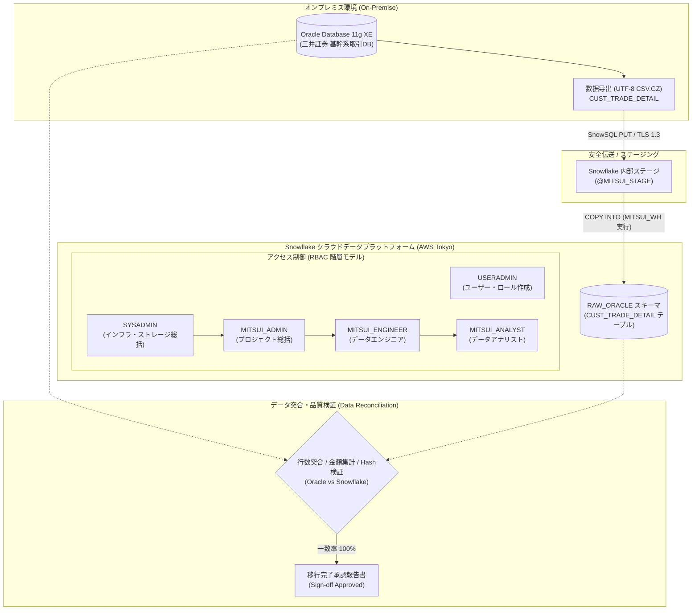

# 三井証券DX：OracleからSnowflakeへのエンタープライズデータ移行実践
# Mitsui Securities DX: Enterprise Data Migration from Oracle to Snowflake

---

## 📖 项目简介 / プロジェクト概要

本项目模拟**三井证券（Mitsui Securities）**核心顾客交易流水（`CUST_TRADE_DETAIL`）从本地传统关系型数据库（Oracle 11g）向云原生数据云（Snowflake）的完整迁移与数仓重构实战。

项目严格遵循**金融企业级安全规范**与 **Snowflake 最佳实践（System Defined Roles & RBAC 最小权限体系）**，采用图文并茂的手把手实操指南，涵盖：
1. **Snowflake 账号注册与日语环境初始化**（带 11 张高清控制台截图）
2. **Oracle 11g 容器化构建与 VSCode 客户端连接**（带 2 张验证截图）
3. **顾客取引明细表（`CUST_TRADE_DETAIL`）真实业务数据建模与 11 组极限边界测试数据集**
4. **Snowflake 渐进式授权与企业级三层业务角色体系（`MITSUI_ADMIN` -> `MITSUI_ENGINEER` -> `MITSUI_ANALYST`，Step 4.1 ~ 4.15）**
5. **Stage 内部受控阶段与高速 COPY INTO 格式转换迁移**
6. **新旧系统数据一致性对账（突合検証）四阶梯模型**
7. **生产环境避坑指南（BYTE 与 CHAR 语义、全角溢出、日期归一化、浮点与小数精度保护）**

---

## 🏗️ 架构拓扑 / システムアーキテクチャ

---

## 🗂️ 教程文档目录 / ドキュメント目次

### 🇨🇳 中文版教程 (Detailed Step-by-Step Tutorials)
- [00. 项目背景与金融级架构设计 (CUST_TRADE_DETAIL 模型详解)](docs/zh/00_architecture_overview.md)
- [01. Snowflake 账号申请与日语界面配置指引 (含11张实操截图)](docs/zh/01_snowflake_signup.md)
- [02. Oracle 11g 容器环境搭建与11组模拟数据准备 (含连接测试截图)](docs/zh/02_oracle_setup_and_data.md)
- [03. Snowflake 企业级 RBAC 权限设计与环境搭建 (Step 4.1~4.15)](docs/zh/03_snowflake_rbac_setup.md)
- [04. 数据迁移实战：Stage、File Format 与 COPY INTO 表达式转换](docs/zh/04_data_migration.md)
- [05. 迁移后两方数据差异对比与质量对账 (Data Reconciliation)](docs/zh/05_data_reconciliation.md)
- [06. 生产环境避坑指南与解决方案 (BYTE vs CHAR、全角溢出、精度截断)](docs/zh/06_troubleshooting_tips.md)

### 🇯🇵 日本語版ドキュメント (Japanese Enterprise Documentation)
- [00. プロジェクト背景とアーキテクチャ設計 (CUST_TRADE_DETAIL 定義)](docs/ja/00_architecture_overview.md)
- [01. Snowflake アカウント開設と日本語UI設定手順 (画像11枚収録)](docs/ja/01_snowflake_signup.md)
- [02. Oracle 11g 移行元環境構築と模擬証券データ投入 (VSCode接続確認済)](docs/ja/02_oracle_setup_and_data.md)
- [03. 金融機関向け3層RBAC権限モデルと環境構築 (Step 4.1〜4.15)](docs/ja/03_snowflake_rbac_setup.md)
- [04. データ移行実務：内部ステージ・フォーマット・COPY INTO](docs/ja/04_data_migration.md)
- [05. 移行後データ突合検証・整合性監査 (4段階監査モデル)](docs/ja/05_data_reconciliation.md)
- [06. トラブルシューティングと本番運用ベストプラクティス](docs/ja/06_troubleshooting_tips.md)

---

## 💻 脚本资源库 / スクリプト一覧

| 脚本文件 | 适用系统 / 角色 | 内容说明 |
| :--- | :--- | :--- |
| [`scripts/oracle/01_create_schema.sql`](scripts/oracle/01_create_schema.sql) | Oracle 11g | `CUST_TRADE_DETAIL` 顾客取引明细表 DDL（CHAR 语义，全角字符安全） |
| [`scripts/oracle/02_seed_trades_data.sql`](scripts/oracle/02_seed_trades_data.sql) | Oracle 11g | 包含 11 组极值、外汇、全角百字边界、跨年交易的真实业务测试数据集 |
| [`scripts/snowflake/01_useradmin_rbac.sql`](scripts/snowflake/01_useradmin_rbac.sql) | `USERADMIN` | Step 4.1~4.4: 创建 ADMIN / ENGINEER / ANALYST 角色树及用户 |
| [`scripts/snowflake/02_sysadmin_objects.sql`](scripts/snowflake/02_sysadmin_objects.sql) | `SYSADMIN` / 业务角色 | Step 4.5~4.15: 仓库创建、DB/Schema/Stage/Table 渐进式授权建立 |
| [`scripts/snowflake/03_copy_into_migration.sql`](scripts/snowflake/03_copy_into_migration.sql) | `MITSUI_ENGINEER` | 批量 COPY INTO 预校验、表达式转换（YYYYMMDD）与入库审计 |
| [`scripts/validation/reconcile_check.sql`](scripts/validation/reconcile_check.sql) | `MITSUI_ANALYST` | 跨系统行数、金额汇总（日元/外币）、全局 Hash 数据指纹比对 |
