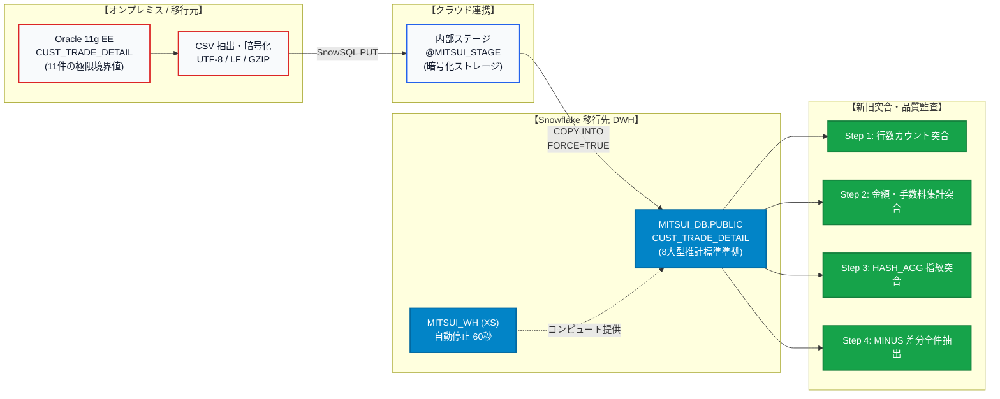

## 🚀 移行工程全体像 (End-to-End Migration Flow)

本プロジェクトでは、証券取引の根幹を成す「顧客取引明細データ（`CUST_TRADE_DETAIL`）」を題材に、本番金融システム水準の厳格な移行工程を網羅しています。

---

## 📊 主要成果指標 (Key Project Metrics)

| 評価指標 | 達成基準 | 実装内容と成果 |
| :--- | :---: | :--- |
| **データ整合性** | **100% 一致** | 4 段階の突合監査（行数・集計値・HASH_AGG データ指紋・全量 MINUS 差分抽出）により差分 0 件を証明。 |
| **セキュリティ・権限分離** | **最小特権達成** | ACCOUNTADMIN/SECURITYADMIN を基盤担当に集約し、SYSADMIN 配下に 3 階層業務ロールを構築。 |
| **データ復元・耐障害性** | **RPO=0 / 秒速復旧** | Time Travel (最大 90 日) と Zero-copy Clone を組み合わせ、ストレージ追加コスト 0 で秒速スナップショット確保。 |
| **文字コード・型互換性** | **溢れ・文字化けゼロ** | Oracle の BYTE 語義から Snowflake の文字数カウント `VARCHAR(100)` への移行標準を策定。 |
| **コスト最適化** | **月額約 $508** | コンピュート自動停止（60秒）、Micro-partition 差分課金、XS ウェアハウス活用による極小化。 |

---

## 🗺️ 実践チュートリアル ナビゲーション

各章の手順に従うことで、ゼロから本番水準の Snowflake 移行環境を構築できます。

1. [**00. プロジェクト背景とアーキテクチャ設計**](/00_architecture_overview)  
   現行課題、オブジェクト体系（19種）、8大データ型推計ルール、パラメータ継承構造、耐障害性。
2. [**01. Snowflake アカウント開設と初期設定**](/01_snowflake_signup)  
   30 日間無料トライアル環境の払い出し、クラウド（AWS/Azure）選定、初期ログイン手順。
3. [**02. Oracle 移行元環境構築と模擬データ投入**](/02_oracle_setup_and_data)  
   Docker による Oracle 11g XE 起動、極限境界値を含む 11 件のテストケース作成、データ抽出。
4. [**03. 3層RBAC権限モデルと環境構築**](/03_snowflake_rbac_setup)  
   MITSUI_ADMIN / ENGINEER / ANALYST の 3 階層ロール設計、Step 4.1〜4.15 の SQL 実行。
5. [**04. データ移行実務（抽出・ステージ・取込）**](/04_data_migration)  
   内部名前付きステージへのアップロード、`COPY INTO` によるバルクインロード、エラー追跡。
6. [**05. 移行後データ突合検証・整合性監査**](/05_data_reconciliation)  
   金融監査に耐えうる 4 段階の突合クエリ実行と、実データによる 100% 整合性証明。
7. [**06. トラブルシューティングとベストプラクティス**](/06_troubleshooting_tips)  
   文字コード桁溢れ、NUMBER 精度、日付文字列化の意義、クエリプロファイル最適化。

