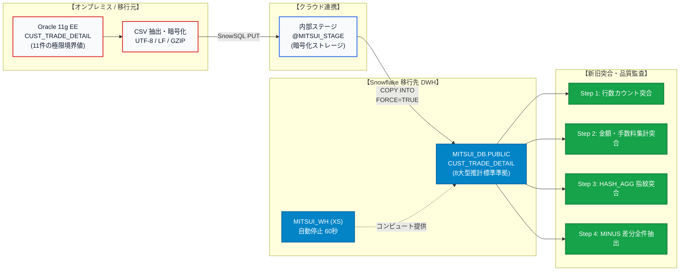

## 🚀 移行工程全体像 (End-to-End Migration Flow)

本プロジェクトでは、証券取引の根幹を成す「顧客取引明細データ（`CUST_TRADE_DETAIL`）」を題材に、本番金融システム水準の厳格な移行工程を網羅しています。

---

## 📊 主要成果指標 (Key Project Metrics)

| 評価指標 | 達成基準 | 実装内容と成果 |
| :--- | :---: | :--- |
| **データ整合性** | **100% 一致** | 4 段階の突合監査（行数・集計値・HASH_AGG データ指紋・全量 MINUS 差分抽出）により差分 0 件を証明。 |
| **セキュリティ・権限分離** | **最小特権達成** | ACCOUNTADMIN/SECURITYADMIN を基盤担当に集約し、SYSADMIN 配下に 3 階層業務ロールを構築。 |
| **データ復元・耐障害性** | **RPO=0 / 秒速復旧** | Time Travel (最大 90 日) と Zero-copy Clone を組み合わせ、ストレージ追加コスト 0 で秒速スナップショット確保。 |
| **文字コード・型互換性** | **溢れ・文字化けゼロ** | Oracle の BYTE 語義から Snowflake の文字数カウント `VARCHAR(100)` への移行標準を策定。 |
| **コスト最適化** | **月額約 $508** | コンピュート自動停止（60秒）、Micro-partition 差分課金、XS ウェアハウス活用による極小化。 |

---

## 🗺️ 実践チュートリアル ナビゲーション

### 【第一部】Snowflake 銀行証券移行実践マニュアル
1. [**00. プロジェクト背景とアーキテクチャ設計**](/00_architecture_overview)  
   現行課題、オブジェクト体系（19種）、8大データ型推計ルール、パラメータ継承構造、耐障害性。
2. [**01. Snowflake アカウント開設と初期設定**](/01_snowflake_signup)  
   30日無料トライアル申請、クラウド基盤選定、初回ログインとコンソール設定。
3. [**02. Oracle 移行元環境構築と模擬データ投入**](/02_oracle_setup_and_data)  
   Docker による Oracle 11g 構築、11組の金融極限境界値データの生成とエクスポート。
4. [**03. 3層RBAC権限モデルと環境構築**](/03_snowflake_rbac_setup)  
   MITSUI_ADMIN / ENGINEER / ANALYST の三権分立、Step 4.1〜4.15 の自動構築スクリプト。
5. [**04. データ移行実務（抽出・ステージ・取込）**](/04_data_migration)  
   SnowSQL によるステージ転送、`COPY INTO` 高速ロードとログ監査。
6. [**05. 移行後データ突合検証・整合性監査**](/05_data_reconciliation)  
   金融監査水準の 4 段階突合 SQL マトリクスと 100% 整合性エビデンス。
7. [**06. トラブルシューティングとベストプラクティス**](/06_troubleshooting_tips)  
   文字コード溢れ、NUMBER 精度、日付文字化け防止とクエリプロファイル分析。
8. [**07. Snowflake Openflow 統合データ連携 (07-1 〜 07-2)**](/07_01_openflow_architecture_and_concepts)  
   - [07-1. Openflow コアアーキテクチャとマルチモーダル統合](/07_01_openflow_architecture_and_concepts)：Apache NiFi エンジン、SPCS コンテナホスティングと統合データ基盤。
   - [07-2. Box クラウド連携と Cortex ナレッジ検索実践](/07_02_openflow_box_integration)：非構造化ファイルのステージ原本保管、チャンク分割と AI ナレッジ検索。
9. [**08. Box API 実践ガイド (8-1 〜 8-8)**](/08_01_box_content_management)  
   Content Management、Auth、Sharing、Metadata、AI、Workflows などの企業 API 網羅。
10. [**09. Snowflake 外部 API アクセス完全ガイド (ENA)**](/09_snowflake_external_api_access)  
    外部ネットワークアクセス (ENA)、シークレット管理、Python UDF による Box API 呼出。
11. [**10. Streamlit in Snowflake (SiS) データ可視化**](/10_snowflake_streamlit_visualization)  
    倉内 Python ネイティブ UI、リアルタイム KPI カードと突合ダッシュボード。
12. [**11. Snowflake コスト計算とガバナンス実践**](/11_snowflake_cost_management)  
    Resource Monitor、クレジット消費構造とコスト安全弁の構築。

---

### 【第二部】dbt 分析エンジニアリング実践 (Analytics Engineering)
モダンデータスタック（MDS）に準拠した Airbnb データウェアハウスモデリング実践：
1. [**01. dbt 入門とモダンデータスタック**](/dbt/01_what_is_dbt)  
   従来型 ETL vs 現代 ELT、dbt の核心思想、なぜ Code as Configuration なのか。
2. [**02. 開発基盤構築と Key-Pair 認証**](/dbt/02_environment_setup_and_snowflake)  
   Snowflake Airbnb DB 初期化、44.1 万件データ投入、RSA 2048 鍵認証、`uv` 高速環境構築。
3. [**03. モデル基礎と Staging 層実装**](/dbt/03_models_and_staging_layer)  
   「Everything is a SELECT」、CTE 規約、Airbnb 3 大ソースの Staging ビュー構築、`dbt run` 倉内実行検証。
4. [**04. マテリアライゼーション戦略と依存関係**](/dbt/04_materializations)  
   4 つのマテリアライゼーション（view/table/incremental/ephemeral）選定、`ref()` マクロ DAG 依存関係解決、ディメンションと増分ファクト実装、秒速差分更新。

