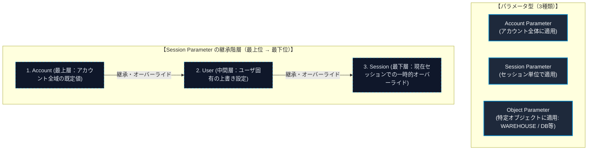
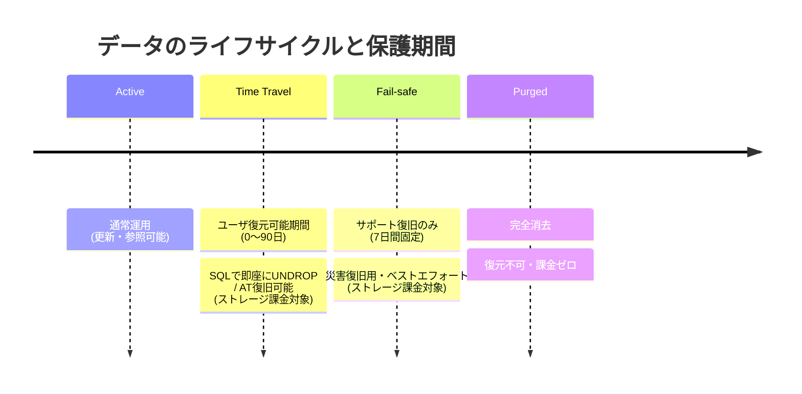

# 第00章：プロジェクト背景とアーキテクチャ設計

## 1. ビジネス背景 (Business Drivers)

銀行証券におけるコア取引システムのモダナイゼーションに伴い、オンプレミスの Oracle 11g データベースからクラウドデータプラットフォームである Snowflake への移行を推進しています。

- **オンプレミスのリソース限界**：取引件数の増加に伴うバッチ処理性能の低下と夜間運用の逼迫を解消。
- **権限分離とガバナンス**：プロジェクト管理者（MITSUI_ADMIN）、データエンジニア（MITSUI_ENGINEER）、データアナリスト（MITSUI_ANALYST）の厳格な職務分掌。
- **データ主権とセキュリティ**：AWS 東京リージョンでの保管、最小特権の原則（RBAC）の実装。

---

## 2. 製品（サービス）概要

Snowflake は、クラウドネイティブのデータウェアハウス（DWH）であり、柔軟なスケーラビリティ、高速なクエリ処理、運用の簡素化を実現するデータプラットフォームである。特筆すべき特徴は以下の通り。

### (1) ストレージとコンピュートの分離
データの保存（ストレージ）と処理（コンピュート）のリソースが完全分離している為、必要なリソースのみを柔軟に増減可能であり、結果としてコスト最適化が可能である。

### (2) 自動パーティショニング（マイクロパーティション）
データは内部的に細かく分割管理される為、運用負荷の軽減と共にクエリの高速化やストレージの最適化が実現されている。

### (3) タイムトラベル
過去のデータを指定した時点に遡って取得できる為、誤操作時のデータ復旧や変更管理の追跡が容易に行える。また、クローンと組み合わせる事で、過去のデータを即座に複製し、検証や分析に活用できる。

---

## 3. 課金体系とコスト計算例

Snowflake はサブスクリプション形式の料金体系であり、大きく**三つの項目（コンピュート、ストレージ、データ転送）**で使用した分だけ課金される従量課金体系を採用している。

### (1) 課金対象の 3 大要素

1. **コンピューティングリソース（計算処理）**：  
   Snowflake 内にあるコンピューティングリソース（WAREHOUSE）を使用する場合、クレジットが消費される。クレジットとは Snowflake 内における利用単価を示す単位である。
   - **クレジット消費例**：WAREHOUSE のサイズが **XS で 1 時間使用した場合、消費されるクレジットは 1 クレジット**となる。
   - **コストインパクト**：Snowflake 利用時に最もコストがかかるのがこのコンピュートリソースである（通常全体の 70%〜80%）。
   - **単価確認方法**：クラウドプロバイダー（AWS）、リージョン（Tokyo: `ap-northeast-1`）、および Edition（Enterprise）が交差する公式マトリクスで単価が決定される（例：$5.7/クレジット）。

2. **ストレージリソース（データ保管）**：  
   データベースにロードされた圧縮後の実データ量（テラバイト単位）に対して月額課金される（例：$25/TB/月）。

3. **データ転送リソース（ネットワーク下り転送）**：  
   Snowflake 外部や異なるクラウド・リージョン（DR 隔地保管環境等）へデータを送信・レプリケーションする場合にデータ転送量に応じて課金される（例：$90/TB）。

---

### (2) 💡 Snowflake コスト計算例（月額試算シミュレーション）

銀行証券の初期 PoC / 本番バッチ移行を想定した具体的な月次コスト試算の例を以下に示す。

#### ＜前提条件＞
- **コンピュート**：WAREHOUSE サイズ **XS** を毎営業日 **2 時間** 稼働（月 20 営業日）。
- **ストレージ**：基幹取引データの累積保管量として **4 TB** を常時保持。
- **データ転送**：ディザスタリカバリ（DR）目的で、**月に 1 回 2 TB** を大阪リージョン（隔地保管環境）へデータ転送。

#### ＜リソース別計算内訳＞

| コスト項目 | 算定式 / 計算プロセス | 算出コスト (USD) |
| :--- | :--- | :--- |
| **コンピュートリソース** | WAREHOUSE の消費クレジット × 使用時間 × 営業日<br>＝ 1 × 2 × 20 ＝ **40 クレジット**<br>∴ 40 クレジット × **$5.7**（クレジット単価） | **$228** |
| **ストレージリソース** | テラバイト単価 × 使用量<br>＝ $25 × 4 TB | **$100** |
| **データ転送リソース** | テラバイト単価 × 転送量<br>＝ $90 × 2 TB | **$180** |
| **一月当たりの総消費コスト** | **$228 ＋ $100 ＋ $180** | **$508 / 月** |

> [!TIP]
> **コスト最適化の要諦**：  
> コンピュートリソースの自動サスペンド（`AUTO_SUSPEND = 300`）を活用することで、クエリ処理完了から 5 分後に自動停止させ、無駄なアイドルコストの発生を完全に抑止できる。

---

## 4. システム移行構成図

```text
[オンプレミス環境 (Tokyo On-Prem)]         [Snowflake クラウドデータプラットフォーム (AWS Tokyo)]
 ┌─────────────────────────┐               ┌─────────────────────────────────────────┐
 │   Oracle Database 11g   │               │            MITSUI_SEC_DB                │
 │ ┌─────────────────────┐ │               │  ┌───────────────────────────────────┐  │
 │ │  CUST_TRADE_DETAIL  │ │               │  │ SCHEMA: RAW_ORACLE                │  │
 │ │  (顧客取引明細)     │ │               │  │   ┌─────────────────────────────┐ │  │
 │ └──────────┬──────────┘ │               │  │   │  CUST_TRADE_DETAIL (移行先) │ │  │
 └────────────┼────────────┘               │  │   └──────────────▲──────────────┘ │  │
              │                            │  │                  │ (COPY INTO)    │  │
              ▼ [Gzip CSV / TLS 1.3]       │  │   ┌──────────────┴──────────────┐ │  │
       ┌──────────────┐                    │  │   │ @MITSUI_STAGE               │ │  │
       │ SnowSQL PUT  ├───────────────────┼──┼──►│ (セキュア内部ステージ)      │ │  │
       └──────────────┘                    │  │   └─────────────────────────────┘ │  │
                                           │  └───────────────────────────────────┘  │
                                           │                                         │
                                           │  ┌───────────────────────────────────┐  │
                                           │  │ Virtual Warehouse:                │  │
                                           │  │ MITSUI_WH (X-Small 自動停止)      │  │
                                           │  └───────────────────────────────────┘  │
                                           └─────────────────────────────────────────┘
```

---

## 5. テーブル型マッピング定義 (CUST_TRADE_DETAIL)

| カラム物理名 | 論理項目名 | Oracle データ型 | Snowflake データ型 | 変換仕様および設計ルール |
| :--- | :--- | :--- | :--- | :--- |
| `TRADE_QTY` | 取引数量 | `NUMBER(15)` | `NUMBER(15, 0)` | 小数なし、初期値 0、NOT NULL |
| `AMOUNT_JPY` | 約定金額・円貨 | `NUMBER(18, 3)` | `NUMBER(18, 3)` | 金額統一ルール（小数3桁）、初期値 0 |
| `AMOUNT_FCY` | 約定金額・外貨 | `NUMBER(18, 3)` | `NUMBER(18, 3)` | 通貨コードとセットで保持 |
| `CCY_CODE` | 通貨区分 | `VARCHAR2(3)` | `VARCHAR(3)` | USD, EUR 等 |
| `EXCHANGE_RATE`| 為替レート | `NUMBER(9, 6)` | `NUMBER(9, 6)` | 高精度レート小数 |
| `REMARKS` | 摘要・備考 | `VARCHAR2(100 CHAR)`| `VARCHAR(100)` | CHAR語義指定により全角文字溢れを防止 |
| `CUST_ID` | 顧客ID | `VARCHAR2(10 CHAR)` | `VARCHAR(10)` | 顧客管理システム定義 10桁 |
| `TRADE_TYPE_CD`| 取引区分 | `VARCHAR2(2 CHAR)` | `VARCHAR(2)` | "01"=買付, "02"=売付 |
| `BRANCH_CD` | 支店コード | `VARCHAR2(4 CHAR)` | `VARCHAR(4)` | 支店4桁コード |
| `TRADE_DATE` | 約定日 | `DATE` | `VARCHAR(8)` | YYYYMMDD 形式文字列へ変換 |
| `SETTLE_MONTH` | 決済対象月 | `DATE` | `VARCHAR(6)` | YYYYMM 形式文字列へ変換 |
| `REG_DATETIME` | 登録日時 | `DATE` (秒まで) | `TIMESTAMP_NTZ(6)` | 壁時計時刻、マイクロ秒対応 |
| `UPD_DATETIME` | 更新日時 | `DATE` | `TIMESTAMP_NTZ(6)` | 更新日時 |
| `MIGRATED_AT` | 取込日時 | - | `TIMESTAMP_LTZ(6)` | 移行監査用タイムスタンプ |

---

## 6. Oracle → Snowflake 型推計方針（8 大設計ルール）

基幹系 Oracle から Snowflake への移行にあたり、データ整合性と運用堅牢性を担保するため、以下の **8 つの型推計設計方針** を定めている。

### ① 数値情報（一般数値）
- **変更前 Oracle**：`NUMBER(15)`（模擬データ：`123456789012345`）  
  *背景・課題*：Oracle で小数位を指定しない `NUMBER` は、整数・浮動小数の双方が格納可能であり、精度が不定となり曖昧さを生じやすい。
- **変更後 Snowflake**：`NUMBER(15, 0)`（模擬データ：`123456789012345`）  
  *設計方針*：15 桁の整数・0 位小数と明確に固定し、初期値を統一で `0` とすることで型の曖昧性を排除。

### ② 金額（本幣・邦貨）
- **変更前 Oracle**：`NUMBER(18, 3)` または `NUMBER`（不定精度）（模擬データ：`1234567890123.456`）  
  *背景・課題*：接続元サブシステムごとに金額精度（2 位小数、3 位小数など）が不揃いであった。
- **変更後 Snowflake**：`NUMBER(18, 3)`（模擬データ：`1234567890123.456`）  
  *設計方針*：本幣金額は取得元精度に関わらず **`Number(18, 3)` へ統一・強制アラインメント** を実施し、システム間の精度不整合を根絶。

### ③ 金額（外貨）
- **変更前 Oracle**：`NUMBER(18, 3)` ＋ 単独の通貨コード列（`CURRENCY_CD` / `CCY` 等、命名不統一）（模擬データ：`9876.500` / `USD`）  
  *背景・課題*：通貨識別項目の位置や命名規則が統一されていなかった。
- **変更後 Snowflake**：`NUMBER(18, 3)` ＋ 「通貨区分」カラムのペア定義（模擬データ：`9876.500` / `USD`）  
  *設計方針*：外貨金額項目は必ず通貨区分とセットで対として保持することをルール化。

### ④ 為替レート／比率
- **変更前 Oracle**：`NUMBER(9, 6)` または精度不定（模擬データ：`1.234567`）  
  *背景・課題*：レート系項目の小数桁がテーブルごとに任意に設定されていた。
- **変更後 Snowflake**：`NUMBER(9, 6)`（模擬データ：`1.234567`）  
  *設計方針*：9 桁・小数 6 桁に統一し、多通貨換算時の丸め誤差を防止。

### ⑤ 文字情報（一般文字）
- **変更前 Oracle**：`VARCHAR2(100 BYTE)` または `VARCHAR2(100 CHAR)`（模擬データ：`"サンプルテキスト"`）  
  *背景・課題*：BYTE / CHAR 語義の混用により、日本語マルチバイト（全角 3 バイト）混在時の実格納可能文字数が不安定化。
- **変更後 Snowflake**：`VARCHAR(100)`（模擬データ：`"サンプルテキスト"`）  
  *設計方針*：Snowflake の `VARCHAR` は**文字数カウント**であるため、100 文字として定義し、初期値を半角スペース 1 桁とし、文字コード桁溢れ問題を解消。

### ⑥ 文字情報（参照元項目桁が確定している項目／ID・区分類）
- **変更前 Oracle**：`VARCHAR2(n)` 定長または変長、各システム定義（模擬データ：`"A001"`）
- **変更後 Snowflake**：`VARCHAR(n)`（模擬データ：`"A001"`）  
  *設計方針*：桁数は参照元システムの定義に合わせる（例：顧客 ID = 10 桁）。初期設定の 100 桁標準を適用しない例外ルールとして扱う。

### ⑦ 日付情報 ★重要な設計判断
- **変更前 Oracle**：`DATE` 型（模擬データ：`2025-03-25`）または `"20250325"` 文字型  
  *背景・課題*：ネイティブ DATE は時分秒を含み、また「決済対象月（YYYYMM）」のような非完全日付を統一的に扱えない。
- **変更後 Snowflake**：**`VARCHAR(8)` / `VARCHAR(6)`（文字列型保存）**（模擬データ：日次 `"20250325"` / 月次 `"202503"`）  
  *設計判断の理由*：
  1. 日付粒度の相違（日次は年月日、決済月は年月）を統一文字列として受容。
  2. Snowflake と Oracle 間の日付フォーマット・時区差（JST/UTC）による突合不整合リスクを完全排除。
  3. 業務表示形式と合致させ、人手監査および下流システムでのダイレクト消費を容易化。

### ⑧ 時刻情報（登録／更新日時）
- **変更前 Oracle**：`DATE` 型（秒まで保持）（模擬データ：`2025-03-25 14:30:00.123456`）
- **変更後 Snowflake**：**`TIMESTAMP_NTZ(6)`**（模擬データ：`2025-03-25 14:30:00.123456`）  
  *設計方針*：タイムゾーンを持たない壁時計時刻 `TIMESTAMP_NTZ` を採用し、マイクロ秒（FF6）精度を確保。  
  > **核心的設計思想**：  
  > **業務日付（⑦）は文字列 `VARCHAR`** で管理し、**システム監査タイムスタンプ（⑧）はネイティブ `TIMESTAMP_NTZ`** で管理するという、明確な役割分離を実現している。

---

## 7. Snowflake オブジェクト一覧

Snowflake のオブジェクトとは、データの管理や操作をする為の基本的な構成要素のこと。Snowflake は多くのオブジェクトから構成されており、ポリシーのような設定についてもオブジェクトとして存在している。

本書に記載されているオブジェクトと各オブジェクトの概要は以下の通り。  
> [!NOTE]  
> 本項に未記載のオブジェクトに関しては各業務システムに許可されている権限の範囲内において各自で利用可否を検討/判断すること。

| No | オブジェクト種類 | オブジェクト名 | 概要 |
| :-: | :--- | :--- | :--- |
| **1** | **組織** | `ORGANIZATION` | Snowflake アカウントの管理と請求、アカウント間の連携機能（複製、フェイルオーバー）を行う最上位オブジェクト。 |
| **2** | **アカウント** | `ACCOUNT` | データベース、ユーザ、ロール、ウェアハウスなど全てのオブジェクトを管理するオブジェクト。 |
| **3** | **ネットワークポリシー** | `NETWORK RULE` | ネットワーク識別子（IP アドレスや VPC エンドポイント等）を論理単位でグループ化するオブジェクト。 |
| **4** | **（同上：ポリシー）** | `NETWORK POLICY` | NETWORK RULE を使用して、Snowflake のネットワークトラフィックを制御・遮断するセキュリティオブジェクト。 |
| **5** | **認証ポリシー** | `AUTHENTICATION POLICY` | ユーザの認証方式（MFA、SSO、キーペア認証）や許可クライアントを定義し、セキュリティを強化するオブジェクト。 |
| **6** | **（同上：パスワード）** | `PASSWORD POLICY` | ユーザのパスワードの複雑さや有効期限、再利用制限等の要件を定義し、セキュリティを強化するオブジェクト。 |
| **7** | **ロール** | `ROLE` | Snowflake 内で操作を行うための権限（特権）を束ねて管理するオブジェクト。 |
| **8** | **ユーザ** | `USER` | Snowflake へ接続するための ID と認証情報（パスワード・公開鍵等）を持つオブジェクト。 |
| **9** | **仮想ウェアハウス** | `WAREHOUSE` | クエリを実行するために使用するコンピュートリソース（CPU/メモリ）を定義するオブジェクト。 |
| **10** | **データベース** | `DATABASE` | スキーマの論理的なグループを定義するオブジェクト。 |
| **11** | **スキーマ** | `SCHEMA` | テーブルやビューなどの論理的なグループを定義するオブジェクト。 |
| **12** | **テーブル** | `TABLE` | Snowflake 内でデータを行や列の形式で格納・管理する基本的なデータ格納オブジェクト。 |
| **13** | **ビュー** | `VIEW` | テーブルのデータを特定のクエリ結果として仮想的に定義し、動的に参照する為の仮想データ表示オブジェクト。 |
| **14** | **フェイルオーバー** | `FAILOVER GROUP` | 一部のオブジェクトを別のアカウント（別リージョン）に複製し、可用性や災害復旧（DR）を強化するデータ同期オブジェクト。 |
| **15** | **シェアリング** | `SHARE` | 別アカウントにデータをセキュアに連携する際に使用されるオブジェクト。現在は非提供だが、将来的な提供開始に向け整理を実施中。 |
| **16** | **ステージ** | `STAGE` | Snowflake が外部または内部のストレージに保存されたデータを管理・参照する為の中間領域を定義するオブジェクト。 |
| **17** | **タスク** | `TASK` | 指定したスケジュール（Cron）や条件に基づいて SQL やストアドプロシージャを自動実行するジョブ管理オブジェクト。 |
| **18** | **ストアドプロシージャ** | `PROCEDURE` | 複数の SQL 処理を一連のロジック（JavaScript/Python/SQL）として定義し、実行できるストアドプロシージャオブジェクト。 |
| **19** | **ユーザ定義関数** | `FUNCTION` | 特定の処理を実行し、結果を返すためのユーザ定義関数（UDF / UDTF）オブジェクト。 |

---

## 8. Snowflake パラメータ一覧

Snowflake はアカウントやオブジェクト等の動作をコントロールする為のパラメータが存在する。パラメータは、それぞれ**３つの型（種類）**と**複数の階層（設定の継承構造）**で構成されている。



### 【パラメータ型】
* **Account Parameter**：アカウント全体に適用される設定（例：`AUTO_SUSPEND` 既定値、`NETWORK_POLICY` アカウント紐付けなど）。
* **Session Parameter**：セッション単位で適用される設定（例：タイムゾーン `TIMEZONE`、日付フォーマット `DATE_OUTPUT_FORMAT`、クエリタイムアウトなど）。
* **Object Parameter**：特定オブジェクトに適用される設定（例：仮想ウェアハウス、データベース、テーブル、スキーマごとの `DATA_RETENTION_TIME_IN_DAYS` や `STATEMENT_TIMEOUT_IN_SECONDS` など）。

### 【階層構造と設定の継承ルール】
例として **Session Parameter** について記載する。Session Parameter は以下の **3 階層** で構成される。  
**Account が最上層** であり、下位層に設定がない場合は上位の設定値が自動継承される。**Session が最下層** であり、明示的に指定した場合は最下層の設定が最優先で適用される。

1. **Account**（最上層）：アカウント全体の一括デフォルト値
2. **User**（中間層）：特定ユーザに対して設定した個別値
3. **Session**（最下層）：接続確立時（ALTER SESSION 等）に動的に設定した一時的適用値

---

## 9. Snowflake のセキュリティ

Snowflake のセキュリティは、**ユーザ（Snowflake 利用者）が設計する範囲**と、**Snowflake 側で自動的かつ強制的に担保される範囲**で構成されている。  
ユーザが設計するセキュリティ（ロール階層、オブジェクトアクセス権、ネットワークポリシー等の推奨設計）については、後続の設計章にて記載する。

Snowflake 側で自動的に担保される基盤セキュリティ範囲は以下の通りである。

| 領域 | Snowflake 自動担保機能 | 実装・セキュリティ基準 |
| :--- | :--- | :--- |
| **(1) 認証・アクセス制御** | RBAC ＆ 強制 MFA | 権限分離モデルとして RBAC（ロールベースアクセス制御）を採用。人間が操作するコンソールユーザに対しては MFA（多要素認証）を強制適用。 |
| **(2) データの暗号化** | AES-256 ＆ 自動キーローテーション | 格納される全データは **AES-256** で強力に暗号化。暗号鍵はキー階層モデル（階層化キー構造）で作成・管理され、**30 日以上経過すると自動的にローテーション**される。 |
| **(3) 通信の暗号化** | TLS ＆ E2EE (エンドツーエンド) | 全ての通信経路は強制的に **TLS 1.2 以上**を使用して暗号化。クライアントからストレージ層に至るまでエンドツーエンド暗号化（E2EE）でデータを保護。 |
| **(4) セキュリティ認証** | 国際規格・第三者認証取得 | **SOC 2 Type II**、**ISO 27001**、**PCI-DSS**、**HIPAA** などの厳格な国際的第三者セキュリティ認証を取得・維持。金融機関の厳格なコンプライアンス要件に準拠。 |

---

## 10. Snowflake の耐障害性 (Fault Tolerance & High Availability)

Snowflake では金融・基幹システムに求められる高い耐障害性を実現する為、**「Time Travel」**、**「Fail-safe」**、**「Clone」**という 3 つのコア機能が提供されている。



### (1) Time Travel（タイムトラベル）
* **概要**：ユーザが定める期間分の過去データを保持し、データ削除時や誤操作時にデータを復旧することができる機能。
* **保持期間**：デフォルトの保持期間は **1 日（24 時間）**。パラメータ（`DATA_RETENTION_TIME_IN_DAYS`）を用いて**任意の日数（0～90 日）**へ変更可能（※Enterprise Edition 以上で最大 90 日対応、Standard は最大 1 日）。
* **コストと留意点**：データは追記型（マイクロパーティション）で保存されていく為、**保持期間に比例してストレージコストが加算**される。

### (2) Fail-safe（フェイルセーフ）
* **概要**：Time Travel の保持期間が終了した後でも、**一定期間（7 日間固定）**データを復旧できる Snowflake 基盤側の防衛仕組み。
* **運用の重要ポイント**：
  > [!WARNING]
  > Fail-safe は**ユーザ向けにセルフサービス提供された機能ではなく**、Snowflake の内部システムによる耐障害性の確保という側面が極めて強い。  
  > データ復旧には **Snowflake サポートへの連絡・作業依頼** が必須となる。本機能は**ベストエフォート方式**で提供されるサービスであり、復旧には数日を要する場合もあるため、**耐障害性設計は Time Travel 機能をメインに設計することが強く推奨される**。

### (3) Clone（ゼロコピークローン）
* **概要**：テーブル、スキーマ、データベース等のオブジェクトを瞬時に複製し、障害発生時の復旧や履歴管理に活用できる機能。
* **Time Travel との連携**：Time Travel と併用することで、「障害発生直前の特定時刻の断面（`AT / BEFORE`）」から別名テーブルとしてクローン作成することが可能。
* **コスト構造と最適化**：
  * クローンされたオブジェクトは物理的にデータをコピーするのではなく、**過去データの断面（既存マイクロパーティションのメタデータ）を参照**するため、クローン作成時点では**追加ストレージコストが一切発生しない**。
  * クローン先でデータを追加・更新した場合は、新規のマイクロパーティションが別途作成されるため、**差分更新分のみ追加コストが発生**する。
  * 一時点の断面確保や月次締めバックアップ等にクローンを有効活用することで、ストレージ使用量を大幅に削減し、コストを最小限に抑えることができる。

