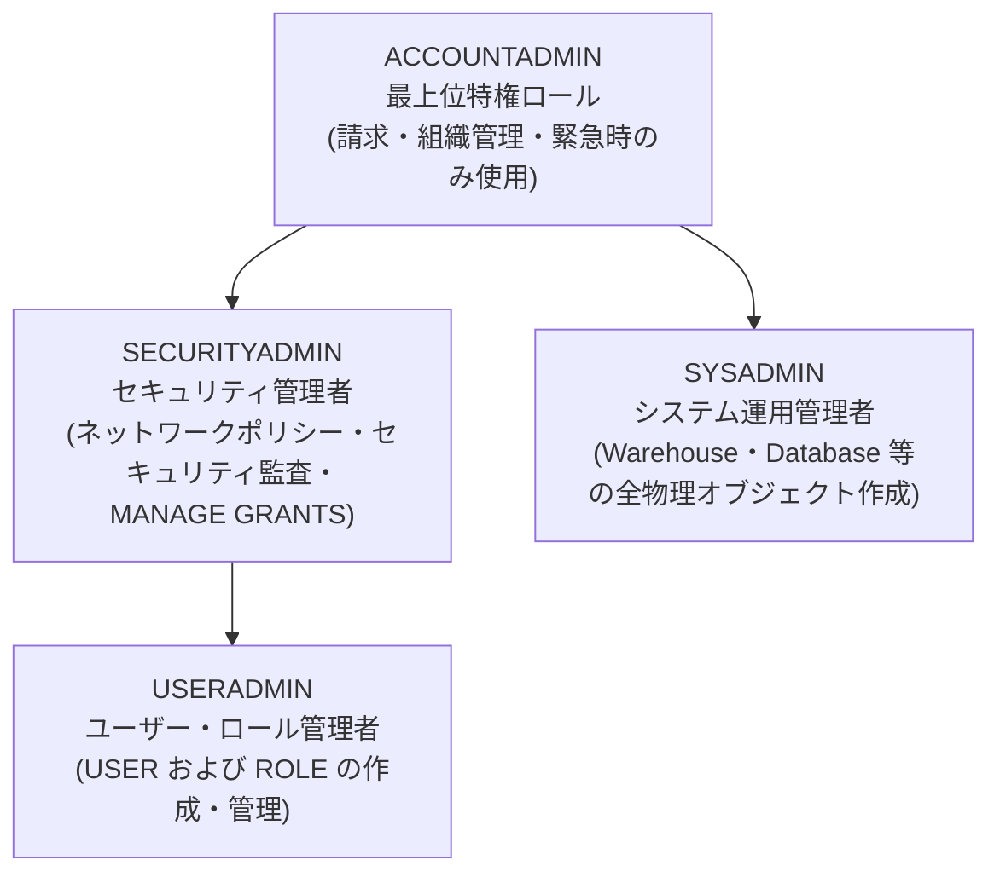

# 第 01 章：Snowflake アカウント開設と初期設定

金融機関（銀行・証券）におけるクラウドデータ基盤移行のファーストステップとして、Snowflake が提供する 30 日間無料のエンタープライズ評価環境（400 ドル相当のコンピュートクレジット付き）を開設し、初期セットアップを行います。

---

## 1. アカウント登録手順と推奨パラメータ

公式登録ポータル：[https://signup.snowflake.com/](https://signup.snowflake.com/)

| 設定項目 | 推奨パラメータ | 業務・コンプライアンス上の選定理由 |
| :--- | :--- | :--- |
| **Snowflake Edition** | **Enterprise（エンタープライズ版）** | **90 日間の Time Travel**、**動的データマスキング（Dynamic Data Masking）**、マルチクラスターウェアハウスに対応。金融庁（FSA）の監査要件を満たす最低基準のエディションです。 |
| **Cloud Provider** | **AWS (Amazon Web Services)** | 日本国内の証券・メガバンクで最も採用実績が多く、周辺のエコシステム連携が充実しています。 |
| **Region (リージョン)** | **Asia Pacific (Tokyo) - `ap-northeast-1`** | **データレジデンシー（主権）要件**：金融庁基準により顧客取引データの国内保管が義務付けられており、レイテンシも最小化されます。 |

---

## 2. 登録ステップと画面遷移

### ステップ 1：基本情報の入力
氏名、会社メールアドレス、役職を入力します：


### ステップ 2：エディションおよびクラウド・リージョンの選択
**Enterprise** エディションを選択し、**AWS - Asia Pacific (Tokyo)** を指定します：


### ステップ 3：アクティベーションメールの確認
登録後、*"Activate your Snowflake account"* という件名の確認メールを受信し、本文内の認証リンクをクリックします：


### ステップ 4：管理者パスワードの設定と初回サインイン
ユーザー名および複雑性要件を満たす安全なパスワードを設定します（初期状態では `ACCOUNTADMIN` 権限を保持）：


---

## 3. Web コンソールの日本語化設定

日本国内の現場エンジニア・アナリストの運用負荷を軽減するため、Snowsight の言語設定を日本語へ変更します：

1. 左下または右上のユーザープロファイルアイコンをクリックし、**Preferences（環境設定）** を開きます；
2. **Language & Region** セクションで言語を **日本語 (Japanese)** に切り替えます：


---

## 4. システム標準ロール階層の全体像



> [!CAUTION]
> **金融機関におけるセキュリティ鉄則（軍規）**：  
> 日常的なシステム運用やデータ移行作業において、全権限を持つ **`ACCOUNTADMIN` を使用することは厳禁** です。  
> 必ず**職務分掌（Separation of Duties）**の原則を徹底し、ユーザーおよびロール管理は `USERADMIN` を、コンピュート・ストレージリソース管理は `SYSADMIN` を起点として委譲・運用してください。

---

## 5. 🧭 Snowsight コンソール画面構成とワークスペース初探

アカウント登録および日本語化が完了したら、Snowflake のモダン Web コンソールである **Snowsight** の基本レイアウトと SQL 実行環境を確認します。

### 5.1 ワークスペースへの移動と画面ナビゲーション
Snowsight では、日々のクエリ実行・開発・データ探索はすべて「ワークスペース」で行われます：

1. 左側のメインナビゲーションメニューから **「プロジェクト（Projects）」** をクリックし、**「ワークスペース（Workspaces）」** を選択します：


2. 初回アクセス時には、最新のワークスペースツアー画面（SQL ファイル、Python Notebook、dbt 等の開発スイートに対応）が表示されます：


### 5.2 SQL ワークシート（Worksheet）の新規作成
ワークスペース内で最初の SQL エディタを開きます：
1. 左上の **「＋ 新規追加」** ボタンをクリックします；
2. **「SQLファイル（SQL File）」** を選択して新しいワークシートを開きます：


### 5.3 開箱即用（Out-of-the-Box）の初期疎通クエリ実行
新規開設された評価アカウントには標準のコンピュート環境が事前配置されています。エディタに以下のクエリを入力し、右上の **「▶ 実行」** ボタン（またはショートカット `Ctrl + Enter` / `Cmd + Enter`）を押下して実行します：

```sql
-- 現在のセッションコンテキストおよび Snowflake エンジンバージョンの確認（外部依存なし）
SELECT 
    CURRENT_USER()             AS "カレントユーザー",
    CURRENT_ROLE()             AS "有効ロール",
    CURRENT_AVAILABLE_ROLES()   AS "利用可能ロール一覧",
    CURRENT_WAREHOUSE()        AS "カレントウェアハウス",
    CURRENT_VERSION()          AS "Snowflakeエンジンバージョン";
```

実行後、画面下部にセッションコンテキスト情報、処理時間（例：22ms）、および監査用の一意な Query ID がリアルタイムに表示されます：


### 5.4 SQL ワークシート主要コンポーネントの確認
* **コンテキストセレクター（Context Selector）**：エディタ右上に配置され、実行ロール（Role）、計算ウェアハウス（Warehouse）、接続先データベース/スキーマを即座に切り替えることができます；
* **実行コントロール（Run Controls）**：1行実行、選択範囲実行、またはシート内全件一括実行に対応しています；
* **結果・クエリ履歴パネル（Results & Query History）**：実行結果の表形式プレビュー、影響行数、処理ミリ秒、および一意の Query ID をリアルタイムに確認できます。

基本操作の確認が完了しました。次章以降では、移行元となるオンプレミス Oracle 環境の準備、および三井証券向け企業級 RBAC 権限モデルと本番オブジェクトの構築へと進みます。
