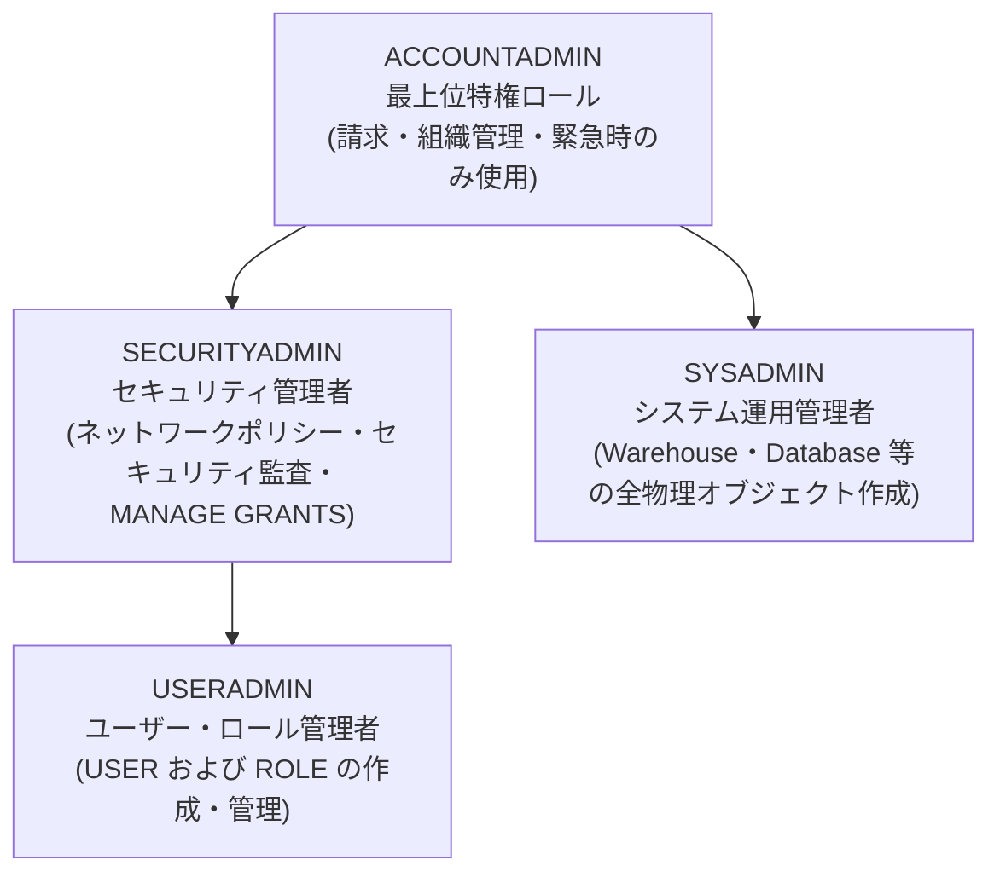
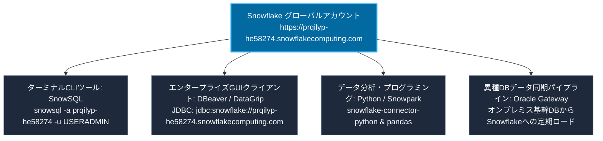

# 第 01 章：Snowflake アカウント開設と初期設定

金融機関（銀行・証券）におけるクラウドデータ基盤移行のファーストステップとして、Snowflake が提供する 30 日間無料のエンタープライズ評価環境（400 ドル相当のコンピュートクレジット付き）を開設し、初期セットアップを行います。

---

## 1. アカウント登録手順と推奨パラメータ

公式登録ポータル：[https://signup.snowflake.com/](https://signup.snowflake.com/)

| 設定項目 | 推奨パラメータ | 業務・コンプライアンス上の選定理由 |
| :--- | :--- | :--- |
| **Snowflake Edition** | **Enterprise（エンタープライズ版）** | **90 日間の Time Travel**、**動的データマスキング（Dynamic Data Masking）**、マルチクラスターウェアハウスに対応。金融庁（FSA）の監査要件を満たす最低基準のエディションです。 |
| **Cloud Provider** | **AWS (Amazon Web Services)** | 日本国内の証券・メガバンクで最も採用実績が多く、周辺のエコシステム連携が充実しています。 |
| **Region (リージョン)** | **Asia Pacific (Tokyo) - `ap-northeast-1`** | **データレジデンシー（主権）要件**：金融庁基準により顧客取引データの国内保管が義務付けられており、レイテンシも最小化されます。 |

---

## 2. 登録ステップと画面遷移

### ステップ 1：基本情報の入力
氏名、会社メールアドレス、役職を入力します：


### ステップ 2：エディションおよびクラウド・リージョンの選択
**Enterprise** エディションを選択し、**AWS - Asia Pacific (Tokyo)** を指定します：


### ステップ 3：アクティベーションメールの確認
登録後、*"Activate your Snowflake account"* という件名の確認メールを受信し、本文内の認証リンクをクリックします：


### ステップ 4：管理者パスワードの設定と初回サインイン
ユーザー名および複雑性要件を満たす安全なパスワードを設定します（初期状態では `ACCOUNTADMIN` 権限を保持）：


---

## 3. Web コンソールの日本語化設定

日本国内の現場エンジニア・アナリストの運用負荷を軽減するため、Snowsight の言語設定を日本語へ変更します：

1. 左下または右上のユーザープロファイルアイコンをクリックし、**Preferences（環境設定）** を開きます；
2. **Language & Region** セクションで言語を **日本語 (Japanese)** に切り替えます：


---

## 4. システム標準ロール階層の全体像



> [!CAUTION]
> **金融機関におけるセキュリティ鉄則（軍規）**：  
> 日常的なシステム運用やデータ移行作業において、全権限を持つ **`ACCOUNTADMIN` を使用することは厳禁** です。  
> 必ず**職務分掌（Separation of Duties）**の原則を徹底し、ユーザーおよびロール管理は `USERADMIN` を、コンピュート・ストレージリソース管理は `SYSADMIN` を起点として委譲・運用してください。

---

## 5. 🧭 Snowsight コンソール全景徹底解説とコア知識体系 (Enterprise Guide)

アカウント開設と日本語化が完了したら、クラウドデータ基盤の公式教材として、Snowflake のモダン Web コンソールである **Snowsight** の各機能領域、操作ボタン、および背後にあるアーキテクチャ原理を網羅的に習得します。

### 5.1 Snowsight アーキテクチャ設計理念と UI マッピング

Snowflake の技術的優位性は、特許取得済みの**3層分離アーキテクチャ（Three-Tier Architecture）**にあります：
1. **クラウドサービス層（Cloud Services Layer）**：グローバルメタデータ管理、SQL パーサー/オプティマイザ、トランザクション制御、認証認可を一括統括；
2. **マルチクラスター仮想コンピュート層（Virtual Warehouses）**：ステートレスな計算リソースプール。必要時に即時起動し、秒単位で自動スケール、クエリ同士の干渉が皆無；
3. **集中型ハイブリッド列指向ストレージ層（Centralized Storage）**：クラウドオブジェクトストレージ（AWS S3 等）上の不変（Immutable）マイクロパーティション群。超高耐久性とデータ保全性を両立。

この設計原理は、Snowsight の UI 設計へダイレクトに反映されています：
- **なぜ画面上部に独立した Warehouse 切替があるのか？** 計算リソースがデータと完全に分離しており、クエリの処理コストとサイズを Warehouse 単位で厳密に管理するため；
- **なぜ画面上部に独立した Role 切替があるのか？** すべてのデータベースオブジェクトへのアクセス判定が RBAC（ロールベースアクセス制御）ツリーに基づいて動的に評価されるため；
- **なぜシステム情報取得クエリが 1ms 〜 20ms で完了するのか？** 物理ストレージの走査を行わず、クラウドサービス層のメタデータキャッシュから瞬時に応答するため。

---

### 5.2 左側メインナビゲーション機能マトリクスと知識体系対照

Snowsight 左側のメインサイドバーは、データエンジニア・アーキテクト・セキュリティ管理者の日常業務を包括的にカバーしています：

| ナビゲーション項目 | 画面上の日本語表記 | 主要機能と利用シナリオ | 対応する Snowflake 重要概念・技術原理 |
| :--- | :--- | :--- | :--- |
| **ワークスペース・プロジェクト** | **ワークスペース / プロジェクト** | SQL ワークシート、Python Notebook、Streamlit アプリケーションの作成・共有 | **マルチモーダル開発スイート**：純粋な SQL だけでなく、Snowpark（Python/Scala/Java）によるインデータベース高度分析・可視化を完備 |
| **統合データカタログ** | **Horizon カタログ (Catalog)** | アカウント内の全データベース階層（Database $\to$ Schema $\to$ Table/View/Stage）を探索 | **Horizon Catalog 統一ガバナンス**：`DATABASE.SCHEMA.OBJECT` の 3 階層ネームスペース構造、クロスクラウドでのデータアセット検索とリネージ把握 |
| **データ取り込み** | **取り込み (Ingestion)** | ローカルデータの手動ロード、ステージ（Stage）管理、Snowpipe パイプライン監視 | **ステージ（Stage）と Snowpipe**：内部/外部クラウドストレージの抽象化。クラウドイベントドリブンによる継続的マイクロバッチ自動取り込み |
| **継続的データ変換** | **変換 (Transformation)** | 宣言型動的テーブル（Dynamic Tables）、スケジュールタスク（Tasks & Streams）の定義 | **CDC（変更データキャプチャ）とパイプライン**：外部スケジューラ（Airflow 等）に依存せず、宣言型リフレッシュとストリームによる差分増分処理 |
| **エンタープライズ生成 AI** | **AI と ML (Cortex AI)** | Cortex LLM 呼び出し、セマンティック検索、Text-to-SQL、ベクトル検索機能 | **Snowflake Cortex**：企業の機密データをセキュア境界外へ出さず、マネージドな基盤モデル（Llama 3, Mistral 等）を SQL から直接実行 |
| **リソース監視・実行履歴** | **モニタリング (Monitoring)** | 全クエリの実行ログ追跡、Warehouse の稼働状況・コンカレンシー負荷分析 | **Query History とコスト透明性**：各クエリへ 128 ビットのグローバル一意 Query ID を自動採番。マルチクラスターの自動スケールアウト制御 |
| **ガバナンス・セキュリティ** | **ガバナンスとセキュリティ** | 動的データマスキング、行アクセスポリシー（RAP）、オブジェクトタグ管理 | **ゼロトラストデータ保護**：閲覧者のロールに応じて顧客機密データを動的マスキング。金融庁 FISC 基準および個人情報保護法要件を満たす統制 |
| **システム管理センター** | **管理 (Admin)** | ユーザー作成、ロール階層付与、ネットワークポリシー（IP 制限）、請求管理 | **職務分掌とコスト最適化**：USERADMIN によるアカウント管理、SYSADMIN による資源管理。秒単位の Credit 課金監査 |


#### 1. データ取り込み (Ingestion / データ取り込みとステージ)
左側メニューの **「取り込み」** をクリックすると、データロードの集中管理画面が表示されます：
- **データソースのロード**：Web 画面から直接 Snowflake テーブルへファイルをロード、または指定した **ステージ（Stage）** へアップロード；
- **外部ストレージ連携**：主要クラウドオブジェクトストレージ（Amazon S3、Google Cloud Storage、Azure Blob Storage、Microsoft OneLake）とネイティブ連携；
- **マイクロバッチ自動取り込み（Snowpipe）**：クラウド側のメッセージ通知（SNS/SQS、Event Grid 等）をトリガーとして、常時自動取り込みを行うパイプラインを構成。


#### 2. データ変換 (Transformation / 継続的データ変換と動的テーブル)
左側メニューの **「変換」** では、最新のモダンデータモデリングを実行できます：
- **宣言型動的テーブル（Dynamic Tables）**：シンプルな SQL SELECT 文で結果スキーマを定義するだけで、Snowflake が設定した遅延目標（Target Lag）に基づき差分増分処理を自動実行。手動の複雑な MERGE 文やストアドプロシージャの保守が不要になります；
- **タスクとストリーム（Tasks & Streams）**：変更データキャプチャ（CDC）による行レベルの差分検知と、スケジュールタスクによる自動化フローを構築。


#### 3. AI と ML (Agent Studio & Cortex AI / 生成AIとインデータベースLLM)
左側メニューの **「AI と ML」** では、エンタープライズ生成 AI の開発・検証環境を提供します：
- **Cortex Agent Studio**：企業の社内データ・ナレッジを活用したセキュアなエージェント（Agent）を構築し、自然言語から SQL への自動変換（Text-to-SQL）や質疑応答を実現；
- **データセキュリティとプライバシーの担保**：最先端の基盤モデル（Llama 3、Mistral 等）が Snowflake の保護された仮想プライベートネットワーク内で稼働するため、機密データが外部のサードパーティへ漏洩するリスクがありません。


#### 4. モニタリング (Monitoring / 全社クエリ監査と性能分析)
左側メニューの **「モニタリング」** では、クエリの実行履歴とリソース状況を一元把握できます：
- **全件実行ログ（Query History）**：Snowsight、DBeaver、Python、JDBC 等、あらゆるクライアントから投入された全クエリを完全記録；
- **多角的フィルタリング検索**：ユーザー名、ウェアハウス、ステータス（成功、失敗、ロック待機）、および 128 ビットの **Query ID** による高速ピンポイント検索；
- **ボトルネック診断**：コンパイル時間、実行時間、スキャンバイト数、キューイング時間をグラフィカルに分解し、クエリチューニングやクラスタリングの最適化を支援。


#### 5. データ共有 (Data Sharing / Horizon Catalog ゼロコピーデータ共有)
Horizon Catalog 傘下の **「データ共有」** では、Snowflake 独自のセキュアなデータ流通を実現します：
- **ゼロコピーデータ共有（Direct Share）**：データを物理的にエクスポート（ファイル化・コピー）することなく、メタデータのポインタ参照により他部門・子会社・外部パートナーへセキュアに即時公開；
- **リアルタイム性と重複排除**：提供元がテーブルを更新すれば、参照側でもミリ秒単位で最新データが可視化され、ストレージコストの重複や版管理の混乱を防止します。


#### 6. ガバナンスとセキュリティ (Governance & Security / ゼロトラスト統制とユーザー管理)
Horizon Catalog 傘下の **「ガバナンスとセキュリティ」** では、金融基準のセキュリティポリシーを一括管理します：
- **ユーザーとロールの統制一覧**：アカウント内の全ユーザーのステータス、パスワード有効期限、多要素認証（MFA）の有効化状況を一覧表示；
- **動的データマスキング（Masking Policies）**：タグベースマスキングと組み合わせ、一般アナリストにはマスク値（例：`****-****-****`）を、コンプライアンス責任者には平文を返す動的制御を実現；
- **行アクセスポリシー（Row Access Policies）**：ユーザーの所属支店コードや担当地域に応じ、参照可能なデータ行を自動絞り込み。


#### 7. コンピュート (Compute / 仮想ウェアハウスと計算リソース管理)
管理傘下の **「コンピュート」** では、計算エンジン（Virtual Warehouses）の配分とスケーリングを制御します：
- **仮想ウェアハウス（Virtual Warehouses）の構成**：ステートレスなコンピュートノード群（X-Small から 4X-Large まで）を定義。サイズに応じて算力と Credit 消化速度が倍増；
- **柔軟なコスト最適化機能**：
  - **Auto-Suspend（自動サスペンド）**：一定時間（例：5分間）クエリ要求がない場合に自動休眠し課金を停止；
  - **Auto-Resume（自動レジューム）**：新しい SQL リクエストが到達した瞬間にミリ秒単位で自動起動；
  - **マルチクラスター自動スケールアウト**：アクセス集中時に同一サイズのクラスターを 1〜N 台まで自動増減。


#### 8. 管理者 (Admin / 請求管理とコスト可視化)
管理傘下の **「管理者」** では、アカウント全体の運用管理とコスト分析を実施します：
- **Credit 消費ダッシュボード（Billing & Usage）**：日別、ウェアハウス別、機能別（クラウドサービス、ストレージ、レプリケーション）の消費点数をグラフ化；
- **30 日間無料評価枠の監視**：残存 `$400` クレジットおよび残り有効日数をリアルタイム表示；
- **ネットワークポリシー（Network Policies）**：許可された社内固定 IP アドレスからの接続のみを許可するホワイトリストを設定。


---

### 5.3 SQL ワークシート（Worksheet）主要操作ボタン徹底解説

SQL ワークシートはエンジニアの主たる作業環境です。**「プロジェクト」 $\to$ 「ワークスペース」** より **「＋ 新規追加」 $\to$ 「SQLファイル」** を選択して開きます：


#### 1. コンテキストセレクター（Context Selector）
エディタ右上に常駐する 2 ペイン構成のセレクターです：
- **左ペイン（ロールを使用 / Role Selector）**：`ACCOUNTADMIN`、`SYSADMIN`、`USERADMIN`、またはプロジェクト業務ロールを即座にスイッチング（`USE ROLE` を毎回手動実行する手間を排除）；
- **右ペイン（ウェアハウスを使用 / Warehouse Selector）**：クエリを実行するコンピュートリソース（`COMPUTE_WH (X-Small)` 等）を指定し、現在のサスペンド/レジューム状態を可視化；
- **データベース・スキーマ選択**：セッションのデフォルト Namespace を指定。指定時は SQL 内でテーブル名のみでの参照が可能。


#### 2. 実行コントロール（Run Controls）
- **青色の「▶ 実行」ボタン**：カーソル行または選択したクエリブロックを実行。ショートカットキー `Ctrl + Enter`（Windows）/ `Cmd + Enter`（Mac）に対応；
- **ドロップダウン三角（すべて実行 / Run All）**：ワークシート内の全ステートメントを上から順に一括直列実行。環境構築スクリプト（DDL）の流し込みに最適。

#### 3. チームコラボレーションと共有（Share ボタン）
- 右上の **「共有」** ボタンより以下を実行可能：
  - **共有ワークスペースへ移動**：チーム内の他エンジニアと同じワークシートを共同編集；
  - **URL をコピー**：セッションコンテキストを保持した直通リンクを発行；
  - **コードをコピー**：エディタ内の全コードをクリップボードへワンクリック複製。


#### 4. 集中開発モードとワークシート設定
- **「フォーカス（Focus Mode）」**：右上の全画面アイコンをクリックすると左右のサイドバーが格納され、広大なエディタ領域でコーディングに集中可能；
- **「...（その他のオプション）」**：オートコンプリート（自動補完）の切り替え、SQL 整形フォーマッタ（Format Query）、ワークシートのリネームに対応。

---

### 5.4 クエリ結果パネルと即時ビジュアライゼーション（Table / Chart / Pivot）

ワークシートに以下のシステム探針クエリを入力し、実行します：
```sql
-- 現在のセッションコンテキストおよび Snowflake エンジンバージョンの確認（外部依存なし）
SELECT 
    CURRENT_USER()             AS "カレントユーザー",
    CURRENT_ROLE()             AS "有効ロール",
    CURRENT_AVAILABLE_ROLES()   AS "利用可能ロール一覧",
    CURRENT_WAREHOUSE()        AS "カレントウェアハウス",
    CURRENT_VERSION()          AS "Snowflakeエンジンバージョン";
```

実行後、画面下部に展開されるパネルは単なる結果プレビューにとどまらず、強力なインデータベース分析機能を有しています：


#### 1. テーブルビュー（テーブル / Table）
- 型アイコン（`A` 文字列、`#` 数値、`📅` 日時）付きの構造化表プレビュー；
- 右側ステータスバーに影響行数（`1行`）および実行時間（例：`22ms`）を表示。

#### 2. チャート可視化エンジン（チャート / Chart）
データを外部ツール（Tableau、Excel、Python）へエクスポートすることなく、Snowflake 内部で即座にグラフ化：
- **「チャート」** ボタンをクリックすると、結果データに基づき自動ビジュアライズ；
- **設定ドロワー（左ペイン）**：
  - **チャート型**：棒グラフ（Bar）、折れ線グラフ（Line）、散布図（Scatter）、面グラフを自在に切り替え；
  - **X 軸 / Y 軸マッピング**：ディメンションとメジャー項目を選択；
  - **集計とグループ化（Aggregation & Grouping）**：`SUM`、`AVG`、`COUNT` などの集約関数および配色ルールを GUI 上で設定可能。


#### 3. ピボット集計分析（ピボット / Pivot）
- 二次元の明細データを動的にクロス集計（ピボットテーブル化）し、財務・リスク管理の多次元比較分析を支援。

#### 4. エクスポートとクイック操作（Export & Copy）
- CSV / TSV 形式でのダウンロード出力、特定セルまたは行単位のクリップボードコピーに対応。

---

### 5.5 グローバルクエリ監査とプロファイル詳細（Query Details & Profile）

Snowflake では、あらゆるツールから投入されたすべてのクエリに対して一意の 128 ビット **Query ID**（例：`01c7bf74-0204-f4a5-0005-59ae001380ce`）が発行されます。
結果一覧の Query ID をクリックすることで、詳細分析および実行プロファイル画面が起動します：


#### 1. クエリ監査メタデータの網羅的追跡
- **実行フェーズの分解**：クエリのコンパイル時間、実行時間、ウェアハウス待機時間をミリ秒精度で可視化；
- **クライアントドライバ証跡**：接続元ドライバ種別（Snowsight の `Go 2.1.0` ドライバ、Python Connector、JDBC 等）を特定；
- **セッションとコスト管理**：セッション ID および消費クレジットを紐付け、正確な部門別チャージバックを実現。

#### 2. Query Profile（実行計画ツリー）によるパフォーマンス分析
**「クエリプロファイル」** タブへ切り替えることで、オプティマイザの物理実行プランをグラフ表示できます：
- **メタデータ層による即時応答（METADATA-BASED RESULT）**：システム関数や集計なしの行数取得等は、クラウドサービス層のメタデータのみで 1ms レベルで完了。ストレージスキャンを発生させないためコストと遅延がゼロ；
- **マイクロパーティションのプルーニング（Partition Pruning）**：大量の取引明細データを扱う際、Query Profile 上で `Partitions scanned` と `Partitions total`（例：`5 / 1200`）を明確に確認可能。パーティションプルーニングの有効性を視覚的に検証できます。

---

## 六、🌐 アカウント識別体系とクライアント接続エコシステム (Account Identifier & Ecosystem)

Web コンソールでの操作を体験した後、自動化スクリプトの開発、CI/CD パイプライン、あるいは外部クライアント（SnowSQL、DBeaver、Python、Airflow 等）からの接続に進む前に、Snowflake の**アカウント識別子（Account Identifier）**体系を理解しておくことは極めて重要です。

### 6.1 アカウント識別子の 2 つの表記形式

エンタープライズネットワーク環境において、Snowflake は以下の 2 つのアカウント指定形式をサポートしています：

| 形式分類 | 標準仕様 | 本プロジェクトの具体例 | 推奨適用シーン |
| :--- | :--- | :--- | :--- |
| **組織・アカウント名形式 (推奨標準)** | `<組織名>-<アカウント名>` | `prqilyp-he58274` | 本番標準、マルチリージョン統合管理、DBeaver/SnowSQL 接続、クラウド移行 |
| **従来型ロケーター形式 (Legacy)** | `<ロケーター>.<リージョン>.<クラウド>` | `he58274.ap-northeast-1.aws` | レガシードライバとの下位互換、専用プライベートリンク (AWS PrivateLink) |

### 6.2 Snowsight からのアカウント URL ワンクリック取得

Snowsight コンソールでは、一意の接続 URL を極めて簡単に確認・コピーできます：


1. 左下のアカウントプロファイル（ユーザー名・ロール）をクリック；
2. 現在アクティブなアカウント情報（例：`HE58274 - ap-northeast-1.aws`）にマウスをホバー；
3. ポップアップするサブウィンドウに、組織名（`PRQILYP`）、アカウント名（`HE58274`）、およびホスティング拠点（`AWS - Asia Pacific (Tokyo) - ap-northeast-1`）が表示されます；
4. **「アカウントURLをコピー」** をクリックすると、以下のような接続ベース URL がクリップボードにコピーされます：
   ```text
   https://prqilyp-he58274.snowflakecomputing.com
   ```

### 6.3 マルチプラットフォーム・クライアント接続エコシステム全景

アカウント URL と識別子を取得することで、後続章で展開する金融データエンジニアリングの全接続チェーンが確立されます：



---

## 七、🎬 HyperFrames 動画制作仕様と絵コンテ・アセット対応表 (Video Production Guide)

本プロジェクトを最高峰のマルチメディア技術教材として展開するため、本ブログの各章には **HeyGen 社がオープンソース化した HyperFrames コード駆動型動画エンジン**（プロジェクト直下の `video_ch1/`）が標準対応しています。HTML/CSS/GSAP を駆使し、ブラウザ上で 60FPS の高品質なアニメーション動画をレンダリングします。

### 7.1 画面構図と 16:9 アスペクト比の標準仕様

| 設計項目 | 仕様基準値 | 制作・エンジニアリング要件 |
| :--- | :--- | :--- |
| **画面解像度** | **1920 × 1080 (16:9 横向き)** | フル HD / 4K モニターの標準比率に準拠。アスペクト比の歪みを防止。 |
| **ダークモード色彩設計** | 背景色 `#0A0F1D`、カード `#0F172A` | グラスモフィズム（透過ガラス質感）とオーロラグローを配し、視認性と科技感を両立。 |
| **フォント・タイポグラフィ** | `Inter` + `JetBrains Mono` | コードシンボルの等幅フォント強調、行間 `1.6 ~ 1.8` で動画再生時も文字が鮮明。 |
| **AI アバター避難安全領域** | **右下 420 × 540 px 予約領域** | HeyGen の AI アバター（講師）が右下に配置されるため、**重要アーキテクチャ図や SQL 出力は画面中央または左側に寄せて配置**。 |

### 7.2 第 1 章 HyperFrames 絵コンテと教材アセットのマッピング表

動画プレビューコマンド `hyperframes preview video_ch1 --port=3002` において、各幕（Act）と本記事の図文アセットは以下のように完全同期しています：

| 幕 (Act) | 幕のタイトル・テーマ | 対応する教材セクション | 使用スクリーンショット / 視覚アセット | GSAP カメラワークと注視ポイント |
| :--- | :--- | :--- | :--- | :--- |
| **ACT 01** | **業務背景と金融DXにおける課題** | 第 1 節 (背景概要) | 課題カード (単体DBの限界/バッチ遅延/拡張困難) | 視点を順番にパン移動し、3 つの課題カードへフォーカス |
| **ACT 02** | **Snowflake 現代クラウドネイティブ 3 大技術基盤** | 第 3 節 (3層アーキテクチャ) | ストレージ・コンピュート分離アーキテクチャ図 | 下層ストレージ ➔ 仮想ウェアハウス ➔ クラウドサービス層へプッシュ |
| **ACT 03** | **コア課金体系と月額 $508 コスト試算モデル** | 第 2 節 (コスト統制) | [01_img_07](../images/01_img_07.png) トライアル残高ダッシュボード | 残高上限アラートと自動サスペンド（Auto-suspend）へズームイン |
| **ACT 04** | **エンドツーエンド安全移行トポロジーとパイプライン** | 第 5 節 (アーキテクチャ連携) | [01_img_20](../images/01_img_20.png) オブジェクト構造とデータロード | 左右 2 列比較：オンプレミス Oracle ソース ➔ Snowflake ターゲット |
| **ACT 05** | **8 大機能マトリクスと次世代コンソール全景** | 第 5 節 (5.2 マトリクス) | [01_cat_01 ~ 08 シリーズ](../images/01_cat_01_ingestion.png) | 8 つのカテゴリをカルーセル表示し、左メニューと連動発光 |
| **ACT 06** | **SQL ワークシート実操と多次元分析エンジン** | 第 5 節 (5.3 ~ 5.5) | [01_img_15](../images/01_img_15.png), [01_img_18](../images/01_img_18.png), [01_img_17](../images/01_img_17.png) | コンテキストセレクタから結果表、ネイティブチャート、Query Profile へシームレスにズーム |
| **ACT 07** | **アカウント識別子抽出と金融クライアント接続網** | 第 6 節 (アカウントとエコシステム) | [01_img_21](../images/01_img_21.png) アカウント URL 取得ポップアップ | アカウントポップアップを強調表示し、URL コピーと接続トポロジーを展開 |

---

以上で、Snowsight コンソールの各ボタン操作、アーキテクチャ内部構造、アカウント識別体系、そして動画エンジニアリングの標準仕様までの全貌を網羅しました。次章以降では、オンプレミス Oracle データベースの环境構築、および三井証券向けエンタープライズ RBAC 権限モデルと本番オブジェクトの構築へと本格的に進みます。

