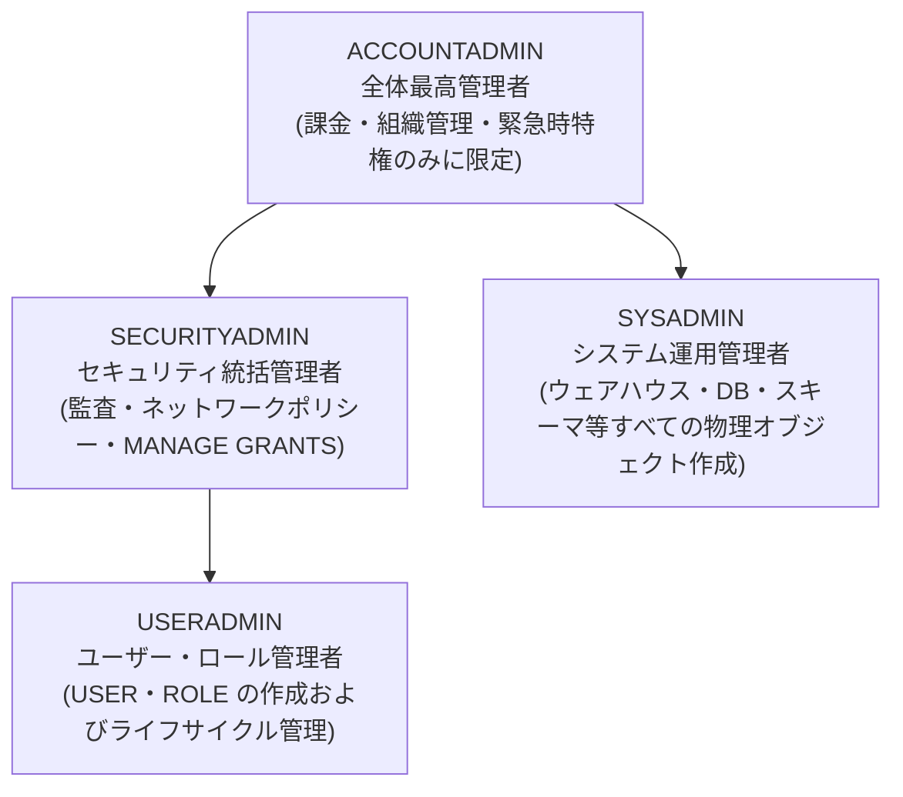

# 第01章：Snowflake アカウント開設と初期設定

銀行証券のクラウド移行 PoC に向けて、Snowflake 30 日間無料トライアル（$400 クレジット付与）のアカウントを開設し、UI 言語を日本語に設定します。

---

## 1. アカウント開設窓口と主要パラメータ選定

公式登録 URL：[https://signup.snowflake.com/](https://signup.snowflake.com/)

| 設定項目 | 推奨選定 | 業務・コンプライアンス上の検討理由 |
| :--- | :--- | :--- |
| **Snowflake Edition** | **Enterprise（エンタープライズ版）** | **最大90日間のタイムトラベル（Time Travel）**、**動的データマスキング（Dynamic Data Masking）**、マルチクラスター対応。金融庁の監査要件および厳格なセキュリティ基準を満たすための最低要件。 |
| **Cloud Provider** | **AWS (Amazon Web Services)** | 日系大手金融機関・証券会社における導入実績が最も豊富で、周辺ツールチェーンとの親和性が高い。 |
| **Region (リージョン)** | **Asia Pacific (Tokyo) - `ap-northeast-1`** | **国内データ主権の厳格な遵守**：顧客取引明細データの国内保管要件を満たし、オンプレミス環境からのネットワークレイテンシを極小化。 |

---

## 2. アカウント開設の全手順と画面操作

### ステップ 1：基本情報の入力
氏名、会社メールアドレス、役職を入力します：


### ステップ 2：エディションおよびリージョン選定
**Enterprise** エディションを選択し、基盤クラウドに **AWS - Asia Pacific (Tokyo)** を指定します：


### ステップ 3：アクティベーションメールの確認
登録後に送信される *"Activate your Snowflake account"* メールを開き、「Click to Activate」をクリックします：


### ステップ 4：管理者パスワード設定と初回ログイン
管理者アカウントのユーザー名と安全な強固パスワードを設定し、Snowsight コンソールへログインします（初期状態では `ACCOUNTADMIN` 権限を保持）：


---

## 3. Web コンソールの日本語化設定

運用担当者が直感的に操作できるよう、Snowsight コンソールの表示言語を日本語に切り替えます：

1. 画面左下（または右上）のユーザープロファイルアイコンから **Preferences（個人設定）** を開きます；
2. **Language & Region** セクションにて、表示言語を **日本語 (Japanese)** に設定します：


---

## 4. システムビルトイン標準ロール体系の理解

Snowflake のアカウント作成直後には、以下のような標準ロール階層が自動定義されています：



> [!CAUTION]
> **金融機関におけるセキュリティ鉄則（軍規）**：  
> 日常的なシステム運用やデータ移行作業において、全権限を持つ **`ACCOUNTADMIN` を使用することは厳禁** です。  
> 必ず**職務分掌（Separation of Duties）**の原則を徹底し、ユーザーおよびロール管理は `USERADMIN` を、コンピュート・ストレージリソース管理は `SYSADMIN` を起点として委譲・運用してください。

---

## 5. 🔐 金融基準に基づく多要素認証 (MFA / 2FA) 設定実務

日本の金融機関（銀行、証券、NRI等のSIパートナー環境）や金融庁 FISC 安全対策基準においては、**検証環境・本番環境を問わず、Snowflake コンソールへのアクセスには多要素認証（MFA / 2FA）の適用が強く推奨・義務付けられています**。

### 5.1 認証アプリ（Authenticator）の紐付け手順
1. **設定メニューの表示**：Snowsight コンソール左下のユーザープロファイルより、**Preferences** $\to$ **Multi-Factor Authentication (MFA)** を選択します。
2. **認証方式の選択**：**Authenticator App（TOTP 認証器）** を選択します。
3. **シークレットキーの取得**：
   - 画面上に QR コードおよび Base32 形式の秘密鍵文字列（例：`WQQC4ZYF...`）が表示されます。
   - モバイル端末の **Google Authenticator** や **Microsoft Authenticator** で QR をスキャンするか、開発専用端末等ではオープンソースの PC 版認証ツール [WinAuth](https://winauth.github.io/winauth/download.html) へ秘密鍵文字列を登録します。
4. **ワンタイムコードの検証**：認証アプリに表示される 6 桁の TOTP 動的認証コードを入力し、有効化（Verify）を完了します。

### 5.2 初期パスワード変更ポリシー（初回ログイン強制変更）
システム管理者から払い出された作業用ユーザー（例：`MITSUI_ENGINEER_USER`）には、通常初回ログイン時のパスワード変更が義務付けられています（`MUST_CHANGE_PASSWORD = TRUE`）：
- 一時パスワードと MFA 認証コードによる初回認証後、パスワード変更ダイアログが起動します；
- 複雑性要件（大文字・小文字・数字・特殊文字を含む 12 桁以上）を満たす新規パスワードへ変更することで、安全にワークスペースへアクセスできます。

---

## 6. 🧪 初回ログイン後の権限・疎通確認 (Sanity Check)

Snowsight コンソールへの初回ログイン完了後、データエンジニアやアナリストは以下の手順で SQL ワークシートを開き、割り当てられた権限やリソースの疎通確認を実施します。

### 6.1 ワークスペースへの移動とSQLファイルの新規作成
検証スクリプトを実行する前に、Snowsight コンソールで SQL エディタ（Worksheet）を開きます：

1. 左側のメインナビゲーションメニューから **「プロジェクト（Projects）」** をクリックし、**「ワークスペース（Workspaces）」** を選択します：


2. 初回アクセス時には、最新のワークスペースツアー画面（SQL ファイル、Notebook、dbt 等の開発スイート対応）が表示されます：


3. 左上の **「＋ 新規追加」** ボタンをクリックし、**「SQLファイル（SQL File）」** を選択して新しい SQL ワークシートを開きます：


### 6.2 ベースライン権限・疎通確認クエリの実行
開いた SQL ワークシートに以下のスクリプトを入力・実行し、割り当てられた権限基盤とリソース接続を確認します：

```sql
-- 1. 自身に付与されたロール一覧の確認
SHOW ROLES;

-- 2. カレントロールに付与されている詳細権限の確認
SHOW GRANTS OF ROLE MITSUI_ENGINEER;

-- 3. 参照可能なデータベース・スキーマの確認
SHOW DATABASES;
SHOW SCHEMAS;

-- 4. プロジェクトコンテキストへの切り替え
USE ROLE MITSUI_ENGINEER;
USE WAREHOUSE MITSUI_WH;
USE DATABASE MITSUI_SEC_DB;
USE SCHEMA RAW_ORACLE;

-- 5. 軽量な疎通確認用一時テーブルの作成と読み書き検証 (Sandbox レベル検証)
CREATE OR REPLACE TEMPORARY TABLE _SANITY_CHECK (
    CHECK_ID    INT,
    OPERATOR    VARCHAR(50),
    CHECKED_AT  TIMESTAMP_NTZ DEFAULT CURRENT_TIMESTAMP()
);

INSERT INTO _SANITY_CHECK (CHECK_ID, OPERATOR) VALUES (1, CURRENT_USER());

SELECT * FROM _SANITY_CHECK;

-- 検証完了後のクリーンアップ
DROP TABLE IF EXISTS _SANITY_CHECK;
```

この疎通確認が正常に完了することで、アカウント開設・MFA 設定・三井証券向け権限基盤の接続確認が完了し、次章の Oracle 環境構築およびデータ移行作業へ安全に進むことができます。
