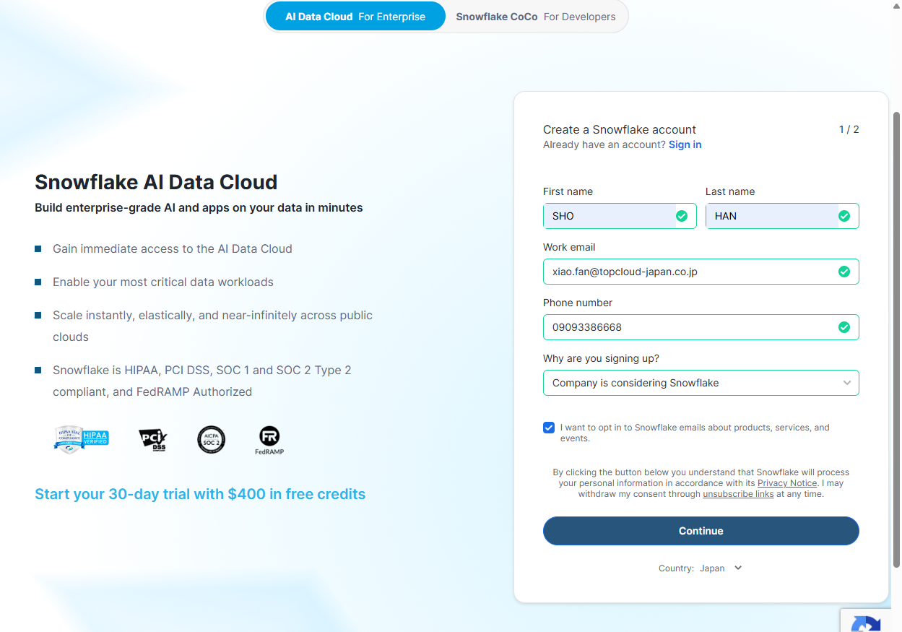
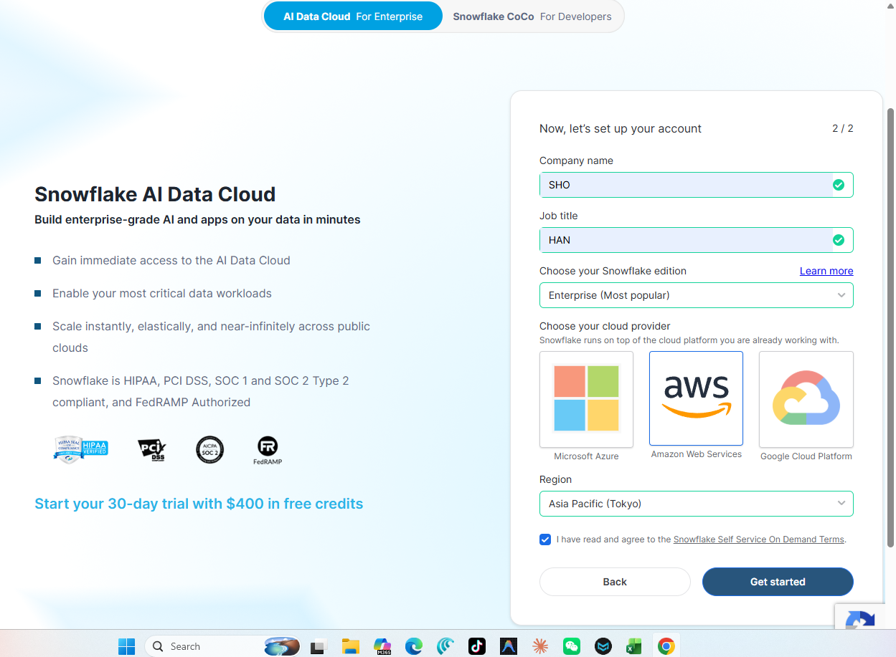
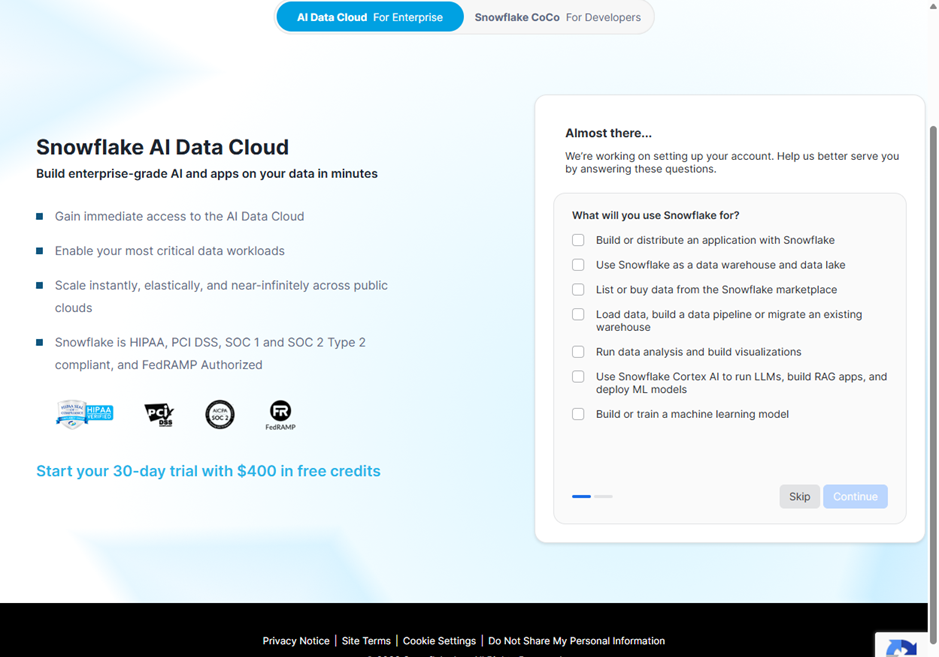
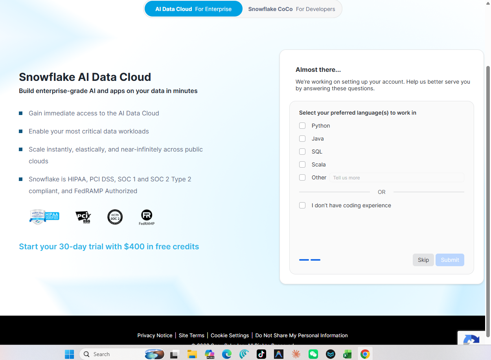
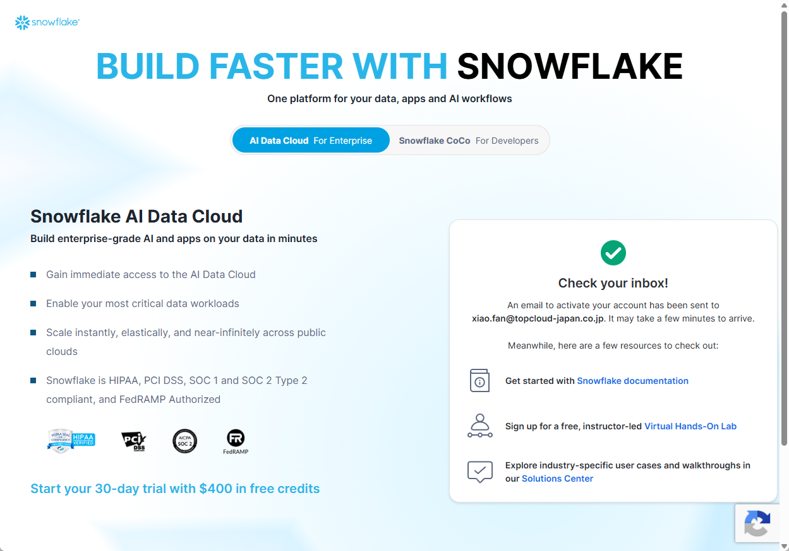
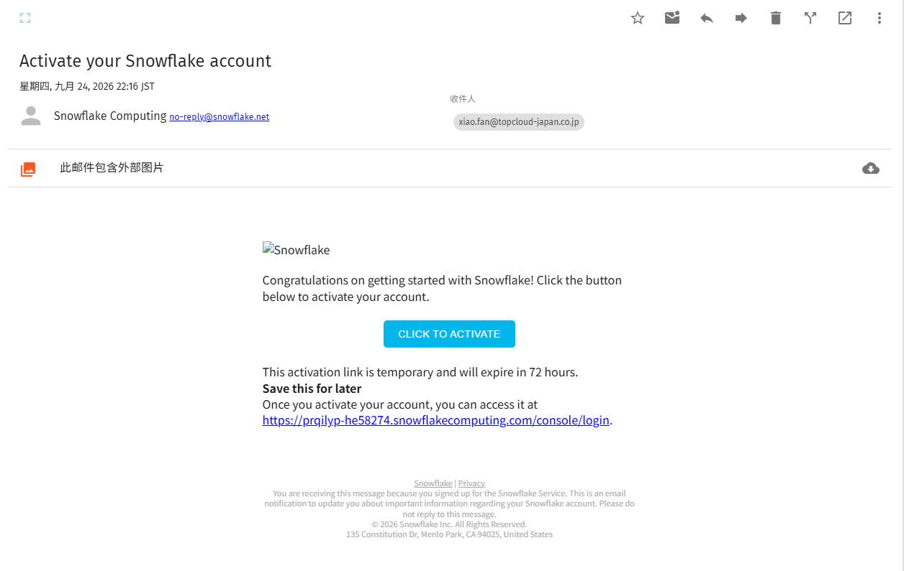
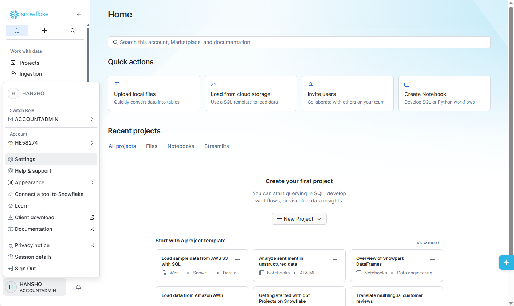
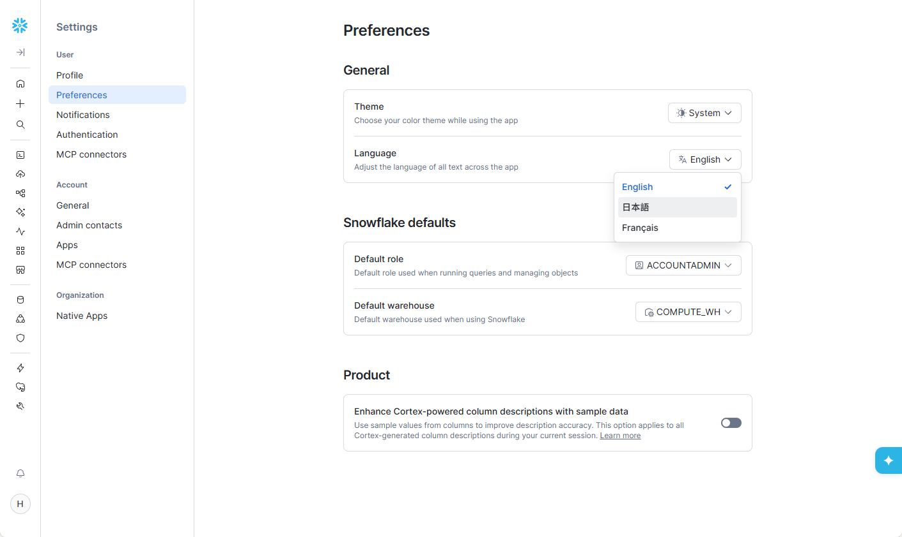
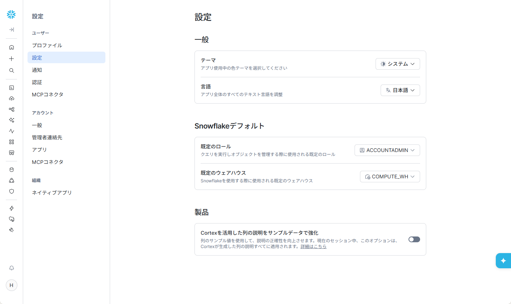

# 第01章：Snowflake アカウント開設と初期設定

三井証券のクラウド移行 PoC に向けて、Snowflake 30 日間無料トライアル（$400 クレジット付与）のアカウントを開設し、UI 言語を日本語に設定します。

---

## 1. アカウント開設手順

登録 URL：[https://signup.snowflake.com/](https://signup.snowflake.com/)

### ステップ 1：基本情報の入力
氏名、会社メールアドレス、役職を入力します：

### ステップ 2：エディションおよびリージョン選定
- **エディション**：**Enterprise**（90日タイムトラベル、動的マスキング対応）
- **クラウド／リージョン**：**AWS - Asia Pacific (Tokyo)**（国内データ主権要件に適合）

### ステップ 3：アクティベーションメールの確認
届いたメール内の「Click to Activate」をクリックします：

### ステップ 4：パスワード設定と初回ログイン
管理者アカウントのパスワードを設定し、Snowsight コンソールへログインします：

---

## 2. 日本語表示設定

運用担当者が直感的に操作できるよう、UI の表示言語を日本語に切り替えます：

1. 左下のユーザープロファイルアイコンから **Preferences（個人設定）** を開きます；
2. **Language & Region** にて **日本語 (Japanese)** を選択します：

