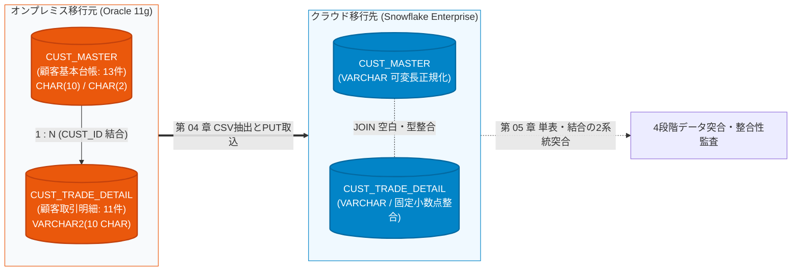

# 第 02 章：Oracle 移行元環境構築と模擬証券データ投入

大手金融機関（銀行・証券）におけるデータ基盤アーキテクチャでは、顧客の株式、外貨、債券などのコア約定明細データが、長年にわたりオンプレミス環境の Oracle リレーショナルデータベースに蓄積されてきました。

前章までにおいて、三井証券における夜間バッチ処理の遅延・超過という深刻な業務課題を整理し（[第 00 章](00_architecture_overview.md)）、クラウド側となる Snowflake エンタープライズ評価環境の開設を完了しました（[第 01 章](01_snowflake_signup.md)）。

本章では、単なる単一テーブルの形式的なコピーにとどまらず、実際の金融業務に忠実な **1:N 主従リレーションシップを持つ 2 テーブル構成（`CUST_MASTER` 顧客基本台帳 ＋ `CUST_TRADE_DETAIL` 顧客取引明細）** を構築します。そして、異種データベース移行（Oracle ➔ Snowflake）において現場を最も悩ませる **「末尾空白パディング（Trailing Spaces）」「空文字（`''` vs `NULL`）」「文字数語義（CHAR vs BYTE）」「全角半角混在」** という 4 つの致命的トラップをあらかじめ組み込み、堅牢な検証基盤を確立します。

---

## 一、 アーキテクチャの承前啓後：2 テーブル構成と跨テーブル結合（JOIN）の課題

金融システムの移行プロジェクトにおいて、不具合の 9 割は単一テーブルのロードではなく、移行後の **複数テーブル結合クエリ（JOIN）** で顕在化します。単一テーブルの行数や金額合計が一致していても、いざ JOIN を実行すると **「Oracle では結合できたのに Snowflake では 0 件になる（静的アンダーマッチ）」**、あるいは **「重複して件数が膨張する（デカルト積）」** という事態が頻発します。



### 🚨 異種 DB 移行における 4 大致命的 JOIN トラップ

| 異種 DB トラップ | Oracle 11g の挙動 | Snowflake の挙動 | 発生する本番障害・リスク |
| :--- | :--- | :--- | :--- |
| **1. `CHAR(N)` 末尾空白と一致比較語義** | 固定長（`CHAR(10)`）に `'CU001'` を格納すると、自動的に右側に空白が埋められ `'CU001     '` となります。<br/>また、`CHAR` 比較時は Blank-padded 規則により `'A ' = 'A'` が TRUE となります。 | Snowflake の `VARCHAR` / `CHAR` は共に可変長文字列です。<br/>`'A ' = 'A'` は **厳格に FALSE** と評価されます。<br/>エクスポートや取込時に TRIM の有無が不一致だと空白がズレます。 | **跨テーブル JOIN が突如 0 件に全滅！**<br/>Oracle 上で正常に結合できていた明細が、Snowflake では外部キー不一致となり INNER JOIN から消失します。 |
| **2. 空文字 `''` と `NULL` の等価性** | **`''` は厳密に `NULL` と同値** です。<br/>`'' IS NULL` は常に TRUE であり、`WHERE col = ''` は何もヒットしません。 | **`''` は長さ 0 の有効な空文字列** です。<br/>`'' IS NULL` は FALSE、`'' = ''` は TRUE です。 | **外部結合（OUTER JOIN）と絞り込みの破綻！**<br/>NULL/空文字を含む外部キーの結合や、ステータス判定で結果件数が乖離します。 |
| **3. 日付の時分秒とスカラー結合** | `DATE` 型は内部的に時分秒を含んでおり、日次結合には `TRUNC()` が必須です。 | `DATE`（日付のみ）と `TIMESTAMP`（日時）が厳格に分離されています。 | 移行時に日時の正規化を怠ると、非表示のミリ秒差により日次結合が不整合になります。 |
| **4. 文字コードと全角半角 Collation** | レガシー勘定系では半角カナや全角空白（`　`）が混在しがちです。 | 大文字・小文字、半角・全角、空白が厳格に区別されます。 | 顧客名や支店名での結合・名寄せが失敗します。 |

---

## 二、 🐳 Docker による Oracle 11g コンテナ起動とライフサイクル管理

Windows (PowerShell/WSL2)、macOS、Linux の各環境で確実に動作させるため、実績豊富な軽量イメージ `gvenzl/oracle-xe:11` を採用します。

### ステップ 1：Oracle 11g XE イメージの取得
ターミナルまたは PowerShell を開き、以下のコマンドを実行します：
```bash
docker pull gvenzl/oracle-xe:11
```

### ステップ 2：コンテナ起動とデータ永続化設定
SGA メモリ不足を防ぐため `--shm-size=1g` を指定し、標準ポート `1521` を公開、データをローカルディレクトリにマウントして起動します（パスワード：`Mitsui_Sec_2026`）：

::: code-group
```bash [PowerShell / Windows]
docker run -d `
  --name mitsui_oracle_11g `
  --restart always `
  -e ORACLE_PASSWORD=Mitsui_Sec_2026 `
  -p 1521:1521 `
  --shm-size=1g `
  -v "${PWD}/oradata":/opt/oracle/oradata `
  gvenzl/oracle-xe:11
```

```bash [Bash / Linux / macOS]
sudo docker run -d \
  --name mitsui_oracle_11g \
  --restart always \
  -e ORACLE_PASSWORD=Mitsui_Sec_2026 \
  -p 1521:1521 \
  --shm-size=1g \
  -v "$PWD/oradata":/opt/oracle/oradata \
  gvenzl/oracle-xe:11
```
:::

### ステップ 3：コンテナの起動状態・ヘルスチェック
初回起動時はデータベースの初期化に 1〜2 分程度を要します。ログを監視して起動完了を確認します：
```bash
docker logs -f mitsui_oracle_11g
```
ログ末尾に以下のメッセージが出力されれば、データベースの準備は完了です：
```text
#########################
DATABASE IS READY TO USE!
#########################
```
確認後、`Ctrl + C` を押してログ監視を終了します。

---

## 三、 🔌 統合開発ツールによる疎通確認 (VSCode / DBeaver)

[第 01 章第 6 節](01_snowflake_signup.md#六-アカウント識別体系とクライアント接続エコシステム-account-identifier--ecosystem) で解説したように、現代のデータエンジニアリングでは単一の統合ツールから異種データベースを一括管理するのがベストプラクティスです。ここでは VSCode 内の **Database Client** 拡張機能、または汎用の **DBeaver** を使用します。

### 1. VSCode Database Client による接続設定

VSCode の拡張機能マーケットプレイスから **Database Client**（または Database Client JDBC）をインストールし、新しい Oracle 接続を作成します：

| 設定項目 | 入力値 | 備考 |
| :--- | :--- | :--- |
| **Connection Type** | `Oracle` | 標準の Oracle 接続プロトコル |
| **Host** | `127.0.0.1` | ローカルホスト（WSL2 環境からも localhost で到達可能） |
| **Port** | `1521` | Docker が公開している通信ポート |
| **Database / SID** | `xe` | Oracle 11g Express Edition の既定インスタンス名 |
| **Username** | `system` | データベース管理者アカウント |
| **Password** | `Mitsui_Sec_2026` | コンテナ起動時に指定したパスワード |


### 2. 接続テストと疎通の確認
**「Connect」** をクリックし、ステータスが Connected となることを確認します：


> [!TIP]
> **DBeaver を使用する場合の JDBC 接続文字列**：  
> DBeaver で接続する場合、ドライバに `Oracle` を選択し、JDBC URL として以下を指定します：  
> `jdbc:oracle:thin:@//localhost:1521/xe`（ユーザー名：`system`）。

---

## 四、 🏛️ コア 2 テーブル DDL と Oracle ➔ Snowflake 設計推論哲学

`system` アカウントで Oracle に接続し、以下の標準 2 テーブル DDL を実行します（スクリプト：[`scripts/oracle/01_create_schema.sql`](file:///c:/Users/FX/Projects/SnowflakeBlog/scripts/oracle/01_create_schema.sql)）：

### 4.1 テーブル 1：ディメンション主表 `CUST_MASTER` (顧客基本台帳)

```sql
CREATE TABLE CUST_MASTER (
    -- ① 顧客識別子：CHAR(10) 固定長（レガシー勘定系の固定長設計。末尾空白パディングの検証用）
    CUST_ID            CHAR(10)          NOT NULL,

    -- ② 顧客氏名（漢字）：全角文字
    CUST_NAME_KANJI    VARCHAR2(50 CHAR) NOT NULL,

    -- ③ 顧客氏名（カナ）：半角カナ・全角カナ混在
    CUST_NAME_KANA     VARCHAR2(50 CHAR),

    -- ④ 顧客ランク区分：CHAR(2) 固定長（'A ' / 'B ' 等の末尾空白比較検証用）
    CUST_RANK_CD       CHAR(2)           DEFAULT 'C ' NOT NULL,

    -- ⑤ 開設支店コード：VARCHAR2(4 CHAR)
    BRANCH_CD          VARCHAR2(4 CHAR)  NOT NULL,

    -- ⑥ 口座ステータス：VARCHAR2(2 CHAR)（Oracle '' ＝ NULL と Snowflake '' の異種挙動検証用）
    STATUS_CD          VARCHAR2(2 CHAR),

    -- ⑦ 口座開設日：DATE 型
    OPEN_DATE          DATE              NOT NULL,

    -- ⑧ 登録日時
    REG_DATETIME       DATE              DEFAULT SYSDATE NOT NULL,

    CONSTRAINT PK_CUST_MASTER PRIMARY KEY (CUST_ID)
);

COMMENT ON TABLE CUST_MASTER IS '顧客基本台帳（Oracle 11g 核心ディメンション表）';
```

---

### 4.2 テーブル 2：ファクト明細表 `CUST_TRADE_DETAIL` (顧客取引明細)

```sql
CREATE TABLE CUST_TRADE_DETAIL (
    -- ① 取引数量：一般数値、初期値 0
    TRADE_QTY          NUMBER(15)        DEFAULT 0        NOT NULL,

    -- ② 約定金額・円貨：固定 3 桁精度の統一
    AMOUNT_JPY         NUMBER(18,3)      DEFAULT 0        NOT NULL,

    -- ③ 約定金額・外貨 ＋ 通貨区分：ペア定義必須
    AMOUNT_FCY         NUMBER(18,3)      DEFAULT 0,
    CCY_CODE           VARCHAR2(3),

    -- ④ 為替レート：6 桁精度
    EXCHANGE_RATE      NUMBER(9,6),

    -- ⑤ 摘要・備考：必ず CHAR 語義を明示（既定の BYTE 語義を回避）
    REMARKS            VARCHAR2(100 CHAR) DEFAULT ' ',

    -- ⑥ 顧客識別：固定 10 桁、CHAR 語義
    CUST_ID            VARCHAR2(10 CHAR)  NOT NULL,

    -- ⑦ 区分コード
    TRADE_TYPE_CD      VARCHAR2(2 CHAR)   NOT NULL,  -- 01:買付, 02:売付
    BRANCH_CD          VARCHAR2(4 CHAR)   NOT NULL,  -- 支店コード

    -- ⑧ 業務日付
    TRADE_DATE         DATE               NOT NULL,  -- 約定日（基準日）
    SETTLE_MONTH       DATE,                         -- 決済対象月（月初日付で代表）

    -- ⑨ 監査日時
    REG_DATETIME       DATE               DEFAULT SYSDATE NOT NULL, -- 登録日時（秒精度）
    UPD_DATETIME       DATE,                                        -- 更新日時

    CONSTRAINT PK_CUST_TRADE_DETAIL PRIMARY KEY (CUST_ID, TRADE_DATE, TRADE_TYPE_CD)
);

COMMENT ON TABLE CUST_TRADE_DETAIL IS '顧客取引明細（Oracle 11g 移行元設計）';
```

---

### 4.3 🌟 重要ナレッジ：Oracle ➔ Snowflake 型マッピングと設計思想対照表

| 項目分類 | Oracle 11g 移行元 | Snowflake 移行先 | アーキテクチャ設計思想と変換理由 (Rationale) |
| :--- | :--- | :--- | :--- |
| **顧客主キー** | `CHAR(10)` in Master<br/>`VARCHAR2(10 CHAR)` in Detail | `VARCHAR(10)` in Both | **★ 跨テーブル結合の命脈（空白トリムの統一）**：<br/>Oracle では `CHAR(10)` の末尾に自動で空白が補完されます。Snowflake で両者を `VARCHAR(10)` に移行する際、`COPY INTO` 時の `TRIM_SPACE = TRUE`、またはロード後の `RTRIM()` 統一を怠ると、`ON m.CUST_ID = t.CUST_ID` が不一致となり結合データが全滅します。 |
| **顧客ランク** | `CUST_RANK_CD CHAR(2)` | `VARCHAR(2)` | Oracle では `'A '`（末尾空白あり）に対し `WHERE CUST_RANK_CD = 'A'` でヒットしますが、Snowflake では厳格に不一致となります。 |
| **口座状態** | `STATUS_CD VARCHAR2(2)` | `VARCHAR(2)` | **★ 空文字と NULL の差異**：<br/>Oracle で `''` を挿入すると自動で `NULL` に変換されます。Snowflake 側でもファイルフォーマットに `EMPTY_FIELD_AS_NULL = TRUE` を設定することで、同等の業務判定を維持します。 |
| **取引数量** | `NUMBER(15)` | `NUMBER(15, 0)` | 株式数量は整数であるため、Scale=0 を明示的に指定。浮動小数点演算による丸め誤差を防止。 |
| **円貨金額** | `NUMBER(18,3)` | `NUMBER(18, 3)` | 金融決済における「銭・厘（0.001）」単位に対応。両環境で完全一致する固定小数点数を保持。 |
| **摘要・備考** | `VARCHAR2(100 CHAR)` | `VARCHAR(100)` | **★ 最大の注意点（CHAR 語義 vs BYTE 語義）**：<br/>UTF-8 環境下では全角日本語 1 文字が 3 バイトを消費します。Oracle で既定の BYTE 語義（`VARCHAR2(100)`）を用いると 34 文字で `ORA-12899`（桁あふれ）が発生します。そのため移行元では必ず `CHAR` 語義を指定。一方、Snowflake の `VARCHAR(N)` は**最初から Unicode 文字数単位でカウント**されるため、両者の語義が完全に一致します。 |
| **約定日** | `TRADE_DATE DATE` | `VARCHAR(8)` (YYYYMMDD) | **日付の正規化・文字列スカラー化**：Oracle の `DATE` は内部的に時分秒を含んでいます。Snowflake の分析基盤では、日次キーとして扱いやすく、パーティションプルーニングを最大化するため 8 桁固定文字列 `YYYYMMDD` に変換します。 |
| **決済月** | `SETTLE_MONTH DATE` | `VARCHAR(6)` (YYYYMM) | 月次集計キーとして `YYYYMM` 形式の 6 桁文字列に正規化。 |
| **登録日時** | `REG_DATETIME DATE` | `TIMESTAMP_NTZ(6)` | **秒精度からマイクロ秒精度への進化**：Oracle DATE（秒精度）から、Snowflake ではタイムゾーンなしのマイクロ秒精度タイムスタンプ `TIMESTAMP_NTZ(6)` へ拡張。 |
| **移行監査** | *(移行元にはなし)* | `MIGRATED_AT TIMESTAMP_LTZ(6)` | **★ クラウド移行専用列**：Snowflake 側で追加する物理取込日時列。既定値 `CURRENT_TIMESTAMP()` により、監査証跡・データリネージを自動保証。 |

---

## 五、 🧪 金融級 2 テーブル・テストデータセットの解説と投入

以下の 2 テーブル構成でテストデータを投入します：
1. **主表 `CUST_MASTER`（計 13 件）**：取引実績のある 11 名の顧客、新規開設で取引のない顧客 1 名（LEFT JOIN による NULL 発生検証用）、口座状態に `''` を登録した顧客 1 名（Oracle の空文字→NULL 挙動検証用）；
2. **ファクト表 `CUST_TRADE_DETAIL`（計 11 件）**：国内株式、外貨、欧州債券、全 9 限界値、全角 100 文字限界値、超極小レート、および年末年越取引。

### 一括投入 SQL スクリプト

以下の SQL をコピーし、VSCode Database Client または Oracle 接続環境で一括実行します（スクリプト：[`scripts/oracle/02_seed_trades_data.sql`](file:///c:/Users/FX/Projects/SnowflakeBlog/scripts/oracle/02_seed_trades_data.sql)）：

```sql
-- 既存データのクリア
DELETE FROM CUST_TRADE_DETAIL;
DELETE FROM CUST_MASTER;

-- ============================================================
-- 1. CUST_MASTER (顧客基本台帳表 - 全 13 件)
-- ============================================================
INSERT INTO CUST_MASTER (CUST_ID, CUST_NAME_KANJI, CUST_NAME_KANA, CUST_RANK_CD, BRANCH_CD, STATUS_CD, OPEN_DATE)
VALUES ('CU00001234', '佐藤 太郎', 'サトウ タロウ', 'A ', '0001', '01', DATE '2020-01-15');

INSERT INTO CUST_MASTER (CUST_ID, CUST_NAME_KANJI, CUST_NAME_KANA, CUST_RANK_CD, BRANCH_CD, STATUS_CD, OPEN_DATE)
VALUES ('CU00005678', '鈴木 一郎', 'スズキ イチロウ', 'A ', '0002', '01', DATE '2021-05-20');

INSERT INTO CUST_MASTER (CUST_ID, CUST_NAME_KANJI, CUST_NAME_KANA, CUST_RANK_CD, BRANCH_CD, STATUS_CD, OPEN_DATE)
VALUES ('CU00009999', '高橋 優子', 'タカハシ ユウコ', 'B ', '0003', '01', DATE '2019-11-10');

INSERT INTO CUST_MASTER (CUST_ID, CUST_NAME_KANJI, CUST_NAME_KANA, CUST_RANK_CD, BRANCH_CD, STATUS_CD, OPEN_DATE)
VALUES ('CU00000001', '三井 証券機構', 'ミツイ ショウケンキコウ', 'S ', '9999', '01', DATE '2010-04-01');

INSERT INTO CUST_MASTER (CUST_ID, CUST_NAME_KANJI, CUST_NAME_KANA, CUST_RANK_CD, BRANCH_CD, STATUS_CD, OPEN_DATE)
VALUES ('CU00002222', '田中 健一', 'タナカ ケンイチ', 'C ', '0005', '01', DATE '2022-08-01');

INSERT INTO CUST_MASTER (CUST_ID, CUST_NAME_KANJI, CUST_NAME_KANA, CUST_RANK_CD, BRANCH_CD, STATUS_CD, OPEN_DATE)
VALUES ('CU00003333', '伊藤 直樹', 'イトウ ナオキ', 'C ', '0001', '01', DATE '2023-02-15');

INSERT INTO CUST_MASTER (CUST_ID, CUST_NAME_KANJI, CUST_NAME_KANA, CUST_RANK_CD, BRANCH_CD, STATUS_CD, OPEN_DATE)
VALUES ('CU00004444', '渡辺 裕美', 'ワタナベ ヒロミ', 'B ', '0002', '01', DATE '2021-09-30');

INSERT INTO CUST_MASTER (CUST_ID, CUST_NAME_KANJI, CUST_NAME_KANA, CUST_RANK_CD, BRANCH_CD, STATUS_CD, OPEN_DATE)
VALUES ('CU00004445', '山本 拓也', 'ヤマモト タクヤ', 'B ', '0002', '01', DATE '2021-10-01');

INSERT INTO CUST_MASTER (CUST_ID, CUST_NAME_KANJI, CUST_NAME_KANA, CUST_RANK_CD, BRANCH_CD, STATUS_CD, OPEN_DATE)
VALUES ('CU00005555', '小林 誠', 'コバヤシ マコト', 'B ', '0004', '01', DATE '2022-03-12');

INSERT INTO CUST_MASTER (CUST_ID, CUST_NAME_KANJI, CUST_NAME_KANA, CUST_RANK_CD, BRANCH_CD, STATUS_CD, OPEN_DATE)
VALUES ('CU00006666', '加藤 恵', 'カトウ メグミ', 'C ', '0006', '01', DATE '2024-01-10');

INSERT INTO CUST_MASTER (CUST_ID, CUST_NAME_KANJI, CUST_NAME_KANA, CUST_RANK_CD, BRANCH_CD, STATUS_CD, OPEN_DATE)
VALUES ('CU00007777', '吉田 勇', 'ヨシダ イサム', 'A ', '0001', '01', DATE '2018-06-25');

-- 12. ★ 開設済み・取引実績なしの顧客 (松本 潤) - LEFT JOIN での NULL 発生検証用
INSERT INTO CUST_MASTER (CUST_ID, CUST_NAME_KANJI, CUST_NAME_KANA, CUST_RANK_CD, BRANCH_CD, STATUS_CD, OPEN_DATE)
VALUES ('CU00008888', '松本 潤', 'マツモト ジュン', 'C ', '0003', '02', DATE '2024-11-01');

-- 13. ★ 口座ステータスに空文字 '' を設定した顧客 (井上 陽水) - Oracle の ''→NULL 自動変換挙動の検証用
INSERT INTO CUST_MASTER (CUST_ID, CUST_NAME_KANJI, CUST_NAME_KANA, CUST_RANK_CD, BRANCH_CD, STATUS_CD, OPEN_DATE)
VALUES ('CU00009990', '井上 陽水', 'イノウエ ヨウスイ', 'D ', '0004', '', DATE '2025-01-05');


-- ============================================================
-- 2. CUST_TRADE_DETAIL (顧客取引明細表 - 全 11 件)
-- ============================================================
-- 1. 通常取引・国内株式
INSERT INTO CUST_TRADE_DETAIL
(TRADE_QTY, AMOUNT_JPY, AMOUNT_FCY, CCY_CODE, EXCHANGE_RATE, REMARKS,
 CUST_ID, TRADE_TYPE_CD, BRANCH_CD, TRADE_DATE, SETTLE_MONTH,
 REG_DATETIME, UPD_DATETIME)
VALUES
(1000, 12345678.900, NULL, NULL, NULL, '通常取引・国内株式',
 'CU00001234', '01', '0001', DATE '2025-03-25', DATE '2025-03-01',
 TO_DATE('2025-03-25 09:05:30','YYYY-MM-DD HH24:MI:SS'), NULL);

-- 2. 外国株式・米国口座（USD レート付き）
INSERT INTO CUST_TRADE_DETAIL
(TRADE_QTY, AMOUNT_JPY, AMOUNT_FCY, CCY_CODE, EXCHANGE_RATE, REMARKS,
 CUST_ID, TRADE_TYPE_CD, BRANCH_CD, TRADE_DATE, SETTLE_MONTH,
 REG_DATETIME, UPD_DATETIME)
VALUES
(500, 7500000.000, 50000.500, 'USD', 150.123456, '外国株式・米国口座',
 'CU00005678', '02', '0002', DATE '2025-03-26', DATE '2025-03-01',
 TO_DATE('2025-03-26 10:15:00','YYYY-MM-DD HH24:MI:SS'),
 TO_DATE('2025-03-26 14:20:45','YYYY-MM-DD HH24:MI:SS'));

-- 3. 外国債券・欧州発行（EUR レート付き）
INSERT INTO CUST_TRADE_DETAIL
(TRADE_QTY, AMOUNT_JPY, AMOUNT_FCY, CCY_CODE, EXCHANGE_RATE, REMARKS,
 CUST_ID, TRADE_TYPE_CD, BRANCH_CD, TRADE_DATE, SETTLE_MONTH,
 REG_DATETIME, UPD_DATETIME)
VALUES
(200, 3200000.000, 20000.000, 'EUR', 160.000000, '外国債券・欧州発行',
 'CU00009999', '01', '0003', DATE '2025-03-27', DATE '2025-03-01',
 TO_DATE('2025-03-27 11:00:00','YYYY-MM-DD HH24:MI:SS'), NULL);

-- 4. 境界値テスト・最大桁数（全 9 限界値）
INSERT INTO CUST_TRADE_DETAIL
(TRADE_QTY, AMOUNT_JPY, AMOUNT_FCY, CCY_CODE, EXCHANGE_RATE, REMARKS,
 CUST_ID, TRADE_TYPE_CD, BRANCH_CD, TRADE_DATE, SETTLE_MONTH,
 REG_DATETIME, UPD_DATETIME)
VALUES
(999999999999999, 999999999999999.999, 999999999999999.999, 'USD', 999.999999,
 '境界値テスト・最大桁数',
 'CU00000001', '01', '9999', DATE '2025-01-01', DATE '2025-01-01',
 TO_DATE('2025-01-01 00:00:00','YYYY-MM-DD HH24:MI:SS'), NULL);

-- 5. 最小限必須項目のみ（各項目初期値の確認）
INSERT INTO CUST_TRADE_DETAIL
(CUST_ID, TRADE_TYPE_CD, BRANCH_CD, TRADE_DATE)
VALUES
('CU00002222', '02', '0005', DATE '2025-03-28');

-- 6. 金額 0・数量 0 の取引（月次失効バッチ想定）
INSERT INTO CUST_TRADE_DETAIL
(TRADE_QTY, AMOUNT_JPY, AMOUNT_FCY, CCY_CODE, EXCHANGE_RATE, REMARKS,
 CUST_ID, TRADE_TYPE_CD, BRANCH_CD, TRADE_DATE, SETTLE_MONTH,
 REG_DATETIME, UPD_DATETIME)
VALUES
(0, 0.000, NULL, NULL, NULL, '月次集計バッチ・2025年2月分',
 'CU00003333', '03', '0001', DATE '2025-02-28', DATE '2025-02-01',
 TO_DATE('2025-03-01 01:00:00','YYYY-MM-DD HH24:MI:SS'), NULL);

-- 7. 全角・半角混在文字の摘要テスト
INSERT INTO CUST_TRADE_DETAIL
(TRADE_QTY, AMOUNT_JPY, AMOUNT_FCY, CCY_CODE, EXCHANGE_RATE, REMARKS,
 CUST_ID, TRADE_TYPE_CD, BRANCH_CD, TRADE_DATE, SETTLE_MONTH,
 REG_DATETIME, UPD_DATETIME)
VALUES
(300, 4500000.000, NULL, NULL, NULL,
 RPAD('全角混在の摘要テスト（日本語・English・123・記号！＠＃）', 95, 'X'),
 'CU00004444', '01', '0002', DATE '2025-03-29', DATE '2025-03-01',
 TO_DATE('2025-03-29 13:45:12','YYYY-MM-DD HH24:MI:SS'), NULL);

-- 8. 全角 100 文字境界値テスト（VARCHAR2(100 CHAR) 語義検証用）
INSERT INTO CUST_TRADE_DETAIL
(TRADE_QTY, AMOUNT_JPY, AMOUNT_FCY, CCY_CODE, EXCHANGE_RATE, REMARKS,
 CUST_ID, TRADE_TYPE_CD, BRANCH_CD, TRADE_DATE, SETTLE_MONTH,
 REG_DATETIME, UPD_DATETIME)
VALUES
(300, 4500000.000, NULL, NULL, NULL,
 RPAD('全角文字百桁境界値検証用摘要欄', 100, '全'),
 'CU00004445', '01', '0002', DATE '2025-03-29', DATE '2025-03-01',
 TO_DATE('2025-03-29 13:45:12','YYYY-MM-DD HH24:MI:SS'), NULL);

-- 9. 訂正取引（更新日時あり）
INSERT INTO CUST_TRADE_DETAIL
(TRADE_QTY, AMOUNT_JPY, AMOUNT_FCY, CCY_CODE, EXCHANGE_RATE, REMARKS,
 CUST_ID, TRADE_TYPE_CD, BRANCH_CD, TRADE_DATE, SETTLE_MONTH,
 REG_DATETIME, UPD_DATETIME)
VALUES
(800, 9800000.000, NULL, NULL, NULL, '訂正取引・数量修正あり',
 'CU00005555', '02', '0004', DATE '2025-03-30', DATE '2025-03-01',
 TO_DATE('2025-03-30 09:00:00','YYYY-MM-DD HH24:MI:SS'),
 TO_DATE('2025-03-31 16:30:00','YYYY-MM-DD HH24:MI:SS'));

-- 10. レート少数桁・低額通貨テスト（インドネシアルピア想定）
INSERT INTO CUST_TRADE_DETAIL
(TRADE_QTY, AMOUNT_JPY, AMOUNT_FCY, CCY_CODE, EXCHANGE_RATE, REMARKS,
 CUST_ID, TRADE_TYPE_CD, BRANCH_CD, TRADE_DATE, SETTLE_MONTH,
 REG_DATETIME, UPD_DATETIME)
VALUES
(10, 1200.000, 1000.000, 'IDR', 0.000120, '低額通貨レートテスト（インドネシアルピア想定）',
 'CU00006666', '01', '0006', DATE '2025-04-01', DATE '2025-04-01',
 TO_DATE('2025-04-01 08:30:00','YYYY-MM-DD HH24:MI:SS'), NULL);

-- 11. 年末最終営業日取引（日付・時刻境界テスト）
INSERT INTO CUST_TRADE_DETAIL
(TRADE_QTY, AMOUNT_JPY, AMOUNT_FCY, CCY_CODE, EXCHANGE_RATE, REMARKS,
 CUST_ID, TRADE_TYPE_CD, BRANCH_CD, TRADE_DATE, SETTLE_MONTH,
 REG_DATETIME, UPD_DATETIME)
VALUES
(50, 650000.000, NULL, NULL, NULL, '年末最終営業日取引',
 'CU00007777', '01', '0001', DATE '2024-12-31', DATE '2024-12-01',
 TO_DATE('2024-12-31 23:58:59','YYYY-MM-DD HH24:MI:SS'), NULL);

COMMIT;
```

---

## 六、 🎯 単表・跨テーブル結合「2 系統黄金基準値 (Dual-Track Baseline)」の確立

データ投入完了後、Oracle 側で以下の検証クエリを実行し、移行元の不変の集計フィンガープリントを取得します：

### 系統 A：単一テーブル基準クエリ（Single Table Baseline）

```sql
-- 1. CUST_MASTER 単表確認
SELECT COUNT(*) AS MASTER_COUNT, COUNT(DISTINCT BRANCH_CD) AS BRANCH_COUNT FROM CUST_MASTER;

-- 2. CUST_TRADE_DETAIL 単表確認
SELECT 
    COUNT(*)                                       AS TOTAL_TRADES,
    SUM(TRADE_QTY)                                 AS TOTAL_QTY,
    ROUND(SUM(AMOUNT_JPY), 3)                      AS TOTAL_AMOUNT_JPY,
    ROUND(SUM(NVL(AMOUNT_FCY, 0)), 3)              AS TOTAL_AMOUNT_FCY,
    TO_CHAR(MIN(TRADE_DATE), 'YYYYMMDD')           AS EARLIEST_TRADE_DATE,
    TO_CHAR(MAX(TRADE_DATE), 'YYYYMMDD')           AS LATEST_TRADE_DATE
FROM CUST_TRADE_DETAIL;
```

### 系統 B：跨テーブル結合・異種トラップ基準クエリ（Multi-table JOIN Baseline）

```sql
-- 3. 跨テーブル INNER JOIN：顧客名義と約定実績の突合
SELECT 
    COUNT(*)                          AS JOINED_ROWS,
    SUM(t.TRADE_QTY)                  AS JOINED_QTY,
    ROUND(SUM(t.AMOUNT_JPY), 3)       AS JOINED_AMOUNT_JPY
FROM CUST_MASTER m
INNER JOIN CUST_TRADE_DETAIL t ON m.CUST_ID = t.CUST_ID;

-- 4. CHAR(2) 末尾空白ランク絞り込み（Blank-padded 規則の検証）
-- Oracle では 'A ' を格納した 3 名（CU00001234, CU00005678, CU00007777）がヒットします
SELECT COUNT(*) AS RANK_A_COUNT FROM CUST_MASTER WHERE CUST_RANK_CD = 'A';

-- 5. 空文字 '' の NULL 自動変換検証
-- Oracle では '' を挿入した顧客（CU00009990）が IS NULL を満たし、1 件ヒットします
SELECT COUNT(*) AS NULL_STATUS_COUNT FROM CUST_MASTER WHERE STATUS_CD IS NULL;
```

---

### 📋 検証用黄金基準値マトリクス (Golden Baseline Matrix)

| 突合監査指標 (Metrics) | Oracle 移行元基準値 (Baseline) | 異種 DB 移行における検証目的 |
| :--- | :--- | :--- |
| **顧客マスタ件数** | **`13` 件** | ディメンション主表の完全性を保証 |
| **約定明細件数** | **`11` 件** | ファクト実績表の完全性を保証 |
| **INNER JOIN 結合件数** | **`11` 件** | **`CUST_ID` の空白パディングによる結合脱落なきことを実証** |
| **結合後約定数量合計** | **`1,000,000,000,002,160` 株** | 結合処理に伴う数量の二重カウント・脱落がないことを確認 |
| **結合後円貨金額合計** | **`1,000,000,042,396,878.900` 円** | 結合処理に伴う金額精度の保持を確認 |
| **`CUST_RANK_CD = 'A'` 件数** | **`3` 件** (Oracle 原生) | **★ 異種断層**：Snowflake では RTRIM を行わないと 0 件に転落する重要検証項目 |
| **`STATUS_CD IS NULL` 件数** | **`1` 件** (Oracle 原生) | **★ 異種断層**：Snowflake で空文字が適切に NULL として扱われるかを検証 |

> [!IMPORTANT]
> **後続章への絶対的コミットメント**：  
> 本テーブルの基準値を記録しておいてください。[第 05 章《移行後データ突合検証・整合性監査》](05_data_reconciliation.md) では、三井証券のデータアナリスト `MITSUI_ANALYST` として、Snowflake 側で同一の集計クエリおよび跨テーブル結合監査を実行し、**単表だけでなく JOIN 結合においても誤差 0.000・欠落ゼロ・100% 完全一致** を合否判定基準として厳格に監査・サインオフします。

---

## 七、 本章のまとめと次章ナビゲーション

本章を通じて、ローカル Docker 環境上に忠実な Oracle 11g 金融コア業務データベースを構築し、典型的な **`CUST_MASTER` 顧客マスタ** と **`CUST_TRADE_DETAIL` 取引明細** の 2 テーブル構成を整備しました。末尾空白や空文字といった異種 DB の核心的トラップを織り込んだテストデータを投入し、跨テーブル結合の黄金基準値を確立しました。

次章より、いよいよクラウド側（Snowflake）の本格構築とデータ移行実務へ突入します：
- 👉 **[第 03 章：3 層 RBAC 権限モデルと環境構築実戦](03_snowflake_rbac_setup.md)**：`USERADMIN` と `SYSADMIN` の役割分担のもと、三井証券の 3 層業務ロール（ADMIN / ENGINEER / ANALYST）を構築し、本章の設計思想に則ったステージ `@MITSUI_STAGE` およびターゲット 2 テーブル `CUST_MASTER` と `CUST_TRADE_DETAIL` を作成します！
