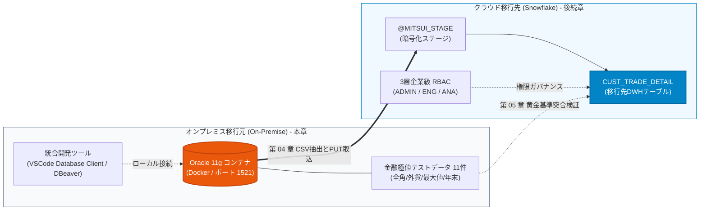

# 第 02 章：Oracle 移行元環境構築と模擬証券データ投入

大手金融機関（銀行・証券）におけるデータ基盤アーキテクチャでは、顧客の株式、外貨、債券などのコア約定明細データが、長年にわたりオンプレミス環境の Oracle リレーショナルデータベースに蓄積されてきました。

前章までにおいて、三井証券における夜間バッチ処理の遅延・超過という深刻な業務課題を整理し（[第 00 章](00_architecture_overview.md)）、クラウド側となる Snowflake エンタープライズ評価環境の開設を完了しました（[第 01 章](01_snowflake_signup.md)）。本章では、追加のハードウェア費用を一切かけずに高精度なデータ移行実務を検証するため、Docker を用いてローカル環境に **Oracle 11g 移行元サンドボックス** を立ち上げ、金融業務の境界条件を網羅した 11 パターンのテストデータを投入します。

---

## 一、 アーキテクチャの承前啓後：移行トポロジーと本章の位置付け

三井証券データ基盤モダナイゼーションの全体ロードマップにおいて、本章は「移行元データの起点」を確立する重要な位置を占めています：



- **第 00/01 章からの承前**：クラウド側の Snowflake とオンプレミス側の Oracle を 1 つの統合トポロジーとして捉え、エンドツーエンドの検証環境を完成させます；
- **第 03/04/05 章への啓後**：本章で定義する **Oracle ➔ Snowflake 型変換の設計思想** と **11 件の集計基準値（Golden Baseline）** は、後続のオブジェクト作成、`COPY INTO` 式変換、および新旧データ突合監査の絶対的基準となります。

---

## 二、 🐳 Docker による Oracle 11g コンテナ起動とライフサイクル管理

Windows (PowerShell/WSL2)、macOS、Linux の各環境で確実に動作させるため、実績豊富な軽量イメージ `gvenzl/oracle-xe:11` を採用します。

### ステップ 1：Oracle 11g XE イメージの取得
ターミナルまたは PowerShell を開き、以下のコマンドを実行します：
```bash
docker pull gvenzl/oracle-xe:11
```

### ステップ 2：コンテナ起動とデータ永続化設定
SGA メモリ不足を防ぐため `--shm-size=1g` を指定し、標準ポート `1521` を公開、データをローカルディレクトリにマウントして起動します（パスワード：`Mitsui_Sec_2026`）：

::: code-group
```bash [PowerShell / Windows]
docker run -d `
  --name mitsui_oracle_11g `
  --restart always `
  -e ORACLE_PASSWORD=Mitsui_Sec_2026 `
  -p 1521:1521 `
  --shm-size=1g `
  -v "${PWD}/oradata":/opt/oracle/oradata `
  gvenzl/oracle-xe:11
```

```bash [Bash / Linux / macOS]
sudo docker run -d \
  --name mitsui_oracle_11g \
  --restart always \
  -e ORACLE_PASSWORD=Mitsui_Sec_2026 \
  -p 1521:1521 \
  --shm-size=1g \
  -v "$PWD/oradata":/opt/oracle/oradata \
  gvenzl/oracle-xe:11
```
:::

### ステップ 3：コンテナの起動状態・ヘルスチェック
初回起動時はデータベースの初期化に 1〜2 分程度を要します。ログを監視して起動完了を確認します：
```bash
docker logs -f mitsui_oracle_11g
```
ログ末尾に以下のメッセージが出力されれば、データベースの準備は完了です：
```text
#########################
DATABASE IS READY TO USE!
#########################
```
確認後、`Ctrl + C` を押してログ監視を終了します。

---

## 三、 🔌 統合開発ツールによる疎通確認 (VSCode / DBeaver)

[第 01 章第 6 節](01_snowflake_signup.md#六-アカウント識別体系とクライアント接続エコシステム-account-identifier--ecosystem) で解説したように、現代のデータエンジニアリングでは単一の統合ツールから異種データベースを一括管理するのがベストプラクティスです。ここでは VSCode 内の **Database Client** 拡張機能、または汎用の **DBeaver** を使用します。

### 1. VSCode Database Client による接続設定

VSCode の拡張機能マーケットプレイスから **Database Client**（または Database Client JDBC）をインストールし、新しい Oracle 接続を作成します：

| 設定項目 | 入力値 | 備考 |
| :--- | :--- | :--- |
| **Connection Type** | `Oracle` | 標準の Oracle 接続プロトコル |
| **Host** | `127.0.0.1` | ローカルホスト（WSL2 環境からも localhost で到達可能） |
| **Port** | `1521` | Docker が公開している通信ポート |
| **Database / SID** | `xe` | Oracle 11g Express Edition の既定インスタンス名 |
| **Username** | `system` | データベース管理者アカウント |
| **Password** | `Mitsui_Sec_2026` | コンテナ起動時に指定したパスワード |


### 2. 接続テストと疎通の確認
**「Connect」** をクリックし、ステータスが Connected となることを確認します：


> [!TIP]
> **DBeaver を使用する場合の JDBC 接続文字列**：  
> DBeaver で接続する場合、ドライバに `Oracle` を選択し、JDBC URL として以下を指定します：  
> `jdbc:oracle:thin:@//localhost:1521/xe`（ユーザー名：`system`）。

---

## 四、 🏛️ 顧客取引明細テーブル DDL と Oracle ➔ Snowflake 設計推論哲学

金融システムのデータ移行において、テーブル定義の移行は単なる「型名の機械的置換」ではありません。文字コード体系、文字数語義、日付の正規化、監査証跡の付与など、クラウドネイティブな再設計が求められます。

### 4.1 Oracle 側 DDL：`CUST_TRADE_DETAIL` (顧客取引明細)

`system` アカウントで Oracle に接続し、以下の DDL を実行します（スクリプト：[`scripts/oracle/01_create_schema.sql`](file:///c:/Users/FX/Projects/SnowflakeBlog/scripts/oracle/01_create_schema.sql)）：

```sql
CREATE TABLE CUST_TRADE_DETAIL (
    -- ① 取引数量：一般数値、初期値 0
    TRADE_QTY          NUMBER(15)        DEFAULT 0        NOT NULL,

    -- ② 約定金額・円貨：固定 3 桁精度の統一
    AMOUNT_JPY         NUMBER(18,3)      DEFAULT 0        NOT NULL,

    -- ③ 約定金額・外貨 ＋ 通貨区分：ペア定義必須
    AMOUNT_FCY         NUMBER(18,3)      DEFAULT 0,
    CCY_CODE           VARCHAR2(3),

    -- ④ 為替レート：6 桁精度
    EXCHANGE_RATE      NUMBER(9,6),

    -- ⑤ 摘要・備考：必ず CHAR 語義を明示（既定の BYTE 語義を回避）
    REMARKS            VARCHAR2(100 CHAR) DEFAULT ' ',

    -- ⑥ 顧客ID：固定 10 桁、CHAR 語義
    CUST_ID            VARCHAR2(10 CHAR)  NOT NULL,

    -- ⑦ 区分コード
    TRADE_TYPE_CD      VARCHAR2(2 CHAR)   NOT NULL,  -- 01:買付, 02:売付
    BRANCH_CD          VARCHAR2(4 CHAR)   NOT NULL,  -- 支店コード

    -- ⑧ 業務日付
    TRADE_DATE         DATE               NOT NULL,  -- 約定日（基準日）
    SETTLE_MONTH       DATE,                         -- 決済対象月（月初日付で代表）

    -- ⑨ 監査日時
    REG_DATETIME       DATE               DEFAULT SYSDATE NOT NULL, -- 登録日時（秒精度）
    UPD_DATETIME       DATE,                                        -- 更新日時

    CONSTRAINT PK_CUST_TRADE_DETAIL PRIMARY KEY (CUST_ID, TRADE_DATE, TRADE_TYPE_CD)
);

COMMENT ON TABLE CUST_TRADE_DETAIL IS '顧客取引明細（Oracle 11g 移行元設計）';
```

---

### 4.2 🌟 重要ナレッジ：Oracle ➔ Snowflake 型マッピングと設計思想対照表

第 03 章（Snowflake 受託テーブル作成）および第 04 章（`COPY INTO` 式変換）との整合性を担保するため、両環境における型変換ルールと設計意図を以下に整理します：

| 項目分類 | Oracle 11g 移行元 | Snowflake 移行先 | アーキテクチャ設計思想と変換理由 (Rationale) |
| :--- | :--- | :--- | :--- |
| **取引数量** | `NUMBER(15)` | `NUMBER(15, 0)` | 株式数量は整数であるため、Scale=0 を明示的に指定。浮動小数点演算による丸め誤差を防止。 |
| **円貨金額** | `NUMBER(18,3)` | `NUMBER(18, 3)` | 金融決済における「銭・厘（0.001）」単位に対応。両環境で完全一致する固定小数点数を保持。 |
| **外貨・通貨** | `AMOUNT_FCY NUMBER(18,3)`<br/>`CCY_CODE VARCHAR2(3)` | `AMOUNT_FCY NUMBER(18, 3)`<br/>`CCY_CODE VARCHAR(3)` | 外貨建て取引と ISO 通貨コードの連動定義。円貨単独取引時は NULL を許容。 |
| **為替レート** | `NUMBER(9,6)` | `NUMBER(9, 6)` | 少数点以下 6 桁を確保し、低額通貨（インドネシアルピア IDR 0.000120 等）の極小レートも正確に表現。 |
| **摘要・備考** | `VARCHAR2(100 CHAR)` | `VARCHAR(100)` | **★ 最大の注意点（CHAR 語義 vs BYTE 語義）**：<br/>UTF-8 環境下では全角日本語 1 文字が 3 バイトを消費します。Oracle で既定の BYTE 語義（`VARCHAR2(100)`）を用いると 34 文字で `ORA-12899`（桁あふれ）が発生します。そのため移行元では必ず `CHAR` 語義を指定。一方、Snowflake の `VARCHAR(N)` は**最初から Unicode 文字数単位でカウント**されるため、両者の語義が完全に一致します。 |
| **約定日** | `TRADE_DATE DATE` | `VARCHAR(8)` (YYYYMMDD) | **日付の正規化・文字列スカラー化**：Oracle の `DATE` は内部的に時分秒を含んでいます。Snowflake の分析基盤では、日次キーとして扱いやすく、パーティションプルーニングを最大化するため 8 桁固定文字列 `YYYYMMDD` に変換します。 |
| **決済月** | `SETTLE_MONTH DATE` | `VARCHAR(6)` (YYYYMM) | 月次集計キーとして `YYYYMM` 形式の 6 桁文字列に正規化。 |
| **登録日時** | `REG_DATETIME DATE` | `TIMESTAMP_NTZ(6)` | **秒精度からマイクロ秒精度への進化**：Oracle DATE（秒精度）から、Snowflake ではタイムゾーンなしのマイクロ秒精度タイムスタンプ `TIMESTAMP_NTZ(6)` へ拡張。 |
| **更新日時** | `UPD_DATETIME DATE` | `TIMESTAMP_NTZ(6)` | 変更履歴監査の保持。 |
| **移行監査** | *(移行元にはなし)* | `MIGRATED_AT TIMESTAMP_LTZ(6)` | **★ クラウド移行専用列**：Snowflake 側で追加する物理取込日時列。既定値 `CURRENT_TIMESTAMP()` により、監査証跡・データリネージを自動保証。 |

---

## 五、 🧪 金融極値・境界値テストデータ（全 11 パターン）の解説と投入

本プロジェクトの移行パイプラインが実業務のあらゆるエッジケースに耐えうることを証明するため、以下の 11 種類のテストシナリオを設計しました。

### 5.1 テストケースマトリクスと設計意図

| 番号 | 業務シナリオ分類 | テストデータの特性と技術検証ポイント | 想定される検証目的 |
| :---: | :--- | :--- | :--- |
| **01** | **通常取引・国内株式** | 基準となる約定データ（国内株式買付、単価 12,345.678） | 基本的なデータパイプラインとマッピングの健全性確認 |
| **02** | **外国株式・米国口座** | 米ドル USD 建て、6 桁為替レート（150.123456）、更新日時あり | 複数通貨の取込およびタイムスタンプ更新ログの検証 |
| **03** | **外国債券・欧州発行** | ユーロ EUR 建て、整数レート（160.000000） | 外債取引および通貨ペア計算の互換性確認 |
| **04** | **境界値・最大桁数** | **数量・金額が全 9 の限界値**（`999999999999999.999`） | **極限ストレステスト**：数値のオーバーフローや指数表記（科学表記）への丸め脱落が発生しないかを検証 |
| **05** | **最小限必須項目のみ** | 主キーと NOT NULL 列のみ設定、残りは DEFAULT / NULL | 既定値補完（数量 0、金額 0）と NULL 安全性の検証 |
| **06** | **金額・数量 0 取引** | 取引数量 0、約定金額 0.000（失効・取消取引） | ゼロ除算の防止および集計バッチでのゼロ値処理確認 |
| **07** | **全角・半角混在摘要** | 日英混在、全角数字、特殊記号（`！＠＃`） | CSV エクスポート時のダブルクォートエスケープおよび文字化け耐性確認 |
| **08** | **全角 100 文字限界値** | **ちょうど 100 文字の全角漢字**（計 300 バイト） | **文字数語義の境界検証**：`VARCHAR2(100 CHAR)` から `VARCHAR(100)` への欠落なき取込を実証 |
| **09** | **訂正取引（更新あり）** | 登録日時より後の `UPD_DATETIME` を保持 | タイムスタンプの順序性と増分差分ロジックの検証 |
| **10** | **超極小レート通貨** | 低額通貨 IDR（インドネシアルピア）、レート `0.000120` | 微小浮動小数がアンダーフローせず正確に格納されるかを確認 |
| **11** | **年末最終秒取引** | `2024-12-31 23:58:59` の年越取引 | 年末年始バッチ境界および日付プルーニングの検証 |

---

### 5.2 模擬テストデータ投入 SQL スクリプト

以下の SQL をコピーし、VSCode Database Client または Oracle 接続環境で一括実行します（スクリプト：[`scripts/oracle/02_seed_trades_data.sql`](file:///c:/Users/FX/Projects/SnowflakeBlog/scripts/oracle/02_seed_trades_data.sql)）：

```sql
-- 1. 通常取引・国内株式
INSERT INTO CUST_TRADE_DETAIL
(TRADE_QTY, AMOUNT_JPY, AMOUNT_FCY, CCY_CODE, EXCHANGE_RATE, REMARKS,
 CUST_ID, TRADE_TYPE_CD, BRANCH_CD, TRADE_DATE, SETTLE_MONTH,
 REG_DATETIME, UPD_DATETIME)
VALUES
(1000, 12345678.900, NULL, NULL, NULL, '通常取引・国内株式',
 'CU00001234', '01', '0001', DATE '2025-03-25', DATE '2025-03-01',
 TO_DATE('2025-03-25 09:05:30','YYYY-MM-DD HH24:MI:SS'), NULL);

-- 2. 外国株式・米国口座（USD レート付き）
INSERT INTO CUST_TRADE_DETAIL
(TRADE_QTY, AMOUNT_JPY, AMOUNT_FCY, CCY_CODE, EXCHANGE_RATE, REMARKS,
 CUST_ID, TRADE_TYPE_CD, BRANCH_CD, TRADE_DATE, SETTLE_MONTH,
 REG_DATETIME, UPD_DATETIME)
VALUES
(500, 7500000.000, 50000.500, 'USD', 150.123456, '外国株式・米国口座',
 'CU00005678', '02', '0002', DATE '2025-03-26', DATE '2025-03-01',
 TO_DATE('2025-03-26 10:15:00','YYYY-MM-DD HH24:MI:SS'),
 TO_DATE('2025-03-26 14:20:45','YYYY-MM-DD HH24:MI:SS'));

-- 3. 外国債券・欧州発行（EUR レート付き）
INSERT INTO CUST_TRADE_DETAIL
(TRADE_QTY, AMOUNT_JPY, AMOUNT_FCY, CCY_CODE, EXCHANGE_RATE, REMARKS,
 CUST_ID, TRADE_TYPE_CD, BRANCH_CD, TRADE_DATE, SETTLE_MONTH,
 REG_DATETIME, UPD_DATETIME)
VALUES
(200, 3200000.000, 20000.000, 'EUR', 160.000000, '外国債券・欧州発行',
 'CU00009999', '01', '0003', DATE '2025-03-27', DATE '2025-03-01',
 TO_DATE('2025-03-27 11:00:00','YYYY-MM-DD HH24:MI:SS'), NULL);

-- 4. 境界値テスト・最大桁数（全 9 限界値）
INSERT INTO CUST_TRADE_DETAIL
(TRADE_QTY, AMOUNT_JPY, AMOUNT_FCY, CCY_CODE, EXCHANGE_RATE, REMARKS,
 CUST_ID, TRADE_TYPE_CD, BRANCH_CD, TRADE_DATE, SETTLE_MONTH,
 REG_DATETIME, UPD_DATETIME)
VALUES
(999999999999999, 999999999999999.999, 999999999999999.999, 'USD', 999.999999,
 '境界値テスト・最大桁数',
 'CU00000001', '01', '9999', DATE '2025-01-01', DATE '2025-01-01',
 TO_DATE('2025-01-01 00:00:00','YYYY-MM-DD HH24:MI:SS'), NULL);

-- 5. 最小限必須項目のみ（各項目初期値の確認）
INSERT INTO CUST_TRADE_DETAIL
(CUST_ID, TRADE_TYPE_CD, BRANCH_CD, TRADE_DATE)
VALUES
('CU00002222', '02', '0005', DATE '2025-03-28');

-- 6. 金額 0・数量 0 の取引（月次失効バッチ想定）
INSERT INTO CUST_TRADE_DETAIL
(TRADE_QTY, AMOUNT_JPY, AMOUNT_FCY, CCY_CODE, EXCHANGE_RATE, REMARKS,
 CUST_ID, TRADE_TYPE_CD, BRANCH_CD, TRADE_DATE, SETTLE_MONTH,
 REG_DATETIME, UPD_DATETIME)
VALUES
(0, 0.000, NULL, NULL, NULL, '月次集計バッチ・2025年2月分',
 'CU00003333', '03', '0001', DATE '2025-02-28', DATE '2025-02-01',
 TO_DATE('2025-03-01 01:00:00','YYYY-MM-DD HH24:MI:SS'), NULL);

-- 7. 全角・半角混在文字の摘要テスト
INSERT INTO CUST_TRADE_DETAIL
(TRADE_QTY, AMOUNT_JPY, AMOUNT_FCY, CCY_CODE, EXCHANGE_RATE, REMARKS,
 CUST_ID, TRADE_TYPE_CD, BRANCH_CD, TRADE_DATE, SETTLE_MONTH,
 REG_DATETIME, UPD_DATETIME)
VALUES
(300, 4500000.000, NULL, NULL, NULL,
 RPAD('全角混在の摘要テスト（日本語・English・123・記号！＠＃）', 95, 'X'),
 'CU00004444', '01', '0002', DATE '2025-03-29', DATE '2025-03-01',
 TO_DATE('2025-03-29 13:45:12','YYYY-MM-DD HH24:MI:SS'), NULL);

-- 8. 全角 100 文字境界値テスト（VARCHAR2(100 CHAR) 語義検証用）
INSERT INTO CUST_TRADE_DETAIL
(TRADE_QTY, AMOUNT_JPY, AMOUNT_FCY, CCY_CODE, EXCHANGE_RATE, REMARKS,
 CUST_ID, TRADE_TYPE_CD, BRANCH_CD, TRADE_DATE, SETTLE_MONTH,
 REG_DATETIME, UPD_DATETIME)
VALUES
(300, 4500000.000, NULL, NULL, NULL,
 RPAD('全角文字百桁境界値検証用摘要欄', 100, '全'),
 'CU00004445', '01', '0002', DATE '2025-03-29', DATE '2025-03-01',
 TO_DATE('2025-03-29 13:45:12','YYYY-MM-DD HH24:MI:SS'), NULL);

-- 9. 訂正取引（更新日時あり）
INSERT INTO CUST_TRADE_DETAIL
(TRADE_QTY, AMOUNT_JPY, AMOUNT_FCY, CCY_CODE, EXCHANGE_RATE, REMARKS,
 CUST_ID, TRADE_TYPE_CD, BRANCH_CD, TRADE_DATE, SETTLE_MONTH,
 REG_DATETIME, UPD_DATETIME)
VALUES
(800, 9800000.000, NULL, NULL, NULL, '訂正取引・数量修正あり',
 'CU00005555', '02', '0004', DATE '2025-03-30', DATE '2025-03-01',
 TO_DATE('2025-03-30 09:00:00','YYYY-MM-DD HH24:MI:SS'),
 TO_DATE('2025-03-31 16:30:00','YYYY-MM-DD HH24:MI:SS'));

-- 10. レート少数桁・低額通貨テスト（インドネシアルピア想定）
INSERT INTO CUST_TRADE_DETAIL
(TRADE_QTY, AMOUNT_JPY, AMOUNT_FCY, CCY_CODE, EXCHANGE_RATE, REMARKS,
 CUST_ID, TRADE_TYPE_CD, BRANCH_CD, TRADE_DATE, SETTLE_MONTH,
 REG_DATETIME, UPD_DATETIME)
VALUES
(10, 1200.000, 1000.000, 'IDR', 0.000120, '低額通貨レートテスト（インドネシアルピア想定）',
 'CU00006666', '01', '0006', DATE '2025-04-01', DATE '2025-04-01',
 TO_DATE('2025-04-01 08:30:00','YYYY-MM-DD HH24:MI:SS'), NULL);

-- 11. 年末最終営業日取引（日付・時刻境界テスト）
INSERT INTO CUST_TRADE_DETAIL
(TRADE_QTY, AMOUNT_JPY, AMOUNT_FCY, CCY_CODE, EXCHANGE_RATE, REMARKS,
 CUST_ID, TRADE_TYPE_CD, BRANCH_CD, TRADE_DATE, SETTLE_MONTH,
 REG_DATETIME, UPD_DATETIME)
VALUES
(50, 650000.000, NULL, NULL, NULL, '年末最終営業日取引',
 'CU00007777', '01', '0001', DATE '2024-12-31', DATE '2024-12-01',
 TO_DATE('2024-12-31 23:58:59','YYYY-MM-DD HH24:MI:SS'), NULL);

COMMIT;
```

---

## 六、 🎯 新旧データ突合の「黄金基準値 (Golden Baseline)」の確立 (第 05 章直結)

データ投入完了後、Oracle 側で直ちに以下の集計クエリを実行し、移行元の「不変の集計フィンガープリント」を取得します：

```sql
SELECT 
    COUNT(*)                                       AS TOTAL_TRADES,
    SUM(TRADE_QTY)                                 AS TOTAL_QTY,
    ROUND(SUM(AMOUNT_JPY), 3)                      AS TOTAL_AMOUNT_JPY,
    ROUND(SUM(NVL(AMOUNT_FCY, 0)), 3)              AS TOTAL_AMOUNT_FCY,
    TO_CHAR(MIN(TRADE_DATE), 'YYYYMMDD')           AS EARLIEST_TRADE_DATE,
    TO_CHAR(MAX(TRADE_DATE), 'YYYYMMDD')           AS LATEST_TRADE_DATE
FROM CUST_TRADE_DETAIL;
```

### 📋 検証用黄金基準値 (Golden Baseline)

クエリの実行結果として、以下の基準値が正しく算出されていることを記録します：

| 突合監査指標 (Metrics) | Oracle 移行元基準値 (Baseline) | 金融業務上の検証目的 |
| :--- | :--- | :--- |
| **総取引件数 (TOTAL_TRADES)** | **`11` 件** | 移行パイプラインにおけるレコード脱落ゼロ（$\Delta = 0$）を保証 |
| **約定数量合計 (TOTAL_QTY)** | **`1,000,000,000,002,160` 株** | 大規模数値 `NUMBER(15)` の累積オーバーフローなきことを実証 |
| **円貨約定代金 (TOTAL_AMOUNT_JPY)** | **`1,000,000,042,396,878.900` 円** | 固定小数点 3 桁精度の金額合算が完全一致することを保証 |
| **外貨約定代金 (TOTAL_AMOUNT_FCY)** | **`1,000,000,000,071,000.499`** | 複数外貨の混在環境下での合算精度を担保 |
| **最古約定日 (EARLIEST_TRADE_DATE)** | **`20241231`** | 年末境界取引の日付マッピング整合性を確認 |
| **最新約定日 (LATEST_TRADE_DATE)** | **`20250401`** | 新年度首日取引の日付マッピング整合性を確認 |

> [!IMPORTANT]
> **後続章への絶対的コミットメント**：  
> 本テーブルの数値を記録しておいてください。[第 05 章《移行後データ突合検証・整合性監査》](05_data_reconciliation.md) では、三井証券のデータアナリスト `MITSUI_ANALYST` として、Snowflake 側で同一の集計クエリおよびハッシュ突合を実行し、**誤差 0.000・欠落ゼロ・100% 完全一致** を合否判定基準として厳格に監査・サインオフします。

---

## 七、 本章のまとめと次章ナビゲーション

本章を通じて、ローカル Docker 環境上に忠実な Oracle 11g 金融コア業務データベースを構築し、11 パターンの極値テストデータを投入、そして将来の突合検証に向けた黄金基準値を確立しました。

次章より、いよいよクラウド側（Snowflake）の本格構築とデータ移行実務へ突入します：
- 👉 **[第 03 章：3 層 RBAC 権限モデルと環境構築実戦](03_snowflake_rbac_setup.md)**：`USERADMIN` と `SYSADMIN` の役割分担のもと、三井証券の 3 層業務ロール（ADMIN / ENGINEER / ANALYST）を構築し、本章の設計思想に則ったステージ `@MITSUI_STAGE` およびターゲットテーブル `CUST_TRADE_DETAIL` を作成します！
