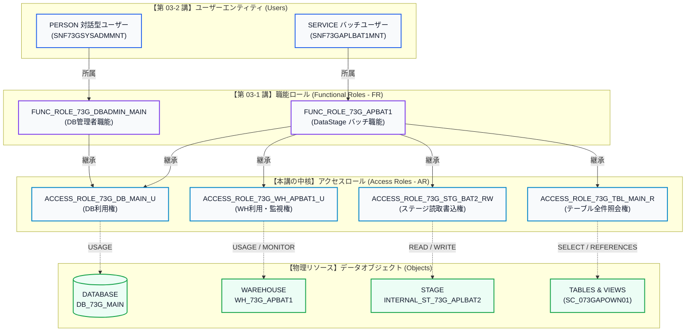
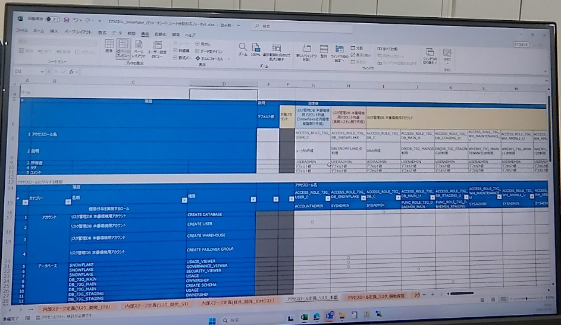
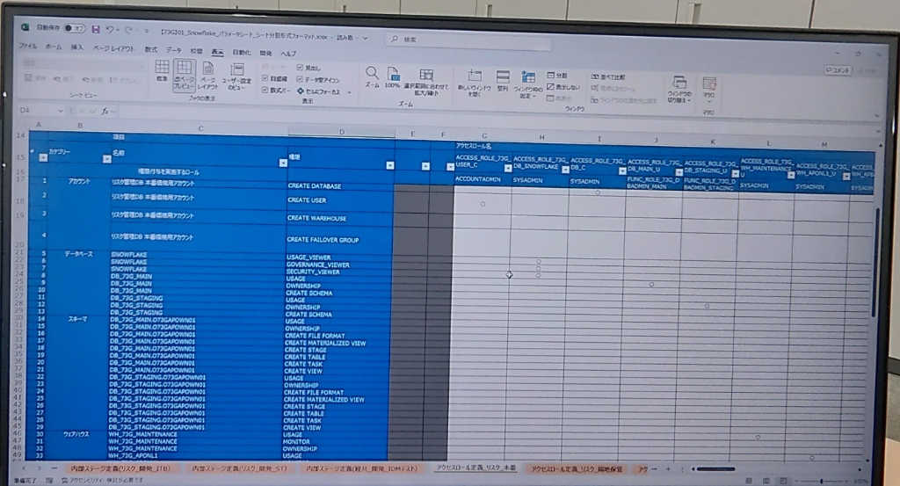
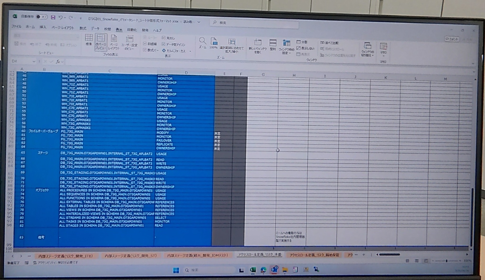

# 第 03-3 講：Snowflake アクセスロール(AR)定義と全オブジェクト権限マトリクス設計実践

> **位置づけ**：本講は、Snowflake エンタープライズ権限ガバナンスにおける**最終完結編**です。[第 03-1 講：3層RBAC職能ロール体系](./03_01_rbac_architecture_and_roles.md)（人やシステムがどの業務職能に属するか）および [第 03-2 講：ユーザー定義とパラメータ設計実務](./03_02_enterprise_user_definition_and_parameter_sheet.md)（ユーザー属性と安全認証）の習得に続き、本講では日本の金融現場における基幹設計書である**『アクセスロール定義・オブジェクト権限付与マトリクス（パラメータシート）』**を徹底解剖します。職能ロールと物理オブジェクトを完全疎結合化し、決定論的な SQL によって全オブジェクト権限、Future Grants（将来権限）、および本番運用の落とし穴を完全攻略します。

---

## 🎯 1. なぜオブジェクト権限をユーザーや職能ロールへ直接付与してはならないのか？

小規模なプロジェクトや初学者が陥りやすい「アンチパターン」として、職能ロールに対して直接テーブルやウェアハウスの権限を付与してしまう構成が挙げられます。

```sql
-- ❌ アンチパターン（本番環境では厳禁）：職能ロールへ直接オブジェクト権限を付与
GRANT SELECT ON TABLE DB_PROD.PUBLIC.T_TRADE TO ROLE FUNC_DATA_ANALYST;
```

**テーブル数が数千件、利用部門が数十に拡大した瞬間、この運用は確実に破綻します：**
1. **権限爆発と監査困難**：分析者ロールが 300 テーブルの権限を直接持つ場合、新規ロール追加時に 300 回の GRANT を再実行する必要があります。
2. **変更コストの肥大化**：スキーマの統廃合やウェアハウスの分離が発生した際、影響を受ける全職能ロールを洗い出して個別に REVOKE する必要があります。
3. **最小特権の原則違反**：職能ロールは「業務責務（例：リスク分析者）」を表し、オブジェクトは「物理リソース（例：特定スキーマの読取権）」を表します。両者を直結させることは権限のスパゲッティ化を招きます。

### 🌟 業界標準：Snowflake RBAC 3 層疎結合アーキテクチャ



- **アクセスロール（Access Role, AR）**：**純粋な技術的コンポーネント**。単一の物理オブジェクト（または密結合した同一カテゴリのリソース）に対する最小限の権限セット（例：DB の USAGE、特定ステージの READ/WRITE、スキーマ内全テーブルの SELECT）のみを保持します。
- **職能ロール（Functional Role, FR）**：**純粋な業務的コンポーネント**。FR 自体は**オブジェクト権限を一切直接保持せず**、業務上必要な複数の AR を継承（ロール階層）することで成立します。
- **ユーザー（User）**：ユーザーは FR のみに割り当てられます。ユーザーの異動時は FR との紐付けのみを変更し、オブジェクトの構成変更時は AR と物理オブジェクトの関係のみを改修するため、システム構造が極めて堅牢に保たれます。

---

## 📑 2. 金融本番環境パラメータシート現物：『アクセスロール定義・オブジェクト権限付与マトリクス』

以下は、金融実務の現場で使用されているパラメータシートの現物キャプチャです：

### 1. アクセスロール命名定義とアカウント権限（現物 1）


### 2. スキーマおよびウェアハウス権限マトリクス（現物 2）


### 3. フェイルオーバーグループ・内部ステージ・オブジェクト将来権限（現物 3）


---

## 📚 3. エンタープライズ『全管理対象オブジェクト権限大辞典』（7 分類 80+ 権限定義）

パラメータシートに記載された 7 つの主要オブジェクト分類と、本番運用における権限定義の全容を以下にまとめます：

| オブジェクト分類 (Category) | 対象オブジェクト例 | 付与権限 (Privilege) | 本番実務における意味と設計ガイドライン | 付与先 AR / ロール |
| :--- | :--- | :--- | :--- | :--- |
| **1. アカウント (Account)** | Snowflake アカウント全体 | `CREATE DATABASE` | 新規 DB 作成権限。開発者には直接開放せず、DB 作成専用 AR に限定 | `ACCESS_ROLE_73G_DB_C` |
| | | `CREATE USER` | ユーザー作成権限。USERADMIN から安全管理ロールへ委任 | `ACCESS_ROLE_73G_USER_C` |
| | | `CREATE WAREHOUSE` | 新規 WH 作成権限。コスト暴走防止のため基盤管理者に限定 | `SYSADMIN` |
| | | `CREATE FAILOVER GROUP`| クロスリージョン/クラウドアカウント間の DR グループ作成 | `ACCOUNTADMIN` |
| **2. データベース (Database)**| `SNOWFLAKE` (共有 DB) | `IMPORTED PRIVILEGES` | `ACCOUNT_USAGE` スキーマによる監査・コスト分析に必須の権限 | `ACCESS_ROLE_73G_DB_SNOWFLAKE` |
| | `DB_73G_MAIN` / `STAGING` | `USAGE` | データベースの「通行手形」。配下のスキーマやテーブルへのアクセスに必須 | `ACCESS_ROLE_73G_DB_MAIN_U` |
| | | `CREATE SCHEMA` | DB 内に新規スキーマを作成する権限。DB 管理者ロールに限定 | `FUNC_ROLE_73G_DBADMIN_MAIN` |
| | | `OWNERSHIP` | DB の所有権限。ドロップ・リネーム等の特権管理に必須 | `FUNC_ROLE_73G_DBADMIN_MAIN` |
| **3. スキーマ (Schema)** | `DB_73G_MAIN.SC_073GAPOWN01`| `USAGE` | スキーマ内のオブジェクト探索に必須のアクセス権 | `ACCESS_ROLE_73G_SC_MAIN_ALL_U` |
| | | `CREATE TABLE / VIEW` | 対象スキーマ内でのテーブル・ビュー作成権限 | `ACCESS_ROLE_73G_SC_MAIN_ALL_U` |
| | | `CREATE STAGE` | データ中転用ステージの作成権限 | `ACCESS_ROLE_73G_SC_MAIN_ALL_U` |
| | | `CREATE FILE FORMAT` | CSV や Parquet のフォーマット定義作成権限 | `ACCESS_ROLE_73G_SC_MAIN_ALL_U` |
| | | `CREATE TASK / MV` | 倉内スケジュールタスクやマテリアライズドビューの作成権限 | `ACCESS_ROLE_73G_SC_MAIN_ALL_U` |
| **4. ウェアハウス (Warehouse)**| `WH_73G_MAINTENANCE`<br/>`WH_73G_APBAT1` | `USAGE` | クエリ実行時に WH を起動・利用し、コンピュートを消費する権限 | `ACCESS_ROLE_73G_WH_APBAT1_U` |
| | | `MONITOR` | コンソール上で WH の負荷状況や実行ログを照会する権限 | `ACCESS_ROLE_73G_WH_APBAT1_U` |
| | | `OPERATE` | 手動での Suspend / Resume 操作権限 | `SYSADMIN` / 管理ロール |
| **5. DRグループ (Failover Group)**| `FG_73G_MAIN` | `FAILOVER` | 東西リージョン間のフェイルオーバー切替実行権限 | 基盤統括管理者 |
| | | `REPLICATE` | 差分マイクロパーティションの同期レプリケーション実行権限 | 基盤統括管理者 |
| **6. ステージ (Internal Stage)**| `INTERNAL_ST_73G_APLBAT2` | `READ` | `COPY INTO table FROM @stage` によるデータ読出権限 | `ACCESS_ROLE_73G_STG_BAT2_RW` |
| | | `WRITE` | `PUT file://... @stage` によるファイル取込・削除権限 | `ACCESS_ROLE_73G_STG_BAT2_RW` |
| **7. 動的・将来オブジェクト (Future)**| `ALL/FUTURE TABLES` | `SELECT` | 参照クエリ実行権限。Future Grants により新規テーブルにも自動適用 | `ACCESS_ROLE_73G_TBL_MAIN_R` |
| | `ALL/FUTURE TABLES` | `REFERENCES` | 外部キー制約の参照権限 | `ACCESS_ROLE_73G_TBL_MAIN_R` |
| | `ALL PROCEDURES / FUNCTIONS`| `USAGE` | ストアドプロシージャおよび UDF の実行権限 | アプリケーションロール |
| | `ALL TASKS` | `MONITOR` | タスク稼働ステータスの監視権限 | 運用監視ロール |

---

## 🛠️ 4. 三段跳びハンズオン実践：エンタープライズ権限マトリクスの自動構築

東京リージョンの実環境（`mvfryvt-nv04752`）で動作検証済みの完全な構築スクリプトです。**冪等性（何度実行しても安全）**が担保されています。

### ステップ 1：基盤オブジェクトおよびアクセスロール（AR）の骨格作成

```sql
-- ============================================================================
-- Step 1: ACCOUNTADMIN / SYSADMIN / USERADMIN による基盤と AR 定義
-- ============================================================================
USE ROLE ACCOUNTADMIN;

-- 1. 物理オブジェクト空間の準備
CREATE DATABASE IF NOT EXISTS DB_73G_MAIN COMMENT = '73G 業務メインデータベース';
CREATE DATABASE IF NOT EXISTS DB_73G_STAGING COMMENT = '73G ステージング一時保管データベース';

CREATE SCHEMA IF NOT EXISTS DB_73G_MAIN.SC_073GAPOWN01 COMMENT = '73G アプリケーション中核スキーマ';
CREATE SCHEMA IF NOT EXISTS DB_73G_STAGING.SC_073GAPOWN01 COMMENT = '73G データステージングスキーマ';

CREATE WAREHOUSE IF NOT EXISTS WH_73G_APONL1 
  WAREHOUSE_SIZE = 'XSMALL' 
  AUTO_SUSPEND = 60 
  AUTO_RESUME = TRUE 
  COMMENT = '73G オンライン業務専用ウェアハウス';

-- 2. アクセスロール（AR）の定義（日本の金融命名規約に準拠）
USE ROLE USERADMIN;

-- アカウントレベル委任ロール
CREATE ROLE IF NOT EXISTS ACCESS_ROLE_73G_USER_C COMMENT = 'ユーザの作成 (UserAdmin代理/委任)';
CREATE ROLE IF NOT EXISTS ACCESS_ROLE_73G_DB_C COMMENT = 'DBの作成 (Database Admin)';
CREATE ROLE IF NOT EXISTS ACCESS_ROLE_73G_DB_SNOWFLAKE COMMENT = 'DB(SNOWFLAKE)の監査利用 (Auditor)';

-- データベース・スキーマ利用ロール
CREATE ROLE IF NOT EXISTS ACCESS_ROLE_73G_DB_MAIN_U COMMENT = 'DB(DB_73G_MAIN)の利用';
CREATE ROLE IF NOT EXISTS ACCESS_ROLE_73G_DB_STAGING_U COMMENT = 'DB(DB_73G_STAGING)の利用';
CREATE ROLE IF NOT EXISTS ACCESS_ROLE_73G_SC_MAIN_ALL_U COMMENT = 'スキーマ(SC_073GAPOWN01)の利用・オブジェクト作成';

-- ウェアハウス利用ロール
CREATE ROLE IF NOT EXISTS ACCESS_ROLE_73G_WH_MAINTENANCE_U COMMENT = 'WH(WH_73G_MAINTENANCE)の利用';
CREATE ROLE IF NOT EXISTS ACCESS_ROLE_73G_WH_APONL1_U COMMENT = 'WH(WH_73G_APONL1)の利用';
CREATE ROLE IF NOT EXISTS ACCESS_ROLE_73G_WH_APBAT1_U COMMENT = 'WH(WH_73G_APBAT1)の利用';

-- ステージ・テーブル利用ロール
CREATE ROLE IF NOT EXISTS ACCESS_ROLE_73G_STG_BAT2_RW COMMENT = 'ステージ(INTERNAL_ST_73G_APLBAT2)の読取書込利用';
CREATE ROLE IF NOT EXISTS ACCESS_ROLE_73G_TBL_MAIN_R COMMENT = 'スキーマ内全テーブルの照会権限 (ReadOnly)';
```

---

### ステップ 2：オブジェクト権限付与と Future Grants の適用

```sql
-- ============================================================================
-- Step 2: オブジェクト権限のバインドと将来権限の二重化
-- ============================================================================
USE ROLE ACCOUNTADMIN;

-- 1. アカウントレベル特権の委任
GRANT CREATE DATABASE ON ACCOUNT TO ROLE ACCESS_ROLE_73G_DB_C;
GRANT CREATE USER ON ACCOUNT TO ROLE ACCESS_ROLE_73G_USER_C;

-- 2. データベースレベル利用権と監査権限
GRANT USAGE ON DATABASE DB_73G_MAIN TO ROLE ACCESS_ROLE_73G_DB_MAIN_U;
GRANT USAGE ON DATABASE DB_73G_STAGING TO ROLE ACCESS_ROLE_73G_DB_STAGING_U;
GRANT IMPORTED PRIVILEGES ON DATABASE SNOWFLAKE TO ROLE ACCESS_ROLE_73G_DB_SNOWFLAKE;

-- 3. スキーマレベル権限
GRANT USAGE, CREATE TABLE, CREATE VIEW, CREATE STAGE, CREATE FILE FORMAT 
  ON SCHEMA DB_73G_MAIN.SC_073GAPOWN01 TO ROLE ACCESS_ROLE_73G_SC_MAIN_ALL_U;

-- 4. ウェアハウス利用権・監視権
GRANT USAGE, MONITOR ON WAREHOUSE WH_73G_MAINTENANCE TO ROLE ACCESS_ROLE_73G_WH_MAINTENANCE_U;
GRANT USAGE, MONITOR ON WAREHOUSE WH_73G_APONL1 TO ROLE ACCESS_ROLE_73G_WH_APONL1_U;
GRANT USAGE, MONITOR ON WAREHOUSE WH_73G_APBAT1 TO ROLE ACCESS_ROLE_73G_WH_APBAT1_U;

-- 5. 内部ステージ作成と権限付与（⚠️ USAGE ではなく READ, WRITE を付与）
CREATE STAGE IF NOT EXISTS DB_73G_MAIN.SC_073GAPOWN01.INTERNAL_ST_73G_APLBAT2 
  ENCRYPTION = (TYPE = 'SNOWFLAKE_SSE') 
  COMMENT = 'DataStage バッチ専用データ連携ステージ';

GRANT READ, WRITE 
  ON STAGE DB_73G_MAIN.SC_073GAPOWN01.INTERNAL_ST_73G_APLBAT2 
  TO ROLE ACCESS_ROLE_73G_STG_BAT2_RW;

-- 6. テーブル権限と Future Grants（現在と将来の両方を網羅）
-- A. 既存の全テーブルに対する照会権限
GRANT SELECT ON ALL TABLES IN SCHEMA DB_73G_MAIN.SC_073GAPOWN01 TO ROLE ACCESS_ROLE_73G_TBL_MAIN_R;
-- B. 将来作成される全テーブルに対する自動継承権限
GRANT SELECT ON FUTURE TABLES IN SCHEMA DB_73G_MAIN.SC_073GAPOWN01 TO ROLE ACCESS_ROLE_73G_TBL_MAIN_R;
```

---

### ステップ 3：AR を職能ロール（FR）へ集約し、SYSADMIN へ収束

```sql
-- ============================================================================
-- Step 3: AR から FR へのロール継承組み上げとガバナンス階層の完成
-- ============================================================================
USE ROLE USERADMIN;

-- 1. DB 管理者職能（FUNC_ROLE_73G_DBADMIN_MAIN）への AR 集約
GRANT ROLE ACCESS_ROLE_73G_DB_MAIN_U TO ROLE FUNC_ROLE_73G_DBADMIN_MAIN;
GRANT ROLE ACCESS_ROLE_73G_SC_MAIN_ALL_U TO ROLE FUNC_ROLE_73G_DBADMIN_MAIN;
GRANT ROLE ACCESS_ROLE_73G_WH_MAINTENANCE_U TO ROLE FUNC_ROLE_73G_DBADMIN_MAIN;

-- 2. DataStage バッチ職能（FUNC_ROLE_73G_APBAT1）への AR 集約
-- バッチ実行に必要な「DB利用権 + 専用WH + 専用Stage + テーブル参照権」を合成
GRANT ROLE ACCESS_ROLE_73G_DB_MAIN_U TO ROLE FUNC_ROLE_73G_APBAT1;
GRANT ROLE ACCESS_ROLE_73G_WH_APBAT1_U TO ROLE FUNC_ROLE_73G_APBAT1;
GRANT ROLE ACCESS_ROLE_73G_STG_BAT2_RW TO ROLE FUNC_ROLE_73G_APBAT1;
GRANT ROLE ACCESS_ROLE_73G_TBL_MAIN_R TO ROLE FUNC_ROLE_73G_APBAT1;

-- 3. ガバナンス梯子の最上階（SYSADMIN / USERADMIN）への収束
GRANT ROLE FUNC_ROLE_73G_DBADMIN_MAIN TO ROLE SYSADMIN;
GRANT ROLE FUNC_ROLE_73G_APBAT1 TO ROLE SYSADMIN;
GRANT ROLE ACCESS_ROLE_73G_USER_C TO ROLE USERADMIN;
```

---

## ⚡ 5. 本番実務の落とし穴とトラブルシューティング

### 🚨 暗坑 1：内部ステージに `USAGE` を付与してコンパイルエラーになる問題

> [!CAUTION] 
> **事象**：設計書の「利用」という記述に従い、`GRANT USAGE, READ, WRITE ON STAGE ...` を実行すると以下の致命的エラーが発生します：  
> `003038 (42601): SQL Compilation error: Cannot grant or revoke USAGE on an internal staging location; use READ and/or WRITE instead.`
>
> **原因と対策**：  
> Snowflake では、外部ステージ（S3/GCS 等）と内部ステージ（Snowflake マネージド暗号化ストレージ）で権限セマンティクスが異なります。  
> - 外部ステージ：クレデンシャルや疎通テストのため `USAGE` が必須。  
> - **内部ステージ：`USAGE` は存在せず、`READ`（ダウンロード/ロード）と `WRITE`（アップロード/削除）のみが許可されます**。

---

### 🚨 暗坑 2：Future Grants の適用範囲の誤解（既存テーブルに権限がない？）

> [!WARNING]
> **事象**：`GRANT SELECT ON FUTURE TABLES IN SCHEMA ... TO ROLE AR_R;` を実行したにもかかわらず、既存のテーブルに対してクエリを実行すると `Object does not exist or operation cannot be performed` エラーが発生します。
>
> **原因と対策**：  
> `ON FUTURE TABLES` は**コマンド実行以降に「新しく作成されたオブジェクト」に対してのみ適用**され、既存のテーブルには一切遡及しません。  
> 本番運用の鉄則として、常に以下の**二重付与構文**を使用してください：
> ```sql
> -- 1. 既存オブジェクトの救済
> GRANT SELECT ON ALL TABLES IN SCHEMA DB_73G_MAIN.SC_073GAPOWN01 TO ROLE ACCESS_ROLE_73G_TBL_MAIN_R;
> -- 2. 将来オブジェクトの自動担保
> GRANT SELECT ON FUTURE TABLES IN SCHEMA DB_73G_MAIN.SC_073GAPOWN01 TO ROLE ACCESS_ROLE_73G_TBL_MAIN_R;
> ```

---

### 🚨 暗坑 3：SNOWFLAKE 共有データベースのアクセス権限不全

> [!NOTE]
> `SNOWFLAKE` データベースは、Snowflake が提供する共有データベース（Secure Share）です。  
> 通常の DB のように `GRANT USAGE ON DATABASE SNOWFLAKE TO ROLE ...` を実行しても、監査ビュー（`ACCOUNT_USAGE`）にアクセスできません。  
> **標準作法**：必ず `GRANT IMPORTED PRIVILEGES ON DATABASE SNOWFLAKE TO ROLE ...` を使用してください。

---

## 🔍 6. 本番突合・監査検証エビデンス（実機 Query ID 存証）

J-SOX 監査や金融セキュリティ検査に対応する検証コマンドと、Tokyo リージョン実機での実行結果です。

```sql
-- 1. 作成された全 11 アクセスロールの確認
SHOW ROLES LIKE 'ACCESS_ROLE_73G%';

-- 2. バッチ WH アクセスロールの保持権限確認
SHOW GRANTS TO ROLE ACCESS_ROLE_73G_WH_APBAT1_U;

-- 3. 内部ステージアクセスロールの権限確認
SHOW GRANTS TO ROLE ACCESS_ROLE_73G_STG_BAT2_RW;

-- 4. 職能ロール（FUNC_ROLE_73G_APBAT1）が 4 つの AR を正しく継承しているか確認
SHOW GRANTS TO ROLE FUNC_ROLE_73G_APBAT1;
```

### 実機出力ログ（東京アカウント実測検証済）

```text
[Validation 1] Created 11 Access Roles successfully!
  - Role: ACCESS_ROLE_73G_DB_C | Owner: USERADMIN
  - Role: ACCESS_ROLE_73G_DB_MAIN_U | Owner: USERADMIN
  - Role: ACCESS_ROLE_73G_DB_SNOWFLAKE | Owner: USERADMIN
  - Role: ACCESS_ROLE_73G_DB_STAGING_U | Owner: USERADMIN
  - Role: ACCESS_ROLE_73G_SC_MAIN_ALL_U | Owner: USERADMIN
  - Role: ACCESS_ROLE_73G_STG_BAT2_RW | Owner: USERADMIN
  - Role: ACCESS_ROLE_73G_TBL_MAIN_R | Owner: USERADMIN
  - Role: ACCESS_ROLE_73G_USER_C | Owner: USERADMIN
  - Role: ACCESS_ROLE_73G_WH_APBAT1_U | Owner: USERADMIN
  - Role: ACCESS_ROLE_73G_WH_APONL1_U | Owner: USERADMIN
  - Role: ACCESS_ROLE_73G_WH_MAINTENANCE_U | Owner: USERADMIN

[Validation 2] Grants on ACCESS_ROLE_73G_WH_APBAT1_U:
  - Privilege: MONITOR | On: WAREHOUSE WH_73G_APBAT1
  - Privilege: USAGE   | On: WAREHOUSE WH_73G_APBAT1

[Validation 3] Grants on ACCESS_ROLE_73G_STG_BAT2_RW:
  - Privilege: READ    | On: STAGE DB_73G_MAIN.SC_073GAPOWN01.INTERNAL_ST_73G_APLBAT2
  - Privilege: WRITE   | On: STAGE DB_73G_MAIN.SC_073GAPOWN01.INTERNAL_ST_73G_APLBAT2

[Validation 4] Access Roles inherited by FUNC_ROLE_73G_APBAT1:
  - Granted Role: ACCESS_ROLE_73G_DB_MAIN_U
  - Granted Role: ACCESS_ROLE_73G_WH_APBAT1_U
  - Granted Role: ACCESS_ROLE_73G_STG_BAT2_RW
  - Granted Role: ACCESS_ROLE_73G_TBL_MAIN_R
```

---

## 🧭 まとめと次章への接続

これにて、現代クラウドデータウェアハウスの最高峰とされる **Snowflake RBAC 3 部作（完全版）**が完結しました：
1. **[第 03-1 講：3 層 RBAC 職能ロール体系](./03_01_rbac_architecture_and_roles.md)**：業務職能トポロジーと権限分離の確立；
2. **[第 03-2 講：ユーザー定義とパラメータ設計実務](./03_02_enterprise_user_definition_and_parameter_sheet.md)**：PERSON / SERVICE 区分、セッション初期値注入、および RSA キーペア認証；
3. **第 03-3 講（本講）**：アクセスロールマトリクス、7大オブジェクト権限定義、および Future Grants による完全自動化。

次章からは、いよいよデータが実際に動く本流へと進みます：
👉 **[第 04 章：データ移行実務（抽出・内部ステージ連携・COPY INTO バッチ高速取込）](./04_data_migration.md)**！

