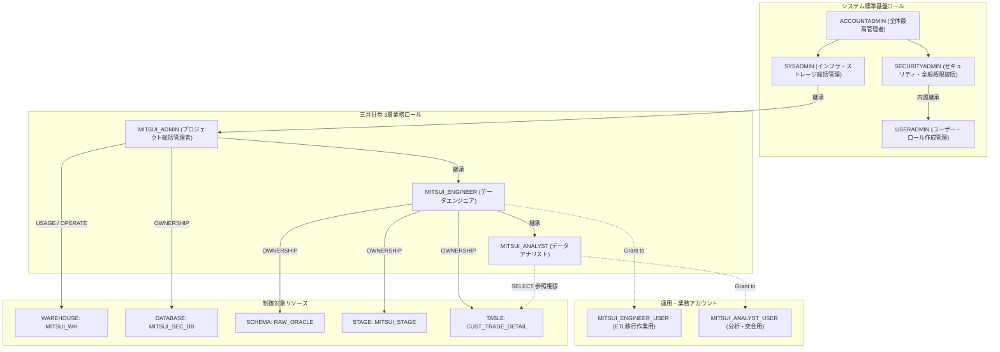

# 第03章：金融機関向けRBAC権限モデルと環境構築実践 (Step 4.1〜4.15)

三井証券における職務分掌モデルに基づき、Snowflake のビルトインシステムロール（`USERADMIN` / `SYSADMIN`）から三井プロジェクト専用の 3 層ロール体系（`MITSUI_ADMIN` → `MITSUI_ENGINEER` → `MITSUI_ANALYST`）を構築し、段階的委譲による環境作成（Step 4.1〜4.15）を完了させます。

---

## 🏛️ 三井証券ロール階層モデル (Role Hierarchy)



---

## 🛠️ Step 4.1 〜 4.15 実装手順

### フェーズ 1：`USERADMIN` によるID・ロールガバナンス

```sql
USE ROLE USERADMIN;
```

#### 4.1 ロール作成（CREATE ROLE）
```sql
CREATE ROLE IF NOT EXISTS MITSUI_ADMIN    COMMENT = '三井証券プロジェクト総括管理者ロール';
CREATE ROLE IF NOT EXISTS MITSUI_ENGINEER COMMENT = '三井証券データエンジニアロール';
CREATE ROLE IF NOT EXISTS MITSUI_ANALYST  COMMENT = '三井証券データアナリストロール';
```

#### 4.2 権限の付与・継承（Role Hierarchy 設定）
```sql
GRANT ROLE MITSUI_ADMIN TO ROLE SYSADMIN;
GRANT ROLE MITSUI_ENGINEER TO ROLE MITSUI_ADMIN;
GRANT ROLE MITSUI_ANALYST TO ROLE MITSUI_ENGINEER;
```

#### 4.3 ユーザー作成（CREATE USER）
```sql
CREATE USER IF NOT EXISTS MITSUI_ENGINEER_USER
    PASSWORD = 'MitsuiSecStrongPass2026!'
    DEFAULT_ROLE = MITSUI_ENGINEER
    DEFAULT_WAREHOUSE = MITSUI_WH
    MUST_CHANGE_PASSWORD = FALSE
    COMMENT = '三井証券ETLおよび移行運用アカウント';

CREATE USER IF NOT EXISTS MITSUI_ANALYST_USER
    PASSWORD = 'MitsuiSecStrongPass2026!'
    DEFAULT_ROLE = MITSUI_ANALYST
    DEFAULT_WAREHOUSE = MITSUI_WH
    MUST_CHANGE_PASSWORD = FALSE
    COMMENT = '三井証券データ分析・監査アカウント';
```

#### 4.4 ユーザーへロール付与（GRANT ROLE TO USER）
```sql
GRANT ROLE MITSUI_ENGINEER TO USER MITSUI_ENGINEER_USER;
GRANT ROLE MITSUI_ANALYST TO USER MITSUI_ANALYST_USER;
```

---

### フェーズ 2：`SYSADMIN` によるコンピュート割当とDB作成権限の委譲

```sql
USE ROLE SYSADMIN;
```

#### 4.5 WAREHOUSE 作成
```sql
CREATE WAREHOUSE IF NOT EXISTS MITSUI_WH
    WITH 
    WAREHOUSE_SIZE = 'XSMALL'
    AUTO_SUSPEND = 300           -- 5分間無操作で自動停止
    AUTO_RESUME = TRUE
    INITIALLY_SUSPENDED = TRUE
    COMMENT = '三井証券バッチ処理・移行専用WH';

GRANT USAGE, OPERATE ON WAREHOUSE MITSUI_WH TO ROLE MITSUI_ADMIN;
```

#### 4.6 DB 作成権限付与
```sql
GRANT CREATE DATABASE ON ACCOUNT TO ROLE MITSUI_ADMIN;
```

---

### フェーズ 3：業務ロールによるオブジェクト構築と最小権限の検証 (Step 4.7 〜 4.15)

#### 4.7 アカウント・ロール切り替え（MITSUI_ADMIN）
```sql
USE ROLE MITSUI_ADMIN;
USE WAREHOUSE MITSUI_WH;
```

#### 4.8 DATABASE の作成
```sql
CREATE DATABASE IF NOT EXISTS MITSUI_SEC_DB
    COMMENT = '三井証券基幹系データクラウド格納庫';

USE DATABASE MITSUI_SEC_DB;
```

#### 4.9 スキーマ作成権限付与（エンジニアロールへ委譲）
```sql
GRANT USAGE ON DATABASE MITSUI_SEC_DB TO ROLE MITSUI_ENGINEER;
GRANT CREATE SCHEMA ON DATABASE MITSUI_SEC_DB TO ROLE MITSUI_ENGINEER;
```

#### 4.10 アカウント・ロール切り替え（MITSUI_ENGINEER）
```sql
USE ROLE MITSUI_ENGINEER;
USE WAREHOUSE MITSUI_WH;
USE DATABASE MITSUI_SEC_DB;
```

#### 4.11 SCHEMA 作成
```sql
CREATE SCHEMA IF NOT EXISTS RAW_ORACLE
    DATA_RETENTION_TIME_IN_DAYS = 7
    COMMENT = 'Oracle 抽出データ格納用ステージングスキーマ';

USE SCHEMA RAW_ORACLE;
```

#### 4.12 ステージ／テーブル作成権限付与
```sql
-- 分析ロールへスキーマ参照権限のみ付与
GRANT USAGE ON SCHEMA MITSUI_SEC_DB.RAW_ORACLE TO ROLE MITSUI_ANALYST;
```

#### 4.13 アカウント・ロール切り替え / コンテキスト確認
```sql
USE ROLE MITSUI_ENGINEER;
USE WAREHOUSE MITSUI_WH;
USE DATABASE MITSUI_SEC_DB;
USE SCHEMA RAW_ORACLE;
```

#### 4.14 ステージ作成（FILE FORMAT と内部ステージの定義）
```sql
CREATE OR REPLACE FILE FORMAT CSV_ORACLE_IMPORT_FF
    TYPE = 'CSV'
    FIELD_DELIMITER = ','
    RECORD_DELIMITER = '\n'
    SKIP_HEADER = 1
    FIELD_OPTIONALLY_ENCLOSED_BY = '"'
    NULL_IF = ('NULL', 'null', '')
    EMPTY_FIELD_AS_NULL = TRUE
    TIMESTAMP_FORMAT = 'YYYY-MM-DD HH24:MI:SS'
    ENCODING = 'UTF8';

CREATE OR REPLACE STAGE MITSUI_STAGE
    FILE_FORMAT = CSV_ORACLE_IMPORT_FF
    COMMENT = 'Oracle 連携用セキュア内部ステージ';
```

#### 4.15 テーブル作成（`CUST_TRADE_DETAIL`）
```sql
CREATE OR REPLACE TABLE CUST_TRADE_DETAIL (
    TRADE_QTY          NUMBER(15, 0)     DEFAULT 0 NOT NULL COMMENT '取引数量',
    AMOUNT_JPY         NUMBER(18, 3)     DEFAULT 0 NOT NULL COMMENT '約定金額・円貨',
    AMOUNT_FCY         NUMBER(18, 3)     DEFAULT 0 COMMENT '約定金額・外貨',
    CCY_CODE           VARCHAR(3)        COMMENT '通貨区分 (USD/EUR等)',
    EXCHANGE_RATE      NUMBER(9, 6)      COMMENT '為替レート',
    REMARKS            VARCHAR(100)      DEFAULT ' ' COMMENT '摘要・備考 (全角対応)',
    CUST_ID            VARCHAR(10)       NOT NULL COMMENT '顧客ID',
    TRADE_TYPE_CD      VARCHAR(2)        NOT NULL COMMENT '取引区分 (01:買付, 02:売付)',
    BRANCH_CD          VARCHAR(4)        NOT NULL COMMENT '支店コード',
    TRADE_DATE         VARCHAR(8)        NOT NULL COMMENT '約定日 (YYYYMMDD)',
    SETTLE_MONTH       VARCHAR(6)        COMMENT '決済対象月 (YYYYMM)',
    REG_DATETIME       TIMESTAMP_NTZ(6)  DEFAULT CURRENT_TIMESTAMP() NOT NULL COMMENT '登録日時',
    UPD_DATETIME       TIMESTAMP_NTZ(6)  COMMENT '更新日時',
    MIGRATED_AT        TIMESTAMP_LTZ(6)  DEFAULT CURRENT_TIMESTAMP() COMMENT '移行取込日時',
    CONSTRAINT PK_CUST_TRADE_DETAIL PRIMARY KEY (CUST_ID, TRADE_DATE, TRADE_TYPE_CD)
)
COMMENT = '顧客取引明細（Oracle移行先 Snowflake設計）';

-- アナリストロールへ SELECT 権限を付与
GRANT SELECT ON TABLE CUST_TRADE_DETAIL TO ROLE MITSUI_ANALYST;
```
