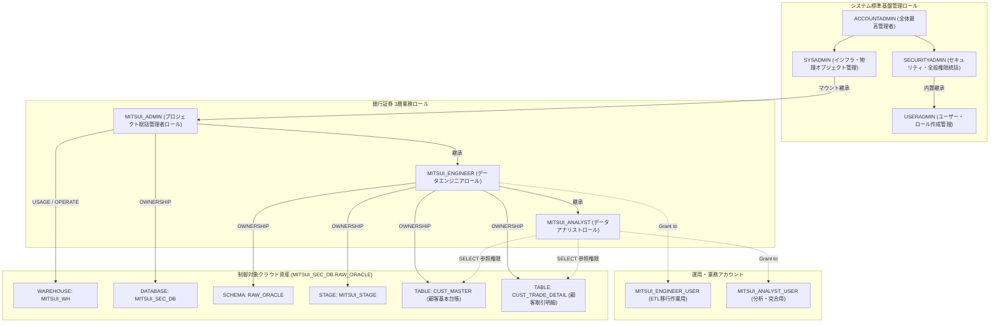
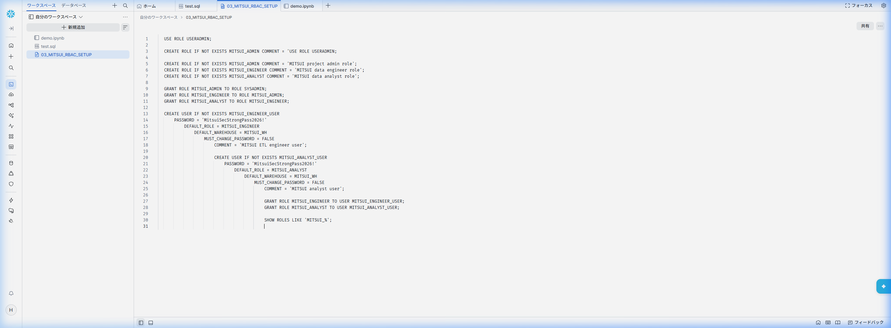
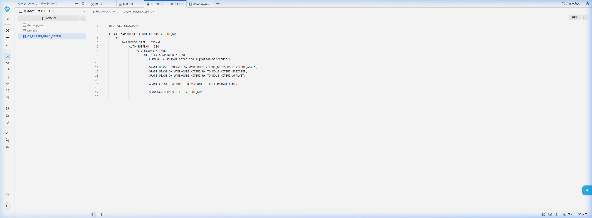
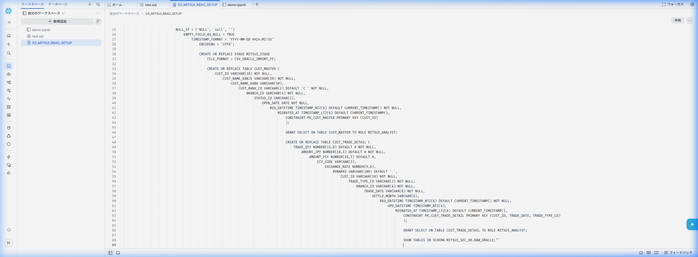
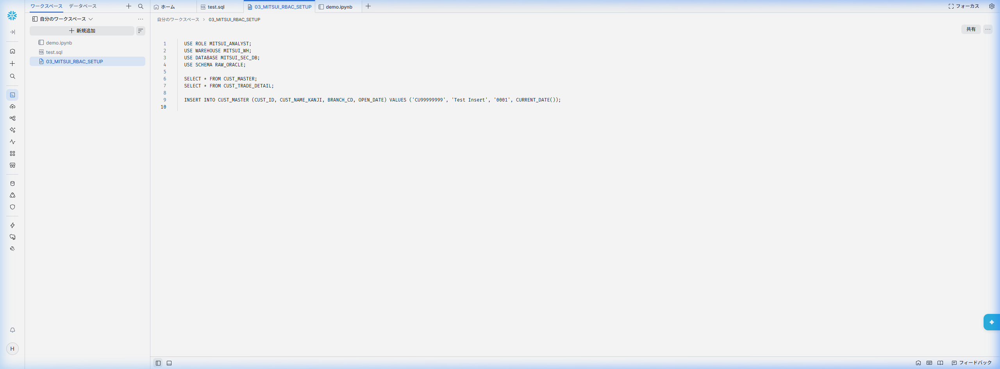
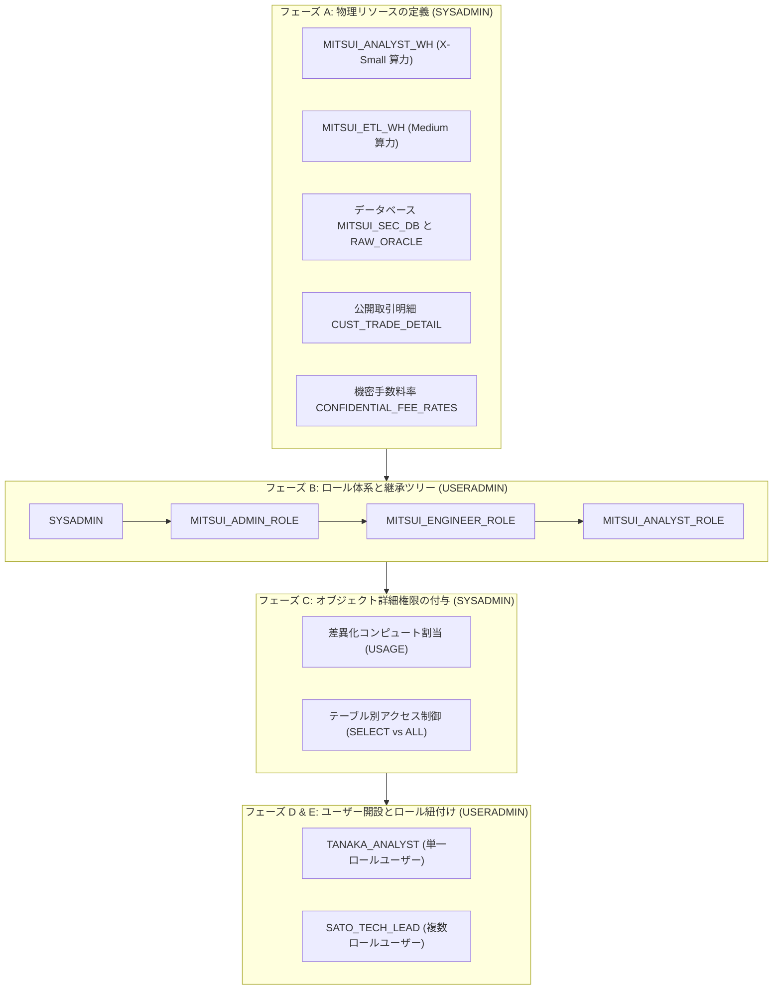

# 第 03 章：金融機関向け RBAC 権限モデルと環境構築実践

銀行証券などの金融機関において、**最小特権の原則（Principle of Least Privilege）** と **職務分掌（Separation of Duties: SoD）** はコンプライアンス上の生命線です。

前章までにおいて、三井証券の夜間バッチ処理遅延という業務課題を分析し（[第 00 章](00_architecture_overview.md)）、Snowflake クラウド環境を開設（[第 01 章](01_snowflake_signup.md)）、さらにローカル環境にて Oracle 11g 移行元データベースおよび 1:N 金融 2 テーブル構成（`CUST_MASTER` 顧客基本台帳 ＋ `CUST_TRADE_DETAIL` 顧客取引明細）のモックデータ投入を完了しました（[第 02 章](02_oracle_setup_and_data.md)）。

本章では、Snowflake クラウド側において三井証券のエンタープライズ統制基盤を確立します。ビルトインロールである `USERADMIN` および `SYSADMIN` を活用し、**3 層業務ロール体系（`MITSUI_ADMIN` $\to$ `MITSUI_ENGINEER` $\to$ `MITSUI_ANALYST`）** を構築。安全な権限委譲メカニズムを通じ、目標の 3 階層ネームスペース **`MITSUI_SEC_DB.RAW_ORACLE`** 配下に、仮想ウェアハウス、ステージ領域、そして `CUST_MASTER` マスター表と `CUST_TRADE_DETAIL` トランザクション明細表の 2 テーブル環境を構築します。

---

## 一、 システム概要とコア目的（社内管理基盤の設計思想）

金融工学の実務において、Snowflake 社内管理基盤の策定は以下の 2 つのコア目的を達成するために設計されています：

1. **重大セキュリティリスクの極小化と特権の一元管理**：  
   外部へのデータ漏洩などの重大リスクに直結する最高特権は、**基盤アーキテクチャチーム（インフラ・セキュリティ統括）** が一元管理します。具体的には、全体最高管理ロールである **`ACCOUNTADMIN`** および **`SECURITYADMIN`** を厳格に管理下に置き、業務開発者への直接付与を排除。これにより、各業務部門に対して標準化されたセキュアな Snowflake 実行基盤を提供します。

2. **分散運用基盤との連携共通化と業務負担の軽減**：  
   管理基盤が社内分散運用システムとの連携に必要な標準インターフェースを共通機能として提供し、業務システム側の個別運用負荷を大幅に軽減します。  
   > [!IMPORTANT]
   > **エンタープライズ責務境界の原則**：  
   > 各業務システム固有の **`SYSADMIN` 管理領域（仮想ウェアハウス Warehouse、データベース Database、スキーマ Schema、ステージ Stage などの物理オブジェクト）** については、業務部門（銀行証券データ移行プロジェクト側）へ自律的な管理権限を委譲し、全体ガバナンスと現場の開発アジリティを両立させます。

---

## 二、 🏛️ 銀行証券ロール階層モデル (Role Hierarchy)

金融クラウド DWH の設計に基づき、システム標準ロールと業務カスタムロールを疎結合に定義・継承します：



> [!NOTE]
> **★ Snowflake 権限仕様の要諦（単方向の上位集約モデル）**：  
> Snowflake のロール継承は**単方向の上位集約（親ロールは子ロールの特権を行使できるが、子ロールは親ロールの特権を自動継承しない）** です。したがって：  
> 1. `SYSADMIN` は配下のすべての業務オブジェクトに対する操作権限を自然に包含し、システム保守を円滑に行えます；  
> 2. ただし、`MITSUI_ADMIN` に付与された Warehouse の `USAGE` 権限は、配下の `MITSUI_ENGINEER` や `MITSUI_ANALYST` に**自動的には伝播しません**。そのため、各実行ロールに対して明示的に `GRANT USAGE` を設定する必要があります。

---

## 三、 🛠️ エンタープライズ環境構築実践マニュアル（Step 1 〜 Step 15 双軌推進）

本節では、金融機関標準のステップ別実行手順を解説します。**Snowsight ワークシート** で順次実行するか、リポジトリに配置されているスクリプトを用いて一括実行が可能です：
* **フェーズ 1 対応スクリプト**：`scripts/snowflake/01_useradmin_rbac.sql`
* **フェーズ 2 & 3 対応スクリプト**：`scripts/snowflake/02_sysadmin_objects.sql`

---

### フェーズ 1：`USERADMIN` による ID・ロールガバナンス

特権ユーザーで Snowflake に接続し、ユーザーおよびロール管理を所管する `USERADMIN` へ切り替えます：

```sql
USE ROLE USERADMIN;
```

#### Step 1: 銀行証券 3 層業務ロールの作成
```sql
CREATE ROLE IF NOT EXISTS MITSUI_ADMIN    COMMENT = '銀行証券プロジェクト総括管理者ロール';
CREATE ROLE IF NOT EXISTS MITSUI_ENGINEER COMMENT = '銀行証券データエンジニアロール';
CREATE ROLE IF NOT EXISTS MITSUI_ANALYST  COMMENT = '銀行証券データアナリストロール';
```

#### Step 2: 権限の付与・継承（Role Hierarchy 設定）
業務権限を平滑に継承させ、最終的に `SYSADMIN` 配下に集約します：
```sql
-- MITSUI_ADMIN を SYSADMIN 配下にマウント
GRANT ROLE MITSUI_ADMIN TO ROLE SYSADMIN;

-- エンジニアを管理者ロールに継承
GRANT ROLE MITSUI_ENGINEER TO ROLE MITSUI_ADMIN;

-- アナリストをエンジニアロールに継承
GRANT ROLE MITSUI_ANALYST TO ROLE MITSUI_ENGINEER;
```

#### Step 3: 業務技術アカウント (User) の作成

> [!NOTE]
> **依存関係と順序に関する補足**：ここではユーザー作成時に先行して `DEFAULT_WAREHOUSE = MITSUI_WH` を指定しています。Snowflake の仕様上、事前登録は可能ですが、このコンピュートリソースは後続の **Step 5** にて `SYSADMIN` が正式に作成し、`USAGE` 権限を付与した後に初めて有効化されます。

```sql
-- エンジニアアカウント（データ移行・バッチ処理担当）
CREATE USER IF NOT EXISTS MITSUI_ENGINEER_USER
    PASSWORD = 'MitsuiSecStrongPass2026!'
    DEFAULT_ROLE = MITSUI_ENGINEER
    DEFAULT_WAREHOUSE = MITSUI_WH
    MUST_CHANGE_PASSWORD = FALSE
    COMMENT = '銀行証券ETLとデータ移行作業用アカウント';

-- アナリストアカウント（照合・分析業務担当）
CREATE USER IF NOT EXISTS MITSUI_ANALYST_USER
    PASSWORD = 'MitsuiSecStrongPass2026!'
    DEFAULT_ROLE = MITSUI_ANALYST
    DEFAULT_WAREHOUSE = MITSUI_WH
    MUST_CHANGE_PASSWORD = FALSE
    COMMENT = '銀行証券分析・監査突合用アカウント';
```

#### Step 4: ユーザーへのロール紐付け
```sql
GRANT ROLE MITSUI_ENGINEER TO USER MITSUI_ENGINEER_USER;
GRANT ROLE MITSUI_ANALYST TO USER MITSUI_ANALYST_USER;

-- 作成結果の検証
SHOW ROLES LIKE 'MITSUI_%';
SHOW USERS LIKE 'MITSUI_%';
```



---

### フェーズ 2：`SYSADMIN` によるコンピュート割当と DB 作成特権の委譲

```sql
USE ROLE SYSADMIN;
```

#### Step 5: 仮想ウェアハウス (MITSUI_WH) の作成
需要に応じて自動起動・休眠する仮想ウェアハウスを作成し、厳格なコスト抑制ポリシーを設定します：
```sql
CREATE WAREHOUSE IF NOT EXISTS MITSUI_WH
    WITH 
    WAREHOUSE_SIZE = 'XSMALL'
    AUTO_SUSPEND = 300           -- 5分間クエリがない場合、自動休眠（コスト課金停止）
    AUTO_RESUME = TRUE           -- SQLリクエスト到着時に秒単位で自動復帰
    INITIALLY_SUSPENDED = TRUE
    COMMENT = '銀行証券コアデータバッチおよび移行専用WH';

-- 各業務ロールに対して明示的に利用権限を付与
GRANT USAGE, OPERATE ON WAREHOUSE MITSUI_WH TO ROLE MITSUI_ADMIN;
GRANT USAGE ON WAREHOUSE MITSUI_WH TO ROLE MITSUI_ENGINEER;
GRANT USAGE ON WAREHOUSE MITSUI_WH TO ROLE MITSUI_ANALYST;
```

#### Step 6: プロジェクト総括管理者への DB 作成特権の付与
アカウント階層において、`MITSUI_ADMIN` に対してデータベース作成権限を委譲します：
```sql
GRANT CREATE DATABASE ON ACCOUNT TO ROLE MITSUI_ADMIN;
```



---

### フェーズ 3：業務ロールへの切り替え、特権検証およびストレージ実体の作成

#### Step 7: プロジェクト総括管理者 MITSUI_ADMIN への切り替え
```sql
USE ROLE MITSUI_ADMIN;
USE WAREHOUSE MITSUI_WH;
```

#### Step 8: コア業務データベース (MITSUI_SEC_DB) の作成
```sql
CREATE DATABASE IF NOT EXISTS MITSUI_SEC_DB
    COMMENT = '銀行証券基幹データクラウド移行DWH';

USE DATABASE MITSUI_SEC_DB;
```

#### Step 9: エンジニアロールへのスキーマ作成権限の委譲
```sql
GRANT USAGE ON DATABASE MITSUI_SEC_DB TO ROLE MITSUI_ENGINEER;
GRANT CREATE SCHEMA ON DATABASE MITSUI_SEC_DB TO ROLE MITSUI_ENGINEER;
```

#### Step 10: データエンジニア MITSUI_ENGINEER への切り替え
```sql
USE ROLE MITSUI_ENGINEER;
USE WAREHOUSE MITSUI_WH;
USE DATABASE MITSUI_SEC_DB;
```

#### Step 11: Oracle 移行生データ受入スキーマ (RAW_ORACLE) の作成
```sql
CREATE SCHEMA IF NOT EXISTS RAW_ORACLE
    DATA_RETENTION_TIME_IN_DAYS = 7
    COMMENT = 'Oracle移行生データ格納スキーマ';

USE SCHEMA RAW_ORACLE;
```

#### Step 12: アナリストロールへのスキーマ利用権限の付与
`MITSUI_ENGINEER` はスキーマの所有者（OWNER）としてすべての作成権限を有しています。最小特権の原則に基づき、アナリストへスキーマ利用権限を付与します：
```sql
GRANT USAGE ON SCHEMA MITSUI_SEC_DB.RAW_ORACLE TO ROLE MITSUI_ANALYST;
```

#### Step 13: 現在の実行コンテキストの確認
```sql
USE ROLE MITSUI_ENGINEER;
USE WAREHOUSE MITSUI_WH;
USE DATABASE MITSUI_SEC_DB;
USE SCHEMA RAW_ORACLE;
```

#### Step 14: ファイルフォーマットと受入ステージ (Stage) の定義
第 02 章で解説した末尾空白や空文字（`''` vs `NULL`）の差異を吸収する CSV パーサーを定義します：
```sql
CREATE OR REPLACE FILE FORMAT CSV_ORACLE_IMPORT_FF
    TYPE = 'CSV'
    FIELD_DELIMITER = ','
    RECORD_DELIMITER = '\n'
    SKIP_HEADER = 1
    FIELD_OPTIONALLY_ENCLOSED_BY = '"'
    NULL_IF = ('NULL', 'null', '')
    EMPTY_FIELD_AS_NULL = TRUE             -- 重要：Oracleの空文字NULL変換をSnowflake側で再現
    TIMESTAMP_FORMAT = 'YYYY-MM-DD HH24:MI:SS'
    ENCODING = 'UTF8';

CREATE OR REPLACE STAGE MITSUI_STAGE
    FILE_FORMAT = CSV_ORACLE_IMPORT_FF
    COMMENT = 'Oracleから抽出されたCSV受入用内部ステージ';
```

#### Step 15-A: マスター表 `CUST_MASTER` (顧客基本台帳) の作成
第 02 章で設計した型変換思想に基づき、顧客マスター表を作成し、アナリストに参照権限を付与します：
```sql
CREATE OR REPLACE TABLE CUST_MASTER (
    -- ① 顧客識別子：Oracle CHAR(10) -> Snowflake VARCHAR(10)（空白パディング差とRTRIMの検証）
    CUST_ID            VARCHAR(10)       NOT NULL COMMENT '顧客ID (CHAR(10)正規化)',

    -- ② 顧客氏名（漢字）：全角文字
    CUST_NAME_KANJI    VARCHAR(50)       NOT NULL COMMENT '顧客氏名 (漢字全角)',

    -- ③ 顧客氏名（カナ）：半角・全角カナ混在
    CUST_NAME_KANA     VARCHAR(50)       COMMENT '顧客氏名 (カナ)',

    -- ④ 顧客ランク：Oracle CHAR(2) -> Snowflake VARCHAR(2)（末尾空白比較検証用）
    CUST_RANK_CD       VARCHAR(2)        DEFAULT 'C ' NOT NULL COMMENT '顧客ランク (A /B /C 等)',

    -- ⑤ 開設支店コード：VARCHAR(4)
    BRANCH_CD          VARCHAR(4)        NOT NULL COMMENT '支店コード',

    -- ⑥ 口座ステータス：Oracle '' -> NULL（空文字NULL変換の異種検証用）
    STATUS_CD          VARCHAR(2)        COMMENT '口座状態 (01:有効, 02:休眠, NULL:未設定)',

    -- ⑦ 口座開設日：DATE 型
    OPEN_DATE          DATE              NOT NULL COMMENT '口座開設日',

    -- ⑧ 登録日時：秒精度からマイクロ秒精度へ拡張
    REG_DATETIME       TIMESTAMP_NTZ(6)  DEFAULT CURRENT_TIMESTAMP() NOT NULL COMMENT '登録日時',

    -- ⑨ クラウド移行監査列（データリネージ追跡用）
    MIGRATED_AT        TIMESTAMP_LTZ(6)  DEFAULT CURRENT_TIMESTAMP() COMMENT 'Snowflake 移行取込日時',

    CONSTRAINT PK_CUST_MASTER PRIMARY KEY (CUST_ID)
)
COMMENT = '顧客基本台帳（Oracle 11g 移行先テーブル）';

-- 最小特権の原則に基づき、アナリストロールへ SELECT 権限を付与
GRANT SELECT ON TABLE CUST_MASTER TO ROLE MITSUI_ANALYST;
```

#### Step 15-B: トランザクション明細表 `CUST_TRADE_DETAIL` (顧客取引明細) の作成
```sql
CREATE OR REPLACE TABLE CUST_TRADE_DETAIL (
    -- ① 取引数量：整数型、Scale 0 を明示
    TRADE_QTY          NUMBER(15, 0)     DEFAULT 0 NOT NULL COMMENT '取引数量',

    -- ② 約定金額・邦貨（円貨）：固定 3 位の小数精度統一
    AMOUNT_JPY         NUMBER(18, 3)     DEFAULT 0 NOT NULL COMMENT '約定金額・円貨',

    -- ③ 約定金額・外貨 ＋ 通貨区分：ペア定義
    AMOUNT_FCY         NUMBER(18, 3)     DEFAULT 0 COMMENT '約定金額・外貨',
    CCY_CODE           VARCHAR(3)        COMMENT '通貨区分 (USD/EUR等)',

    -- ④ 為替レート：6 位の小数統一
    EXCHANGE_RATE      NUMBER(9, 6)      COMMENT '為替レート',

    -- ⑤ 摘要・備考：Snowflake の VARCHAR(100) は常に文字数カウント（Oracle BYTE あふれ回避）
    REMARKS            VARCHAR(100)      DEFAULT ' ' COMMENT '摘要・備考 (全角半角混在安全)',

    -- ⑥ 顧客ID：固定 10 桁
    CUST_ID            VARCHAR(10)       NOT NULL COMMENT '顧客ID',

    -- ⑦ 取引区分・支店コード
    TRADE_TYPE_CD      VARCHAR(2)        NOT NULL COMMENT '取引区分 (01:買付, 02:売付)',
    BRANCH_CD          VARCHAR(4)        NOT NULL COMMENT '支店コード',

    -- ⑧ 業務日付：定長数字文字列に正規化し、検索プルーニング性能を最大化
    TRADE_DATE         VARCHAR(8)        NOT NULL COMMENT '約定日 (YYYYMMDD形式)',
    SETTLE_MONTH       VARCHAR(6)        COMMENT '決済対象月 (YYYYMM形式)',

    -- ⑨ 監査タイムスタンプ
    REG_DATETIME       TIMESTAMP_NTZ(6)  DEFAULT CURRENT_TIMESTAMP() NOT NULL COMMENT '登録日時',
    UPD_DATETIME       TIMESTAMP_NTZ(6)  COMMENT '更新日時',

    -- ⑩ クラウド移行監査列（データリネージ追跡用）
    MIGRATED_AT        TIMESTAMP_LTZ(6)  DEFAULT CURRENT_TIMESTAMP() COMMENT 'Snowflake 移行取込日時',

    CONSTRAINT PK_CUST_TRADE_DETAIL PRIMARY KEY (CUST_ID, TRADE_DATE, TRADE_TYPE_CD)
)
COMMENT = '顧客取引明細（Oracle 11g 移行先テーブル）';

-- 最小特権の原則に基づき、アナリストロールへ SELECT 権限を付与
GRANT SELECT ON TABLE CUST_TRADE_DETAIL TO ROLE MITSUI_ANALYST;

-- 作成結果の検証
SHOW STAGES LIKE 'MITSUI_STAGE';
SHOW TABLES IN SCHEMA MITSUI_SEC_DB.RAW_ORACLE;
```



---

## 四、 🔐 金融業務ユーザー初回ログイン、MFA 設定および接続検証 (Onboarding & Sanity Check)

基本オブジェクト構築完了後、業務ユーザー（`MITSUI_ENGINEER_USER` 等）の受け入れ作業を実施します。FISC 安全対策基準に則り、初回セキュリティ設定と権限検証を実施します。

### 4.1 初期パスワード変更ポリシー
管理者が発行した初期一時パスワードに対し、初回ログイン時の強制パスワード変更（`MUST_CHANGE_PASSWORD = TRUE`）が適用されます：
- ユーザーが Snowsight に初めてログインした際、自動的にパスワード変更モーダルが表示されます；
- 複雑性要件（大文字、小文字、数字、記号を含み、12 桁以上）を満たす新パスワードを設定してワークスペースへ進入します。

### 4.2 金融水準 MFA (多要素認証) の設定手順
金融庁ガイドラインおよび金融機関のセキュリティ要件に基づき、**本番・検証を問わず Snowflake コンソールへアクセスする全特権・業務アカウントに MFA（TOTP 2要素認証）の設定が義務付けられています**：

1. **設定画面への移動**：Snowsight 右上の Profile アイコンから **Preferences** $\to$ **Multi-Factor Authentication (MFA)** を選択；
2. **認証方式の選択**：**Authenticator App (TOTP)** を選択；
3. **シークレットキーの取得**：
   - 画面に QR コードおよび Base32 シークレットキー（`WQQC4ZYF...` など）が表示されます；
   - モバイル端末の **Google Authenticator** や **Microsoft Authenticator** でスキャンするか、開発専用端末ではオープンソースの PC 版 TOTP ツール [WinAuth](https://winauth.github.io/winauth/download.html) 等にキーをインポートします；
4. **確認と有効化**：生成された 6 桁のワンタイムパスワードを入力し、バインドを完了します。

### 4.3 業務ロールの切り替えと接続性セニティチェック (Sanity Check)
SQL ワークシートにて以下の検証スクリプトを実行し、エンジニアロール `MITSUI_ENGINEER` が所定の権限を正しく保持しているかを確認します：

```sql
-- 1. 自身に付与されているロール一覧の確認
SHOW ROLES;

-- 2. ロールに付与された詳細特権の確認
SHOW GRANTS OF ROLE MITSUI_ENGINEER;

-- 3. プロジェクト環境へのコンテキスト切り替え
USE ROLE MITSUI_ENGINEER;
USE WAREHOUSE MITSUI_WH;
USE DATABASE MITSUI_SEC_DB;
USE SCHEMA RAW_ORACLE;

-- 4. 移行対象 2 テーブルおよびステージの存在確認
SHOW STAGES LIKE 'MITSUI_STAGE';
SHOW TABLES IN SCHEMA MITSUI_SEC_DB.RAW_ORACLE;

-- 5. 一時テーブルを用いた軽量な読み書き疎通確認（Sandbox検証）
CREATE OR REPLACE TEMPORARY TABLE _SANITY_CHECK (
    CHECK_ID    INT,
    OPERATOR    VARCHAR(50),
    CHECKED_AT  TIMESTAMP_NTZ DEFAULT CURRENT_TIMESTAMP()
);

INSERT INTO _SANITY_CHECK (CHECK_ID, OPERATOR) VALUES (1, CURRENT_USER());

SELECT * FROM _SANITY_CHECK;

-- 検証後のクリーンアップ
DROP TABLE IF EXISTS _SANITY_CHECK;

-- 6. 読み取り専用アナリストロールへの切り替えと最小特権防御テスト (Least Privilege Verification)
USE ROLE MITSUI_ANALYST;
USE WAREHOUSE MITSUI_WH;
USE DATABASE MITSUI_SEC_DB;
USE SCHEMA RAW_ORACLE;

-- SELECT 照会は正常実行可能（空レコードが返却され、権限の保持を確認）
SELECT * FROM CUST_MASTER;

-- 不正な書き込み（INSERT）はアクセス制御機構により即座に遮断
INSERT INTO CUST_MASTER (CUST_ID, CUST_NAME_KANJI, OPEN_DATE) 
VALUES ('TEST0001', '不正書込テスト', CURRENT_DATE());
-- 期待されるエラー：SQL compilation error: Object 'CUST_MASTER' does not exist or not authorized.
```



---

## 五、 🏢 エンタープライズ応用実践：マルチスペック算力、複数テーブル隔離と単一／複数ロール検証

基本環境の構築に加え、大規模金融機関の運用現場ではさらに厳格なセキュリティ要件が課されます：
1. **多規格 Warehouse の分離**：アナリストには低コストな `X-Small` 算力を、夜間大量データロードを行うエンジニアには `Medium` 算力を割り当ててリソース競合を防止；
2. **テーブル単位の機密アクセス制御**：同一スキーマ内において、通常の約定明細 `CUST_TRADE_DETAIL` はアナリストに公開し、手数料マスタ等の高機密テーブル `CONFIDENTIAL_FEE_RATES` はアナリストから完全に秘匿；
3. **単一ロールユーザー vs 複数ロールユーザー**：外部委託・一般スタッフには単一の厳格ロールを付与し、テックリードには複数ロールを付与して柔軟な切り替え（`USE ROLE`）を許可。

> [!TIP]
> 本応用シナリオを再現する独立した実行スクリプトは、リポジトリ内 `scripts/snowflake/00_account_provisioning_and_rbac_demo.sql` に配置されています。

### 5.1 FISC 基準に準拠した職務分掌パイプライン



### 5.2 単一ロールユーザー vs 複数ロールユーザーの比較対比

| 比較評価軸 | 単一ロールユーザー (`TANAKA_ANALYST`) | 複数ロールユーザー (`SATO_TECH_LEAD`) |
| :--- | :--- | :--- |
| **保有ロール** | `MITSUI_ANALYST_ROLE` のみ | `MITSUI_ADMIN_ROLE` ＋ `MITSUI_ENGINEER_ROLE` ＋ `MITSUI_ANALYST_ROLE` |
| **セッション挙動** | ログイン時点でアナリストロールに固定され、権限昇格不可 | 初期ロールは `MITSUI_ENGINEER_ROLE`、必要に応じて `USE ROLE` で自由切替 |
| **コンピュート制約** | 軽量な `MITSUI_ANALYST_WH` (X-Small) のみ起動可能。コストを厳格統制 | 開発時は `MITSUI_ETL_WH` (Medium) を使用、定例照会時はアナリスト倉庫へ自律降格 |
| **データアクセス境界** | `CUST_TRADE_DETAIL` のみ参照可能。機密表へアクセスすると `Object does not exist` で拒絶 | エンジニアとして機密手数料表を読み書き可能。管理者ロール切替で全体統括 |
| **対象ペルソナ** | 外部パートナー、一般アナリスト、監査閲覧者（権限逸脱リスクゼロ） | アーキテクト、テックリード、コアデータエンジニア |

### 5.3 応用シナリオ主要 SQL 抜粋

```sql
-- 1. マルチスペック Warehouse および機密テーブルの定義 (SYSADMIN)
USE ROLE SYSADMIN;
CREATE WAREHOUSE IF NOT EXISTS MITSUI_ANALYST_WH WITH WAREHOUSE_SIZE = 'X-SMALL' AUTO_SUSPEND = 60 AUTO_RESUME = TRUE;
CREATE WAREHOUSE IF NOT EXISTS MITSUI_ETL_WH     WITH WAREHOUSE_SIZE = 'MEDIUM'  AUTO_SUSPEND = 120 AUTO_RESUME = TRUE;

-- 2. 差異化権限付与 (SYSADMIN)
-- アナリストには軽量倉庫と公開テーブルのみ付与
GRANT USAGE ON WAREHOUSE MITSUI_ANALYST_WH TO ROLE MITSUI_ANALYST_ROLE;
GRANT SELECT ON TABLE MITSUI_SEC_DB.RAW_ORACLE.CUST_TRADE_DETAIL TO ROLE MITSUI_ANALYST_ROLE;

-- エンジニアには高スペック倉庫と機密テーブルを含めて付与
GRANT USAGE ON WAREHOUSE MITSUI_ETL_WH TO ROLE MITSUI_ENGINEER_ROLE;
GRANT SELECT, INSERT, UPDATE, DELETE ON TABLE MITSUI_SEC_DB.RAW_ORACLE.CUST_TRADE_DETAIL TO ROLE MITSUI_ENGINEER_ROLE;
GRANT SELECT, INSERT, UPDATE ON TABLE MITSUI_SEC_DB.RAW_ORACLE.CONFIDENTIAL_FEE_RATES TO ROLE MITSUI_ENGINEER_ROLE;

-- 3. ユーザー開設とロール付与 (USERADMIN)
USE ROLE USERADMIN;
CREATE USER IF NOT EXISTS TANAKA_ANALYST PASSWORD = 'InitPassword123#A' DEFAULT_ROLE = MITSUI_ANALYST_ROLE DEFAULT_WAREHOUSE = MITSUI_ANALYST_WH;
CREATE USER IF NOT EXISTS SATO_TECH_LEAD PASSWORD = 'InitPassword123#B' DEFAULT_ROLE = MITSUI_ENGINEER_ROLE DEFAULT_WAREHOUSE = MITSUI_ETL_WH;

-- ロールの紐付け
GRANT ROLE MITSUI_ANALYST_ROLE TO USER TANAKA_ANALYST;
GRANT ROLE MITSUI_ENGINEER_ROLE TO USER SATO_TECH_LEAD;
GRANT ROLE MITSUI_ANALYST_ROLE  TO USER SATO_TECH_LEAD;
GRANT ROLE MITSUI_ADMIN_ROLE    TO USER SATO_TECH_LEAD;
```

### 5.4 実機検証チェックリスト
* **テスト 1（限定権限照会）**：`MITSUI_ANALYST_ROLE` にて `CUST_TRADE_DETAIL` の参照が成功すること；
* **テスト 2（不正アクセス遮断）**：`MITSUI_ANALYST_ROLE` にて機密表 `CONFIDENTIAL_FEE_RATES` に対するアクセスが `Access denied` で遮断されること；
* **テスト 3（コンピュート境界分離）**：`MITSUI_ANALYST_ROLE` にて高スペック倉庫 `MITSUI_ETL_WH` の起動が拒否されること；
* **テスト 4（動的ロール切り替え）**：`SATO_TECH_LEAD` にて `USE ROLE MITSUI_ANALYST_ROLE` によるロール降格・昇格が自由に行えること。

---

## 六、 本章のまとめと次章への案内

本章では、金融機関標準の職務分掌に基づき、Snowflake 上に三井証券の 3 層業務ロール体系（`MITSUI_ADMIN` $\to$ `MITSUI_ENGINEER` $\to$ `MITSUI_ANALYST`）を構築しました。さらに仮想ウェアハウス `MITSUI_WH`、データベース `MITSUI_SEC_DB`、スキーマ `RAW_ORACLE`、ステージ `MITSUI_STAGE`、そして移行対象の 2 テーブル（`CUST_MASTER` 顧客基本台帳 ＋ `CUST_TRADE_DETAIL` 顧客取引明細）の DDL 定義と権限委譲を完了しました。

これで、**クラウド側の受け入れインフラは完璧に整いました**：
- 👉 **[第 04 章：データ抽出エクスポートと COPY INTO 一括ロード実践](04_data_migration.md)**：ローカルの Oracle コンテナから Python スクリプトを用いて 2 テーブルの CSV データを抽出し、SnowSQL / PUT コマンドで `MITSUI_STAGE` へ高速アップロード。その後 `COPY INTO` コマンドにより、クラウド側テーブルへの高精度な一括ロードと型変換を実施します！
