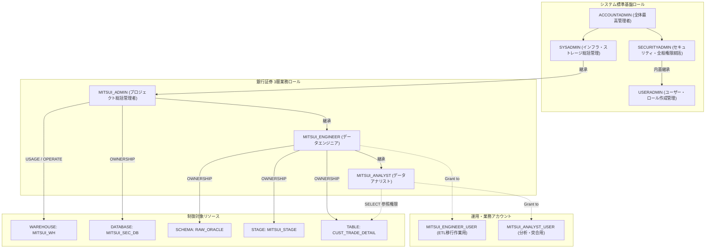
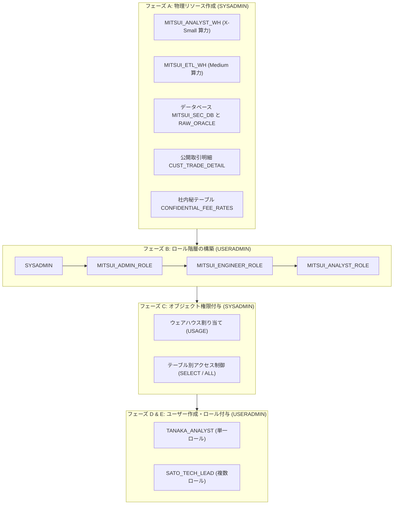

# 第03章：金融機関向けRBAC権限モデルと環境構築実践 (Step 4.1〜4.15)

銀行証券における職務分掌モデルに基づき、Snowflake のビルトインシステムロール（`USERADMIN` / `SYSADMIN`）から銀行プロジェクト専用の 3 層ロール体系（`MITSUI_ADMIN` → `MITSUI_ENGINEER` → `MITSUI_ANALYST`）を構築し、段階的委譲による環境作成（Step 4.1〜4.15）を完了させます。

---

## 1. システム概要と目的

Snowflake 社内管理基盤は、以下の 2 つを目的とする。

1. **重大なセキュリティリスクの極小化と安全な利用環境の提供**：  
   外部へのデータ流出等に繋がる特権・強権限を基盤担当（インフラ統括）にて一元管理するため、Snowflake の最高システム管理ロールである **`ACCOUNTADMIN`** および **`SECURITYADMIN`** を所管し、業務システム部門がセキュアに Snowflake を利用可能な環境を提供する。

2. **分散運用基盤との連携共通化と運用負荷軽減**：  
   Snowflake が分散運用基盤と連携するために必要な機能の一部を共通機能として提供し、業務システム側の運用負荷を軽減する。  
   > [!NOTE]  
   > システム毎に異なる **`SYSADMIN` 管理領域（ウェアハウス、DB、スキーマ等の物理オブジェクト）** については、自律性を担保するため**業務システム部門（銀行証券プロジェクト側）にて管轄・管理する整理**としている。

---

## 2. 🏛️ 銀行証券ロール階層モデル (Role Hierarchy)



---

## 3. 🛠️ Step 4.1 〜 4.15 実装手順

### フェーズ 1：`USERADMIN` によるID・ロールガバナンス

```sql
USE ROLE USERADMIN;
```

#### 4.1 ロール作成（CREATE ROLE）
```sql
CREATE ROLE IF NOT EXISTS MITSUI_ADMIN    COMMENT = '銀行証券プロジェクト総括管理者ロール';
CREATE ROLE IF NOT EXISTS MITSUI_ENGINEER COMMENT = '銀行証券データエンジニアロール';
CREATE ROLE IF NOT EXISTS MITSUI_ANALYST  COMMENT = '銀行証券データアナリストロール';
```

#### 4.2 権限の付与・継承（Role Hierarchy 設定）
```sql
GRANT ROLE MITSUI_ADMIN TO ROLE SYSADMIN;
GRANT ROLE MITSUI_ENGINEER TO ROLE MITSUI_ADMIN;
GRANT ROLE MITSUI_ANALYST TO ROLE MITSUI_ENGINEER;
```

#### 4.3 ユーザー作成（CREATE USER）

> [!NOTE]
> **依存関係と順序に関する補足**：ここではユーザープロファイルに対して先行して `DEFAULT_WAREHOUSE = MITSUI_WH` を指定しています。Snowflake の仕様上、ユーザー定義時にデフォルト倉庫名を事前登録可能ですが、このコンピュートリソースは後続の **Step 4.5** にて `SYSADMIN` が正式に作成し、`USAGE` 権限を付与した後に初めて利用可能となります。

```sql
CREATE USER IF NOT EXISTS MITSUI_ENGINEER_USER
    PASSWORD = 'MitsuiSecStrongPass2026!'
    DEFAULT_ROLE = MITSUI_ENGINEER
    DEFAULT_WAREHOUSE = MITSUI_WH
    MUST_CHANGE_PASSWORD = FALSE
    COMMENT = '銀行証券ETLおよび移行運用アカウント';

CREATE USER IF NOT EXISTS MITSUI_ANALYST_USER
    PASSWORD = 'MitsuiSecStrongPass2026!'
    DEFAULT_ROLE = MITSUI_ANALYST
    DEFAULT_WAREHOUSE = MITSUI_WH
    MUST_CHANGE_PASSWORD = FALSE
    COMMENT = '銀行証券データ分析・監査アカウント';
```

#### 4.4 ユーザーへロール付与（GRANT ROLE TO USER）
```sql
GRANT ROLE MITSUI_ENGINEER TO USER MITSUI_ENGINEER_USER;
GRANT ROLE MITSUI_ANALYST TO USER MITSUI_ANALYST_USER;
```

---

### フェーズ 2：`SYSADMIN` によるコンピュート割当とDB作成権限の委譲

```sql
USE ROLE SYSADMIN;
```

#### 4.5 WAREHOUSE 作成
```sql
CREATE WAREHOUSE IF NOT EXISTS MITSUI_WH
    WITH 
    WAREHOUSE_SIZE = 'XSMALL'
    AUTO_SUSPEND = 300           -- 5分間無操作で自動停止
    AUTO_RESUME = TRUE
    INITIALLY_SUSPENDED = TRUE
    COMMENT = '銀行証券バッチ処理・移行専用WH';

-- ウェアハウスの利用権限を付与
-- ★重要セキュリティ仕様：Snowflake のロール継承は「単一方向（上向き集約）」です
-- （親ロールは子ロールの特権を継承しますが、子ロールが親ロールの特権を自動継承することはありません）
-- そのため、MITSUI_ADMIN、MITSUI_ENGINEER、MITSUI_ANALYST の各ロールへ明示的に USAGE を付与します
GRANT USAGE, OPERATE ON WAREHOUSE MITSUI_WH TO ROLE MITSUI_ADMIN;
GRANT USAGE ON WAREHOUSE MITSUI_WH TO ROLE MITSUI_ENGINEER;
GRANT USAGE ON WAREHOUSE MITSUI_WH TO ROLE MITSUI_ANALYST;
```

#### 4.6 DB 作成権限付与
```sql
GRANT CREATE DATABASE ON ACCOUNT TO ROLE MITSUI_ADMIN;
```

---

### フェーズ 3：業務ロールによるオブジェクト構築と最小権限の検証 (Step 4.7 〜 4.15)

#### 4.7 アカウント・ロール切り替え（MITSUI_ADMIN）
```sql
USE ROLE MITSUI_ADMIN;
USE WAREHOUSE MITSUI_WH;
```

#### 4.8 DATABASE の作成
```sql
CREATE DATABASE IF NOT EXISTS MITSUI_SEC_DB
    COMMENT = '銀行証券基幹系データクラウド格納庫';

USE DATABASE MITSUI_SEC_DB;
```

#### 4.9 スキーマ作成権限付与（エンジニアロールへ委譲）
```sql
GRANT USAGE ON DATABASE MITSUI_SEC_DB TO ROLE MITSUI_ENGINEER;
GRANT CREATE SCHEMA ON DATABASE MITSUI_SEC_DB TO ROLE MITSUI_ENGINEER;
```

#### 4.10 アカウント・ロール切り替え（MITSUI_ENGINEER）
```sql
USE ROLE MITSUI_ENGINEER;
USE WAREHOUSE MITSUI_WH;
USE DATABASE MITSUI_SEC_DB;
```

#### 4.11 SCHEMA 作成
```sql
CREATE SCHEMA IF NOT EXISTS RAW_ORACLE
    DATA_RETENTION_TIME_IN_DAYS = 7
    COMMENT = 'Oracle 抽出データ格納用ステージングスキーマ';

USE SCHEMA RAW_ORACLE;
```

#### 4.12 ステージ／テーブル作成権限付与
```sql
-- 分析ロールへスキーマ参照権限のみ付与
GRANT USAGE ON SCHEMA MITSUI_SEC_DB.RAW_ORACLE TO ROLE MITSUI_ANALYST;
```

#### 4.13 アカウント・ロール切り替え / コンテキスト確認
```sql
USE ROLE MITSUI_ENGINEER;
USE WAREHOUSE MITSUI_WH;
USE DATABASE MITSUI_SEC_DB;
USE SCHEMA RAW_ORACLE;
```

#### 4.14 ステージ作成（FILE FORMAT と内部ステージの定義）
```sql
CREATE OR REPLACE FILE FORMAT CSV_ORACLE_IMPORT_FF
    TYPE = 'CSV'
    FIELD_DELIMITER = ','
    RECORD_DELIMITER = '\n'
    SKIP_HEADER = 1
    FIELD_OPTIONALLY_ENCLOSED_BY = '"'
    NULL_IF = ('NULL', 'null', '')
    EMPTY_FIELD_AS_NULL = TRUE
    TIMESTAMP_FORMAT = 'YYYY-MM-DD HH24:MI:SS'
    ENCODING = 'UTF8';

CREATE OR REPLACE STAGE MITSUI_STAGE
    FILE_FORMAT = CSV_ORACLE_IMPORT_FF
    COMMENT = 'Oracle 連携用セキュア内部ステージ';
```

#### 4.15 テーブル作成（`CUST_TRADE_DETAIL`）
```sql
CREATE OR REPLACE TABLE CUST_TRADE_DETAIL (
    TRADE_QTY          NUMBER(15, 0)     DEFAULT 0 NOT NULL COMMENT '取引数量',
    AMOUNT_JPY         NUMBER(18, 3)     DEFAULT 0 NOT NULL COMMENT '約定金額・円貨',
    AMOUNT_FCY         NUMBER(18, 3)     DEFAULT 0 COMMENT '約定金額・外貨',
    CCY_CODE           VARCHAR(3)        COMMENT '通貨区分 (USD/EUR等)',
    EXCHANGE_RATE      NUMBER(9, 6)      COMMENT '為替レート',
    REMARKS            VARCHAR(100)      DEFAULT ' ' COMMENT '摘要・備考 (全角対応)',
    CUST_ID            VARCHAR(10)       NOT NULL COMMENT '顧客ID',
    TRADE_TYPE_CD      VARCHAR(2)        NOT NULL COMMENT '取引区分 (01:買付, 02:売付)',
    BRANCH_CD          VARCHAR(4)        NOT NULL COMMENT '支店コード',
    TRADE_DATE         VARCHAR(8)        NOT NULL COMMENT '約定日 (YYYYMMDD)',
    SETTLE_MONTH       VARCHAR(6)        COMMENT '決済対象月 (YYYYMM)',
    REG_DATETIME       TIMESTAMP_NTZ(6)  DEFAULT CURRENT_TIMESTAMP() NOT NULL COMMENT '登録日時',
    UPD_DATETIME       TIMESTAMP_NTZ(6)  COMMENT '更新日時',
    MIGRATED_AT        TIMESTAMP_LTZ(6)  DEFAULT CURRENT_TIMESTAMP() COMMENT '移行取込日時',
    CONSTRAINT PK_CUST_TRADE_DETAIL PRIMARY KEY (CUST_ID, TRADE_DATE, TRADE_TYPE_CD)
)
COMMENT = '顧客取引明細（Oracle移行先 Snowflake設計）';

-- アナリストロールへ SELECT 権限を付与
GRANT SELECT ON TABLE CUST_TRADE_DETAIL TO ROLE MITSUI_ANALYST;
```

---

## 4. 🎯 検証とセルフチェックリスト

```sql
-- 1. カレントセッション情報の確認
SELECT CURRENT_USER(), CURRENT_ROLE(), CURRENT_WAREHOUSE(), CURRENT_DATABASE(), CURRENT_SCHEMA();

-- 2. ロール継承関係の確認
SHOW GRANTS OF ROLE MITSUI_ENGINEER;
SHOW GRANTS OF ROLE MITSUI_ADMIN;

-- 3. テーブル・ステージオブジェクトの確認
SHOW STAGES LIKE 'MITSUI_STAGE';
SHOW TABLES LIKE 'CUST_TRADE_DETAIL';
```

---

## 5. 🏢 金融エンタープライズ実践応用：複数スペック算力・テーブル分離・単一／複数ロール詳細検証

上記 **Step 4.1 〜 4.15** による標準的な単一ウェアハウス・単一テーブル構成の検証完了を踏まえ、本番金融システムの大規模運用へ向けた複合的なセキュリティ・ガバナンス設計へと拡張します：
1. **複数スペックのウェアハウス（Warehouse）分離**：アナリストにはコスト抑制を重視した `X-Small` を、夜间バッチや大量データ移行（ETL）エンジニアには高スループットの `Medium` を割り当てる；
2. **テーブルレベルのきめ細やかなアクセス制御**：同一スキーマ内において、通常の取引明細（`CUST_TRADE_DETAIL`）はアナリストに参照（SELECT）を許可するが、社内秘の手数料率テーブル（`CONFIDENTIAL_FEE_RATES`）はエンジニア・管理者以外に一切非公開とする；
3. **単一ロールユーザー vs 複数ロールユーザー**：外部パートナーや一般アナリストには単一の限定ロールを、テックリードや統括担当には複数ロールを付与し、セッションコンテキストの動的切り替え（`USE ROLE`）を運用する。

> [!TIP]
> 本応用検証に対応する一括実行用 SQL スクリプトはプロジェクト内に完備されています：[`scripts/snowflake/00_account_provisioning_and_rbac_demo.sql`](../../scripts/snowflake/00_account_provisioning_and_rbac_demo.sql)。Snowsight ワークシート上で順次実行して検証可能です。

### 5.1 エンタープライズ標準構築順序と職務分掌 (Separation of Duties)

FISC 安全対策基準に準拠し、日常運用における特権 `ACCOUNTADMIN` の濫用を排除した標準リソース構築フローを徹底します：



### 5.2 単一ロールユーザーと複数ロールユーザーの比較マトリクス

| 評価観点 | 単一ロールユーザー (`TANAKA_ANALYST`) | 複数ロールユーザー (`SATO_TECH_LEAD`) |
| :--- | :--- | :--- |
| **付与ロール** | `MITSUI_ANALYST_ROLE` のみ | `MITSUI_ADMIN_ROLE` + `MITSUI_ENGINEER_ROLE` + `MITSUI_ANALYST_ROLE` |
| **セッション動作** | ログイン時点でアナリストロールに固定、権限昇格不可 | デフォルトは `MITSUI_ENGINEER_ROLE`、必要に応じて `USE ROLE` で切り替え |
| **計算リソース制限** | `MITSUI_ANALYST_WH` (X-Small) のみ起動可能、コスト厳格抑制 | 開発時は `MITSUI_ETL_WH` (Medium)、照会時はアナリスト倉庫へ降格可能 |
| **データアクセス境界** | `CUST_TRADE_DETAIL` のみ参照可。秘匿テーブル照会時は `Object does not exist` | エンジニアロールで秘匿手数料テーブルの読み書きが可能 |
| **想定対象者** | 外部委託パートナー、業務監査担当、一般アナリスト（誤操作リスク極小） | アーキテクト、テックリード、コア開発エンジニア（高い業務柔軟性） |

### 5.3 主要 SQL 実装ダイジェスト

```sql
-- 1. 複数スペック Warehouse とセキュリティ分離テーブルの作成 (SYSADMIN)
USE ROLE SYSADMIN;
CREATE WAREHOUSE IF NOT EXISTS MITSUI_ANALYST_WH WITH WAREHOUSE_SIZE = 'X-SMALL' AUTO_SUSPEND = 60 AUTO_RESUME = TRUE;
CREATE WAREHOUSE IF NOT EXISTS MITSUI_ETL_WH     WITH WAREHOUSE_SIZE = 'MEDIUM'  AUTO_SUSPEND = 120 AUTO_RESUME = TRUE;

-- 2. きめ細やかなアクセス制御 (SYSADMIN)
-- アナリストには軽量倉庫と取引明細の SELECT 権限のみ付与
GRANT USAGE ON WAREHOUSE MITSUI_ANALYST_WH TO ROLE MITSUI_ANALYST_ROLE;
GRANT SELECT ON TABLE MITSUI_SEC_DB.RAW_ORACLE.CUST_TRADE_DETAIL TO ROLE MITSUI_ANALYST_ROLE;

-- エンジニアには高性能倉庫と秘匿テーブルを含む全操作権限を付与
GRANT USAGE ON WAREHOUSE MITSUI_ETL_WH TO ROLE MITSUI_ENGINEER_ROLE;
GRANT SELECT, INSERT, UPDATE, DELETE ON TABLE MITSUI_SEC_DB.RAW_ORACLE.CUST_TRADE_DETAIL TO ROLE MITSUI_ENGINEER_ROLE;
GRANT SELECT, INSERT, UPDATE ON TABLE MITSUI_SEC_DB.RAW_ORACLE.CONFIDENTIAL_FEE_RATES TO ROLE MITSUI_ENGINEER_ROLE;

-- 3. ユーザー作成とロールバインド (USERADMIN)
USE ROLE USERADMIN;
CREATE USER IF NOT EXISTS TANAKA_ANALYST PASSWORD = 'InitPassword123#A' DEFAULT_ROLE = MITSUI_ANALYST_ROLE DEFAULT_WAREHOUSE = MITSUI_ANALYST_WH;
CREATE USER IF NOT EXISTS SATO_TECH_LEAD PASSWORD = 'InitPassword123#B' DEFAULT_ROLE = MITSUI_ENGINEER_ROLE DEFAULT_WAREHOUSE = MITSUI_ETL_WH;

-- ロールの付与
GRANT ROLE MITSUI_ANALYST_ROLE TO USER TANAKA_ANALYST;
GRANT ROLE MITSUI_ENGINEER_ROLE TO USER SATO_TECH_LEAD;
GRANT ROLE MITSUI_ANALYST_ROLE  TO USER SATO_TECH_LEAD;
GRANT ROLE MITSUI_ADMIN_ROLE    TO USER SATO_TECH_LEAD;
```

### 5.4 検証シナリオ一覧（Snowflake 上での確認項目）
* **テスト 1（限定ユーザー照会）**：`MITSUI_ANALYST_ROLE` にて `CUST_TRADE_DETAIL` の SELECT が正常動作することを確認；
* **テスト 2（不正アクセス遮断）**：`MITSUI_ANALYST_ROLE` にて `INSERT` や `CONFIDENTIAL_FEE_RATES` 参照がエラー（拒否）となることを確認；
* **テスト 3（算力リソース分離）**：`MITSUI_ANALYST_ROLE` にて `USE WAREHOUSE MITSUI_ETL_WH` を実行し、権限不足で拒否されることを確認；
* **测试 4（動的ロール切り替え）**：`SATO_TECH_LEAD` にて `USE ROLE MITSUI_ANALYST_ROLE` を実行し、正常にコンテキストが切り替わることを確認。

