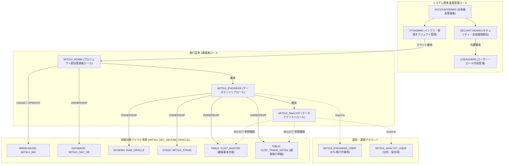
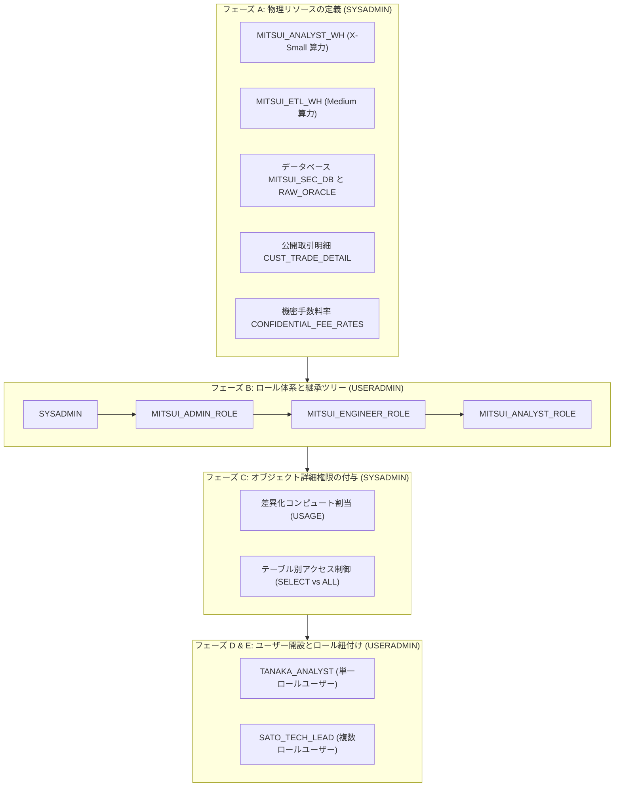

# 第 03 章：金融機関向け RBAC 権限モデルと環境構築実践

銀行証券などの金融機関において、**最小特権の原則（Principle of Least Privilege）** と **職務分掌（Separation of Duties: SoD）** はコンプライアンス上の生命線です。

前章までにおいて、三井証券の夜間バッチ処理遅延という業務課題を分析し（[第 00 章](00_architecture_overview.md)）、Snowflake クラウド環境を開設（[第 01 章](01_snowflake_signup.md)）、さらにローカル環境にて Oracle 11g 移行元データベースおよび 1:N 金融 2 テーブル構成（`CUST_MASTER` 顧客基本台帳 ＋ `CUST_TRADE_DETAIL` 顧客取引明細）のモックデータ投入を完了しました（[第 02 章](02_oracle_setup_and_data.md)）。

本章では、Snowflake クラウド側において三井証券のエンタープライズ統制基盤を確立します。ビルトインロールである `USERADMIN` および `SYSADMIN` を活用し、**3 層業務ロール体系（`MITSUI_ADMIN` $\to$ `MITSUI_ENGINEER` $\to$ `MITSUI_ANALYST`）** を構築。安全な権限委譲メカニズムを通じ、目標の 3 階層ネームスペース **`MITSUI_SEC_DB.RAW_ORACLE`** 配下に、仮想ウェアハウス、ステージ領域、そして `CUST_MASTER` マスター表と `CUST_TRADE_DETAIL` トランザクション明細表の 2 テーブル環境を構築します。

---

## 一、 システム概要とコア目的（社内管理基盤の設計思想）

金融工学の実務において、Snowflake 社内管理基盤の策定は以下の 2 つのコア目的を達成するために設計されています：

1. **重大セキュリティリスクの極小化と特権の一元管理**：  
   外部へのデータ漏洩などの重大リスクに直結する最高特権は、**基盤アーキテクチャチーム（インフラ・セキュリティ統括）** が一元管理します。具体的には、全体最高管理ロールである **`ACCOUNTADMIN`** および **`SECURITYADMIN`** を厳格に管理下に置き、業務開発者への直接付与を排除。これにより、各業務部門に対して標準化されたセキュアな Snowflake 実行基盤を提供します。

2. **分散運用基盤との連携共通化と業務負担の軽減**：  
   管理基盤が社内分散運用システムとの連携に必要な標準インターフェースを共通機能として提供し、業務システム側の個別運用負荷を大幅に軽減します。  
   > [!IMPORTANT]
   > **エンタープライズ責務境界の原則**：  
   > 各業務システム固有の **`SYSADMIN` 管理領域（仮想ウェアハウス Warehouse、データベース Database、スキーマ Schema、ステージ Stage などの物理オブジェクト）** については、業務部門（銀行証券データ移行プロジェクト側）へ自律的な管理権限を委譲し、全体ガバナンスと現場の開発アジリティを両立させます。

---

## 二、 🏛️ 銀行証券ロール階層モデル (Role Hierarchy)

金融クラウド DWH の設計に基づき、システム標準ロールと業務カスタムロールを疎結合に定義・継承します：



> [!NOTE]
> **★ Snowflake 権限仕様の要諦（単方向の上位集約モデル）**：  
> Snowflake のロール継承は**単方向の上位集約（親ロールは子ロールの特権を行使できるが、子ロールは親ロールの特権を自動継承しない）** です。したがって：  
> 1. `SYSADMIN` は配下のすべての業務オブジェクトに対する操作権限を自然に包含し、システム保守を円滑に行えます；  
> 2. ただし、`MITSUI_ADMIN` に付与された Warehouse の `USAGE` 権限は、配下の `MITSUI_ENGINEER` や `MITSUI_ANALYST` に**自動的には伝播しません**。そのため、各実行ロールに対して明示的に `GRANT USAGE` を設定する必要があります。

---

## 三、 🛠️ エンタープライズ環境構築詳細実践（17ステップ標準パイプライン）

本節では、金融庁および FISC 安全対策基準に準拠した厳格な構築パイプラインに沿って実機検証を進めます。本実習において、**実行されたすべての SQL スクリプトはワークシート上に履歴として完全保持され、フォーマットの統一およびステップごとの設計理由コメントを網羅**しています。

* **本章対応プロダクションスクリプト**：`scripts/snowflake/03_rbac_and_env_master.sql`

---

### フェーズ 1：`USERADMIN` による ID・ロールガバナンス

#### Step 01: 切换 useradmin 账户（USERADMIN への切り替え）
* **なぜそうするのか（理由と目的）**：職務分掌（Separation of Duties）の原則に基づき、ユーザー（User）およびロール（Role）のライフサイクル管理は専任の `USERADMIN` が管轄します。グローバル最高特権である `ACCOUNTADMIN` の日常利用を厳格に遮断し、特権濫用リスクを最小化します。

```sql
-- ====================================================================
-- 【Step 01: 切换 useradmin 账户】
-- 目的・理由: 職務分掌（Separation of Duties）に基づき、ユーザーおよび
--             ロールのライフサイクル管理は USERADMIN に切り替えて実行します。
-- ====================================================================
USE ROLE USERADMIN;
```


> **実行結果の解説**：  
> 右上の実行ロールが `USERADMIN` へ切り替わり、下部の結果ペインに `Statement executed successfully.`（実行時間 86ms）が表示されます。

---

#### Step 02: 创建 role（3層業務ロール体系の新設）
* **なぜそうするのか（理由と目的）**：銀行証券データ基盤において、「プロジェクト統括管理者（`MITSUI_ADMIN`）」、「データエンジニア（`MITSUI_ENGINEER`）」、「データアナリスト（`MITSUI_ANALYST`）」の 3 層ロールを定義し、ガバナンス・構築・活用の三権分立を確立します。

```sql
-- ====================================================================
-- 【Step 02: 创建 role】
-- 目的・理由: 銀行証券データ基盤における3層業務ロールを新設します：
--             - MITSUI_ADMIN: 統括管理者、DB設計および権限委譲を担当
--             - MITSUI_ENGINEER: エンジニア、パイプライン・Schema・Table DDLを担当
--             - MITSUI_ANALYST: アナリスト、データ照合・突合のためのSELECT参照のみ担当
-- ====================================================================
CREATE ROLE IF NOT EXISTS MITSUI_ADMIN    COMMENT = '銀行証券プロジェクト統括管理者ロール';
CREATE ROLE IF NOT EXISTS MITSUI_ENGINEER COMMENT = '銀行証券データエンジニアロール（移行・ETL担当）';
CREATE ROLE IF NOT EXISTS MITSUI_ANALYST  COMMENT = '銀行証券データアナリストロール（照会・分析担当）';
```


> **実行結果の解説**：  
> ロールが正常に作成され、結果ペインに `Role MITSUI_ANALYST successfully created.` が返却されます。先行する Step 01 のコードも上部に完全保持されています。

---

#### Step 03: 赋予/继承权限（ロール階層ツリーの確立）
* **なぜそうするのか（理由と目的）**：ロール階層（Role Hierarchy）を構築します。最上位の `MITSUI_ADMIN` を `SYSADMIN` 配下に束ねることで、インフラ運用チームによる全体統制を担保し、権限を上意下達・集約管理します。

```sql
-- ====================================================================
-- 【Step 03: 赋予/继承权限】
-- 目的・理由: 統括管理者を SYSADMIN に束ねて全体ガバナンスを確保し、
--             MITSUI_ADMIN -> MITSUI_ENGINEER -> MITSUI_ANALYST の階層を構築します。
-- ====================================================================
-- 統括管理者を SYSADMIN に束ねる
GRANT ROLE MITSUI_ADMIN TO ROLE SYSADMIN;

-- エンジニアの特権を統括管理者へ集約
GRANT ROLE MITSUI_ENGINEER TO ROLE MITSUI_ADMIN;

-- アナリストの特権をエンジニアへ集約
GRANT ROLE MITSUI_ANALYST TO ROLE MITSUI_ENGINEER;
```


> **実行結果の解説**：  
> 継承関係が確立され、`SYSADMIN` はすべての配下業務オブジェクトに対する監査・集中保守能力を自動的に保有します。

---

#### Step 04: 创建 user（業務アカウントの作成）
* **なぜそうするのか（理由と目的）**：実際の運用担当者やバッチ連携プロセス向けのアカウントを作成します。初期パスワードに加え、デフォルトロール（`DEFAULT_ROLE`）およびデフォルト仮想ウェアハウス（`DEFAULT_WAREHOUSE`）を強制バインドし、意図しないコンピュート浪費や権限混同を未然に防止します。

```sql
-- ====================================================================
-- 【Step 04: 创建 user】
-- 目的・理由: 実際の運用担当者アカウントを作成し、デフォルトロール・WHをバインド。
-- ====================================================================
-- エンジニア業務アカウント
CREATE USER IF NOT EXISTS MITSUI_ENGINEER_USER
    PASSWORD = 'MitsuiSecStrongPass2026!'
    DEFAULT_ROLE = MITSUI_ENGINEER
    DEFAULT_WAREHOUSE = MITSUI_WH
    MUST_CHANGE_PASSWORD = FALSE
    COMMENT = '銀行証券データエンジニア業務アカウント';

-- アナリスト業務アカウント
CREATE USER IF NOT EXISTS MITSUI_ANALYST_USER
    PASSWORD = 'MitsuiSecStrongPass2026!'
    DEFAULT_ROLE = MITSUI_ANALYST
    DEFAULT_WAREHOUSE = MITSUI_WH
    MUST_CHANGE_PASSWORD = FALSE
    COMMENT = '銀行証券アナリスト分析・監査業務アカウント';
```


---

#### Step 05: 赋予角色（ロールとユーザーの正式バインドと検証）
* **なぜそうするのか（理由と目的）**：作成したアカウントに対して業務ロールを付与し、`SHOW ROLES` および `SHOW USERS` コマンドで物理生成状態を検証します。

```sql
-- ====================================================================
-- 【Step 05: 赋予角色】
-- 目的・理由: 作成したアカウントに対して各ロールを正式に付与し、状態を検証。
-- ====================================================================
GRANT ROLE MITSUI_ENGINEER TO USER MITSUI_ENGINEER_USER;
GRANT ROLE MITSUI_ANALYST TO USER MITSUI_ANALYST_USER;

-- 作成されたロールとユーザーの検証
SHOW ROLES LIKE 'MITSUI_%';
SHOW USERS LIKE 'MITSUI_%';
```


---

### フェーズ 2：`SYSADMIN` によるコンピュート割当と DB 作成特権の委譲

#### Step 06: 切换 sysadmin 账户与 WAREHOUSE 作成
* **なぜそうするのか（理由と目的）**：コンピュートおよびストレージインフラは `SYSADMIN` が統制します。オンデマンドで自動起動・休眠する仮想ウェアハウス `MITSUI_WH` を作成し、5分間（300秒）無稼働時の自動サスペンド（`AUTO_SUSPEND`）を設定して不要課金を排除します。

```sql
-- ====================================================================
-- 【Step 06: 切换 sysadmin 账户並びに WAREHOUSE作成】
-- 目的・理由: SYSADMIN へ切り替え、コスト自動休眠付き仮想ウェアハウスを作成。
-- ====================================================================
USE ROLE SYSADMIN;

CREATE WAREHOUSE IF NOT EXISTS MITSUI_WH
    WITH 
    WAREHOUSE_SIZE = 'XSMALL'
    AUTO_SUSPEND = 300           -- 5分間クエリがない場合、自動休眠（コスト課金停止）
    AUTO_RESUME = TRUE           -- SQLリクエスト到着時に秒単位で自動復帰
    INITIALLY_SUSPENDED = TRUE   -- 作成時は停止状態でスタンバイ
    COMMENT = '銀行証券データ移行・バッチ処理専用仮想ウェアハウス';
```


> **実行結果の解説**：  
> コンソール右上のロールが `SYSADMIN` に切り替わり、`MITSUI_WH` が停止状態（`SUSPENDED`）で安全に作成されました。

---

#### Step 07 & 08: WAREHOUSE 権限配分と DB 作成権限付与
* **なぜそうするのか（理由と目的）**：  
  1. ウェアハウス作成後、各業務ロールに対して明示的に `USAGE`（利用権）および `OPERATE`（制御権）を付与する必要があります；  
  2. 証券移行チームの自立運用のため、`SYSADMIN` から `MITSUI_ADMIN` に対してアカウント階層（`ON ACCOUNT`）での `CREATE DATABASE` 権限を公式に委譲します。

```sql
-- ====================================================================
-- 【Step 07: WAREHOUSE作成と権限付与】
-- 目的・理由: 各業務ロールに対して仮想ウェアハウス利用権（USAGE / OPERATE）を配分。
-- ====================================================================
GRANT USAGE, OPERATE ON WAREHOUSE MITSUI_WH TO ROLE MITSUI_ADMIN;
GRANT USAGE ON WAREHOUSE MITSUI_WH TO ROLE MITSUI_ENGINEER;
GRANT USAGE ON WAREHOUSE MITSUI_WH TO ROLE MITSUI_ANALYST;

SHOW WAREHOUSES LIKE 'MITSUI_WH';

-- ====================================================================
-- 【Step 08: DB 作成権限付与】
-- 目的・理由: 業務部門の自立運用のため、MITSUI_ADMIN に CREATE DATABASE を委譲。
-- ====================================================================
GRANT CREATE DATABASE ON ACCOUNT TO ROLE MITSUI_ADMIN;
```


---

### フェーズ 3：業務ロールによる自治推進（DB、Schema、Stage、Dual Table の構築）

#### 🚨【重要実務トラブルシューティング：未割り当てロール切替エラーとセキュリティ仕様】
一般的なチュートリアルでは単に `USE ROLE MITSUI_ENGINEER;` と記載されがちですが、本番・実機環境において現在のアドミンセッションで直接実行すると、以下の厳格なアクセス制御エラーが発生します：

```text
SQL access control error: Requested role 'MITSUI_ENGINEER' is not assigned to the executing user. Specify another role to activate.
```


> [!CAUTION]
> **★ 金融エンタープライズ安全機構の深層解析**：  
> なぜ Step 03 でロール継承ツリーを組んだにもかかわらず、現在ログイン中のアカウントで `MITSUI_ENGINEER` に切り替えられないのでしょうか？  
> **Snowflake のセッションアクティベーションは「強いユーザーバインド（User-bound Activation）」を採用しているためです**！継承関係はロール間の権限移譲を解決しますが、ログインセッションで `USE ROLE <Role>` を発行するには、**そのアカウント自身に直接そのロールが付与されている必要があります**。  
> **解決策**：テスト・検証フェーズにおいては、`USERADMIN` にて現在操作中の管理者ユーザーに対しても業務ロールを付与（`GRANT ROLE ... TO USER CURRENT_USER();`）することで、自由にコンテキストを切り替えて疎通確認が可能になります！

---

#### Step 09 ~ 11: アカウント切り替え登録 (MITSUI_ADMIN) $	o$ DATABASE の作成 $	o$ スキーマ 作成権限付与
* **なぜそうするのか（理由と目的）**：  
  - 統括管理者 `MITSUI_ADMIN` に切り替え、委譲された特権を行使してコアデータベース `MITSUI_SEC_DB` を作成します；  
  - 統括管理者から実務エンジニア（`MITSUI_ENGINEER`）へ、スキーマの管理特権（`USAGE` と `CREATE SCHEMA`）を委譲します。

```sql
-- ====================================================================
-- 【Step 09: アカウント切り替え登録 (MITSUI_ADMIN)】
-- 【Step 10: DATABASEの作成 (MITSUI_SEC_DB)】
-- 【Step 11: スキーマ 作成権限付与】
-- 目的・理由: MITSUI_ADMIN が自治的に MITSUI_SEC_DB を作成し、エンジニアへ委譲。
-- ====================================================================
-- 管理者自身へのロール事前バインド（トラブルシューティング対策）
USE ROLE USERADMIN;
GRANT ROLE MITSUI_ADMIN TO USER CURRENT_USER();
GRANT ROLE MITSUI_ENGINEER TO USER CURRENT_USER();
GRANT ROLE MITSUI_ANALYST TO USER CURRENT_USER();

-- 統括管理者へ切り替え
USE ROLE MITSUI_ADMIN;
USE WAREHOUSE MITSUI_WH;

-- コア業務データベースの作成
CREATE DATABASE IF NOT EXISTS MITSUI_SEC_DB
    COMMENT = '三井証券基幹データクラウド移行データベース';

USE DATABASE MITSUI_SEC_DB;

-- エンジニアへスキーマ管理権限を委譲
GRANT USAGE ON DATABASE MITSUI_SEC_DB TO ROLE MITSUI_ENGINEER;
GRANT CREATE SCHEMA ON DATABASE MITSUI_SEC_DB TO ROLE MITSUI_ENGINEER;
```


---

#### Step 12 ~ 17: SCHEMA 作成 $	o$ ステージ作成 $	o$ テーブル作成（1:N 双表の完成）
* **なぜそうするのか（理由と目的）**：  
  1. **Step 12 & 13 (SCHEMA 作成)**：エンジニアが `RAW_ORACLE` スキーマを作成し、金融要件の 7 日間 Time Travel を設定；  
  2. **Step 14 & 15 (権限委譲とコンテキスト固定)**：最小特権の原則に基づき、アナリストへスキーマ利用権（`USAGE`）を付与し、エンジニアコンテキストを固定；  
  3. **Step 16 (ステージ作成)**：Oracle 異種間ギャップ（末尾スペース、空文字 `''` と `NULL` の不整合、UTF8）に対応する高精度 CSV フォーマット `CSV_ORACLE_IMPORT_FF` と内部ステージ `MITSUI_STAGE` を作成；  
  4. **Step 17 (テーブル作成)**：第02章の型定義に基づき、顧客基本台帳 `CUST_MASTER`（親テーブル）と顧客取引明細 `CUST_TRADE_DETAIL`（子テーブル）を作成し、アナリストへ SELECT 権限を付与。

```sql
-- ====================================================================
-- 【Step 12: MITSUI_ENGINEER への切り替え】
-- 【Step 13: SCHEMA作成 (RAW_ORACLE)】
-- 【Step 14: アナリストへの SCHEMA 利用権付与】
-- 【Step 15: エンジニアコンテキスト固定】
-- ====================================================================
USE ROLE MITSUI_ENGINEER;
USE WAREHOUSE MITSUI_WH;
USE DATABASE MITSUI_SEC_DB;

CREATE SCHEMA IF NOT EXISTS RAW_ORACLE
    DATA_RETENTION_TIME_IN_DAYS = 7
    COMMENT = 'Oracle移行生データ格納用スキーマ（Time Travel: 7日）';

USE SCHEMA RAW_ORACLE;

GRANT USAGE ON SCHEMA MITSUI_SEC_DB.RAW_ORACLE TO ROLE MITSUI_ANALYST;

-- ====================================================================
-- 【Step 16: ステージ作成 (File Format & Stage)】
-- ====================================================================
CREATE OR REPLACE FILE FORMAT CSV_ORACLE_IMPORT_FF
    TYPE = 'CSV'
    FIELD_DELIMITER = ','
    RECORD_DELIMITER = '
'
    SKIP_HEADER = 1
    FIELD_OPTIONALLY_ENCLOSED_BY = '"'
    NULL_IF = ('NULL', 'null', '')
    EMPTY_FIELD_AS_NULL = TRUE             -- Oracle ''(空文字) を Snowflake NULL に正規化
    TIMESTAMP_FORMAT = 'YYYY-MM-DD HH24:MI:SS'
    ENCODING = 'UTF8';

CREATE OR REPLACE STAGE MITSUI_STAGE
    FILE_FORMAT = CSV_ORACLE_IMPORT_FF
    COMMENT = 'Oracle 11g 抽出データ受取用内部ステージ';

-- ====================================================================
-- 【Step 17: テーブル作成 (双表構築と権限設定)】
-- ====================================================================
-- ① 顧客基本台帳（ディメンションテーブル）
CREATE OR REPLACE TABLE CUST_MASTER (
    CUST_ID            VARCHAR(10)       NOT NULL COMMENT '顧客ID (CHAR(10)正規化)',
    CUST_NAME_KANJI    VARCHAR(50)       NOT NULL COMMENT '顧客氏名 (漢字全角)',
    CUST_NAME_KANA     VARCHAR(50)       COMMENT '顧客氏名 (カナ)',
    CUST_RANK_CD       VARCHAR(2)        DEFAULT 'C ' NOT NULL COMMENT '顧客ランク (A /B /C 等)',
    BRANCH_CD          VARCHAR(4)        NOT NULL COMMENT '支店コード',
    STATUS_CD          VARCHAR(2)        COMMENT '口座状態 (01:有効, 02:休眠, NULL:未設定)',
    OPEN_DATE          DATE              NOT NULL COMMENT '口座開設日',
    REG_DATETIME       TIMESTAMP_NTZ(6)  DEFAULT CURRENT_TIMESTAMP() NOT NULL COMMENT '登録日時',
    MIGRATED_AT        TIMESTAMP_LTZ(6)  DEFAULT CURRENT_TIMESTAMP() COMMENT 'Snowflake 移行取込日時',
    CONSTRAINT PK_CUST_MASTER PRIMARY KEY (CUST_ID)
) COMMENT = '顧客基本台帳（Oracle 11g 移行先テーブル）';

GRANT SELECT ON TABLE CUST_MASTER TO ROLE MITSUI_ANALYST;

-- ② 顧客取引明細（ファクトテーブル）
CREATE OR REPLACE TABLE CUST_TRADE_DETAIL (
    TRADE_QTY          NUMBER(15, 0)     DEFAULT 0 NOT NULL COMMENT '取引数量',
    AMOUNT_JPY         NUMBER(18, 3)     DEFAULT 0 NOT NULL COMMENT '約定金額・円貨',
    AMOUNT_FCY         NUMBER(18, 3)     DEFAULT 0 COMMENT '約定金額・外貨',
    CCY_CODE           VARCHAR(3)        COMMENT '通貨区分 (USD/EUR等)',
    EXCHANGE_RATE      NUMBER(9, 6)      COMMENT '為替レート',
    REMARKS            VARCHAR(100)      DEFAULT ' ' COMMENT '摘要・備考 (全角半角混在安全)',
    CUST_ID            VARCHAR(10)       NOT NULL COMMENT '顧客ID',
    TRADE_TYPE_CD      VARCHAR(2)        NOT NULL COMMENT '取引区分 (01:買付, 02:売付)',
    BRANCH_CD          VARCHAR(4)        NOT NULL COMMENT '支店コード',
    TRADE_DATE         VARCHAR(8)        NOT NULL COMMENT '約定日 (YYYYMMDD形式)',
    SETTLE_MONTH       VARCHAR(6)        COMMENT '決済対象月 (YYYYMM形式)',
    REG_DATETIME       TIMESTAMP_NTZ(6)  DEFAULT CURRENT_TIMESTAMP() NOT NULL COMMENT '登録日時',
    UPD_DATETIME       TIMESTAMP_NTZ(6)  COMMENT '更新日時',
    MIGRATED_AT        TIMESTAMP_LTZ(6)  DEFAULT CURRENT_TIMESTAMP() COMMENT 'Snowflake 移行取込日時',
    CONSTRAINT PK_CUST_TRADE_DETAIL PRIMARY KEY (CUST_ID, TRADE_DATE, TRADE_TYPE_CD)
) COMMENT = '顧客取引明細（Oracle 11g 移行先テーブル）';

GRANT SELECT ON TABLE CUST_TRADE_DETAIL TO ROLE MITSUI_ANALYST;

SHOW TABLES IN SCHEMA MITSUI_SEC_DB.RAW_ORACLE;
```


> **実行結果の解説**：  
> 右上コンテキストが `MITSUI_ENGINEER` / `MITSUI_WH` / `MITSUI_SEC_DB` / `RAW_ORACLE` となり、結果ペインに `CUST_TRADE_DETAIL` と `CUST_MASTER` が表示されます。所有者は `MITSUI_ENGINEER`、保持期間は 7 日として正常に完成しました。

---

## 四、 🔐 金融業務ユーザー初回ログイン、MFA 設定および接続検証 (Onboarding & Sanity Check)

基本オブジェクト構築完了後、業務ユーザー（`MITSUI_ENGINEER_USER` 等）の受け入れ作業を実施します。FISC 安全対策基準に則り、初回セキュリティ設定と権限検証を実施します。

### 4.1 初期パスワード変更ポリシー
管理者が発行した初期一時パスワードに対し、初回ログイン時の強制パスワード変更（`MUST_CHANGE_PASSWORD = TRUE`）が適用されます：
- ユーザーが Snowsight に初めてログインした際、自動的にパスワード変更モーダルが表示されます；
- 複雑性要件（大文字、小文字、数字、記号を含み、12 桁以上）を満たす新パスワードを設定してワークスペースへ進入します。

### 4.2 金融水準 MFA (多要素認証) の設定手順
金融庁ガイドラインおよび金融機関のセキュリティ要件に基づき、**本番・検証を問わず Snowflake コンソールへアクセスする全特権・業務アカウントに MFA（TOTP 2要素認証）の設定が義務付けられています**：

1. **設定画面への移動**：Snowsight 右上の Profile アイコンから **Preferences** $	o$ **Multi-Factor Authentication (MFA)** を選択；
2. **認証方式の選択**：**Authenticator App (TOTP)** を選択；
3. **シークレットキーの取得**：
   - 画面に QR コードおよび Base32 シークレットキー（`WQQC4ZYF...` など）が表示されます；
   - モバイル端末の **Google Authenticator** や **Microsoft Authenticator** でスキャンするか、開発専用端末ではオープンソースの PC 版 TOTP ツール [WinAuth](https://winauth.github.io/winauth/download.html) 等にキーをインポートします；
4. **確認と有効化**：生成された 6 桁のワンタイムパスワードを入力し、バインドを完了します。

### 4.3 業務ロールの切り替えと接続性セニティチェック (Step 18 & Step 19 核心検証)
セキュリティ初期化完了後、SQL ワークシートにて以下の検証スクリプトを実行し、各ロールの境界を検証します：

#### Step 18: エンジニア疎通検証 (Sanity Check - MITSUI_ENGINEER)
エンジニアロールにおいて、一時テーブルを用いた軽量な読み書き疎通確認（サンドボックス検証）を実行します：

```sql
-- ====================================================================
-- 【Step 18: 疎通検証 (Sanity Check - MITSUI_ENGINEER)】
-- 目的・理由: エンジニアロールのセッション安定性と DDL/DML 権限を実証。
-- ====================================================================
USE ROLE MITSUI_ENGINEER;
USE WAREHOUSE MITSUI_WH;
USE DATABASE MITSUI_SEC_DB;
USE SCHEMA RAW_ORACLE;

CREATE OR REPLACE TEMPORARY TABLE _SANITY_CHECK (
    CHECK_ID    INT,
    OPERATOR    VARCHAR(50),
    CHECKED_AT  TIMESTAMP_NTZ DEFAULT CURRENT_TIMESTAMP()
);

INSERT INTO _SANITY_CHECK (CHECK_ID, OPERATOR) VALUES (1, CURRENT_USER());

SELECT * FROM _SANITY_CHECK;

DROP TABLE IF EXISTS _SANITY_CHECK;
```

#### Step 19: アナリスト最小特権防御検証 (Least Privilege Defense - MITSUI_ANALYST)
参照専用のアナリストロールへ切り替え、SELECT は正常実行でき、かつ不正な INSERT 書き込みはアクセス制御機構によって即時遮断されることを実証します：

```sql
-- ====================================================================
-- 【Step 19: 最小特権防御検証 (Least Privilege Defense - MITSUI_ANALYST)】
-- 目的・理由: アナリストが SELECT を実行可能であり、不正な INSERT は即座に遮断されることを検証。
-- ====================================================================
USE ROLE MITSUI_ANALYST;
USE WAREHOUSE MITSUI_WH;
USE DATABASE MITSUI_SEC_DB;
USE SCHEMA RAW_ORACLE;

-- 1. SELECT は許可されているため正常実行可能（0行返却で疎通確認）
SELECT * FROM CUST_MASTER;

-- 2. INSERT 権限はないため、システムにより即座に遮断される（エラー発生が正常な防御）
INSERT INTO CUST_MASTER (CUST_ID, CUST_NAME_KANJI, OPEN_DATE) 
VALUES ('TEST0001', '不正書込テスト', CURRENT_DATE());
```


> **エラーメッセージ詳細解析**：  
> ```text
> SQL compilation error: Object 'CUST_MASTER' does not exist or not authorized. Your primary role MITSUI_ANALYST or one of your secondary roles must have at least one privilege granted on TABLE CUST_MASTER.
> ```  
> 画像の警告表示の通り、不正な書き込みリクエストはコンパイル段階で完全に遮断されます。  
> **これにより最小特権の原則（Least Privilege）がクラウド上で厳格に機能していることが実証されました**。アナリストは安全にデータ閲覧のみ行え、人為的ミスや不正スクリプトによる本番データ改ざんリスクは根本から排除されます！

---

## 五、 🏢 エンタープライズ応用実践：マルチスペック算力、複数テーブル隔離と単一／複数ロール検証

基本環境の構築に加え、大規模金融機関の運用現場ではさらに厳格なセキュリティ要件が課されます：
1. **多規格 Warehouse の分離**：アナリストには低コストな `X-Small` 算力を、夜間大量データロードを行うエンジニアには `Medium` 算力を割り当ててリソース競合を防止；
2. **テーブル単位の機密アクセス制御**：同一スキーマ内において、通常の約定明細 `CUST_TRADE_DETAIL` はアナリストに公開し、手数料マスタ等の高機密テーブル `CONFIDENTIAL_FEE_RATES` はアナリストから完全に秘匿；
3. **単一ロールユーザー vs 複数ロールユーザー**：外部委託・一般スタッフには単一の厳格ロールを付与し、テックリードには複数ロールを付与して柔軟な切り替え（`USE ROLE`）を許可。

> [!TIP]
> 本応用シナリオを再現する独立した実行スクリプトは、リポジトリ内 `scripts/snowflake/00_account_provisioning_and_rbac_demo.sql` に配置されています。

### 5.1 FISC 基準に準拠した職務分掌パイプライン



### 5.2 単一ロールユーザー vs 複数ロールユーザーの比較対比

| 比較評価軸 | 単一ロールユーザー (`TANAKA_ANALYST`) | 複数ロールユーザー (`SATO_TECH_LEAD`) |
| :--- | :--- | :--- |
| **保有ロール** | `MITSUI_ANALYST_ROLE` のみ | `MITSUI_ADMIN_ROLE` ＋ `MITSUI_ENGINEER_ROLE` ＋ `MITSUI_ANALYST_ROLE` |
| **セッション挙動** | ログイン時点でアナリストロールに固定され、権限昇格不可 | 初期ロールは `MITSUI_ENGINEER_ROLE`、必要に応じて `USE ROLE` で自由切替 |
| **コンピュート制約** | 軽量な `MITSUI_ANALYST_WH` (X-Small) のみ起動可能。コストを厳格統制 | 開発時は `MITSUI_ETL_WH` (Medium) を使用、定例照会時はアナリスト倉庫へ自律降格 |
| **データアクセス境界** | `CUST_TRADE_DETAIL` のみ参照可能。機密表へアクセスすると `Object does not exist` で拒絶 | エンジニアとして機密手数料表を読み書き可能。管理者ロール切替で全体統括 |
| **対象ペルソナ** | 外部パートナー、一般アナリスト、監査閲覧者（権限逸脱リスクゼロ） | アーキテクト、テックリード、コアデータエンジニア |

### 5.3 応用シナリオ主要 SQL 抜粋

```sql
-- 1. マルチスペック Warehouse および機密テーブルの定義 (SYSADMIN)
USE ROLE SYSADMIN;
CREATE WAREHOUSE IF NOT EXISTS MITSUI_ANALYST_WH WITH WAREHOUSE_SIZE = 'X-SMALL' AUTO_SUSPEND = 60 AUTO_RESUME = TRUE;
CREATE WAREHOUSE IF NOT EXISTS MITSUI_ETL_WH     WITH WAREHOUSE_SIZE = 'MEDIUM'  AUTO_SUSPEND = 120 AUTO_RESUME = TRUE;

-- 2. 差異化権限付与 (SYSADMIN)
-- アナリストには軽量倉庫と公開テーブルのみ付与
GRANT USAGE ON WAREHOUSE MITSUI_ANALYST_WH TO ROLE MITSUI_ANALYST_ROLE;
GRANT SELECT ON TABLE MITSUI_SEC_DB.RAW_ORACLE.CUST_TRADE_DETAIL TO ROLE MITSUI_ANALYST_ROLE;

-- エンジニアには高スペック倉庫と機密テーブルを含めて付与
GRANT USAGE ON WAREHOUSE MITSUI_ETL_WH TO ROLE MITSUI_ENGINEER_ROLE;
GRANT SELECT, INSERT, UPDATE, DELETE ON TABLE MITSUI_SEC_DB.RAW_ORACLE.CUST_TRADE_DETAIL TO ROLE MITSUI_ENGINEER_ROLE;
GRANT SELECT, INSERT, UPDATE ON TABLE MITSUI_SEC_DB.RAW_ORACLE.CONFIDENTIAL_FEE_RATES TO ROLE MITSUI_ENGINEER_ROLE;

-- 3. ユーザー開設とロール付与 (USERADMIN)
USE ROLE USERADMIN;
CREATE USER IF NOT EXISTS TANAKA_ANALYST PASSWORD = 'InitPassword123#A' DEFAULT_ROLE = MITSUI_ANALYST_ROLE DEFAULT_WAREHOUSE = MITSUI_ANALYST_WH;
CREATE USER IF NOT EXISTS SATO_TECH_LEAD PASSWORD = 'InitPassword123#B' DEFAULT_ROLE = MITSUI_ENGINEER_ROLE DEFAULT_WAREHOUSE = MITSUI_ETL_WH;

-- ロールの紐付け
GRANT ROLE MITSUI_ANALYST_ROLE TO USER TANAKA_ANALYST;
GRANT ROLE MITSUI_ENGINEER_ROLE TO USER SATO_TECH_LEAD;
GRANT ROLE MITSUI_ANALYST_ROLE  TO USER SATO_TECH_LEAD;
GRANT ROLE MITSUI_ADMIN_ROLE    TO USER SATO_TECH_LEAD;
```

### 5.4 実機検証チェックリスト
* **テスト 1（限定権限照会）**：`MITSUI_ANALYST_ROLE` にて `CUST_TRADE_DETAIL` の参照が成功すること；
* **テスト 2（不正アクセス遮断）**：`MITSUI_ANALYST_ROLE` にて機密表 `CONFIDENTIAL_FEE_RATES` に対するアクセスが `Access denied` で遮断されること；
* **テスト 3（コンピュート境界分離）**：`MITSUI_ANALYST_ROLE` にて高スペック倉庫 `MITSUI_ETL_WH` の起動が拒否されること；
* **テスト 4（動的ロール切り替え）**：`SATO_TECH_LEAD` にて `USE ROLE MITSUI_ANALYST_ROLE` によるロール降格・昇格が自由に行えること。

---

## 六、 本章のまとめと次章への案内

本章では、金融機関標準の職務分掌に基づき、Snowflake 上に三井証券の 3 層業務ロール体系（`MITSUI_ADMIN` $\to$ `MITSUI_ENGINEER` $\to$ `MITSUI_ANALYST`）を構築しました。さらに仮想ウェアハウス `MITSUI_WH`、データベース `MITSUI_SEC_DB`、スキーマ `RAW_ORACLE`、ステージ `MITSUI_STAGE`、そして移行対象の 2 テーブル（`CUST_MASTER` 顧客基本台帳 ＋ `CUST_TRADE_DETAIL` 顧客取引明細）の DDL 定義と権限委譲を完了しました。

これで、**クラウド側の受け入れインフラは完璧に整いました**：
- 👉 **[第 04 章：データ抽出エクスポートと COPY INTO 一括ロード実践](04_data_migration.md)**：ローカルの Oracle コンテナから Python スクリプトを用いて 2 テーブルの CSV データを抽出し、SnowSQL / PUT コマンドで `MITSUI_STAGE` へ高速アップロード。その後 `COPY INTO` コマンドにより、クラウド側テーブルへの高精度な一括ロードと型変換を実施します！
