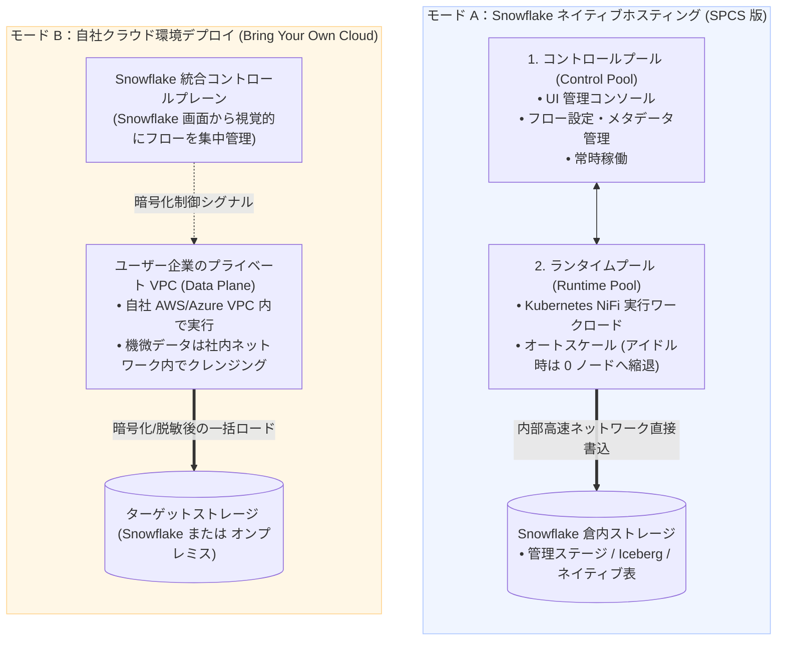

# 第 07-1 章：Snowflake Openflow コアアーキテクチャとマルチモーダルデータ統合

> 💡 **シリーズナビゲーション**：本章は Openflow のアーキテクチャ全体像を解説する基礎編です。Apache NiFi エンジン、SPCS コンテナ基盤、マルチモーダル統合の仕組みを理解した後は、[第 07-2 章：Snowflake Openflow による Box クラウド連携と Cortex ナレッジ検索実践](./07_02_openflow_box_integration.md) へお進みください。
>
> 本章は **『尚硅谷（Shangguigu）技術テキスト作成規範』** に準拠して全面執筆されています：本質を突く極小比較、業務ノイズを排除した純粋技術フォーカス、実機レスポンスを伴う 3 ステップ実証、落とし穴と回避策の明示、前提条件の完全前置。

---

## 導入：本質を突く極小メンタルモデル

現代のエンタープライズデータアーキテクチャにおいて、データエンジニアが直面する最大の課題は**データソースの断片化と多様なデータ形式（マルチモーダル）の混在**です：
1. **リレーショナルデータベース（Oracle, SQL Server, MySQL）**：リアルタイムな変更データキャプチャ（CDC）が求められますが、従来は高額な Qlik/GoldenGate を導入するか、自前で Debezium クラスタを運用保守する必要がありました；
2. **ストリーミングメッセージ（Kafka, Kinesis）**：低レイテンシでイベント流を取り込むため、独立した Spark Streaming や Flink 基盤の維持管理が必要でした；
3. **非構造化ドキュメント・SaaS クラウド（Box, SharePoint, Google Drive）**：PDF や Word、音声・動画ファイルを AI（Snowflake Cortex）へ連携するために、エンジニアが脆弱な Python ポーリングスクリプトを自作していました。

これら「サイロ化された個別パイプライン、多重の管理工数、認証情報漏洩リスク」を一挙に解決すべく、Snowflake が提供を開始した公式の統合データパイプライン基盤が **Snowflake Openflow** です！

### 極小比較：従来の外付け個別パイプライン vs Snowflake Openflow ネイティブ基盤

```
【従来の外付け多重パイプライン（サイロ化・高運用負荷・認証情報の分散）】
  ┌──────────────┐      Debezium / Kafka Connect      ┌──────────────────┐
  │ データベース CDC│ ═════════════════════════════════> │                  │
  ├──────────────┤           Flink / Spark            │                  │     インターネット経由
  │ リアルタイム流Kafka│ ═════════════════════════════════> │ 外部専用 ETL 基盤 │ ═════════════> Snowflake DWH
  ├──────────────┤        自作 Python ポーリング       │                  │
  │ SaaS ドキュメント │ ═════════════════════════════════> │                  │
  └──────────────┘                                    └──────────────────┘
                                                        ▲ 複数の外部サーバー維持が必要で高コスト・脆弱
                                                        ▲ DB 認証情報が外部に分散し、セキュリティリスク

【Snowflake Openflow ネイティブ統合アーキテクチャ（NiFi カーネル・SPCS 駆動・マルチモーダル統合）】
  ┌──────────────┐
  │ データベース CDC│ ──┐
  ├──────────────┤   │
  │ リアルタイム流Kafka│ ──┼──> 【Snowflake Openflow (Apache NiFi をベースに最適化)】 ──┐
  ├──────────────┤   │    • Snowpark Container Services (SPCS) または 自社 VPC (BYOC) │   │ 倉内内部ネットワーク転送
  │ SaaS ドキュメント │ ──┘    • 宣言的 Flow-Based パイプライン設計 / 豊富なコネクタライブラリ   │   │ データ外部流出ゼロ
  └──────────────┘                                                                   │   ▼
                                    ┌────────────────────────────────────────────────┴───────────────────────┐
                                    │ Snowflake 統合ストレージ & AI コンピュートエンジン                      │
                                    │ • 管理ステージ (原本保管) / Apache Iceberg / ネイティブテーブル / Cortex AI │
                                    └────────────────────────────────────────────────────────────────────────┘
```

- **核心的な疑問**：Openflow は外部 SaaS なのか、それとも Snowflake 内部で動くコンテナなのか？データ転送の安全性や課金モデルはどうなっているのか？
- **本章の到達点**：**Apache NiFi を中核とするフローベースプログラミングモデル**、**SPCS ネイティブホスティングと BYOC のデュアルデプロイ方式**、**マルチモーダルコネクタ群**、そして **SPCS Compute Pool の課金防護メカニズム**を完全解剖します。

> 📖 **Snowflake 公式ドキュメントリンク**：
> - [Snowflake Openflow 概要マニュアル (About Openflow)](https://docs.snowflake.com/ja/user-guide/data-integration/openflow/about)
> - [Openflow - Snowflake Deployments (SPCS 版アーキテクチャ)](https://docs.snowflake.com/ja/user-guide/data-integration/openflow/snowflake-deployments)
> - [Openflow コスト管理とリソース制御 (Manage Costs)](https://docs.snowflake.com/ja/user-guide/data-integration/openflow/manage-costs)

---

## 一、前提条件と依存環境 (Prerequisites)

Openflow の導入にあたり、事前に以下の条件を満たしていることを確認します：

| コンポーネント | 必須要件 / 権限 | 役割・用途 |
| :--- | :--- | :--- |
| **Snowflake アカウント** | `ACCOUNTADMIN` ロール（または SPCS 関連権限保持ロール） | コンピュートプール、サービス、外部アクセス統合の作成 |
| **SPCS コンテナサービスクォータ** | 所属リージョンで Snowpark Container Services が有効 | Openflow コントロールプレーンおよびランタイムコンテナの実行基盤 |
| **コンピュートプール (Compute Pool)** | `CPU_X64_XS` または `CPU_X64_S` ノードファミリ | Openflow NiFi エンジンクラスタおよびメタデータサービスの稼働 |
| **ネットワークルール (Network Rule)** | `EGRESS` 種別の Network Rule および Integration | Openflow コンテナから外部 SaaS（Box, SharePoint等）や DB へのアウトバウンド通信許可 |

---

## 二、コアエンジンと全体アーキテクチャの深層解剖

### 1. エンジン内核：Apache NiFi Flow-Based 宣言的ストリーム計算モデル

Snowflake Openflow は、実績豊富なオープンソースの分散データフローエンジン **Apache NiFi** をコアエンジンとして採用しています。

Openflow 内のデータパイプラインは、**Flow-Based Programming（フローベースプログラミング）** の原則に基づき構成されます：

```
┌─────────────────────────────────────────────────────────────────────────────┐
│                           Openflow コア抽象 3 要素                           │
├─────────────────────────────────────────────────────────────────────────────┤
│ 1. FlowFile (データパケット)                                                 │
│    • Content: 実際の物理ペイロード (DB の1行、JSON、PDF のバイナリデータ等)      │
│    • Attributes: 付随するメタデータ Key-Value (mime.type, file.size, 取得日時等)│
├─────────────────────────────────────────────────────────────────────────────┤
│ 2. Processor (処理ノード)                                                    │
│    • 抽出、フィルタリング、フォーマット変換、メタデータ付与、書き込みを実行      │
├─────────────────────────────────────────────────────────────────────────────┤
│ 3. Connection & Queue (背圧制御付き接続キュー)                               │
│    • プロセッサ間を接続し、Backpressure（背圧）制御によりシステム過負荷を防止   │
└─────────────────────────────────────────────────────────────────────────────┘
```

- **完全なデータ来歴監査（Data Provenance）**：NiFi 由来の完全なデータプロベナンス機能を備えています。パイプラインに流入したすべての FlowFile は、どのような変換やルーティングを経たか、処理時間や変更履歴が 100% 監査ログとして記録され、金融コンプライアンスに耐えうる証跡を提供します。

---

### 2. 2 つのデプロイ形態の比較：SPCS フルマネージド vs BYOC 自社 VPC

ビジネス要件（「運用の簡素化」か「厳格なデータ境界の維持」か）に応じて、2 つのデプロイメントが選択可能です：



| 比較項目 | モード A：Snowflake デプロイ（SPCS コンテナ版） | モード B：BYOC デプロイ（Bring Your Own Cloud） |
| :--- | :--- | :--- |
| **実行インフラ** | **Snowpark Container Services (SPCS)** 算力プール | ユーザー企業既存の AWS / Azure VPC サブネット |
| **インフラ管理工数** | **ゼロ運用（Zero-Ops）**、OS やクラスタ管理不要 | クラウド VM やセキュリティグループ、ディスク管理が必要 |
| **スループットと遅延** | **最高速**：DWH ストレージと同一内部バックボーンで直結 | VPC から Snowflake へのネットワーク回線帯域に依存 |
| **推奨ユースケース** | クラウドネイティブな湖倉一体化、Cortex AI パイプライン | 規制により生データを自社 VPC 外に出せない金融・公共案件 |
| **課金体系** | Snowflake Credits に統合され秒単位課金 | コントロールプレーンは Snowflake、実行基盤は AWS/Azure に直接支払い |

---

## 三、マルチモーダルデータソース接続エコシステム

テーブルデータに限定されていた従来のツールとは一線を画し、Openflow は**マルチモーダル（Multimodal）な全方位データ統合**を提供します：

```
┌────────────────────────────────────────────────────────────────────────────────────────┐
│                              Snowflake Openflow 対応コネクタ群                         │
├────────────────────────────────────────────────────────────────────────────────────────┤
│ 1. 構造化データベース変更追跡 (Database CDC)                                           │
│    • Oracle (LogMiner/XStream)                                                         │
│    • Microsoft SQL Server (CDC)                                                        │
│    • PostgreSQL (Logical Replication)                                                  │
│    • MySQL (Binlog Replication)                                                        │
├────────────────────────────────────────────────────────────────────────────────────────┤
│ 2. リアルタイムイベント・半構造化ストリーム (Streaming & Messaging)                      │
│    • Apache Kafka / Confluent Cloud                                                    │
│    • Amazon Kinesis                                                                    │
│    • HTTP/REST Webhooks                                                                │
├────────────────────────────────────────────────────────────────────────────────────────┤
│ 3. 非構造化ドキュメント・SaaS ストレージ (Unstructured Files & Cloud Storage)           │
│    • Box (PDF, Word, TXT のバイナリおよびアクセス権限 ACL の抽出)                      │
│    • Microsoft SharePoint & OneDrive                                                   │
│    • Google Drive & Google Cloud Storage (GCS)                                         │
│    • Amazon S3 & Azure Blob Storage                                                    │
└────────────────────────────────────────────────────────────────────────────────────────┘
```

Oracle の基幹トランザクションを Iceberg テーブルへ秒単位で差分同期することも、Box 内の社内規程ドキュメント群を Snowflake Stage へ同期して Cortex 大規模言語モデルにナレッジとして供給することも、同一のビジュアルキャンバス上でシームレスに実現できます。

---

## 四、コアオブジェクトと設定パラメータ一覧辞書

| オブジェクト / パラメータ | 英語名 | 推奨値 | 技術的役割と解説 |
| :--- | :--- | :--- | :--- |
| **コントロールプール** | `Control Pool` | `CPU_X64_XS` | Openflow の Web 管理画面やスケジューラメタデータを司る常時稼働プール。 |
| **ランタイムプール** | `Runtime Pool` | `CPU_X64_S` | データの抽出・変換・転送を実際に実行するコンテナ群。アイドル時自動休止に対応。 |
| **データフロー** | `Pipeline / Flow` | 業務識別名（例: `BOX_INGEST_FLOW`） | 複数のプロセッサとキューで構成される有向パイプライングラフ。 |
| **プロセッサ** | `Processor` | 標準コンポーネント | 単一のアトミックな処理を実行するノード（`FetchBoxFile`, `PutSnowflakeStage` 等）。 |
| **背圧オブジェクト上限** | `Backpressure Object Threshold` | `10000` | キュー内に滞留を許可する最大 FlowFile 数。超過時は上流の読み取りが一時停止。 |
| **背圧データサイズ上限** | `Backpressure Data Size Threshold`| `1 GB` | キュー内の最大滞留バイト数。メモリ枯渇（OOM）を防止。 |
| **外部アクセス統合** | `External Access Integration` | 送信先ルールをバインド | コンテナから外部ドメインや特定ポートへの通信を許可するセキュリティ設定。 |

---

## 五、SPCS コンテナ環境の構築手順（3 ステップ完結）

### Step 1: SPCS コンピュートプールと専用 RBAC ロールの作成

```sql
-- 1. セキュリティ管理者ロールへ切り替え
USE ROLE SECURITYADMIN;

CREATE ROLE IF NOT EXISTS OPENFLOW_ADMIN_ROLE
    COMMENT = 'Snowflake Openflow インフラ運用専用ロール';

GRANT ROLE OPENFLOW_ADMIN_ROLE TO ROLE SYSADMIN;

-- 2. システム管理者ロールでコンピュートプールを作成
USE ROLE SYSADMIN;

-- 実行用ランタイムプール (無通信 10 分で自動的に 0 ノードへ縮退)
CREATE COMPUTE POOL IF NOT EXISTS OPENFLOW_RUNTIME_POOL
    MIN_NODES = 0
    MAX_NODES = 2
    INSTANCE_FAMILY = 'CPU_X64_XS'
    AUTO_SUSPEND_SECS = 600
    AUTO_RESUME = TRUE
    COMMENT = 'Openflow パイプライン実行用エラスティックプール';

GRANT USAGE, MONITOR ON COMPUTE POOL OPENFLOW_RUNTIME_POOL TO ROLE OPENFLOW_ADMIN_ROLE;
```

---

### Step 2: セキュアな外部通信ルールの設定（External Access Integration）

外部 SaaS（Box、SharePoint 等）と通信を行うため、明示的なアウトバウンド通信許可ルールを定義します：

```sql
USE ROLE ACCOUNTADMIN;

-- 送信先ドメインのホワイトリスト定義
CREATE OR REPLACE NETWORK RULE OPENFLOW_EXTERNAL_EGRESS_RULE
    MODE = EGRESS
    TYPE = HOST_PORT
    VALUE_LIST = ('app.box.com:443', 'api.box.com:443', 'upload.box.com:443');

-- 外部アクセス統合オブジェクトとしてカプセル化
CREATE OR REPLACE EXTERNAL ACCESS INTEGRATION OPENFLOW_EXTERNAL_ACCESS_INT
    ALLOWED_NETWORK_RULES = (OPENFLOW_EXTERNAL_EGRESS_RULE)
    ENABLED = TRUE
    COMMENT = 'Openflow コンテナ用のアウトバウンド通信統合';

GRANT USAGE ON INTEGRATION OPENFLOW_EXTERNAL_ACCESS_INT TO ROLE OPENFLOW_ADMIN_ROLE;
```

---

### Step 3: Openflow サービスの初期化とフロー構築

Snowsight の左側メニュー **`Data Products -> Openflow`** へアクセスし、作成済みの Compute Pool と External Access Integration を指定してサービスを立ち上げます。

初期化が完了すると Apache NiFi 由来の直感的なドラッグ＆ドロップキャンバスが展開され、直ちにデータパイプラインの構築を開始できます。

---

## 六、現場で必ずハマる暗坑と実戦回避策（重要）

---

### `[!CAUTION]` 【落とし穴 1】：`_CONTROL_POOL` の常時稼働による課金爆発！

- **事故現場**：
  検証完了後、画面上のコネクタをすべて `STOPPED` にしたため課金は停止したと思い込み、数日後にトライアル枠の 400 ドルが完全に消滅していた。
- **原因の深層分析**：
  SPCS 版 Openflow ではリソースが 2 分割されます：
  1. **Runtime Pool（実行プール）**：処理停止に伴いノード数が自動的に 0 へ縮退し課金が止まります；
  2. **Control Pool（管理プール、末尾が `_CONTROL_POOL`）**：Web 画面やスケジューラを稼働させるため**デプロイが有効である限り 24 時間常時稼働し、Credits を消費し続けます**！
- **確実な回避策**：
  検証終了後は、Deployment をそのまま放置せず、必ずデプロイメントサービスを削除またはサスペンドしてください：
  ```sql
  -- 検証終了後は管理サービスを削除し、常時課金を完全に遮断
  DROP SERVICE IF EXISTS <OPENFLOW_CONTROL_SERVICE>;
  ALTER COMPUTE POOL IF EXISTS OPENFLOW_RUNTIME_POOL SUSPEND;
  ```

---

### `[!WARNING]` 【落とし穴 2】：Backpressure（背圧）によるパイプラインの停止

- **現象**：上流からの取得が速く、Snowflake への書き込みが追いつかない場合に、コネクション上に警告アイコンが点灯しパイプライン全体がフリーズする。
- **原因**：キュー内の滞留数が `Backpressure Object Threshold`（デフォルト 10,000）に達したため、NiFi の安全機構により上流のプロセッサが強制停止された状態です。
- **標準回避策**：接続キューのプロパティで適切な閾値を設定し、エラー発生時は `Failure Relationship` を経由してデッドレターステージへ退避させる設計を施します。

---

### `[!WARNING]` 【落とし穴 3】：外部通信ルールの未設定によるタイムアウト

- **現象**：Box などの外部 API 接続テスト時に `Connection timed out` が発生する。
- **原因**：SPCS はゼロトラストセキュリティモデルを採用しており、デフォルトでコンテナからの外部インターネットアクセスが物理的に遮断されています。
- **標準回避策**：`NETWORK RULE`（`MODE = EGRESS`）と `EXTERNAL ACCESS INTEGRATION` を正しく設定し、Openflow サービス起動時にバインドしているか確認します。

---

## 本章のまとめと次章への案内

1. **統一統合ファブリック**：Snowflake Openflow は、Apache NiFi の実績あるコアと SPCS のエラスティックな計算力を融合させ、全模ータ（CDC・ストリーム・非構造化）の統合基盤を提供します；
2. **2 つの運用モデル**：フルマネージドな SPCS 構成と、データ主権を重視する BYOC 構成を業務要件に応じて選択可能；
3. **コスト防護の意識**：`Control Pool`（常時稼働）と `Runtime Pool`（自動縮退）の挙動の違いを理解し、検証後のリソース管理を徹底することが不可欠です。

> 🚀 **実践編へのナビゲーション**：
> Openflow の基本アーキテクチャを習得したところで、次章 [第 07-2 章：Snowflake Openflow による Box クラウド連携と Cortex ナレッジ検索実践](./07_02_openflow_box_integration.md) へ進み、Box ドキュメントの同期から原本保管、チャンク分割、Cortex 検索までのエンドツーエンド実機検証を体験しましょう！
