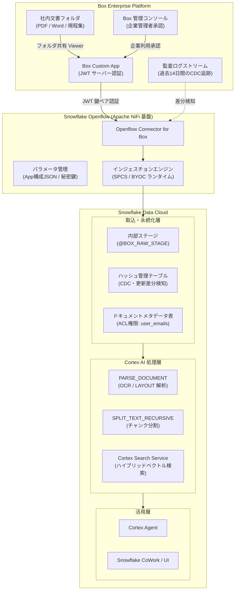
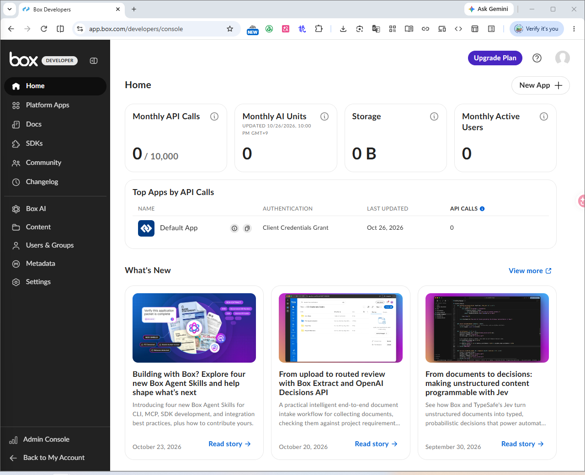
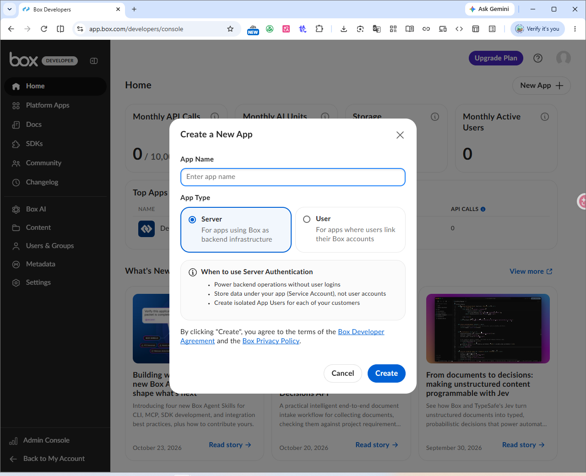
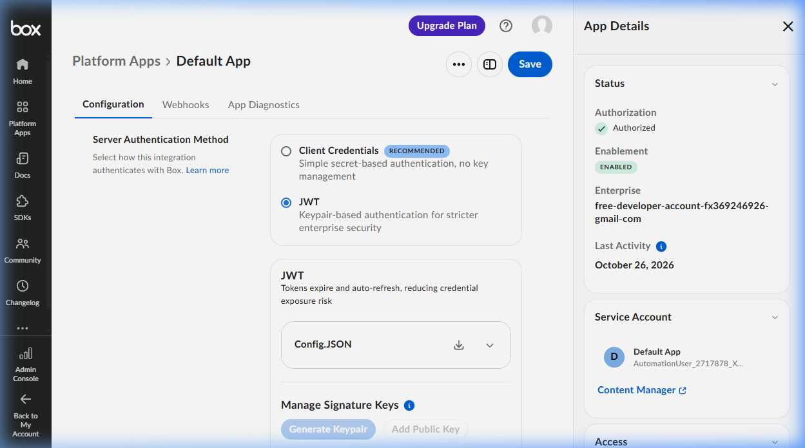
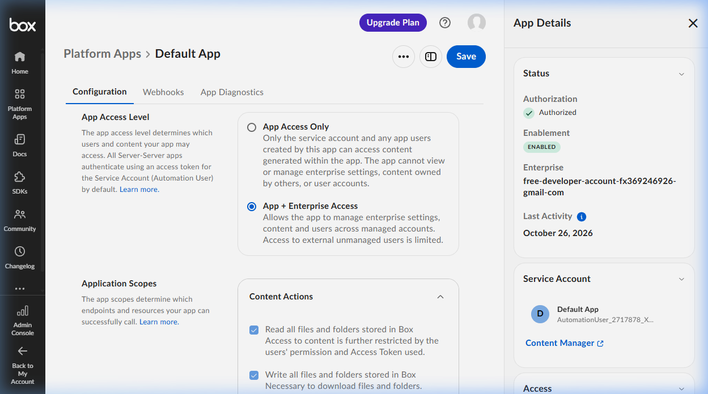
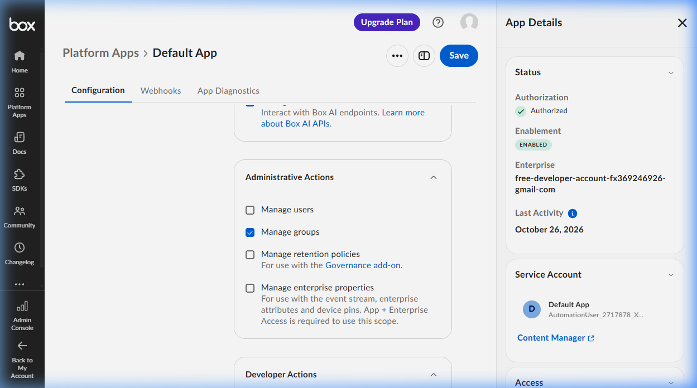
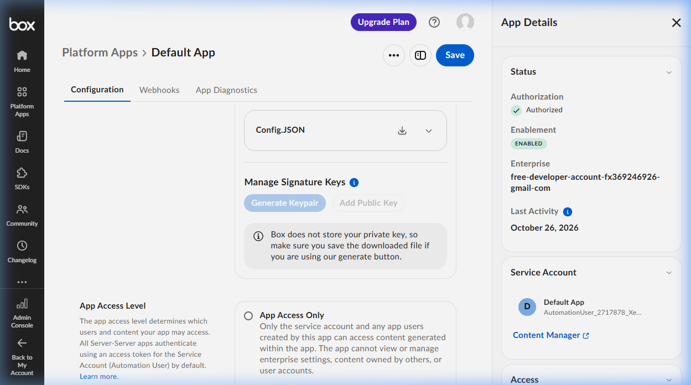
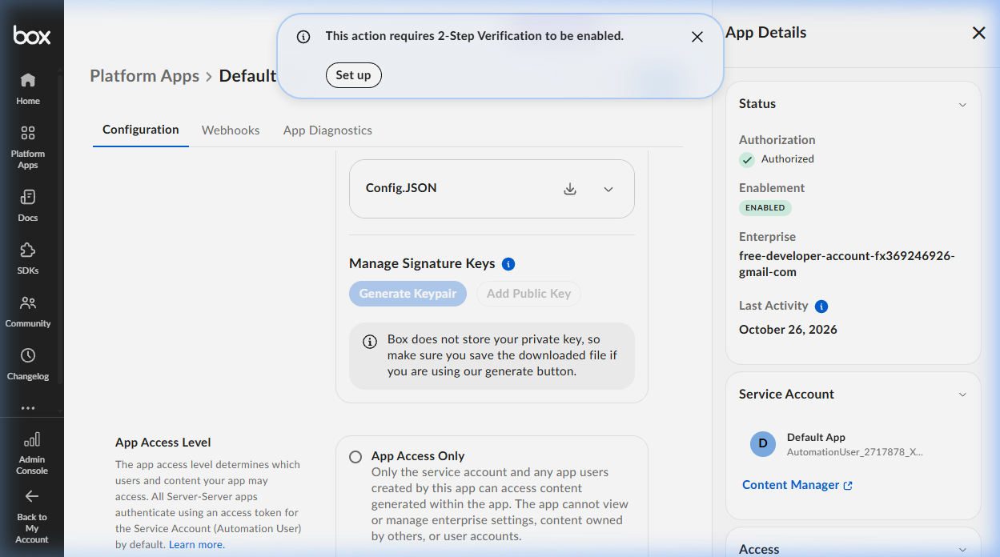
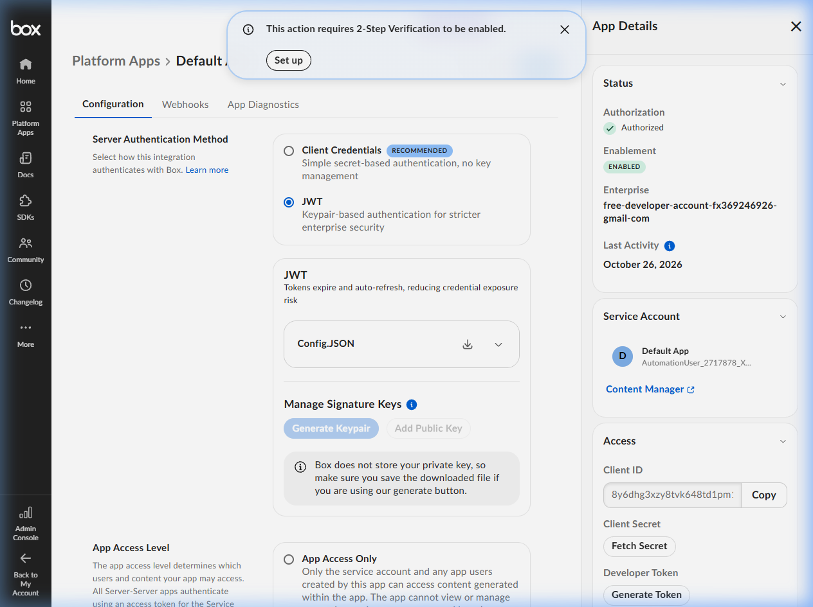
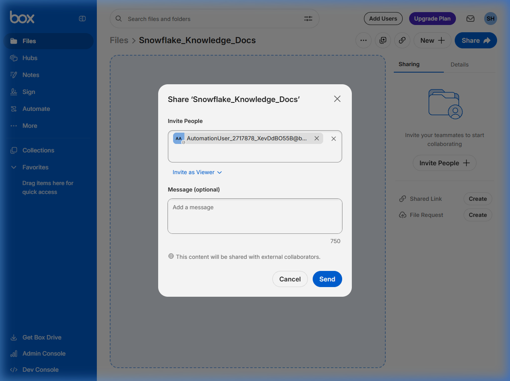

# 第 07 章：Snowflake Openflow による Box 連携と Cortex 知識検索統合

金融機関（メガバンク・大手証券）やエンタープライズ企業において、規程集・マニュアル・契約書・リサーチレポートなどの膨大な非構造化データは **Box** に蓄積されています。これらをセキュアに **Snowflake** へ集約し、**Cortex Search** および **Cortex Agent** と統合することで、社内規程の即時照会や業務自動化（RAG：検索拡張生成）を実現する需要が急速に高まっています。

本章では、Snowflake のフルマネージドデータ統合機能である **Snowflake Openflow** と **Openflow Connector for Box** を活用し、従来のカスタム API スクリプト開発（スクラッチ開発）を排した、低コード・保守性に優れた企業級データ連携パイプラインの構築手順を徹底解説します。

---

## 全体アーキテクチャと連携フロー



### 連携方式の選定：案①（Openflow） vs 案②（Box REST API）

| 比較項目 | 案①：Snowflake Openflow Connector (本章採用) | 案②：Box REST API スクラッチ開発 |
| :--- | :--- | :--- |
| **開発工数** | **極小（数時間〜半日で疎通完了）** | 大（認証・ダウンロード・リトライ機構の実装が必要） |
| **認証管理** | **Openflow 内で JWT 構成 JSON を安全に管理** | 自前サーバーで Token 保存・定期リフレッシュ処理を構築 |
| **差分同期 (CDC)** | **過去14日間の `admin_logs_streaming` を自動解析** | ファイル更新日時のポーリングや Webhook の自前実装が必要 |
| **アクセス権限 (ACL)** | **Box の閲覧権限（user_emails）を自動連携可能** | 権限取得 API を別途叩いてマッピングテーブルを自作 |
| **Cortex 統合** | **パース・チャンク・Search Service まで自動化可能** | 各 Cortex SQL 関数を手作業でスクリプトチェーン化 |

---

## フェーズ 1：Box 側の事前準備と設定手順 (Box Developer Console)

Box 側では、外部システム（Openflow）からのアクセスを受け入れるための **カスタムアプリ (Custom App)** を払い出し、セキュリティ統制に基づく管理者の承認を受けます。

### Step 1.1: Custom App の新規作成
1. [Box Developer Console](https://app.box.com/developers/console) にアクセスします。



2. 右上の **「Create Platform App」**（プラットフォームアプリの作成）または **「New App +」** をクリックします。
3. アプリケーションタイプとして **「Custom App」** を選択します。



4. アプリ情報を入力します：
   - **App Name**：`Snowflake_Openflow_Box`（または組織の命名規則に準拠）
   - **Description**：`Box to Snowflake data pipeline via Openflow`
   - **Purpose**：ドロップダウンリストから `Integration`（データ統合）を選択します。
5. 認証方法（Authentication Method）として、必ず **「Server Authentication (with JWT)」** を選択します。



6. **「Create App」** をクリックします。

### Step 1.2: 権限スコープ（Application Scopes）の設定
アプリ作成後、**「Configuration」**（構成）タブを開き、以下の通り設定します：

1. **App Access Level**：
   - **「App + Enterprise Access」** を選択します（エンタープライズ内のファイルおよびユーザー情報の読み取りに必須）。
2. **Application Scopes**（アプリケーションスコープ）：
   - `Read all files and folders stored in Box`（Boxに保存されているすべてのファイルとフォルダーの読み取り）：**必須チェック**
   - `Write all files and folders stored in Box`：**必須チェック**  
     *(※注：コネクタがファイルをダウンロードする内部処理に必要です。コネクタが Box 上のファイルを更新・アップロードすることはありません)*



   - `Manage users`（ユーザーの管理）：**必須チェック**（Box ユーザー情報の取得用）
   - `Manage groups`（グループの管理）：**必須チェック**
   - `Manage enterprise properties`（エンタープライズプロパティの管理）：**必須チェック**（監査ログイベントの読み取り用）



3. **Advanced Features**（高度な機能）：
   - 必要に応じて `Perform Actions as Users` および `Generate user access tokens` を有効化します。

### Step 1.3: 公開鍵/秘密鍵ペアの生成と構成 JSON の取得
1. **「Add and Manage Public Keys」**（公開キーの追加と管理）セクションまでスクロールします。



2. **「Generate a Public/Private Keypair」**（公開/秘密キーペアを生成）をクリックします。
   > [!IMPORTANT]
   > **企業セキュリティ要件（2段階認証 / 2FA の必須化）：**  
   > Box では秘密鍵の安全保護のため、開発者アカウントに 2 段階認証（2-Step Verification）が有効化されていない場合、以下のアラートが表示され鍵ペアの自動生成が保留されます。
   > 
   > 
   > 
   > エンタープライズ環境では、Box アカウント設定（Account Settings > Security）にて SMS または Authenticator App による 2FA を有効化の上、再度ボタンをクリックしてください。

3. 生成が完了すると、秘密鍵を含む **構成 JSON ファイル**（例：`2717878_xxxx_config.json`）がローカル端末に自動ダウンロードされます。
   > [!CAUTION]
   > この JSON ファイルには Box アプリの秘密鍵（Private Key）が含まれています。Git リポジトリにコミットしたり、パブリックなチャットに貼り付けたりせず、安全なパスワードマネージャーや機密ストアで保管してください。
4. 画面右上の **「Save Changes」**（変更を保存）をクリックします。



### Step 1.4: Box 組織管理者によるアプリ承認（必須統制フロー）
開発者が作成した Custom App は、企業の管理者が承認するまで有効化されません。

1. **「Authorization」**（承認）タブに移動します。
2. **「Review and Submit」** をクリックし、管理者に承認申請を送信します。
3. **Box 企業管理者（Enterprise Admin）側の作業**：
   - [Box 管理コンソール (Admin Console)](https://app.box.com/master) にログインします。
   - 左メニューの **「アプリ」** ＞ **「カスタムアプリマネージャー」**（Custom Apps）を開きます。
   - 申請されたアプリの `Client ID`（またはアプリ名）を確認し、**「承認 (Authorize)」** を実行します。

### Step 1.5: サービスアカウントの取得と対象フォルダへの招待
1. Developer Console の **「General Settings」**（一般設定）タブまたはアプリ詳細サイドバーを開きます。
2. **「Service Account Info」**（サービスアカウント情報）にあるメールアドレスをコピーします。
   - 書式例：`AutomationUser_2717878_XevDdBO55B@boxdevedition.com`
3. **対象フォルダの共有設定**：
   - 通常の Box Web 画面で、Snowflake へ取り込みたいフォルダ（例：`Snowflake_Knowledge_Docs` または `全社規程・技術文書`）を開きます。
   - 右上の **「共有」** ＞ **「ユーザーを招待」** をクリックします。
   - 先ほどコピーしたサービスアカウントのメールアドレスを貼り付け、ロールとして **「ビューアー (Viewer)」** を選択して招待します。
   - これにより、サービスアカウントが該当フォルダとその配下のサブフォルダ・ファイルを安全に読み取れるようになります。



4. **Folder ID の取得**：
   - ブラウザの URL バーからフォルダ ID（`https://app.box.com/folder/431197981508` の末尾の数字 `431197981508`）を控えておきます。
   - ※アプリがアクセス可能な全フォルダを対象にする場合は `0` を指定できます。

---

## フェーズ 2：Snowflake 側の基盤構築と RBAC 設計

Snowflake 側では、Openflow が安全にデータをロードできるよう、最小特権の原則に基づく専用ロール、サービスユーザー、データベース、スキーマ、およびウェアハウスを定義します。

### Step 2.1: RBAC ロール階層と専用ユーザーの作成
`SECURITYADMIN` および `SYSADMIN` 権限で定義されたマスタースクリプト [`07_openflow_box_setup.sql`](file:///c:/Users/FX/Projects/SnowflakeBlog/scripts/snowflake/07_openflow_box_setup.sql) を実行します。

```sql
-- 1. ユーザー・ロール管理
USE ROLE SECURITYADMIN;

CREATE ROLE IF NOT EXISTS OPENFLOW_CONNECTOR_ROLE
    COMMENT = 'Snowflake Openflow Box コネクタ実行用ロール';

CREATE ROLE IF NOT EXISTS CORTEX_SEARCH_READ_ROLE
    COMMENT = 'Cortex Agent / 検索アプリ用 読取専用ロール';

CREATE USER IF NOT EXISTS OPENFLOW_BOX_SVC_USER
    TYPE = SERVICE
    DEFAULT_ROLE = OPENFLOW_CONNECTOR_ROLE
    COMMENT = 'Openflow ランタイム自動連携用サービスユーザー';

GRANT ROLE OPENFLOW_CONNECTOR_ROLE TO USER OPENFLOW_BOX_SVC_USER;
GRANT ROLE OPENFLOW_CONNECTOR_ROLE TO ROLE SYSADMIN;
GRANT ROLE CORTEX_SEARCH_READ_ROLE TO ROLE SYSADMIN;

-- 2. コンピュートおよびストレージリソース作成
USE ROLE SYSADMIN;

CREATE WAREHOUSE IF NOT EXISTS OPENFLOW_INGEST_WH
    WITH
    WAREHOUSE_SIZE = 'XSMALL'
    AUTO_SUSPEND = 120
    AUTO_RESUME = TRUE
    INITIALLY_SUSPENDED = TRUE
    COMMENT = 'Openflow 取込および Cortex チャンク処理用ウェアハウス';

CREATE DATABASE IF NOT EXISTS BOX_INTEGRATION_DB;
CREATE SCHEMA IF NOT EXISTS BOX_INTEGRATION_DB.BOX_LANDING_DATA;
CREATE SCHEMA IF NOT EXISTS BOX_INTEGRATION_DB.CORTEX;

-- 3. 権限付与
GRANT USAGE, OPERATE ON WAREHOUSE OPENFLOW_INGEST_WH TO ROLE OPENFLOW_CONNECTOR_ROLE;
GRANT USAGE ON DATABASE BOX_INTEGRATION_DB TO ROLE OPENFLOW_CONNECTOR_ROLE;
GRANT USAGE ON SCHEMA BOX_INTEGRATION_DB.BOX_LANDING_DATA TO ROLE OPENFLOW_CONNECTOR_ROLE;
GRANT USAGE ON SCHEMA BOX_INTEGRATION_DB.CORTEX TO ROLE OPENFLOW_CONNECTOR_ROLE;

GRANT CREATE TABLE, CREATE DYNAMIC TABLE, CREATE STAGE, CREATE SEQUENCE 
    ON SCHEMA BOX_INTEGRATION_DB.BOX_LANDING_DATA TO ROLE OPENFLOW_CONNECTOR_ROLE;

GRANT CREATE TABLE, CREATE DYNAMIC TABLE, CREATE CORTEX SEARCH SERVICE 
    ON SCHEMA BOX_INTEGRATION_DB.CORTEX TO ROLE OPENFLOW_CONNECTOR_ROLE;
```

---

## フェーズ 3：Openflow Connector for Box のデプロイとパラメータ装配

Openflow Web 管理コンソールにて、コネクタのプロセスグループを配置しパラメータを流し込みます。

### Step 3.1: コネクタのインストール
1. Openflow 画面上部の **「Connector Library」** を開きます。
2. 一覧から **「Openflow Connector for Box」** を探し、**「Install」** をクリックします。
3. デプロイ先のランタイム（SPCS または BYOC）を選択し、インストールを実行します。

### Step 3.2: パラメータ設定値マッピング表

インポートされたコネクタのプロセスグループを右クリックし、**「Parameters」** を選択して以下の値を入力します：

#### ① Box Source Parameters（データソース設定）
| パラメータ名 | 設定値 | 説明 |
| :--- | :--- | :--- |
| **Box App Config JSON** | `{ "boxAppSettings": { ... } }` | Step 1.3 でダウンロードした構成 JSON の全内容をそのまま貼り付け |
| **Box App Config File** | *(空欄)* | JSON 文字列を直接貼る場合は設定不要（ファイル参照時はこちらを使用） |

#### ② Box Ingestion Parameters（取込制御設定）
| パラメータ名 | 設定値 | 説明 |
| :--- | :--- | :--- |
| **Folder ID** | `431197981508`（または `0`） | 取得対象の Box フォルダ ID。`0` はサービスアカウント参照可能全域 |
| **File Extensions** | `pdf,docx,pptx,txt,md` | 取り込み対象の拡張子（小文字カンマ区切り） |
| **OCR Mode** | `LAYOUT` | ドキュメント解析モード。`LAYOUT` または `OCR` を選択 |
| **Batch Size** | `100` | 1 実行サイクルあたりの最大処理ファイル数 |

#### ③ Box Destination Parameters（Snowflake 出力先設定）
| パラメータ名 | 設定値 | 説明 |
| :--- | :--- | :--- |
| **Destination Database** | `BOX_INTEGRATION_DB` | 取込先データベース名（大文字） |
| **Destination Schema** | `BOX_LANDING_DATA` | 取込先スキーマ名（大文字） |
| **Warehouse** | `OPENFLOW_INGEST_WH` | 取込実行用ウェアハウス |
| **Snowflake Authentication Strategy** | `SNOWFLAKE_MANAGED` | SPCS ではマネージド認証、BYOC では `KEY_PAIR` を選択 |

---

## フェーズ 4：Cortex 連携パイプラインと ACL 制御の検証

### Step 4.1: Cortex Search Service によるセキュア検索
Openflow によって `BOX_DOCUMENT_METADATA` および `BOX_DOC_CHUNKS` に同期されたデータに対し、ユーザー権限（`user_emails`）を意識したハイブリッド検索を実行します。

```sql
-- 一般社員 (suzuki.ichiro@company.co.jp) の権限で検索を実行
SELECT SNOWFLAKE.CORTEX.SEARCH_PREVIEW(
    'BOX_INTEGRATION_DB.CORTEX.BOX_ENTERPRISE_SEARCH_SERVICE',
    '{
        "query": "パスワード管理や閉域網の接続方針について教えてください",
        "columns": ["FILE_NAME", "CHUNK_TEXT"],
        "filter": {
            "@contains": {
                "USER_EMAILS": "suzuki.ichiro@company.co.jp"
            }
        },
        "limit": 3
    }'
);
```

### Step 4.2: 権限分離の確証結果（SQL による実証）

| FILE_NAME | CHUNK_TEXT（抜粋） | SUZUKI_AUTHORIZED | ADMIN_AUTHORIZED |
| :--- | :--- | :---: | :---: |
| `01_情報セキュリティ基本規程_2026.pdf` | パスワードは12文字以上、90日更新、MFA必須... | **TRUE** | TRUE |
| `02_クラウド移行プロジェクト_機密設計書.docx` | AWS Direct Connect / PrivateLink 閉域網接続... | **FALSE** | **TRUE** |

> [!NOTE]
> 鈴木一郎氏（一般社員）のクエリでは、機密設計書はフィルタリングされて一切返却されません。Box 上で付与された共有権限がそのまま Snowflake Cortex のセマンティック検索層までシームレスに引き継がれ、権限の漏洩を根本から防止します。

---

## まとめと本番運用ベストプラクティス

1. **手動スクラッチ開発からの脱却**：
   - Openflow を採用することで、トークンリフレッシュ・障害リトライ・過去14日間の CDC 同期ロジックの自前実装が一切不要になります。
2. **Box Enterprise 承認プロセスの確立**：
   - JWT 認証のカスタムアプリ作成と秘密鍵生成には、組織のセキュリティポリシー（2FA）および Enterprise 管理者の承認が必要です。プロジェクト計画時に事前に社内情シス部門へ申請枠を確保してください。
3. **下流 AI アプリ（Cortex Agent / CoWork）との接続**：
   - 本パイプラインで構築した `CORTEX_SEARCH_SERVICE` は、そのまま Cortex Agent や Snowflake CoWork などのチャット UI から呼び出し可能なナレッジソースとして即日活用できます。
