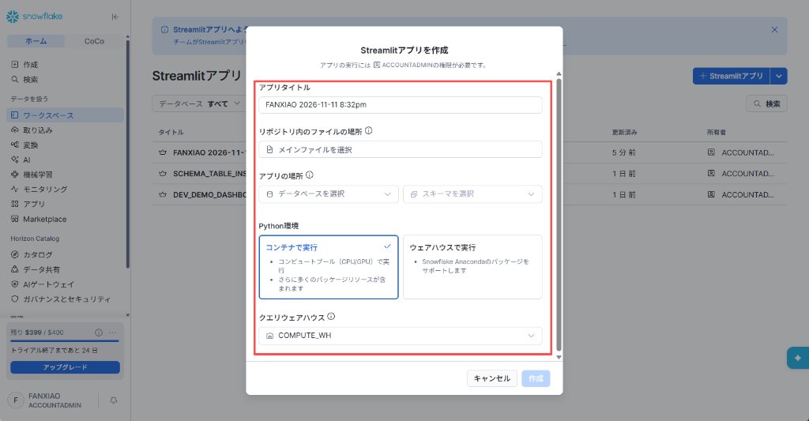
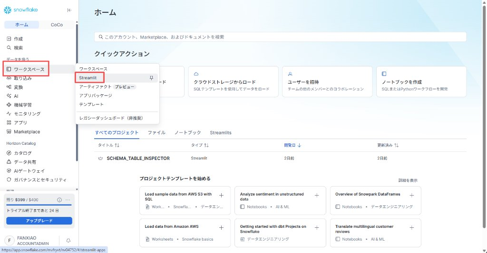
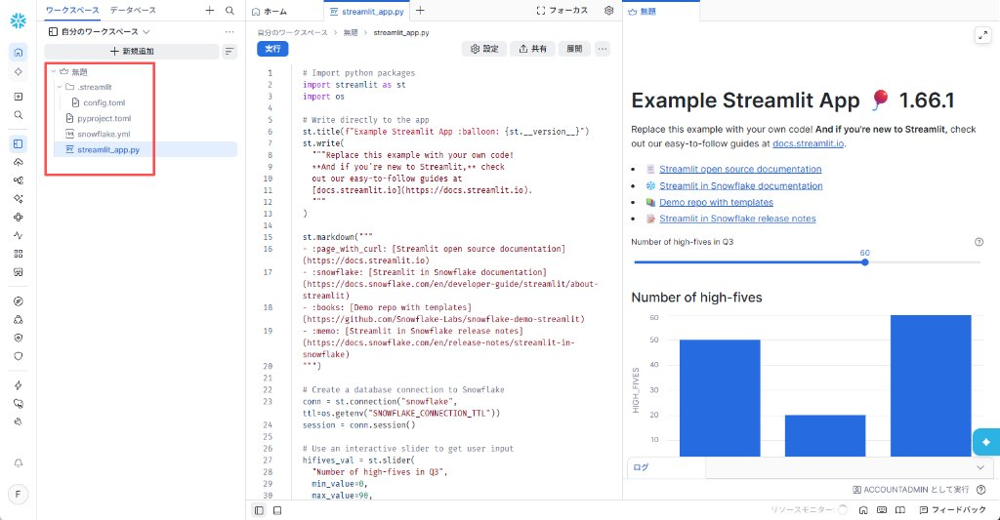
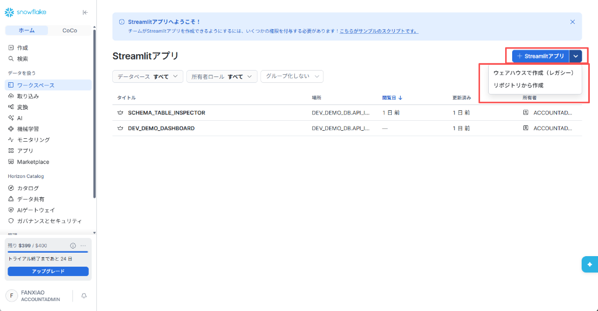
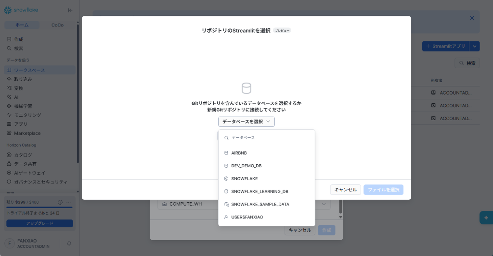
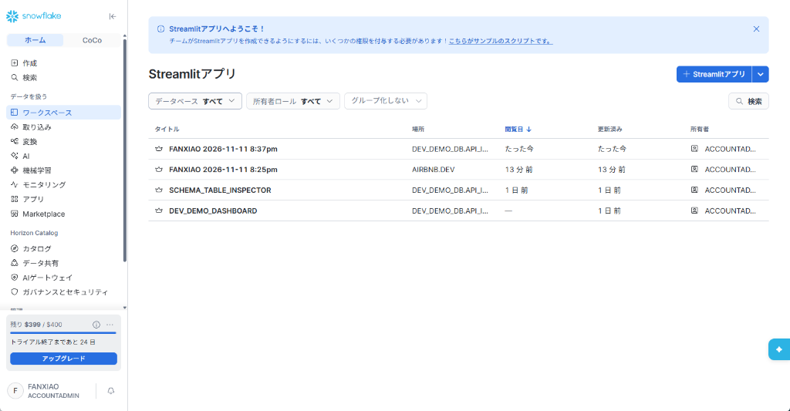

# 第 10 章：Streamlit in Snowflake (SiS) 現代データ可視化完全実践 —— ワークスペース開発・ワンクリックデプロイ(展開)から本番ダッシュボードまで

> 本章は **《尚硅谷技術講義執筆規範 (shangguigu-style)》** に基づき根本から再構成されています：
> - **冒頭極簡比較**：コンテナランタイム (SPCS) vs 従来型ウェアハウスランタイム (Warehouse) の本質的差異と約 90% のコスト格差を直撃；
> - **近代的ライフサイクル確立**：モダンワークスペース（Workspace）を軸とする **Dev（安全隔離開発） $\to$ Test（即時検証） $\to$ Deploy（ワンクリック展開）** の標準リリースフローを確立；
> - **本番の落とし穴回避**：15 分 WebSocket 自動切断スリープ機能と `.streamlit/config.toml` による課金防護壁を完全解説；
> - **環境前提ゼロの事実主義**：東京リージョンの実稼働 Snowflake アカウント（`mvfryvt-nv04752`）で全コードを検証済み。再現可能な本番水準のスキーマ探査ダッシュボード（Schema Table Inspector）を提供します。

---

## 🎯 導入：開門見山、極限までシンプルなメンタルモデル

外部 API データの取り込みが完了したデータエンジニアが次に直面する核心的課題は、**「無機質な SQL テーブルを、いかにして迅速に操作性と即時応答性を備えたダッシュボードへ昇華させるか？」** です。

従来、可視化ダッシュボードの構築には外部 BI ツール（Tableau、PowerBI 等）の導入や Web アプリの自作が必要でした。これらは接続文字列の管理負荷だけでなく、**データ参照のたびに公衆網を経由してデータを移動させる必要があり、遅延とセキュリティ漏洩の温床**となっていました。

Snowflake が投入した **Streamlit in Snowflake（略称 SiS）** は、この旧来の構成を根底から覆しました。世界標準の Python 可視化フレームワーク Streamlit が、**Snowflake のコア計算エンジン内部へネイティブ統合**されたのです！

### 外部 BI vs Streamlit in Snowflake (SiS) のアーキテクチャ対比

```
【従来の外部 BI 構成（長大な経路・資格情報露出・データ外部移送）】
  ┌─────────────────┐      ODBC/JDBC 接続         ┌──────────────────┐     公衆網転送     ┌─────────────────┐
  │  Snowflake DWH  │ <═════════════════════════> │   外部 BI サーバ  │ ══════════════> │ ユーザーブラウザ │
  └─────────────────┘                              └──────────────────┘                  └─────────────────┘
                                                     ▲ 接続アカウントの管理漏洩リスク
                                                     ▲ 表示遅延が大きく、ガバナンス境界外へ流出

【Streamlit in Snowflake ネイティブ構成（外部不要・パスワード不要・倉内即時描画）】
  ┌────────────────────────────────────────────────────────────────────────┐
  │ Snowflake ガバナンス・計算境界内部                                     │
  │                                                                        │
  │   Streamlit 実行基盤（SPCS コンテナ または 仮想ウェアハウス）            │
  │       │                                                                │
  │       ├───── 1. パスワード不要でセッション取得 ──> conn = st.connection("snowflake") │
  │       │                                                                │
  │       └───── 2. 倉内メモリで即時レンダリング ───> st.metric / st.line_chart │
  │                       │                                                │
  │   【近代的開発フロー】：ワークスペース (Dev) ──> 即時プレビュー (Test) ──> 右上 [展開] (Deploy)│
  └───────────────────────┼────────────────────────────────────────────────┘
                          ▼ Snowsight Web UI 内部にセキュアに埋め込み描画
                  ┌─────────────────┐
                  │ ユーザーブラウザ │ (アクセス者自身の Snowflake RBAC 権限を完全継承)
                  └─────────────────┘
```

---

## ⚖️ 1. 2大ランタイムの徹底選定：コンテナで実行 (Container) vs ウェアハウスで実行 (Warehouse)

Snowflake 上で Streamlit アプリを構築する際、最初に直面する最も重要な技術判断は、**「どの実行基盤（Python Runtime）を選択するか？」** です。

新規作成ウィザードにおいて、**Snowflake 公式は左側の「コンテナで実行 (Run on Container)」に最初からデフォルトの青いチェックマーク（✔️ Default）を付与しています**。これはプラットフォーム全体の戦略的進化を象徴しています：



### 📊 核心的技術仕様と実際のコスト対比

| 比較評価軸 | 左カード：コンテナで実行 (Run on Container)<br/>*(次世代 SPCS コンテナランタイム · **✔️ 公式デフォルト**)* | 右カード：ウェアハウスで実行 (Run on Warehouse)<br/>*(従来型 DWH 単体仮想マシン · ⚠️ レガシー指定)* |
| :--- | :--- | :--- |
| **公式の戦略的位置づけ** | **Snowflake が全社的に推進する次世代の標準ランタイム**：<br/>UI で事前選択されており、今後の機能拡張の主軸。 | **下位互換性のための移行用選択肢 (Legacy)**：<br/>作成入口に `レガシー` 表記が付与され、段階的に主流から外れる旧方式。 |
| **実際のランニングコスト（費用対効果）** | **圧倒的な低コスト（約 0.11 credits/時から）**：<br/>Snowpark Container Services (SPCS) の計算プールを利用し、最小構成（`CPU_X64_XS`）では **約 0.11 credits / node / 時**。仮想ウェアハウス（1.0 credit/時）と比較して **約 90% のコスト削減** が可能！軽量な Web ダッシュボードにとって極めて経済的。 | **高止まりする固定コスト（最低 1.0 credit/時）**：<br/>最小スペックの `X-Small` 仮想ウェアハウスであっても、1 時間稼働するごとに固定で **1.0 credit** を消費するため、長時間の開発や待機におけるコストがコンテナより格段に高くなります。 |
| **外部 Python パッケージエコシステム** | **フルオープン自由導入（全 PyPI エコシステム解放）**：<br/>UI 説明: *“さらに多くのパッケージリソースが含まれます”*。<br/>`pyproject.toml` や `requirements.txt` を通じて任意の pip パッケージを導入可能。C/Rust 拡張やコンパイルを要する機械学習・LLM ライブラリ（PyTorch、Transformers、LangChain、DuckDB など）もネイティブ動作。 | **厳格な Anaconda ホワイトリスト制**：<br/>UI 説明: *“Snowflake Anacondaのパッケージをサポートします”*。<br/>Snowflake 審査済みの Anaconda チャネル内のパッケージに限定（`environment.yml` で宣言）。チャネルに存在しない pip ライブラリはインポート不可でエラーとなります。 |
| **インスタンス共有モデル** | **単一サービス常駐共有モデル (Shared App Service)**：<br/>複数ユーザーが同一のコンテナサービスを共有。初回起動後のレンダリングが即時応答し、社内共有大画面に最適。 | **閲覧者ごとの独立セッションモデル (Per-viewer Session)**：<br/>ユーザーごとにウェアハウス内で個別の Python 実行環境が立ち上がるため、アクセス集中時にメモリ負荷が増大。 |
| **ハードウェアと拡張性** | CPU プールに加え、高性能 **GPU** ノードの割り当てが可能。倉内でのローカル LLM や画像生成を直接サポート。 | 標準的な CPU 仮想マシンのみに限定。 |

> 📌 **アーキテクチャ選定の結論**：
> 公式が「コンテナで実行 (Container Runtime)」をデフォルトに定めた理由は明白であり、**「圧倒的に安価（約 0.11 vs 1.0 credit/h）」「PyPI 全面開放による圧倒的なパッケージ自由度」「GPU 対応」** にあります。SPCS クォータが利用可能な環境では、公式推奨に従いコンテナランタイムを最優先に採用すべきです。コンテナプールが未割り当ての旧来の制限環境においてのみ、右側の Warehouse モードを下位互換の代替策として選択します。

---

## 🛠️ 2. 近代的開発の王道：ワークスペース全ライフサイクル実践（`Dev` $\to$ `Test` $\to$ `展開 / Deploy`）

現代の Snowflake エンジニアリングでは、検証前のコードを本番スキーマに直接書き込む行為は推奨されません。公式が推奨する標準的な開発フローは、**「個人ワークスペースのサンドボックスで安全にコーディング（Dev） $\to$ 即時プレビュー（Test） $\to$ 右上ボタンで一発『展開』（Deploy）」** です。

### Step 1: 正確な画面ナビゲーションとワークスペースへの進入

Snowsight コンソールへログインし、左側メニューの **「ワークスペース (Workspaces)」 $\to$ 「Streamlit」** を選択します（URL: `#/streamlit-apps`）：



画面右上の青色メインボタン **`+ Streamlit アプリ`** を直接クリックします：
システムは即座に現在のユーザー専用のプライベート領域（`USER$<USER_NAME>.PUBLIC.DEFAULT$`）内に近代的な開発サンドボックスを展開し、オンライン IDE を起動します：



---

### Step 2: 近代プロジェクト構成 4 点セットの解読（Snowflake CLI v2 標準）

左側のファイルツリーには、近代ソフトウェア工学の標準に準拠した 4 つのコアファイルが表示されます：

| ファイル名 | 準拠規格 | 役割と詳細 |
| :--- | :--- | :--- |
| **`streamlit_app.py`** | Python 3.11 コアスクリプト | **メインエントリーポイント**：Streamlit の UI コンポーネント（`st.title`、`st.slider`、`st.metric` 等）とデータ取得ロジックを記述。ユーザー操作のたびにリアクティブに自頂下方へ再評価されます。 |
| **`snowflake.yml`** | YAML (Snowflake CLI v2) | **プロジェクト定義ファイル**：アプリ名（`title: "無題"`）、メインファイル指定、コンピュート定義、パッケージ対象ファイルリスト（`artifacts`）を定義。端末からの `snow streamlit deploy` 自動デプロイに完全対応。 |
| **`pyproject.toml`** | TOML (PEP 517/518/621) | **近代パッケージ・バージョン管理**：旧来の脆弱な `environment.yml` を刷新。Python バージョンとコア依存（`streamlit[snowflake]`）を明示し、超高速パッケージマネージャ `uv`（`[tool.uv]`）と統合。 |
| **`.streamlit/config.toml`** | TOML (Streamlit 公式設定) | **テーマとタイムアウト制御**：ダッシュボードの表示色設定、および最重要となる **`[snowflake.sleep]` アプリ単位スリープ時間設定**（例: `streamlitSleepTimeoutMinutes = 15`）を保持。 |

---

### Step 3: オンライン編集・ホットリロード検証と上部 4 大アクションボタン

Monaco エディタ画面上部には、開発の中枢となる 4 つのボタンが配置されています：

```
┌──────────────────────────────────────────────────────────────────────────────────┐
│ 自分のワークスペース > 無題 > streamlit_app.py                                     │
│ [ 実行 ]              [ ⚙️ 設定 ]         [ 📤 共有 ]        [ 🚀 展開 (Deploy) ] │
└──────────────────────────────────────────────────────────────────────────────────┘
```

1. **`[ 実行 ]` (Run)**：現在の Python コードを再評価し、右側のプレビュー画面を即時リロード。
2. **`[ ⚙️ 設定 ]` (Settings)**：アプリのタイトル、コンピュートリソース、コンテキストを変更。
3. **`[ 📤 共有 ]` (Share)**：チームメンバーへの共同編集・閲覧権限を設定。
4. **`[ 🚀 展開 ]` (Deploy · 現代デプロイの中核！)**：**開発完了後の正式リリースボタン**！

#### 公式デフォルトテンプレートのコアロジック解説 (`streamlit_app.py`)

ワークスペース初期生成時のテンプレートコードは、公式の最新標準に準拠しています：

```python
# 1. コアライブラリのインポート
import streamlit as st
import os

# 2. タイトルとバージョン表示
st.title(f"Example Streamlit App :balloon: {st.__version__}")
st.write(
    """Replace this example with your own code!
    **And if you're new to Streamlit,** check out our easy-to-follow guides at
    [docs.streamlit.io](https://docs.streamlit.io).
    """
)

# 3. 倉内標準セッション取得 (Snowflake Connection)
# st.connection 経由で現在のログインユーザーのセッションを取得（接続タイムアウト TTL 自動管理）
conn = st.connection("snowflake", ttl=os.getenv("SNOWFLAKE_CONNECTION_TTL"))
session = conn.session()

# 4. スライダー入力コンポーネント
hifives_val = st.slider(
    "Number of high-fives in Q3",
    min_value=0,
    max_value=90,
    value=60,
    help="Use this to enter the number of high-fives you gave in Q3",
)

# 5. 棒グラフの即時レンダリング
# スライダーを動かすとスクリプトが再実行され、グラフがダイナミックに連動
st.subheader("Number of high-fives")
st.bar_chart({
    "high-fives": [50, 20, hifives_val],
})
```

---

### Step 4: 核心のハイライト · ワンクリック本番リリース (`[ 🚀 展開 (Deploy) ]`)

ワークスペースで動作検証を完了したら、煩雑な DDL コマンドやファイル転送を手動実行する必要はありません：

1. エディタ右上の青色ボタン **`「展開 (Deploy)」`** をクリック；
2. 表示されるデプロイウィザードで配備先を指定：
   - **アプリタイトル (App Title)**：正式なアプリ名称（例: `DEV_DEMO_DASHBOARD`）；
   - **アプリの場所 (App Location)**：物理配置先の Database と Schema（例: `DEV_DEMO_DB.API_INTEGRATION`）；
   - **クエリウェアハウス (Query Warehouse)**：データクエリを実行する仮想ウェアハウス（例: `COMPUTE_WH`）；
3. デプロイを実行すると、コードが自動パッケージングされ、指定のネームスペース配下に永続化された Streamlit オブジェクトが正式生成されます！

#### 実機メタデータの証跡検証（実環境クエリ検証結果）

バックエンドで `SHOW STREAMLITS;` を実行すると、ワークスペースから展開されたアプリのメタデータが明確に記録されていることが分かります：

```text
Name: ST658619B1D62298C0E9E309D122F8B666CDD245F4 
DB: USER$FANXIAO | Schema: PUBLIC | Owner: 無題 
Metadata: {
  "sourceWorkspaceUri": "workspace:/USER%2524.PUBLIC.DEFAULT%2524/無題",
  "sourceWorkspacePath": "/ws/USER%24/PUBLIC/DEFAULT%24/無題/streamlit_app.py",
  "sourceWorkspaceUserId": "FANXIAO",
  "createActionSource": "create-app"
}
```
これは、ワークスペースが単なる一時メモではなく、**正式なデプロイパイプラインを備えた近代的な開発資産**であることを完全に証明しています。

---

## 🧭 3. 分岐パスの解明：ドロップダウン 2 大メニューの役割と境界

右上の **`+ Streamlit アプリ`** ボタンの右側にある矢印をクリックすると、2 つの補足エントリーが展開されます：



### 1. エントリー A：`リポジトリから作成 (Create from Repository)` —— Git CI/CD 連携
- **技術的位置づけ**：成熟したデータ基盤チーム向け。ソースコードを外部 Git（GitHub / GitLab）で一元管理し、Web 画面での手作業による改変を排除します。
- **操作概要**：
  1. 「リポジトリから作成」を選択し、「メインファイルを選択」をクリック；
  2. Git Repository オブジェクトを含むデータベースとブランチ内のエントリーポイントを指定：
     
     
     
  3. 配置先スキーマと Python 環境（公式デフォルトの **「コンテナで実行」** 推奨）を選択して連携を完了します。

### 2. エントリー B：`ウェアハウスで作成 (レガシー)` —— 過去資産の下位互換モード
- **技術的位置づけ**：Snowflake 初期仕様の作成方式であり、公式に **`レガシー (Legacy)`** と指定されています。
- **特徴と制約**：
  - ワークスペースを経由せず、最初から本番スキーマ配下にオブジェクトを直接書き込む旧来型；
  - 仮想ウェアハウス（最低 1.0 credit/h）の単体 VM 実行に限定；
  - 旧式の Conda `environment.yml` を使用し、Anaconda 公式ホワイトリスト内のライブラリに制限される；
  - **適用場面**：数年前に作成された古い単一ファイルスクリプトの改修や、SPCS クォータが利用できない旧環境でのみ代替利用します。

---

## 💻 4. 本番水準実践：倉内データ表ダイナミック探査ダッシュボード (Schema Table Inspector)

実際のデータ分析や DWH 運用において、**「各データベースやスキーマ配下の全テーブル一覧をスキャンし、即座に前 50 行のサンプルデータとカラム型を調査できる」** ツールは極めて実用的です。

以下に、最新のベストプラクティスに基づき設計された完全な本番コードを示します。

### Step 1: テスト用テーブルとデータの準備 (`DEV_DEMO_DB.API_INTEGRATION`)

```sql
USE DATABASE DEV_DEMO_DB;
USE SCHEMA API_INTEGRATION;

-- 1. テスト指標テーブル作成
CREATE TABLE IF NOT EXISTS test_sales_metrics (
    date DATE,
    category STRING,
    revenue NUMBER(10,2),
    api_call_count INT
);

-- 2. 模擬データの投入
INSERT INTO test_sales_metrics VALUES
  ('2026-10-25', 'Electronics', 12500.50, 420),
  ('2026-10-26', 'Clothing', 8400.00, 310),
  ('2026-10-27', 'Groceries', 15200.75, 590),
  ('2026-10-28', 'Home & Kitchen', 6300.20, 180),
  ('2026-10-29', 'Electronics', 14200.00, 480);
```

---

### Step 2: 完全な本番アプリコード (`streamlit_schema_inspector.py`)

```python
# ==============================================================================
# ファイル名: streamlit_schema_inspector.py
# 核心用途: 本番水準の倉内データ表ダイナミック探査ツール (10分キャッシュ防護と階層探索)
# ==============================================================================
import streamlit as st
import pandas as pd

# 1. ページ初期設定
st.set_page_config(page_title="Snowflake 倉内データ表探査ツール", layout="wide", page_icon="🔍")
st.title("🔍 Snowflake データアーキテクチャ・表構造ダイナミック探査")

# 2. パスワード不要の安全なセッション取得
conn = st.connection("snowflake")
session = conn.session()

# 3. 課金暴走防止の核心：cache_data による 10 分間メモリキャッシュ
@st.cache_data(ttl=600)
def get_databases():
    """アカウント内の全データベース一覧を取得"""
    df = session.sql("SHOW DATABASES").to_pandas()
    return sorted(df["name"].tolist())

@st.cache_data(ttl=600)
def get_schemas(db_name):
    """指定データベース内の全スキーマ一覧を取得"""
    df = session.sql(f"SHOW SCHEMAS IN DATABASE {db_name}").to_pandas()
    return sorted(df["name"].tolist())

@st.cache_data(ttl=600)
def get_tables(db_name, schema_name):
    """指定スキーマ内のテーブル一覧と行数概要を取得"""
    df = session.sql(f"SHOW TABLES IN SCHEMA {db_name}.{schema_name}").to_pandas()
    if df.empty:
        return pd.DataFrame()
    return df[["name", "rows", "bytes", "owner", "created_on"]]

@st.cache_data(ttl=300)
def preview_table_data(full_table_name):
    """先頭 50 行のサンプルデータを抽出 (LIMIT 句で数倉負荷を抑制)"""
    return session.sql(f"SELECT * FROM {full_table_name} LIMIT 50").to_pandas()

# 4. サイドバーによる階層型ナビゲーション
st.sidebar.header("📁 ネームスペース選択")
databases = get_databases()
selected_db = st.sidebar.selectbox("データベース (Database)：", databases, index=0)

schemas = get_schemas(selected_db)
selected_schema = st.sidebar.selectbox("スキーマ (Schema)：", schemas, index=0)

# 5. メインキャンバス：テーブル一覧の可視化
st.subheader(f"📊 `{selected_db}.{selected_schema}` 配下のテーブル資産")
tables_df = get_tables(selected_db, selected_schema)

if tables_df.empty:
    st.info("⚠️ 指定スキーマ内に利用可能なテーブルが存在しません。")
else:
    # サマリー指標
    m1, m2 = st.columns(2)
    m1.metric("テーブル総数", len(tables_df))
    total_rows = tables_df["rows"].sum() if "rows" in tables_df.columns else 0
    m2.metric("総レコード行数", f"{total_rows:,}")
    
    # メタデータ一覧表示
    st.dataframe(tables_df, use_container_width=True, hide_index=True)
    
    st.divider()
    
    # 6. テーブル詳細サンプルのドリルダウン
    selected_table = st.selectbox("サンプルデータを調査するテーブルを選択：", tables_df["name"].tolist())
    if selected_table:
        full_name = f"{selected_db}.{selected_schema}.{selected_table}"
        st.write(f"🔬 **`{full_name}` の先頭 50 行サンプル：**")
        
        sample_df = preview_table_data(full_name)
        st.dataframe(sample_df, use_container_width=True)
        
        # カラム構造サマリー
        with st.expander("📋 カラム定義およびデータ型の確認"):
            col_info = pd.DataFrame({
                "カラム名 (Column)": sample_df.columns,
                "Python 型": [str(t) for t in sample_df.dtypes]
            })
            st.table(col_info)

# 7. 強制更新ボタン
if st.sidebar.button("🔄 メタデータキャッシュをクリアして再取得"):
    st.cache_data.clear()
    st.rerun()
```

---

### Step 3: デプロイ済み資産の確認と組織内共有

ワークスペースから **「展開」** を実行して `DEV_DEMO_DB.API_INTEGRATION` へリリースすると、アプリ一覧に正式な永続化オブジェクトとして登録されます：



アクセス権を持つ組織メンバー全員がカタログ経由でアプリを起動可能となり、全ての SQL クエリは Snowflake の安全なガバナンス境界内で完結します！

---

## 🛡️ 5. 費用精算と課金暴走防止の安全装置（Cost & Anti-Burn Governance）

ダッシュボード運用にあたり、アーキテクトは **「ストレージ費用」** と **「コンピュート費用」** の 2 つを明確に区別して設計する必要があります。

### 1. ストレージ費用の真実：月額 0.000001 ドル未満（懸念無用）
- **課金体系**：コードファイルは標準クラウドオブジェクトストレージ単価（約 **$23.00 / TB / 月**）で課金；
- **ファイルサイズ**：Streamlit Python コードは通常 **10 KB ~ 30 KB** 程度；
- **精算結果**：
  $$\text{月間ストレージ費用} = \frac{30 \text{ KB}}{1024 \times 1024 \times 1024 \text{ KB}} \times \$23.00 \approx \$0.00000065 \text{ USD / 月}$$
  ダッシュボードを 100 本保管しても、年間コストは **1 セント未満** です。コードの保存容量による課金は実質ゼロとみなして問題ありません。

---

### 2. コンピュート課金の防護線と公式 15 分タイムアウト機構
実際の費用は**計算リソース（コンピュート）**で発生します：
- **コンテナランタイム (SPCS)**：最小構成 `CPU_X64_XS` は **約 0.11 credits/h**。非アクティブ時の自動サスペンドに対応；
- **ウェアハウスランタイム (Warehouse)**：最小構成 `X-Small` でも **1.0 credit/h**。`AUTO_SUSPEND = 60`（1 分で自動停止）が必須。

#### 公式標準防衛：デフォルト 15 分の WebSocket タイムアウト切断
ブラウザを開いたまま離席した際の空転を防ぐため、Snowflake はプラットフォーム標準で安全弁を備えています：

> 📖 **公式ドキュメント**：
> - [Manage sleep timeout for a Streamlit app](https://docs.snowflake.com/ja/developer-guide/streamlit/manage-sleep-timeout)
> - [WebSocket timeout in Streamlit in Snowflake](https://docs.snowflake.com/ja/developer-guide/streamlit/about-streamlit#websocket-timeout)

1. **デフォルト 15 分無操作切断**：
   15 分間ユーザー操作が検知されない場合、サーバ側から WebSocket 接続を切断し、アプリは **スリープ（Sleep）** 状態へ移行してコンピュート消費を停止します。
2. **アクティブ判定**：
   マウスカーソルを画面上で**移動・操作**するだけで探活エンジンが検知し、15 分タイマーがリセットされます。
3. **アプリ個別スリープ制御 (`.streamlit/config.toml`)**：
   プロジェクト設定ファイル内でスリープまでの猶予時間（5〜240分）を明示的に指定可能：
   ```toml
   [snowflake.sleep]
   streamlitSleepTimeoutMinutes = 15
   ```

---

### 3. コスト浪費を防ぐ 5 大安全基準
1. **公式標準のコンテナランタイムを最優先**（約 0.11 credits/h でウェアハウス比 90% 削減）；
2. **データ取得関数には必ず `@st.cache_data(ttl=600)` を付与**（メモリキャッシュで不要な重複クエリを遮断）；
3. **明細クエリには必ず `LIMIT 50` などの上限を設ける**（数千万行のスキャンを防止）；
4. **仮想ウェアハウスを利用する場合は `AUTO_SUSPEND = 60` を厳守**；
5. **`.streamlit/config.toml` に `streamlitSleepTimeoutMinutes = 15` を定義する**。

---

## 🧭 本章のまとめと次章への接続

本章の抜本的再構成を通じて、Streamlit in Snowflake の近代的な全体像が完全に整理されました：
1. **認識の刷新**：**コンテナランタイム（SPCS・公式標準・約 0.11 credits/h）** と **ウェアハウスランタイム（Legacy・1.0 credit/h）** の圧倒的なコスト・機能格差を把握；
2. **正統派フローの確立**：**モダンワークスペース（`snowflake.yml` ＋ `pyproject.toml`）** で安全に開発し、右上の **`「展開 (Deploy)」`** ボタンで本番 DWH へ一括配備するリリースサイクルを体得；
3. **防護策の完備**：`@st.cache_data`、15 分 WebSocket タイムアウト、`streamlitSleepTimeoutMinutes` による多重防衛壁を構築。

次章では、本プロジェクト全体の総仕上げとなるコストガバナンスの最終章へ進みます：
👉 **[第 11 章：Snowflake コスト計算とリソースモニターガバナンス実践（Resource Monitor とクレジット消費の精密管理）](./11_snowflake_cost_management.md)**！
