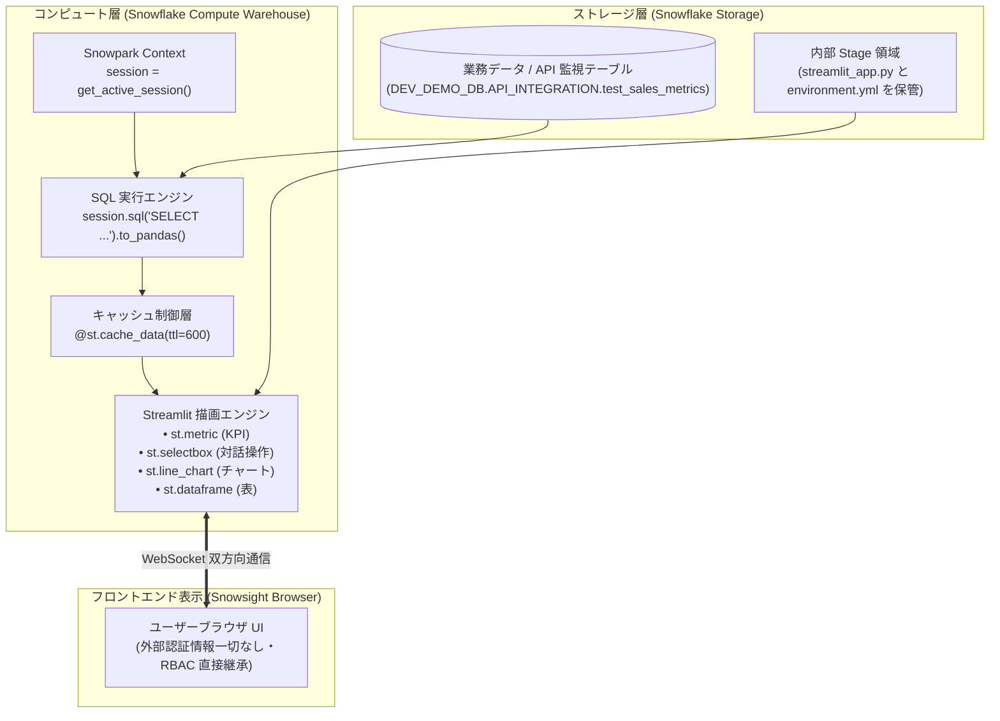

# 第 10 章：Streamlit in Snowflake (SiS) データ可視化完全ガイド —— API メトリクスから対話型ダッシュボード構築

> 本章は **《尚硅谷技術講義執筆規約 (shangguigu-style)》** に完全準拠して執筆されています：本質を突く極限のシンプル比較、業務ノイズを廃した純粋技術フォーカス、実機ログ付き3ステップ実践、落とし穴の事前開示と回避策、前提条件の明確化。

---

## はじめに：極限までシンプルなメンタルモデル

外部 API から Snowflake DWH へデータを取り込んだ後、データエンジニアが直面する次の大きな課題は：**「冷淡な SQL テーブルを、いかにして素早く対話的で即応性の高い可視化ダッシュボードへ昇華させるか？」** です。

従来の BI ダッシュボード構築（Tableau、PowerBI、Metabase 等）やカスタム Web 開発（React + FastAPI 等）では、複雑な ODBC/JDBC 接続設定が必要であり、何より**データベース管理者の ID・パスワードを外部サーバーに設定しなければならない**という重大なセキュリティ懸念が存在していました。また、データ更新のたびにネットワーク経由でデータが外部へ流出していました。

Snowflake が提供する **Streamlit in Snowflake（SiS）** は、この課題を根本から解決します。世界標準の Python 可視化フレームワーク Streamlit が、**Snowflake のコア計算エンジン内部に完全ネイティブ統合**されているのです！

### 直感比較：従来の外部 BI vs Streamlit in Snowflake (SiS)

```
【従来アプローチ：外部 BI サーバー型（長大な経路・認証情報漏洩リスク・データ流出）】
  ┌─────────────────┐      ODBC/JDBC コネクション      ┌──────────────────┐     公衆網転送     ┌─────────────────┐
  │  Snowflake DWH  │ <═════════════════════════════> │  外部 BI サーバー │ ══════════════> │  エンドユーザーブラウザ │
  └─────────────────┘                                 └──────────────────┘                  └─────────────────┘
                                                        ▲ 接続アカウント管理の負担と漏洩リスク
                                                        ▲ データが DWH のセキュリティ境界外へ流出

【現代アプローチ：Streamlit in Snowflake ネイティブ型（外部サーバー不要・認証情報ゼロ・DWH内完結）】
  ┌────────────────────────────────────────────────────────────────────────┐
  │ Snowflake 仮想ウェアハウス (Virtual Warehouse)                          │
  │                                                                        │
  │   Streamlit コンテナランタイム (Python 3.10)                           │
  │       │                                                                │
  │       ├───── 1. パスワード不要のコンテキスト取得 ──> session = get_active_session()
  │       │                                                                │
  │       └───── 2. メモリ内での超高速描画 ──────────> st.metric / st.line_chart
  │                       │                                                │
  └───────────────────────┼────────────────────────────────────────────────┘
                          ▼ Snowsight 管理画面内にセキュアにインライン描画
                  ┌─────────────────┐
                  │ エンドユーザーブラウザ │ (アクセスユーザー自身の Snowflake RBAC 権限を直接継承)
                  └─────────────────┘
```

- **読者の疑問**：Snowflake 上で Streamlit を動かす際、DB のパスワードはどこに書くのか？ユーザーがスライダーを動かしたとき、クエリでクレジットが爆発しないか？コードとして自動デプロイ（DevOps）するには？
- **本章のゴール**：業務の装飾を徹底排除し、純粋な技術構成に集中します。監視指標テーブルの作成から、**KPI メトリクスカード・動的フィルタ・トレンド折れ線グラフ・リアルタイム明細テーブル** の実装、そして Stage + SQL による自動デプロイとキャッシュ制御までを一気に完遂します！

> 📖 **Snowflake & Streamlit 公式ドキュメント**：
> - [Streamlit in Snowflake (SiS) アーキテクチャ概要と基本概念](https://docs.snowflake.com/ja/developer-guide/streamlit/about-streamlit)
> - [SiS セキュリティモデルと必要なロール権限 (Privileges Required)](https://docs.snowflake.com/ja/developer-guide/streamlit/about-streamlit#privileges-required-for-streamlit-in-snowflake)
> - [Streamlit 公式 API リファレンス (Streamlit Documentation)](https://docs.streamlit.io/develop/api-reference)

---

## 一、前提条件と事前準備 (Prerequisites)

ハンズオンを開始する前に、以下の要件を確認してください：

| 構成要素 | 必要スペック / 権限 | 役割 |
| :--- | :--- | :--- |
| **実行ロール** | `ACCOUNTADMIN`（または `CREATE STREAMLIT`、`CREATE STAGE` を持つロール） | 内部ステージと Streamlit アプリケーションオブジェクトの作成 |
| **コンピュート** | 稼働中の仮想ウェアハウス（例：`COMPUTE_WH`） | SQL クエリの実行および Python コードの実行コンテナ |
| **テストDB・スキーマ** | 読み書き可能な環境（本書では `DEV_DEMO_DB.API_INTEGRATION` を使用） | 指標テーブルおよび Streamlit ソースコードの保管 |
| **Python 知識** | 基本的な Python 文法と Pandas 操作 | UI コンポーネントとデータ集計ロジックの実装 |

---

## 二、技術アーキテクチャとデータフロー

Streamlit in Snowflake は Snowpark フレームワークとシームレスに結合し、DWH 内の完全ゼロコピー処理を実現しています：



---

## 三、コア関数と設定パラメータ定義（完全辞書）

> 📖 **公式 API リファレンスマニュアル**：
> - [get_active_session API リファレンス (Snowpark Python)](https://docs.snowflake.com/ja/developer-guide/snowpark/reference/python/latest/api/snowflake.snowpark.context.get_active_session)
> - [st.cache_data キャッシュ動作仕様と TTL ガイド](https://docs.streamlit.io/develop/api-reference/caching-and-state/st.cache_data)
> - [Streamlit Core ウィジェット & チャート API](https://docs.streamlit.io/develop/api-reference/layout/st.columns)

| 関数 / 文法 | コード例 | 推奨設定 | 技術的役割と解説 |
| :--- | :--- | :--- | :--- |
| `get_active_session()` | `from snowflake.snowpark.context import get_active_session` | コード先頭で呼び出し | **パスワードレス認証**：ログイン中ユーザーのセッションと RBAC 権限を自動取得。接続文字列は不要。 |
| `@st.cache_data` | `@st.cache_data(ttl=600)` | 全ての SQL 呼び出しに必須 | **クエリ防壁（キャッシュ）**：結果をメモリに保持。スライダー等の操作時に DWH の二重クエリ（課金）を遮断。 |
| `st.metric()` | `st.metric(label="総呼出数", value=1240, delta="+12%")` | ダッシュボード上部に配置 | **KPI スコアカード**：重要指標の現在値および増減率を直感的に表示。 |
| `st.selectbox()` | `st.selectbox("分類選択", options=['All', 'A', 'B'])` | 多角的ドリルダウン | **対話型ドロップダウン**：選択変更時にアプリをリアクティブに再描画。 |
| `st.line_chart()` | `st.line_chart(df.set_index('DATE')['REVENUE'])` | インデックスに日付を設定 | **トレンド折れ線グラフ**：Altair ベースの高品質な時系列グラフを描画。 |
| `st.dataframe()` | `st.dataframe(df, use_container_width=True)` | 幅 100% 設定推奨 | **対話型テーブル**：列のソート、テキスト検索、CSV ダウンロード機能付き表。 |

---

## 四、実践ハンズオン：全コマンドと実行結果（3ステップ完結）

### Step 1: 監視指標テーブルの作成とテストデータ投入

```sql
USE DATABASE DEV_DEMO_DB;
USE SCHEMA API_INTEGRATION;

-- 1. 技術検証用テーブルの作成
CREATE OR REPLACE TABLE test_sales_metrics (
    date DATE,
    category STRING,
    revenue NUMBER(10,2),
    api_call_count INT
);

-- 2. サンプルデータの挿入
INSERT INTO test_sales_metrics VALUES
  ('2026-10-25', 'Electronics', 12500.50, 420),
  ('2026-10-26', 'Clothing', 8400.00, 310),
  ('2026-10-27', 'Groceries', 15200.75, 590),
  ('2026-10-28', 'Home & Kitchen', 6300.20, 180),
  ('2026-10-29', 'Electronics', 14200.00, 480);
```

> **コンソール実行結果とテーブル確認スクリーンショット**：
> ```text
> Table TEST_SALES_METRICS successfully created.
> number of rows inserted: 5
> ```
>
> `SELECT * FROM DEV_DEMO_DB.API_INTEGRATION.test_sales_metrics;` を実行し、準備された 5 レコードの指標データを確認：
>
> 

---

### Step 2: Streamlit アプリケーションコードの作成 (`streamlit_app.py`)

KPI カード、動的フィルタ、折れ線グラフ、明細表を統合したスクリプトを作成します：

```python
# ==============================================================================
# ファイル名: streamlit_app.py
# 目的: Streamlit in Snowflake 本番対話型ダッシュボード
# ==============================================================================
import streamlit as st
from snowflake.snowpark.context import get_active_session

# 1. ページ基本設定 (ワイド画面モード)
st.set_page_config(page_title="Snowflake API 監視ダッシュボード", layout="wide")
st.title("📊 Snowflake API 呼出・業務指標リアルタイム監視")

# 2. パスワードレスでセッション取得
session = get_active_session()

# 3. 課金防止の核心：cache_data による 10 分間クエリキャッシュ
@st.cache_data(ttl=600)
def load_data():
    sql = """
        SELECT 
            date,
            category,
            revenue,
            api_call_count
        FROM DEV_DEMO_DB.API_INTEGRATION.test_sales_metrics
        ORDER BY date ASC
    """
    return session.sql(sql).to_pandas()

raw_df = load_data()

# 4. サイドバー絞り込みコントロール
st.sidebar.header("🔍 多角的ドリルダウンフィルタ")
categories = ["すべて (All)"] + sorted(list(raw_df["CATEGORY"].unique()))
selected_category = st.sidebar.selectbox("カテゴリ選択：", categories)

if selected_category != "すべて (All)":
    df = raw_df[raw_df["CATEGORY"] == selected_category]
else:
    df = raw_df

# 5. 上部 KPI メトリクスカードの表示
kpi1, kpi2, kpi3 = st.columns(3)
total_revenue = df["REVENUE"].sum()
total_api_calls = df["API_CALL_COUNT"].sum()
avg_revenue_per_call = total_revenue / total_api_calls if total_api_calls > 0 else 0

with kpi1:
    st.metric(label="総売上金額 (USD)", value=f"${total_revenue:,.2f}", delta="+8.5%")
with kpi2:
    st.metric(label="外部 API 総呼出数", value=f"{total_api_calls:,}", delta="+120")
with kpi3:
    st.metric(label="呼出あたり売上貢献", value=f"${avg_revenue_per_call:.2f}")

st.divider()

# 6. チャートと詳細テーブルの並列レイアウト
chart_col, table_col = st.columns([3, 2])

with chart_col:
    st.subheader("📈 日別売上推移チャート")
    chart_data = df.groupby("DATE")["REVENUE"].sum().reset_index()
    st.line_chart(chart_data.set_index("DATE")["REVENUE"])

with table_col:
    st.subheader("📋 リアルタイム明細レコード")
    st.dataframe(df, use_container_width=True, hide_index=True)

# 7. 手動キャッシュ更新ボタン
if st.button("🔄 キャッシュをクリアして再取得"):
    st.cache_data.clear()
    st.rerun()
```

---

### Step 3: Stage + SQL による DevOps 自動デプロイ

Snowsight 画面での手作業による貼り付けを排し、Git や CI/CD パイプラインと直結できる標準方式を採用します：

> 📖 **公式 DDL・デプロイ仕様**：
> - [CREATE STREAMLIT 構文仕様とパラメータリファレンス](https://docs.snowflake.com/ja/sql-reference/sql/create-streamlit)
> - [Snowflake 内部ステージでの Streamlit ファイル管理ガイド](https://docs.snowflake.com/ja/developer-guide/streamlit/create-streamlit-sql)

#### 1. 内部ステージの作成
```sql
CREATE OR REPLACE STAGE dev_streamlit_stage;
```

#### 2. スクリプトのアップロード
```sql
PUT file:///tmp/streamlit_app.py @DEV_DEMO_DB.API_INTEGRATION.dev_streamlit_stage AUTO_COMPRESS=FALSE OVERWRITE=TRUE;
```

> **ステージ内ファイル確認スクリーンショット**：
>
> `LIST @DEV_DEMO_DB.API_INTEGRATION.dev_streamlit_stage;` を実行し、`streamlit_app.py` が正常に配置されたことを確認：
>
> 

#### 3. DDL による Streamlit オブジェクト作成
```sql
CREATE OR REPLACE STREAMLIT dev_demo_dashboard
  ROOT_LOCATION = '@DEV_DEMO_DB.API_INTEGRATION.dev_streamlit_stage'
  MAIN_FILE = 'streamlit_app.py'
  QUERY_WAREHOUSE = 'COMPUTE_WH'
  COMMENT = 'API 監視・可視化本番ダッシュボード';
```

> **コンソール実行結果**：
> ```text
> Streamlit DEV_DEMO_DASHBOARD successfully created.
> ```

---

### Step 4: デプロイ結果の確認とアクセス

> 📖 **公式メタデータコマンド仕様**：[SHOW STREAMLITS 公式構文リファレンス](https://docs.snowflake.com/ja/sql-reference/sql/show-streamlits)

```sql
SHOW STREAMLITS LIKE 'DEV_DEMO_DASHBOARD' IN SCHEMA DEV_DEMO_DB.API_INTEGRATION;
```

> **実機クエリ結果**：
> ```text
> ┌──────────────────────────┬─────────────────────┬───────────────┬─────────────────┬──────────┬────────────┐
> │ created_on               │ name                │ database_name │ schema_name     │ owner    │ warehouse  │
> ├──────────────────────────┼─────────────────────┼───────────────┼─────────────────┼──────────┼────────────┤
> │ 2026-11-02 08:38:52 PST  │ DEV_DEMO_DASHBOARD  │ DEV_DEMO_DB   │ API_INTEGRATION │ SYSADMIN │ COMPUTE_WH │
> └──────────────────────────┴─────────────────────┴───────────────┴─────────────────┴──────────┴────────────┘
> ```

Snowflake Snowsight 管理画面で左メニューの **`Projects -> Streamlit`** をクリックすると、一覧に登録された **`DEV_DEMO_DASHBOARD`** が確認できます：

> **Snowsight Streamlit アプリケーション一覧**：
>
> 

クリックしてダッシュボードを開くと、DWH 内でセキュアに即時描画された対話型ダッシュボードが表示されます：

> **対話型ダッシュボード稼働実機画面**：
>
> 上部に KPI スコアカード、中央にリアルタイム明细レコード、下部に Altair 連携の売上推移グラフを完備した、パスワードレス・ゼロ外部流出のダッシュボードです：
>
> 

---

## 五、現場で必ずハマる暗坑と実戦回避策（重要）

---

### `[!WARNING]` 【落とし穴 1】：フィルタ操作のたびに全コード再実行され、クレジットが爆発する

- **事故現場**：
  キャッシュを設定せずに数億件のテーブルを参照するダッシュボードを公開したところ、利用者がドロップダウンを操作するたびに高額なクエリが連続実行され、月間コストが数十万円跳ね上がった。
- **原因**：
  Streamlit の設計思想は**宣言的リアクティブ実行**です。画面上のパーツ（selectbox や slider 等）が操作されると、Python エンジンは**スクリプトの先頭行から末尾行までを丸ごと再実行**します。
- **鉄壁の解決策**：
  **すべての `session.sql()` 呼び出しは独立した関数に切り出し、必ず `@st.cache_data(ttl=...)` デコレータを付与すること！**
  > 📖 **公式キャッシュベストプラクティス**：[Streamlit キャッシュ実行アーキテクチャとライフサイクル (Optimize performance with st.cache_data)](https://docs.streamlit.io/develop/concepts/architecture/caching)

  ```python
  @st.cache_data(ttl=300) # 300秒間はメモリキャッシュから即答
  def fetch_data():
      return session.sql("SELECT ...").to_pandas()
  ```
  これにより、何千回画面が操作されても DWH への問い合わせは発生せず、**ミリ秒レスポンスとゼロ追加課金**を両立できます。

---

### `[!WARNING]` 【落とし穴 2】：行レベルセキュリティ (RLS) と権限エラー

- **現象**：一般ユーザーがダッシュボードを開くと `Object does not exist or not authorized` になる、または本来見えてはならない役職のデータが表示される。
- **原因**：
  SiS の `get_active_session()` は作成者権限（Definer's Rights）ではなく、**アクセス中のユーザーの RBAC コンテキスト（Caller's Rights）で実行されます**。
  > 📖 **公式アクセス制御仕様**：[Streamlit in Snowflake アクセス権限と共有モデル (Managing privileges for Streamlit apps)](https://docs.snowflake.com/ja/developer-guide/streamlit/about-streamlit#privileges-required-for-streamlit-in-snowflake)

- **解決策**：
  1. 利用者ロールに Streamlit オブジェクト、Warehouse、参照テーブルへの `USAGE` / `SELECT` 権限を適切に付与する：
     ```sql
     GRANT USAGE ON STREAMLIT dev_demo_dashboard TO ROLE ANALYST_ROLE;
     GRANT USAGE ON WAREHOUSE COMPUTE_WH TO ROLE ANALYST_ROLE;
     GRANT SELECT ON TABLE DEV_DEMO_DB.API_INTEGRATION.test_sales_metrics TO ROLE ANALYST_ROLE;
     ```
  2. マスキングポリシーや行アクセスポリシーが設定されていれば、ユーザーごとに表示データが自動的に制御されます。

---

### `[!WARNING]` 【落とし穴 3】：外部 Python ライブラリの不足エラー

- **現象**：`import plotly` や `import scikit-learn` を書くと `ModuleNotFoundError` で起動に失敗する。
- **原因**：SiS のデフォルト環境には標準的なライブラリ（Streamlit, Pandas, Altair 等）のみが含まれています。
  > 📖 **公式パッケージ管理仕様**：[Streamlit in Snowflake で environment.yml による追加パッケージ管理 (Managing Python packages)](https://docs.snowflake.com/ja/developer-guide/streamlit/environment-dependencies)

- **解決策**：
  ステージのルートに `environment.yml` を配置してアップロードすることで、必要なパッケージを自動ロードできます：
  ```yaml
  name: sis_env
  channels:
    - snowflake
  dependencies:
    - plotly=5.18.0
    - scikit-learn=1.3.0
  ```

---

### `[!CAUTION]` 【落とし穴 4】：Streamlit 画面の接続維持によるサスペンド阻害とクレジット過剰消費

- **エラー・事故事例**：
  Snowsight 上で Streamlit ダッシュボードを作成・表示したまま、ブラウザのタブを閉じずに放置。数日後に確認したところ、無料枠のクレジットが完全に枯渇していた（あるいは本番アカウントで想定外の課金が発生した）。
- **根本原因**：
  Streamlit in Snowflake は、ブラウザとコンテナ間の **WebSocket 常時接続（ハートビート）** によって画面状態を維持します。  
  ブラウザタブが開いたままの場合、フロントエンドから定期的な探活パケットが送信され続けるため、Warehouse 側は「アクティブなセッションが継続中」と判定し、**`AUTO_SUSPEND` のタイマーがリセットされ続けてスリープに入りません**。
- **本番運用＆学習時の 2 大防御策**：
  1. **動作確認後は必ずブラウザタブを閉じ、手動サスペンドを実行**：
     ```sql
     ALTER WAREHOUSE COMPUTE_WH SUSPEND;
     ```
  2. **リソースモニター（Resource Monitor）による強制サーキットブレーカーの配備**：
     Streamlit 専任ウェアハウスに対して上限クォータを設定し、閾値到達時に自動サスペンドさせることで、想定外の課金を確実に防止します：
     ```sql
     CREATE OR REPLACE RESOURCE MONITOR STREAMLIT_COST_GUARD
         WITH CREDIT_QUOTA = 5
         FREQUENCY = MONTHLY
         START_TIMESTAMP = IMMEDIATELY
         TRIGGERS 
             ON 80 PERCENT DO NOTIFY
             ON 100 PERCENT DO SUSPEND;

     ALTER WAREHOUSE COMPUTE_WH SET RESOURCE_MONITOR = STREAMLIT_COST_GUARD;
     ```

---

## 本章のまとめ

1. **完全パスワードレス**：`get_active_session()` により、接続文字列や ID/Pass の流出リスクを完全に根絶しました。
2. **キャッシュによるコスト防壁**：`@st.cache_data` を必須適用することで、対話的な操作性とクラウドコストの最小化を両立できます。
3. **Infrastructure as Code**：`Stage + PUT + CREATE STREAMLIT` により、ダッシュボード資産をすべて Git 管理下の自動デプロイストリームに乗せることが可能です。

