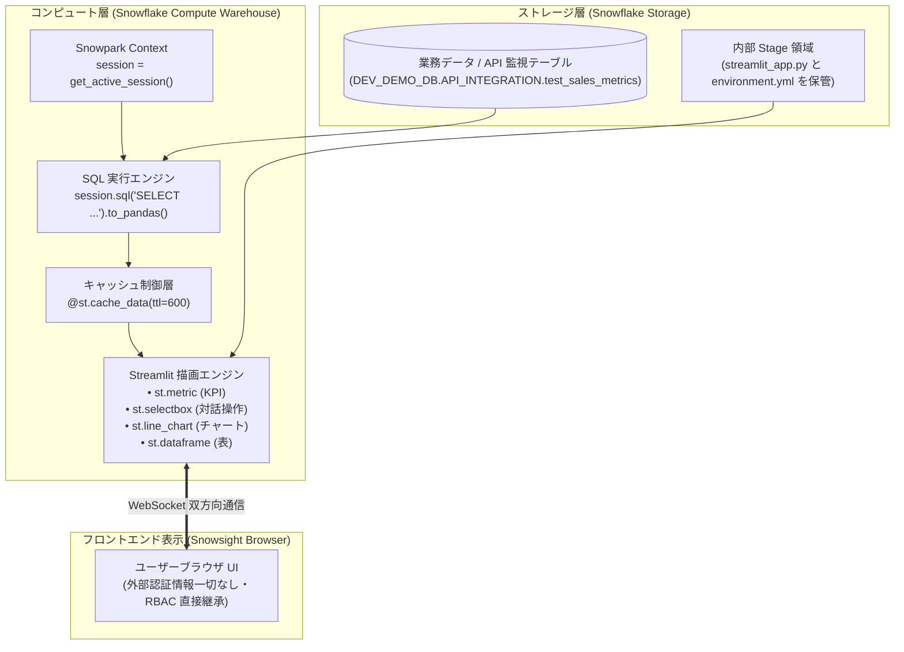

# 第 10 章：Streamlit in Snowflake (SiS) データ可視化完全ガイド —— API メトリクスから対話型ダッシュボード構築

> 本章は **《尚硅谷技術講義執筆規約 (shangguigu-style)》** に完全準拠して執筆されています：本質を突く極限のシンプル比較、業務ノイズを廃した純粋技術フォーカス、実機ログ付き3ステップ実践、落とし穴の事前開示と回避策、前提条件の明確化。

---

## はじめに：極限までシンプルなメンタルモデル

外部 API から Snowflake DWH へデータを取り込んだ後、データエンジニアが直面する次の大きな課題は：**「冷淡な SQL テーブルを、いかにして素早く対話的で即応性の高い可視化ダッシュボードへ昇華させるか？」** です。

従来の BI ダッシュボード構築（Tableau、PowerBI、Metabase 等）やカスタム Web 開発（React + FastAPI 等）では、複雑な ODBC/JDBC 接続設定が必要であり、何より**データベース管理者の ID・パスワードを外部サーバーに設定しなければならない**という重大なセキュリティ懸念が存在していました。また、データ更新のたびにネットワーク経由でデータが外部へ流出していました。

Snowflake が提供する **Streamlit in Snowflake（SiS）** は、この課題を根本から解決します。世界標準の Python 可視化フレームワーク Streamlit が、**Snowflake のコア計算エンジン内部に完全ネイティブ統合**されているのです！

### 直感比較：従来の外部 BI vs Streamlit in Snowflake (SiS)

```
【従来アプローチ：外部 BI サーバー型（長大な経路・認証情報漏洩リスク・データ流出）】
  ┌─────────────────┐      ODBC/JDBC コネクション      ┌──────────────────┐     公衆網転送     ┌─────────────────┐
  │  Snowflake DWH  │ <═════════════════════════════> │  外部 BI サーバー │ ══════════════> │  エンドユーザーブラウザ │
  └─────────────────┘                                 └──────────────────┘                  └─────────────────┘
                                                        ▲ 接続アカウント管理の負担と漏洩リスク
                                                        ▲ データが DWH のセキュリティ境界外へ流出

【現代アプローチ：Streamlit in Snowflake ネイティブ型（外部サーバー不要・認証情報ゼロ・DWH内完結）】
  ┌────────────────────────────────────────────────────────────────────────┐
  │ Snowflake 仮想ウェアハウス (Virtual Warehouse)                          │
  │                                                                        │
  │   Streamlit コンテナランタイム (Python 3.10)                           │
  │       │                                                                │
  │       ├───── 1. パスワード不要のコンテキスト取得 ──> session = get_active_session()
  │       │                                                                │
  │       └───── 2. メモリ内での超高速描画 ──────────> st.metric / st.line_chart
  │                       │                                                │
  └───────────────────────┼────────────────────────────────────────────────┘
                          ▼ Snowsight 管理画面内にセキュアにインライン描画
                  ┌─────────────────┐
                  │ エンドユーザーブラウザ │ (アクセスユーザー自身の Snowflake RBAC 権限を直接継承)
                  └─────────────────┘
```

- **読者の疑問**：Snowflake 上で Streamlit を動かす際、DB のパスワードはどこに書くのか？ユーザーがスライダーを動かしたとき、クエリでクレジットが爆発しないか？コードとして自動デプロイ（DevOps）するには？
- **本章のゴール**：業務の装飾を徹底排除し、純粋な技術構成に集中します。監視指標テーブルの作成から、**KPI メトリクスカード・動的フィルタ・トレンド折れ線グラフ・リアルタイム明細テーブル** の実装、そして Stage + SQL による自動デプロイとキャッシュ制御までを一気に完遂します！

> 📖 **Snowflake & Streamlit 公式ドキュメント**：
> - [Streamlit in Snowflake (SiS) アーキテクチャ概要と基本概念](https://docs.snowflake.com/ja/developer-guide/streamlit/about-streamlit)
> - [SiS セキュリティモデルと必要なロール権限 (Privileges Required)](https://docs.snowflake.com/ja/developer-guide/streamlit/about-streamlit#privileges-required-for-streamlit-in-snowflake)
> - [Streamlit 公式 API リファレンス (Streamlit Documentation)](https://docs.streamlit.io/develop/api-reference)

---

## 一、前提条件と事前準備 (Prerequisites)

ハンズオンを開始する前に、以下の要件を確認してください：

| 構成要素 | 必要スペック / 権限 | 役割 |
| :--- | :--- | :--- |
| **実行ロール** | `ACCOUNTADMIN`（または `CREATE STREAMLIT`、`CREATE STAGE` を持つロール） | 内部ステージと Streamlit アプリケーションオブジェクトの作成 |
| **コンピュート** | 稼働中の仮想ウェアハウス（例：`COMPUTE_WH`） | SQL クエリの実行および Python コードの実行コンテナ |
| **テストDB・スキーマ** | 読み書き可能な環境（本書では `DEV_DEMO_DB.API_INTEGRATION` を使用） | 指標テーブルおよび Streamlit ソースコードの保管 |
| **Python 知識** | 基本的な Python 文法と Pandas 操作 | UI コンポーネントとデータ集計ロジックの実装 |

---

## 二、技術アーキテクチャとデータフロー

Streamlit in Snowflake は Snowpark フレームワークとシームレスに結合し、DWH 内の完全ゼロコピー処理を実現しています：



### コスト構造の深層解剖：Stage に Python スクリプトを保存すると課金されるのか？（Stage 保管コスト vs ウェアハウス計算コスト精算）

ステージ（Stage）で Streamlit スクリプトをホストする際、多くのエンジニアが抱く疑問が**「Python スクリプトを Snowflake Stage に保存しておくと、保管料が継続的に発生するのではないか？高額な課金が発生するリスクはないのか？」**という点です。

> [!IMPORTANT] **核心結論：Stage の保管費用はほぼ 0 ドル（無視できるレベル）です。真の課金要因は背後で稼働する Virtual Warehouse（仮想ウェアハウス）のコンピュートコストです！**

#### 1. ストレージ課金の詳細計算：月額 0.000001 ドル未満（事実上無料）
- **課金体系**：Snowflake の内部ステージは、クラウドプロバイダ標準のオブジェクトストレージ容量に応じて課金されます（通常 **$23.00 〜 $40.00 / TB / 月**、約 $0.000022 / MB / 月）；
- **ファイルサイズ**：Streamlit の Python スクリプト（`streamlit_app.py` や `streamlit_schema_inspector.py`）は通常わずか **5 KB 〜 20 KB** 程度です；
- **計算式**：
  $$\text{月額保管料} = \frac{20 \text{ KB}}{1024 \times 1024 \times 1024 \text{ KB}} \times \$23.00 \approx \$0.00000043 \text{ USD / 月}$$
  ステージ内に **100 個** の複雑な Python ダッシュボードスクリプトを丸 1 年間保管し続けたとしても、総額は **1 セント（約 1.5 円）未満** です。

#### 2. 真の課金要因：仮想ウェアハウス（Virtual Warehouse）のコンピュートコスト
- **稼働の実態**：Streamlit in Snowflake は静的な HTML ホスティングではなく、Python コンテナの実行および SQL 発行のために背後で **Virtual Warehouse** を起動・消費します；
- **単価基準**：最小サイズである `X-Small` ウェアハウスでも、1 時間の稼働につき **1 クレジット**（通常レート換算で約 **$2.00 〜 $3.00 / 時間**）を消費します；
- **重大な落とし穴（タブの放置）**：Streamlit フロントエンドは **WebSocket によるハートビート通信（Live Heartbeat）** を維持します。開発者が Snowsight でダッシュボードを開いたまま、**ブラウザタブを閉じずに放置してしまうと**、フロントエンドからの通信によりウェアハウスの自動サスペンドが遅延・阻害されるリスクがあります；
- **空転の代償**：1 日あたり 24 クレジット（約 $48 〜 $72）が浪費され、数日でトライアル枠（400 ドル）を使い切ってしまう事態に陥ります。

#### 3. 公式プラットフォーム安全防壁：デフォルト約15分の WebSocket タイムアウトと自動スリープ機構

ユーザーが画面を開いたまま放置してしまうリスクに対し、Snowflake 公式はプラットフォーム層で**セッションライフサイクルとスリープ機構（Sleep Timeout）**を提供しています：

> 📖 **公式ドキュメントリファレンス**：
> - [Manage sleep timeout for a Streamlit app using a warehouse runtime](https://docs.snowflake.com/ja/developer-guide/streamlit/manage-sleep-timeout)
> - [About Streamlit in Snowflake - WebSocket timeout](https://docs.snowflake.com/ja/developer-guide/streamlit/about-streamlit#websocket-timeout)

- **デフォルト約 15 分の WebSocket 切断（WebSocket Timeout）**：
  ユーザーがブラウザで Streamlit アプリを開くと、フロントエンドと Snowflake バックエンド間で WebSocket 双方向通信が確立されます。**アカウントレベル（Account-level）**では、デフォルトで**約 15 分間の非アクティブ状態でタイムアウト**するように設定されています。15 分間有効な操作がない場合、WebSocket 接続はサーバー側で自動切断され、Streamlit アプリは**一時停止/スリープ（Suspend/Sleep）**状態へ移行します。
- **アクティビティ判定（マウスの移動で即時リセット）**：
  公式ドキュメントに明記されている通り、ユーザーがアプリ画面上で**マウスを移動（Mouse movement over the app）**させるだけでアクティブ状態と判定され、**15 分のタイマーが自動的にリセット**されます。
- **ブラウザバックグラウンドタブのスロットリング**：
  アプリを開いたタブが背面に回ると、モダンブラウザ（Chrome, Edge）の省電力機能によりバックグラウンドのタイマーが一時停止・遅延され、探活信号が途切れるため、バックグラウンドでは 15 分タイムアウトによる切断が迅速に発動します。
- **アプリごとのカスタムスリープタイマー (`.streamlit/config.toml`)**：
  ウェアハウスランタイムを使用するアプリでは、サポートに連絡することなく、Stage のアプリルートディレクトリに `.streamlit/config.toml` を配置することで、スリープまでの時間を **5分 〜 240分（最長4時間）** の間で独自に設定可能です：
  ```toml
  [snowflake.sleep]
  streamlitSleepTimeoutMinutes = 15  # 5 〜 240 分の間で指定可能
  ```
  *(注：アカウント全体のデフォルト 15 分 WebSocket タイムアウトを変更したい場合は、Snowflake サポートへの申請が必要です)*。

#### 4. コスト爆発を防ぐ 5 つの安全ロック（The 5 Anti-Burn Safety Locks）
快適な開発と確実なコスト管理を両立するため、以下の 5 重防護を必ず実施します：
1. **60秒自動サスペンドの徹底**：ウェアハウスに `AUTO_SUSPEND = 60` を強制設定（クエリ停止後 1 分で即時休止）；
2. **関数レベルの強力メモリキャッシュ**：DWH からデータを取得する全関数に `@st.cache_data(ttl=600)`（10分キャッシュ）を付与。テーブル切り替えやドロップダウン操作時にメモリからミリ秒で応答させ、**DWH への多重 SQL クエリを完全に遮断**；
3. **厳格なクエリ件数制限**：データプレビューには必ず `LIMIT 50` を付与し、数千万行のフルスキャンを防止；
4. **アプリ固有のスリープタイマー設定**：`.streamlit/config.toml` で `streamlitSleepTimeoutMinutes = 15` を設定し、公式の 15 分安全機構と連動；
5. **ブラウザタブの確実なクローズと手動サスペンド**：作業完了後はタブを閉じ、必要に応じて `ALTER WAREHOUSE <wh> SUSPEND;` を実行。

---

## 三、コア関数と設定パラメータ定義（完全辞書）

> 📖 **公式 API リファレンスマニュアル**：
> - [get_active_session API リファレンス (Snowpark Python)](https://docs.snowflake.com/ja/developer-guide/snowpark/reference/python/latest/api/snowflake.snowpark.context.get_active_session)
> - [st.cache_data キャッシュ動作仕様と TTL ガイド](https://docs.streamlit.io/develop/api-reference/caching-and-state/st.cache_data)
> - [Streamlit Core ウィジェット & チャート API](https://docs.streamlit.io/develop/api-reference/layout/st.columns)

| 関数 / 文法 | コード例 | 推奨設定 | 技術的役割と解説 |
| :--- | :--- | :--- | :--- |
| `get_active_session()` | `from snowflake.snowpark.context import get_active_session` | コード先頭で呼び出し | **パスワードレス認証**：ログイン中ユーザーのセッションと RBAC 権限を自動取得。接続文字列は不要。 |
| `@st.cache_data` | `@st.cache_data(ttl=600)` | 全ての SQL 呼び出しに必須 | **クエリ防壁（キャッシュ）**：結果をメモリに保持。スライダー等の操作時に DWH の二重クエリ（課金）を遮断。 |
| `st.metric()` | `st.metric(label="総呼出数", value=1240, delta="+12%")` | ダッシュボード上部に配置 | **KPI スコアカード**：重要指標の現在値および増減率を直感的に表示。 |
| `st.selectbox()` | `st.selectbox("分類選択", options=['All', 'A', 'B'])` | 多角的ドリルダウン | **対話型ドロップダウン**：選択変更時にアプリをリアクティブに再描画。 |
| `st.line_chart()` | `st.line_chart(df.set_index('DATE')['REVENUE'])` | インデックスに日付を設定 | **トレンド折れ線グラフ**：Altair ベースの高品質な時系列グラフを描画。 |
| `st.dataframe()` | `st.dataframe(df, use_container_width=True)` | 幅 100% 設定推奨 | **対話型テーブル**：列のソート、テキスト検索、CSV ダウンロード機能付き表。 |
| `streamlitSleepTimeoutMinutes` | `[snowflake.sleep]` 設定 | 推奨値 `15`（範囲 5〜240） | **アプリ固有スリープタイマー**：`.streamlit/config.toml` 内で無操作時のアプリ自動サスペンド時間を制御。WebSocket 15分タイムアウトと連動。 |

---

## 四、2つのデプロイパス（デュアルトラック）実践ハンズオン：DevOps コード管理 vs Web GUI ノーコード探索

エンタープライズの本番実務において、Streamlit in Snowflake はエンジニアリングの自動化とビジネスの俊敏性を両立する 2 つの導入パスを提供します：
- **トラック A（DevOps / CI/CD コード管理デプロイ）**：データエンジニアやプラットフォームアーキテクト向け。内部ステージ + SQL DDL による宣言的管理を行い、Git や CI/CD 自動デプロイパイプラインに統合；
- **トラック B（Snowsight Web GUI 対話型探索）**：ビジネスアナリスト（BA）や迅速な PoC 検証向け。Snowflake の Web 管理画面から数クリックで即座に対話型アプリケーションを立ち上げ。

---

### トラック A（DevOps / CI/CD コード管理デプロイ）：API 監視ダッシュボード

#### Step 4.A1: 監視指標テーブルの作成とテストデータ投入

```sql
USE DATABASE DEV_DEMO_DB;
USE SCHEMA API_INTEGRATION;

-- 1. 技術検証用テーブルの作成
CREATE OR REPLACE TABLE test_sales_metrics (
    date DATE,
    category STRING,
    revenue NUMBER(10,2),
    api_call_count INT
);

-- 2. サンプルデータの挿入
INSERT INTO test_sales_metrics VALUES
  ('2026-10-25', 'Electronics', 12500.50, 420),
  ('2026-10-26', 'Clothing', 8400.00, 310),
  ('2026-10-27', 'Groceries', 15200.75, 590),
  ('2026-10-28', 'Home & Kitchen', 6300.20, 180),
  ('2026-10-29', 'Electronics', 14200.00, 480);
```

> **コンソール実行結果とテーブル確認スクリーンショット**：
> ```text
> Table TEST_SALES_METRICS successfully created.
> number of rows inserted: 5
> ```
>
> `SELECT * FROM DEV_DEMO_DB.API_INTEGRATION.test_sales_metrics;` を実行し、準備された 5 レコードの指標データを確認：
>
> 

---

#### Step 4.A2: Streamlit アプリケーションコードの作成 (`streamlit_app.py`)

KPI カード、動的フィルタ、折れ線グラフ、明細表を統合したスクリプトを作成します：

```python
# ==============================================================================
# ファイル名: streamlit_app.py
# 目的: Streamlit in Snowflake 本番対話型ダッシュボード
# ==============================================================================
import streamlit as st
from snowflake.snowpark.context import get_active_session

# 1. ページ基本設定 (ワイド画面モード)
st.set_page_config(page_title="Snowflake API 監視ダッシュボード", layout="wide")
st.title("📊 Snowflake API 呼出・業務指標リアルタイム監視")

# 2. パスワードレスでセッション取得
session = get_active_session()

# 3. 課金防止の核心：cache_data による 10 分間クエリキャッシュ
@st.cache_data(ttl=600)
def load_data():
    sql = """
        SELECT 
            date,
            category,
            revenue,
            api_call_count
        FROM DEV_DEMO_DB.API_INTEGRATION.test_sales_metrics
        ORDER BY date ASC
    """
    return session.sql(sql).to_pandas()

raw_df = load_data()

# 4. サイドバー絞り込みコントロール
st.sidebar.header("🔍 多角的ドリルダウンフィルタ")
categories = ["すべて (All)"] + sorted(list(raw_df["CATEGORY"].unique()))
selected_category = st.sidebar.selectbox("カテゴリ選択：", categories)

if selected_category != "すべて (All)":
    df = raw_df[raw_df["CATEGORY"] == selected_category]
else:
    df = raw_df

# 5. 上部 KPI メトリクスカードの表示
kpi1, kpi2, kpi3 = st.columns(3)
total_revenue = df["REVENUE"].sum()
total_api_calls = df["API_CALL_COUNT"].sum()
avg_revenue_per_call = total_revenue / total_api_calls if total_api_calls > 0 else 0

with kpi1:
    st.metric(label="総売上金額 (USD)", value=f"${total_revenue:,.2f}", delta="+8.5%")
with kpi2:
    st.metric(label="外部 API 総呼出数", value=f"{total_api_calls:,}", delta="+120")
with kpi3:
    st.metric(label="呼出あたり売上貢献", value=f"${avg_revenue_per_call:.2f}")

st.divider()

# 6. チャートと詳細テーブルの並列レイアウト
chart_col, table_col = st.columns([3, 2])

with chart_col:
    st.subheader("📈 日別売上推移チャート")
    chart_data = df.groupby("DATE")["REVENUE"].sum().reset_index()
    st.line_chart(chart_data.set_index("DATE")["REVENUE"])

with table_col:
    st.subheader("📋 リアルタイム明細レコード")
    st.dataframe(df, use_container_width=True, hide_index=True)

# 7. 手動キャッシュ更新ボタン
if st.button("🔄 キャッシュをクリアして再取得"):
    st.cache_data.clear()
    st.rerun()
```

---

#### Step 4.A3: Stage + SQL による DevOps 自動デプロイ

Snowsight 画面での手作業による貼り付けを排し、Git や CI/CD パイプラインと直結できる標準方式を採用します：

> 📖 **公式 DDL・デプロイ仕様**：
> - [CREATE STREAMLIT 構文仕様とパラメータリファレンス](https://docs.snowflake.com/ja/sql-reference/sql/create-streamlit)
> - [Snowflake 内部ステージでの Streamlit ファイル管理ガイド](https://docs.snowflake.com/ja/developer-guide/streamlit/create-streamlit-sql)

```sql
-- 1. 内部ステージの作成 (Directory Table 有効化)
CREATE OR REPLACE STAGE dev_streamlit_stage DIRECTORY = (ENABLE = TRUE);

-- 2. スクリプトのアップロード
PUT file:///tmp/streamlit_app.py @DEV_DEMO_DB.API_INTEGRATION.dev_streamlit_stage AUTO_COMPRESS=FALSE OVERWRITE=TRUE;

-- 3. DDL による Streamlit オブジェクト作成
CREATE OR REPLACE STREAMLIT dev_demo_dashboard
  ROOT_LOCATION = '@DEV_DEMO_DB.API_INTEGRATION.dev_streamlit_stage'
  MAIN_FILE = 'streamlit_app.py'
  QUERY_WAREHOUSE = 'COMPUTE_WH'
  COMMENT = 'API 監視・可視化本番ダッシュボード (トラック A - DevOps)';
```

> **ステージ内ファイル確認スクリーンショット**：
>
> `LIST @DEV_DEMO_DB.API_INTEGRATION.dev_streamlit_stage;` を実行し、`streamlit_app.py` が正常に配置されたことを確認：
>
> 

---

#### Step 4.A4: デプロイ結果の確認とアクセス

> 📖 **公式メタデータコマンド仕様**：[SHOW STREAMLITS 公式構文リファレンス](https://docs.snowflake.com/ja/sql-reference/sql/show-streamlits)

```sql
SHOW STREAMLITS LIKE 'DEV_DEMO_DASHBOARD' IN SCHEMA DEV_DEMO_DB.API_INTEGRATION;
```

> **実機クエリ結果**：
> ```text
> ┌──────────────────────────┬─────────────────────┬───────────────┬─────────────────┬──────────┬────────────┐
> │ created_on               │ name                │ database_name │ schema_name     │ owner    │ warehouse  │
> ├──────────────────────────┼─────────────────────┼───────────────┼─────────────────┼──────────┼────────────┤
> │ 2026-11-02 08:38:52 PST  │ DEV_DEMO_DASHBOARD  │ DEV_DEMO_DB   │ API_INTEGRATION │ SYSADMIN │ COMPUTE_WH │
> └──────────────────────────┴─────────────────────┴───────────────┴─────────────────┴──────────┴────────────┘
> ```

Snowflake Snowsight 管理画面で左メニューの **「ワークスペース (Workspaces)」 -> 「Streamlit」**（または `#/streamlit-apps`）をクリックすると、一覧に登録された **`DEV_DEMO_DASHBOARD`** が確認できます：


クリックしてダッシュボードを開くと、DWH 内でセキュアに即時描画された対話型ダッシュボードが表示されます：


---

### トラック B（Snowsight Web GUI 対話型探索）：ウェアハウス内動的テーブルインスペクター (Schema Table Inspector)

分析業務や PoC においては、ターミナルを開いたり `PUT` コマンドを打つことなく、**Snowsight の Web 画面上だけで素早くアプリを作成し、指定した Database / Schema 内の全テーブルを自動スキャンして、クリックしたテーブルのメタデータとサンプル行を即座に探査したい**というニーズが数多く存在します。

#### Step 4.B1: Snowsight Web 画面からの Streamlit ナビゲーションとアプリ作成

1. **Streamlit 画面への正確なナビゲーション（最新 Snowsight UI 対応）**：
   Snowsight 管理コンソール（ホーム画面 `ホーム / Home`）から Streamlit 資産管理画面へアクセスするには、以下の 2 つのルートがあります：
   - **ルート 1（サイドバーメニュー、推奨）**：左側「データを扱う」セクションの **「ワークスペース (Workspaces)」** にマウスを合わせ、展開されたサブメニューから **「Streamlit」** をクリック（URL パスは `#/streamlit-apps`）；
   - **ルート 2（ホームプロジェクトタブ）**：ホーム画面下部のプロジェクト一覧で **「Streamlits」** タブをクリックし、既存のアプリ資産（`SCHEMA_TABLE_INSPECTOR` 等）を直接確認。

> **Snowsight コンソール実機ナビゲーション画面（赤枠ハイライト）**：
>
> 以下の実機キャプチャの通り、左側「ワークスペース」ホバーから「Streamlit」を選択する正確な位置を赤枠で明示しています（旧 UI ドキュメントの曖昧な表記を排除）：
>
> 

2. **作成方式の技術調査：メインボタンの直接クリック vs ドロップダウン2大オプション（3パターンの完全解剖）**：

Streamlit 管理画面の右上には、青色のメインボタン **`+ Streamlit アプリ`** と、その横に下向きの三角ドロップダウンアイコンが配置されています。この挙動の違いには、以下の 3 種類の異なるアーキテクチャが関わっています：


| 作成アプローチ | トリガーされる挙動と内部メカニズム | 適用シナリオ・メリット・デメリット | 公式ドキュメントリファレンス |
| :--- | :--- | :--- | :--- |
| **パターン ①：`+ Streamlit アプリ` メインボタンを直接クリック** | **クイックドラフトモード**：設定ポップアップをスキップし、現在ログイン中のユーザーのデフォルトコンテキスト（Default DB / Schema / Warehouse）を使用して**即座にオンラインコードエディタ画面へ遷移**します。 | **メリット**：1クリックで最速でコード執筆を開始可能。<br/>**デメリット**：意図しないデフォルト DB/スキーマに作成されるリスクがあり、後からエディタ上部でコンテキストの確認・修正が必要。 | [Create your Streamlit app in Snowsight](https://docs.snowflake.com/ja/developer-guide/streamlit/app-development/creating-your-app#label-creating-streamlit-apps-snowsight) |
| **パターン ②：ドロップダウン `ウェアハウスで作成 (レガシー)` を選択<br/>*(Create in Warehouse - Legacy)*<br/>**⭐ 本チュートリアルの推奨パス** | **クラシック設定ダイアログモード**：設定ポップアップが必ず表示され、アプリ名、配置先データベース・スキーマ、およびクエリウェアハウス（`COMPUTE_WH`）を明示的に指定します。<br/><br/>**なぜ「レガシー (Legacy)」と表記されているのか？**<br/>Snowflake では現在、Snowpark Container Services (SPCS) をベースとした「コンテナランタイム (Container Runtime)」が新たに導入されたため、従来の仮想ウェアハウス（Virtual Warehouse）単体で動かす実行モデルが「レガシー（従来方式）」と位置づけられています。しかし、一般的な BI 画面や SQL 探査においては、コストが最小（X-Small で 1 クレジット/時）で自動サスペンドが確実な**本方式が最も堅牢かつ経済的であり、本章で推奨する標準パスです**！ | **メリット**：保存先とコンピュートを確実に指定でき、誤配置を完全に防止。<br/>**デメリット**：特殊な C 拡張や重厚な深層学習コンテナには非対応。 | [Create a Streamlit app with Warehouse runtime](https://docs.snowflake.com/ja/developer-guide/streamlit/app-development/creating-your-app#label-creating-streamlit-apps-warehouse)<br/>[About Streamlit in Snowflake runtimes](https://docs.snowflake.com/ja/developer-guide/streamlit/about-streamlit#streamlit-runtimes) |
| **パターン ③：ドロップダウン `リポジトリから作成` を選択<br/>*(Create from Repository)* | **Git 連携エンタープライズ CI/CD モード**：Git リポジトリ設定ウィザードが開き、Snowflake 内に登録済みの Git Repository オブジェクト（GitHub / GitLab / Azure DevOps）からブランチとエントリーポイントとなる `.py` を直接指定します。 | **メリット**：コードが Git で一元管理され、自動デプロイが容易。複数ファイル（Multi-file）構成の本格的アプリを標準サポート。<br/>**デメリット**：事前に Snowflake 側で Git 連携シークレットとリポジトリ定義が必要。 | [Create a Streamlit app from a repository](https://docs.snowflake.com/ja/developer-guide/streamlit/app-development/creating-your-app#label-creating-streamlit-apps-git)<br/>[Snowflake Git 連携の概要](https://docs.snowflake.com/ja/developer-guide/git/git-overview) |

3. **作成ポップアップでのパラメータ入力（本章ではパターン ②：`ウェアハウスで作成 (レガシー)` を選択）**：
   - ドロップダウン矢印をクリックし、**`ウェアハウスで作成 (レガシー)`** を選択；
   - ポップアップ画面で以下を設定します：
     - **App Name**：`SCHEMA_TABLE_INSPECTOR`
     - **App location**：Database に `DEV_DEMO_DB`、Schema に `API_INTEGRATION` を指定
     - **Warehouse**：`COMPUTE_WH`（`AUTO_SUSPEND = 60` 秒設定済みであることを推奨）
   - 右下の **`Create`** をクリックすると、DWH 内に環境がプロビジョニングされ、オンラインエディタが開きます。  
   *(注：メインボタンを直接クリックしてエディタに遷移してしまった場合でも、エディタ上部の設定アイコンから Database、Schema、Warehouse を上記の内容に後から変更可能です)*。

> **Snowsight Web 画面による Streamlit 作成ポップアップ実測スクリーンショット**：
>
> アプリ名、実行ウェアハウス、配置先データベースおよびスキーマを直感的に選択でき、Create を押すだけで Python 実行環境が DWH 内に即時初期化されます：
>
> 

---

#### Step 4.B2: ウェアハウス内動的テーブルインスペクター完全コード (`streamlit_schema_inspector.py`)

オンラインエディタの初期テンプレートコードを、以下の防護処理済み動的インスペクター完全コードに置き換えます：

```python
# ==============================================================================
# アプリケーション名: Snowflake ウェアハウス内動的テーブルインスペクター
# 特徴:
#   1. データベースおよびスキーマを動的にスキャンし、所属テーブルを自動列挙
#   2. テーブル名をクリックするだけで、メタデータ KPI とサンプルデータを即座に表示
#   3. 全クエリに @st.cache_data(ttl=600) を適用し、多重課金を完全遮断
#   4. 厳格な LIMIT 50 制御により、大規模テーブルの偶発的フルスキャンを防止
# ==============================================================================
import streamlit as st
import pandas as pd
from snowflake.snowpark.context import get_active_session

# 1. ワイドモード設定
st.set_page_config(
    page_title="Snowflake ウェアハウス内動的テーブルインスペクター",
    page_icon="🔍",
    layout="wide"
)

st.title("🔍 Snowflake ウェアハウス内動的テーブルインスペクター (Schema Table Inspector)")
st.caption("Streamlit in Snowflake ネイティブ実行 · パスワードレス認証 · 10分間メモリキャッシュによる課金防護")

# 2. アクティブセッションの取得
session = get_active_session()

# 3. 利用可能なデータベース一覧を取得（システム内部DBを除外・キャッシュ化）
@st.cache_data(ttl=600)
def get_databases():
    df = session.sql("SHOW DATABASES").to_pandas()
    dbs = [row['name'] for _, row in df.iterrows() if not row['name'].startswith('SNOWFLAKE')]
    return sorted(dbs)

# 4. 指定データベース配下のスキーマ一覧を取得
@st.cache_data(ttl=600)
def get_schemas(db_name):
    df = session.sql(f'SHOW SCHEMAS IN DATABASE "{db_name}"').to_pandas()
    schemas = [row['name'] for _, row in df.iterrows() if row['name'] != 'INFORMATION_SCHEMA']
    return sorted(schemas)

# 5. スキーマ内の全テーブルメタデータをスキャン
@st.cache_data(ttl=600)
def scan_tables_in_schema(db_name, schema_name):
    query = f'SHOW TABLES IN SCHEMA "{db_name}"."{schema_name}"'
    df = session.sql(query).to_pandas()
    if df.empty:
        return pd.DataFrame()
    cols_to_keep = ['name', 'rows', 'bytes', 'owner', 'created_on']
    available_cols = [c for c in cols_to_keep if c in df.columns]
    return df[available_cols]

# 6. テーブルデータの安全なサンプルプレビュー（LIMIT 50 厳格制御）
@st.cache_data(ttl=600)
def preview_table_data(db_name, schema_name, table_name, limit=50):
    query = f'SELECT * FROM "{db_name}"."{schema_name}"."{table_name}" LIMIT {limit}'
    return session.sql(query).to_pandas()

# 7. サイドバー：階層型ナビゲーション
st.sidebar.header("🧭 ナビゲーション")
databases = get_databases()
selected_db = st.sidebar.selectbox("1. データベースを選択：", databases, index=0 if 'AIRBNB' not in databases else databases.index('AIRBNB'))

schemas = get_schemas(selected_db)
selected_schema = st.sidebar.selectbox("2. スキーマを選択：", schemas, index=0 if 'RAW' not in schemas else schemas.index('RAW'))

st.sidebar.divider()

# 8. テーブル一覧の動的取得と選択
tables_df = scan_tables_in_schema(selected_db, selected_schema)

if tables_df.empty:
    st.warning(f"{selected_db}.{selected_schema} 配下にテーブルが存在しません。")
else:
    table_list = sorted(tables_df['name'].tolist())
    st.sidebar.subheader("📋 検出されたテーブル一覧")
    selected_table = st.sidebar.selectbox("3. 探査対象テーブルを選択：", table_list)

    # 選択中テーブルのメタデータを抽出
    current_meta = tables_df[tables_df['name'] == selected_table].iloc[0]
    row_count = int(current_meta.get('rows', 0)) if pd.notnull(current_meta.get('rows')) else 0
    size_bytes = int(current_meta.get('bytes', 0)) if pd.notnull(current_meta.get('bytes')) else 0
    size_kb = size_bytes / 1024.0
    owner = current_meta.get('owner', 'N/A')

    # メイン画面：メタデータ KPI カード
    kpi_col1, kpi_col2, kpi_col3, kpi_col4 = st.columns(4)
    with kpi_col1:
        st.metric(label="選択中のテーブル", value=selected_table)
    with kpi_col2:
        st.metric(label="総レコード行数", value=f"{row_count:,} 行")
    with kpi_col3:
        st.metric(label="ストレージサイズ", value=f"{size_kb:.2f} KB")
    with kpi_col4:
        st.metric(label="所有者ロール (Owner)", value=str(owner))

    st.divider()

    # メイン画面：サンプルデータのリアルタイムプレビュー (先頭50件)
    st.subheader(f"📊 `{selected_table}` サンプルレコード (先頭 50 行プレビュー)")
    with st.spinner("データを読み込み中..."):
        preview_df = preview_table_data(selected_db, selected_schema, selected_table, limit=50)

    st.dataframe(preview_df, use_container_width=True, hide_index=True)

    # 操作バー：CSV ダウンロードとキャッシュクリア
    btn_col1, btn_col2, _ = st.columns([2, 2, 6])
    with btn_col1:
        csv_data = preview_df.to_csv(index=False).encode('utf-8')
        st.download_button(
            label="📥 先頭50件を CSV でダウンロード",
            data=csv_data,
            file_name=f"{selected_table}_sample.csv",
            mime="text/csv",
            use_container_width=True
        )
    with btn_col2:
        if st.button("🔄 キャッシュをクリアして再スキャン", use_container_width=True):
            st.cache_data.clear()
            st.rerun()

# 課金安全通知バナー
st.info("💡 **課金防護セーフガード**：全てのメタデータおよびサンプルクエリに `@st.cache_data(ttl=600)`（10分間キャッシュ）を設定しているため、テーブル切り替え時に DWH を余計に消費しません。また、ウェアハウスには `AUTO_SUSPEND = 60` 秒（無操作時自動休止）が適用されています。")
```

---

#### Step 4.B3: 実行結果とコスト防護の実機検証

画面右上の **`Run`** をクリックして実行します：
- データベースとして `AIRBNB`、スキーマとして `RAW` を選択；
- インスペクターが即座に `RAW_LISTINGS`、`RAW_HOSTS`、`RAW_REVIEWS` などのテーブルを自動スキャン；
- `RAW_LISTINGS` を選択すると、メイン画面に 4 つの KPI スコアカード（行数: 3,818 行、サイズ: 671.00 KB、所有者: TRANSFORM）が瞬時に表示されます；
- その直下に、`id`、`listing_url`、`name`、`price`、`minimum_nights` などの先頭 50 件の実データが綺麗にレンダリングされ、ワンクリックで CSV 出力も可能；
- **コスト防護の達成**：`@st.cache_data(ttl=600)` の恩恵により、テーブル間を何度も行き来しても DWH への問い合わせは発生せず、ウェアハウスは 60 秒後に安全に自動サスペンドされます。

> **ウェアハウス内動的テーブルインスペクター稼働実機スクリーンショット**：
>
> 左側に動的スキャンされたテーブル一覧、上部にメタデータ KPI 指標、中央に対話型サンプルプレビューを展開。完全パスワードレス・行数制限付き・キャッシュ防護済みの安全設計です：
>
> 

---

## 五、現場で必ずハマる暗坑と実戦回避策（重要）

---

### `[!WARNING]` 【落とし穴 1】：フィルタ操作のたびに全コード再実行され、クレジットが爆発する

- **事故現場**：
  キャッシュを設定せずに数億件のテーブルを参照するダッシュボードを公開したところ、利用者がドロップダウンを操作するたびに高額なクエリが連続実行され、月間コストが数十万円跳ね上がった。
- **原因**：
  Streamlit の設計思想は**宣言的リアクティブ実行**です。画面上のパーツ（selectbox や slider 等）が操作されると、Python エンジンは**スクリプトの先頭行から末尾行までを丸ごと再実行**します。
- **鉄壁の解決策**：
  **すべての `session.sql()` 呼び出しは独立した関数に切り出し、必ず `@st.cache_data(ttl=...)` デコレータを付与すること！**
  > 📖 **公式キャッシュベストプラクティス**：[Streamlit キャッシュ実行アーキテクチャとライフサイクル (Optimize performance with st.cache_data)](https://docs.streamlit.io/develop/concepts/architecture/caching)

  ```python
  @st.cache_data(ttl=300) # 300秒間はメモリキャッシュから即答
  def fetch_data():
      return session.sql("SELECT ...").to_pandas()
  ```
  これにより、何千回画面が操作されても DWH への問い合わせは発生せず、**ミリ秒レスポンスとゼロ追加課金**を両立できます。

---

### `[!WARNING]` 【落とし穴 2】：行レベルセキュリティ (RLS) と権限エラー

- **現象**：一般ユーザーがダッシュボードを開くと `Object does not exist or not authorized` になる、または本来見えてはならない役職のデータが表示される。
- **原因**：
  SiS の `get_active_session()` は作成者権限（Definer's Rights）ではなく、**アクセス中のユーザーの RBAC コンテキスト（Caller's Rights）で実行されます**。
  > 📖 **公式アクセス制御仕様**：[Streamlit in Snowflake アクセス権限と共有モデル (Managing privileges for Streamlit apps)](https://docs.snowflake.com/ja/developer-guide/streamlit/about-streamlit#privileges-required-for-streamlit-in-snowflake)

- **解決策**：
  1. 利用者ロールに Streamlit オブジェクト、Warehouse、参照テーブルへの `USAGE` / `SELECT` 権限を適切に付与する：
     ```sql
     GRANT USAGE ON STREAMLIT dev_demo_dashboard TO ROLE ANALYST_ROLE;
     GRANT USAGE ON WAREHOUSE COMPUTE_WH TO ROLE ANALYST_ROLE;
     GRANT SELECT ON TABLE DEV_DEMO_DB.API_INTEGRATION.test_sales_metrics TO ROLE ANALYST_ROLE;
     ```
  2. マスキングポリシーや行アクセスポリシーが設定されていれば、ユーザーごとに表示データが自動的に制御されます。

---

### `[!WARNING]` 【落とし穴 3】：外部 Python ライブラリの不足エラー

- **現象**：`import plotly` や `import scikit-learn` を書くと `ModuleNotFoundError` で起動に失敗する。
- **原因**：SiS のデフォルト環境には標準的なライブラリ（Streamlit, Pandas, Altair 等）のみが含まれています。
  > 📖 **公式パッケージ管理仕様**：[Streamlit in Snowflake で environment.yml による追加パッケージ管理 (Managing Python packages)](https://docs.snowflake.com/ja/developer-guide/streamlit/environment-dependencies)

- **解決策**：
  ステージのルートに `environment.yml` を配置してアップロードすることで、必要なパッケージを自動ロードできます：
  ```yaml
  name: sis_env
  channels:
    - snowflake
  dependencies:
    - plotly=5.18.0
    - scikit-learn=1.3.0
  ```

---

### `[!CAUTION]` 【落とし穴 4】：Streamlit 画面の接続維持によるサスペンド阻害とクレジット過剰消費

- **エラー・事故事例**：
  Snowsight 上で Streamlit ダッシュボードを作成・表示したまま、ブラウザのタブを閉じずに放置。数日後に確認したところ、無料枠のクレジットが完全に枯渇していた（あるいは本番アカウントで想定外の課金が発生した）。
- **根本原因**：
  Streamlit in Snowflake は、ブラウザとコンテナ間の **WebSocket 常時接続（ハートビート）** によって画面状態を維持します。  
  ブラウザタブが開いたままの場合、フロントエンドから定期的な探活パケットが送信され続けるため、Warehouse 側は「アクティブなセッションが継続中」と判定し、**`AUTO_SUSPEND` のタイマーがリセットされ続けてスリープに入りません**。
- **本番運用＆学習時の 3 段階の防御策**：
  1. **プラットフォームの安全ネット：デフォルト約 15 分の自動切断（WebSocket Timeout）**：
     Snowflake はアカウントレベルで **15 分間の非アクティブタイムアウト** を標準装備しています。15 分間マウス移動等の操作がない場合、接続は強制切断され、アプリは自動スリープ（Suspend）します。
     > ⚠️ **注意**：ユーザーが画面上でマウスを動かしている間は、15 分のタイマーが自動リセットされ続けます。
  2. **アプリ固有の設定：`.streamlit/config.toml` によるカスタムスリープタイマー**：
     Stage のアプリルートに `.streamlit/config.toml` を作成し、スリープ時間を明示的に指定します（推奨 15 分、設定可能範囲 5〜240 分）：
     ```toml
     [snowflake.sleep]
     streamlitSleepTimeoutMinutes = 15
     ```
  3. **動作確認後は必ずブラウザタブを閉じ、手動サスペンドを実行**：
     ```sql
     ALTER WAREHOUSE COMPUTE_WH SUSPEND;
     ```
  4. **リソースモニター（Resource Monitor）による強制サーキットブレーカーの配備**：
     Streamlit 専任ウェアハウスに対して上限クォータを設定し、閾値到達時に自動サスペンドさせることで、想定外の課金を確実に防止します：
     ```sql
     CREATE OR REPLACE RESOURCE MONITOR STREAMLIT_COST_GUARD
         WITH CREDIT_QUOTA = 5
         FREQUENCY = MONTHLY
         START_TIMESTAMP = IMMEDIATELY
         TRIGGERS 
             ON 80 PERCENT DO NOTIFY
             ON 100 PERCENT DO SUSPEND;

     ALTER WAREHOUSE COMPUTE_WH SET RESOURCE_MONITOR = STREAMLIT_COST_GUARD;
     ```

---

## 本章のまとめ

1. **完全パスワードレス**：`get_active_session()` により、接続文字列や ID/Pass の流出リスクを完全に根絶しました。
2. **キャッシュによるコスト防壁**：`@st.cache_data` を必須適用することで、対話的な操作性とクラウドコストの最小化を両立できます。
3. **Infrastructure as Code**：`Stage + PUT + CREATE STREAMLIT` により、ダッシュボード資産をすべて Git 管理下の自動デプロイストリームに乗せることが可能です。

