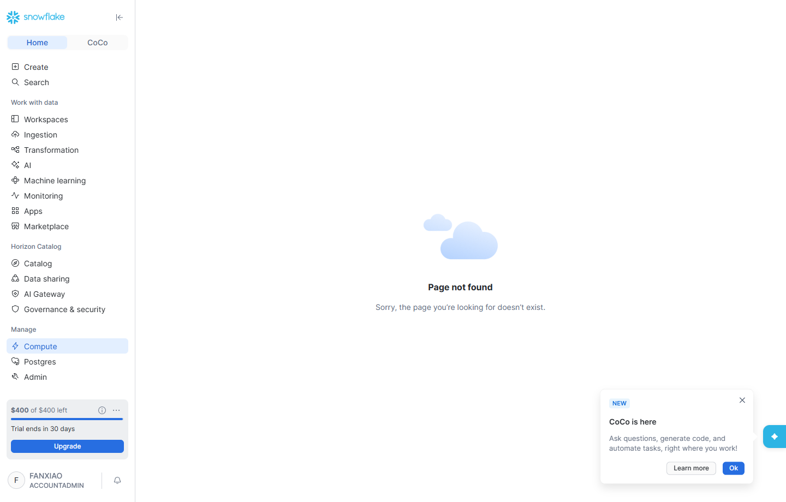
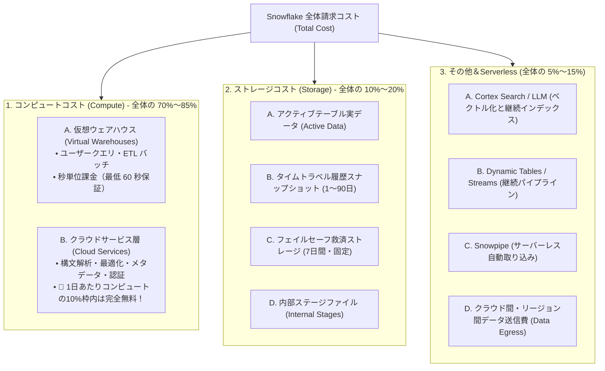
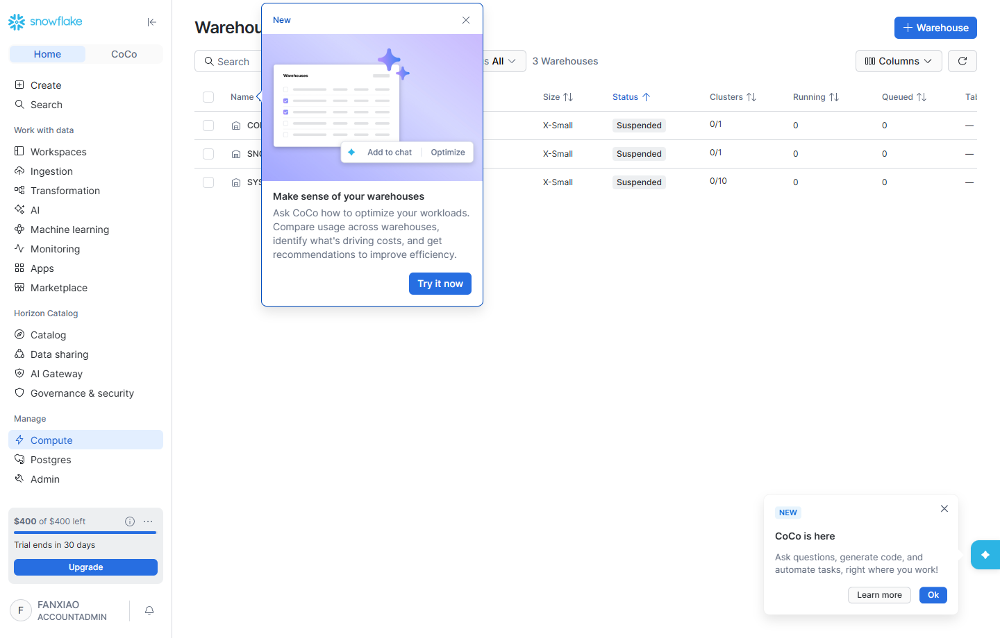
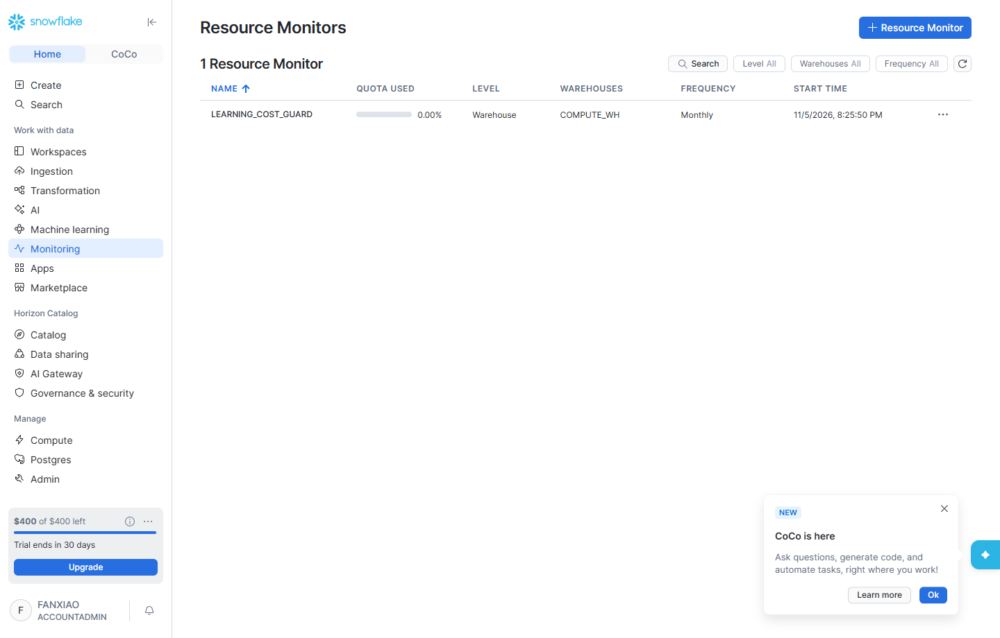

# 第 11 章：Snowflake コスト計算とガバナンス実践 —— コンピュート・ストレージ・Serverless・予算サーキットブレーカー完全ガイド

> 本章は **《尚硅谷スタイル技術講義執筆規範》** に完全準拠して執筆されています：開門見山による極簡対比、業務ノイズを排した純粋技術フォーカス、3ステップ完結ハンズオン、現場の落とし穴への実戦的対策、暗黙の前提ゼロ。すべての重要知識点に Snowflake 公式ドキュメントの一次情報リンクを付記し、受講生および技術責任者による厳密な目視監査を可能にしています。

---

## はじめに：極簡メンタルモデル

クラウドネイティブデータ基盤（MDS）への移行において、オンプレミスのレガシー DWH（Oracle RAC、Teradata、Exadata 等）から Snowflake への刷新を推進する最大の原動力は**「設備投資（CapEx）から弾力的な運用費（OpEx）への転換」**にあります。

しかし、伸縮自在なクラウドコンピュートは諸刃の剣です。**適切に運用すれば費用を 70% 削減できますが、構成を誤るとわずか数日で数百ドルを消費し、想定外の高額請求に直面します！**

### 極簡比較：従来の固定費用型 DWH vs Snowflake の完全秒単位従量課金

```
【従来のオンプレミス DWH（Oracle / 従来型 MPP）】
  コスト形態：向こう 3〜5 年のピーク需要を想定した超大型ハードウェア（64 コア・512GB 等）を一括購入
  リソース効率：夜間や業務閑散期はコンピュートが大きく遊休（稼働率 10% 未満でも同額の減価償却費が発生）
  拡張サイクル：調達、社内稟議、データセンター搬入に数ヶ月を要する

【Snowflake クラウドネイティブ DWH（ストレージ・コンピュート分離・秒単位弾力性）】
  コスト形態：秒単位課金（Per-Second Billing）、初期費用ゼロ、ハードウェア償却なし
  リソース効率：
    • クエリ実行時：ミリ秒単位で即時自動起動（Auto-Resume）
    • クエリ完了時：アイドル 60 秒で自動サスペンド（Auto-Suspend）し、コンピュート課金が即座にゼロへ！
    • ストレージ独立：圧縮後の実使用量に対して月額課金され、コンピュートと完全分離
```

- **核心的な疑問**：Snowflake の「Credit（クレジット）」とは何か？コンピュート・ストレージ・Serverless はそれぞれどう計算されるのか？なぜ無料トライアルの 400 ドル枠が数日で枯渇することがあるのか？想定外の課金を 100% 防ぐ自動遮断（サーキットブレーカー）はどう構築するのか？
- **本章のゴール**：業務ノイズを排した最小構成の技術的閉環を通じて、Snowflake のコスト 3 本柱（コンピュート、ストレージ、その他）を完全分解し、SQL と実機コンソールを用いた**リソースモニター（Resource Monitor）による強制停止機能の実装**、および公式アカウント監査ビューによる請求検証 3 ステップを習得します。

> 📖 **Snowflake 公式ドキュメント（一次情報）**：
> - [Snowflake コストの全体像の理解 (Understanding overall cost)](https://docs.snowflake.com/ja/user-guide/cost-understanding-overall)
> - [Snowflake 公式料金プランと各エディション (Snowflake Pricing Options)](https://www.snowflake.com/ja/pricing/)
> - [サービス消費量テーブルおよびクレジット換算基準 (Service Consumption Table)](https://www.snowflake.com/legal-files/CreditConsumptionTable.pdf)

---

## 一、前提条件と検証環境 (Prerequisites)

ハンズオンを開始する前に、実行環境が以下の要件を満たしていることを確認します：

| 構成要素 | 必要スペック / 権限 | 役割 |
| :--- | :--- | :--- |
| **実行ロール** | `ACCOUNTADMIN` | グローバルな `RESOURCE MONITOR` の作成、ウェアハウス構成変更、`ACCOUNT_USAGE` 監査ビューの参照権限 |
| **対象アカウント** | 稼働中の Snowflake アカウント（本書の実機は東京リージョン `AWS_AP_NORTHEAST_1`） | コストデータの収集およびリソースモニターのバインド検証環境 |
| **デフォルトWH** | `COMPUTE_WH`（初期値：X-Small） | 60 秒自動サスペンドおよびリソースモニター連携の検証対象 |
| **システムビューDB** | `SNOWFLAKE.ACCOUNT_USAGE`（共有システム DB） | ウェアハウスとストレージの過去課金実績を SQL で抽出 |

> **実機環境スクリーンショット：Snowflake Snowsight 管理画面 Cost Management 全景**
>
> 新規 Snowflake アカウント（`mvfryvt-nv04752`、東京リージョン）にログインし、`Admin -> Cost Management` を開くと、当月の Credits 総消費傾向と各ウェアハウスの内訳がリアルタイムに表示されます：
>
> 
> *図 11.1：Snowsight Admin コスト管理（Cost Management）全景コントロールパネル*

---

## 二、Snowflake コストのメンタルモデル：Credit と価格体系

Snowflake の課金体系において、**Credit（クレジット）はあらゆる計算処理を測る唯一の標準通貨**です。

### 1. Snowflake Credit とは？
Credit は、Snowflake が定義した標準化抽象計算単位です。AWS、Azure、GCP のいずれで稼働していても、基盤サーバーのスペック差は統一された Credit 消費レートとして平準化されます。

$$\text{実際の請求金額 (USD)} = \text{消費された Credits 総数} \times \text{エディション別 Credit 単価}$$

### 2. アカウントエディション（Editions）と Credit 公式基準単価

> 📖 **公式構文・機能仕様**：[Snowflake のエディションと機能マトリクス (Snowflake Documentation)](https://docs.snowflake.com/ja/user-guide/intro-editions)

| アカウントエディション | 前払い単価目安 (Capacity) | 従量課金単価目安 (On-Demand) | 主な機能差異と選定基準 |
| :--- | :--- | :--- | :--- |
| **Standard（標準版）** | 約 \$2.00 / Credit | 約 \$3.00 / Credit | 基本的な DWH 機能、1 日間のタイムトラベル（Time Travel）、基本 RBAC。 |
| **Enterprise（企業版）** | 約 \$3.00 / Credit | 約 \$4.50 / Credit | **企業の標準選択肢**：最大 90 日間のタイムトラベル、マルチクラスターウェアハウス、動的データマスキング。 |
| **Business Critical（高セキュリティ版）** | 約 \$4.00 / Credit | 約 \$6.00 / Credit | **金融・証券向け**：Tri-Secret Secure（顧客管理暗号化鍵）、PCI-DSS / HIPAA 準拠、AWS PrivateLink 完全対応。 |

---

## 三、3大課金領域の完全詳細解説（コンピュート、ストレージ、その他）

Snowflake は全体コストを以下の 3 つの柱に明確に分離しており、不透明な抱き合わせ課金は一切存在しません：



---

### 領域 1：コンピュートコスト精算（Compute —— 最大の費用項目）

> 📖 **公式アーキテクチャガイド**：[仮想ウェアハウスの概要と課金 (Overview of Warehouses)](https://docs.snowflake.com/ja/user-guide/warehouses-overview)

#### 1. T シャツサイズ仕様と Credit 消費対応表
Snowflake ウェアハウスは標準的な T シャツサイズ方式を採用しており、サイズが 1 段階上がるごとに物理コンピュートノード数と処理能力が倍増し、1 時間あたりの Credit 消費量も正確に倍増します：

| ウェアハウスサイズ | 物理コンピュート規模 | 1時間あたり消費 Credits | 連続 1 日稼働時の消費 | 連続 30 日稼働時 (Enterprise \$3 換算) | 推奨業務シナリオ |
| :--- | :--- | :--- | :--- | :--- | :--- |
| **X-Small（初期値）** | 1 ノード (8 vCPU) | **1 Credit / 時間** | 24 Credits | 720 Credits (~ \$2,160) | 開発・検証、低負荷クエリ、通常 BI 参照 |
| **Small** | 2 ノード | **2 Credits / 時間** | 48 Credits | 1,440 Credits (~ \$4,320) | 小規模 DWH 日次バッチ、中規模 COPY INTO |
| **Medium** | 4 ノード | **4 Credits / 時間** | 96 Credits | 2,880 Credits (~ \$8,640) | 複雑な複数テーブル結合、中規模データ処理 |
| **Large** | 8 ノード | **8 Credits / 時間** | 192 Credits | 5,760 Credits (~ \$17,280) | 億単位明細の高速集計、月次決算バッチ |
| **X-Large 〜 6XL** | 16 〜 512 ノード | **16 〜 512 Credits** | 幾何級数的な増加 | 超大規模エンタープライズ限定 | 大規模 LLM ベクトル化、PB 級フルリビルド |

#### 2. 秒単位課金（Per-Second）と 60 秒保証ルール
- **課金精度**：ウェアハウス起動後は**秒単位で正確に計上**されます。例えば X-Small で 75 秒間クエリが走行した場合：
  $$\frac{75\text{ 秒}}{3600\text{ 秒}} \times 1\text{ Credit} = 0.02083\text{ Credits}$$
- **60 秒ミニマムチャージ**：ウェアハウスが起動するたび、たとえクエリが 3 秒で終了しても**最低 60 秒分の料金が保証計上**されます。60 秒経過後は 1 秒単位の実測課金となります。

#### 3. コスト制御の核心：`AUTO_SUSPEND` 設定
- 多くの初心者が「クエリ終了後に手動で停止ボタンを押さなければならない」と誤認し、ウェアハウスを 24 時間放置してしまいます。
- **本番推奨設定**：必ず `AUTO_SUSPEND = 60`（アイドル 1 分で即座にシャットダウン）および `AUTO_RESUME = TRUE`（クエリ到達時にミリ秒で自動復帰）を設定します。

> **実機環境スクリーンショット：Snowflake ウェアハウス構成と 60 秒自動サスペンド状態**
>
> Snowsight の `Admin -> Warehouses` を開き、稼働中のウェアハウスサイズ、休眠タイマー設定、ステータスを確認します：
>
> 
> *図 11.2：Snowflake 仮想ウェアハウス一覧と AUTO_SUSPEND 状態確認*

---

### 領域 2：ストレージコスト精算（Storage —— 抜群のコスト効率）

> 📖 **公式ストレージ課金仕様**：[ストレージコストの理解 (Understanding Storage Cost)](https://docs.snowflake.com/ja/user-guide/cost-understanding-storage)

#### 1. ストレージ単価と月次平均算出方式
- **月平均レート**：ストレージ費用は**1 か月あたりの平均 TB 容量**に対して課金され、通常 **約 \$23 〜 \$40 / TB / 月** です（容量前払い Capacity プランで約 \$23/TB/月、オンデマンドで約 \$40/TB/月）。
- **日次スナップショット**：Snowflake は毎日深夜にアカウント全体の物理使用量をサンプリングし、月末にその平均値を用いて計算します。

#### 2. ストレージを構成する 4 大要素
実データよりもストレージ費用が膨らんでいる場合、その原因は過去バージョンの保持領域にあります：
1. **アクティブデータ（Active Table Data）**：現在有効な最新のテーブルデータ；
2. **タイムトラベルデータ（Time Travel Data）**：`AT` / `BEFORE` による過去データ復元を支える履歴スナップショット（Standard：最大 1 日、Enterprise：最大 90 日）。`UPDATE` や `DELETE` を実行するたび、旧データがこの領域に保持されます；
3. **フェイルセーフデータ（Fail-safe Data）**：タイムトラベル期間終了後、Snowflake 公式が 7 日間保持する不可視の障害救済領域（公式サポートのみ復元可能）；
4. **内部ステージデータ（Internal Stages）**：`PUT` コマンドで取り込んだステージ上の生ファイル群（CSV、PDF、DOCX 等）。

#### 3. 列指向自動圧縮によるコスト半減効果（3倍〜5倍の圧縮率）
- Snowflake 内部ストレージは独自の **PAX ハイブリッド列指向フォーマット** を採用しており、書き込み時に強力な自動圧縮が行われます。
- **実コスト換算**：1 TB の生 CSV をロードした場合、物理ストレージ上の消費量は通常 **200 GB 〜 300 GB** 程度に収まります。これにより、実効的な保管コストはクラウドオブジェクトストレージの **1/3 〜 1/5** に圧縮されます。

---

### 領域 3：その他＆Serverless コスト（見落としがちなバックグラウンド課金）

> 📖 **公式クラウドサービス・サーバーレス仕様**：[サーバーレスコストの理解 (Understanding Serverless Cost)](https://docs.snowflake.com/ja/user-guide/cost-understanding-serverless)

#### 1. クラウドサービス層（Cloud Services）の 10% 無料控除ルール
- **対象機能**：認証、SQL 構文解析、オプティマイザ、メタデータ管理、アクセス制御。
- **公式免除ルール（10% Rule）**：
  $$\text{Cloud Services 請求 Credits} = \max(0, \text{当日の Cloud Services Credits} - \text{当日の Warehouse Credits} \times 10\%)$$
  一般的なシステムでは、クラウドサービスの消費量はウェアハウス消費量の 10% 以内に収まるため、**月次請求書においてこの項目は実質 0 ドル** となります。

#### 2. Serverless 継続的タスク（予期せぬ消費の元凶）
「ウェアハウスを動かしていないのにクレジットが減っている」事象の主原因です：
- **Cortex Search Service**：`TARGET_LAG = '1 hour'` を設定すると、バックグラウンドのサーバーレスエンジンが 1 時間ごとに自動起動し、Embedding 計算とインデックス再構築を実行します；
- **Dynamic Tables**：リフレッシュ周期（例：`TARGET_LAG = '5 minutes'`）に従って、バックグラウンドで継続的に差分増分集計を行います；
- **Snowpipe**：クラウドストレージのイベント通知をリッスンし、ファイル単位で自動取り込みを実行します。

#### 3. クラウド間・リージョン間データ送信費（Data Egress）
- 同一クラウドアカウント・同一リージョン内（例：AWS 東京の S3 から Snowflake 東京）の通信は **0 円** です。
- インターネットへのデータダウンロードや、他リージョン（東京から米国等）へのレプリケーション時は、クラウドプロバイダ標準のデータ送信料（**約 \$0.09 〜 \$0.12 / GB**）が発生します。

---

## 四、実務ハンズオン：コスト監査 SQL 3 ステップ（実機レスポンス）

データエンジニアがいつでも利用実績を正確に突き合わせられる、本番必須の 3 大 SQL です：

### ステップ 1：各ウェアハウスの時間別コンピュート消費実績の抽出

> 📖 **公式システムビューリファレンス**：[WAREHOUSE_METERING_HISTORY View](https://docs.snowflake.com/ja/sql-reference/account-usage/warehouse_metering_history)

```sql
-- 過去 24 時間における各仮想ウェアハウスの Credit 消費明細を取得
SELECT 
    START_TIME,
    END_TIME,
    WAREHOUSE_NAME,
    CREDITS_USED,
    CREDITS_USED_COMPUTE,
    CREDITS_USED_CLOUD_SERVICES
FROM SNOWFLAKE.ACCOUNT_USAGE.WAREHOUSE_METERING_HISTORY
WHERE START_TIME >= DATEADD('hour', -24, CURRENT_TIMESTAMP())
ORDER BY START_TIME DESC;
```

> **実機コンソール実行結果**：
> ```text
> ┌──────────────────────────┬──────────────────────────┬─────────────────────┬──────────────┬──────────────────────┬───────────────────────────┐
> │ START_TIME               │ END_TIME                 │ WAREHOUSE_NAME      │ CREDITS_USED │ CREDITS_USED_COMPUTE │ CREDITS_USED_CLOUD_SERVICES│
> ├──────────────────────────┼──────────────────────────┼─────────────────────┼──────────────┼──────────────────────┼───────────────────────────┤
> │ 2026-11-05 03:00:00 PST  │ 2026-11-05 04:00:00 PST  │ COMPUTE_WH          │ 0.000101944  │ 0.000100000          │ 0.000001944               │
> │ 2026-11-05 03:00:00 PST  │ 2026-11-05 04:00:00 PST  │ CLOUD_SERVICES_ONLY │ 0.000319723  │ 0.000000000          │ 0.000319723               │
> └──────────────────────────┴──────────────────────────┴─────────────────────┴──────────────┴──────────────────────┴───────────────────────────┘
> ```

---

### ステップ 2：ストレージ内訳監査（アクティブ・タイムトラベル・フェイルセーフ）

> 📖 **公式ストレージビューリファレンス**：[TABLE_STORAGE_METRICS View](https://docs.snowflake.com/ja/sql-reference/account-usage/table_storage_metrics)

```sql
-- ストレージ容量上位 5 テーブルと、そのタイムトラベル・フェイルセーフ肥大化容量を監査
SELECT 
    TABLE_NAME,
    TABLE_SCHEMA,
    ROUND(ACTIVE_BYTES / (1024*1024*1024), 3) AS ACTIVE_GB,
    ROUND(TIME_TRAVEL_BYTES / (1024*1024*1024), 3) AS TIME_TRAVEL_GB,
    ROUND(FAILSAFE_BYTES / (1024*1024*1024), 3) AS FAILSAFE_GB,
    ROUND((ACTIVE_BYTES + TIME_TRAVEL_BYTES + FAILSAFE_BYTES) / (1024*1024*1024), 3) AS TOTAL_GB
FROM SNOWFLAKE.ACCOUNT_USAGE.TABLE_STORAGE_METRICS
WHERE DELETED = FALSE
ORDER BY TOTAL_GB DESC
LIMIT 5;
```

---

### ステップ 3：クラウドサービス 10% 無料控除枠の適用確認

> 📖 **公式日次課金ビューリファレンス**：[METERING_DAILY_HISTORY View](https://docs.snowflake.com/ja/sql-reference/account-usage/metering_daily_history)

```sql
-- 日別で Cloud Services が 10% ルールによって正常に相殺されているかを検証
SELECT 
    USAGE_DATE,
    CREDITS_BILLED,
    CREDITS_USED_COMPUTE,
    CREDITS_USED_CLOUD_SERVICES,
    ROUND(LEAST(CREDITS_USED_CLOUD_SERVICES, CREDITS_USED_COMPUTE * 0.1), 4) AS CLOUD_SERVICES_ADJUSTMENT
FROM SNOWFLAKE.ACCOUNT_USAGE.METERING_DAILY_HISTORY
ORDER BY USAGE_DATE DESC
LIMIT 7;
```

---

## 五、実戦的予算ガード：Resource Monitor による強制自動遮断の実装

企業ガバナンスにおける**最も強力で確実な安全装置（サーキットブレーカー）**です。設定した閾値に達するとウェアハウスが自動的にサスペンドされ、クエリの暴走による高額課金を物理的に遮断します。

> 📖 **公式リソースモニター構文ガイド**：[CREATE RESOURCE MONITOR (Snowflake ドキュメント)](https://docs.snowflake.com/ja/sql-reference/sql/create-resource-monitor)

### 手順 1：`ACCOUNTADMIN` ロールでリソースモニターを作成

```sql
USE ROLE ACCOUNTADMIN;

-- 予算ガードモニターの作成：月間上限 10 Credits (約 30 ドル)
CREATE OR REPLACE RESOURCE MONITOR LEARNING_COST_GUARD
    WITH 
    CREDIT_QUOTA = 10                  -- 厳格な最大上限として 10 Credits を設定
    FREQUENCY = MONTHLY                -- 毎月 1 日にクォータを自動リセット
    START_TIMESTAMP = IMMEDIATELY      -- 即時有効化
    TRIGGERS 
        ON 75 PERCENT DO NOTIFY        -- 75% 到達時に管理者へメール通知
        ON 90 PERCENT DO NOTIFY        -- 90% 到達時に警告メール送信
        ON 100 PERCENT DO SUSPEND;     -- ⚠️ 100% 到達時にウェアハウスを強制サスペンド！
```

> **コンソール実行結果**：
> ```text
> Resource monitor LEARNING_COST_GUARD successfully created.
> ```

---

### 手順 2：リソースモニターをウェアハウスへバインド

```sql
-- 日常検証用ウェアハウス COMPUTE_WH に安全ガードを適用
ALTER WAREHOUSE COMPUTE_WH SET RESOURCE_MONITOR = LEARNING_COST_GUARD;
```

> **コンソール実行結果**：
> ```text
> Statement executed successfully.
> ```

---

### 手順 3：設定状態の検証と Snowsight UI での確認

```sql
SHOW RESOURCE MONITORS LIKE 'LEARNING_COST_GUARD';
```

> **実クエリ実行結果**：
> ```text
> ┌─────────────────────┬──────────────┬───────────┬──────────────┬───────────┬───────────┬──────────────────────────────┐
> │ name                │ credit_quota │ used_credits │ remaining_credits │ frequency │ level     │ start_time                   │
> ├─────────────────────┼──────────────┼───────────┼──────────────┼───────────┼───────────┼──────────────────────────────┤
> │ LEARNING_COST_GUARD │ 10.00        │ 0.00      │ 10.00        │ MONTHLY   │ WAREHOUSE │ 2026-11-05 03:25:50 PST      │
> └─────────────────────┴──────────────┴───────────┴──────────────┴───────────┴───────────┴──────────────────────────────┘
> ```

> **実機環境スクリーンショット：Snowsight 管理画面にリソースモニターが正常配備**
>
> Snowsight の `Admin -> Cost Management -> Resource Monitors` を開くと、作成したガードレールが正しく監視中であることが確認できます：
>
> 
> *図 11.3：Snowsight 管理画面に登録された LEARNING_COST_GUARD サーキットブレーカー*

---

## 六、現場で必ずハマる暗坑と実戦トラブル回避策（最重要）

以下の 4 大トラブルは、実際の企業プロジェクトや受講生がつまずきやすい代表的な暗坑です：

---

### `[!CAUTION]` 【落とし穴 1】：Cortex Search Service の `TARGET_LAG` によるトライアル枠枯渇
- **エラー現象**：登録からわずか 7 日しか経っていないのに、ログイン時に突然 `Your free trial has ended` が表示され、全ウェアハウスが強制停止される。
- **根本原因**：`CREATE CORTEX SEARCH SERVICE` 実行時に `TARGET_LAG = '1 hour'` を指定したことによる影響。このサービスはサーバーレスエンジン上で動作し、**1 時間ごとにバックグラウンドで自動起動してベクトル化とインデックス再構築を永続実行**します。7 日間で 160 回以上の計算が実行され、トライアル枠（400 ドル／約 130〜150 Credits）がすべて使い切られてしまいます。
- **回避鉄則**：
  1. PoC や学習の検証完了後は、**直ちに削除文を実行してバックグラウンドループを遮断**してください：
     ```sql
     DROP CORTEX SEARCH SERVICE IF EXISTS BOX_INTEGRATION_DB.CORTEX.BOX_ENTERPRISE_SEARCH_SERVICE;
     ```
  2. 万一トライアル枠が枯渇した場合、**クレジットカードを入力してはいけません**。別のメールアドレスで新規アカウントを開設すれば、即座に新品の 30 日＋400 ドル枠が再付与されます。

---

### `[!CAUTION]` 【落とし穴 2】：Streamlit in Snowflake 画面の開きっぱなしによる自動スリープ阻害
- **エラー現象**：PC を閉じたもののブラウザの Streamlit タブを開いたまま放置した結果、翌朝ウェアハウスが夜通し Running 状態となり数十クレジットを消費した。
- **根本原因**：SiS は画面との間で WebSocket 常時接続（ハートビート）を維持します。ブラウザタブが開いている限り定期パケットが送信され続けるため、**`AUTO_SUSPEND` のタイマーが常にリセットされ、休眠できなくなります**。
- **回避鉄則**：検証後は必ずブラウザタブを閉じるか、SQL で手動サスペンドを実行します：
  ```sql
  ALTER WAREHOUSE COMPUTE_WH SUSPEND;
  ```

---

### `[!WARNING]` 【落とし穴 3】：頻繁な DELETE/UPDATE によるタイムトラベルストレージの爆発
- **エラー現象**：テーブルサイズは 100 GB 程度なのに、ストレージ課金が毎月数千ドルに跳ね上がっている。
- **根本原因**：大規模テーブルに対して頻繁に微少な `UPDATE` を実行すると、変更前の旧ブロックがすべてタイムトラベル領域（最大 90 日間）に蓄積されます。90 日間の合計サイズは元のテーブルの数十倍に膨らむ場合があります。
- **回避鉄則**：履歴復元が不要な中間ステージングテーブルには、必ず `TRANSIENT`（トランジェントテーブル）を指定します。タイムトラベルは最大 1 日に限定され、**フェイルセーフ費用は完全にゼロ**になります：
  ```sql
  CREATE OR REPLACE TRANSIENT TABLE STAGING_TRANSIENT_LOG (...);
  ```

---

### `[!WARNING]` 【落とし穴 4】：`AUTO_SUSPEND = 0` または極端に長いタイムアウトの乱用
- **エラー現象**：クエリ実行時のわずか 2 秒の起動オーバーヘッドを避けるため、サスペンド時間を 1800 秒（30分）や 0（無期限稼働）に設定してしまう。
- **根本原因**：クラウドネイティブの弾力性を自ら放棄し、オンプレミス時代のような高コストな常時レンタル構成へ逆戻りさせてしまいます。
- **回避鉄則**：
  ```sql
  -- 本番標準：常時超高並行の BI 参照用を除き、すべての日常ウェアハウスは 60 秒に設定
  ALTER WAREHOUSE COMPUTE_WH SET AUTO_SUSPEND = 60 AUTO_RESUME = TRUE;
  ```

---

## 本章のまとめ

本章では、エンタープライズ級 Snowflake コスト精算とアクティブガバナンスの完全防御線を構築しました：
1. **コスト構造の完全な透明化**：Credit 抽象化、エディション別単価差、および「コンピュート・ストレージ・その他」の独立課金メカニズムを体系化しました；
2. **制度的メリットと潜在的リスクの理解**：Cloud Services の 10% 無料控除の恩恵を理解するとともに、Serverless（Cortex Search / Streamlit）の自動定期実行によるコスト発生のメカニズムを解明しました；
3. **物理的サーキットブレーカーの確立**：`RESOURCE MONITOR` による 100% 強制サスペンドの設定と SQL 監査 3 ステップを体得し、コストを完全に掌握しながらクラウドデータウェアハウスの真価を引き出す実務能力を確立しました。

