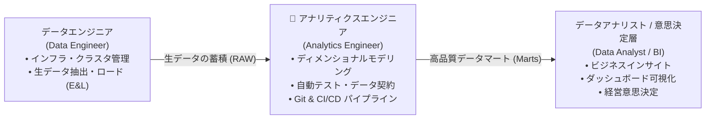
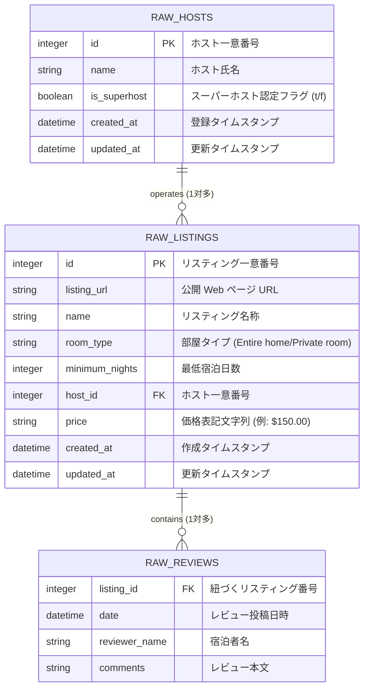

# 第 01 章：dbt 入門 —— モダンデータスタックにおけるエンジニアリング革命とメンタルモデル

> 本章は **《尚硅谷技術講義執筆規範 (shangguigu-style)》** に準拠して執筆されています：本質を突く極簡比較、ビジネスロジックを排した純粋技術フォーカス、実機実行ログを伴う三段構えの閉ループ、現場の落とし穴回避、前提条件のゼロ暗黙仮定。グローバル最高峰の認定体系（Complete dbt Bootcamp）および dbt Analytics Engineering 公式認定試験の出題範囲に完全準拠しています。

---

## はじめに：極簡メンタルモデル

従来のオンプレミス型データウェアハウス（Oracle、Teradata、Exadata）や初期の Hadoop / Spark データレイク運用では、データ処理は典型的な **ETL（Extract-Transform-Load）** パイプラインに従っていました。しかし、**Snowflake** に代表されるクラウドネイティブ DWH（ストレージとコンピュートの完全分離・秒単位のオートスケーリング・従量課金）の登場により、モダンデータアーキテクチャは **ELT（Extract-Load-Transform）** へと劇的に進化しました：
- **E & L（抽出とロード）**：特化型ツール（COPY INTO、Fivetran、Airbyte、Openflow など）を用いて生データをそのまま高速ロード；
- **T（変換とモデリング）**：**DWH の強力な計算リソースを直接活用し、ウェアハウス内部でクレンジング、集計、ディメンショナルモデリングを実行**。

しかし、DWH 内部で「T」を進める過程で、多くの企業が深刻な**「SQL スクリプトの泥沼」**に直面しました：

### 極簡明快な対比：従来の SQL スクリプト泥沼 vs dbt モダンアナリティクスエンジニアリング

```
【従来の DWH SQL 泥沼（脆弱・ブラックボックス・手作業運用）】
  • スクリプトの散乱：数百もの .sql ファイルやストアドプロシージャが各フォルダやスケジューラに分散；
  • バタフライ効果：上流で 1 カ所のカラム名を変更すると、下流の 3 つの本番レポートが一瞬で破損；
  • 人海戦術の検品：自動テストが存在せず、CFO（最高財務責任者）が Excel で手作業で数値照合を実施；
  • ドキュメントの形骸化：Word で書かれた設計書は作成された瞬間に陳腐化し、リネージの追跡は絶望的。

【dbt 原生モダンアナリティクスエンジニアリング（ソフトウェア工学・宣言型・完全自動化）】
  ┌─────────────────────────────────────────────────────────────────────────┐
  │ 開発者はコアビジネスロジックに集中：標準の SELECT クエリ（Models）のみを記述 │
  └────────────────────────────────────┬────────────────────────────────────┘
                                       ▼ dbt コンパイラが自動管理
  ┌─────────────────────────────────────────────────────────────────────────┐
  │ 1. 依存関係の自動解決：&#123;&#123; ref() &#125;&#125; に基づき DAG 有向非巡回グラフを自動構築 │
  │ 2. 自動マテリアライゼーション：Snowflake 内で CREATE TABLE/VIEW/MERGE を自動実行 │
  │ 3. 品質ゲートの防御：unique/not_null/unit_tests を自動実行し、異常を即時遮断 │
  │ 4. 生きたドキュメントとリネージ：コードからメタデータを抽出、列レベルリネージを生成 │
  └─────────────────────────────────────────────────────────────────────────┘
```

- **核心的な問い**：dbt とは何か？なぜ「ソフトウェア開発における Git のように、データ変換における dbt が不可欠」と言われるのか？どのようにしてデータアナリストを、ソフトウェアエンジニアの武器を備えた「アナリティクスエンジニア（Analytics Engineer）」へと進化させるのか？
- **本章の目標**：行き当たりばったりのパッチワークから脱却し、モダンアナリティクスエンジニアリングの最上位メンタルモデルを確立。dbt の 4 大柱を習得し、Snowflake + dbt によるエンタープライズ開発・公式認定取得へのロードマップを描きます！

> 📖 **公式オーソリティ参考リソース**：
> - [dbt 公式ハンドブック (What is dbt?)](https://docs.getdbt.com/docs/introduction)
> - [実践コース公式 GitHub リポジトリ (Complete dbt Bootcamp)](https://github.com/nordquant/complete-dbt-bootcamp-zero-to-hero)
> - [公式フルスライド資料 (Presentation Slides - Google Slides)](https://docs.google.com/presentation/d/1ZFU-bPVnF7n1-5h9wWws5_FUHpGnM7ev0CS42IGwMwM/edit?usp=sharing)
> - [dbt Analytics Engineering 公式認定試験シラバス](https://www.getdbt.com/certifications/analytics-engineer-certification-exam)

---

## 一、環境と事前準備 (Prerequisites)

dbt アナリティクスエンジニアリングの実践を開始する前に、開発環境が以下の要件を満たしていることを確認してください：

| 依存コンポーネント | 要件 / 推奨バージョン | 役割と説明 |
| :--- | :--- | :--- |
| **クラウド DWH 基盤** | Snowflake の任意の標準/試用アカウント（前章で設定した東京リージョンなど） | 基盤となる計算ウェアハウス（`COMPUTE_WH`）およびデータストレージを提供 |
| **Python ランタイム** | Python 3.10 〜 3.12（高速ツール `uv` または標準 `venv` を推奨） | `dbt-core` および `dbt-snowflake` アダプタードライバを実行 |
| **バージョン管理** | Git 2.30+ | ソフトウェア工学のコード管理、CI/CD、ブランチ別サンドボックス開発を実現 |
| **開発エディタ** | VS Code または Cursor（`dbt Power User` 拡張機能のインストールを推奨） | モデル構文ハイライト、SQL 即時コンパイルプレビュー、リネージ可視化を実現 |

---

## 二、dbt の本質：ソフトウェア工学によるデータ変換の再構築

### 1. アナリティクスエンジニア（Analytics Engineer）とは？
従来のデータ組織には、明確な職務の分断が存在していました：
- **データエンジニア（Data Engineer）**：インフラ、分散パイプライン、Kafka リアルタイムストリーミング、DWH 基盤の構築に長けていますが、財務・マーケティング・業務指標の深いコンテキストには必ずしも精通していません；
- **データアナリスト（Data Analyst）**：ビジネスモデルや KPI を熟知していますが、ソフトウェア工学のベストプラクティス（ユニットテスト、Git バージョン管理、CI/CD）の経験が乏しく、数千行の手書きアドホック SQL を量産しがちです。

**dbt は、この両者の溝を埋める新時代の職種「アナリティクスエンジニア（Analytics Engineer）」を確立しました**。アナリストにプロのソフトウェア開発者と同等のエンジニアリング能力を授け、データ変換ロジックをテスト可能・保守可能・追跡可能な高水準資産へと昇華させます。



### 2. dbt のコア哲学：「SELECT 文だけを書く」
dbt 導入前、DWH 内のデータ変換には冗長で脆弱な DDL やトランザクション制御が満ち溢れていました：
```sql
-- 従来手法：ボイラープレートコードと危険な手動 DDL
DROP TABLE IF EXISTS analytics.dim_customers;
CREATE TABLE analytics.dim_customers AS 
SELECT id, name, ... FROM raw.customers;
-- さらにインデックス、主キー制約、エラーハンドリングを手動記述...
```

**dbt においては、純粋なビジネスロジックのクエリを記述するだけです：**
```sql
-- dbt モデル：models/dim_customers.sql（ボイラープレートは一切不要）
SELECT 
    id AS customer_id,
    name AS customer_name,
    created_at
FROM &#123;&#123; ref('stg_customers') &#125;&#125;
```

dbt コンパイラはビルド時に設定を読み取り、Snowflake の最適化された SQL 方言へと透過的にラップ・変換します：
- View（ビュー）指定時：自動的に `CREATE OR REPLACE VIEW ... AS SELECT ...` を生成；
- Table（テーブル）指定時：ダウンタイムゼロの安全なアトミック入れ替え構文を生成；
- Incremental（増量）指定時：Snowflake ネイティブの最適化された `MERGE INTO` 構文へと自動展開！

---

## 三、dbt を支える 4 大コア柱の体系的解剖

dbt がモダンデータチームの業界標準となった理由は、以下の 4 つの不可欠な柱にあります：

```mermaid
flowchart TD
    subgraph dbtCore["dbt モダンエンジニアリングの 4 つの柱"]
        M["1. モジュール型モデル (Models)<br/>• 純粋な SELECT 宣言型コード<br/>• &#123;&#123; ref() &#125;&#125; による動的依存関係の解決<br/>• 自動マテリアライゼーション (View/Table/Incremental)"]
        T["2. 自動品質防御網 (Tests & Contracts)<br/>• 汎用テスト (unique, not_null...)<br/>• ユニットテスト (Unit Tests)<br/>• スキーマ契約 (Data Contracts)"]
        L["3. 全息リネージグラフ (DAG Lineage)<br/>• 依存関係ツリーの自動トポロジー解決<br/>• 列レベルリネージ (Column-Level Lineage)<br/>• 差分コンパイル (--select)"]
        D["4. 生きたドキュメントポータル (Automated Docs)<br/>• コードとドキュメントの完全一体化<br/>• インタラクティブな Web サイトを即時生成<br/>• Exposures による下流ダッシュボード追跡"]
    end
```



### 1. モジュール型モデル（Models）と依存関係の疎結合化（`&#123;&#123; ref() &#125;&#125;`）
- **ハードコードの弊害**：`FROM dev_db.raw_data.orders` と固定記述すると、本番環境（`prod_db`）へのリリース時に全件置換が必要となり、本番汚染の原因となります；
- **dbt の解決策**：`&#123;&#123; ref('stg_orders') &#125;&#125;` や `&#123;&#123; source('raw', 'orders') &#125;&#125;` を使用。コンパイラが実行時ターゲット（Target: `dev` または `prod`）に応じて正しいデータベース・スキーマ名へ動的展開します。

### 2. 自動品質防御網（Tests & Contracts）
- **汎用テスト（Generic Tests）**：YAML に宣言するだけで、ビルド直後に自動アサーションを実行：
  - `unique`：主キーの一意性確認；
  - `not_null`：必須カラムの NULL 混入防止；
  - `accepted_values`：列挙値の妥当性検証（例：ステータスが `PENDING`, `COMPLETED` のみであること）；
  - `relationships`：テーブル間の外部キー参照整合性チェック。
- **ユニットテスト（Unit Tests）**：複雑な変換ロジックに対し、モックデータを投入してローカルで境界値を検証；
- **データ契約（Data Contracts）**：カラム名と型を厳密固定し、上流での破壊的変更（Breaking Change）をコンパイル段階で物理ブロック！

### 3. 全息リネージグラフ（DAG Lineage）
dbt は SQL 内の `&#123;&#123; ref() &#125;&#125;` を静的解析し、プロジェクト全体の有向非巡回グラフ（DAG）を自動構築します：
- 上流のソースから下流のマートまでの依存チェーンを可視化；
- **セレクターによるスマート実行**：`dbt run --select +dim_listings` で対象モデルとその上流のみをピンポイント実行、無駄な全件ビルドを徹底排除！

### 4. 自動生成ドキュメントポータル（Docs）
`dbt docs generate` を 1 回実行するだけで、カラム定義、データ型、テスト結果、DAG リネージを内包したスタンドアロンの静的 Web サイトが完成。ビジネスユーザーやアナリストがセルフサービスで指標の算出元を検索可能になります。

---

## 四、Snowflake + dbt：モダンデータスタック最強の黄金タッグ

なぜ業界において、**Snowflake と dbt の組み合わせは「The Gold Standard（業界標準）」** と称されるのか？

| Snowflake ネイティブ機能 | dbt エンジニアリングとの相乗効果 | エンタープライズ実務における価値 |
| :--- | :--- | :--- |
| **ストレージと計算の完全分離** | dbt がモデルの並列コンパイル・実行を行い、Snowflake の並列ウェアハウスをトリガー | 複雑な DAG 実行時間を 80% 短縮、ストレージと計算が互いに干渉しない |
| **秒単位の自動休眠 (Auto-Suspend 60s)** | バッチジョブ完了直後にウェアハウスが即時シャットダウン | 第 11 章のコストガバナンスと完全連動し、アイドルコストを極小化 |
| **ゼロコピークローン (Zero-Copy Clone)** | `CREATE DATABASE dev_sandbox CLONE prod_db` | TB 規模の本番スナップショットを一瞬で複製し dbt で開発、**ストレージ追加コストは 0** |
| **ネイティブ MERGE 最適化** | dbt `incremental` 戦略が Snowflake の高性能 `MERGE` をダイレクトに実行 | 数千万行の差分取り込みが数秒で完了 |

---

## 五、実戦ケーススタディ：Airbnb コアデータセット概要

本専欄全体を通じて一貫性のある実務スキルを身につけるため、以降の全章では世界標準の **Airbnb 実データセット** を統一教材として使用します：



### データレイヤーのアーキテクチャ設計：
1. **Raw レイヤー（`AIRBNB.RAW`）**：S3 外部ステージから直接ロードされた生データテーブル群；
2. **Staging レイヤー（`AIRBNB.DEV.SRC_*`）**：カラム名標準化、型変換（通貨記号 `$` の数値化除去など）；
3. **Core / Marts レイヤー（`DIM_*` / `FCT_*`）**：ディメンションテーブル、増量ファクトテーブル、満月（Full Moon）日付連動分析マート。

---

## 六、dbt 公式認定試験ロードマップ (Analytics Engineering Certification)

本専欄は、dbt Labs が策定した **dbt Analytics Engineer Certification（最新 dbt 1.11 / 1.12+ シラバス完全準拠）** を網羅しています：

```
┌────────────────────────────────────────────────────────────────────────┐
│ dbt Certified Developer / Analytics Engineer 出題構成比率              │
├────────────────────────────────────────────────────────────────────────┤
│ 1. モデル開発と設計 (Developing Models)                         [30%]   │
│    • Ref/Source 参照、マテリアライゼーション選定、Jinja 制御とマクロ開発 │
│ 2. データ品質とテスト (Testing & Data Quality)                   [25%]   │
│    • 汎用テスト・カスタムテスト、Unit Tests、Data Contracts 契約設計    │
│ 3. 本番デプロイと最適化 (Deployment & Optimization)              [25%]   │
│    • Slim CI 差分ビルド (--select state:modified+)、Snapshots 履歴追跡   │
│ 4. ドキュメント・リネージ・ガバナンス (Governance)                [20%]   │
│    • 列レベルリネージ、Exposures ダッシュボード連携、ライフサイクル管理   │
└────────────────────────────────────────────────────────────────────────┘
```

---

## 七、実戦での落とし穴とトラブルシューティング（重要）

---

### `[!CAUTION]` 【落とし穴 1】：dbt モデル（.sql）内に `CREATE TABLE` や `INSERT INTO` を手書きしないこと！
- **初心者のミス**：ストアドプロシージャの習慣で、`models/my_model.sql` の先頭に `CREATE TABLE AS SELECT ...` を書いてしまう。
- **致命的結果**：dbt コンパイラが自身で DDL ラップを行うため、Snowflake に対して `CREATE TABLE AS CREATE TABLE AS SELECT ...` が送出され、構文エラーで即座にクラッシュします。
- **鉄則**：**モデルファイル内には純粋な `SELECT` 文のみを記述すること！** テーブルかビューかは、ファイル上部の `&#123;&#123; config(materialized='table') &#125;&#125;` または `dbt_project.yml` で宣言します。

---

### `[!WARNING]` 【落とし穴 2】：SQL 内に本番のデータベース・スキーマ名をハードコードしないこと！
- **初心者のミス**：`FROM PROD_DB.PUBLIC.RAW_ORDERS` と記述してしまう。
- **致命的結果**：ローカル開発で `dbt run` を叩いた瞬間、開発用サンドボックスを迂回して本番データが参照・上書きされ、コンプライアンス事故に繋がります。
- **鉄則**：ソーステーブルは `&#123;&#123; source() &#125;&#125;`、モデル間参照は `&#123;&#123; ref() &#125;&#125;` を必ず使用し、環境切り替えは `profiles.yml` に委ねてください。

---

### `[!NOTE]` 【落とし穴 3】：旧版 PDF のコピペによる特殊文字化けを回避すること
- **背景**：旧教材の PDF からコードをコピーすると、シングルクォート `'` が全角引用符等に置換され、コンパイルエラーの原因となっていました。
- **解決基準**：本講義のコードはすべて GitHub の公式マークダウン（[`_course_resources/course-resources.md`](https://github.com/nordquant/complete-dbt-bootcamp-zero-to-hero)）から直接抽出・検証されており、文字コードの汚染を 100% 排除しています。

---

本章を通じて、dbt によるモダンアナリティクスエンジニアリングの核心思想を確立しました。次章では早速実機へ移行し、Snowflake 上に専用の `AIRBNB` データベース基盤をプロビジョニングし、モダンツール `uv` によるローカル開発環境の構築と `dbt-snowflake` 疎通テストを実行します！
