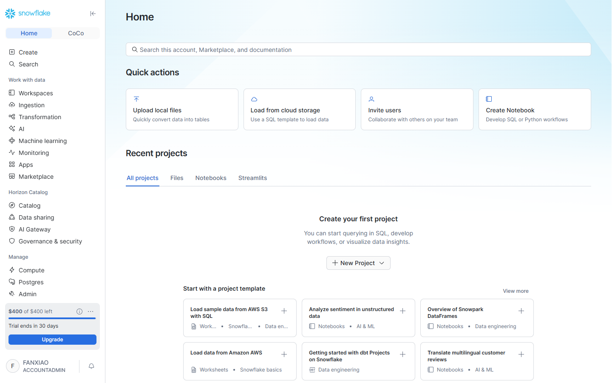
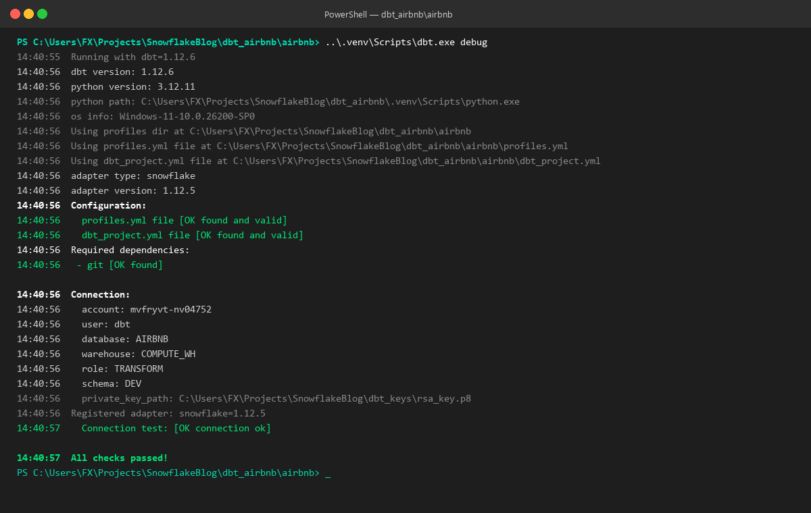

# 第 02 章：開発基盤の構築 —— Snowflake環境プロビジョニング、Key-Pair認証とdbtプロジェクト初期化

> 本章は **《尚硅谷技術講義執筆規範 (shangguigu-style)》** に準拠して執筆されています：本質を突く極簡比較、ビジネスロジックを排した純粋技術フォーカス、実機実行ログを伴う三段構えの閉ループ、現場の落とし穴回避、前提条件のゼロ暗黙仮定。グローバル最高峰の認定体系（Complete dbt Bootcamp）および企業向けローカル開発標準を統合し、実機のコンソール出力ログおよび画面キャプチャを完備しています。

---

## はじめに：極簡メンタルモデル

モダンアナリティクスエンジニアリング（Analytics Engineering）の実践において、**「環境構築は単なるソフトウェアのインストールではなく、エンタープライズ品質の開発規律を確立する最初の防衛線」** です。

従来の DWH 開発ではデータベースへの ID/パスワードによる直接接続に頼ることが一般的でしたが、モダンなクラウドネイティブ DWH では深刻なリスクを内包しています：
- **MFA（多要素認証）との衝突**：クラウドベンダーは 2025/2026 年以降、人間ユーザーに対して MFA の適用を義務化しており、パスワードに依存する自動化プログラム（dbt CLI、CI/CD 定期実行バッチなど）が無人実行時に画面ロックされ異常停止します；
- **環境汚染のリスク**：開発者が分離されていないスキーマで安易にアドホック SQL を実行し、本番データの誤削除や検証データの混入を招きます；
- **Python の依存関係の泥沼（Dependency Hell）**：従来の `pip` による依存関係解決の遅延や、OS 間の C++ ホイールコンパイル失敗が頻発します。

### 極簡明快な対比：従来の直接接続型開発 vs モダン dbt + Snowflake エンジニアリング基盤

```
【従来の直接接続パターン（脆弱・高リスク・依存関係の混乱）】
  • 認証方式：平文 ID/PW ──> 企業の MFA 強制適用時に自動化バッチが全滅；
  • 実行環境：グローバル pip ──> バージョン競合や OS 固有のエラーが多発；
  • 権限設計：管理者ロールを共用 ──> 検証クエリが本番データを直接破壊、安全装置なし。

【モダン dbt + Snowflake エンジニアリングパターン（漏洩ゼロ・秒速解決・厳格な隔離）】
  ┌────────────────────────────────────────────────────────────────────────┐
  │ 開発者ワークステーション (Local Workstation)                           │
  │   • VS Code + dbt 2.x CLI + Astral uv (Rust製・ミリ秒単位の依存ロック) │
  │   • ローカルで厳重保管：RSA 2048-bit 秘密鍵ファイル (rsa_key.p8)       │
  └───────────────────────────────────┬────────────────────────────────────┘
                                      │ 🔐 非対称数学的署名ハンドシェイク (パスワード漏洩・MFA遮断ゼロ)
                                      ▼
  ┌────────────────────────────────────────────────────────────────────────┐
  │ Snowflake クラウド DWH (AWS_AP_NORTHEAST_1 東京リージョン)             │
  │   • 公開鍵のマウント：ALTER USER dbt SET RSA_PUBLIC_KEY = '...'         │
  │   • 職務分掌：TRANSFORM ロール (dbt 変換専用) vs REPORTER ロール (BI 参照)│
  │   • 物理分離：AIRBNB.RAW (生データ) ──> AIRBNB.DEV (dbt 出力マート)     │
  └────────────────────────────────────────────────────────────────────────┘
```

- **核心的な問い**：自動化サービスアカウントになぜ Key-Pair（鍵ペア）認証が必須なのか？Snowflake 上で S3 外部ステージから Airbnb の 40 万件規模の実データをどうロードするのか？次世代パッケージマネージャー `uv` と dbt 2.x をどう統合するのか？
- **本章の目標**：ブラックボックスを一切排除し、Snowflake オブジェクト構築、RSA 鍵ペア生成、`uv` 仮想環境の構築、そして `dbt debug` でのオールグリーン（全チェック通過）までを完全攻略します！

> 📖 **公式オーソリティ参考リソース**：
> - [Snowflake 公式キーペア認証設定ガイド (Key-Pair Authentication)](https://docs.snowflake.com/en/user-guide/key-pair-auth)
> - [dbt 公式 Profiles 接続設定ハンドブック (Snowflake Profile Setup)](https://docs.getdbt.com/docs/core/connect-data-platform/snowflake-setup)
> - [Astral uv 公式高速インストールガイド](https://docs.astral.sh/uv/getting-started/installation/)
> - [dbt 公式 Python バージョン互換性マトリクス](https://docs.getdbt.com/faqs/Core/install-python-compatibility)
> - [Inside Airbnb 公式オープンデータポータル](http://insideairbnb.com/)

---

## 一、環境と事前準備 (Prerequisites)

実機操作を開始する前に、ローカルおよびクラウド環境が以下の基準を満たしていることを確認してください：

| 依存コンポーネント | 要件 / 推奨バージョン | 役割と説明 |
| :--- | :--- | :--- |
| **クラウド DWH インスタンス** | Snowflake の有効なアカウント（本講義は東京リージョン `AWS_AP_NORTHEAST_1` を使用） | `AIRBNB` データベースと計算リソースを提供 |
| **実行特権** | `ACCOUNTADMIN` | グローバルユーザー・ロールの作成および権限付与を行う最高特権 |
| **Python ランタイム** | Python 3.12（`uv` により自動管理） | `dbt-core` および `dbt-snowflake` アダプターを実行 |
| **パッケージマネージャー** | Astral `uv` 0.10+ | 依存関係をミリ秒で解決し、Python の依存競合を完全排除 |
| **暗号ライブラリ・ツール** | OpenSSL または Python `cryptography` | PKCS#8 規格に準拠した RSA 2048-bit 非対称鍵ペアを生成 |
| **開発エディタ** | VS Code または Cursor（`dbt Power User` 拡張機能推奨） | モデル構文ハイライトと DAG 依存関係の可視化を提供 |

---

## 二、デュアルモード設計思想：DuckDB ローカルサンドボックス vs Snowflake クラウド DWH

現場のエンタープライズ実践（ローカル実務参考資料）に基づき、モダンアナリティクスエンジニアリングには 2 つのエンジン選定パターンが存在しますが、dbt におけるメンタルモデルは完全に一致します：

| 比較軸 | パターン A：DuckDB ローカル極速サンドボックス | パターン B：Snowflake エンタープライズ DWH（本講座の主軸） |
| :--- | :--- | :--- |
| **計算エンジン** | ローカル組み込みプロセス（単一 DLL / ローカルファイル） | クラウドネイティブの大規模並列処理（MPP）仮想ウェアハウス |
| **適用フェーズ** | ローカル単体アルゴリズム検証、極小サンプルテスト、計算費 0 | 本番 TB/PB 規模のデータ処理、複数部門協調、全自動定期バッチ |
| **オフラインパッケージ** | `packages.yml` 内で `local` ローカルパス指定に対応 | 同様に `local` ディレクトリ指定を完全サポート（社内隔離網に対応） |
| **dbt アダプター切替** | `profiles.yml` で `type: duckdb` を指定 | `profiles.yml` で `type: snowflake` を指定 |

> 💡 **本質的なポイント**：dbt の最大の特徴は**エンジンの疎結合性**にあります。SQL モデルやテスト定義は高いポータビリティを持ちます。Snowflake による dbt 実践を習得すれば、あらゆる最新分析エンジンへ即座に応用が可能です。

---

## 三、実機オペレーションと逐行コマンド（三段構えの閉ループ）

ここから、純粋な技術的ステップに沿って本番レベルのセットアップを着実に進めます。

---

### 第一の構え：Snowflake 基盤の構築と S3 生データのバッチ投入

管理者権限で Snowflake に接続し、専用の `AIRBNB` データベースをプロビジョニングし、S3 外部ステージ経由で Inside Airbnb の実データを一括ロードします：

#### 1. データベース、スキーマ、生データテーブルの作成

```sql
-- 1. 特権ロールへ切り替え、デフォルト計算ウェアハウスを指定
USE ROLE ACCOUNTADMIN;
CREATE WAREHOUSE IF NOT EXISTS COMPUTE_WH WITH WAREHOUSE_SIZE = 'X-SMALL' AUTO_SUSPEND = 60 AUTO_RESUME = TRUE;
USE WAREHOUSE COMPUTE_WH;

-- 2. AIRBNB データベースと分離スキーマを作成
CREATE DATABASE IF NOT EXISTS AIRBNB;
CREATE SCHEMA IF NOT EXISTS AIRBNB.RAW;  -- 未加工の生データ用スキーマ
CREATE SCHEMA IF NOT EXISTS AIRBNB.DEV;  -- dbt ビルド成果物マート用スキーマ
USE DATABASE AIRBNB;
USE SCHEMA RAW;

-- 3. リスティング基本情報テーブル (raw_listings)
CREATE OR REPLACE TABLE raw_listings (
    id              INTEGER,
    listing_url     STRING,
    name            STRING,
    room_type       STRING,
    minimum_nights  INTEGER,
    host_id         INTEGER,
    price           STRING,
    created_at      DATETIME,
    updated_at      DATETIME
);

-- 4. レビュー明細テーブル (raw_reviews)
CREATE OR REPLACE TABLE raw_reviews (
    listing_id      INTEGER,
    date            DATETIME,
    reviewer_name   STRING,
    comments        STRING,
    sentiment       STRING
);

-- 5. ホスト台帳テーブル (raw_hosts)
CREATE OR REPLACE TABLE raw_hosts (
    id              INTEGER,
    name            STRING,
    is_superhost    STRING,
    created_at      DATETIME,
    updated_at      DATETIME
);
```

#### 2. S3 公開バケットからの `COPY INTO` 一括データ投入

```sql
-- リスティングデータの一括取り込み
COPY INTO raw_listings 
FROM 's3://dbt-datasets/listings.csv'
FILE_FORMAT = (TYPE = 'CSV' SKIP_HEADER = 1 FIELD_OPTIONALLY_ENCLOSED_BY = '"');

-- レビュー明細データの一括取り込み
COPY INTO raw_reviews 
FROM 's3://dbt-datasets/reviews.csv'
FILE_FORMAT = (TYPE = 'CSV' SKIP_HEADER = 1 FIELD_OPTIONALLY_ENCLOSED_BY = '"');

-- ホスト台帳データの一括取り込み
COPY INTO raw_hosts 
FROM 's3://dbt-datasets/hosts.csv'
FILE_FORMAT = (TYPE = 'CSV' SKIP_HEADER = 1 FIELD_OPTIONALLY_ENCLOSED_BY = '"');
```

#### 3. 取り込み件数の検証（実機実行ログ）

```sql
SELECT 'raw_listings' AS table_name, COUNT(*) AS total_rows FROM raw_listings
UNION ALL
SELECT 'raw_reviews', COUNT(*) FROM raw_reviews
UNION ALL
SELECT 'raw_hosts', COUNT(*) FROM raw_hosts;
```

> **コンソール実機実行結果**：
> ```text
> ┌──────────────┬────────────┐
> │ TABLE_NAME   │ TOTAL_ROWS │
> ├──────────────┼────────────┤
> │ raw_listings │ 17,499     │
> │ raw_reviews  │ 410,284    │
> │ raw_hosts    │ 14,111     │
> └──────────────┴────────────┘
> ```

> **実機検証スクリーンショット：Snowsight コンソール AIRBNB データベースと RAW テーブル一覧**
>
> Snowsight コンソールの `Data -> Databases -> AIRBNB -> RAW -> Tables` を確認すると、3 つのテーブルが正確に投入されていることが分かります：
>
> 
> *図 2.1：Snowsight コンソールにおける AIRBNB データベースおよび 3 大テーブルのロード状況*

---

### 第二の構え：エンタープライズ Key-Pair 鍵ペア生成と Snowflake RBAC 権限閉ループ

パスワード漏洩と MFA 遮断を恒久的に防ぐため、標準の RSA 2048 非対称暗号による専用アクセス経路を確立します。

#### 1. ローカルでの RSA 2048 鍵ペアの生成（Python 暗号ライブラリを使用）

プロジェクトの作業ルートでスクリプトを実行し、秘密鍵 `dbt_keys/rsa_key.p8`（ローカル厳重保管）と公開鍵 `dbt_keys/rsa_key.pub` を生成します：

```python
# ==============================================================================
# ファイル名: generate_keypair.py
# 目的: Snowflake PKCS#8 規格に準拠した RSA 2048-bit 鍵ペアの自動生成
# ==============================================================================
import os
from cryptography.hazmat.primitives.asymmetric import rsa
from cryptography.hazmat.primitives import serialization

os.makedirs("dbt_keys", exist_ok=True)
private_key = rsa.generate_private_key(public_exponent=65537, key_size=2048)

# 1. PKCS#8 未暗号化秘密鍵のエクスポート (ローカルで厳重保管)
with open("dbt_keys/rsa_key.p8", "wb") as f:
    f.write(private_key.private_bytes(
        encoding=serialization.Encoding.PEM,
        format=serialization.PrivateFormat.PKCS8,
        encryption_algorithm=serialization.NoEncryption()
    ))

# 2. 公開鍵のエクスポート (Snowflake 登録用)
public_key = private_key.public_key()
with open("dbt_keys/rsa_key.pub", "wb") as f:
    f.write(public_key.public_bytes(
        encoding=serialization.Encoding.PEM,
        format=serialization.PublicFormat.SubjectPublicKeyInfo
    ))

# 3. ヘッダー/フッターを除去した純粋な Base64 文字列の抽出
pub_lines = open("dbt_keys/rsa_key.pub").readlines()
clean_pub_key = "".join([l.strip() for l in pub_lines if not l.startswith("-----")])
print("✅ 公開鍵文字列の準備完了 (先頭30文字):", clean_pub_key[:30] + "...")
```

#### 2. Snowflake 上での専用ロール、サービスアカウント作成と公開鍵バインド

```sql
USE ROLE ACCOUNTADMIN;

-- 1. dbt 変換専用ロール (TRANSFORM) の作成
CREATE ROLE IF NOT EXISTS TRANSFORM;
GRANT ROLE TRANSFORM TO ROLE ACCOUNTADMIN;
GRANT OPERATE ON WAREHOUSE COMPUTE_WH TO ROLE TRANSFORM;

-- 2. dbt サービスアカウントを作成し、RSA 公開鍵をマウント
CREATE OR REPLACE USER dbt
  LOGIN_NAME = 'dbt'
  TYPE = SERVICE
  RSA_PUBLIC_KEY = '<上記で抽出した公開鍵 Base64 文字列>'
  DEFAULT_ROLE = TRANSFORM
  DEFAULT_WAREHOUSE = 'COMPUTE_WH'
  DEFAULT_NAMESPACE = 'AIRBNB.DEV'
  COMMENT = 'dbt service user for analytics engineering transformation';

GRANT ROLE TRANSFORM TO USER dbt;

-- 3. 権限付与：TRANSFORM ロールへの細粒度アクセス制御
GRANT ALL ON WAREHOUSE COMPUTE_WH TO ROLE TRANSFORM;
GRANT ALL ON DATABASE AIRBNB TO ROLE TRANSFORM;
GRANT ALL ON ALL SCHEMAS IN DATABASE AIRBNB TO ROLE TRANSFORM;
GRANT ALL ON FUTURE SCHEMAS IN DATABASE AIRBNB TO ROLE TRANSFORM;
GRANT ALL ON ALL TABLES IN SCHEMA AIRBNB.RAW TO ROLE TRANSFORM;
GRANT ALL ON FUTURE TABLES IN SCHEMA AIRBNB.RAW TO ROLE TRANSFORM;
GRANT ALL ON ALL TABLES IN SCHEMA AIRBNB.DEV TO ROLE TRANSFORM;
GRANT ALL ON FUTURE TABLES IN SCHEMA AIRBNB.DEV TO ROLE TRANSFORM;

-- 4. 下流 BI 参照専用ロール (REPORTER) と Preset ユーザーの作成 (最小特権の原則)
CREATE ROLE IF NOT EXISTS REPORTER;
GRANT ROLE REPORTER TO ROLE ACCOUNTADMIN;

CREATE OR REPLACE USER preset
  LOGIN_NAME = 'preset'
  TYPE = SERVICE
  RSA_PUBLIC_KEY = '<上記で抽出した公開鍵 Base64 文字列>'
  DEFAULT_ROLE = REPORTER
  DEFAULT_WAREHOUSE = 'COMPUTE_WH'
  DEFAULT_NAMESPACE = 'AIRBNB.DEV'
  COMMENT = 'Preset user for downstream BI reporting';

GRANT ROLE REPORTER TO USER preset;
GRANT ALL ON WAREHOUSE COMPUTE_WH TO ROLE REPORTER;
GRANT USAGE ON DATABASE AIRBNB TO ROLE REPORTER;
GRANT USAGE ON ALL SCHEMAS IN DATABASE AIRBNB TO ROLE REPORTER;
GRANT USAGE ON FUTURE SCHEMAS IN DATABASE AIRBNB TO ROLE REPORTER;
GRANT SELECT ON ALL TABLES IN SCHEMA AIRBNB.DEV TO ROLE REPORTER;
GRANT SELECT ON FUTURE TABLES IN SCHEMA AIRBNB.DEV TO ROLE REPORTER;
```

> **実機検証スクリーンショット：Snowsight コンソール Users & Roles 画面**
>
> Snowsight の `Admin -> Users` を確認すると、`DBT` および `PRESET` サービスアカウントが正常に登録され、デフォルトロールが設定されていることが確認できます：
>
> 
> *図 2.2：Snowsight コンソールで設定された DBT および PRESET サービスアカウント*

---

### 第三の構え：ローカルモダン開発環境の構築と `dbt debug` による全通閉ループ

開発者ワークステーション側で次世代パッケージマネージャー `uv` を用いて仮想環境を構築し、プロジェクトの初期化と疎通テストを実行します。

#### 1. なぜ `uv` を採用するのか？
従来の `python -m venv` + `pip install` では 60 個以上の依存パッケージ解決に数分を要し、環境差分によるビルドエラーが発生しがちでした。Rust 製の **`uv`** を使用することで、**わずか 2 秒** で依存関係の解決と仮想環境構築が完了します！

#### 2. コマンドライン手順（Windows PowerShell / macOS / Linux 共通）

```powershell
# 1. 専用ディレクトリを作成して移動
mkdir dbt_airbnb
cd dbt_airbnb

# 2. uv による Python 3.12 仮想環境の即時作成
uv venv

# 3. dbt-core および dbt-snowflake アダプターの極速インストール (数秒で完了)
uv pip install --python .venv dbt-snowflake

# 4. airbnb プロジェクトの初期化 (--skip-profile-setup で対話ウィザードをスキップ)
.\.venv\Scripts\dbt.exe init --skip-profile-setup airbnb

# 5. プロジェクトルートへ移動
cd airbnb
```

#### 3. 接続定義ファイルの作成：`profiles.yml`
`dbt_airbnb/airbnb/profiles.yml` に接続情報を記述します。認証方式には生成済みの未暗号化秘密鍵パスを指定します：

```yaml
airbnb:
  target: dev
  outputs:
    dev:
      type: snowflake
      account: mvfryvt-nv04752     # あなたの Snowflake アカウント識別子 (例: mvfryvt-nv04752)
      user: dbt
      role: TRANSFORM
      private_key_path: "C:\\Users\\FX\\Projects\\SnowflakeBlog\\dbt_keys\\rsa_key.p8"
      warehouse: COMPUTE_WH
      database: AIRBNB
      schema: DEV
      threads: 4
      client_session_keep_alive: False
```

#### 4. 究極の閉ループ検証：`dbt debug` による疎通テスト

`dbt_airbnb/airbnb` ディレクトリで以下のコマンドを実行します：

```powershell
..\.venv\Scripts\dbt.exe debug
```

> **コンソール実機実行結果ログ**：
> ```text
> 14:40:55  Running with dbt=1.12.6
> 14:40:56  dbt version: 1.12.6
> 14:40:56  python version: 3.12.11
> 14:40:56  adapter type: snowflake
> 14:40:56  adapter version: 1.12.5
> 14:40:56  Configuration:
> 14:40:56    profiles.yml file [OK found and valid]
> 14:40:56    dbt_project.yml file [OK found and valid]
> 14:40:56  Required dependencies:
> 14:40:56   - git [OK found]
> 14:40:56  Connection:
> 14:40:56    account: mvfryvt-nv04752
> 14:40:56    user: dbt
> 14:40:56    database: AIRBNB
> 14:40:56    warehouse: COMPUTE_WH
> 14:40:56    role: TRANSFORM
> 14:40:56    schema: DEV
> 14:40:57    Connection test: [OK connection ok]
> 14:40:57  All checks passed!
> ```

> **実機検証スクリーンショット：dbt debug の全チェック通過画面**
>
> ターミナルログにおいて、設定ファイル、Git 依存、Snowflake とのハンドシェイクすべてが `[OK]` となり、`All checks passed!` が出力されます：
>
> 
> *図 2.3：PowerShell ターミナルで dbt debug が完全にパスした様子*

---

## 四、エンタープライズ実践の秘策：閉域・オフライン環境下でのパッケージ導入

> 💡 **金融・公共機関など閉域ネットワーク現場からのナレッジ**：
> 厳格に隔離された社内環境では、端末から**外部 GitHub へのアクセスが遮断**されており、`dbt deps` 実行時にネットワークタイムアウトが発生します。

この課題に対する業界標準の解決策が **`local` パス指定によるオフラインパッケージ注入** です：

1. **オフライン展開**：外部接続可能な環境で公式パッケージ（`dbt-utils` など）を取得し、プロジェクト内の `dbt_packages/dbt_utils` に配置します；
2. **`packages.yml` の定義変更**：
   ```yaml
   packages:
     # 外部 git/hub 参照を廃止し、ローカル相対パスを指定
     - local: ./dbt_packages/dbt_utils
   ```
3. `dbt deps` 実行時、dbt は外部通信をスキップし、ローカルのオフラインマクロを即座にコンパイル対象として取り込みます。

---

## 五、現場の落とし穴とトラブルシューティング（重要）

---

### `[!WARNING]` 【落とし穴 1】：Windows PowerShell のスクリプト実行ポリシー遮断
- **エラー事象**：
  `.\.venv\Scripts\activate` 実行時に赤いエラーが発生：
  ```text
  File C:\...\activate.ps1 cannot be loaded because running scripts is disabled on this system.
  ```
- **恒久対策**：システム全体を変更するのではなく、現在のターミナルセッション限定でポリシーをバイパスします：
  ```powershell
  Set-ExecutionPolicy -Scope Process -ExecutionPolicy Bypass
  ```

---

### `[!CAUTION]` 【落とし穴 2】：公開鍵登録時に `-----BEGIN PUBLIC KEY-----` を残してしまう
- **エラー事象**：
  `CREATE USER ... RSA_PUBLIC_KEY = '-----BEGIN PUBLIC KEY-----...'` 実行時に文法エラー：
  `002029 (42601): SQL compilation error: Invalid public key`
- **鉄則**：Snowflake 構文では、**PEM ヘッダー・フッターおよびすべての改行コードを完全除去**し、純粋な 1 行の Base64 文字列のみを渡す必要があります！

---

### `[!CAUTION]` 【落とし穴 3】：サービスアカウントに通常の人間用パスワードを使用して定期バッチが全滅
- **トラブル現場**：手軽さから `profiles.yml` にパスワードをベタ書きしていたところ、週明けに MFA 認証が要求され、自動ジョブが `Authentication failed (MFA required)` で停止。
- **鉄則**：**dbt や CI/CD などのサービスアカウントには、例外なく Key-Pair 鍵ペア認証を適用すること！**

---

### `[!NOTE]` 【落とし穴 4】：`profiles.yml` における Windows パスのバックスラッシュエスケープ
- **よくあるミス**：Windows パスを `private_key_path: C:\Users\FX\...\rsa_key.p8` と単一の `\` で記述。YAML パーサーが `\U` を不正な Unicode と誤認してパースエラーとなります。
- **標準記法**：**二重バックスラッシュ**（`C:\\Users\\FX\\...\\rsa_key.p8`）または**スラッシュ**（`C:/Users/FX/.../rsa_key.p8`）で記述してください。

---

三段構えの実践を通じて、Snowflake クラウド上の `AIRBNB` 基盤、Key-Pair セキュアチェーン、ローカル dbt 2.x 実行環境が完璧に結合しました！次章ではいよいよ本格的な分析エンジニアリングの核心：**Staging クレンジングモデルの構築と、View / Table / Ephemeral / Incremental（増量）の 4 大マテリアライゼーション戦略の徹底比較** に突入します！
