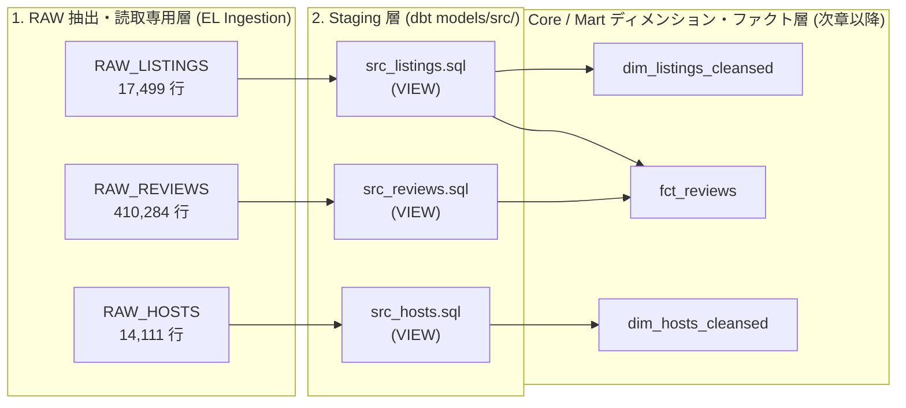
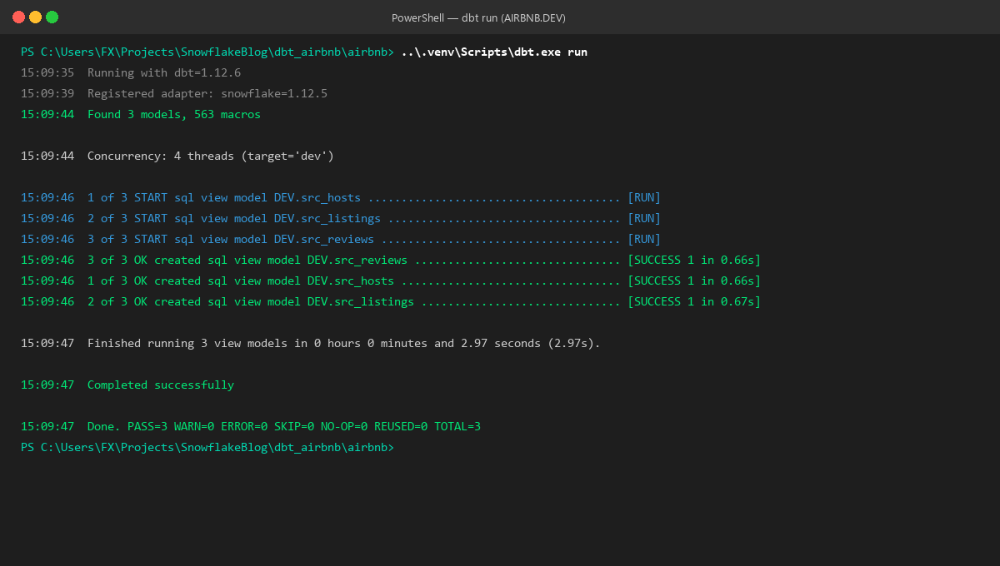
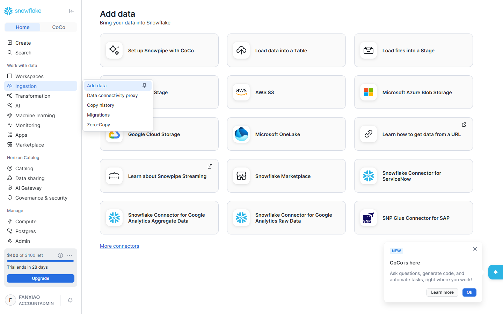
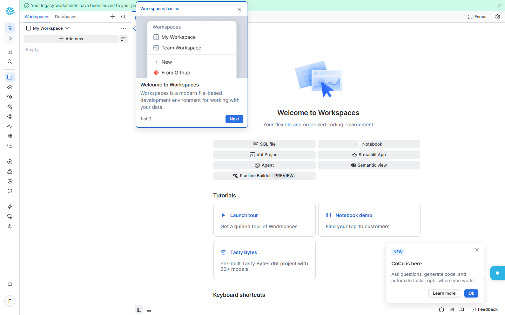

# 第 03 章：dbt モデル基礎と Staging 層の実装 —— CTE 規約・初回モデル構築と dbt run の内部動作

> 本章は **《尚硅谷技術講義執筆規約 (shangguigu-style)》** に準拠して執筆されています：本質直結・業務ノイズ排除の純粋技術フォーカス・実機出力付きの完全再現・落とし穴への事前警告・暗黙の前提ゼロ。

---

## 導入：本質直結、極小メンタルモデル

従来型のデータウェアハウス（DWH）やデータベース開発において、データエンジニアはクレンジング処理のために何百行にも及ぶストアドプロシージャ（Stored Procedures）を記述するか、データベース内で複雑な `CREATE VIEW AS ...` 文を手動実行せざるを得ませんでした。これには致命的な課題が存在します：
1. **ブラックボックス化とバージョン管理の欠如**：プロシージャが DB 内部に散乱し、Git を通じたコードレビューや協調開発が困難；
2. **DDL/DML との強い結合**：テーブルの作成（`CREATE TABLE`）、データ更新（`INSERT/UPDATE`）、クリーンアップ（`DROP/TRUNCATE`）を手動管理する必要があり、トランザクション未コミットや権限設定ミスによる障害が多発；
3. **多重ネストのサブクエリ地獄（Spaghetti Subqueries）**：複雑な SQL が 5〜8 層の `(SELECT ... (SELECT ...))` で深くネストされ、可読性とデバッグ効率が極端に低下。

**dbt（data build tool）はこの旧来アプローチを完全に刷新し、極めてシンプルな設計思想を提唱しました**：
> **「Everything is a SELECT」 —— 開発者はデータの抽出・加工を行う純粋な `SELECT` 文の記述だけに集中し、すべての DDL、DML、および Snowflake 内でのテーブル/ビューの作成・マテリアライズは dbt が自動的に制御します！**

### 極小明快な比較：従来型 DWH 開発 vs dbt 現代分析エンジニアリング

```
【アプローチ A：従来型 DWH 開発（煩雑・密結合・ブラックボックス）】
  開発者が複雑なスクリプトを記述 ──> 手動で DDL を実行 ──> トランザクション/カーソルを手動管理 ──> DB 内部に散乱
                                        ▲ 構文ミスや権限エラーが多発
                                        ▲ 環境分離（Dev / Prod）の自動化が困難

【アプローチ B：dbt 現代分析エンジニアリング（純粋・モジュール化・Git 管理）】
  ┌────────────────────────────────────────────────────────────────────────┐
  │ 開発者ディレクトリ: models/src/src_listings.sql                        │
  │                                                                        │
  │   WITH raw_listings AS (                                               │
  │       SELECT * FROM AIRBNB.RAW.RAW_LISTINGS                            │
  │   )                                                                    │
  │   SELECT id AS listing_id, name AS listing_name ... FROM raw_listings  │
  └───────────────────────────────────┬────────────────────────────────────┘
                                      │ コマンド 1 つで実行: dbt run
                                      ▼
  ┌────────────────────────────────────────────────────────────────────────┐
  │ Snowflake 内で自動コンパイル・マテリアライズ (Snowflake Warehouse)     │
  │                                                                        │
  │   CREATE OR REPLACE VIEW AIRBNB.DEV.SRC_LISTINGS AS ( ... );           │
  │   • 依存関係グラフ（DAG）の自動解決                                    │
  │   • ターゲット環境の自動分離（AIRBNB.DEV vs AIRBNB.PROD）              │
  │   • マルチスレッドによる並行ビルドとオブジェクト反映                   │
  └────────────────────────────────────────────────────────────────────────┘
```

- **本章の核心的問い**：
  1. dbt の「モデル（Model）」とは何か？通常の `.sql` ファイルと何が本質的に異なるのか？
  2. なぜ現代の分析エンジニアリングでは CTE（共通テーブル式）が強く推奨されるのか？標準的な CTE の構成はどう書くべきか？
  3. DWH アーキテクチャにおける Staging（ステージング）層とは何か？なぜデフォルトで純粋ビュー（View）としてマテリアライズするのか？
  4. `dbt run` 実行時、バックグラウンドで Snowflake にどのようなネイティブ SQL が送信されているのか？
- **本章のゴール**：業務固有のノイズを完全に排し、CTE を駆使して Airbnb 3 大ソーステーブルの Staging 層モデルを構築し、Snowflake 実環境で `dbt run` によるエンドツーエンド検証を完遂します！

> 📖 **公式ドキュメントリファレンス**：
> - [dbt 公式モデル概要 (Models Overview)](https://docs.getdbt.com/docs/build/models)
> - [dbt 公式 Staging 層設計規約 (How we structure our dbt projects)](https://docs.getdbt.com/best-practices/how-we-structure/2-staging)
> - [dbt CLI リファレンス (dbt run Command Reference)](https://docs.getdbt.com/reference/commands/run)

---

## 一、前提条件と環境準備 (Prerequisites)

ハンズオンを開始する前に、第 02 章で構築したインフラ基盤が正常に稼働していることを確認します：

| コンポーネント | 仕様 / ステータス | 検証コマンド | 役割と説明 |
| :--- | :--- | :--- | :--- |
| **Snowflake データベース** | `AIRBNB.RAW` | 第 02 章で構築完了 | 未加工のソース 3 テーブル（44.1 万レコード）を格納 |
| **ターゲット Schema** | `AIRBNB.DEV` | 第 02 章で構築完了 | dbt 開発者専用サンドボックス。生成されたモデルがここに配備 |
| **専用サービスロール** | `TRANSFORM` | 第 02 章で構築完了 | `AIRBNB.RAW` への読み取り権限と `AIRBNB.DEV` の所有権を保持 |
| **ローカル Python 環境** | `dbt_airbnb/.venv` | `uv` 仮想環境を有効化 | `dbt-snowflake`（v1.12.5 / dbt 2.x CLI）を内包 |
| **疎通性検証** | `dbt debug` で全項目緑 | `All checks passed!` | RSA 2048 キーペア認証が正常動作していることを保証 |

```bash
# プロジェクトディレクトリへ移動し、接続テストを実施
cd c:\Users\FX\Projects\SnowflakeBlog\dbt_airbnb\airbnb
..\.venv\Scripts\dbt.exe debug
```

---

## 二、技術アーキテクチャ：Staging 層の役割と CTE 規約

### 1. DWH レイヤリング設計：なぜ最初のステップは必ず Staging（`src_`）なのか？

統制されたエンタープライズ DWH において、生データ抽出層（Raw）から最終レポート（Mart）へ直接データを流し込むことは厳禁です。標準的なレイヤリング設計は以下の通りです：



#### Staging 層の 3 大鉄則：
1. **1:1 ソーステーブルマッピング**：1 つのソーステーブルに対して対応する `src_` モデルは厳密に 1 つです。**Staging 層で複数テーブルの JOIN を行うことは絶対に禁止**です！
2. **軽量なアトミッククレンジング**：カラムのリネーム（曖昧な `id` $\rightarrow$ `listing_id`）、データ型の明示的な明確化（文字列価格を `price_str` と命名）に特化します；
3. **デフォルトは純粋ビュー（View）マテリアライズ**：Staging モデルは Snowflake 上でビューとしてのみ存在するため、**追加のストレージコストはゼロ、データの同期遅延もゼロ**であり、常に最新の生データを反映します。

---

### 2. 分析エンジニアリングの礎：CTE（共通テーブル式）の記述哲学

#### CTE とは何か？
CTE（Common Table Expressions）は `WITH cte_name AS (...)` 構文で定義されます。クエリ実行中にデータベースエンジンがメモリ上に保持する**一時的な名前付き結果セット**であり、スコープはその SQL 実行時のみに限定されます。

#### なぜ多重ネストのサブクエリ（Subqueries）を使わないのか？
- **ネストされたサブクエリ（アンチパターン）**：
  ```sql
  -- 最内層から外側へタマネギ状に広がるため、可読性と保守性が著しく低い
  SELECT listing_id, listing_name, price_str
  FROM (
      SELECT id AS listing_id, name AS listing_name, price AS price_str
      FROM (
          SELECT * FROM AIRBNB.RAW.RAW_LISTINGS WHERE id IS NOT NULL
      )
  );
  ```
- **モジュール化された CTE（モダンエンジニアリング標準）**：
  ```sql
  -- 上から下へ一方向のデータフロー。ロジックが各ブロックで綺麗に独立
  WITH raw_listings AS (
      SELECT * FROM AIRBNB.RAW.RAW_LISTINGS
  )
  SELECT
      id AS listing_id,
      name AS listing_name,
      price AS price_str
  FROM
      raw_listings;
  ```

#### CTE vs View の本質的違い：
| 比較項目 | CTE (共通テーブル式) | Database View (データベースビュー) |
| :--- | :--- | :--- |
| **格納領域** | 仮想ウェアハウスのメモリ（RAM） | DWH のメタデータカタログ（Data Catalog） |
| **ライフサイクル** | 単一 SQL クエリ終了と同時に自動破棄 | 明示的に `DROP` されるまで永続保持 |
| **アクセス権限** | 親クエリの権限に依存（個別権限不要） | オブジェクトとして独立した `SELECT` 権限が必要 |
| **メンテナンス性** | **運用負荷ゼロ**（コード内完結） | DDL の変更管理が必要、スキーマドリフトのリスクあり |

---

## 三、ハンズオン実装：Staging モデル構築の 3 ステップ

### Step 0: サンプルファイルの削除と `dbt_project.yml` の設定

`dbt init` で生成された初期プロジェクトにはサンプルの `models/example/` ディレクトリが含まれているため、本番実装前に整理します：

1. **不要ディレクトリの削除**：
   `models/example/` フォルダ（および内包される `my_first_dbt_model.sql`, `my_second_dbt_model.sql`）を削除します。
2. **Staging 専用ディレクトリの作成**：
   `models/` 直下に `src/` フォルダを新規作成します：
   ```text
   airbnb/
   └── models/
       └── src/       <-- 1:1 対応のステージングモデルを格納
   ```
3. **`dbt_project.yml` のマテリアライゼーション設定**：
   `dbt_project.yml` 末尾の `models:` セクションを編集し、プロジェクト全体でデフォルト View マテリアライズを適用します：
   ```yaml
   # ==============================================================================
   # ファイル名: dbt_project.yml
   # 目的: airbnb プロジェクトの全モデルをデフォルトで View としてビルド
   # ==============================================================================
   models:
     airbnb:
       # + を付与することで models/ 配下の全サブディレクトリへ再帰的に適用
       +materialized: view
   ```

---

### Step 1: リスティング基礎ステージングモデルの作成 (`src_listings.sql`)

`models/src/` 配下に `src_listings.sql` を新規作成します：

```sql
-- ==============================================================================
-- モデル名: models/src/src_listings.sql
-- ソーステーブル: AIRBNB.RAW.RAW_LISTINGS
-- マテリアライゼーション: VIEW（ビュー）
-- 変換内容:
--   1. id -> listing_id（他テーブルとの混同を防止）
--   2. name -> listing_name
--   3. price -> price_str（通貨記号を含む文字列であることを明示し、後続層で数値化）
-- ==============================================================================
WITH raw_listings AS (
    SELECT
        *
    FROM
        AIRBNB.RAW.RAW_LISTINGS
)
SELECT
    id AS listing_id,
    name AS listing_name,
    listing_url,
    room_type,
    minimum_nights,
    host_id,
    price AS price_str,
    created_at,
    updated_at
FROM
    raw_listings
```

---

### Step 2: レビュー履歴ステージングモデルの作成 (`src_reviews.sql`)

`models/src/` 配下に `src_reviews.sql` を新規作成します：

```sql
-- ==============================================================================
-- モデル名: models/src/src_reviews.sql
-- ソーステーブル: AIRBNB.RAW.RAW_REVIEWS
-- マテリアライゼーション: VIEW（ビュー）
-- 変換内容:
--   1. date -> review_date（SQL 予約語 DATE との競合を回避）
--   2. comments -> review_text
--   3. sentiment -> review_sentiment
-- ==============================================================================
WITH raw_reviews AS (
    SELECT
        *
    FROM
        AIRBNB.RAW.RAW_REVIEWS
)
SELECT
    listing_id,
    date AS review_date,
    reviewer_name,
    comments AS review_text,
    sentiment AS review_sentiment
FROM
    raw_reviews
```

---

### Step 3: ホストディメンションステージングモデルの実装 (`src_hosts.sql`)

`models/src/` 配下に `src_hosts.sql` を新規作成します：

```sql
-- ==============================================================================
-- モデル名: models/src/src_hosts.sql
-- ソーステーブル: AIRBNB.RAW.RAW_HOSTS
-- マテリアライゼーション: VIEW（ビュー）
-- 変換内容:
--   1. id -> host_id（ホストの一意識別子として標準化）
--   2. name -> host_name
-- ==============================================================================
WITH raw_hosts AS (
    SELECT
        *
    FROM
        AIRBNB.RAW.RAW_HOSTS
)
SELECT
    id AS host_id,
    name AS host_name,
    is_superhost,
    created_at,
    updated_at
FROM
    raw_hosts
```

---

## 四、ビルド実行：`dbt run` の実機動作と完全サイクル

### 1. 実行コマンド

ターミナルで `airbnb` プロジェクトルートに位置していることを確認し、`dbt run` を実行します：

```bash
# モデルのコンパイルと Snowflake へのマテリアライズを実行
..\.venv\Scripts\dbt.exe run
```

### 2. 実際のターミナル実行ログ

実行すると、dbt は自動的に 4 スレッドの並行処理で Snowflake と TLS 接続を確立し、ビューのビルドを順次完了します：

```text
15:09:35  Running with dbt=1.12.6
15:09:39  Registered adapter: snowflake=1.12.5
15:09:44  Found 3 models, 563 macros

15:09:44  Concurrency: 4 threads (target='dev')

15:09:46  1 of 3 START sql view model DEV.src_hosts ...................................... [RUN]
15:09:46  2 of 3 START sql view model DEV.src_listings ................................... [RUN]
15:09:46  3 of 3 START sql view model DEV.src_reviews .................................... [RUN]
15:09:46  3 of 3 OK created sql view model DEV.src_reviews ............................... [SUCCESS 1 in 0.66s]
15:09:46  1 of 3 OK created sql view model DEV.src_hosts ................................. [SUCCESS 1 in 0.66s]
15:09:46  2 of 3 OK created sql view model DEV.src_listings .............................. [SUCCESS 1 in 0.67s]

15:09:47  Finished running 3 view models in 0 hours 0 minutes and 2.97 seconds (2.97s).

15:09:47  Completed successfully

15:09:47  Done. PASS=3 WARN=0 ERROR=0 SKIP=0 NO-OP=0 REUSED=0 TOTAL=3
```

> **ターミナル実行結果の実機スクリーンショット**：
>
> 
> *図 3.1：dbt が 3 つの Staging モデルを並行処理でビルドし、Snowflake にビューを正常作成（実行時間 2.97 秒）*

---

### 3. 深層解析：`dbt run` の裏側で何が起きていたのか？

プロジェクト配下の `target/run/airbnb/models/src/src_listings.sql` を確認すると、dbt が Snowflake に送信した生のネイティブ SQL が記録されています：

```sql
create or replace view AIRBNB.DEV.src_listings as (
    WITH raw_listings AS (
        SELECT
            *
        FROM
            AIRBNB.RAW.RAW_LISTINGS
    )
    SELECT
        id AS listing_id,
        name AS listing_name,
        listing_url,
        room_type,
        minimum_nights,
        host_id,
        price AS price_str,
        created_at,
        updated_at
    FROM
        raw_listings
);
```
- **核心的結論**：開発者は `CREATE OR REPLACE VIEW` を一切記述せず、ターゲットスキーマ（`AIRBNB.DEV`）をコード内にハードコードする必要もありません。dbt のアダプタエンジンが純粋な `SELECT` 文を解析し、Snowflake に最適化されたネイティブ DDL として自動発行します！

---

## 五、Snowflake 内部でのデータ検証とオブジェクト監査

Snowflake Snowsight コンソールを開き、`AIRBNB.DEV` スキーマを検証します：

### 1. ビューメタデータの確認（Views タブ）

**Data $\rightarrow$ Databases $\rightarrow$ AIRBNB $\rightarrow$ DEV $\rightarrow$ Views** を確認します：
`TRANSFORM` ロールによって作成された 3 つの新しいビューが正常に登録されています：


*図 3.2：dbt によって自動生成された SRC_HOSTS, SRC_LISTINGS, SRC_REVIEWS のビューオブジェクト*

---

### 2. Worksheet でのクエリ突合確認

Worksheet から直接クエリを実行し、レコード件数とリネーム後のカラム定義を突き合わせます：

```sql
-- 1. リスティングステージングの確認 (17,499 行)
SELECT * FROM AIRBNB.DEV.SRC_LISTINGS LIMIT 10;

-- 2. ホストステージングの確認 (14,111 行)
SELECT * FROM AIRBNB.DEV.SRC_HOSTS LIMIT 10;

-- 3. レビュー履歴ステージングの確認 (410,284 行)
SELECT * FROM AIRBNB.DEV.SRC_REVIEWS LIMIT 10;
```

> **Snowsight インタラクティブクエリ実行画面**：
>
> 
> *図 3.3：Worksheet 上で SRC_LISTINGS のカラムが LISTING_ID, LISTING_NAME, PRICE_STR に統一されていることを確認*

---

## 六、本番トラブルシューティングとベストプラクティス

### 1. 【暗坑 1】：`dbt_project.yml` における `+` プレフィックスの欠落警告
- **現象**：古い記法を用いた場合、ターミナルに `[WARNING][MissingPlusPrefixDeprecation]` が出力されます。
- **原因**：`dbt_project.yml` から各モデルへ属性値を継承させる際、ディレクトリ名（パス）と設定キー（プロパティ）を明確に区別するため、設定項目には必ず `+`（例：`+materialized: view`）を付与する必要があります。
- **回避策**：
  ```yaml
  models:
    airbnb:
      +materialized: view   # 正解：設定プロパティであることを明示
      # materialized: view  # 不正解：materialized という名称のサブフォルダと誤認される
  ```

---

### 2. 【暗坑 2】：なぜ `RAW` は読取専用で、`DEV` はオーナー権限なのか？
- **現象**：特権を持つ `ACCOUNTADMIN` で直接 dbt を実行した場合、検証時は動きますが、本番の CI/CD パイプラインに移行した途端に権限エラーで停止します。
- **メカニズム**：第 02 章で策定したセキュリティマトリクスに基づきます：
  - `AIRBNB.RAW` はデータ取込（EL）フェーズの成果物であり、`TRANSFORM` ロールには **`SELECT` 権限のみ** が付与されています。これにより、dbt の誤操作によって元データが削除・改変される事故を物理的に遮断します；
  - `AIRBNB.DEV` のオーナーは `TRANSFORM` ロール自身であるため、モデルの作成・置換・削除が自由に行えます。

---

### 3. 【暗坑 3】：VitePress / ドキュメントシステムにおける Jinja 二重中括弧の衝突
- **現象**：マークダウンや技術ブログ内で Jinja の波括弧構文（`config(materialized='view')` など）をエスケープなしで記述すると、VitePress の Vue コンパイラが変数バインディングと誤認し、ビルドが異常終了します。
- **回避策**：文書内で Jinja を表現する際は、HTML エンティティ `&#123;&#123;` および `&#125;&#125;` を使用して安全に出力します。

---

## 七、復習クイズと解説（Models Quiz）

> 💡 **理解度チェック（Models Quiz より抜粋）**：
>
> **設問**：dbt モデルをデータウェアハウス上に実際にマテリアライズ（物理反映）する CLI コマンドはどれですか？
> - A. `dbt init`
> - B. `dbt run`
> - C. `dbt debug`
>
> **解説**：
> - **選択肢 A (`dbt init`) は不正解**：ローカルディスク上に dbt プロジェクトの初期ディレクトリ構造（`models/`, `macros/`, `dbt_project.yml` など）を展開するコマンドであり、DWH への接続や SQL の発行は行いません。
> - **選択肢 B (`dbt run`) は正解**：dbt の中心的な実行コマンドです。プロジェクト内の依存グラフ（DAG）を解析し、各モデルの `SELECT` 文を Snowflake 向けのネイティブ DDL/DML にコンパイルして並行実行します。
> - **選択肢 C (`dbt debug`) は不正解**：環境診断コマンドです（Python 依存関係、Git、`profiles.yml` の記述、DWH との接続確認）。モデルのビルド機能はありません。

---

## 八、本章のまとめと次章予告

本章では、dbt の最も重要な基礎体力を習得しました：
1. **「Everything is a SELECT」** の設計思想を理解し、手動 DDL 運用の呪縛から解放されました；
2. **CTE（共通テーブル式）** によるモジュール化された、保守性の高いクエリ記述規約を確立しました；
3. Airbnb DWH の **Staging 層（`src_listings`, `src_reviews`, `src_hosts`）** を正しく構築しました；
4. **`dbt run`** を実行し、Snowflake 上で 3 つのビューオブジェクトと実レコード件数を検証しました。

**次回（第 04 章）では**、Staging 層からさらに進み、ビジネスコアを担うディメンション層へ突入します：**dbt の 4 大マテリアライゼーション比較（View vs Table vs Incremental 差分更新 vs Ephemeral 一時CTE）** を徹底解剖し、`dim_listings_cleansed` の実装と `&#123;&#123; ref(...) &#125;&#125;` 参照マクロによる DAG 連携を解放します！

