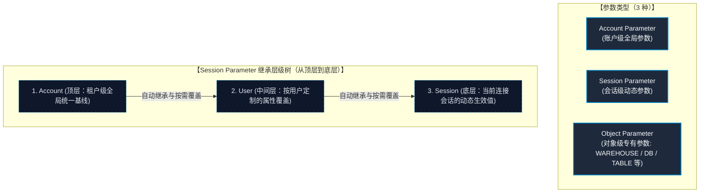
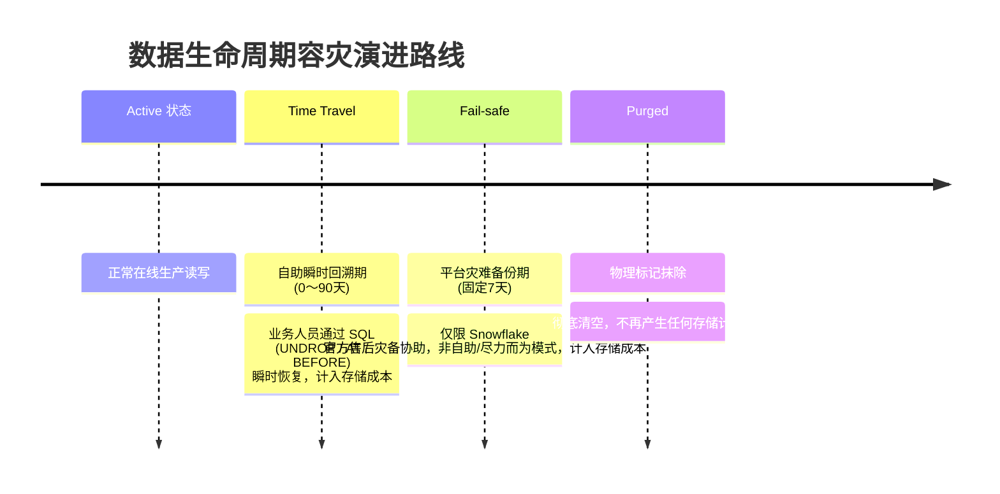

# 第 00 章：项目背景、架构设计与业务数据模型

## 1. 业务背景 (Business Case)

银行证券作为传统老牌金融机构，面临以下数字化转型挑战：
1. **本地 Oracle 扩容瓶颈**：随着量化交易与多品种投资激增，原有基于本地 Oracle 11g 数据库的计算与存储出现性能瓶颈，报表汇总耗时冗长。
2. **多租户与隔离合规诉求**：项目管理员、数据工程师、业务分析师对数据的访问权责必须严格分离，急需实现“存算分离、秒级弹性扩缩容、成本透明化管控”。
3. **云原生数据安全底座**：在推进上云过程中，严格遵循日本金融厅 (FSA) 监管要求，确保数据驻留东京境内，全链路具备细粒度 RBAC 权限隔离、不可篡改的时间旅行 (Time Travel) 与数据审计能力。

---

## 2. 产品与服务概要 (Product Architecture)

Snowflake 是一套云原生数据仓库（Cloud-native DWH），具备极高的弹性伸缩能力、超高速查询性能以及运维极简的现代化数据云平台，其核心技术支柱包括：

### (1) 存储与计算彻底分离 (Separation of Storage and Compute)
数据持久化存储（Storage）与 SQL 解析执行引擎（Compute）完全解耦。可根据业务波峰波谷独立弹性扩缩计算资源，实现金融级成本最优化。

### (2) 自动微分区机制 (Micro-partitioning)
底层数据由系统全自动按列切分为细粒度的微分区（Micro-partitions），无需 DBA 手动维护物理分区索引，在大幅降低运维负担的同时极大提升剪裁与点查速度。

### (3) 时间旅行与零拷贝克隆 (Time Travel & Zero-copy Cloning)
支持指定时间戳回溯历史快照，实现误操作毫秒级数据复原；配合 Zero-copy Clone 能够在不产生额外存储成本的前提下秒级克隆生产数据集，供量化建模与沙箱验证。

---

## 3. 计费体系与成本测算模型 (Pricing & Cost Simulation)

Snowflake 采用订阅制形式，基于“按实际用量计费（Pay-as-you-go）”模型，核心成本由**三大计费要素（计算、存储、数据传输）**构成：

### (1) 核心计费三大要素

1. **计算资源（Computing / 虚拟仓库）**：  
   使用虚拟仓库（WAREHOUSE）执行 SQL 查询、跑批或执行 `COPY INTO` 时消耗算力点数。
   - **计费单位**：Snowflake 内部将算力定义为 **Credit（点数）**；
   - **算力换算基准**：**XS 规格运行 1 小时精确消耗 1 个 Credit**；
   - **成本占比**：计算资源是日常数仓运行中开销最大的部分（通常占总账单的 70%~80%）；
   - **单价确定规则**：1 个 Credit 的单价由 **底层云厂商（AWS） × 区域（Tokyo: `ap-northeast-1`） × 软件版本（Enterprise）** 交叉唯一定位（企业版东京区参考单价约 $5.7/Credit）。

2. **存储资源（Storage / 数据持久化）**：  
   针对加载到数仓并经高度压缩后的实际数据体积（按 TB/月计费，如约 $25/TB/月）。

3. **数据传输资源（Data Transfer / 跨区网络下行）**：  
   跨不同云厂商或跨不同机房区域（如往异地容灾机房传输归档）时的网络外发流量（如约 $90/TB）。

---

### (2) 💡 Snowflake 生产级成本测算实操案例（月度仿真）

以下是模拟银行证券初期迁移与稳态运行环境下的月度成本核算模型：

#### ＜测算前提条件＞
- **计算资源**：虚拟仓库（WAREHOUSE）规格为 **XS**，每个工作日运行 **2 小时**（按每月 20 个营业日计算）。
- **存储资源**：核心交易流水与历史数据累计沉淀占用 **4 TB** 压缩存储。
- **数据传输**：满足金融异地容灾（DR）合规诉求，**每月 1 次将 2 TB 增量数据跨区域传输至大阪机房**的异地保管环境。

#### ＜分项明细核算表＞

| 成本维度 | 计算公式 / 测算逻辑 | 月度费用 (USD) |
| :--- | :--- | :--- |
| **计算资源 (Compute)** | 仓库每小时消耗 Credit × 日均运行小时 × 营业天数<br>＝ 1 × 2 × 20 ＝ **40 Credits**<br>∴ 40 Credits × **$5.7**（企业版单价） | **$228** |
| **存储资源 (Storage)** | TB 存储单价 × 实际数据量<br>＝ $25 × 4 TB | **$100** |
| **数据传输 (Data Transfer)** | 跨区传输单价 × 传输量<br>＝ $90 × 2 TB | **$180** |
| **月度总消费支出** | **$228 ＋ $100 ＋ $180** | **$508 / 月** |

> [!TIP]
> **金融级降本关键秘诀**：  
> 必须开启计算仓库的自动挂起（`AUTO_SUSPEND = 300`），无任务 5 分钟后自动停机、有新查询毫秒级唤醒，彻底根绝空闲浪费！

---

## 4. 总体迁移架构设计

```text
[本地数据中心 (Tokyo On-Prem)]             [Snowflake Cloud Data Platform (AWS Tokyo)]
 ┌─────────────────────────┐               ┌─────────────────────────────────────────┐
 │   Oracle Database 11g   │               │            MITSUI_SEC_DB                │
 │ ┌─────────────────────┐ │               │  ┌───────────────────────────────────┐  │
 │ │  CUST_TRADE_DETAIL  │ │               │  │ SCHEMA: RAW_ORACLE                │  │
 │ │  (顧客取引明細)     │ │               │  │   ┌─────────────────────────────┐ │  │
 │ └──────────┬──────────┘ │               │  │   │  CUST_TRADE_DETAIL (落地表) │ │  │
 └────────────┼────────────┘               │  │   └──────────────▲──────────────┘ │  │
              │                            │  │                  │ (COPY INTO)    │  │
              ▼ [Gzip CSV / TLS 1.3]       │  │   ┌──────────────┴──────────────┐ │  │
       ┌──────────────┐                    │  │   │ @MITSUI_STAGE               │ │  │
       │ SnowSQL PUT  ├───────────────────┼──┼──►│ (内部受控受保阶段)          │ │  │
       └──────────────┘                    │  │   └─────────────────────────────┘ │  │
                                           │  └───────────────────────────────────┘  │
                                           │                                         │
                                           │  ┌───────────────────────────────────┐  │
                                           │  │ Virtual Warehouse:                │  │
                                           │  │ MITSUI_WH (X-Small 弹性自动挂起)  │  │
                                           │  └───────────────────────────────────┘  │
                                           └─────────────────────────────────────────┘
```

---

## 5. 核心表结构映射设计 (CUST_TRADE_DETAIL)

| 字段名称 | 业务含义 | Oracle 数据类型 | Snowflake 数据类型 | 转换规则与设计考量 |
| :--- | :--- | :--- | :--- | :--- |
| `TRADE_QTY` | 取引数量 | `NUMBER(15)` | `NUMBER(15, 0)` | 整数株数，默认值 0，非空 |
| `AMOUNT_JPY` | 约定金额（日元） | `NUMBER(18, 3)` | `NUMBER(18, 3)` | 统一保留3位小数，默认值 0，非空 |
| `AMOUNT_FCY` | 约定金额（外币） | `NUMBER(18, 3)` | `NUMBER(18, 3)` | 外币金额，与货币代码成对定义 |
| `CCY_CODE` | 货币代码 | `VARCHAR2(3)` | `VARCHAR(3)` | 通货区分，如 USD, EUR, IDR |
| `EXCHANGE_RATE`| 外汇兑换汇率 | `NUMBER(9, 6)` | `NUMBER(9, 6)` | 高精度汇率小数（6位小数） |
| `REMARKS` | 摘要・备注 | `VARCHAR2(100 CHAR)`| `VARCHAR(100)` | 采用 CHAR 语义，杜绝全角日文字符超长报错 |
| `CUST_ID` | 客户识别代码 | `VARCHAR2(10 CHAR)` | `VARCHAR(10)` | 客户管理系统 10 位固定长度，非空 |
| `TRADE_TYPE_CD`| 交易区分 | `VARCHAR2(2 CHAR)` | `VARCHAR(2)` | '01'=买付, '02'=卖付, '03'=月次等 |
| `BRANCH_CD` | 支店代码 | `VARCHAR2(4 CHAR)` | `VARCHAR(4)` | 4 位营业网点代码 |
| `TRADE_DATE` | 约定日（日次） | `DATE` | `VARCHAR(8)` | 业务要求转为 `YYYYMMDD` 纯数字格式 |
| `SETTLE_MONTH` | 结算月份 | `DATE` | `VARCHAR(6)` | 业务要求转为 `YYYYMM` 格式 |
| `REG_DATETIME` | 记录登入时间 | `DATE` (含时分秒) | `TIMESTAMP_NTZ(6)` | 消除时区漂移，保留至微秒级别 |
| `UPD_DATETIME` | 记录更新时间 | `DATE` | `TIMESTAMP_NTZ(6)` | 可空更新时间戳 |
| `MIGRATED_AT` | 同步迁移入库时间 | - | `TIMESTAMP_LTZ(6)` | Snowflake 专属落地审计追踪时间 |

---

## 6. Oracle → Snowflake 类型推测与建模方针（8 大关键设计规则）

在金融数仓迁移中，类型推测不仅是技术语法映射，更是保障跨系统对账 100% 吻合的规范准绳。本项目提炼了以下 **8 大核心设计方针**：

### ① 数值信息（一般数值）
- **变更前 Oracle**：`NUMBER(15)`（模拟数据：`123456789012345`）  
  *痛点说明*：Oracle 中不指定小数位的 `NUMBER` 可存整数也可存浮点，精度不固定，易产生业务歧义。
- **变更后 Snowflake**：`NUMBER(15, 0)`（模拟数据：`123456789012345`）  
  *设计方针*：明确固定为 15 位整数、0 位小数，初期值统一设定为 0，彻底消除类型模糊性。

### ② 金额（本币・邦货）
- **变更前 Oracle**：`NUMBER(18, 3)` 或 `NUMBER`（不定精度）（模拟数据：`1234567890123.456`）  
  *痛点说明*：各上游来源系统对金额定义不一（有的 2 位小数、有的 3 位）。
- **变更后 Snowflake**：`NUMBER(18, 3)`（模拟数据：`1234567890123.456`）  
  *设计方针*：统一强制为 `Number(18, 3)`，**无论来源端是几位小数，全量清洗对齐**，彻底消除精度不一致隐患。

### ③ 金额（外币）
- **变更前 Oracle**：`NUMBER(18, 3)` + 单独的货币代码字段（命名各异，如 `CURRENCY_CD` / `CCY`）（模拟数据：`9876.500` / `USD`）
- **变更后 Snowflake**：`NUMBER(18, 3)` + 「货币区分」字段成对定义（模拟数据：`9876.500` / `USD`）  
  *设计方针*：明确外币金额字段必须与货币区分字段成对建立，强化表结构之间的高内聚性。

### ④ 汇率／比率
- **变更前 Oracle**：`NUMBER(9, 6)` 或精度不定（模拟数据：`1.234567`）
- **变更后 Snowflake**：`NUMBER(9, 6)`（模拟数据：`1.234567`）  
  *设计方针*：统一固定为 9 位总宽、6 位小数，确保多币种换算时的精度绝对一致。

### ⑤ 文字信息（一般字符）
- **变更前 Oracle**：`VARCHAR2(100 BYTE)` 或 `VARCHAR2(100 CHAR)`（模拟数据：`"サンプルテキスト"`）  
  *痛点说明*：Oracle 中 BYTE / CHAR 语义混用，在 UTF-8 下日文全角占用 3 字节，导致 100 字节字段只能装 33 个日文字符，极易引发 `ORA-12899` 溢出。
- **变更后 Snowflake**：`VARCHAR(100)`（模拟数据：`"サンプルテキスト"`）  
  *设计方针*：Snowflake 的 `VARCHAR` **默认按字符数（而非字节）计数**，统一为 100 字符，初期值设为半角空格 1 位，化繁为简。

### ⑥ 文字信息（参照来源位数已确定／ID、区分类）
- **变更前 Oracle**：`VARCHAR2(n)` 定长或变长，各系统自定义（模拟数据：`"A001"`）
- **变更后 Snowflake**：`VARCHAR(n)`（模拟数据：`"A001"`）  
  *设计方针*：位数沿用来源系统的原始定义（如客户 ID 固定 10 位），不做统一改造（属于例外规则，不套用初期 100 字符标准）。

### ⑦ 日期信息 ★最核心的顶层设计决策
- **变更前 Oracle**：`DATE`（模拟数据：`2025-03-25`）或 `"20250325"` 字符型  
  *痛点说明*：Oracle 的原生 `DATE` 带有秒，且无法直接表示“只到月份（YYYYMM）”这类非完整日期。
- **变更后 Snowflake**：**`VARCHAR(8)` / `VARCHAR(6)`（字符串型存储）**（模拟数据：日次 `"20250325"` / 月次 `"202503"`）  
  *设计决策三大原因*：
  1. **包容不同日期粒度**：日次是“年月日”，结算月只到“年月”，原生 DATE 无法统一表示只到月的业务语义；
  2. **杜绝时区隐性差异**：避免 Snowflake 与 Oracle 因 Session 默认时区不同而导致跨系统数据对账报错；
  3. **直供下游消费**：与金融业务报送的标准格式完全吻合，便于数据核对与报表系统直接读取。

### ⑧ 时刻信息（系统登记／更新时间戳）
- **变更前 Oracle**：`DATE` 型（模拟数据：`2025-03-25 14:30:00.123456`）
- **变更后 Snowflake**：**`TIMESTAMP_NTZ(6)`**（模拟数据：`2025-03-25 14:30:00.123456`，格式 `YYYY-MM-DD HH24:MI:SS.FF6`）  
  *设计方针*：统一使用无时区墙上时钟 `TIMESTAMP_NTZ`，保留至微秒（FF6）精度，专用于数据行版本与审计追踪。  
  > 💡 **核心逻辑分野总结**：  
  > **业务日期（⑦）统一采用字符串 `VARCHAR` 保存**，而 **系统审计时间戳（⑧）统一采用原生 `TIMESTAMP_NTZ(6)` 保存**。这是银行证券迁移架构中最具工程辨识度的设计亮点！

---

## 7. Snowflake 核心受控对象清单 (Securable Objects)

在 Snowflake 体系中，“对象（Object）”是进行数据资产管理、安全授权与计算调度的基本构成要素。Snowflake 由丰富的对象层级构建而成，甚至各类安全与网络策略（Policy）也是作为一等公民的对象存在。

本项目与企业级管理基盘中涉及的核心对象及其规范说明如下：  
> [!NOTE]  
> 凡未在下表中列出的扩展对象，各业务系统部门应在自身被赋予的权限边界内，自行评估并按需决策使用。

| 序号 | 对象分类 | 对象名称 | 核心概念与功能说明 |
| :-: | :--- | :--- | :--- |
| **1** | **组织** | `ORGANIZATION` | Snowflake 最高管理层级，负责跨账户计费汇总、组织级账单管理及跨账户复制与故障转移（Failover）。 |
| **2** | **账户** | `ACCOUNT` | 独立租户实体，统管其下所有的数据库、用户、角色、计算仓库及安全策略。 |
| **3** | **网络规则** | `NETWORK RULE` | 将 IP 地址段、CIDR 或私网终端节点（VPC Endpoint）以逻辑单元进行归组定义的安全实体。 |
| **4** | **网络策略** | `NETWORK POLICY` | 引用 NETWORK RULE 规则，对访问 Snowflake 的客户端网络流量实施精确白名单准入与拦截。 |
| **5** | **认证策略** | `AUTHENTICATION POLICY` | 集中定义用户的登录认证方式（MFA 多因子认证、SSO 单点登录、Key-Pair 密钥对认证）与客户端类型控制。 |
| **6** | **密码策略** | `PASSWORD POLICY` | 强制管控账号密码的复杂度、过期失效周期、锁定阈值与历史复用限制，筑牢安全防线。 |
| **7** | **角色** | `ROLE` | 权限（Privilege）的容器，所有操作特权均赋予角色，再通过角色继承树（RBAC）赋权给用户。 |
| **8** | **用户** | `USER` | 实际连接 Snowflake 平台的技术服务账号或业务人员身份实体，持有凭据与默认上下文。 |
| **9** | **虚拟计算仓库** | `WAREHOUSE` | 提供 CPU 与内存算力的独立计算集群，专用于执行 SQL 查询、跑批与数据加载。 |
| **10** | **数据库** | `DATABASE` | Schema（架构）的顶层逻辑分组容器。 |
| **11** | **架构／模式** | `SCHEMA` | 表（Table）、视图（View）、阶段（Stage）等物理资产的逻辑分组容器。 |
| **12** | **表** | `TABLE` | 以行列结构持久化存储与管理数据的核心结构化资产对象。 |
| **13** | **视图** | `VIEW` | 基于特定查询逻辑构建的虚表，用于动态呈现数据并实现行级/列级安全视图脱敏。 |
| **14** | **故障转移组** | `FAILOVER GROUP` | 将核心对象及数据自动同步复制到异地跨云账户，强化金融级业务连续性与容灾（DR）。 |
| **15** | **数据共享** | `SHARE` | 安全跨账户零数据复制即时共享的核心对象（目前作为战略储备，正规划逐步向业务端开放）。 |
| **16** | **阶段／暂存区** | `STAGE` | 用于指向并管理内部存储或外部云存储（S3/Blob/GCS）中待加载数据文件命名的中间暂存区。 |
| **17** | **任务** | `TASK` | 支持按 Cron 表达式或父子依赖流水线自动调度执行 SQL/存储过程的批处理作业引擎。 |
| **18** | **存储过程** | `PROCEDURE` | 将复杂的多步事务与流转逻辑封装为一个独立可调用的过程实体（支持 SQL / Python / JavaScript）。 |
| **19** | **用户定义函数** | `FUNCTION` | 接收输入参数并返回标量值或表格结果的自定义函数（UDF / UDTF）。 |

---

## 8. Snowflake 参数体系与继承架构

Snowflake 具备一套完备的参数体系，用于灵活控制账户全局与各类底层资产对象的运行时行为。参数体系由 **3 种参数类型** 与 **多级层级继承树** 构成。



### 【参数类型】
* **Account Parameter（账户级参数）**：对整个 Snowflake 账户（租户）生效的顶层设定（如：默认的自动挂起时限 `AUTO_SUSPEND` 缺省值、全局绑定的网络策略 `NETWORK_POLICY` 等）。
* **Session Parameter（会话级参数）**：针对客户端连接会话生效的运行参数（如：时区 `TIMEZONE`、日期输出格式 `DATE_OUTPUT_FORMAT`、查询超时截断时长等）。
* **Object Parameter（对象级参数）**：针对特定受控实体（如虚拟计算仓库、数据库、Schema、数据表）所配置的专有参数（如：数据保留天数 `DATA_RETENTION_TIME_IN_DAYS`、仓库自动扩缩容阈值等）。

### 【继承层级与生效优先级】
以最为常用的 **Session Parameter（会话参数）** 为例，其内部严格由以下 **3 级层级结构** 组成：  
**Account 处于最顶层，Session 处于最底层**。当下层未显式配置时，将自动从上一层继承设定值；当下层进行了显式定义（如通过 `ALTER SESSION` 或用户配置）时，下层优先级最高，将直接覆盖（Override）上层基线。

1. **Account（最上层）**：全账户统一默认基线
2. **User（中间层）**：为特定运维/业务用户单独绑定的个性化设定
3. **Session（最下层）**：应用系统或运维人员在连接会话建立时动态执行生效的最终值

---

## 9. Snowflake 企业级安全合规体系

在金融级数据基础设施中，Snowflake 的安全防护由**“用户自定义设计范围（责任共担模型）”**与**“平台底层原生强制担保范围”**共同构成。  
由用户主导的 RBAC 角色拓扑、网络规则白名单、认证/密码策略等实战设计，详见后置章节；而由 Snowflake 基础设施层**自动强制担保**的核心安全基准如下：

| 防护领域 | Snowflake 原生安全机制 | 生产级技术指标与规范 |
| :--- | :--- | :--- |
| **(1) 认证与访问控制** | RBAC 细粒度模型 ＆ 强制 MFA | 采用业界成熟的基于角色访问控制体系（RBAC），严格遵循最小权限原则（PoLP）；对所有控制台人类交互账户强制启用多因子认证（MFA）。 |
| **(2) 静态数据落盘加密** | AES-256 ＆ 自动密钥轮转 | 平台内所有落盘数据无条件采用最高标准的 **AES-256** 强加密；采用分层密钥管理模型（Key Hierarchy），加密密钥**超过 30 天自动触发后台静默轮转**。 |
| **(3) 传输链路加密** | 强制 TLS ＆ 端到端加密 (E2EE) | 平台所有网络通信通道强制要求 **TLS 1.2+** 协议；从各客户端发起调用、传输直至云端存储介质，全链路实施端到端加密（E2EE），防止明文窥探。 |
| **(4) 权威合规认证** | 国际金融级安全认证全覆盖 | 原生通过 **SOC 2 Type II**、**ISO 27001**、**PCI-DSS**、**HIPAA** 等国际权威第三方法规与合规审计，满足金融核心系统极为严苛的合规监管要求。 |

---

## 10. Snowflake 高容灾与耐故障性架构 (Fault Tolerance)

为了保障证券生产级业务的连续性（BCP）与数据零丢失，Snowflake 底层提供了 **Time Travel（时间旅行）**、**Fail-safe（安全网容灾）** 与 **Zero-copy Clone（零拷贝克隆）** 三位一体的容灾体系。



### (1) Time Travel（时间旅行）
* **核心功能**：赋予用户随时回溯历史快照的能力，在数据误删除（`DROP TABLE`）或业务批量误更新时，无需传统冷备还原，直接通过 SQL 原生语法（如 `UNDROP`、`SELECT ... AT(TIMESTAMP => ...)`）秒级恢复数据。
* **保留时效**：默认保留周期为 **1 天（24 小时）**。可通过参数（`DATA_RETENTION_TIME_IN_DAYS`）按业务需求灵活配置为 **0 至 90 天**（*注：企业版 Enterprise 及以上版本支持配置到 90 天，标准版 Standard 最多支持 1 天*）。
* **成本权衡**：底层的微分区（Micro-partitions）以追加不可变方式保留历史版本，**保留时间越长，所占用的历史存储计费会相应增加**。

### (2) Fail-safe（安全网保底机制）
* **核心功能**：当数据超过 Time Travel 的保留时限后，Snowflake 基础设施会自动提供为期 **7 天（固定）** 的极端灾备恢复窗口。
* **运维关键戒律**：
  > [!WARNING]
  > Fail-safe 是 Snowflake 内部基础设施层提供的灾备底线，**绝不是面向最终用户的日常自助功能**！  
  > 触发 Fail-safe 恢复必须**向 Snowflake 官方技术支持提交紧急工单由工程师人工干预**。该服务采用**尽力而为（Best-effort）**原则，恢复过程通常需要耗费数天工期。因此，**金融系统在进行高可用架构设计时，必须将容灾重心置于 Time Travel 体系，严禁将 Fail-safe 视为主力应急手段**！

### (3) Zero-copy Clone（零拷贝即时克隆）
* **核心功能**：支持在秒级内快速克隆出表、Schema 乃至整个数据库对象，广泛应用于故障紧急快照备份、环境隔离与数据演练。
* **与 Time Travel 强强联合**：结合 Time Travel 语法，能够一键以“故障发生前 1 分钟”的历史快照直接生成全新的镜像克隆表（如 `CREATE TABLE backup_trade CLONE trade AT(OFFSET => -60)`）。
* **计费原理解密与成本极致优化**：
  * 克隆操作本质上仅是**复制元数据（Metadata 指针映射）**，直接共享已有的物理只读微分区，因此在克隆瞬间**不占用额外存储空间，产生 0 额外费用**！
  * 仅当在克隆出的新对象上执行写入或数据修改时，写时复制（Copy-on-write）机制才会分配全新的微分区，**用户仅为这部分写入的差量数据支付存储费用**。
  * 在每月结账、季度审计或重大版本发布前善用克隆制作快照，既能保障容灾秒级兜底，又能大幅压缩企业的云上存储开销。


