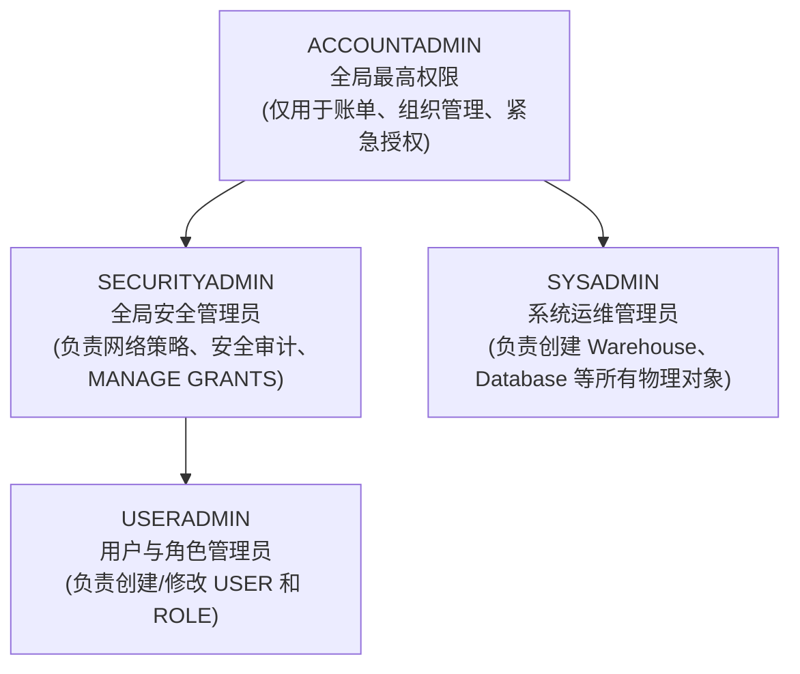

# 第 01 章：Snowflake 账号申请与初始化配置

作为金融企业（如银行证券）在进行云原生转型验证时，首要步骤是申请并初始化 Snowflake 30天免费企业级试用环境（包含 $400 计算额度）。

---

## 1. 账号申请入口与关键参数

访问官方注册入口：[https://signup.snowflake.com/](https://signup.snowflake.com/)

| 配置项 | 推荐选型 | 业务与合规考量 |
| :--- | :--- | :--- |
| **Snowflake Edition** | **Enterprise（企业版）** | 支持 **90天时间旅行 (Time Travel)**、**动态数据脱敏 (Data Masking)** 以及多集群仓储，这是金融级监管与合规审计的最低门槛。 |
| **Cloud Provider** | **AWS (Amazon Web Services)** | 日资券商在东京区域使用率最高的底层云之一，生态工具链完备。 |
| **Region (区域)** | **Asia Pacific (Tokyo) - `ap-northeast-1`** | **数据主权合规要求**：日本金融厅 (FSA) 要求核心客户交易数据常驻境内，且网络延迟极低。 |

---

## 2. 注册全流程步骤与界面指引

### 步骤 1：访问注册入口并填写基本信息
输入姓名、公司邮箱及职位信息：


### 步骤 2：选择版本与云厂商区域
选择 **Enterprise** 版本，底层选择 **AWS - Asia Pacific (Tokyo)**：


### 步骤 3：验证与激活邮件
提交后查收标题为 *"Activate your Snowflake account"* 的官方邮件，点击激活按钮：


### 步骤 4：设置管理员密码与首次登录
设置登录账号和安全强密码（初始具备 `ACCOUNTADMIN` 权限）：


---

## 3. Web 控制台语言设置（切换为日语）

为了符合日本业务现场的操作习惯，可将 Snowsight 控制台界面语言设置为日语：

1. 点击左下角或右上角个人 Profile 图标进入 **Preferences（首选项）**；
2. 在 **Language & Region** 中，将语言切换为 **日本語 (Japanese)**：


---

## 4. 账号系统预置角色体系认知



> [!CAUTION]
> **金融级安全军规**：日常运维与迁移绝不可使用 `ACCOUNTADMIN`。
> 必须遵循职责分离，使用 `USERADMIN` 统一管理人员角色生命周期，使用 `SYSADMIN` 管控计算与存储资源！

---

## 5. 🔐 金融企业级 MFA (多因素认证) 绑定实战

在日本金融机构（如银行、证券、NRI 等外包及合作体系）以及金融厅 FISC 安全基线要求下，**所有访问生产与验证环境的 Snowflake 控制台及特权账户，均被强制要求启用多因素认证（MFA / 2FA）**。

### 5.1 认证器（Authenticator）绑定流程
1. **进入设置界面**：在 Snowsight 界面点击个人 Profile，进入 **Preferences** $\to$ **Multi-Factor Authentication (MFA)**。
2. **选择认证器类型**：选择 **Authenticator App（TOTP 认证器）**。
3. **获取密钥字符串 (Secret Key)**：
   - 界面将展示二维码以及一串 Base32 编码的密钥字符串（如 `WQQC4ZYF...`）。
   - 可使用移动端 **Google Authenticator** / **Microsoft Authenticator** 扫码；或在受限开发机环境中下载运行开源 PC 端工具 [WinAuth](https://winauth.github.io/winauth/download.html)，导入该密钥字符串。
4. **验证与绑定**：在输入框内填入认证器实时生成的 6 位 TOTP 动态验证码，点击完成绑定。

### 5.2 初始密码安全策略（首登强制改密）
由管理员下发的企业用户（如 `MITSUI_ENGINEER_USER`）通常带有临时初始密码，并开启了强制改密策略（`MUST_CHANGE_PASSWORD = TRUE`）：
- 首次输入临时初始密码并通过 MFA 动态码后，系统会自动拦截并弹出密码修改弹窗；
- 输入符合复杂性要求（大写字母、小写字母、数字及特殊符号组合，长度 $\ge 12$ 位）的新密码后，方可完成身份确认进入工作台。

---

## 6. 🧪 首次登录后的基线权限与连通性验证 (Sanity Check)

登录进入 Snowsight 控制台后，建议数据工程师或分析师第一时间执行基础连通性与权限基线核查，确保账号上下文与环境预期一致：

```sql
-- 1. 查看当前账号被授予的角色清单
SHOW ROLES;

-- 2. 查看当前角色具备的细粒度特权
SHOW GRANTS OF ROLE MITSUI_ENGINEER;

-- 3. 验证数据库与 Schema 的可见性
SHOW DATABASES;
SHOW SCHEMAS;

-- 4. 切换上下文至项目环境
USE ROLE MITSUI_ENGINEER;
USE WAREHOUSE MITSUI_WH;
USE DATABASE MITSUI_SEC_DB;
USE SCHEMA RAW_ORACLE;

-- 5. 执行一次轻量级连通性读写验证（Sandbox 级别验证）
CREATE OR REPLACE TEMPORARY TABLE _SANITY_CHECK (
    CHECK_ID    INT,
    OPERATOR    VARCHAR(50),
    CHECKED_AT  TIMESTAMP_NTZ DEFAULT CURRENT_TIMESTAMP()
);

INSERT INTO _SANITY_CHECK (CHECK_ID, OPERATOR) VALUES (1, CURRENT_USER());

SELECT * FROM _SANITY_CHECK;

-- 验证完毕后清理临时对象
DROP TABLE IF EXISTS _SANITY_CHECK;
```

完成上述连通性验证后，即表明账号开通、MFA 认证及三井证券上下文配置均已就绪，可无缝进入后续的 Oracle 环境搭建与迁移实战。


