# 第 01 章：Snowflake 账号申请与初始化配置

作为金融企业（如银行证券）在进行云原生转型验证时，首要步骤是申请并初始化 Snowflake 30天免费企业级试用环境（包含 $400 计算额度）。

---

## 1. 账号申请入口与关键参数

访问官方注册入口：[https://signup.snowflake.com/](https://signup.snowflake.com/)

| 配置项 | 推荐选型 | 业务与合规考量 |
| :--- | :--- | :--- |
| **Snowflake Edition** | **Enterprise（企业版）** | 支持 **90天时间旅行 (Time Travel)**、**动态数据脱敏 (Data Masking)** 以及多集群仓储，这是金融级监管与合规审计的最低门槛。 |
| **Cloud Provider** | **AWS (Amazon Web Services)** | 日资券商在东京区域使用率最高的底层云之一，生态工具链完备。 |
| **Region (区域)** | **Asia Pacific (Tokyo) - `ap-northeast-1`** | **数据主权合规要求**：日本金融厅 (FSA) 要求核心客户交易数据常驻境内，且网络延迟极低。 |

---

## 2. 注册全流程步骤与界面指引

### 步骤 1：访问注册入口并填写基本信息
输入姓名、公司邮箱及职位信息：


### 步骤 2：选择版本与云厂商区域
选择 **Enterprise** 版本，底层选择 **AWS - Asia Pacific (Tokyo)**：


### 步骤 3：验证与激活邮件
提交后查收标题为 *"Activate your Snowflake account"* 的官方邮件，点击激活按钮：


### 步骤 4：设置管理员密码与首次登录
设置登录账号和安全强密码（初始具备 `ACCOUNTADMIN` 权限）：


---

## 3. Web 控制台语言设置（切换为日语）

为了符合日本业务现场的操作习惯，可将 Snowsight 控制台界面语言设置为日语：

1. 点击左下角或右上角个人 Profile 图标进入 **Preferences（首选项）**；
2. 在 **Language & Region** 中，将语言切换为 **日本語 (Japanese)**：


---

## 4. 账号系统预置角色体系认知

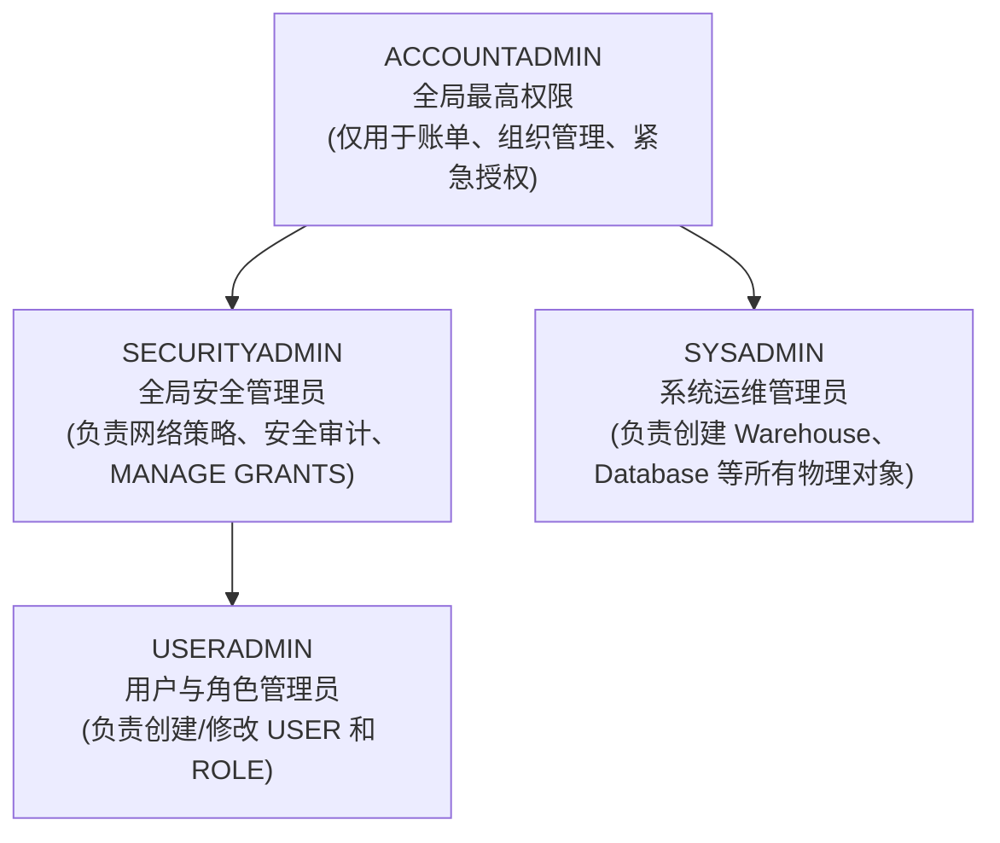

> [!CAUTION]
> **金融级安全军规**：日常运维与迁移绝不可使用 `ACCOUNTADMIN`。
> 必须遵循职责分离，使用 `USERADMIN` 统一管理人员角色生命周期，使用 `SYSADMIN` 管控计算与存储资源！

---

## 5. 🧭 Snowsight 控制台全景深度教学与核心知识点体系

完成账号注册与界面日语偏好设置后，作为现代云原生数据仓库课程教材，本节将系统拆解 Snowflake 现代 Web 控制台 **Snowsight** 的每一处核心功能区域、交互按钮及其背后承载的架构知识点。

### 5.1 Snowsight 架构设计理念与 UI 具象映射

Snowflake 的底层革命性创新在于**三层解耦架构（Three-Tier Architecture）**：
1. **云服务层（Cloud Services Layer）**：负责全局元数据管理、SQL 解析优化、事务协调与安全认证；
2. **多集群虚拟计算层（Virtual Warehouses）**：无状态（Stateless）计算资源池，按需启动，秒级自动伸缩，互不争抢资源；
3. **集中式混合列存储层（Centralized Storage）**：基于对象存储（如 AWS S3）构建的不可变（Immutable）微分区（Micro-partitions），数据高可用且永久保真。

这一核心架构直接映射到了 Snowsight 的 UI 设计逻辑中：
- **为什么顶部有独立的 Warehouse 切换器？** 因为计算资源完全独立于数据，任何查询都由指定的 Warehouse 承载其算力与计费；
- **为什么顶部有独立的 Role 切换器？** 因为所有的物理对象访问权限均遵循严格的 RBAC 授权树判定；
- **为什么执行系统探针查询耗时仅 1ms~20ms？** 因为系统函数无需启动物理存储磁盘扫描，全部由云服务元数据层毫秒级极速响应。

---

### 5.2 左侧主导航栏功能矩阵与核心知识点对照

Snowsight 左侧主导航栏（Sidebar）整合了数据工程师、架构师与安全合规团队日常运维的所有核心入口：

| 导航模块 / 按钮 | 日语界面标识 | 核心功能与操作路径 | 对应 Snowflake 关键知识点与架构原理 |
| :--- | :--- | :--- | :--- |
| **工作区与项目** | **ワークスペース / プロジェクト** | 编写与组织 SQL 脚本、Python Notebook 以及 Streamlit 数据应用 | **多模态分析开发栈**：支持纯 SQL 与 Snowpark（Python/Scala/Java），直接在库内实现交互式数据科学与敏捷应用交付 |
| **统一数据目录** | **Horizon カタログ (Catalog)** | 检索与探索全局数据库分层对象树（Database $\to$ Schema $\to$ Table/View/Stage） | **Horizon Catalog 统一治理平台**：遵循 `DATABASE.SCHEMA.OBJECT` 三层命名空间，提供跨云元数据发现与全局全文检索 |
| **数据摄取与阶段** | **取り込み (Ingestion)** | 上传本地数据、配置内部/外部暂存区（Stage）、监控 Snowpipe 导入管道 | **暂存区（Stage）与管道机制**：通过 Internal/External Stage 规范外部数据着陆区，支持基于云事件驱动的微批自动加载（Snowpipe） |
| **连续数据转换** | **変換 (Transformation)** | 配置声明式动态表（Dynamic Tables）、编排定时作业（Tasks & Streams） | **CDC 变更数据捕获与流水线**：利用动态表声明式刷新取代繁重的外部调度工具（如 Airflow），原生支持近实时增量数据处理 |
| **企业级生成式 AI** | **AI と ML (Cortex AI)** | 运行 Cortex 大语言模型调用、语义搜索、自然语言转 SQL 及向量检索 | **Snowflake Cortex**：企业数据安全不出库边界，直接在托管计算环境中利用大模型（如 Llama 3、Mistral）实现智能化提炼 |
| **资源与负载监控** | **モニタリング (Monitoring)** | 检索全量历史 Query 日志、查看 Warehouse 实时并发与负载热力图 | **Query History 与算力计费透明度**：每条 SQL 生成全局唯一 Query ID；多集群仓库（Multi-cluster）按需自动横向水平扩展 |
| **数据安全与治理** | **ガバナンスとセキュリティ** | 配置动态数据脱敏（Masking）、行级安全访问策略（RAP）、对象标签（Tags） | **零信任金融级数据保护**：敏感客户数据字段级按角色动态脱敏，满足金融厅 FISC / PCI-DSS 安全合规审计硬性要求 |
| **系统管理员中心** | **管理 (Admin)** | 开通用户（Users）、划分角色（Roles）、配置网络白名单（Network Policies）及账单计费（Billing） | **职责分离与成本管控**：USERADMIN 管控人员身份，SYSADMIN 管控资源，精确到秒级的按需 Credit 消耗透明核算 |


#### 1. データ取り込み (Ingestion / 数据摄取与 Stage)
点击左侧 **「取り込み」**，直达数据导入控制中心：
- **数据源载入**：支持直接通过 Web 界面加载文件至 Snowflake 表，或将数据放入指定的 **暂存区（Stage）**；
- **外部存储集成**：原生对接云端对象存储（Amazon S3、Google Cloud Storage、Azure Blob Storage 及 Microsoft OneLake）；
- **微批与管道（Snowpipe）**：配置基于云端消息通知（如 SNS/SQS、Event Grid）触发的轻量级自动化持续摄取。

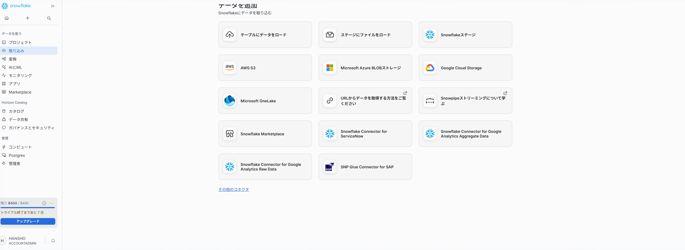

#### 2. データ変換 (Transformation / 连续转换与动态表)
点击左侧 **「変換」**，进入现代化数据建模流水线：
- **声明式动态表（Dynamic Tables）**：以简单的 SQL SELECT 语句定义目标形态，由 Snowflake 自动化计算增量并在指定的延迟目标（Target Lag）内持续刷新，无需编写复杂的手动 Merge/Insert 存储过程；
- **任务与流（Tasks & Streams）**：原生支持基于变更数据捕获（CDC）的行级增量追踪，驱动事件流自动化运行。

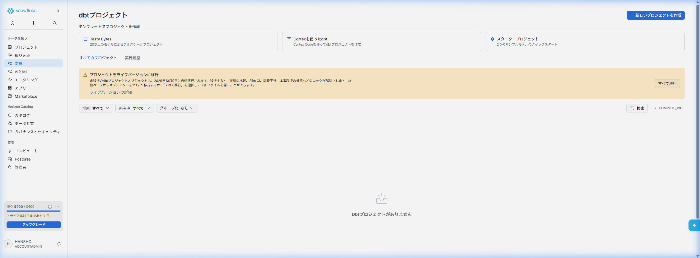

#### 3. AI と ML (Agent Studio & Cortex AI / 智能体与库内大模型)
点击左侧 **「AI と ML」**，进入企业级生成式 AI 演练场：
- **Cortex Agent Studio**：允许开发者基于企业私域数据构建安全智能体（Agent），支持自然语言到 SQL（Text-to-SQL）的自动转换与交互；
- **数据合规与私密性保障**：调用前沿大语言模型（如 Llama 3、Mistral 等）在 Snowflake 安全虚拟私有网络内本地运行，企业专有数据绝不流向公网第三方平台。

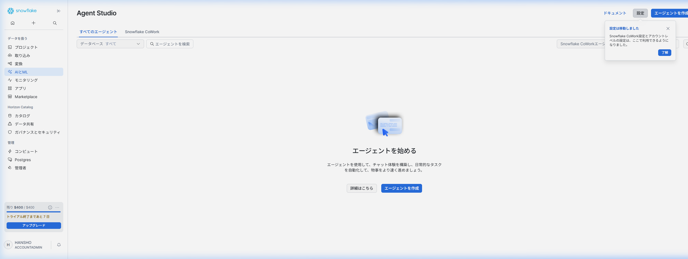

#### 4. モニタリング (Monitoring / 全局查询审计与性能监控)
点击左侧 **「モニタリング」**，直达全局查询与运行分析看板：
- **全量执行日志（Query History）**：详细记录当前账号下任何工具（Snowsight、DBeaver、Python、JDBC）提交的每条 SQL；
- **多维度性能检索**：支持按用户、仓库、状态（成功、失败、等待锁）以及 128 位全局 **Query ID** 精准过滤；
- **资源瓶颈诊断**：直观展示编译耗时、计算时间、读写字节数及排队等待，协助 DBA 开展性能调优与索引聚簇优化。

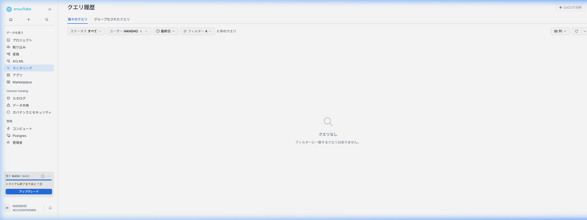

#### 5. データ共有 (Data Sharing / Horizon Catalog 零拷贝数据共享)
点击 Horizon Catalog 下的 **「データ共有」**，体验 Snowflake 最具革命性的数据分发技术：
- **零拷贝直连共享（Direct Share）**：无需耗费算力做物理数据导出（Unload/Dump）或 API 传输，通过底层元数据指针授权，将只读数据集安全共享给其他部门、子公司或外部合作伙伴；
- **实时同步与零冗余**：数据提供方更新数据时，使用方毫秒级可见最新数据，杜绝存储膨胀与版本不一致风险。

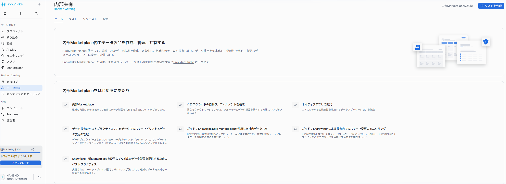

#### 6. ガバナンスとセキュリティ (Governance & Security / 零信任与用户管理)
点击 Horizon Catalog 下的 **「ガバナンスとセキュリティ」**，掌控金融级权限合规大局：
- **用户与角色总览**：一屏掌握当前所有用户（Users）的启用状态、密码策略到期日以及多因素认证（MFA）绑定情况；
- **动态数据脱敏（Masking Policies）**：结合敏感数据标签（Tags），实现针对普通分析师自动掩码（如 `****-****-****`），对合规主管展示明文的动态权限模型；
- **行级访问策略（Row Access Policies）**：基于用户所属支店或地域，自动限制只能检索所属范围内的数据行。

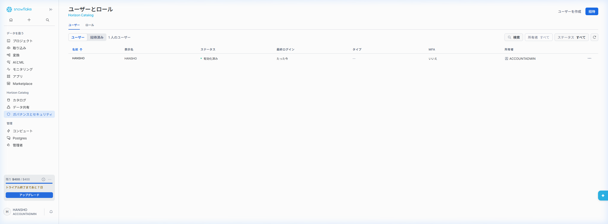

#### 7. コンピュート (Compute / 虚拟数仓与算力池管理)
点击管理下方的 **「コンピュート」**，进入核心算力调度中心：
- **虚拟数仓（Virtual Warehouses）配置**：创建和调整无状态计算集群（X-Small 到 4X-Large），每个 T-shirt 尺码对应算力与每小时 Credit 翻倍增长；
- **弹性成本控制机制**：
  - **Auto-Suspend（自动挂起）**：当指定时间内（如 5 分钟）无 SQL 运行时自动休眠，停止计费；
  - **Auto-Resume（自动拉起）**：当新查询到达时，毫秒级自动拉起集群继续处理；
  - **Multi-cluster 自动水平扩展**：在高峰期自动根据排队负载弹性增加 1~N 个同等集群，负载回落自动缩减。

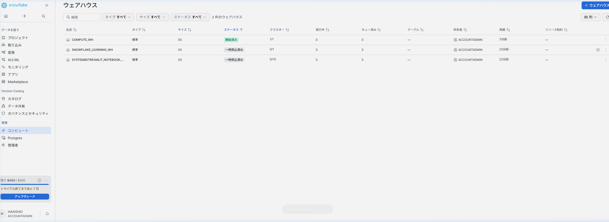

#### 8. 管理者 (Admin / 成本核算与账单计费)
点击 **「管理者」**，查阅企业级运营与财务计费透明度报告：
- **点数消耗看板（Billing & Usage）**：精确统计每一天、每一个虚拟数仓、每一个功能模块（如云服务、数据存储、复制传输）所消耗的 Credits；
- **30 天免费试用额度监控**：实时展示当前账号剩余的 `$400` 试用额度与到期天数；
- **账户网络策略（Network Policies）**：设置公司固定出口 IP 白名单，杜绝未授权网络非法接入。

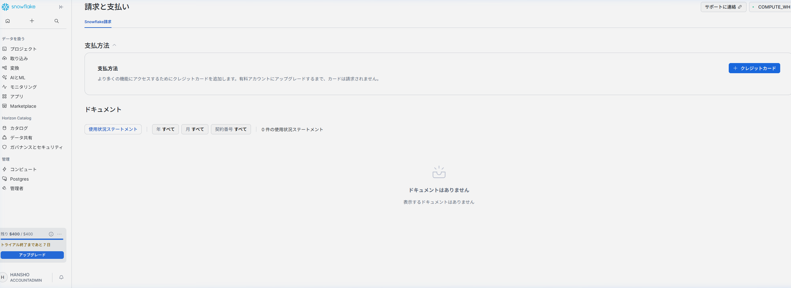

---

### 5.3 SQL Worksheet 核心交互按钮全解析

SQL 工作表（Worksheet）是数据工程师与分析师最核心的作业工作台。进入 **「プロジェクト」 $\to$ 「ワークスペース」**，点击 **「＋ 新規追加」 $\to$ 「SQLファイル」** 即可打开：


#### 1. 顶部上下文选择器（Context Selector）
位于工作表右上角，包含两个核心下拉组件：
- **左列（ロールを使用 / Role Selector）**：实时切换当前会话生效的 RBAC 角色（如 `ACCOUNTADMIN`、`SYSADMIN` 或自定义业务角色），避免繁琐的手动 `USE ROLE` 语句；
- **右列（ウェアハウスを使用 / Warehouse Selector）**：指定承载当前计算的算力大小（如 `COMPUTE_WH (X-Small)`），并可即时观察仓库的挂起与运行状态。
- **数据库与 Schema 选择器**：设定当前会话的默认 Namespace。若已指定，SQL 中可省略数据库前缀直接访问表。


#### 2. 执行控制栏（Execution Controls）
- **蓝色「▶ 実行」按钮**：默认执行光标所在当前行或选中的代码块；快捷键为 `Ctrl + Enter`（Windows）或 `Cmd + Enter`（Mac）；
- **下拉三角选项（Run All）**：支持从首行到末行按序一键整表批量运行，适合执行大型初始化 DDL 脚本。

#### 3. 团队协同与共享（Share 按钮）
- 点击右上角 **「共有」** 按钮，支持：
  - **移动至共享工作区**：让团队其他工程师直接协同开发同一个 SQL 脚本；
  - **复制共享 URL**：生成带有特定工作表上下文的安全直链；
  - **复制代码**：一键导出脚本到剪贴板。


#### 4. 辅助视图与设置组件
- **「フォーカス（Focus Mode）」**：位于右上角，点击后可收起左侧导航与侧边栏，进入沉浸式宽屏 SQL 编写体验；
- **「...（更多选项）」**：提供自动补全开关（Autocomplete）、代码美化格式化（Format Query）及工作表重命名功能。

---

### 5.4 结果集多维分析与即时可视化（Table / Chart / Pivot）

在编辑器中输入并执行开箱即用的基准探针语句：
```sql
-- 验证当前会话基本上下文与 Snowflake 引擎版本（开箱即用，无需外部对象依赖）
SELECT 
    CURRENT_USER()             AS "当前登录用户",
    CURRENT_ROLE()             AS "当前生效角色",
    CURRENT_AVAILABLE_ROLES()   AS "可用角色清单",
    CURRENT_WAREHOUSE()        AS "当前计算仓库",
    CURRENT_VERSION()          AS "Snowflake引擎版本";
```

执行后底部的结果面板不仅是一个查询输出窗口，更是开箱即用的轻量级交互分析工具：


#### 1. 表格视图（テーブル / Table）
- 展现结构化列数据，标明字段类型（如 `A` 文本、`#` 数值、`📅` 日期时间）；
- 右侧状态栏展示受影响行数（`1行`）与实际执行耗时（如 `22ms`）。

#### 2. 图表可视化引擎（チャート / Chart）
无需将数据导出到 Python、Tableau 或 Excel，Snowflake 原生支持秒级可视化：
- 点击 **「チャート」** 按钮，系统自动解析数值与文本维度并生成图表；
- **配置抽屉（Left Drawer）**：
  - **チャート型**：自由切换柱状图（棒グラフ）、折线图（折れ線グラフ）、散点图、面积图；
  - **X 轴 / Y 轴设定**：自由选择分类维度与度量字段；
  - **集计与分组（Aggregation & Grouping）**：直接配置 `SUM`、`AVG`、`COUNT` 等聚合运算以及系列色彩。


#### 3. 透视交叉分析（ピボット / Pivot）
- 支持将二维明细表一键转置为多维数据透视矩阵，方便财务和风险分析师进行交叉对比。

#### 4. 导出与快捷操作（Export & Copy）
- 支持一键导出为 CSV 或 TSV 格式，支持复制选中单元格或整行数据。

---

### 5.5 全局查询审计与性能详情（Query Details & Profile）

Snowflake 具备极其强大的企业级透明度审计体系，每一条执行语句均被赋予全局唯一的 128 位 **Query ID**（如 `01c7bf74-0204-f4a5-0005-59ae001380ce`）。
点击结果面板上的 Query ID，即可调出详情与执行火焰图：


#### 1. 审计元数据全生命周期追踪
- **执行状态与耗时**：精确分解编译时间（Compilation）、执行时间（Execution）及锁等待；
- **客户端驱动标识**：捕获接入驱动类型（如 Snowsight 的 `Go 2.1.0` 驱动、Python Connector 或 JDBC）；
- **会话与成本**：记录会话 Session ID 及消耗的计算点数（Credits），支持精细化成本分摊审计。

#### 2. Query Profile（执行计划树）深度洞察
切换至 **「クエリプロファイル」** 选项卡，可深入分析 SQL 底层执行原理：
- **元数据直接响应（METADATA-BASED RESULT）**：对于系统内置函数或未过滤的基础行数统计，优化器直接从 Cloud Services 层的持久化元数据中秒级提取，不启动底层微分区文件扫描，既零等待又节省计费；
- **微分区剪枝（Partition Pruning）**：在后续章节处理海量金融交易流水时，Query Profile 会清晰标明 `Partitions scanned` 与 `Partitions total`（例如 `5 / 1200`），直观证明谓词下推与分区裁剪的显著威力。

---

## 六、🌐 账号定位标识体系与客户端连接生态 (Account Identifier & Ecosystem)

完成 Web 端的初步体验后，在进入自动化脚本开发、CI/CD 运维流水线或第三方企业客户端（如 SnowSQL、DBeaver、Python、Airflow）之前，理解 Snowflake 的**全局账号标识符（Account Identifier）**是至关重要的基石。

### 6.1 账号定位符的两种表示法

在企业网络拓扑中，Snowflake 支持两种格式的账号定位：

| 格式分类 | 标准规范 | 示例（以本项目为例） | 适用场景 |
| :--- | :--- | :--- | :--- |
| **组织账号定位法 (推荐)** | `<组织名>-<账号名>` | `prqilyp-he58274` | 生产标准、跨云迁移、多区域统一纳管、DBeaver/SnowSQL 接入 |
| **传统定位符定位法 (Legacy)** | `<定位符>.<区域>.<云厂商>` | `he58274.ap-northeast-1.aws` | 旧版驱动兼容、专用私有云链接 (AWS PrivateLink) |

### 6.2 在 Snowsight 中一键提取账号 URL

在 Snowsight 控制台界面中，可以极其便捷地提取全局唯一的连接 URL：

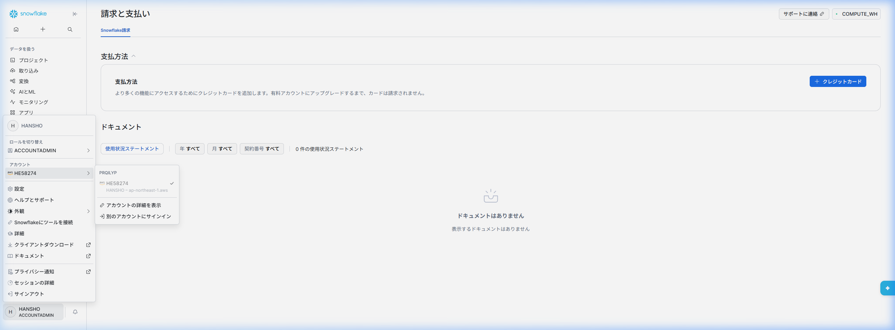

1. 点击左下角当前登录用户的个人资料卡片；
2. 鼠标悬停在当前激活的账号项（例如 `HE58274 - ap-northeast-1.aws`）；
3. 在弹出的二级浮窗中，清晰标明了组织编号（`PRQILYP`）、账号标识（`HE58274`）及物理机房（`AWS - Asia Pacific (Tokyo) - ap-northeast-1`）；
4. 点击 **「アカウントURLをコピー (Copy Account URL)」** 按钮，即可将连接基址复制到剪贴板：
   ```text
   https://prqilyp-he58274.snowflakecomputing.com
   ```

### 6.3 跨平台客户端连接生态全景

获取账号 URL 与定位符后，后续章节将串联起完整的金融工程开发链路：

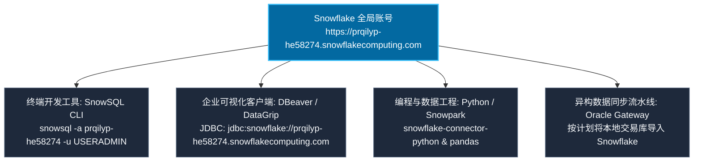

---

## 七、🎬 HyperFrames 教学视频工程规范与分镜映射 (Video Production Guide)

为了将本项目打造为业界顶尖的多媒体技术课程，本教程配套采用了 **HeyGen 开源的 HyperFrames 现代代码级视频渲染引擎**（位于项目根目录 `video_ch1/`）。通过 Web 技术（HTML/CSS/GSAP）驱动，实现工业级 60FPS 丝滑高保真动效视频输出。

### 7.1 画面构图标准与 16:9 画幅规范

| 工程维度 | 规范参数 | 关键设计要求 |
| :--- | :--- | :--- |
| **原生画幅分辨率** | **1920 × 1080 (16:9 Landscape)** | 符合现代 4K/1080p 显示器全屏比例，严禁非等比拉伸。 |
| **界面暗色美学** | 背景色 `#0A0F1D`，卡片 `#0F172A` | 结合玻璃拟态（Glassmorphism）与极光光晕（Glow Orbs），科技感强且护眼。 |
| **文字与代码排版** | `Inter` + `JetBrains Mono` | 代码关键词高亮，行高设为 `1.6 ~ 1.8`，保证视频观看时字符清晰辨识。 |
| **数字人避让安全区** | **右下角 420 × 540 px 保留区** | HeyGen 虚拟播报数字人通常置于画面右下角或底部，**核心架构图或 SQL 输出绝对不可放置于此区域**，必须居中或居左编排。 |

### 7.2 第一章 HyperFrames 分镜与教材资产映射矩阵

在 `hyperframes preview video_ch1 --port=3002` 视频生成流中，各幕（Act）与本篇教程图文资源的对应关系如下：

| 幕次 (Act) | 视频标题与核心主题 | 对应教材章节 | 核心截图 / 视觉动效物料 | GSAP 运镜与焦点区域 |
| :--- | :--- | :--- | :--- | :--- |
| **ACT 01** | **业务背景与金融数字化转型挑战** | 第一节 (背景概述) | 挑战卡片 (单体瓶颈/跑批延迟/扩展困境) | 视口平移依次聚焦 3 大痛点卡片 |
| **ACT 02** | **Snowflake 现代云原生三大技术底座** | 第三节 (三层架构) | 存算分离架构卡片与层级关系 | 纵向推镜头：底座存储 ➔ 计算引擎 ➔ 云服务层 |
| **ACT 03** | **核心计费体系与月度 $508 成本仿真** | 第二节 (成本控制) | [01_img_07](../images/01_img_07.png) 试用期额度看板 | 缩放聚焦于额度告警与自动休眠策略 |
| **ACT 04** | **端到端安全迁移拓扑与流水线架构** | 第五节 (架构映射) | [01_img_20](../images/01_img_20.png) 对象树、数据加载拓扑 | 左右双列对比：本地 Oracle 源端 ➔ Snowflake 目标端 |
| **ACT 05** | **8 大功能矩阵与现代化操作台全览** | 第五节 (5.2 矩阵) | [01_cat_01 ~ 08 系列](../images/01_cat_01_ingestion.png) | 轮播切换 8 大模块，左侧微动效聚焦 |
| **ACT 06** | **SQL 工作区实操与多维分析引擎** | 第五节 (5.3 ~ 5.5) | [01_img_15](../images/01_img_15.png), [01_img_18](../images/01_img_18.png), [01_img_17](../images/01_img_17.png) | 视口先聚焦上下文选择器，再平滑拉镜头至图表与 Query Profile |
| **ACT 07** | **账号定位提取与金融客户端生态** | 第六节 (账号与生态) | [01_img_21](../images/01_img_21.png) 账号 URL 提取弹窗 | 弹出卡片浮显，高亮复制 URL 与组织名，展示客户端互联拓扑 |

---

完成上述从界面按钮、架构内核、账号标识到多媒体视频工程的全面拆解后，您已完整掌握了 Snowflake 企业级核心交互基石。接下来我们将进入后续章节，正式开展本地 Oracle 环境搭建及三井证券企业级 RBAC 生产体系的构建实战！

