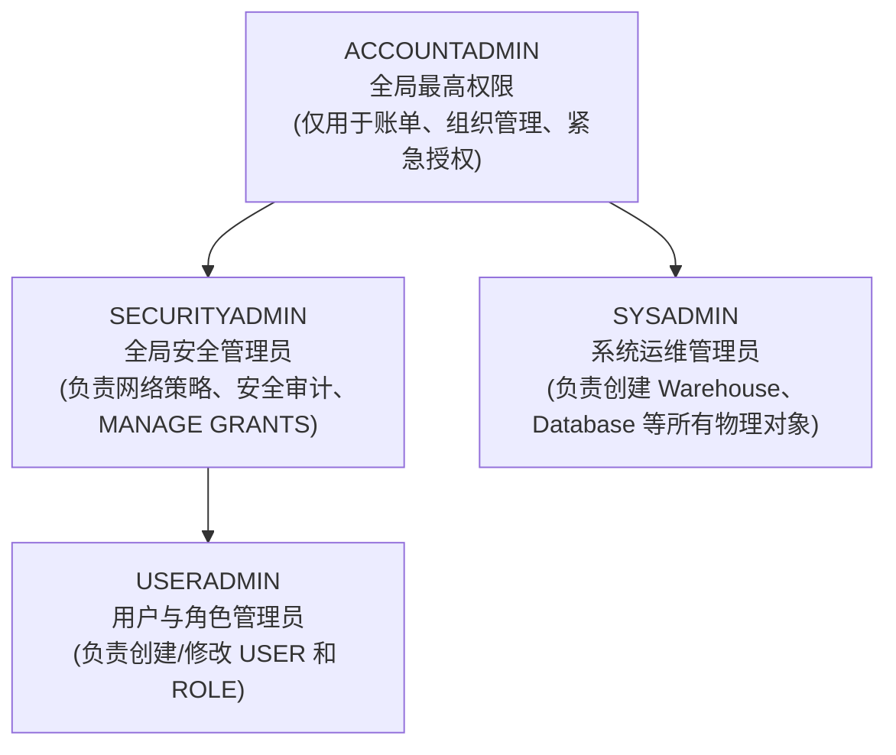

# 第 01 章：Snowflake 账号申请与初始化配置

作为金融企业（如三井证券）在进行云原生转型验证时，首要步骤是申请并初始化 Snowflake 30天免费企业级试用环境（包含 $400 计算额度）。

---

## 1. 账号申请入口与关键参数

访问官方注册入口：[https://signup.snowflake.com/](https://signup.snowflake.com/)

| 配置项 | 推荐选型 | 业务与合规考量 |
| :--- | :--- | :--- |
| **Snowflake Edition** | **Enterprise（企业版）** | 支持 **90天时间旅行 (Time Travel)**、**动态数据脱敏 (Data Masking)** 以及多集群仓储，这是金融级监管与合规审计的最低门槛。 |
| **Cloud Provider** | **AWS (Amazon Web Services)** | 日资券商在东京区域使用率最高的底层云之一，生态工具链完备。 |
| **Region (区域)** | **Asia Pacific (Tokyo) - `ap-northeast-1`** | **数据主权合规要求**：日本金融厅 (FSA) 要求核心客户交易数据常驻境内，且网络延迟极低。 |

---

## 2. 注册全流程步骤与界面指引

### 步骤 1：访问注册入口并填写基本信息
输入姓名、公司邮箱及职位信息：

### 步骤 2：选择版本与云厂商区域
选择 **Enterprise** 版本，底层选择 **AWS - Asia Pacific (Tokyo)**：

### 步骤 3：验证与激活邮件
提交后查收标题为 *"Activate your Snowflake account"* 的官方邮件，点击激活按钮：

### 步骤 4：设置管理员密码与首次登录
设置登录账号和安全强密码（初始具备 `ACCOUNTADMIN` 权限）：

---

## 3. Web 控制台语言设置（切换为日语）

为了符合日本业务现场的操作习惯，可将 Snowsight 控制台界面语言设置为日语：

1. 点击左下角或右上角个人 Profile 图标进入 **Preferences（首选项）**；
2. 在 **Language & Region** 中，将语言切换为 **日本語 (Japanese)**：

---

## 4. 账号系统预置角色体系认知

> [!CAUTION]
> **金融级安全军规**：日常运维与迁移绝不可使用 `ACCOUNTADMIN`。
> 必须遵循职责分离，使用 `USERADMIN` 统一管理人员角色生命周期，使用 `SYSADMIN` 管控计算与存储资源！
