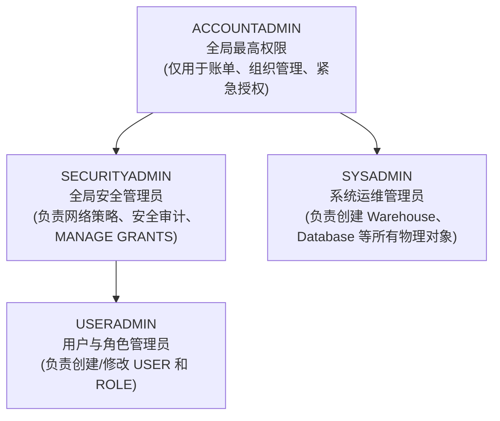
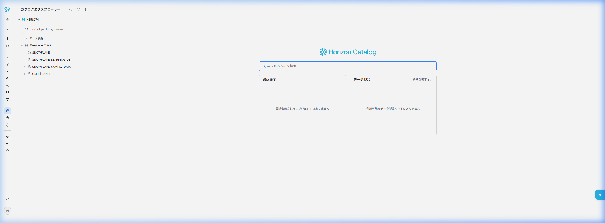
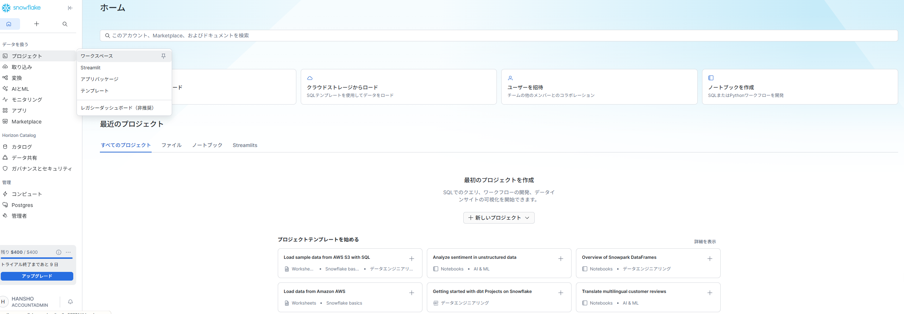
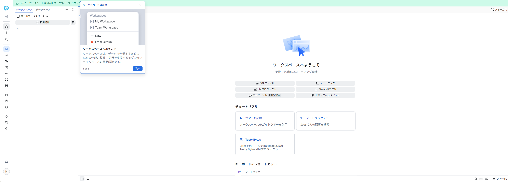
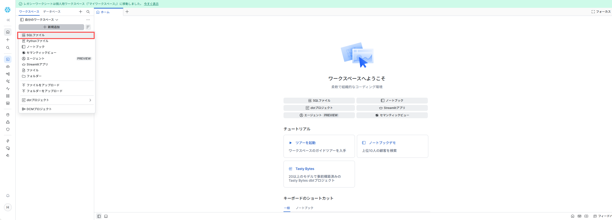
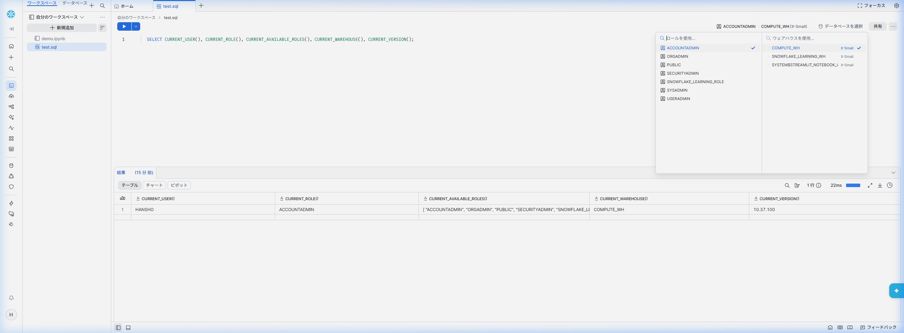
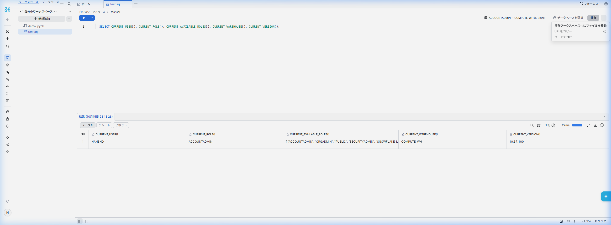
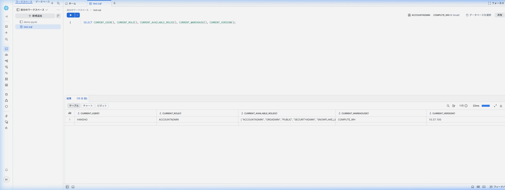
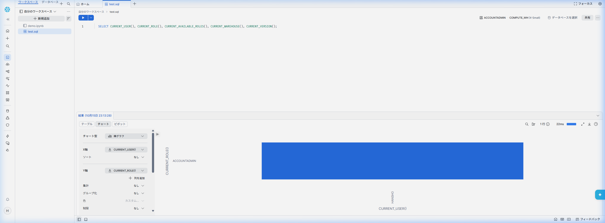
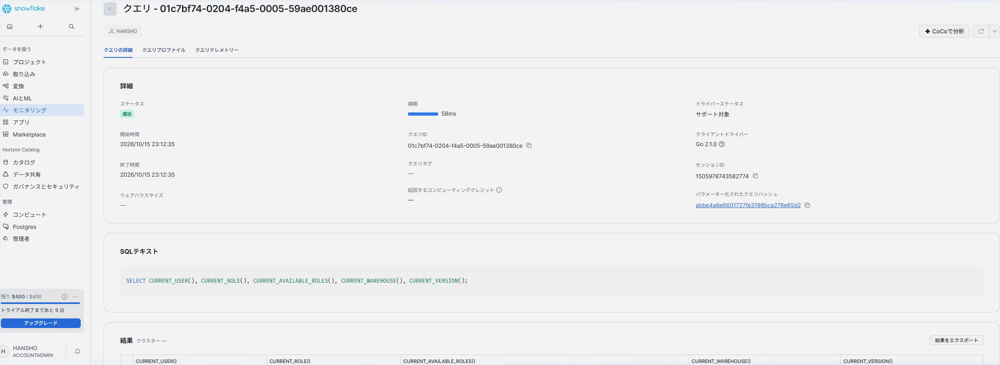

# 第 01 章：Snowflake 账号申请与初始化配置

作为金融企业（如银行证券）在进行云原生转型验证时，首要步骤是申请并初始化 Snowflake 30天免费企业级试用环境（包含 $400 计算额度）。

---

## 1. 账号申请入口与关键参数

访问官方注册入口：[https://signup.snowflake.com/](https://signup.snowflake.com/)

| 配置项 | 推荐选型 | 业务与合规考量 |
| :--- | :--- | :--- |
| **Snowflake Edition** | **Enterprise（企业版）** | 支持 **90天时间旅行 (Time Travel)**、**动态数据脱敏 (Data Masking)** 以及多集群仓储，这是金融级监管与合规审计的最低门槛。 |
| **Cloud Provider** | **AWS (Amazon Web Services)** | 日资券商在东京区域使用率最高的底层云之一，生态工具链完备。 |
| **Region (区域)** | **Asia Pacific (Tokyo) - `ap-northeast-1`** | **数据主权合规要求**：日本金融厅 (FSA) 要求核心客户交易数据常驻境内，且网络延迟极低。 |

---

## 2. 注册全流程步骤与界面指引

### 步骤 1：访问注册入口并填写基本信息
输入姓名、公司邮箱及职位信息：


### 步骤 2：选择版本与云厂商区域
选择 **Enterprise** 版本，底层选择 **AWS - Asia Pacific (Tokyo)**：


### 步骤 3：验证与激活邮件
提交后查收标题为 *"Activate your Snowflake account"* 的官方邮件，点击激活按钮：


### 步骤 4：设置管理员密码与首次登录
设置登录账号和安全强密码（初始具备 `ACCOUNTADMIN` 权限）：


---

## 3. Web 控制台语言设置（切换为日语）

为了符合日本业务现场的操作习惯，可将 Snowsight 控制台界面语言设置为日语：

1. 点击左下角或右上角个人 Profile 图标进入 **Preferences（首选项）**；
2. 在 **Language & Region** 中，将语言切换为 **日本語 (Japanese)**：


---

## 4. 账号系统预置角色体系认知



> [!CAUTION]
> **金融级安全军规**：日常运维与迁移绝不可使用 `ACCOUNTADMIN`。
> 必须遵循职责分离，使用 `USERADMIN` 统一管理人员角色生命周期，使用 `SYSADMIN` 管控计算与存储资源！

---

## 5. 🧭 Snowsight 控制台全景深度教学与核心知识点体系

完成账号注册与界面日语偏好设置后，作为现代云原生数据仓库课程教材，本节将系统拆解 Snowflake 现代 Web 控制台 **Snowsight** 的每一处核心功能区域、交互按钮及其背后承载的架构知识点。

### 5.1 Snowsight 架构设计理念与 UI 具象映射

Snowflake 的底层革命性创新在于**三层解耦架构（Three-Tier Architecture）**：
1. **云服务层（Cloud Services Layer）**：负责全局元数据管理、SQL 解析优化、事务协调与安全认证；
2. **多集群虚拟计算层（Virtual Warehouses）**：无状态（Stateless）计算资源池，按需启动，秒级自动伸缩，互不争抢资源；
3. **集中式混合列存储层（Centralized Storage）**：基于对象存储（如 AWS S3）构建的不可变（Immutable）微分区（Micro-partitions），数据高可用且永久保真。

这一核心架构直接映射到了 Snowsight 的 UI 设计逻辑中：
- **为什么顶部有独立的 Warehouse 切换器？** 因为计算资源完全独立于数据，任何查询都由指定的 Warehouse 承载其算力与计费；
- **为什么顶部有独立的 Role 切换器？** 因为所有的物理对象访问权限均遵循严格的 RBAC 授权树判定；
- **为什么执行系统探针查询耗时仅 1ms~20ms？** 因为系统函数无需启动物理存储磁盘扫描，全部由云服务元数据层毫秒级极速响应。

---

### 5.2 左侧主导航栏功能矩阵与核心知识点对照

Snowsight 左侧主导航栏（Sidebar）整合了数据工程师、架构师与安全合规团队日常运维的所有核心入口：

| 导航模块 / 按钮 | 日语界面标识 | 核心功能与操作路径 | 对应 Snowflake 关键知识点与架构原理 |
| :--- | :--- | :--- | :--- |
| **工作区与项目** | **ワークスペース / プロジェクト** | 编写与组织 SQL 脚本、Python Notebook 以及 Streamlit 数据应用 | **多模态分析开发栈**：支持纯 SQL 与 Snowpark（Python/Scala/Java），直接在库内实现交互式数据科学与敏捷应用交付 |
| **统一数据目录** | **Horizon カタログ (Catalog)** | 检索与探索全局数据库分层对象树（Database $\to$ Schema $\to$ Table/View/Stage） | **Horizon Catalog 统一治理平台**：遵循 `DATABASE.SCHEMA.OBJECT` 三层命名空间，提供跨云元数据发现与全局全文检索 |
| **数据摄取与阶段** | **取り込み (Ingestion)** | 上传本地数据、配置内部/外部暂存区（Stage）、监控 Snowpipe 导入管道 | **暂存区（Stage）与管道机制**：通过 Internal/External Stage 规范外部数据着陆区，支持基于云事件驱动的微批自动加载（Snowpipe） |
| **连续数据转换** | **変換 (Transformation)** | 配置声明式动态表（Dynamic Tables）、编排定时作业（Tasks & Streams） | **CDC 变更数据捕获与流水线**：利用动态表声明式刷新取代繁重的外部调度工具（如 Airflow），原生支持近实时增量数据处理 |
| **企业级生成式 AI** | **AI と ML (Cortex AI)** | 运行 Cortex 大语言模型调用、语义搜索、自然语言转 SQL 及向量检索 | **Snowflake Cortex**：企业数据安全不出库边界，直接在托管计算环境中利用大模型（如 Llama 3、Mistral）实现智能化提炼 |
| **资源与负载监控** | **モニタリング (Monitoring)** | 检索全量历史 Query 日志、查看 Warehouse 实时并发与负载热力图 | **Query History 与算力计费透明度**：每条 SQL 生成全局唯一 Query ID；多集群仓库（Multi-cluster）按需自动横向水平扩展 |
| **数据安全与治理** | **ガバナンスとセキュリティ** | 配置动态数据脱敏（Masking）、行级安全访问策略（RAP）、对象标签（Tags） | **零信任金融级数据保护**：敏感客户数据字段级按角色动态脱敏，满足金融厅 FISC / PCI-DSS 安全合规审计硬性要求 |
| **系统管理员中心** | **管理 (Admin)** | 开通用户（Users）、划分角色（Roles）、配置网络白名单（Network Policies）及账单计费（Billing） | **职责分离与成本管控**：USERADMIN 管控人员身份，SYSADMIN 管控资源，精确到秒级的按需 Credit 消耗透明核算 |



---

### 5.3 SQL Worksheet 核心交互按钮全解析

SQL 工作表（Worksheet）是数据工程师与分析师最核心的作业工作台。进入 **「プロジェクト」 $\to$ 「ワークスペース」**，点击 **「＋ 新規追加」 $\to$ 「SQLファイル」** 即可打开：





#### 1. 顶部上下文选择器（Context Selector）
位于工作表右上角，包含两个核心下拉组件：
- **左列（ロールを使用 / Role Selector）**：实时切换当前会话生效的 RBAC 角色（如 `ACCOUNTADMIN`、`SYSADMIN` 或自定义业务角色），避免繁琐的手动 `USE ROLE` 语句；
- **右列（ウェアハウスを使用 / Warehouse Selector）**：指定承载当前计算的算力大小（如 `COMPUTE_WH (X-Small)`），并可即时观察仓库的挂起与运行状态。
- **数据库与 Schema 选择器**：设定当前会话的默认 Namespace。若已指定，SQL 中可省略数据库前缀直接访问表。



#### 2. 执行控制栏（Execution Controls）
- **蓝色「▶ 実行」按钮**：默认执行光标所在当前行或选中的代码块；快捷键为 `Ctrl + Enter`（Windows）或 `Cmd + Enter`（Mac）；
- **下拉三角选项（Run All）**：支持从首行到末行按序一键整表批量运行，适合执行大型初始化 DDL 脚本。

#### 3. 团队协同与共享（Share 按钮）
- 点击右上角 **「共有」** 按钮，支持：
  - **移动至共享工作区**：让团队其他工程师直接协同开发同一个 SQL 脚本；
  - **复制共享 URL**：生成带有特定工作表上下文的安全直链；
  - **复制代码**：一键导出脚本到剪贴板。



#### 4. 辅助视图与设置组件
- **「フォーカス（Focus Mode）」**：位于右上角，点击后可收起左侧导航与侧边栏，进入沉浸式宽屏 SQL 编写体验；
- **「...（更多选项）」**：提供自动补全开关（Autocomplete）、代码美化格式化（Format Query）及工作表重命名功能。

---

### 5.4 结果集多维分析与即时可视化（Table / Chart / Pivot）

在编辑器中输入并执行开箱即用的基准探针语句：
```sql
-- 验证当前会话基本上下文与 Snowflake 引擎版本（开箱即用，无需外部对象依赖）
SELECT 
    CURRENT_USER()             AS "当前登录用户",
    CURRENT_ROLE()             AS "当前生效角色",
    CURRENT_AVAILABLE_ROLES()   AS "可用角色清单",
    CURRENT_WAREHOUSE()        AS "当前计算仓库",
    CURRENT_VERSION()          AS "Snowflake引擎版本";
```

执行后底部的结果面板不仅是一个查询输出窗口，更是开箱即用的轻量级交互分析工具：



#### 1. 表格视图（テーブル / Table）
- 展现结构化列数据，标明字段类型（如 `A` 文本、`#` 数值、`📅` 日期时间）；
- 右侧状态栏展示受影响行数（`1行`）与实际执行耗时（如 `22ms`）。

#### 2. 图表可视化引擎（チャート / Chart）
无需将数据导出到 Python、Tableau 或 Excel，Snowflake 原生支持秒级可视化：
- 点击 **「チャート」** 按钮，系统自动解析数值与文本维度并生成图表；
- **配置抽屉（Left Drawer）**：
  - **チャート型**：自由切换柱状图（棒グラフ）、折线图（折れ線グラフ）、散点图、面积图；
  - **X 轴 / Y 轴设定**：自由选择分类维度与度量字段；
  - **集计与分组（Aggregation & Grouping）**：直接配置 `SUM`、`AVG`、`COUNT` 等聚合运算以及系列色彩。



#### 3. 透视交叉分析（ピボット / Pivot）
- 支持将二维明细表一键转置为多维数据透视矩阵，方便财务和风险分析师进行交叉对比。

#### 4. 导出与快捷操作（Export & Copy）
- 支持一键导出为 CSV 或 TSV 格式，支持复制选中单元格或整行数据。

---

### 5.5 全局查询审计与性能详情（Query Details & Profile）

Snowflake 具备极其强大的企业级透明度审计体系，每一条执行语句均被赋予全局唯一的 128 位 **Query ID**（如 `01c7bf74-0204-f4a5-0005-59ae001380ce`）。
点击结果面板上的 Query ID，即可调出详情与执行火焰图：



#### 1. 审计元数据全生命周期追踪
- **执行状态与耗时**：精确分解编译时间（Compilation）、执行时间（Execution）及锁等待；
- **客户端驱动标识**：捕获接入驱动类型（如 Snowsight 的 `Go 2.1.0` 驱动、Python Connector 或 JDBC）；
- **会话与成本**：记录会话 Session ID 及消耗的计算点数（Credits），支持精细化成本分摊审计。

#### 2. Query Profile（执行计划树）深度洞察
切换至 **「クエリプロファイル」** 选项卡，可深入分析 SQL 底层执行原理：
- **元数据直接响应（METADATA-BASED RESULT）**：对于系统内置函数或未过滤的基础行数统计，优化器直接从 Cloud Services 层的持久化元数据中秒级提取，不启动底层微分区文件扫描，既零等待又节省计费；
- **微分区剪枝（Partition Pruning）**：在后续章节处理海量金融交易流水时，Query Profile 会清晰标明 `Partitions scanned` 与 `Partitions total`（例如 `5 / 1200`），直观证明谓词下推与分区裁剪的显著威力。

---

完成上述从界面按钮到架构内核的全面拆解后，您已完整掌握了 Snowflake 核心交互环境。接下来我们将进入后续章节，正式开展本地 Oracle 环境搭建及三井证券企业级 RBAC 生产体系的构建实战！
