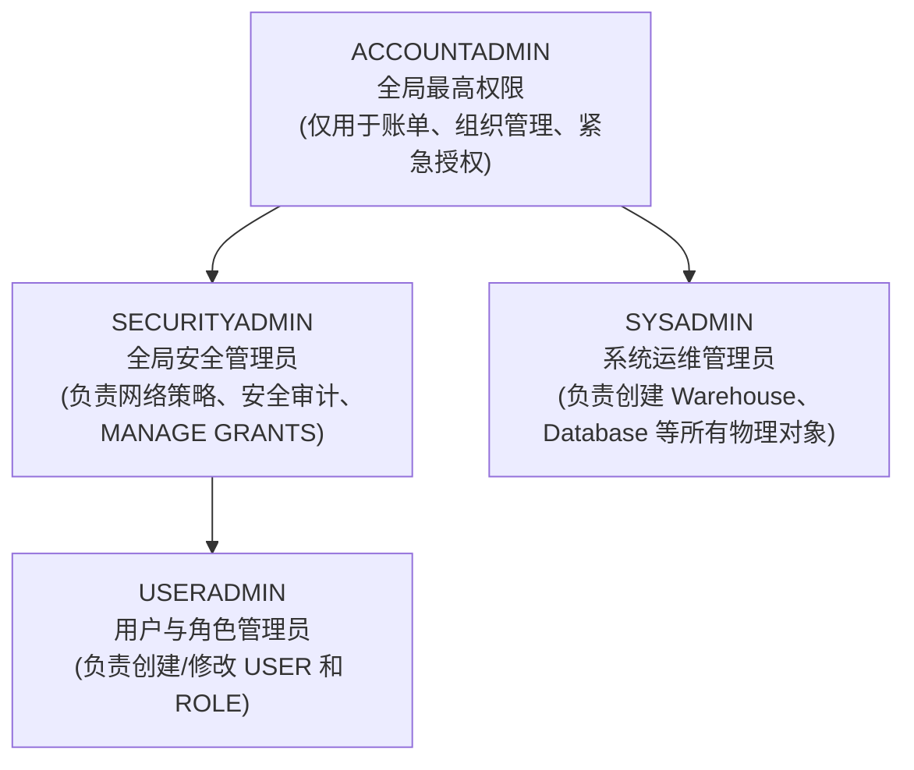

# 第 01 章：Snowflake 账号申请与初始化配置

作为金融企业（如银行证券）在进行云原生转型验证时，首要步骤是申请并初始化 Snowflake 30天免费企业级试用环境（包含 $400 计算额度）。

---

## 1. 账号申请入口与关键参数

访问官方注册入口：[https://signup.snowflake.com/](https://signup.snowflake.com/)

| 配置项 | 推荐选型 | 业务与合规考量 |
| :--- | :--- | :--- |
| **Snowflake Edition** | **Enterprise（企业版）** | 支持 **90天时间旅行 (Time Travel)**、**动态数据脱敏 (Data Masking)** 以及多集群仓储，这是金融级监管与合规审计的最低门槛。 |
| **Cloud Provider** | **AWS (Amazon Web Services)** | 日资券商在东京区域使用率最高的底层云之一，生态工具链完备。 |
| **Region (区域)** | **Asia Pacific (Tokyo) - `ap-northeast-1`** | **数据主权合规要求**：日本金融厅 (FSA) 要求核心客户交易数据常驻境内，且网络延迟极低。 |

---

## 2. 注册全流程步骤与界面指引

### 步骤 1：访问注册入口并填写基本信息
输入姓名、公司邮箱及职位信息：


### 步骤 2：选择版本与云厂商区域
选择 **Enterprise** 版本，底层选择 **AWS - Asia Pacific (Tokyo)**：


### 步骤 3：验证与激活邮件
提交后查收标题为 *"Activate your Snowflake account"* 的官方邮件，点击激活按钮：


### 步骤 4：设置管理员密码与首次登录
设置登录账号和安全强密码（初始具备 `ACCOUNTADMIN` 权限）：


---

## 3. Web 控制台语言设置（切换为日语）

为了符合日本业务现场的操作习惯，可将 Snowsight 控制台界面语言设置为日语：

1. 点击左下角或右上角个人 Profile 图标进入 **Preferences（首选项）**；
2. 在 **Language & Region** 中，将语言切换为 **日本語 (Japanese)**：


---

## 4. 账号系统预置角色体系认知



> [!CAUTION]
> **金融级安全军规**：日常运维与迁移绝不可使用 `ACCOUNTADMIN`。
> 必须遵循职责分离，使用 `USERADMIN` 统一管理人员角色生命周期，使用 `SYSADMIN` 管控计算与存储资源！

---

## 5. 🧭 Snowsight 控制台界面与工作台初探

完成注册与日语偏好设置后，接下来熟悉 Snowflake 现代 Web 控制台 **Snowsight** 的基本布局与 SQL 运行环境。

### 5.1 工作区（Workspaces）导航与界面初识
在 Snowsight 中，所有日常查询、开发与协作均在「工作区」中开展：

1. 点击左侧主导航栏中的 **「プロジェクト（Projects）」**，选择进入 **「ワークスペース（Workspaces）」**：


2. 首次进入时系统会展示现代化的工作区导览界面（支持 SQL 文件、Python Notebook 与 dbt 资产等多模态开发）：


### 5.2 新建 SQL 工作表（Worksheet）
在工作区中创建您的第一个 SQL 编辑运行环境：
1. 点击左上角的 **「＋ 新規追加」** 按钮；
2. 选择 **「SQLファイル（SQL File）」** 打开全新的 SQL 执行工作台：


### 5.3 运行首条开箱即用探测 SQL
新注册的试用账号已由系统预置了基础环境。在打开的 SQL 编辑器中输入以下语句，点击右上角 **「▶ 実行」** 按钮（或使用快捷键 `Ctrl + Enter` / `Cmd + Enter`）执行：

```sql
-- 验证当前会话基本上下文与 Snowflake 引擎版本（开箱即用，无需外部对象依赖）
SELECT 
    CURRENT_USER()             AS "当前登录用户",
    CURRENT_ROLE()             AS "当前生效角色",
    CURRENT_AVAILABLE_ROLES()   AS "可用角色清单",
    CURRENT_WAREHOUSE()        AS "当前计算仓库",
    CURRENT_VERSION()          AS "Snowflake引擎版本";
```

执行后可在下方实时看到会话上下文、执行耗时（如 22ms）与全局 Query ID：


### 5.4 SQL 工作台核心组件速览
* **上下文选择器（Context Selector）**：位于编辑器右上角，用于随时切换当前会话生效的角色（Role）、计算仓库（Warehouse）以及默认数据库/Schema；
* **执行控制（Run Controls）**：支持单行执行、高亮选中文本执行或全表依次批量运行；
* **结果与历史面板（Results & Query History）**：底部实时返回结构化表格数据、受影响行数、查询执行耗时（毫秒级）及全局 Query ID，方便审计追踪。

完成上述基本熟悉后，账号基础环境与操作入口均已完备。接下来请进入后续章节，我们将开启本地 Oracle 环境准备及三井证券企业级 RBAC 权限体系与生产对象的全套构建！
