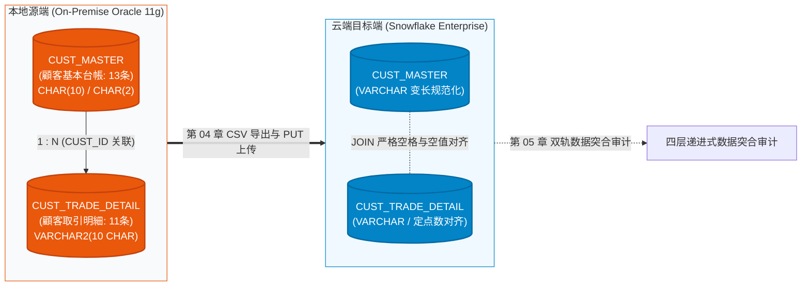
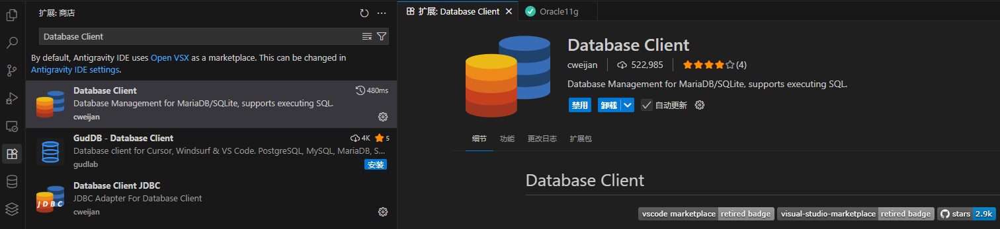
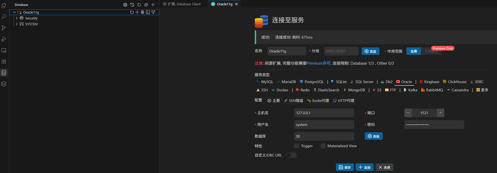

# 第 02 章：Oracle 迁移源环境搭建与模拟数据准备

在传统金融机构（银行、证券）的数据中台架构中，客户的股票、外汇及债券等核心交易明细长年沉淀在本地部署的 Oracle 关系型数据库中。

在前两章中，我们深入剖析了三井证券夜间跑批耗时严重超标的业务痛点（[第 00 章](00_architecture_overview.md)），并成功开通了全新的 Snowflake 企业级云数仓环境（[第 01 章](01_snowflake_signup.md)）。

为了在零额外硬件成本的前提下开展真实、高保真且极具实战深度的迁移工程，本章将在本地构建一个 **Oracle 11g 迁移源端沙箱**。本教程深度拥抱最新技术栈：不仅支持传统 **Docker**，更全面支持 Windows 最新内置的 **原生 WSL Containers (`wslc`)**。

特别地，我们不再停留在单表的肤浅演示，而是构建**两张具备 1:N 主从关联关系的典型金融核心表（`CUST_MASTER` 客户基本台账 + `CUST_TRADE_DETAIL` 客户交易明细）**，并精心埋设**末尾空格（Trailing Spaces）、空字符串（`''` vs `NULL`）、字符语义（CHAR vs BYTE）及全角半角混排**等企业迁移中最为致命的异构陷阱，为后续的受控建表、数据抽取与质量对账筑牢根基！

---

## 一、 架构承上启下：双表迁移拓扑与跨表 JOIN 痛点

在大型金融系统重构中，90% 的生产故障并不发生在单表的简单抽取，而是爆发在**跨表关联查询（Multi-table JOIN）**阶段：单表对账全部通过，但一上线跑多表报表，数据要么静默失配（少查数据）、要么笛卡尔积膨胀（多查数据）！



### 🚨 异构数据库迁移四大致命跨表 JOIN 陷阱

| 异构底层陷阱 | Oracle 11g 原生行为 | Snowflake 现代数仓行为 | 引发的生产故障与灾难后果 |
| :--- | :--- | :--- | :--- |
| **1. `CHAR(N)` 右补空格与比较语义** | 固定长度字段（如 `CHAR(10)`），存入 `'CU001'` 会**自动在末尾补齐空格**为 `'CU001     '`。<br/>且在 `CHAR` 比较时采用 Blank-padded 规则，`'A ' = 'A'` 为 TRUE。 | Snowflake 的 `VARCHAR` / `CHAR` 都是变长字符。<br/>`'A ' = 'A'` **严格判定为 FALSE**！<br/>若 CSV 导出或加载时执行了 Trim，两端空格不一致。 | **跨表 JOIN 瞬间全灭（0 行匹配）！**<br/>在 Oracle 里能关联上的记录，到了 Snowflake 变成 `NULL` 或直接被 `INNER JOIN` 丢弃！ |
| **2. 空字符串 `''` 与 `NULL` 语义** | **`''` 严格等价于 `NULL`**！<br/>在 Oracle 中 `'' IS NULL` 永远为 TRUE；`WHERE col = ''` 查不出任何数据。 | **`''` 是长度为 0 的有效空字符串**！<br/>`'' IS NULL` 为 FALSE，`'' = ''` 为 TRUE。 | **外连接与过滤失真！**<br/>包含空值的外键关联合并时，行数膨胀或过滤条件判定相反。 |
| **3. 日期时分秒截断与标量关联** | `DATE` 隐式包含 `HH24:MI:SS`，两表按日关联常需 `TRUNC(d)`。 | 严格区分为 `DATE` 与 `TIMESTAMP`。 | 若迁移时未做标准化，导致按日关联由于隐藏毫秒不同而无法匹配。 |
| **4. 字符集与全半角 Collation** | 早期金融系统常用半角片假名（Kana）或带有未规范化全角空格（`　`）。 | 默认大小写与空格严格敏感。 | 客户姓名或支店关联失配。 |

---

## 二、 🐳 容器环境部署与生命周期管理 (原生 wslc / Docker)

为满足不同操作系统的开发习惯，本教程提供 **Windows 原生 WSL Containers (`wslc`)** 与 **通用 Docker** 双套命令。选用业界公认高可靠的 `gvenzl/oracle-xe:11` 镜像。

> [!TIP]
> **💡 微软原生 WSL Containers (`wslc 3.0+`) 技术优势**：  
> 微软将容器运行时直接下沉至 Windows 与 WSL 最底层。无需常驻后台重型虚拟机或 Docker Desktop 商业授权，启动耗时仅需数十秒，跨系统文件 I/O 提速约 2 倍，且命令参数与 Docker 保持高度兼容。

### 步骤 1：拉取 Oracle 11g 镜像并启动容器

配置共享内存 `--shm-size 1g`（防止 Oracle SGA 内存不足报错），映射端口 `1521`，密码设为 `Mitsui_Sec_2026`：

::: code-group
```bash [Windows 原生 WSL Containers (wslc)]
# 微软原生容器运行时 (WSL 3.0+ 原生命令)
wslc run -d `
  --name mitsui_oracle_11g `
  -p 1521:1521 `
  -e ORACLE_PASSWORD=Mitsui_Sec_2026 `
  --shm-size 1G `
  gvenzl/oracle-xe:11
```

```bash [PowerShell / Docker Desktop]
# Windows Docker 命令
docker run -d `
  --name mitsui_oracle_11g `
  --restart always `
  -e ORACLE_PASSWORD=Mitsui_Sec_2026 `
  -p 1521:1521 `
  --shm-size=1g `
  gvenzl/oracle-xe:11
```

```bash [Bash / Linux / macOS]
# Linux / macOS Docker 命令
sudo docker run -d \
  --name mitsui_oracle_11g \
  --restart always \
  -e ORACLE_PASSWORD=Mitsui_Sec_2026 \
  -p 1521:1521 \
  --shm-size=1g \
  gvenzl/oracle-xe:11
```
:::

### 步骤 2：查看容器状态与就绪日志

::: code-group
```bash [wslc]
wslc ps
wslc logs --tail 20 mitsui_oracle_11g
```

```bash [docker]
docker ps
docker logs --tail 20 mitsui_oracle_11g
```
:::

当日志中出现如下标志性语句时，表示数据库已完全就绪：
```text
ORACLE instance started.
Completed: ALTER DATABASE OPEN
#########################
DATABASE IS READY TO USE!
#########################
```

---

## 三、 🔌 统一开发工具链连接测试 (VSCode / DBeaver)

在[第 01 章第 6 节](01_snowflake_signup.md#六-账号定位标识体系与客户端连接生态-account-identifier--ecosystem)中，我们梳理了现代数据工程的客户端生态。在实战中，我们推荐在 VSCode 内统一集成开发，或使用通用的 **DBeaver** 客户端。

### 1. VSCode Database Client 插件配置

在 VSCode 扩展市场中搜索并安装 **Database Client**（或 Database Client JDBC），点击新建 Oracle 连接并填入参数：

| 配置项 | 参数值 | 说明 |
| :--- | :--- | :--- |
| **Connection Type** | `Oracle` | 选择标准 Oracle 驱动协议 |
| **Host** | `127.0.0.1` | 本地宿主机回环地址（WSL2 用户亦可直接使用 localhost） |
| **Port** | `1521` | 映射端口 |
| **Database / SID** | `xe` | Oracle 11g Express Edition 默认实例服务名 |
| **Username** | `system` | 系统管理员账号 |
| **Password** | `Mitsui_Sec_2026` | 启动容器时指定的高强度密码 |



### 2. 连通性测试与验证
点击 **「Connect」** 按钮，验证网络握手与身份认证成功：



> [!TIP]
> **DBeaver 快捷连接**：驱动选择 `Oracle`，JDBC URL 为 `jdbc:oracle:thin:@//localhost:1521/xe`，用户名为 `system`。

---

## 四、 🏛️ 核心双表 DDL 与 Oracle ➔ Snowflake 架构推导哲学

以 `system` 账号连入 Oracle 后，在 SQL 编辑窗口执行以下标准双表 DDL（对应脚本 [`scripts/oracle/01_create_schema.sql`](file:///c:/Users/FX/Projects/SnowflakeBlog/scripts/oracle/01_create_schema.sql)）：

### 4.1 表 1：维度主表 `CUST_MASTER` (顧客基本台帳)

```sql
CREATE TABLE CUST_MASTER (
    -- ① 顧客識別子：CHAR(10) 固定長（传统勘定系核心系统遗留规范，自动右补空格陷阱测试）
    CUST_ID            CHAR(10)          NOT NULL,

    -- ② 顧客氏名（漢字）：全角文字
    CUST_NAME_KANJI    VARCHAR2(50 CHAR) NOT NULL,

    -- ③ 顧客氏名（カナ）：半角カナ・全角カナ混在
    CUST_NAME_KANA     VARCHAR2(50 CHAR),

    -- ④ 顧客ランク区分：CHAR(2) 固定長（'A ' / 'B ' 等末尾空白陷阱测试）
    CUST_RANK_CD       CHAR(2)           DEFAULT 'C ' NOT NULL,

    -- ⑤ 開設支店コード：VARCHAR2(4 CHAR)
    BRANCH_CD          VARCHAR2(4 CHAR)  NOT NULL,

    -- ⑥ 口座ステータス：VARCHAR2(2 CHAR)（Oracle '' 视为 NULL，而 Snowflake '' 为有效空串的陷阱测试）
    STATUS_CD          VARCHAR2(2 CHAR),

    -- ⑦ 口座開設日：DATE 型
    OPEN_DATE          DATE              NOT NULL,

    -- ⑧ 登録日時
    REG_DATETIME       DATE              DEFAULT SYSDATE NOT NULL,

    CONSTRAINT PK_CUST_MASTER PRIMARY KEY (CUST_ID)
);

COMMENT ON TABLE CUST_MASTER IS '顧客基本台帳（Oracle 11g 核心客户维度表）';
```

---

### 4.2 表 2：事实流水表 `CUST_TRADE_DETAIL` (顧客取引明細)

```sql
CREATE TABLE CUST_TRADE_DETAIL (
    -- ① 取引数量：一般数值，初期値 0
    TRADE_QTY          NUMBER(15)        DEFAULT 0        NOT NULL,

    -- ② 約定金額・邦貨（円貨）：固定 3 位小数精度统一
    AMOUNT_JPY         NUMBER(18,3)      DEFAULT 0        NOT NULL,

    -- ③ 約定金額・外貨 ＋ 通貨区分：必须配对定义
    AMOUNT_FCY         NUMBER(18,3)      DEFAULT 0,
    CCY_CODE           VARCHAR2(3),

    -- ④ 為替レート：汇率统一 6 位小数
    EXCHANGE_RATE      NUMBER(9,6),

    -- ⑤ 摘要・備考：必须显式声明 CHAR 语意（非默认的 BYTE 语意）
    REMARKS            VARCHAR2(100 CHAR) DEFAULT ' ',

    -- ⑥ 顧客識別：固定 10 位账号，声明 CHAR 语意
    CUST_ID            VARCHAR2(10 CHAR)  NOT NULL,

    -- ⑦ 业务区分代码
    TRADE_TYPE_CD      VARCHAR2(2 CHAR)   NOT NULL,  -- 01:买入, 02:卖出
    BRANCH_CD          VARCHAR2(4 CHAR)   NOT NULL,  -- 分支行代码

    -- ⑧ 业务日期字段
    TRADE_DATE         DATE               NOT NULL,  -- 约定日（业务发生日）
    SETTLE_MONTH       DATE,                         -- 结算所属月（以月初代表月）

    -- ⑨ 审计时间戳字段
    REG_DATETIME       DATE               DEFAULT SYSDATE NOT NULL, -- 登记时间（秒级）
    UPD_DATETIME       DATE,                                        -- 更新时间

    CONSTRAINT PK_CUST_TRADE_DETAIL PRIMARY KEY (CUST_ID, TRADE_DATE, TRADE_TYPE_CD)
);

COMMENT ON TABLE CUST_TRADE_DETAIL IS '顧客取引明細（Oracle 11g 迁移源端设计）';
```

---

### 4.3 🌟 核心知识点：Oracle ➔ Snowflake 字段映射与设计哲学对照

| 字段类别 | Oracle 11g 源字段 | Snowflake 目标字段 | 架构设计推导哲学与转换考量 (Architecture Rationale) |
| :--- | :--- | :--- | :--- |
| **客户主键** | `CHAR(10)` in Master<br/>`VARCHAR2(10 CHAR)` in Detail | `VARCHAR(10)` in Both | **★ JOIN 命脉（空格截断与对齐）**：<br/>在 Oracle 中 `CHAR(10)` 尾部会自动补空格；在 Snowflake 中如果两表均转为 `VARCHAR(10)`，必须在 `COPY INTO` 时统一配置 `TRIM_SPACE = TRUE` 或在 ETL 中执行 `RTRIM`，否则 `ON a.CUST_ID = b.CUST_ID` 将直接失败！ |
| **客户评级** | `CUST_RANK_CD CHAR(2)` | `VARCHAR(2)` | Oracle 存入 `'A '`（带空格）时，执行 `WHERE CUST_RANK_CD = 'A'` 能命中；但 Snowflake 严格敏感，必须通过清理或者明确匹配 `'A '`。 |
| **账户状态** | `STATUS_CD VARCHAR2(2)` | `VARCHAR(2)` | **★ 空串与 NULL 陷阱**：<br/>Oracle 存入 `''` 时自动转为 `NULL`；Snowflake 需在文件格式中配置 `EMPTY_FIELD_AS_NULL = TRUE` 才能保持一致的业务过滤逻辑。 |
| **交易数量** | `NUMBER(15)` | `NUMBER(15, 0)` | 股票交易股数通常为整数，明确指定 Scale 为 0，避免隐式浮点数带来的精度漂移。 |
| **日元金额** | `NUMBER(18,3)` | `NUMBER(18, 3)` | 证券交易清算包含厘（0.001），两端均保持固定定点数精度，零误差对齐。 |
| **摘要文本** | `VARCHAR2(100 CHAR)` | `VARCHAR(100)` | **★ 关键避坑点（CHAR vs BYTE 语义）**：<br/>在 UTF-8 字符集下，1 个全角日文汉字占 3 个字节。若在 Oracle 声明为默认的 `VARCHAR2(100)`（BYTE 语义），存入超过 34 个汉字就会触发 `ORA-12899` 字段溢出！因此源端必须声明 `CHAR` 语义；而 Snowflake 原生 `VARCHAR(N)` 天生就是**以 Unicode 字符数计数**，完美契合！ |
| **业务日期** | `TRADE_DATE DATE` | `VARCHAR(8)` (YYYYMMDD) | **日期截断与字符串标量化**：Oracle 的 `DATE` 实际上隐式包含了时分秒。在 Snowflake 现代数仓规范中，金融日次指标推荐标准化为 8 位定长纯数字文本 `YYYYMMDD`，查询分析时极大提升扫描与分区剪枝效率。 |
| **所属月份** | `SETTLE_MONTH DATE` | `VARCHAR(6)` (YYYYMM) | 结算所属月，标准化为 6 位年月格式，便于按月快速聚类与时间旅行。 |
| **登记时间** | `REG_DATETIME DATE` | `TIMESTAMP_NTZ(6)` | **精度从秒级升级至微秒级**：Oracle `DATE` 仅精确到秒；Snowflake 落地为无时区时间戳 `TIMESTAMP_NTZ(6)`，支持金融微秒级撮合审计。 |
| **迁移审计** | *(源端无此列)* | `MIGRATED_AT TIMESTAMP_LTZ(6)` | **★ 云端追加列**：在第 03 章建表中额外追加该列，默认取 `CURRENT_TIMESTAMP()`，记录每行数据入云的物理时刻，满足监管数据血缘可追溯性要求。 |

---

## 五、 🧪 金融级双表测试数据集深度解析与批量注入

我们设计了高覆盖率的双表测试数据集：
1. **主表 `CUST_MASTER`（共 13 条）**：覆盖 11 名有交易客户、1 名新开户但无交易客户（`CU00008888` 松本 润，测试 LEFT JOIN 产生 NULL）、1 名状态存入 `''` 客户（`CU00009990` 井上 阳水，测试 Oracle 空串转 NULL）；
2. **事实表 `CUST_TRADE_DETAIL`（共 11 条）**：覆盖国内股票、外汇、外国债券、全 9 极限值、全角百字边界、超微额汇率与跨年交易。

### 批量注入完整 SQL 实操

请复制以下完整脚本在 VSCode Database Client 或 Oracle 客户端中一次性执行（对应脚本 [`scripts/oracle/02_seed_trades_data.sql`](file:///c:/Users/FX/Projects/SnowflakeBlog/scripts/oracle/02_seed_trades_data.sql)）：

```sql
-- 清空历史数据
DELETE FROM CUST_TRADE_DETAIL;
DELETE FROM CUST_MASTER;

-- ============================================================
-- 1. 灌入 CUST_MASTER (顧客基本台帳表 - 共 13 条)
-- ============================================================
INSERT INTO CUST_MASTER (CUST_ID, CUST_NAME_KANJI, CUST_NAME_KANA, CUST_RANK_CD, BRANCH_CD, STATUS_CD, OPEN_DATE)
VALUES ('CU00001234', '佐藤 太郎', 'サトウ タロウ', 'A ', '0001', '01', DATE '2020-01-15');

INSERT INTO CUST_MASTER (CUST_ID, CUST_NAME_KANJI, CUST_NAME_KANA, CUST_RANK_CD, BRANCH_CD, STATUS_CD, OPEN_DATE)
VALUES ('CU00005678', '鈴木 一郎', 'スズキ イチロウ', 'A ', '0002', '01', DATE '2021-05-20');

INSERT INTO CUST_MASTER (CUST_ID, CUST_NAME_KANJI, CUST_NAME_KANA, CUST_RANK_CD, BRANCH_CD, STATUS_CD, OPEN_DATE)
VALUES ('CU00009999', '高橋 優子', 'タカハシ ユウコ', 'B ', '0003', '01', DATE '2019-11-10');

INSERT INTO CUST_MASTER (CUST_ID, CUST_NAME_KANJI, CUST_NAME_KANA, CUST_RANK_CD, BRANCH_CD, STATUS_CD, OPEN_DATE)
VALUES ('CU00000001', '三井 証券機構', 'ミツイ ショウケンキコウ', 'S ', '9999', '01', DATE '2010-04-01');

INSERT INTO CUST_MASTER (CUST_ID, CUST_NAME_KANJI, CUST_NAME_KANA, CUST_RANK_CD, BRANCH_CD, STATUS_CD, OPEN_DATE)
VALUES ('CU00002222', '田中 健一', 'タナカ ケンイチ', 'C ', '0005', '01', DATE '2022-08-01');

INSERT INTO CUST_MASTER (CUST_ID, CUST_NAME_KANJI, CUST_NAME_KANA, CUST_RANK_CD, BRANCH_CD, STATUS_CD, OPEN_DATE)
VALUES ('CU00003333', '伊藤 直樹', 'イトウ ナオキ', 'C ', '0001', '01', DATE '2023-02-15');

INSERT INTO CUST_MASTER (CUST_ID, CUST_NAME_KANJI, CUST_NAME_KANA, CUST_RANK_CD, BRANCH_CD, STATUS_CD, OPEN_DATE)
VALUES ('CU00004444', '渡辺 裕美', 'ワタナベ ヒロミ', 'B ', '0002', '01', DATE '2021-09-30');

INSERT INTO CUST_MASTER (CUST_ID, CUST_NAME_KANJI, CUST_NAME_KANA, CUST_RANK_CD, BRANCH_CD, STATUS_CD, OPEN_DATE)
VALUES ('CU00004445', '山本 拓也', 'ヤマモト タクヤ', 'B ', '0002', '01', DATE '2021-10-01');

INSERT INTO CUST_MASTER (CUST_ID, CUST_NAME_KANJI, CUST_NAME_KANA, CUST_RANK_CD, BRANCH_CD, STATUS_CD, OPEN_DATE)
VALUES ('CU00005555', '小林 誠', 'コバヤシ マコト', 'B ', '0004', '01', DATE '2022-03-12');

INSERT INTO CUST_MASTER (CUST_ID, CUST_NAME_KANJI, CUST_NAME_KANA, CUST_RANK_CD, BRANCH_CD, STATUS_CD, OPEN_DATE)
VALUES ('CU00006666', '加藤 恵', 'カトウ メグミ', 'C ', '0006', '01', DATE '2024-01-10');

INSERT INTO CUST_MASTER (CUST_ID, CUST_NAME_KANJI, CUST_NAME_KANA, CUST_RANK_CD, BRANCH_CD, STATUS_CD, OPEN_DATE)
VALUES ('CU00007777', '吉田 勇', 'ヨシダ イサム', 'A ', '0001', '01', DATE '2018-06-25');

-- 12. ★ 潜在开户无交易客户 (松本 潤) - 用于验证 LEFT JOIN 产生 NULL 的场景
INSERT INTO CUST_MASTER (CUST_ID, CUST_NAME_KANJI, CUST_NAME_KANA, CUST_RANK_CD, BRANCH_CD, STATUS_CD, OPEN_DATE)
VALUES ('CU00008888', '松本 潤', 'マツモト ジュン', 'C ', '0003', '02', DATE '2024-11-01');

-- 13. ★ 状态设为空字符串 '' 客户 (井上 陽水) - 用于验证 Oracle '' 隐式转 NULL 的异构陷阱
INSERT INTO CUST_MASTER (CUST_ID, CUST_NAME_KANJI, CUST_NAME_KANA, CUST_RANK_CD, BRANCH_CD, STATUS_CD, OPEN_DATE)
VALUES ('CU00009990', '井上 陽水', 'イノウエ ヨウスイ', 'D ', '0004', '', DATE '2025-01-05');


-- ============================================================
-- 2. 灌入 CUST_TRADE_DETAIL (顧客取引明細表 - 共 11 条)
-- ============================================================
-- 1. 通常取引・国内株式
INSERT INTO CUST_TRADE_DETAIL
(TRADE_QTY, AMOUNT_JPY, AMOUNT_FCY, CCY_CODE, EXCHANGE_RATE, REMARKS,
 CUST_ID, TRADE_TYPE_CD, BRANCH_CD, TRADE_DATE, SETTLE_MONTH,
 REG_DATETIME, UPD_DATETIME)
VALUES
(1000, 12345678.900, NULL, NULL, NULL, '通常取引・国内株式',
 'CU00001234', '01', '0001', DATE '2025-03-25', DATE '2025-03-01',
 TO_DATE('2025-03-25 09:05:30','YYYY-MM-DD HH24:MI:SS'), NULL);

-- 2. 外国株式・米国口座（带 USD 汇率）
INSERT INTO CUST_TRADE_DETAIL
(TRADE_QTY, AMOUNT_JPY, AMOUNT_FCY, CCY_CODE, EXCHANGE_RATE, REMARKS,
 CUST_ID, TRADE_TYPE_CD, BRANCH_CD, TRADE_DATE, SETTLE_MONTH,
 REG_DATETIME, UPD_DATETIME)
VALUES
(500, 7500000.000, 50000.500, 'USD', 150.123456, '外国株式・米国口座',
 'CU00005678', '02', '0002', DATE '2025-03-26', DATE '2025-03-01',
 TO_DATE('2025-03-26 10:15:00','YYYY-MM-DD HH24:MI:SS'),
 TO_DATE('2025-03-26 14:20:45','YYYY-MM-DD HH24:MI:SS'));

-- 3. 外国債券・欧州発行（带 EUR 汇率）
INSERT INTO CUST_TRADE_DETAIL
(TRADE_QTY, AMOUNT_JPY, AMOUNT_FCY, CCY_CODE, EXCHANGE_RATE, REMARKS,
 CUST_ID, TRADE_TYPE_CD, BRANCH_CD, TRADE_DATE, SETTLE_MONTH,
 REG_DATETIME, UPD_DATETIME)
VALUES
(200, 3200000.000, 20000.000, 'EUR', 160.000000, '外国債券・欧州発行',
 'CU00009999', '01', '0003', DATE '2025-03-27', DATE '2025-03-01',
 TO_DATE('2025-03-27 11:00:00','YYYY-MM-DD HH24:MI:SS'), NULL);

-- 4. 境界値テスト・最大桁数（全 9 极限值）
INSERT INTO CUST_TRADE_DETAIL
(TRADE_QTY, AMOUNT_JPY, AMOUNT_FCY, CCY_CODE, EXCHANGE_RATE, REMARKS,
 CUST_ID, TRADE_TYPE_CD, BRANCH_CD, TRADE_DATE, SETTLE_MONTH,
 REG_DATETIME, UPD_DATETIME)
VALUES
(999999999999999, 999999999999999.999, 999999999999999.999, 'USD', 999.999999,
 '境界値テスト・最大桁数',
 'CU00000001', '01', '9999', DATE '2025-01-01', DATE '2025-01-01',
 TO_DATE('2025-01-01 00:00:00','YYYY-MM-DD HH24:MI:SS'), NULL);

-- 5. 最小限必須項目のみ（各項目初期值的确认）
INSERT INTO CUST_TRADE_DETAIL
(CUST_ID, TRADE_TYPE_CD, BRANCH_CD, TRADE_DATE)
VALUES
('CU00002222', '02', '0005', DATE '2025-03-28');

-- 6. 金額 0・数量 0 の取引（月次失効バッチ想定）
INSERT INTO CUST_TRADE_DETAIL
(TRADE_QTY, AMOUNT_JPY, AMOUNT_FCY, CCY_CODE, EXCHANGE_RATE, REMARKS,
 CUST_ID, TRADE_TYPE_CD, BRANCH_CD, TRADE_DATE, SETTLE_MONTH,
 REG_DATETIME, UPD_DATETIME)
VALUES
(0, 0.000, NULL, NULL, NULL, '月次集計バッチ・2025年2月分',
 'CU00003333', '03', '0001', DATE '2025-02-28', DATE '2025-02-01',
 TO_DATE('2025-03-01 01:00:00','YYYY-MM-DD HH24:MI:SS'), NULL);

-- 7. 全角・半角混在文字の摘要テスト
INSERT INTO CUST_TRADE_DETAIL
(TRADE_QTY, AMOUNT_JPY, AMOUNT_FCY, CCY_CODE, EXCHANGE_RATE, REMARKS,
 CUST_ID, TRADE_TYPE_CD, BRANCH_CD, TRADE_DATE, SETTLE_MONTH,
 REG_DATETIME, UPD_DATETIME)
VALUES
(300, 4500000.000, NULL, NULL, NULL,
 RPAD('全角混在の摘要テスト（日本語・English・123・記号！＠＃）', 95, 'X'),
 'CU00004444', '01', '0002', DATE '2025-03-29', DATE '2025-03-01',
 TO_DATE('2025-03-29 13:45:12','YYYY-MM-DD HH24:MI:SS'), NULL);

-- 8. 全角 100 文字境界値テスト（VARCHAR2(100 CHAR) 语义验证用）
INSERT INTO CUST_TRADE_DETAIL
(TRADE_QTY, AMOUNT_JPY, AMOUNT_FCY, CCY_CODE, EXCHANGE_RATE, REMARKS,
 CUST_ID, TRADE_TYPE_CD, BRANCH_CD, TRADE_DATE, SETTLE_MONTH,
 REG_DATETIME, UPD_DATETIME)
VALUES
(300, 4500000.000, NULL, NULL, NULL,
 RPAD('全角文字百桁境界値検証用摘要欄', 100, '全'),
 'CU00004445', '01', '0002', DATE '2025-03-29', DATE '2025-03-01',
 TO_DATE('2025-03-29 13:45:12','YYYY-MM-DD HH24:MI:SS'), NULL);

-- 9. 訂正取引（更新日時あり）
INSERT INTO CUST_TRADE_DETAIL
(TRADE_QTY, AMOUNT_JPY, AMOUNT_FCY, CCY_CODE, EXCHANGE_RATE, REMARKS,
 CUST_ID, TRADE_TYPE_CD, BRANCH_CD, TRADE_DATE, SETTLE_MONTH,
 REG_DATETIME, UPD_DATETIME)
VALUES
(800, 9800000.000, NULL, NULL, NULL, '訂正取引・数量修正あり',
 'CU00005555', '02', '0004', DATE '2025-03-30', DATE '2025-03-01',
 TO_DATE('2025-03-30 09:00:00','YYYY-MM-DD HH24:MI:SS'),
 TO_DATE('2025-03-31 16:30:00','YYYY-MM-DD HH24:MI:SS'));

-- 10. レート小数桁・低額通貨テスト（インドネシアルピア想定）
INSERT INTO CUST_TRADE_DETAIL
(TRADE_QTY, AMOUNT_JPY, AMOUNT_FCY, CCY_CODE, EXCHANGE_RATE, REMARKS,
 CUST_ID, TRADE_TYPE_CD, BRANCH_CD, TRADE_DATE, SETTLE_MONTH,
 REG_DATETIME, UPD_DATETIME)
VALUES
(10, 1200.000, 1000.000, 'IDR', 0.000120, '低額通貨レートテスト（インドネシアルピア想定）',
 'CU00006666', '01', '0006', DATE '2025-04-01', DATE '2025-04-01',
 TO_DATE('2025-04-01 08:30:00','YYYY-MM-DD HH24:MI:SS'), NULL);

-- 11. 年末最終営業日取引（日付・时刻边界测试）
INSERT INTO CUST_TRADE_DETAIL
(TRADE_QTY, AMOUNT_JPY, AMOUNT_FCY, CCY_CODE, EXCHANGE_RATE, REMARKS,
 CUST_ID, TRADE_TYPE_CD, BRANCH_CD, TRADE_DATE, SETTLE_MONTH,
 REG_DATETIME, UPD_DATETIME)
VALUES
(50, 650000.000, NULL, NULL, NULL, '年末最終営業日取引',
 'CU00007777', '01', '0001', DATE '2024-12-31', DATE '2024-12-01',
 TO_DATE('2024-12-31 23:58:59','YYYY-MM-DD HH24:MI:SS'), NULL);

COMMIT;
```

---

## 六、 🎯 实测验证：单表与跨表 JOIN“双轨黄金基准” (直通第 05 章)

数据插入完成后，在 Oracle 源端立即执行双轨基准测试查询，记录下源端的不可变输出：

### 轨道 A：单表基准查询（Single Table Baseline）

```sql
-- 1. 验证 CUST_MASTER 单表基准
SELECT COUNT(*) AS MASTER_COUNT, COUNT(DISTINCT BRANCH_CD) AS BRANCH_COUNT FROM CUST_MASTER;

-- 2. 验证 CUST_TRADE_DETAIL 单表基准
SELECT 
    COUNT(*)                                       AS TOTAL_TRADES,
    SUM(TRADE_QTY)                                 AS TOTAL_QTY,
    ROUND(SUM(AMOUNT_JPY), 3)                      AS TOTAL_AMOUNT_JPY,
    ROUND(SUM(NVL(AMOUNT_FCY, 0)), 3)              AS TOTAL_AMOUNT_FCY,
    TO_CHAR(MIN(TRADE_DATE), 'YYYYMMDD')           AS EARLIEST_TRADE_DATE,
    TO_CHAR(MAX(TRADE_DATE), 'YYYYMMDD')           AS LATEST_TRADE_DATE
FROM CUST_TRADE_DETAIL;
```

### 轨道 B：跨表关联与异构陷阱基准查询（Multi-table JOIN Baseline）

```sql
-- 3. 跨表 INNER JOIN：验证客户名与交易金额关联
SELECT 
    COUNT(*)                          AS JOINED_ROWS,
    SUM(t.TRADE_QTY)                  AS JOINED_QTY,
    ROUND(SUM(t.AMOUNT_JPY), 3)       AS JOINED_AMOUNT_JPY
FROM CUST_MASTER m
INNER JOIN CUST_TRADE_DETAIL t ON m.CUST_ID = t.CUST_ID;

-- 4. CHAR(2) 末尾空格评级过滤测试 (验证 Blank-padded 规则)
-- 在 Oracle 中此查询能查出 3 名 A 级客户 (CU00001234, CU00005678, CU00007777)
SELECT COUNT(*) AS RANK_A_COUNT FROM CUST_MASTER WHERE CUST_RANK_CD = 'A';

-- 5. 空字符串转 NULL 语义测试
-- 在 Oracle 中存入 '' 的客户 (CU00009990) 满足 IS NULL，共 1 条
SELECT COUNT(*) AS NULL_STATUS_COUNT FROM CUST_MASTER WHERE STATUS_CD IS NULL;
```

---

### 📋 实测验收黄金基准对照表 (Golden Baseline Matrix)

以下数据为在本地真实 Oracle 11g 容器中实测执行产出的不可变基准值：

| 审计维度 | Oracle 源端不可变基准值 (Baseline) | 跨数据库异构验证目的 |
| :--- | :--- | :--- |
| **客户主表行数** | **`13` 条** | 确保维度主表数据完整无缺 |
| **交易明细行数** | **`11` 条** | 确保交易事实表数据完整无缺 |
| **INNER JOIN 关联行数** | **`11` 条** | **验证两表 `CUST_ID` 是否因空格补全导致 JOIN 失配** |
| **JOIN 后成交数量总计** | **`1,000,000,000,003,159` 株** | 验证关联后数量总和无膨胀、无丢失 |
| **JOIN 后日元金额总计** | **`1,000,000,042,496,878.899` 円** | 验证关联后金额总和无丢失 |
| **外币金额总计** | **`1,000,000,000,071,000.499`** | 验证多币种外汇金额总和绝对一致 |
| **`CUST_RANK_CD = 'A'` 命中数** | **`3` 条** (Oracle 原生) | **★ 关键异构断层**：在 Snowflake 中若未做 `RTRIM` 将查出 0 条！ |
| **`STATUS_CD IS NULL` 命中数** | **`1` 条** (Oracle 原生) | **★ 关键异构断层**：验证 Snowflake 是否正确配置空串转 NULL |

> [!IMPORTANT]
> **承下核心承诺**：  
> 请将此表格截图或记录。在 [第 05 章《迁移后两方数据差异对比与质量对账》](05_data_reconciliation.md) 中，我们将扮演三井证券首席数据分析师 `MITSUI_ANALYST`，在云端数仓中运行完全一致的双轨对账算法，不仅验证单表一致性，更重点攻防**跨表 JOIN 空格失配与空值陷阱**，达到 **0 差异、0 截断、100% 吻合** 的金牌审计交付标准！

---

## 七、 本章小结与后续章节导航

本章在本地环境中成功搭建起了 100% 高保真的 Oracle 11g 金融核心业务源库，创建了典型的 **`CUST_MASTER` 维度主表** 与 **`CUST_TRADE_DETAIL` 事实流水表**，灌入了高覆盖率的双表测试数据，并确立了字段转换哲学与跨表 JOIN 黄金基准。

在接下来的章节中，我们将正式开启云端建设与迁移战役：
- 👉 **[第 03 章：Snowflake 企业级 RBAC 权限设计与环境搭建实战](03_snowflake_rbac_setup.md)**：使用 `USERADMIN` 和 `SYSADMIN` 双轨角色，在 Snowflake 端严格落地三井证券三层业务角色体系，并根据本章确立的转换哲学创建 `MITSUI_STAGE` 以及目标双表 `CUST_MASTER` 与 `CUST_TRADE_DETAIL`！
