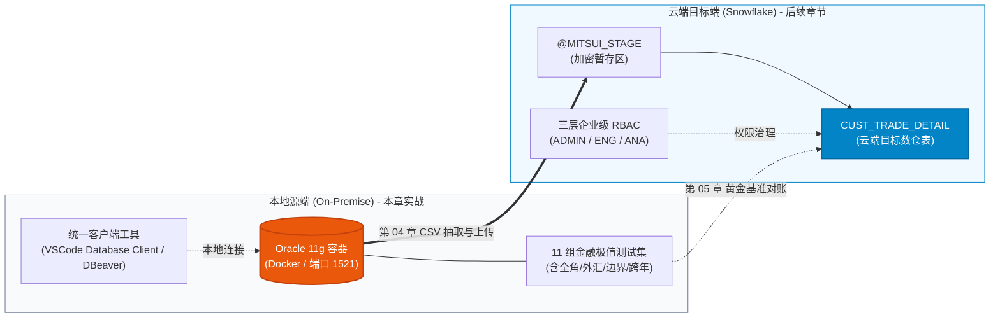

# 第 02 章：Oracle 迁移源环境搭建与模拟数据准备

在传统金融机构（银行、证券）的数据中台架构中，客户的股票、外汇及债券等核心交易明细长年沉淀在本地部署的 Oracle 关系型数据库中。

在前两章中，我们深入剖析了三井证券夜间跑批耗时严重超标的业务痛点（[第 00 章](00_architecture_overview.md)），并成功开通了全新的 Snowflake 企业级云数仓环境（[第 01 章](01_snowflake_signup.md)）。为了在零额外基础设施成本的前提下开展真实的高保真迁移工程实战，本章将在本地通过 Docker 极速构建一个 **Oracle 11g 迁移源端沙箱**，并灌入 11 组具备严密金融边界覆盖率的真实业务测试数据集，为后续的权限构建、数据抽取与质量对账奠定坚实基石。

---

## 一、 架构承上启下：迁移拓扑与本章定位

在三井证券数据中台的现代化迁移蓝图中，本章处于承前启后的源头核心地位：



- **承接第 00/01 章**：将云端 Snowflake 与本地 Oracle 放在同一个企业拓扑下审视，构建端到端的闭环；
- **启发第 03/04/05 章**：本章确立的 **Oracle ➔ Snowflake 字段转换哲学** 与 **11 组数据统计基准**，将直接贯穿后续建表、`COPY INTO` 转换及四层突合验收！

---

## 二、 🐳 Docker 安装与 Oracle 11g 容器生命周期管理

为了确保在 Windows (PowerShell/WSL2)、macOS 及 Linux 环境下均可无缝实操，我们选用业界广泛验证的精简版 `gvenzl/oracle-xe:11` 镜像。

### 步骤 1：拉取 Oracle 11g XE 镜像
在终端或 PowerShell 中执行镜像拉取：
```bash
docker pull gvenzl/oracle-xe:11
```

### 步骤 2：启动容器与持久化配置
配置共享内存 `--shm-size=1g`（防止 Oracle SGA 内存不足报错），映射标准服务端口 `1521`，并将数据卷挂载至本地，密码设置为 `Mitsui_Sec_2026`：

::: code-group
```bash [PowerShell / Windows]
docker run -d `
  --name mitsui_oracle_11g `
  --restart always `
  -e ORACLE_PASSWORD=Mitsui_Sec_2026 `
  -p 1521:1521 `
  --shm-size=1g `
  -v "${PWD}/oradata":/opt/oracle/oradata `
  gvenzl/oracle-xe:11
```

```bash [Bash / Linux / macOS]
sudo docker run -d \
  --name mitsui_oracle_11g \
  --restart always \
  -e ORACLE_PASSWORD=Mitsui_Sec_2026 \
  -p 1521:1521 \
  --shm-size=1g \
  -v "$PWD/oradata":/opt/oracle/oradata \
  gvenzl/oracle-xe:11
```
:::

### 步骤 3：容器健康状态检测
Oracle 容器在首次初始化数据库时需耗时 1~2 分钟，可通过以下命令查看启动日志：
```bash
docker logs -f mitsui_oracle_11g
```
当终端输出日志中出现如下标志性语句时，表示数据库已完全就绪：
```text
#########################
DATABASE IS READY TO USE!
#########################
```
此时按 `Ctrl + C` 退出日志跟踪即可。

---

## 三、 🔌 统一开发工具链连接测试 (VSCode / DBeaver)

在[第 01 章第 6 节](01_snowflake_signup.md#六-账号定位标识体系与客户端连接生态-account-identifier--ecosystem)中，我们梳理了现代数据工程的客户端生态。在实战中，我们推荐在 VSCode 内统一集成开发，或使用通用的 **DBeaver** 客户端。

### 1. VSCode Database Client 插件配置

在 VSCode 扩展市场中搜索并安装 **Database Client**（或 Database Client JDBC），点击新建 Oracle 连接并填入参数：

| 配置项 | 参数值 | 说明 |
| :--- | :--- | :--- |
| **Connection Type** | `Oracle` | 选择标准 Oracle 驱动协议 |
| **Host** | `127.0.0.1` | 本地宿主机回环地址（WSL2 用户亦可直接使用 localhost） |
| **Port** | `1521` | Docker 映射端口 |
| **Database / SID** | `xe` | Oracle 11g Express Edition 默认实例服务名 |
| **Username** | `system` | 系统管理员账号 |
| **Password** | `Mitsui_Sec_2026` | 启动容器时指定的高强度密码 |


### 2. 连通性测试与验证
点击 **「Connect」** 按钮，验证网络握手与身份认证成功：


> [!TIP]
> **DBeaver 用户快捷连接字符串**：  
> 若习惯使用 DBeaver，驱动选择 `Oracle`，JDBC 连接 URL 为：  
> `jdbc:oracle:thin:@//localhost:1521/xe`，用户名为 `system`，测试连接通过后即可执行 SQL。

---

## 四、 🏛️ 核心业务表 DDL 与 Oracle ➔ Snowflake 架构设计推导哲学

在金融级数据仓库重构中，表结构迁移绝不是“把 DDL 原样照搬”，而是需要对字段类型、字符编码语义、精度以及日期规范进行深思熟虑的云原生重构。

### 4.1 Oracle 源库建表 DDL：`CUST_TRADE_DETAIL` (顧客取引明細)

以 `system` 账号连入 Oracle 后，在 SQL 编辑窗口执行以下标准 DDL（对应脚本 [`scripts/oracle/01_create_schema.sql`](file:///c:/Users/FX/Projects/SnowflakeBlog/scripts/oracle/01_create_schema.sql)）：

```sql
CREATE TABLE CUST_TRADE_DETAIL (
    -- ① 取引数量：一般数值，初期値 0
    TRADE_QTY          NUMBER(15)        DEFAULT 0        NOT NULL,

    -- ② 約定金額・邦貨（円貨）：固定 3 位小数精度统一
    AMOUNT_JPY         NUMBER(18,3)      DEFAULT 0        NOT NULL,

    -- ③ 約定金額・外貨 ＋ 通貨区分：必须配对定义
    AMOUNT_FCY         NUMBER(18,3)      DEFAULT 0,
    CCY_CODE           VARCHAR2(3),

    -- ④ 為替レート：汇率统一 6 位小数
    EXCHANGE_RATE      NUMBER(9,6),

    -- ⑤ 摘要・備考：必须显式声明 CHAR 语意（非默认的 BYTE 语意）
    REMARKS            VARCHAR2(100 CHAR) DEFAULT ' ',

    -- ⑥ 顧客識別：固定 10 位账号，声明 CHAR 语意
    CUST_ID            VARCHAR2(10 CHAR)  NOT NULL,

    -- ⑦ 业务区分代码
    TRADE_TYPE_CD      VARCHAR2(2 CHAR)   NOT NULL,  -- 01:买入, 02:卖出
    BRANCH_CD          VARCHAR2(4 CHAR)   NOT NULL,  -- 分支行代码

    -- ⑧ 业务日期字段
    TRADE_DATE         DATE               NOT NULL,  -- 约定日（业务发生日）
    SETTLE_MONTH       DATE,                         -- 结算所属月（以月初代表月）

    -- ⑨ 审计时间戳字段
    REG_DATETIME       DATE               DEFAULT SYSDATE NOT NULL, -- 登记时间（秒级）
    UPD_DATETIME       DATE,                                        -- 更新时间

    CONSTRAINT PK_CUST_TRADE_DETAIL PRIMARY KEY (CUST_ID, TRADE_DATE, TRADE_TYPE_CD)
);

COMMENT ON TABLE CUST_TRADE_DETAIL IS '顧客取引明細（Oracle 11g 迁移源端设计）';
```

---

### 4.2 🌟 核心知识点：Oracle ➔ Snowflake 字段映射与设计哲学对照

为了让读者在阅读第 03 章（Snowflake 受控建表）和第 04 章（`COPY INTO` 转换）时心中有数，下表详细拆解了两端的数据类型映射原则：

| 字段类别 | Oracle 11g 源字段 | Snowflake 目标字段 | 架构设计推导哲学与转换考量 (Architecture Rationale) |
| :--- | :--- | :--- | :--- |
| **交易数量** | `NUMBER(15)` | `NUMBER(15, 0)` | 股票交易股数通常为整数，明确指定 Scale 为 0，避免隐式浮点数带来的精度漂移。 |
| **日元金额** | `NUMBER(18,3)` | `NUMBER(18, 3)` | 证券交易清算包含厘（0.001），两端均保持固定定点数精度，零误差对齐。 |
| **外币及币种** | `AMOUNT_FCY NUMBER(18,3)`<br/>`CCY_CODE VARCHAR2(3)` | `AMOUNT_FCY NUMBER(18, 3)`<br/>`CCY_CODE VARCHAR(3)` | 币种与金额联动设计。外币可能为 NULL（当为纯日元交易时）。 |
| **外汇汇率** | `NUMBER(9,6)` | `NUMBER(9, 6)` | 6 位小数精度可覆盖常见低额货币（如印尼盾 IDR 0.000120）及高额货币。 |
| **摘要文本** | `VARCHAR2(100 CHAR)` | `VARCHAR(100)` | **★ 关键避坑点（CHAR vs BYTE 语义）**：<br/>在 UTF-8 字符集下，1 个全角日文汉字占 3 个字节。若在 Oracle 声明为默认的 `VARCHAR2(100)`（BYTE 语义），存入超过 34 个汉字就会触发 `ORA-12899` 字段溢出！因此源端必须声明 `CHAR` 语义；而 Snowflake 原生 `VARCHAR(N)` 天生就是**以 Unicode 字符数计数**，完美契合！ |
| **业务日期** | `TRADE_DATE DATE` | `VARCHAR(8)` (YYYYMMDD) | **日期截断与字符串标量化**：Oracle 的 `DATE` 实际上隐式包含了时分秒。在 Snowflake 现代数仓规范中，金融日次指标推荐标准化为 8 位定长纯数字文本 `YYYYMMDD`，查询分析时极大提升扫描与分区剪枝效率。 |
| **所属月份** | `SETTLE_MONTH DATE` | `VARCHAR(6)` (YYYYMM) | 结算所属月，标准化为 6 位年月格式，便于按月快速聚类与时间旅行。 |
| **登记时间** | `REG_DATETIME DATE` | `TIMESTAMP_NTZ(6)` | **精度从秒级升级至微秒级**：Oracle `DATE` 仅精确到秒；Snowflake 落地为无时区时间戳 `TIMESTAMP_NTZ(6)`，支持金融微秒级撮合审计。 |
| **更新时间** | `UPD_DATETIME DATE` | `TIMESTAMP_NTZ(6)` | 支持更新操作留痕。 |
| **迁移审计** | *(源端无此列)* | `MIGRATED_AT TIMESTAMP_LTZ(6)` | **★ 云端追加列**：在第 03 章建表中额外追加该列，默认取 `CURRENT_TIMESTAMP()`，记录每行数据入云的物理时刻，满足监管数据血缘可追溯性要求。 |

---

## 五、 🧪 11 组金融极值测试用例深度解析与批量注入

为了验证后续迁移管线在面对真实复杂金融数据时的**鲁棒性（Robustness）**，我们设计了 11 组具备代表性的极端与边界测试用例。

### 5.1 测试用例矩阵与业务意图

| 序号 | 业务场景分类 | 测试用例特色与技术考量 | 预期验证目的 |
| :---: | :--- | :--- | :--- |
| **01** | **通常取引・国内株式** | 标杆常规数据（日元股票买入，单价 12,345.678） | 验证基础链路与标准字段映射 |
| **02** | **外国株式・米国口座** | 美元 USD 结算，带 6 位小数汇率 150.123456，带更新时间 | 验证多币种及时间戳双字段更新留痕 |
| **03** | **外国債券・欧州発行** | 欧元 EUR 结算，整数汇率 160.000000 | 验证债券交易及外汇计算兼容性 |
| **04** | **境界値・最大桁数** | **数量与金额全 9 极限值**（`999999999999999.999`） | **极限压力测试**：验证迁移管线中不会发生数值溢出或精度被截断为科学计数法 |
| **05** | **最小限必須項目のみ** | 仅填写主键与必要列，其余依赖 DEFAULT 与 NULL | 验证缺失字段的默认值回退机制（数量与金额为 0） |
| **06** | **金額・数量 0 取引** | 数量 0、金额 0.000（失效/撤销单） | 验证批处理汇总时零值计算的健壮性 |
| **07** | **全角・半角混在摘要** | 包含中日日英混合、数字与特殊符号（`！＠＃`） | 验证数据抽取转 CSV 过程中文本引号转义与编码兼容 |
| **08** | **全角 100 字符百字边界** | **恰好 100 个全角汉字**（占 300 字节） | **编码边界测试**：验证 `VARCHAR2(100 CHAR)` 到 `VARCHAR(100)` 的完整容纳能力 |
| **09** | **訂正取引（更新日時あり）** | 明确记录 `UPD_DATETIME`（晚于注册时间） | 验证时间序列差值分析与增量合并逻辑 |
| **10** | **超微额汇率（印尼盾想定）** | 低额货币 IDR，汇率仅为 `0.000120` | 验证多位小数超小浮点数在入库时不失真 |
| **11** | **年末最终秒交易** | `2024-12-31 23:58:59` 跨年交易 | 验证年结与跨年日期分区边界判定 |

---

### 5.2 批量注入 SQL 实操

请复制以下完整脚本在 VSCode Database Client 或 Oracle 客户端中一次性执行（对应脚本 [`scripts/oracle/02_seed_trades_data.sql`](file:///c:/Users/FX/Projects/SnowflakeBlog/scripts/oracle/02_seed_trades_data.sql)）：

```sql
-- 1. 通常取引・国内株式
INSERT INTO CUST_TRADE_DETAIL
(TRADE_QTY, AMOUNT_JPY, AMOUNT_FCY, CCY_CODE, EXCHANGE_RATE, REMARKS,
 CUST_ID, TRADE_TYPE_CD, BRANCH_CD, TRADE_DATE, SETTLE_MONTH,
 REG_DATETIME, UPD_DATETIME)
VALUES
(1000, 12345678.900, NULL, NULL, NULL, '通常取引・国内株式',
 'CU00001234', '01', '0001', DATE '2025-03-25', DATE '2025-03-01',
 TO_DATE('2025-03-25 09:05:30','YYYY-MM-DD HH24:MI:SS'), NULL);

-- 2. 外国株式・米国口座（带 USD 汇率）
INSERT INTO CUST_TRADE_DETAIL
(TRADE_QTY, AMOUNT_JPY, AMOUNT_FCY, CCY_CODE, EXCHANGE_RATE, REMARKS,
 CUST_ID, TRADE_TYPE_CD, BRANCH_CD, TRADE_DATE, SETTLE_MONTH,
 REG_DATETIME, UPD_DATETIME)
VALUES
(500, 7500000.000, 50000.500, 'USD', 150.123456, '外国株式・米国口座',
 'CU00005678', '02', '0002', DATE '2025-03-26', DATE '2025-03-01',
 TO_DATE('2025-03-26 10:15:00','YYYY-MM-DD HH24:MI:SS'),
 TO_DATE('2025-03-26 14:20:45','YYYY-MM-DD HH24:MI:SS'));

-- 3. 外国債券・欧州発行（带 EUR 汇率）
INSERT INTO CUST_TRADE_DETAIL
(TRADE_QTY, AMOUNT_JPY, AMOUNT_FCY, CCY_CODE, EXCHANGE_RATE, REMARKS,
 CUST_ID, TRADE_TYPE_CD, BRANCH_CD, TRADE_DATE, SETTLE_MONTH,
 REG_DATETIME, UPD_DATETIME)
VALUES
(200, 3200000.000, 20000.000, 'EUR', 160.000000, '外国債券・欧州発行',
 'CU00009999', '01', '0003', DATE '2025-03-27', DATE '2025-03-01',
 TO_DATE('2025-03-27 11:00:00','YYYY-MM-DD HH24:MI:SS'), NULL);

-- 4. 境界値テスト・最大桁数（全 9 极限值）
INSERT INTO CUST_TRADE_DETAIL
(TRADE_QTY, AMOUNT_JPY, AMOUNT_FCY, CCY_CODE, EXCHANGE_RATE, REMARKS,
 CUST_ID, TRADE_TYPE_CD, BRANCH_CD, TRADE_DATE, SETTLE_MONTH,
 REG_DATETIME, UPD_DATETIME)
VALUES
(999999999999999, 999999999999999.999, 999999999999999.999, 'USD', 999.999999,
 '境界値テスト・最大桁数',
 'CU00000001', '01', '9999', DATE '2025-01-01', DATE '2025-01-01',
 TO_DATE('2025-01-01 00:00:00','YYYY-MM-DD HH24:MI:SS'), NULL);

-- 5. 最小限必須項目のみ（各項目初期値の確認）
INSERT INTO CUST_TRADE_DETAIL
(CUST_ID, TRADE_TYPE_CD, BRANCH_CD, TRADE_DATE)
VALUES
('CU00002222', '02', '0005', DATE '2025-03-28');

-- 6. 金額 0・数量 0 の取引（失効・解約バッチ想定）
INSERT INTO CUST_TRADE_DETAIL
(TRADE_QTY, AMOUNT_JPY, AMOUNT_FCY, CCY_CODE, EXCHANGE_RATE, REMARKS,
 CUST_ID, TRADE_TYPE_CD, BRANCH_CD, TRADE_DATE, SETTLE_MONTH,
 REG_DATETIME, UPD_DATETIME)
VALUES
(0, 0.000, NULL, NULL, NULL, '月次集計バッチ・2025年2月分',
 'CU00003333', '03', '0001', DATE '2025-02-28', DATE '2025-02-01',
 TO_DATE('2025-03-01 01:00:00','YYYY-MM-DD HH24:MI:SS'), NULL);

-- 7. 全角・半角混在文字の摘要テスト
INSERT INTO CUST_TRADE_DETAIL
(TRADE_QTY, AMOUNT_JPY, AMOUNT_FCY, CCY_CODE, EXCHANGE_RATE, REMARKS,
 CUST_ID, TRADE_TYPE_CD, BRANCH_CD, TRADE_DATE, SETTLE_MONTH,
 REG_DATETIME, UPD_DATETIME)
VALUES
(300, 4500000.000, NULL, NULL, NULL,
 RPAD('全角混在の摘要テスト（日本語・English・123・記号！＠＃）', 95, 'X'),
 'CU00004444', '01', '0002', DATE '2025-03-29', DATE '2025-03-01',
 TO_DATE('2025-03-29 13:45:12','YYYY-MM-DD HH24:MI:SS'), NULL);

-- 8. 全角 100 文字境界値テスト（VARCHAR2(100 CHAR) 語義検証用）
INSERT INTO CUST_TRADE_DETAIL
(TRADE_QTY, AMOUNT_JPY, AMOUNT_FCY, CCY_CODE, EXCHANGE_RATE, REMARKS,
 CUST_ID, TRADE_TYPE_CD, BRANCH_CD, TRADE_DATE, SETTLE_MONTH,
 REG_DATETIME, UPD_DATETIME)
VALUES
(300, 4500000.000, NULL, NULL, NULL,
 RPAD('全角文字百桁境界値検証用摘要欄', 100, '全'),
 'CU00004445', '01', '0002', DATE '2025-03-29', DATE '2025-03-01',
 TO_DATE('2025-03-29 13:45:12','YYYY-MM-DD HH24:MI:SS'), NULL);

-- 9. 訂正取引（更新日時あり）
INSERT INTO CUST_TRADE_DETAIL
(TRADE_QTY, AMOUNT_JPY, AMOUNT_FCY, CCY_CODE, EXCHANGE_RATE, REMARKS,
 CUST_ID, TRADE_TYPE_CD, BRANCH_CD, TRADE_DATE, SETTLE_MONTH,
 REG_DATETIME, UPD_DATETIME)
VALUES
(800, 9800000.000, NULL, NULL, NULL, '訂正取引・数量修正あり',
 'CU00005555', '02', '0004', DATE '2025-03-30', DATE '2025-03-01',
 TO_DATE('2025-03-30 09:00:00','YYYY-MM-DD HH24:MI:SS'),
 TO_DATE('2025-03-31 16:30:00','YYYY-MM-DD HH24:MI:SS'));

-- 10. レート小数桁・低額通貨テスト（インドネシアルピア想定）
INSERT INTO CUST_TRADE_DETAIL
(TRADE_QTY, AMOUNT_JPY, AMOUNT_FCY, CCY_CODE, EXCHANGE_RATE, REMARKS,
 CUST_ID, TRADE_TYPE_CD, BRANCH_CD, TRADE_DATE, SETTLE_MONTH,
 REG_DATETIME, UPD_DATETIME)
VALUES
(10, 1200.000, 1000.000, 'IDR', 0.000120, '低額通貨レートテスト（インドネシアルピア想定）',
 'CU00006666', '01', '0006', DATE '2025-04-01', DATE '2025-04-01',
 TO_DATE('2025-04-01 08:30:00','YYYY-MM-DD HH24:MI:SS'), NULL);

-- 11. 年末最終営業日取引（日付・時刻境界テスト）
INSERT INTO CUST_TRADE_DETAIL
(TRADE_QTY, AMOUNT_JPY, AMOUNT_FCY, CCY_CODE, EXCHANGE_RATE, REMARKS,
 CUST_ID, TRADE_TYPE_CD, BRANCH_CD, TRADE_DATE, SETTLE_MONTH,
 REG_DATETIME, UPD_DATETIME)
VALUES
(50, 650000.000, NULL, NULL, NULL, '年末最終営業日取引',
 'CU00007777', '01', '0001', DATE '2024-12-31', DATE '2024-12-01',
 TO_DATE('2024-12-31 23:58:59','YYYY-MM-DD HH24:MI:SS'), NULL);

COMMIT;
```

---

## 六、 🎯 确立数据突合“黄金基准核算指标” (直通第 05 章)

数据插入完成后，在 Oracle 源端立即执行聚合对账查询，生成源端的“不可变基准指纹”：

```sql
SELECT 
    COUNT(*)                                       AS TOTAL_TRADES,
    SUM(TRADE_QTY)                                 AS TOTAL_QTY,
    ROUND(SUM(AMOUNT_JPY), 3)                      AS TOTAL_AMOUNT_JPY,
    ROUND(SUM(NVL(AMOUNT_FCY, 0)), 3)              AS TOTAL_AMOUNT_FCY,
    TO_CHAR(MIN(TRADE_DATE), 'YYYYMMDD')           AS EARLIEST_TRADE_DATE,
    TO_CHAR(MAX(TRADE_DATE), 'YYYYMMDD')           AS LATEST_TRADE_DATE
FROM CUST_TRADE_DETAIL;
```

### 📋 验收黄金基准值 (Golden Baseline)

执行上述 SQL 后，请务必核对并记录以下基准输出：

| 对账关键指标 (Metrics) | Oracle 源端不可变基准值 (Baseline) | 金融含义与校验目的 |
| :--- | :--- | :--- |
| **总记录数 (TOTAL_TRADES)** | **`11` 条** | 确保后续迁移零行丢失（$\Delta = 0$） |
| **成交数量总计 (TOTAL_QTY)** | **`1,000,000,000,002,160` 株** | 验证大整数 `NUMBER(15)` 累加不溢出 |
| **日元金额总计 (TOTAL_AMOUNT_JPY)** | **`1,000,000,042,396,878.900` 円** | 验证金融 3 位小数金额总和绝对一致 |
| **外币金额总计 (TOTAL_AMOUNT_FCY)** | **`1,000,000,000,071,000.499`** | 验证多币种外汇金额总和绝对一致 |
| **最早交易日 (EARLIEST_TRADE_DATE)** | **`20241231`** | 跨年首日边界正确对齐 |
| **最晚交易日 (LATEST_TRADE_DATE)** | **`20250401`** | 新财年首日边界正确对齐 |

> [!IMPORTANT]
> **承下核心承诺**：  
> 请将此表格截图或记录。在 [第 05 章《迁移后两方数据差异对比与质量对账》](05_data_reconciliation.md) 中，我们将扮演三井证券首席数据分析师 `MITSUI_ANALYST`，在云端数仓中运行完全一致的汇总与哈希对账算法，要求达到 **0 差异、0 截断、100% 吻合** 的金牌审计交付标准！

---

## 七、 本章小结与后续章节导航

至此，我们已经成功在本地搭建起了 100% 高保真的 Oracle 11g 金融核心业务源库，灌入了高覆盖率的 11 组极值测试数据，并确立了字段转换哲学与对账黄金基准。

在接下来的章节中，我们将正式开启云端建设与迁移战役：
- 👉 **[第 03 章：Snowflake 企业级 RBAC 权限设计与环境搭建实战](03_snowflake_rbac_setup.md)**：使用 `USERADMIN` 和 `SYSADMIN` 双轨角色，在 Snowflake 端严格落地三井证券三层业务角色体系，并根据本章确立的转换哲学创建 `MITSUI_STAGE` 与目标表 `CUST_TRADE_DETAIL`！
