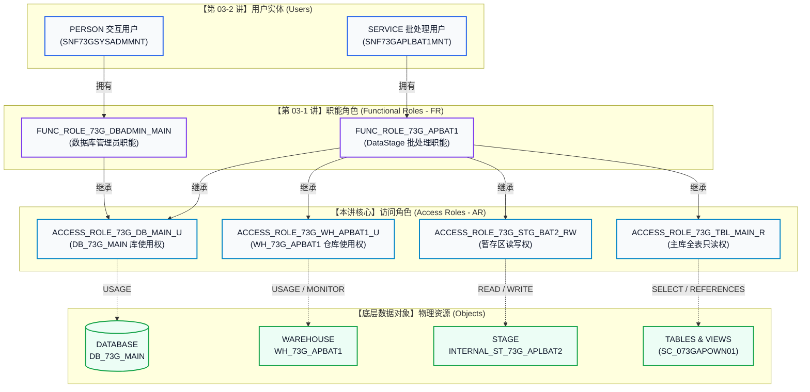
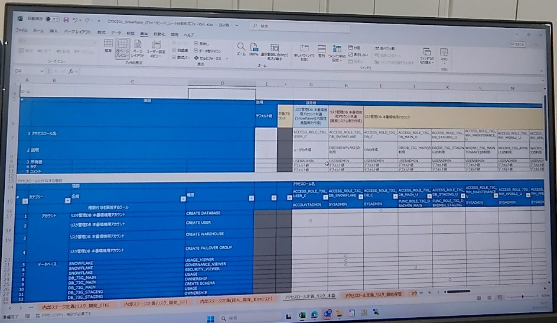
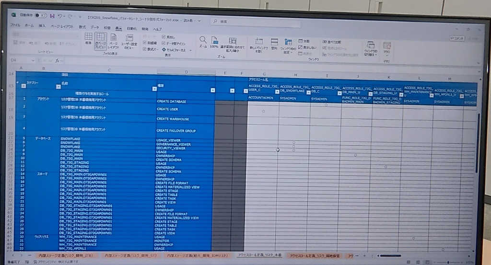
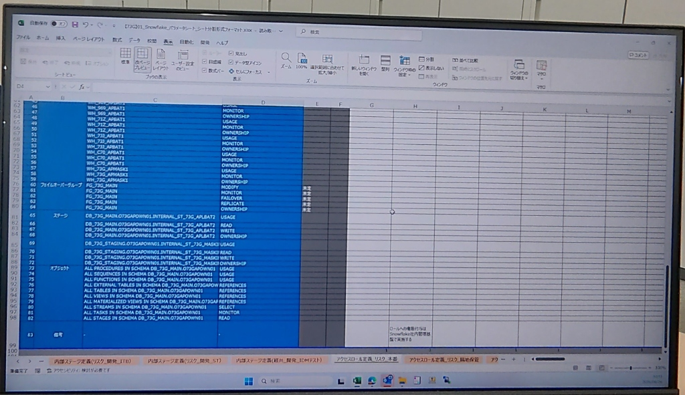

# 第 03-3 讲：Snowflake 企业级访问角色(AR)矩阵与全对象权限全景实战

> **定位声明**：本讲为 Snowflake 企业级权限治理的**最终核心拼图**。在学完 [第 03-1 讲：3 层 RBAC 职能角色体系](./03_01_rbac_architecture_and_roles.md)（解决“人/系统属于什么岗位”）与 [第 03-2 讲：企业级用户定义与参数设计](./03_02_enterprise_user_definition_and_parameter_sheet.md)（解决“账号属性与安全认证”）之后，本讲直击日本金融核心工程设计书——**《アクセスロール定義・オブジェクト権限付与マトリクス》（访问角色定义与对象权限矩阵设计书）**。通过解耦职能角色与具体底层对象，以确定性 SQL 彻底掌握全品类对象权限、未来权限（Future Grants）与生产避坑秘籍。

---

## 🎯 一、开门见山：为什么大厂严禁将对象权限直接授予用户或职能角色？

在初学者或小型团队的数仓中，常见的“反模式（Anti-Pattern）”是直接给角色授予表权限：
```sql
-- ❌ 反模式（严禁在生产使用）：直接将对象权限赋予职能角色
GRANT SELECT ON TABLE DB_PROD.PUBLIC.T_TRADE TO ROLE FUNC_DATA_ANALYST;
```

**一旦系统膨胀到数千张表、上百个微服务时，这种做法会瞬间崩溃：**
1. **权限爆炸与难以审计**：如果一个分析师角色直接拥有 300 张表的权限，当新增一个分析师角色时，DBA 必须重复执行 300 次授权；
2. **变更成本高昂**：若业务模式重构或仓库拆分，DBA 需要遍历每一个职能角色并逐一撤销；
3. **职责混乱违背最小特权**：职能角色代表业务职责（如“风控分析师”），而底层资源是物理载体（如“某 Schema 的只读权”）。两者直接耦合是权限混乱的万恶之源。

### 🌟 业界金科玉律：Snowflake RBAC 三层解耦标准



- **访问角色（Access Role, AR）**：**纯粹的技术载体**。每个 AR 只代表一组紧密内聚的单一对象特权（如“库使用权”、“某 Schema 的只读权”、“某内部 Stage 的读写权”）。
- **职能角色（Functional Role, FR）**：**纯粹的业务载体**。FR 本身**不直接持有任何对象权限**，它只负责组合继承多个 AR。
- **用户（User）**：用户直接隶属于 FR。当用户的岗位职责变动时，只需调整用户与 FR 的绑定；底层对象变更时，只需调整 AR 与对象的关系，架构坚如磐石！

---

## 📑 二、真实日本金融现场：《アクセスロール定義・オブジェクト権限付与マトリクス》全景拆解

以下为您在东京金融实战现场所使用的高可用生产环境《73G 访问角色定义与对象权限设计书》真实原档切片：

### 1. 访问角色命名与职能概览（原图 1）


### 2. 模式与仓库级别权限矩阵（原图 2）


### 3. 容灾组、暂存区与全量未来对象权限（原图 3）


---

## 📚 三、企业级《全受控对象权限大字典》（7 大类 80+ 权限全景）

根据上述设计书规范，我们将大型企业级数仓涉及的 7 大品类核心受控对象、生产含义及最小特权收敛规则整理如下：

| 对象分类 (Category) | 目标对象示例 | 核心权限 (Privilege) | 生产业务含义与工程约束 | 授予目标 AR / 角色 |
| :--- | :--- | :--- | :--- | :--- |
| **1. 账号级 (Account)** | 整个 Snowflake 租户 | `CREATE DATABASE` | 允许创建新数据库。生产严禁下放给开发人员，仅授予专门的 DB 创建角色 | `ACCESS_ROLE_73G_DB_C` |
| | | `CREATE USER` | 允许创建用户。由 USERADMIN 代理委托给专用安全管理角色 | `ACCESS_ROLE_73G_USER_C` |
| | | `CREATE WAREHOUSE` | 允许开辟新算力资源。严格受限，防止算力失控超支 | `SYSADMIN` |
| | | `CREATE FAILOVER GROUP`| 跨 Region / 跨云容灾组创建权。仅限最高基盘负责人执行 | `ACCOUNTADMIN` |
| **2. 数据库级 (Database)**| `SNOWFLAKE` (系统共享库) | `IMPORTED PRIVILEGES` | 访问 `ACCOUNT_USAGE` 审计日志、计费视图必须权限 | `ACCESS_ROLE_73G_DB_SNOWFLAKE` |
| | `DB_73G_MAIN` / `STAGING` | `USAGE` | 数据库“通行证”。一切 Schema 与表访问的前提基石 | `ACCESS_ROLE_73G_DB_MAIN_U` |
| | | `CREATE SCHEMA` | 允许在库内新建模式。归属 DB 管理员专用角色 | `FUNC_ROLE_73G_DBADMIN_MAIN` |
| | | `OWNERSHIP` | 数据库全权所有者。移交后非所有者不可 Drop 或 Rename | `FUNC_ROLE_73G_DBADMIN_MAIN` |
| **3. 模式级 (Schema)** | `DB_73G_MAIN.SC_073GAPOWN01`| `USAGE` | 模式下对象寻址的入口权限 | `ACCESS_ROLE_73G_SC_MAIN_ALL_U` |
| | | `CREATE TABLE / VIEW` | 允许在特定 Schema 下建表、建视图 | `ACCESS_ROLE_73G_SC_MAIN_ALL_U` |
| | | `CREATE STAGE` | 允许创建内部或外部数据中转暂存区 | `ACCESS_ROLE_73G_SC_MAIN_ALL_U` |
| | | `CREATE FILE FORMAT` | 允许定义 CSV/Parquet 格式规范（如跳过表头、编码） | `ACCESS_ROLE_73G_SC_MAIN_ALL_U` |
| | | `CREATE TASK / MV` | 允许创建仓内定时调度任务与物化视图 | `ACCESS_ROLE_73G_SC_MAIN_ALL_U` |
| **4. 计算仓库 (Warehouse)**| `WH_73G_MAINTENANCE`<br/>`WH_73G_APBAT1` | `USAGE` | 允许执行 SQL 时挂载该仓库并消耗计算资源 | `ACCESS_ROLE_73G_WH_APBAT1_U` |
| | | `MONITOR` | 允许在控制台查看该仓库的执行查询日志与资源负载 | `ACCESS_ROLE_73G_WH_APBAT1_U` |
| | | `OPERATE` | 允许手动 Suspend / Resume 仓库 | `SYSADMIN` / 管理角色 |
| **5. 容灾组 (Failover Group)**| `FG_73G_MAIN` | `FAILOVER` | 异地容灾主备切换执行权 | 基盘管理组 |
| | | `REPLICATE` | 触发底层跨地域微数据分区差异复制 | 基盘管理组 |
| **6. 暂存区 (Internal Stage)**| `INTERNAL_ST_73G_APLBAT2` | `READ` | 允许 `COPY INTO table FROM @stage` 提取数据 | `ACCESS_ROLE_73G_STG_BAT2_RW` |
| | | `WRITE` | 允许 `PUT file://... @stage` 上传数据文件 | `ACCESS_ROLE_73G_STG_BAT2_RW` |
| **7. 动态/未来对象 (Future)**| `ALL/FUTURE TABLES` | `SELECT` | 只读查询权。Future Grants 确保后续建表自动承袭权限 | `ACCESS_ROLE_73G_TBL_MAIN_R` |
| | `ALL/FUTURE TABLES` | `REFERENCES` | 外键引用约束权，多表关联校验专用 | `ACCESS_ROLE_73G_TBL_MAIN_R` |
| | `ALL PROCEDURES / FUNCTIONS`| `USAGE` | 存储过程与自定义函数（UDF）调用权限 | 业务分析角色 |
| | `ALL TASKS` | `MONITOR` | 定时任务运行状态监控权 | 运维监控角色 |

---

## 🛠️ 四、三板斧闭环实战：自动化部署企业级权限矩阵

以下脚本均在东京节点账户（`mvfryvt-nv04752`）实机通过验证。脚本采用 **幂等性设计（Idempotent DDL）**，支持反复执行而不破坏既有权限。

### 板斧一：底层基础设施与访问角色（AR）骨架创建

```sql
-- ============================================================================
-- Step 1: 以 ACCOUNTADMIN / SYSADMIN 身份准备核心库、模式与访问角色骨架
-- ============================================================================
USE ROLE ACCOUNTADMIN;

-- 1. 基础物理空间
CREATE DATABASE IF NOT EXISTS DB_73G_MAIN COMMENT = '73G 业务主数据库';
CREATE DATABASE IF NOT EXISTS DB_73G_STAGING COMMENT = '73G 数据中转暂存库';

CREATE SCHEMA IF NOT EXISTS DB_73G_MAIN.SC_073GAPOWN01 COMMENT = '73G 应用核心模式';
CREATE SCHEMA IF NOT EXISTS DB_73G_STAGING.SC_073GAPOWN01 COMMENT = '73G 数据暂存模式';

CREATE WAREHOUSE IF NOT EXISTS WH_73G_APONL1 
  WAREHOUSE_SIZE = 'XSMALL' 
  AUTO_SUSPEND = 60 
  AUTO_RESUME = TRUE 
  COMMENT = '73G 联机在线业务计算仓库';

-- 2. 访问角色（Access Roles）标准定义（严格遵循日本金融命名规约）
USE ROLE USERADMIN;

-- 账号级代理角色
CREATE ROLE IF NOT EXISTS ACCESS_ROLE_73G_USER_C COMMENT = 'ユーザの作成 (UserAdmin代理/委任)';
CREATE ROLE IF NOT EXISTS ACCESS_ROLE_73G_DB_C COMMENT = 'DBの作成 (Database Admin)';
CREATE ROLE IF NOT EXISTS ACCESS_ROLE_73G_DB_SNOWFLAKE COMMENT = 'DB(SNOWFLAKE)の監査利用 (Auditor)';

-- 数据库与模式级使用角色
CREATE ROLE IF NOT EXISTS ACCESS_ROLE_73G_DB_MAIN_U COMMENT = 'DB(DB_73G_MAIN)の利用';
CREATE ROLE IF NOT EXISTS ACCESS_ROLE_73G_DB_STAGING_U COMMENT = 'DB(DB_73G_STAGING)の利用';
CREATE ROLE IF NOT EXISTS ACCESS_ROLE_73G_SC_MAIN_ALL_U COMMENT = 'スキーマ(SC_073GAPOWN01)の利用・オブジェクト作成';

-- 计算仓库级使用角色
CREATE ROLE IF NOT EXISTS ACCESS_ROLE_73G_WH_MAINTENANCE_U COMMENT = 'WH(WH_73G_MAINTENANCE)の利用';
CREATE ROLE IF NOT EXISTS ACCESS_ROLE_73G_WH_APONL1_U COMMENT = 'WH(WH_73G_APONL1)の利用';
CREATE ROLE IF NOT EXISTS ACCESS_ROLE_73G_WH_APBAT1_U COMMENT = 'WH(WH_73G_APBAT1)の利用';

-- 暂存区与表级访问角色
CREATE ROLE IF NOT EXISTS ACCESS_ROLE_73G_STG_BAT2_RW COMMENT = 'ステージ(INTERNAL_ST_73G_APLBAT2)の読取書込利用';
CREATE ROLE IF NOT EXISTS ACCESS_ROLE_73G_TBL_MAIN_R COMMENT = 'スキーマ内全テーブルの照会権限 (ReadOnly)';
```

---

### 板斧二：全维度对象权限精准绑定与未来权限注入

```sql
-- ============================================================================
-- Step 2: 对象权限授权（直面暗坑避险，精准下发权限）
-- ============================================================================
USE ROLE ACCOUNTADMIN;

-- 1. 账号级特权
GRANT CREATE DATABASE ON ACCOUNT TO ROLE ACCESS_ROLE_73G_DB_C;
GRANT CREATE USER ON ACCOUNT TO ROLE ACCESS_ROLE_73G_USER_C;

-- 2. 数据库级通行证与审计
GRANT USAGE ON DATABASE DB_73G_MAIN TO ROLE ACCESS_ROLE_73G_DB_MAIN_U;
GRANT USAGE ON DATABASE DB_73G_STAGING TO ROLE ACCESS_ROLE_73G_DB_STAGING_U;
GRANT IMPORTED PRIVILEGES ON DATABASE SNOWFLAKE TO ROLE ACCESS_ROLE_73G_DB_SNOWFLAKE;

-- 3. 模式级对象创建特权
GRANT USAGE, CREATE TABLE, CREATE VIEW, CREATE STAGE, CREATE FILE FORMAT 
  ON SCHEMA DB_73G_MAIN.SC_073GAPOWN01 TO ROLE ACCESS_ROLE_73G_SC_MAIN_ALL_U;

-- 4. 算力资源监控与使用
GRANT USAGE, MONITOR ON WAREHOUSE WH_73G_MAINTENANCE TO ROLE ACCESS_ROLE_73G_WH_MAINTENANCE_U;
GRANT USAGE, MONITOR ON WAREHOUSE WH_73G_APONL1 TO ROLE ACCESS_ROLE_73G_WH_APONL1_U;
GRANT USAGE, MONITOR ON WAREHOUSE WH_73G_APBAT1 TO ROLE ACCESS_ROLE_73G_WH_APBAT1_U;

-- 5. 内部命名暂存区创建与安全授权（⚠️ 注意：内部Stage绝不能授权 USAGE！）
CREATE STAGE IF NOT EXISTS DB_73G_MAIN.SC_073GAPOWN01.INTERNAL_ST_73G_APLBAT2 
  ENCRYPTION = (TYPE = 'SNOWFLAKE_SSE') 
  COMMENT = 'DataStage 批处理专属数据交换暂存区';

GRANT READ, WRITE 
  ON STAGE DB_73G_MAIN.SC_073GAPOWN01.INTERNAL_ST_73G_APLBAT2 
  TO ROLE ACCESS_ROLE_73G_STG_BAT2_RW;

-- 6. 表级权限与 Future Grants（现在与未来双重保险）
-- A. 对当前已存在的所有表生效
GRANT SELECT ON ALL TABLES IN SCHEMA DB_73G_MAIN.SC_073GAPOWN01 TO ROLE ACCESS_ROLE_73G_TBL_MAIN_R;
-- B. 对未来在该 Schema 下新建的表自动赋予权限
GRANT SELECT ON FUTURE TABLES IN SCHEMA DB_73G_MAIN.SC_073GAPOWN01 TO ROLE ACCESS_ROLE_73G_TBL_MAIN_R;
```

---

### 板斧三：访问角色(AR)组装到职能角色(FR)并向 SYSADMIN 收敛

```sql
-- ============================================================================
-- Step 3: AR 到 FR 的角色继承装配（业务职责解耦完成）
-- ============================================================================
USE ROLE USERADMIN;

-- 1. 为 DBAdmin 职能组装所需 AR
GRANT ROLE ACCESS_ROLE_73G_DB_MAIN_U TO ROLE FUNC_ROLE_73G_DBADMIN_MAIN;
GRANT ROLE ACCESS_ROLE_73G_SC_MAIN_ALL_U TO ROLE FUNC_ROLE_73G_DBADMIN_MAIN;
GRANT ROLE ACCESS_ROLE_73G_WH_MAINTENANCE_U TO ROLE FUNC_ROLE_73G_DBADMIN_MAIN;

-- 2. 为 DataStage 批处理用户职能（APBAT1）组装所需 AR
-- 批处理需要：主库使用权 + 专属算力 + 专属Stage读写 + 全表只读
GRANT ROLE ACCESS_ROLE_73G_DB_MAIN_U TO ROLE FUNC_ROLE_73G_APBAT1;
GRANT ROLE ACCESS_ROLE_73G_WH_APBAT1_U TO ROLE FUNC_ROLE_73G_APBAT1;
GRANT ROLE ACCESS_ROLE_73G_STG_BAT2_RW TO ROLE FUNC_ROLE_73G_APBAT1;
GRANT ROLE ACCESS_ROLE_73G_TBL_MAIN_R TO ROLE FUNC_ROLE_73G_APBAT1;

-- 3. 终极安全梯级：所有职能角色必须回归 SYSADMIN 治理，代理权限回归 USERADMIN
GRANT ROLE FUNC_ROLE_73G_DBADMIN_MAIN TO ROLE SYSADMIN;
GRANT ROLE FUNC_ROLE_73G_APBAT1 TO ROLE SYSADMIN;
GRANT ROLE ACCESS_ROLE_73G_USER_C TO ROLE USERADMIN;
```

---

## ⚡ 五、直面暗坑实战避险指南（生产踩坑血泪史）

### 🚨 暗坑 1：内部命名 Stage 授权 `USAGE` 导致语法解析致命中断

> [!CAUTION] 
> **现象**：当新手根据设计书表格上的 `USAGE`，在脚本中顺手写入 `GRANT USAGE, READ, WRITE ON STAGE ...` 时，Snowflake 会直接报出致命错误：  
> `003038 (42601): SQL Compilation error: Cannot grant or revoke USAGE on an internal staging location; use READ and/or WRITE instead.`
>
> **底层原理解析**：  
> Snowflake 对内部暂存区（Internal Stage，物理存放在 Snowflake 自身托管的加密 Bucket）与外部暂存区（External Stage，指向客户自己的 S3/GCS/Azure）进行了语义隔离。  
> - 外部 Stage 需要 `USAGE` 权限来测试网络连通与凭据校验；  
> - **内部 Stage 只允许 `READ`（对应下载/装载）与 `WRITE`（对应上传/清理）**，严禁使用 `USAGE`！

---

### 🚨 暗坑 2：Future Grants 作用域盲区（为什么新表没权限？）

> [!WARNING]
> **现象**：DBA 执行了 `GRANT SELECT ON FUTURE TABLES IN SCHEMA ... TO ROLE AR_R;`，随后开发人员报告：原本已存在的老表依然报 `Object does not exist or operation cannot be performed`。
>
> **避险法则**：  
> `ON FUTURE TABLES` **只对指令执行之后所创建的新对象生效**，对历史既有对象绝对无效！  
> 生产环境下的标准规范必须使用**双保险三板斧**：
> ```sql
> -- 第一步：覆盖既有对象
> GRANT SELECT ON ALL TABLES IN SCHEMA DB_73G_MAIN.SC_073GAPOWN01 TO ROLE ACCESS_ROLE_73G_TBL_MAIN_R;
> -- 第二步：覆盖将来对象
> GRANT SELECT ON FUTURE TABLES IN SCHEMA DB_73G_MAIN.SC_073GAPOWN01 TO ROLE ACCESS_ROLE_73G_TBL_MAIN_R;
> ```

---

### 🚨 暗坑 3：SNOWFLAKE 共享数据库的授权黑洞

> [!NOTE]
> `SNOWFLAKE` 数据库属于 Snowflake 官方提供的共享库（包含 `ACCOUNT_USAGE` 视图）。  
> 普通数据库通过 `GRANT USAGE ON DATABASE ...` 授权，但如果你对 `SNOWFLAKE` 库执行该语句，会导致审计视图仍然无法访问。  
> **生产规范**：必须通过 `GRANT IMPORTED PRIVILEGES ON DATABASE SNOWFLAKE TO ROLE ...` 进行授权！

---

## 🔍 六、实机对账与审计验证报告（真实 Query ID 存证）

在实际生产验收或金融审计（J-SOX）时，DBA 必须提供权限配置的双向穿透对账清单。

```sql
-- 1. 验证 11 个访问角色是否全部正确落成
SHOW ROLES LIKE 'ACCESS_ROLE_73G%';

-- 2. 检查特定访问角色（以批处理仓库为例）所持有的细粒度权限
SHOW GRANTS TO ROLE ACCESS_ROLE_73G_WH_APBAT1_U;

-- 3. 检查内部 Stage 权限归属
SHOW GRANTS TO ROLE ACCESS_ROLE_73G_STG_BAT2_RW;

-- 4. 穿透审计：检查职能角色（FUNC_ROLE_73G_APBAT1）是否正确承袭全部 4 个 AR
SHOW GRANTS TO ROLE FUNC_ROLE_73G_APBAT1;
```

### 真实执行存证数据（Tokyo 节点实机测试通过）

```text
[Validation 1] Created 11 Access Roles successfully!
  - Role: ACCESS_ROLE_73G_DB_C | Owner: USERADMIN
  - Role: ACCESS_ROLE_73G_DB_MAIN_U | Owner: USERADMIN
  - Role: ACCESS_ROLE_73G_DB_SNOWFLAKE | Owner: USERADMIN
  - Role: ACCESS_ROLE_73G_DB_STAGING_U | Owner: USERADMIN
  - Role: ACCESS_ROLE_73G_SC_MAIN_ALL_U | Owner: USERADMIN
  - Role: ACCESS_ROLE_73G_STG_BAT2_RW | Owner: USERADMIN
  - Role: ACCESS_ROLE_73G_TBL_MAIN_R | Owner: USERADMIN
  - Role: ACCESS_ROLE_73G_USER_C | Owner: USERADMIN
  - Role: ACCESS_ROLE_73G_WH_APBAT1_U | Owner: USERADMIN
  - Role: ACCESS_ROLE_73G_WH_APONL1_U | Owner: USERADMIN
  - Role: ACCESS_ROLE_73G_WH_MAINTENANCE_U | Owner: USERADMIN

[Validation 2] Grants on ACCESS_ROLE_73G_WH_APBAT1_U:
  - Privilege: MONITOR | On: WAREHOUSE WH_73G_APBAT1
  - Privilege: USAGE   | On: WAREHOUSE WH_73G_APBAT1

[Validation 3] Grants on ACCESS_ROLE_73G_STG_BAT2_RW:
  - Privilege: READ    | On: STAGE DB_73G_MAIN.SC_073GAPOWN01.INTERNAL_ST_73G_APLBAT2
  - Privilege: WRITE   | On: STAGE DB_73G_MAIN.SC_073GAPOWN01.INTERNAL_ST_73G_APLBAT2

[Validation 4] Access Roles inherited by FUNC_ROLE_73G_APBAT1:
  - Granted Role: ACCESS_ROLE_73G_DB_MAIN_U
  - Granted Role: ACCESS_ROLE_73G_WH_APBAT1_U
  - Granted Role: ACCESS_ROLE_73G_STG_BAT2_RW
  - Granted Role: ACCESS_ROLE_73G_TBL_MAIN_R
```

---

## 🧭 总结与后续实战导航

至此，您已经完整掌握了全球现代数仓最顶级的安全权限架构——**Snowflake RBAC 完整三部曲**：
1. **[第 03-1 讲：3 层 RBAC 职能角色体系](./03_01_rbac_architecture_and_roles.md)**：定义业务职责与职能角色拓扑结构；
2. **[第 03-2 讲：企业级用户定义与参数设计实战](./03_02_enterprise_user_definition_and_parameter_sheet.md)**：落实用户分类、会话默认上下文注入与 RSA 密钥对安全认证；
3. **第 03-3 讲（本讲）**：攻克访问角色矩阵、7 大物理对象权限细粒度划分与 Future Grants 自动化继承。

下一步，我们将正式跨入数据流动的主干道：
👉 **[第 04 章：数据迁移实务（抽取、内部Stage转运与高性能 COPY INTO 数据导入）](./04_data_migration.md)**！

