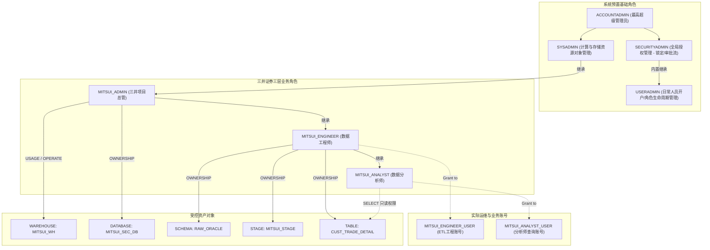

# 第 03 章：Snowflake 企业级 RBAC 权限设计与环境搭建实战

在三井证券等金融机构中，**最小特权原则（Principle of Least Privilege）**与**职能分离（Separation of Duties）**是合规的生命线。

本章严格遵循 Excel 规划，完整演练从内置系统角色（`USERADMIN` / `SYSADMIN`）到三井证券三层业务角色体系（`MITSUI_ADMIN` -> `MITSUI_ENGINEER` -> `MITSUI_ANALYST`），从资源配置到渐进式授权（Step 4.1 ~ 4.15）的全流程。

---

## 🏛️ 三井证券角色继承与访问控制架构



---

## 🛠️ Step 4.1 ~ 4.15 详细执行手册

### 阶段一：切换 `USERADMIN`（管理用户与角色的生命周期）

```sql
USE ROLE USERADMIN;
```

#### 4.1 创建 Role
创建三井证券三层业务角色体系：
```sql
CREATE ROLE IF NOT EXISTS MITSUI_ADMIN    COMMENT = '三井证券项目总管角色';
CREATE ROLE IF NOT EXISTS MITSUI_ENGINEER COMMENT = '三井证券数据工程师角色';
CREATE ROLE IF NOT EXISTS MITSUI_ANALYST  COMMENT = '三井证券数据分析师角色';
```

#### 4.2 赋予 / 继承权限 (Role Hierarchy)
建立清晰的角色层级树，使得权限平滑继承，并最终汇总受控于 `SYSADMIN`：
```sql
-- 将 MITSUI_ADMIN 挂载到 SYSADMIN 之下
GRANT ROLE MITSUI_ADMIN TO ROLE SYSADMIN;

-- 工程师继承总管
GRANT ROLE MITSUI_ENGINEER TO ROLE MITSUI_ADMIN;

-- 分析师继承工程师
GRANT ROLE MITSUI_ANALYST TO ROLE MITSUI_ENGINEER;
```

#### 4.3 创建 User
创建实际业务用户：
```sql
-- 工程师账号
CREATE USER IF NOT EXISTS MITSUI_ENGINEER_USER
    PASSWORD = 'MitsuiSecStrongPass2026!'
    DEFAULT_ROLE = MITSUI_ENGINEER
    DEFAULT_WAREHOUSE = MITSUI_WH
    MUST_CHANGE_PASSWORD = FALSE
    COMMENT = '三井证券ETL与迁移工程账号';

-- 分析师账号
CREATE USER IF NOT EXISTS MITSUI_ANALYST_USER
    PASSWORD = 'MitsuiSecStrongPass2026!'
    DEFAULT_ROLE = MITSUI_ANALYST
    DEFAULT_WAREHOUSE = MITSUI_WH
    MUST_CHANGE_PASSWORD = FALSE
    COMMENT = '三井证券分析师业务账号';
```

#### 4.4 赋予角色
```sql
GRANT ROLE MITSUI_ENGINEER TO USER MITSUI_ENGINEER_USER;
GRANT ROLE MITSUI_ANALYST TO USER MITSUI_ANALYST_USER;
```

---

### 阶段二：切换 `SYSADMIN`（分配计算资源与下发建库特权）

```sql
USE ROLE SYSADMIN;
```

#### 4.5 WAREHOUSE 作成
创建按需自动启停的虚拟计算仓库：
```sql
CREATE WAREHOUSE IF NOT EXISTS MITSUI_WH
    WITH 
    WAREHOUSE_SIZE = 'XSMALL'
    AUTO_SUSPEND = 300           -- 5分钟无查询自动休眠
    AUTO_RESUME = TRUE           -- 有SQL请求时秒级自动拉起
    INITIALLY_SUSPENDED = TRUE
    COMMENT = '三井证券核心数据批处理与迁移专用WH';

-- 授予计算仓库使用权
GRANT USAGE, OPERATE ON WAREHOUSE MITSUI_WH TO ROLE MITSUI_ADMIN;
```

#### 4.6 DB 作成权限付与
在 Account 层级授予项目总管建库特权：
```sql
GRANT CREATE DATABASE ON ACCOUNT TO ROLE MITSUI_ADMIN;
```

---

### 阶段三：切换至业务角色，验证特权并创建存储实体 (Step 4.7 ~ 4.15)

#### 4.7 账号角色切换（切换为项目总管 MITSUI_ADMIN）
```sql
USE ROLE MITSUI_ADMIN;
USE WAREHOUSE MITSUI_WH;
```

#### 4.8 DATABASE 作成
```sql
CREATE DATABASE IF NOT EXISTS MITSUI_SEC_DB
    COMMENT = '三井证券核心生产数据云端迁移仓';

USE DATABASE MITSUI_SEC_DB;
```

#### 4.9 Schema 作成权限付与
将创建 Schema 的权限委托给数据工程师角色 `MITSUI_ENGINEER`：
```sql
GRANT USAGE ON DATABASE MITSUI_SEC_DB TO ROLE MITSUI_ENGINEER;
GRANT CREATE SCHEMA ON DATABASE MITSUI_SEC_DB TO ROLE MITSUI_ENGINEER;
```

#### 4.10 账号角色切换（切换为数据工程师 MITSUI_ENGINEER）
```sql
USE ROLE MITSUI_ENGINEER;
USE WAREHOUSE MITSUI_WH;
USE DATABASE MITSUI_SEC_DB;
```

#### 4.11 SCHEMA 作成
创建 Oracle 落地原始表所在的 Schema：
```sql
CREATE SCHEMA IF NOT EXISTS RAW_ORACLE
    DATA_RETENTION_TIME_IN_DAYS = 7
    COMMENT = 'Oracle 迁移落地原始表 Schema';

USE SCHEMA RAW_ORACLE;
```

#### 4.12 阶段 / 表作成权限付与
`MITSUI_ENGINEER` 作为当前 Schema 的创建者（OWNER），天然拥有创建 Stage、Table、File Format 的所有特权；同时为分析师赋予 Schema 的使用权：
```sql
GRANT USAGE ON SCHEMA MITSUI_SEC_DB.RAW_ORACLE TO ROLE MITSUI_ANALYST;
```

#### 4.13 账号角色切换 / 上下文锁定
```sql
USE ROLE MITSUI_ENGINEER;
USE WAREHOUSE MITSUI_WH;
USE DATABASE MITSUI_SEC_DB;
USE SCHEMA RAW_ORACLE;
```

#### 4.14 ステージ作成（Stage 与解析格式定义）
```sql
CREATE OR REPLACE FILE FORMAT CSV_ORACLE_IMPORT_FF
    TYPE = 'CSV'
    FIELD_DELIMITER = ','
    RECORD_DELIMITER = '\n'
    SKIP_HEADER = 1
    FIELD_OPTIONALLY_ENCLOSED_BY = '"'
    NULL_IF = ('NULL', 'null', '')
    EMPTY_FIELD_AS_NULL = TRUE
    TIMESTAMP_FORMAT = 'YYYY-MM-DD HH24:MI:SS'
    ENCODING = 'UTF8';

CREATE OR REPLACE STAGE MITSUI_STAGE
    FILE_FORMAT = CSV_ORACLE_IMPORT_FF
    COMMENT = '接收来自 Oracle 导出的中间受控暂存区';
```

#### 4.15 テーブル作成（CUST_TRADE_DETAIL 表创建）
严格按照 Excel 的规范映射创建落地表：
```sql
CREATE OR REPLACE TABLE CUST_TRADE_DETAIL (
    TRADE_QTY          NUMBER(15, 0)     DEFAULT 0 NOT NULL COMMENT '取引数量',
    AMOUNT_JPY         NUMBER(18, 3)     DEFAULT 0 NOT NULL COMMENT '約定金額・円貨',
    AMOUNT_FCY         NUMBER(18, 3)     DEFAULT 0 COMMENT '約定金額・外貨',
    CCY_CODE           VARCHAR(3)        COMMENT '通貨区分 (USD/EUR等)',
    EXCHANGE_RATE      NUMBER(9, 6)      COMMENT '為替レート',
    REMARKS            VARCHAR(100)      DEFAULT ' ' COMMENT '摘要・備考 (全角半角混在安全)',
    CUST_ID            VARCHAR(10)       NOT NULL COMMENT '顧客ID',
    TRADE_TYPE_CD      VARCHAR(2)        NOT NULL COMMENT '取引区分 (01:買付, 02:売付)',
    BRANCH_CD          VARCHAR(4)        NOT NULL COMMENT '支店コード',
    TRADE_DATE         VARCHAR(8)        NOT NULL COMMENT '約定日 (YYYYMMDD)',
    SETTLE_MONTH       VARCHAR(6)        COMMENT '決済対象月 (YYYYMM)',
    REG_DATETIME       TIMESTAMP_NTZ(6)  DEFAULT CURRENT_TIMESTAMP() NOT NULL COMMENT '登録日時',
    UPD_DATETIME       TIMESTAMP_NTZ(6)  COMMENT '更新日時',
    MIGRATED_AT        TIMESTAMP_LTZ(6)  DEFAULT CURRENT_TIMESTAMP() COMMENT '迁移同步时间戳',
    CONSTRAINT PK_CUST_TRADE_DETAIL PRIMARY KEY (CUST_ID, TRADE_DATE, TRADE_TYPE_CD)
)
COMMENT = '顧客取引明細（Oracle移行先 Snowflake設計）';

-- 遵循最小权限，只为分析师角色赋予 SELECT 权
GRANT SELECT ON TABLE CUST_TRADE_DETAIL TO ROLE MITSUI_ANALYST;
```

---

## 🎯 验证与自检清单

```sql
-- 1. 查看当前会话环境
SELECT CURRENT_USER(), CURRENT_ROLE(), CURRENT_WAREHOUSE(), CURRENT_DATABASE(), CURRENT_SCHEMA();

-- 2. 检查角色继承关系
SHOW GRANTS OF ROLE MITSUI_ENGINEER;
SHOW GRANTS OF ROLE MITSUI_ADMIN;

-- 3. 检查表对象与阶段
SHOW STAGES LIKE 'MITSUI_STAGE';
SHOW TABLES LIKE 'CUST_TRADE_DETAIL';
```
