# 第 03 章：Snowflake 企业级 RBAC 权限设计与环境搭建实战

在银行证券等金融机构中，**最小特权原则（Principle of Least Privilege）**与**职能分离（Separation of Duties）**是合规的生命线。

在前两章中，我们剖析了三井证券夜间批处理超时痛点（[第 00 章](00_architecture_overview.md)），开通了企业级 Snowflake 云数仓（[第 01 章](01_snowflake_signup.md)），并在本地完成了 Oracle 11g 源库的搭建与 1:N 金融双表（`CUST_MASTER` + `CUST_TRADE_DETAIL`）的测试灌水（[第 02 章](02_oracle_setup_and_data.md)）。

本章我们将正式在 Snowflake 云端落地三井证券的企业级治理基盘：使用预置的 `USERADMIN` 与 `SYSADMIN` 系统角色，构建清晰的**三层业务角色体系（`MITSUI_ADMIN` $\to$ `MITSUI_ENGINEER` $\to$ `MITSUI_ANALYST`）**，并通过特权安全委让机制，在目标三段式命名空间 **`MITSUI_SEC_DB.RAW_ORACLE`** 下完成虚拟数仓、Stage 暂存区以及 `CUST_MASTER` 维度主表与 `CUST_TRADE_DETAIL` 事实流水表的双表建设！

---

## 一、 系统概要与核心目标（社内管理基盘设计思想）

在金融工程实践中，Snowflake 企业内部统一管理基盘的设立主要聚焦于以下两大核心目标：

1. **防范重大安全风险，基盘团队收敛全局特权**：  
   对于直接关联外部数据外泄等重大安全风险的全局最高权限，必须由**基盘架构团队（基础平台与安全运维）**统一所管。具体而言，全局系统管理角色 **`ACCOUNTADMIN`** 与 **`SECURITYADMIN`** 必须严格受控，杜绝直接下放给业务开发人员；基盘团队以此为前提，为各业务系统部门提供一个标准化、安全可信的 Snowflake 容器与基础设施。

2. **对接分散运维基盘，提供通用公共能力以减轻业务负担**：  
   由管理基盘统一对外提供与企业级分散运维体系对接所需的公共能力与标准接口，大幅减轻各业务部门的独立运维负担。  
   > [!IMPORTANT]
   > **企业级权责边界划分原则**：  
   > 针对因各业务系统而异的 **`SYSADMIN` 管理领域（包括各自的计算仓库 Warehouse、数据库 Database、Schema、Stage 等物理对象）**，全面下放并**由各业务系统部门（银行证券数据迁移项目组）自主管理与规划**，兼顾全局安全合规与业务线的敏捷工程落地。

---

## 二、 🏛️ 银行证券角色继承与访问控制架构

在金融云数仓设计中，我们将系统内置角色与业务定制角色进行清晰的解耦与挂载：

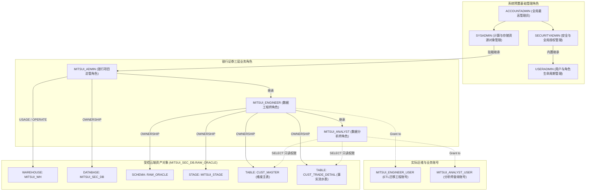

> [!NOTE]
> **★ 关键安全规则（Snowflake 权限向上汇总机制）**：  
> Snowflake 的角色继承是**单向向上继承（父角色拥有子角色的特权，但子角色绝不自动继承父角色特权）**。因此：  
> 1. `SYSADMIN` 天然拥有所有挂载在它之下的业务对象权限，便于全局运维；  
> 2. 但为 `MITSUI_ADMIN` 赋予的 Warehouse `USAGE` 权限，**不会**自动流向 `MITSUI_ENGINEER` 或 `MITSUI_ANALYST`，必须显式对各角色进行明确授权！

---

## 三、 🛠️ 企业级环境部署详细实操（17 步标准流水线实战）

本节严格按照日本金融机构（FISC 安全基线）标准建设流水线展开实操。在本实战演练中，**所有 SQL 语句均完整保留于工作区脚本中，代码格式规范、逐段配备详尽的设计理由注释**，让每一位学习者具备 100% 的可复现能力。

* **配套全量生产级脚本**：`scripts/snowflake/03_rbac_and_env_master.sql`

---

### 阶段一：切换 `USERADMIN`（管理用户与角色的生命周期）

#### Step 01: 切换 useradmin 账户
* **为什么这么做**：按职能分离（Separation of Duties）原则，用户（User）与角色（Role）的生命周期管理必须由专职的 `USERADMIN` 负责，坚决杜绝滥用全局最高特权角色 `ACCOUNTADMIN`，收敛特权扩散风险。

```sql
-- ====================================================================
-- 【Step 01: 切换 useradmin 账户】
-- 目的・理由: 职能分离（Separation of Duties）原则，用户与角色的
--             生命周期管理必须由 USERADMIN 专职管理，杜绝滥用 ACCOUNTADMIN。
-- ====================================================================
USE ROLE USERADMIN;
```

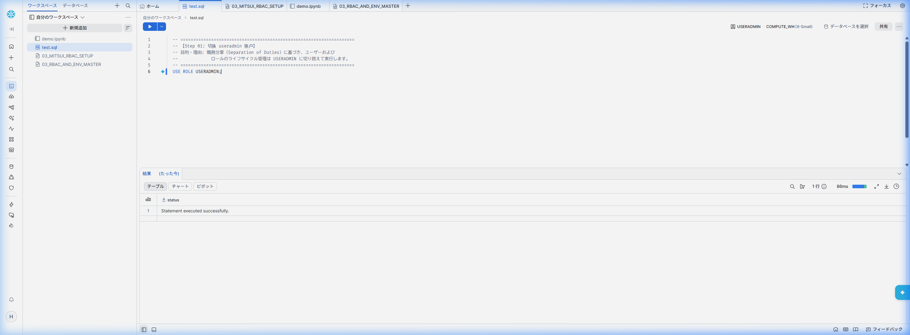

> **实操结果解读**：  
> 右上角角色上下文成功切换为 `USERADMIN`，底部结果面板显示 `Statement executed successfully.`（耗时仅 86ms）。

---

#### Step 02: 创建 role（三层业务角色体系）
* **为什么这么做**：在银行证券数据治理体系中，设立“项目总管（`MITSUI_ADMIN`）”、“数据工程师（`MITSUI_ENGINEER`）”与“业务分析师（`MITSUI_ANALYST`）”三层角色，实现数据资产的治理、构建与消费三权分立。

```sql
-- ====================================================================
-- 【Step 02: 创建 role】
-- 目的・理由: 在银行证券数据基盘中建立三层业务角色：
--             - MITSUI_ADMIN: 统括管理者，负责库级规划与特权下发
--             - MITSUI_ENGINEER: 数据工程师，负责数据管道、Schema与表DDL
--             - MITSUI_ANALYST: 数据分析师，仅拥有查询与对账只读特权
-- ====================================================================
CREATE ROLE IF NOT EXISTS MITSUI_ADMIN    COMMENT = '银行证券项目统括管理者角色';
CREATE ROLE IF NOT EXISTS MITSUI_ENGINEER COMMENT = '银行证券数据工程师角色（负责迁移与ETL）';
CREATE ROLE IF NOT EXISTS MITSUI_ANALYST  COMMENT = '银行证券数据分析师角色（负责对账与查询）';
```

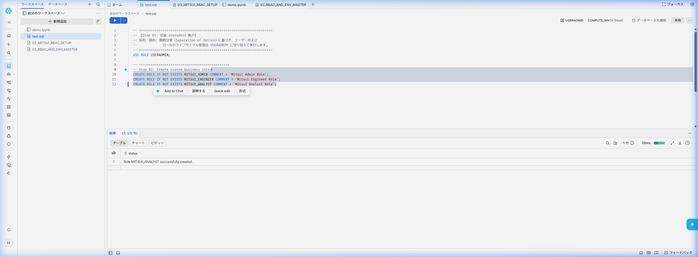

> **实操结果解读**：  
> 角色创建成功，系统输出反馈 `Role MITSUI_ANALYST successfully created.`，前置历史代码完好保留在上方。

---

#### Step 03: 赋予/继承权限（建立角色继承树）
* **为什么这么做**：构建角色层级树（Role Hierarchy）。将 `MITSUI_ADMIN` 挂载到系统管理员 `SYSADMIN` 配下，确保顶层运维团队的集中治理；同时让权限自上而下逐级包含。

```sql
-- ====================================================================
-- 【Step 03: 赋予/继承权限】
-- 目的・理由: 统括管理者挂载至 SYSADMIN 确保集中监管，
--             并建立 MITSUI_ADMIN -> MITSUI_ENGINEER -> MITSUI_ANALYST 继承链。
-- ====================================================================
-- 统括管理者汇总至 SYSADMIN
GRANT ROLE MITSUI_ADMIN TO ROLE SYSADMIN;

-- 工程师向统括管理者汇总特权
GRANT ROLE MITSUI_ENGINEER TO ROLE MITSUI_ADMIN;

-- 分析师向工程师汇总特权
GRANT ROLE MITSUI_ANALYST TO ROLE MITSUI_ENGINEER;
```

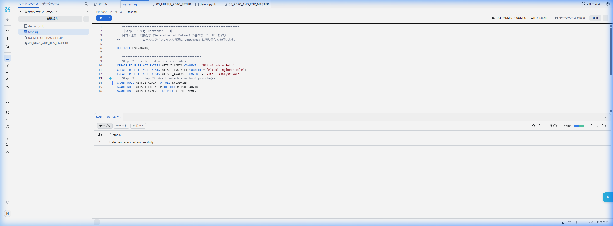

> **实操结果解读**：  
> 继承关系确立，`SYSADMIN` 天然具备对全部业务对象的集中巡检与合规审计能力。

---

#### Step 04: 创建 user（技术账号与业务账号）
* **为什么这么做**：为实际操作人员与跑批程序开通专属账号，并在创建时强制绑定默认角色（`DEFAULT_ROLE`）与默认虚拟数仓（`DEFAULT_WAREHOUSE`），避免操作人员因未设默认环境而发生权限错乱或未按规范使用算力。

```sql
-- ====================================================================
-- 【Step 04: 创建 user】
-- 目的・理由: 创建实际操作账号，绑定默认角色与计算仓库，防范权限混淆。
-- ====================================================================
-- 数据工程师账号（负责数据迁移与跑批）
CREATE USER IF NOT EXISTS MITSUI_ENGINEER_USER
    PASSWORD = 'MitsuiSecStrongPass2026!'
    DEFAULT_ROLE = MITSUI_ENGINEER
    DEFAULT_WAREHOUSE = MITSUI_WH
    MUST_CHANGE_PASSWORD = FALSE
    COMMENT = '银行证券数据工程师业务账号';

-- 数据分析师账号（负责对账突合与业务查询）
CREATE USER IF NOT EXISTS MITSUI_ANALYST_USER
    PASSWORD = 'MitsuiSecStrongPass2026!'
    DEFAULT_ROLE = MITSUI_ANALYST
    DEFAULT_WAREHOUSE = MITSUI_WH
    MUST_CHANGE_PASSWORD = FALSE
    COMMENT = '银行证券数据分析师业务账号';
```

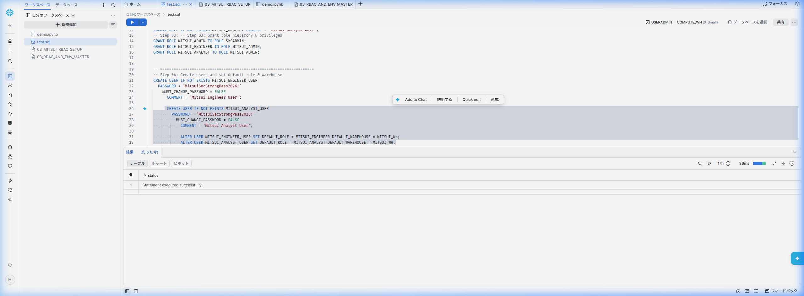

> **实操结果解读**：  
> 两个业务账号顺利开通，初始化默认参数注入完毕。

---

#### Step 05: 赋予角色（账号与角色正式绑定）
* **为什么这么做**：将定制业务角色授权给对应账号，并通过 `SHOW ROLES` 和 `SHOW USERS` 命令核验生成的对象状态，确认人员准入基准。

```sql
-- ====================================================================
-- 【Step 05: 赋予角色】
-- 目的・理由: 将业务角色正式授予对应账号，并验证当前生成状态。
-- ====================================================================
GRANT ROLE MITSUI_ENGINEER TO USER MITSUI_ENGINEER_USER;
GRANT ROLE MITSUI_ANALYST TO USER MITSUI_ANALYST_USER;

-- 作成されたロールとユーザーの検証
SHOW ROLES LIKE 'MITSUI_%';
SHOW USERS LIKE 'MITSUI_%';
```

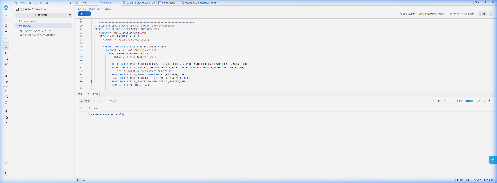

---

### 阶段二：切换 `SYSADMIN`（分配计算资源与下发建库特权）

#### Step 06: 切换 sysadmin 账户与 WAREHOUSE 作成
* **为什么这么做**：在 Snowflake 中，物理计算与存储对象由 `SYSADMIN` 统一调度。我们创建按需自休眠的计算仓库 `MITSUI_WH`，设定 5 分钟（300 秒）无查询自动挂起（`AUTO_SUSPEND`），杜绝闲置费用浪费。

```sql
-- ====================================================================
-- 【Step 06: 切换 sysadmin 账户并创建 WAREHOUSE】
-- 目的・理由: 切换至物理基础设施主管 SYSADMIN，创建自动休眠虚拟数仓。
-- ====================================================================
USE ROLE SYSADMIN;

CREATE WAREHOUSE IF NOT EXISTS MITSUI_WH
    WITH 
    WAREHOUSE_SIZE = 'XSMALL'
    AUTO_SUSPEND = 300           -- 5分钟无查询自动休眠（停止计费）
    AUTO_RESUME = TRUE           -- 有SQL请求时秒级自动拉起
    INITIALLY_SUSPENDED = TRUE   -- 初始状态挂起，避免创建即产生扣费
    COMMENT = '银行证券数据迁移与跑批专用虚拟计算仓库';
```

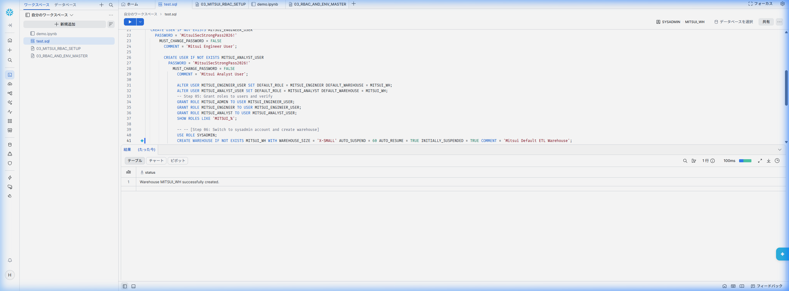

> **实操结果解读**：  
> 屏幕右上角切换为 `SYSADMIN`，`MITSUI_WH` 创建成功，当前处于挂起（`SUSPENDED`）待命状态。

---

#### Step 07 & 08: WAREHOUSE 权限配分与 DB 作成权限下发
* **为什么这么做**：  
  1. 计算资源创建后，必须显式为各业务角色分配 `USAGE`（使用权）与 `OPERATE`（启动/挂起权）；  
  2. 为了让证券数据项目组能够自主规划数据库，`SYSADMIN` 在账户层级（`ON ACCOUNT`）向 `MITSUI_ADMIN` 委任 `CREATE DATABASE` 权限，实现业务自治，无需事事依赖基盘运维。

```sql
-- ====================================================================
-- 【Step 07: WAREHOUSE作成与权限配分】
-- 目的・理由: 向各业务角色显式分发计算仓库使用权（USAGE / OPERATE）。
-- ====================================================================
GRANT USAGE, OPERATE ON WAREHOUSE MITSUI_WH TO ROLE MITSUI_ADMIN;
GRANT USAGE ON WAREHOUSE MITSUI_WH TO ROLE MITSUI_ENGINEER;
GRANT USAGE ON WAREHOUSE MITSUI_WH TO ROLE MITSUI_ANALYST;

SHOW WAREHOUSES LIKE 'MITSUI_WH';

-- ====================================================================
-- 【Step 08: DB 作成权限下发】
-- 目的・理由: 业务线自立，SYSADMIN 向 MITSUI_ADMIN 下发账户级建库特权。
-- ====================================================================
GRANT CREATE DATABASE ON ACCOUNT TO ROLE MITSUI_ADMIN;
```

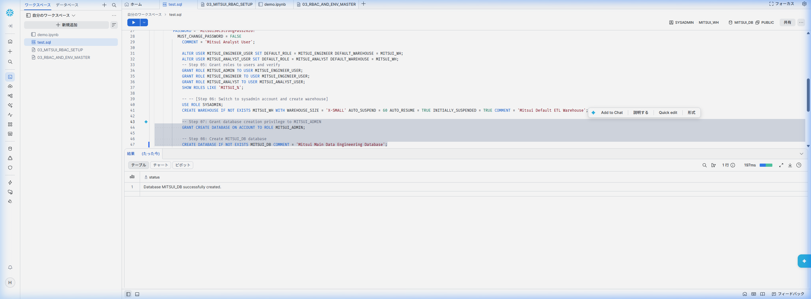

---

### 阶段三：业务角色自治推进（数据库、Schema、Stage 与迁移双表构建）

#### 🚨【核心实战排障避坑录：用户切换未分配角色的底层权限拦截】
在很多教程中，通常会直接写 `USE ROLE MITSUI_ENGINEER;`，但在企业现场演练中，如果在当前会话直接切换，系统将抛出严重安全报错：

```text
SQL access control error: Requested role 'MITSUI_ENGINEER' is not assigned to the executing user. Specify another role to activate.
```

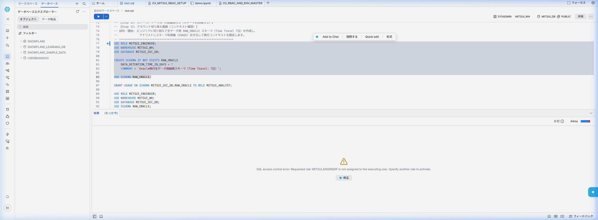

> [!CAUTION]
> **★ 金融级安全机制深度解析**：  
> 为什么明明在 Step 03 中建立了角色继承树，当前登录的用户依然不能切换为 `MITSUI_ENGINEER`？  
> **因为 Snowflake 的会话激活机制是“强用户绑定（User-bound Activation）”**！继承树解决的是“角色与角色之间的特权流动”，但任何一个登录账号（如当前登录的管理账号），**必须被显式直接授予了该角色**，该账号才能在会话中执行 `USE ROLE <RoleName>`！  
> **解决方案**：在测试演练阶段，需在 `USERADMIN` 角色下将业务角色同时授予当前操作管理员（`GRANT ROLE ... TO USER CURRENT_USER();`），方可自由切换上下文进行自检！

---

#### Step 09 ~ 11: アカウント切り替え登録 (MITSUI_ADMIN) $\to$ DATABASE の作成 $\to$ スキーマ 作成権限付与
* **为什么这么做**：  
  - 切换至项目总管 `MITSUI_ADMIN`，行使自治特权创建业务数据库 `MITSUI_SEC_DB`；  
  - 项目总管将 Schema 的管理权委派给实操线的数据工程师（`MITSUI_ENGINEER`），授予 `USAGE` 与 `CREATE SCHEMA`。

```sql
-- ====================================================================
-- 【Step 09: アカウント切り替え登録 (MITSUI_ADMIN)】
-- 【Step 10: DATABASEの作成 (MITSUI_SEC_DB)】
-- 【Step 11: スキーマ 作成権限付与】
-- 目的・理由: MITSUI_ADMIN 自治建库 MITSUI_SEC_DB，并将 Schema 创建权下发给工程师。
-- ====================================================================
-- 先确保当前操作人员具备激活权限（避坑强化）
USE ROLE USERADMIN;
GRANT ROLE MITSUI_ADMIN TO USER CURRENT_USER();
GRANT ROLE MITSUI_ENGINEER TO USER CURRENT_USER();
GRANT ROLE MITSUI_ANALYST TO USER CURRENT_USER();

-- 切换为项目总管
USE ROLE MITSUI_ADMIN;
USE WAREHOUSE MITSUI_WH;

-- 创建核心业务数据库
CREATE DATABASE IF NOT EXISTS MITSUI_SEC_DB
    COMMENT = '三井证券核心生产数据云端迁移仓';

USE DATABASE MITSUI_SEC_DB;

-- 委派 Schema 特权给数据工程师
GRANT USAGE ON DATABASE MITSUI_SEC_DB TO ROLE MITSUI_ENGINEER;
GRANT CREATE SCHEMA ON DATABASE MITSUI_SEC_DB TO ROLE MITSUI_ENGINEER;
```

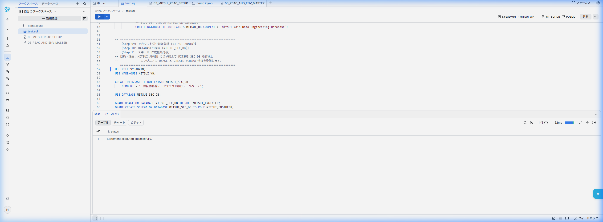

---

#### Step 12 ~ 17: SCHEMA 作成 $\to$ ステージ作成 $\to$ テーブル作成（1:N 双表就绪）
* **为什么这么做**：  
  1. **Step 12 & 13 (SCHEMA 作成)**：工程师创建 `RAW_ORACLE` 模式，开启 7 天金融级 Time Travel 数据恢复窗口；  
  2. **Step 14 & 15 (权能交接与上下文确认)**：按最小权限原则，授予分析师 Schema 访问权（`USAGE`）；固定当前工程师上下文；  
  3. **Step 16 (ステージ作成)**：针对 Oracle 异构断层（末尾空格敏感、空串 `''` 与 `NULL` 差异、UTF8 编码），创建高精度 CSV 文件解析器 `CSV_ORACLE_IMPORT_FF` 与中间受控暂存区 `MITSUI_STAGE`；  
  4. **Step 17 (テーブル作成)**：严格按照第 02 章建立的类型映射，创建顾客基本台账 `CUST_MASTER`（主表）与顾客交易明细 `CUST_TRADE_DETAIL`（明细表），并为分析师配置只读 `SELECT` 权限。

```sql
-- ====================================================================
-- 【Step 12: 切换 MITSUI_ENGINEER】
-- 【Step 13: SCHEMA作成 (RAW_ORACLE)】
-- 【Step 14: 授予分析师 SCHEMA 使用权】
-- 【Step 15: 确认工程师上下文】
-- ====================================================================
USE ROLE MITSUI_ENGINEER;
USE WAREHOUSE MITSUI_WH;
USE DATABASE MITSUI_SEC_DB;

CREATE SCHEMA IF NOT EXISTS RAW_ORACLE
    DATA_RETENTION_TIME_IN_DAYS = 7
    COMMENT = 'Oracle 迁移原始表 Schema (Time Travel 7日)';

USE SCHEMA RAW_ORACLE;

GRANT USAGE ON SCHEMA MITSUI_SEC_DB.RAW_ORACLE TO ROLE MITSUI_ANALYST;

-- ====================================================================
-- 【Step 16: ステージ作成 (File Format & Stage)】
-- ====================================================================
CREATE OR REPLACE FILE FORMAT CSV_ORACLE_IMPORT_FF
    TYPE = 'CSV'
    FIELD_DELIMITER = ','
    RECORD_DELIMITER = '\n'
    SKIP_HEADER = 1
    FIELD_OPTIONALLY_ENCLOSED_BY = '"'
    NULL_IF = ('NULL', 'null', '')
    EMPTY_FIELD_AS_NULL = TRUE             -- 解决 Oracle '' 与 NULL 异构断层
    TIMESTAMP_FORMAT = 'YYYY-MM-DD HH24:MI:SS'
    ENCODING = 'UTF8';

CREATE OR REPLACE STAGE MITSUI_STAGE
    FILE_FORMAT = CSV_ORACLE_IMPORT_FF
    COMMENT = 'Oracle 11g 迁移数据受控暂存区';

-- ====================================================================
-- 【Step 17: テーブル作成 (双表构建与授权)】
-- ====================================================================
-- ① 顾客基本台账（维度主表）
CREATE OR REPLACE TABLE CUST_MASTER (
    CUST_ID            VARCHAR(10)       NOT NULL COMMENT '顧客ID (CHAR(10)规范化)',
    CUST_NAME_KANJI    VARCHAR(50)       NOT NULL COMMENT '顧客氏名 (漢字全角)',
    CUST_NAME_KANA     VARCHAR(50)       COMMENT '顧客氏名 (カナ)',
    CUST_RANK_CD       VARCHAR(2)        DEFAULT 'C ' NOT NULL COMMENT '顧客ランク (A /B /C 等)',
    BRANCH_CD          VARCHAR(4)        NOT NULL COMMENT '支店コード',
    STATUS_CD          VARCHAR(2)        COMMENT '口座状態 (01:有効, 02:休眠, NULL:未設定)',
    OPEN_DATE          DATE              NOT NULL COMMENT '口座開設日',
    REG_DATETIME       TIMESTAMP_NTZ(6)  DEFAULT CURRENT_TIMESTAMP() NOT NULL COMMENT '登録日時',
    MIGRATED_AT        TIMESTAMP_LTZ(6)  DEFAULT CURRENT_TIMESTAMP() COMMENT 'Snowflake 迁移入云时间戳',
    CONSTRAINT PK_CUST_MASTER PRIMARY KEY (CUST_ID)
) COMMENT = '顧客基本台帳（Oracle 11g 迁移目标表）';

GRANT SELECT ON TABLE CUST_MASTER TO ROLE MITSUI_ANALYST;

-- ② 顾客交易明细（事实流水表）
CREATE OR REPLACE TABLE CUST_TRADE_DETAIL (
    TRADE_QTY          NUMBER(15, 0)     DEFAULT 0 NOT NULL COMMENT '取引数量',
    AMOUNT_JPY         NUMBER(18, 3)     DEFAULT 0 NOT NULL COMMENT '約定金額・円貨',
    AMOUNT_FCY         NUMBER(18, 3)     DEFAULT 0 COMMENT '約定金額・外貨',
    CCY_CODE           VARCHAR(3)        COMMENT '通貨区分 (USD/EUR等)',
    EXCHANGE_RATE      NUMBER(9, 6)      COMMENT '為替レート',
    REMARKS            VARCHAR(100)      DEFAULT ' ' COMMENT '摘要・備考 (全角半角混在安全)',
    CUST_ID            VARCHAR(10)       NOT NULL COMMENT '顧客ID',
    TRADE_TYPE_CD      VARCHAR(2)        NOT NULL COMMENT '取引区分 (01:買付, 02:売付)',
    BRANCH_CD          VARCHAR(4)        NOT NULL COMMENT '支店コード',
    TRADE_DATE         VARCHAR(8)        NOT NULL COMMENT '約定日 (YYYYMMDD形式)',
    SETTLE_MONTH       VARCHAR(6)        COMMENT '決済対象月 (YYYYMM形式)',
    REG_DATETIME       TIMESTAMP_NTZ(6)  DEFAULT CURRENT_TIMESTAMP() NOT NULL COMMENT '登録日時',
    UPD_DATETIME       TIMESTAMP_NTZ(6)  COMMENT '更新日時',
    MIGRATED_AT        TIMESTAMP_LTZ(6)  DEFAULT CURRENT_TIMESTAMP() COMMENT 'Snowflake 迁移入云时间戳',
    CONSTRAINT PK_CUST_TRADE_DETAIL PRIMARY KEY (CUST_ID, TRADE_DATE, TRADE_TYPE_CD)
) COMMENT = '顧客取引明細（Oracle 11g 迁移目标表）';

GRANT SELECT ON TABLE CUST_TRADE_DETAIL TO ROLE MITSUI_ANALYST;

SHOW TABLES IN SCHEMA MITSUI_SEC_DB.RAW_ORACLE;
```

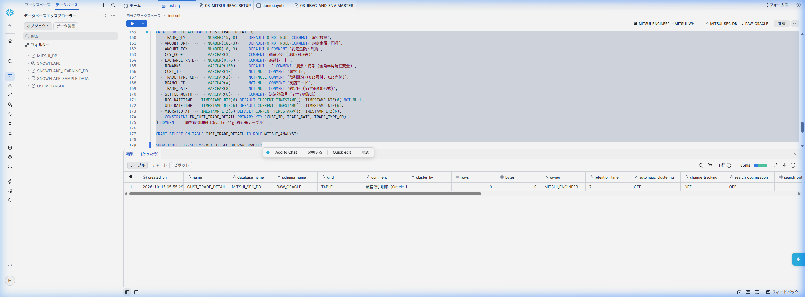

> **实操结果解读**：  
> 右上角完整体现为：`MITSUI_ENGINEER` / `MITSUI_WH` / `MITSUI_SEC_DB` / `RAW_ORACLE`；  
> 底部输出面板中，`CUST_TRADE_DETAIL` 与 `CUST_MASTER` 赫然在列，Owner 明确归属于 `MITSUI_ENGINEER`，Retention Time 为 7 天，双表正式建成交付！

---

## 四、 🔐 金融企业级业务用户首登、MFA 与连通性自检 (Onboarding & Sanity Check)

在完成上文基础权限与对象创建后，业务用户（如 `MITSUI_ENGINEER_USER`）正式接入系统。按照日本金融安全标准（FISC 准则），需完成安全初始化加固与权限自检。

### 4.1 初始密码安全策略（首登强制改密）
由管理员下发的企业用户通常带有临时初始密码，并在创建时开启强制改密策略（`MUST_CHANGE_PASSWORD = TRUE`）：
- 业务工程师首次使用临时初始密码登录 Snowsight 时，系统会自动拦截并弹出密码修改弹窗；
- 输入符合复杂性要求（大写字母、小写字母、数字及特殊符号组合，长度 $\ge 12$ 位）的新密码后，方可完成身份确认进入工作台。

### 4.2 金融企业级 MFA (多因素认证) 绑定实战
在日本金融机构（如银行、证券、NRI 等外包及合作体系）以及金融厅安全基线要求下，**所有访问生产与验证环境的 Snowflake 控制台及特权账户，均被强制要求启用多因素认证（MFA / 2FA）**：

1. **进入设置界面**：在 Snowsight 界面点击个人 Profile，进入 **Preferences** $\to$ **Multi-Factor Authentication (MFA)**；
2. **选择认证器类型**：选择 **Authenticator App（TOTP 认证器）**；
3. **获取密钥字符串 (Secret Key)**：
   - 界面将展示二维码以及一串 Base32 编码的密钥字符串（如 `WQQC4ZYF...`）；
   - 可使用移动端 **Google Authenticator** / **Microsoft Authenticator** 扫码；或在受限开发机环境中下载运行开源 PC 端工具 [WinAuth](https://winauth.github.io/winauth/download.html)，导入该密钥字符串；
4. **验证与绑定**：在输入框内填入认证器实时生成的 6 位 TOTP 动态验证码，点击完成绑定。

### 4.3 切换业务角色上下文与权限基线自检 (Step 18 & Step 19 核心实测)
完成安全初始化后，在 SQL Worksheet 中依次执行以下自检与防御实测语句：

#### Step 18: 工程师沙箱连通性与读写自检 (Sanity Check)
验证 `MITSUI_ENGINEER` 角色在其所属 Schema 下拥有完备的 DDL/DML 权限，使用临时表进行零污染测试：

```sql
-- ====================================================================
-- 【Step 18: 疎通検証 (Sanity Check - MITSUI_ENGINEER)】
-- 目的・理由: 验证工程师角色的会话稳定性与 DDL/DML 权限。
-- ====================================================================
USE ROLE MITSUI_ENGINEER;
USE WAREHOUSE MITSUI_WH;
USE DATABASE MITSUI_SEC_DB;
USE SCHEMA RAW_ORACLE;

CREATE OR REPLACE TEMPORARY TABLE _SANITY_CHECK (
    CHECK_ID    INT,
    OPERATOR    VARCHAR(50),
    CHECKED_AT  TIMESTAMP_NTZ DEFAULT CURRENT_TIMESTAMP()
);

INSERT INTO _SANITY_CHECK (CHECK_ID, OPERATOR) VALUES (1, CURRENT_USER());

SELECT * FROM _SANITY_CHECK;

DROP TABLE IF EXISTS _SANITY_CHECK;
```

#### Step 19: 分析师最小特权防御拦截实测 (Least Privilege Defense)
切换为只读分析师角色 `MITSUI_ANALYST`，验证合法查询与越权拦截的真实系统反应：

```sql
-- ====================================================================
-- 【Step 19: 最小特权防御验证 (Least Privilege Defense - MITSUI_ANALYST)】
-- 目的・理由: 验证分析师具备 SELECT 权，但在非法 INSERT 写入时被系统底层强行拦截。
-- ====================================================================
USE ROLE MITSUI_ANALYST;
USE WAREHOUSE MITSUI_WH;
USE DATABASE MITSUI_SEC_DB;
USE SCHEMA RAW_ORACLE;

-- 1. SELECT 查询完全合法（成功返回 0 行结果集，验证查询权通畅）
SELECT * FROM CUST_MASTER;

-- 2. INSERT 尝试越权写入数据（预期被 Snowflake 安全机制当场拦截！）
INSERT INTO CUST_MASTER (CUST_ID, CUST_NAME_KANJI, OPEN_DATE) 
VALUES ('TEST0001', '不正書込テスト', CURRENT_DATE());
```

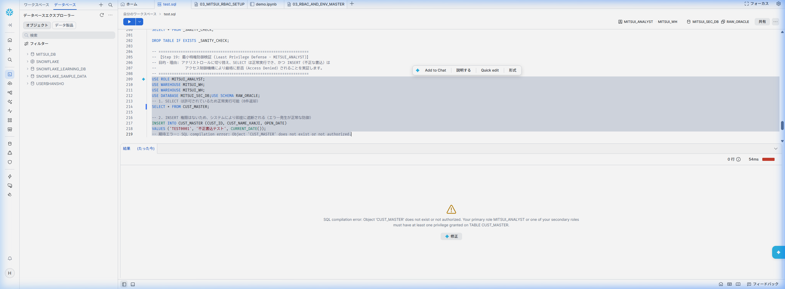

> **现场报错详细分析**：  
> ```text
> SQL compilation error: Object 'CUST_MASTER' does not exist or not authorized. Your primary role MITSUI_ANALYST or one of your secondary roles must have at least one privilege granted on TABLE CUST_MASTER.
> ```  
> 如图中鲜红的警告所示，系统直接将非法写入请求击落并拒绝编译！  
> **这标志着最小特权原则在生产云端完全落地生效**：合法分析师只能通过只读通道观察数据，从根源上消除了业务端由于人为失误或越权脚本篡改生产财务流水数据的可能性！

---

## 五、 🏢 金融企业级进阶实战：多规格算力、多表隔离与单/多角色深度演练

在完成基础搭建后，在真实的金融与大型企业级生产环境中，权限与资源管控往往需要进一步升级为更为灵活严密的复合场景：
1. **多规格 Warehouse 隔离**：不同职责用户需要匹配不同算力（例如：数据分析师只需 `X-Small` 算力，而夜间跑批与 ETL 迁移工程师需要 `Medium` 高吞吐算力）；
2. **多表细粒度权限隔离**：同一业务 Schema 下，部分表允许分析师只读查询（如公开流水 `CUST_TRADE_DETAIL`），部分高敏表（如内控费率 `CONFIDENTIAL_FEE_RATES`）则绝不可对分析师开放；
3. **单角色用户 vs 多角色用户**：初级/外包人员配置单一受限角色；技术主管或核心骨干配置多角色，并支持按需自由切换上下文（`USE ROLE`）。

> [!TIP]
> 本进阶演练配套全量独立可执行验证脚本已存放于仓库脚本：`scripts/snowflake/00_account_provisioning_and_rbac_demo.sql`。可在 Snowsight Worksheet 中一键导入或分段运行。

### 5.1 企业级规范构建顺序与职责分离 (Separation of Duties)

根据金融安全合规标准（FISC 规范），必须杜绝使用全局最高角色 `ACCOUNTADMIN` 进行日常对象维护，严格执行如下分层流水线：

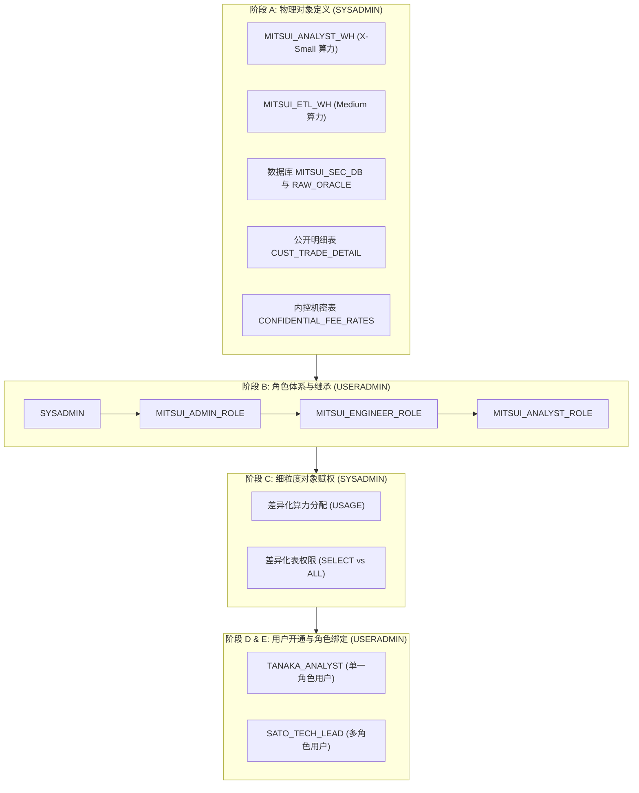

### 5.2 单一角色用户 vs 多角色用户对比矩阵

| 评估维度 | 单一角色用户 (`TANAKA_ANALYST`) | 多角色用户 (`SATO_TECH_LEAD`) |
| :--- | :--- | :--- |
| **分配角色** | 仅绑定 `MITSUI_ANALYST_ROLE` | 同时绑定 `MITSUI_ADMIN_ROLE` + `MITSUI_ENGINEER_ROLE` + `MITSUI_ANALYST_ROLE` |
| **会话上下文行为** | 登录即被限定在分析师角色，无法执行提权操作 | 默认以 `MITSUI_ENGINEER_ROLE` 登录，可随时执行 `USE ROLE` 自由切换 |
| **计算资源约束** | 仅被允许拉起 `MITSUI_ANALYST_WH` (X-Small)，单价 1 点/时，成本严格可控 | 日常开发使用 `MITSUI_ETL_WH` (Medium)，查报表时可自主降级至分析仓库 |
| **数据访问边界** | 仅对 `CUST_TRADE_DETAIL` 只读；访问机密费率表直接报 `Object does not exist` | 工程师角色下可读写机密费率表；切至主管角色可执行全局管理与授权 |
| **适用人群** | 外包人员、业务合规人员、初级分析师（零特权越界风险） | 架构师、Tech Lead、核心数据工程师（兼顾高权限与日常审计安全） |

### 5.3 进阶核心 SQL 摘要

```sql
-- 1. 创建多规格 Warehouse 与差异化安全表 (SYSADMIN)
USE ROLE SYSADMIN;
CREATE WAREHOUSE IF NOT EXISTS MITSUI_ANALYST_WH WITH WAREHOUSE_SIZE = 'X-SMALL' AUTO_SUSPEND = 60 AUTO_RESUME = TRUE;
CREATE WAREHOUSE IF NOT EXISTS MITSUI_ETL_WH     WITH WAREHOUSE_SIZE = 'MEDIUM'  AUTO_SUSPEND = 120 AUTO_RESUME = TRUE;

-- 2. 差异化赋权 (SYSADMIN)
-- 分析师仅获轻量仓库与普通明细表只读
GRANT USAGE ON WAREHOUSE MITSUI_ANALYST_WH TO ROLE MITSUI_ANALYST_ROLE;
GRANT SELECT ON TABLE MITSUI_SEC_DB.RAW_ORACLE.CUST_TRADE_DETAIL TO ROLE MITSUI_ANALYST_ROLE;

-- 工程师获高性能仓库与机密费率表读写
GRANT USAGE ON WAREHOUSE MITSUI_ETL_WH TO ROLE MITSUI_ENGINEER_ROLE;
GRANT SELECT, INSERT, UPDATE, DELETE ON TABLE MITSUI_SEC_DB.RAW_ORACLE.CUST_TRADE_DETAIL TO ROLE MITSUI_ENGINEER_ROLE;
GRANT SELECT, INSERT, UPDATE ON TABLE MITSUI_SEC_DB.RAW_ORACLE.CONFIDENTIAL_FEE_RATES TO ROLE MITSUI_ENGINEER_ROLE;

-- 3. 开通用户与角色绑定 (USERADMIN)
USE ROLE USERADMIN;
CREATE USER IF NOT EXISTS TANAKA_ANALYST PASSWORD = 'InitPassword123#A' DEFAULT_ROLE = MITSUI_ANALYST_ROLE DEFAULT_WAREHOUSE = MITSUI_ANALYST_WH;
CREATE USER IF NOT EXISTS SATO_TECH_LEAD PASSWORD = 'InitPassword123#B' DEFAULT_ROLE = MITSUI_ENGINEER_ROLE DEFAULT_WAREHOUSE = MITSUI_ETL_WH;

-- 绑定角色
GRANT ROLE MITSUI_ANALYST_ROLE TO USER TANAKA_ANALYST;
GRANT ROLE MITSUI_ENGINEER_ROLE TO USER SATO_TECH_LEAD;
GRANT ROLE MITSUI_ANALYST_ROLE  TO USER SATO_TECH_LEAD;
GRANT ROLE MITSUI_ADMIN_ROLE    TO USER SATO_TECH_LEAD;
```

### 5.4 验证测试清单（可在 Snowflake 直接复核）
* **测试 1（受限用户查询）**：以 `MITSUI_ANALYST_ROLE` 查询 `CUST_TRADE_DETAIL`，成功读取；
* **测试 2（越权拦截）**：以 `MITSUI_ANALYST_ROLE` 尝试执行 `INSERT` 或查询 `CONFIDENTIAL_FEE_RATES`，系统直接拦截报错（Access denied）；
* **测试 3（算力隔离）**：以 `MITSUI_ANALYST_ROLE` 执行 `USE WAREHOUSE MITSUI_ETL_WH`，系统提示无权限拒绝使用；
* **测试 4（多角色动态切换）**：以 `SATO_TECH_LEAD` 执行 `USE ROLE MITSUI_ANALYST_ROLE`，成功动态降级切换。

---

## 六、 本章小结与后续章节导航

本章在 Snowflake 端严格落地了三井证券三层业务角色体系（`MITSUI_ADMIN` $\to$ `MITSUI_ENGINEER` $\to$ `MITSUI_ANALYST`），并以此为基石，完成了虚拟数仓 `MITSUI_WH`、数据库 `MITSUI_SEC_DB`、模式 `RAW_ORACLE`、暂存区 `MITSUI_STAGE` 以及目标双表（`CUST_MASTER` + `CUST_TRADE_DETAIL`）的完整构建与授权。

至此，**云端基础设施已完全就绪，静待数据入云**：
- 👉 **[第 04 章：数据抽取导出与 COPY INTO 批量加载实战](04_data_migration.md)**：使用 Python 脚本从本地 Oracle 容器导出双表 CSV 数据，通过 SnowSQL / PUT 指令高速上传至 `MITSUI_STAGE`，并执行 `COPY INTO` 完成云端数据的高保真批量加载与字段格式化！
