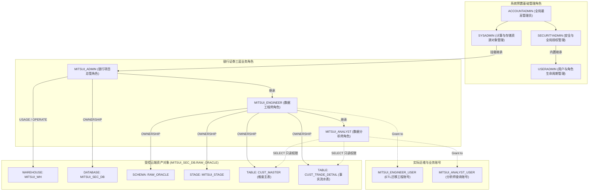
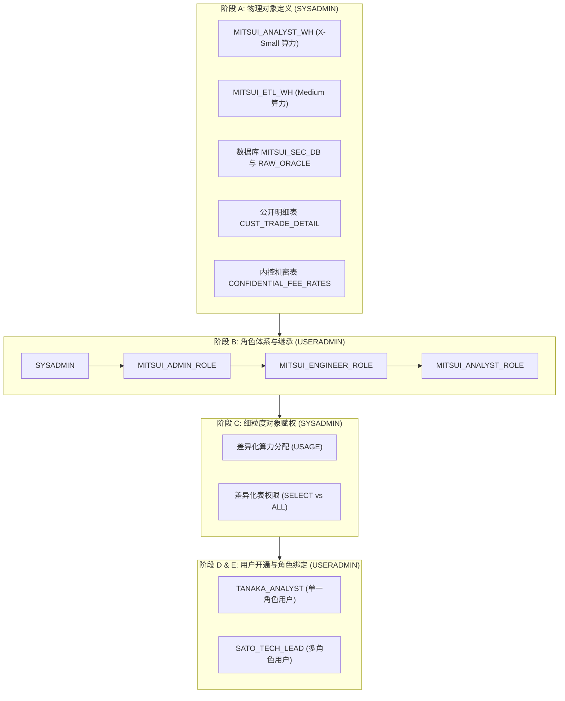

# 第 03 章：Snowflake 企业级 RBAC 权限设计与环境搭建实战

在银行证券等金融机构中，**最小特权原则（Principle of Least Privilege）**与**职能分离（Separation of Duties）**是合规的生命线。

在前两章中，我们剖析了三井证券夜间批处理超时痛点（[第 00 章](00_architecture_overview.md)），开通了企业级 Snowflake 云数仓（[第 01 章](01_snowflake_signup.md)），并在本地完成了 Oracle 11g 源库的搭建与 1:N 金融双表（`CUST_MASTER` + `CUST_TRADE_DETAIL`）的测试灌水（[第 02 章](02_oracle_setup_and_data.md)）。

本章我们将正式在 Snowflake 云端落地三井证券的企业级治理基盘：使用预置的 `USERADMIN` 与 `SYSADMIN` 系统角色，构建清晰的**三层业务角色体系（`MITSUI_ADMIN` $\to$ `MITSUI_ENGINEER` $\to$ `MITSUI_ANALYST`）**，并通过特权安全委让机制，在目标三段式命名空间 **`MITSUI_SEC_DB.RAW_ORACLE`** 下完成虚拟数仓、Stage 暂存区以及 `CUST_MASTER` 维度主表与 `CUST_TRADE_DETAIL` 事实流水表的双表建设！

---

## 一、 系统概要与核心目标（社内管理基盘设计思想）

在金融工程实践中，Snowflake 企业内部统一管理基盘的设立主要聚焦于以下两大核心目标：

1. **防范重大安全风险，基盘团队收敛全局特权**：  
   对于直接关联外部数据外泄等重大安全风险的全局最高权限，必须由**基盘架构团队（基础平台与安全运维）**统一所管。具体而言，全局系统管理角色 **`ACCOUNTADMIN`** 与 **`SECURITYADMIN`** 必须严格受控，杜绝直接下放给业务开发人员；基盘团队以此为前提，为各业务系统部门提供一个标准化、安全可信的 Snowflake 容器与基础设施。

2. **对接分散运维基盘，提供通用公共能力以减轻业务负担**：  
   由管理基盘统一对外提供与企业级分散运维体系对接所需的公共能力与标准接口，大幅减轻各业务部门的独立运维负担。  
   > [!IMPORTANT]
   > **企业级权责边界划分原则**：  
   > 针对因各业务系统而异的 **`SYSADMIN` 管理领域（包括各自的计算仓库 Warehouse、数据库 Database、Schema、Stage 等物理对象）**，全面下放并**由各业务系统部门（银行证券数据迁移项目组）自主管理与规划**，兼顾全局安全合规与业务线的敏捷工程落地。

---

## 二、 🏛️ 银行证券角色继承与访问控制架构

在金融云数仓设计中，我们将系统内置角色与业务定制角色进行清晰的解耦与挂载：



> [!NOTE]
> **★ 关键安全规则（Snowflake 权限向上汇总机制）**：  
> Snowflake 的角色继承是**单向向上继承（父角色拥有子角色的特权，但子角色绝不自动继承父角色特权）**。因此：  
> 1. `SYSADMIN` 天然拥有所有挂载在它之下的业务对象权限，便于全局运维；  
> 2. 但为 `MITSUI_ADMIN` 赋予的 Warehouse `USAGE` 权限，**不会**自动流向 `MITSUI_ENGINEER` 或 `MITSUI_ANALYST`，必须显式对各角色进行明确授权！

---

## 三、 🛠️ 企业级环境部署详细实操（Step 1 ~ Step 15 双轨推进）

本节提供标准企业级分步操作手册。在实战中，你可以选择在 **Snowsight Worksheet** 中逐段执行，也可以直接利用项目仓库中的对应脚本批量运行：
* **阶段一 对应脚本**：`scripts/snowflake/01_useradmin_rbac.sql`
* **阶段二与三 对应脚本**：`scripts/snowflake/02_sysadmin_objects.sql`

---

### 阶段一：切换 `USERADMIN`（管理用户与角色的生命周期）

以具备特权的用户连入 Snowflake，首先切换至专职人员与角色管理的 `USERADMIN`：

```sql
USE ROLE USERADMIN;
```

#### Step 1: 创建银行证券三层业务角色
```sql
CREATE ROLE IF NOT EXISTS MITSUI_ADMIN    COMMENT = '银行证券项目总管角色';
CREATE ROLE IF NOT EXISTS MITSUI_ENGINEER COMMENT = '银行证券数据工程师角色';
CREATE ROLE IF NOT EXISTS MITSUI_ANALYST  COMMENT = '银行证券数据分析师角色';
```

#### Step 2: 建立角色层级树 (Role Hierarchy)
使得业务权限平滑继承，并最终汇总受控于 `SYSADMIN`：
```sql
-- 将 MITSUI_ADMIN 挂载到 SYSADMIN 之下
GRANT ROLE MITSUI_ADMIN TO ROLE SYSADMIN;

-- 工程师继承总管
GRANT ROLE MITSUI_ENGINEER TO ROLE MITSUI_ADMIN;

-- 分析师继承工程师
GRANT ROLE MITSUI_ANALYST TO ROLE MITSUI_ENGINEER;
```

#### Step 3: 创建业务技术账号 (User)

> [!NOTE]
> **依赖时序说明**：此处为用户预先配置了 `DEFAULT_WAREHOUSE = MITSUI_WH`。Snowflake 允许在建用户时登记默认仓库名，但该计算资源必须在随后的 **Step 5** 中由 `SYSADMIN` 正式创建并下发 `USAGE` 权限后方可激活。

```sql
-- 工程师账号（负责数据迁移与跑批）
CREATE USER IF NOT EXISTS MITSUI_ENGINEER_USER
    PASSWORD = 'MitsuiSecStrongPass2026!'
    DEFAULT_ROLE = MITSUI_ENGINEER
    DEFAULT_WAREHOUSE = MITSUI_WH
    MUST_CHANGE_PASSWORD = FALSE
    COMMENT = '银行证券ETL与迁移工程账号';

-- 分析师账号（负责对账突合与业务查询）
CREATE USER IF NOT EXISTS MITSUI_ANALYST_USER
    PASSWORD = 'MitsuiSecStrongPass2026!'
    DEFAULT_ROLE = MITSUI_ANALYST
    DEFAULT_WAREHOUSE = MITSUI_WH
    MUST_CHANGE_PASSWORD = FALSE
    COMMENT = '银行证券分析师业务账号';
```

#### Step 4: 绑定角色至具体用户
```sql
GRANT ROLE MITSUI_ENGINEER TO USER MITSUI_ENGINEER_USER;
GRANT ROLE MITSUI_ANALYST TO USER MITSUI_ANALYST_USER;

-- 验证创建结果
SHOW ROLES LIKE 'MITSUI_%';
SHOW USERS LIKE 'MITSUI_%';
```


---

### 阶段二：切换 `SYSADMIN`（分配计算资源与下发建库特权）

```sql
USE ROLE SYSADMIN;
```

#### Step 5: 创建虚拟计算仓库 (MITSUI_WH)
创建按需自动启停的虚拟计算仓库，并配置严格的成本自休眠策略：
```sql
CREATE WAREHOUSE IF NOT EXISTS MITSUI_WH
    WITH 
    WAREHOUSE_SIZE = 'XSMALL'
    AUTO_SUSPEND = 300           -- 5分钟无查询自动休眠（停止计费）
    AUTO_RESUME = TRUE           -- 有SQL请求时秒级自动拉起
    INITIALLY_SUSPENDED = TRUE
    COMMENT = '银行证券核心数据批处理与迁移专用WH';

-- 显式为各业务角色分配计算仓库的使用权与操作权
GRANT USAGE, OPERATE ON WAREHOUSE MITSUI_WH TO ROLE MITSUI_ADMIN;
GRANT USAGE ON WAREHOUSE MITSUI_WH TO ROLE MITSUI_ENGINEER;
GRANT USAGE ON WAREHOUSE MITSUI_WH TO ROLE MITSUI_ANALYST;
```

#### Step 6: 下发建库特权给项目总管
在账户（Account）层级授予项目总管建库特权，从而无需动用 `SYSADMIN` 来创建具体业务库：
```sql
GRANT CREATE DATABASE ON ACCOUNT TO ROLE MITSUI_ADMIN;
```


---

### 阶段三：切换至业务角色，验证特权并创建存储实体

#### Step 7: 切换为项目总管 MITSUI_ADMIN
```sql
USE ROLE MITSUI_ADMIN;
USE WAREHOUSE MITSUI_WH;
```

#### Step 8: 创建核心业务数据库 (MITSUI_SEC_DB)
```sql
CREATE DATABASE IF NOT EXISTS MITSUI_SEC_DB
    COMMENT = '银行证券核心生产数据云端迁移仓';

USE DATABASE MITSUI_SEC_DB;
```

#### Step 9: 将 Schema 创建特权委托给工程师角色
```sql
GRANT USAGE ON DATABASE MITSUI_SEC_DB TO ROLE MITSUI_ENGINEER;
GRANT CREATE SCHEMA ON DATABASE MITSUI_SEC_DB TO ROLE MITSUI_ENGINEER;
```

#### Step 10: 切换为数据工程师 MITSUI_ENGINEER
```sql
USE ROLE MITSUI_ENGINEER;
USE WAREHOUSE MITSUI_WH;
USE DATABASE MITSUI_SEC_DB;
```

#### Step 11: 创建 Oracle 原始数据落地 Schema (RAW_ORACLE)
```sql
CREATE SCHEMA IF NOT EXISTS RAW_ORACLE
    DATA_RETENTION_TIME_IN_DAYS = 7
    COMMENT = 'Oracle 迁移落地原始表 Schema';

USE SCHEMA RAW_ORACLE;
```

#### Step 12: 授予分析师 Schema 访问权
`MITSUI_ENGINEER` 作为当前 Schema 的创建者（OWNER），天然拥有内部对象的全部特权；在此按最小权限原则，为分析师赋予 Schema 的使用权：
```sql
GRANT USAGE ON SCHEMA MITSUI_SEC_DB.RAW_ORACLE TO ROLE MITSUI_ANALYST;
```

#### Step 13: 确认当前工程上下文环境
```sql
USE ROLE MITSUI_ENGINEER;
USE WAREHOUSE MITSUI_WH;
USE DATABASE MITSUI_SEC_DB;
USE SCHEMA RAW_ORACLE;
```

#### Step 14: 创建解析文件格式与受控暂存区 (Stage)
针对第 02 章中定义的末尾空格与空串（`''` vs `NULL`）陷阱，配置高精度的 CSV 解析器：
```sql
CREATE OR REPLACE FILE FORMAT CSV_ORACLE_IMPORT_FF
    TYPE = 'CSV'
    FIELD_DELIMITER = ','
    RECORD_DELIMITER = '\n'
    SKIP_HEADER = 1
    FIELD_OPTIONALLY_ENCLOSED_BY = '"'
    NULL_IF = ('NULL', 'null', '')
    EMPTY_FIELD_AS_NULL = TRUE             -- 关键：确保 Oracle 的空值在 Snowflake 中对齐
    TIMESTAMP_FORMAT = 'YYYY-MM-DD HH24:MI:SS'
    ENCODING = 'UTF8';

CREATE OR REPLACE STAGE MITSUI_STAGE
    FILE_FORMAT = CSV_ORACLE_IMPORT_FF
    COMMENT = '接收来自 Oracle 导出的中间受控暂存区';
```

#### Step 15-A: 创建维度主表 `CUST_MASTER` (顧客基本台帳)
严格对应第 02 章确立的字段类型推导哲学，创建维度主表，并授予分析师查询特权：
```sql
CREATE OR REPLACE TABLE CUST_MASTER (
    -- ① 顧客識別子：Oracle CHAR(10) -> Snowflake VARCHAR(10)（测试空格对齐与 RTRIM）
    CUST_ID            VARCHAR(10)       NOT NULL COMMENT '顧客ID (CHAR(10)规范化)',

    -- ② 顧客氏名（漢字）：全角文字
    CUST_NAME_KANJI    VARCHAR(50)       NOT NULL COMMENT '顧客氏名 (漢字全角)',

    -- ③ 顧客氏名（カナ）：半角カナ・全角カナ
    CUST_NAME_KANA     VARCHAR(50)       COMMENT '顧客氏名 (カナ)',

    -- ④ 顧客ランク：Oracle CHAR(2) -> Snowflake VARCHAR(2)（末尾空格敏感度验证）
    CUST_RANK_CD       VARCHAR(2)        DEFAULT 'C ' NOT NULL COMMENT '顧客ランク (A /B /C 等)',

    -- ⑤ 開設支店コード：VARCHAR(4)
    BRANCH_CD          VARCHAR(4)        NOT NULL COMMENT '支店コード',

    -- ⑥ 口座ステータス：Oracle '' -> NULL（空值与空串异构断层验证）
    STATUS_CD          VARCHAR(2)        COMMENT '口座状態 (01:有効, 02:休眠, NULL:未設定)',

    -- ⑦ 口座開設日：DATE 型
    OPEN_DATE          DATE              NOT NULL COMMENT '口座開設日',

    -- ⑧ 登録日時：秒级升至微秒级
    REG_DATETIME       TIMESTAMP_NTZ(6)  DEFAULT CURRENT_TIMESTAMP() NOT NULL COMMENT '登録日時',

    -- ⑨ 云端迁移审计字段（血缘追踪）
    MIGRATED_AT        TIMESTAMP_LTZ(6)  DEFAULT CURRENT_TIMESTAMP() COMMENT 'Snowflake 迁移入云时间戳',

    CONSTRAINT PK_CUST_MASTER PRIMARY KEY (CUST_ID)
)
COMMENT = '顧客基本台帳（Oracle 11g 迁移目标表）';

-- 遵循最小权限，授予分析师只读 SELECT 权
GRANT SELECT ON TABLE CUST_MASTER TO ROLE MITSUI_ANALYST;
```

#### Step 15-B: 创建事实流水表 `CUST_TRADE_DETAIL` (顧客取引明細)
```sql
CREATE OR REPLACE TABLE CUST_TRADE_DETAIL (
    -- ① 取引数量：整数，Scale 设为 0
    TRADE_QTY          NUMBER(15, 0)     DEFAULT 0 NOT NULL COMMENT '取引数量',

    -- ② 約定金額・邦貨（円貨）：固定 3 位小数精度统一
    AMOUNT_JPY         NUMBER(18, 3)     DEFAULT 0 NOT NULL COMMENT '約定金額・円貨',

    -- ③ 約定金額・外貨 ＋ 通貨区分：配对定义
    AMOUNT_FCY         NUMBER(18, 3)     DEFAULT 0 COMMENT '約定金額・外貨',
    CCY_CODE           VARCHAR(3)        COMMENT '通貨区分 (USD/EUR等)',

    -- ④ 為替レート：统一 6 位小数
    EXCHANGE_RATE      NUMBER(9, 6)      COMMENT '為替レート',

    -- ⑤ 摘要・備考：Snowflake VARCHAR(100) 天然以字符数计数，免除 Oracle BYTE 溢出烦恼
    REMARKS            VARCHAR(100)      DEFAULT ' ' COMMENT '摘要・備考 (全角半角混在安全)',

    -- ⑥ 顧客ID：固定 10 位账号
    CUST_ID            VARCHAR(10)       NOT NULL COMMENT '顧客ID',

    -- ⑦ 业务区分与支店
    TRADE_TYPE_CD      VARCHAR(2)        NOT NULL COMMENT '取引区分 (01:買付, 02:売付)',
    BRANCH_CD          VARCHAR(4)        NOT NULL COMMENT '支店コード',

    -- ⑧ 业务日期字段：标准化为定长纯数字文本，提升剪枝效率
    TRADE_DATE         VARCHAR(8)        NOT NULL COMMENT '約定日 (YYYYMMDD形式)',
    SETTLE_MONTH       VARCHAR(6)        COMMENT '決済対象月 (YYYYMM形式)',

    -- ⑨ 审计时间戳字段
    REG_DATETIME       TIMESTAMP_NTZ(6)  DEFAULT CURRENT_TIMESTAMP() NOT NULL COMMENT '登録日時',
    UPD_DATETIME       TIMESTAMP_NTZ(6)  COMMENT '更新日時',

    -- ⑩ 云端迁移审计字段（血缘追踪）
    MIGRATED_AT        TIMESTAMP_LTZ(6)  DEFAULT CURRENT_TIMESTAMP() COMMENT 'Snowflake 迁移入云时间戳',

    CONSTRAINT PK_CUST_TRADE_DETAIL PRIMARY KEY (CUST_ID, TRADE_DATE, TRADE_TYPE_CD)
)
COMMENT = '顧客取引明細（Oracle 11g 迁移目标表）';

-- 遵循最小权限，授予分析师只读 SELECT 权
GRANT SELECT ON TABLE CUST_TRADE_DETAIL TO ROLE MITSUI_ANALYST;

-- 验证创建结果
SHOW STAGES LIKE 'MITSUI_STAGE';
SHOW TABLES IN SCHEMA MITSUI_SEC_DB.RAW_ORACLE;
```


---

## 四、 🔐 金融企业级业务用户首登、MFA 与连通性自检 (Onboarding & Sanity Check)

在完成上文基础权限与对象创建后，业务用户（如 `MITSUI_ENGINEER_USER`）正式接入系统。按照日本金融安全标准（FISC 准则），需完成安全初始化加固与权限自检。

### 4.1 初始密码安全策略（首登强制改密）
由管理员下发的企业用户通常带有临时初始密码，并在创建时开启强制改密策略（`MUST_CHANGE_PASSWORD = TRUE`）：
- 业务工程师首次使用临时初始密码登录 Snowsight 时，系统会自动拦截并弹出密码修改弹窗；
- 输入符合复杂性要求（大写字母、小写字母、数字及特殊符号组合，长度 $\ge 12$ 位）的新密码后，方可完成身份确认进入工作台。

### 4.2 金融企业级 MFA (多因素认证) 绑定实战
在日本金融机构（如银行、证券、NRI 等外包及合作体系）以及金融厅安全基线要求下，**所有访问生产与验证环境的 Snowflake 控制台及特权账户，均被强制要求启用多因素认证（MFA / 2FA）**：

1. **进入设置界面**：在 Snowsight 界面点击个人 Profile，进入 **Preferences** $\to$ **Multi-Factor Authentication (MFA)**；
2. **选择认证器类型**：选择 **Authenticator App（TOTP 认证器）**；
3. **获取密钥字符串 (Secret Key)**：
   - 界面将展示二维码以及一串 Base32 编码的密钥字符串（如 `WQQC4ZYF...`）；
   - 可使用移动端 **Google Authenticator** / **Microsoft Authenticator** 扫码；或在受限开发机环境中下载运行开源 PC 端工具 [WinAuth](https://winauth.github.io/winauth/download.html)，导入该密钥字符串；
4. **验证与绑定**：在输入框内填入认证器实时生成的 6 位 TOTP 动态验证码，点击完成绑定。

### 4.3 切换业务角色上下文与权限基线自检 (Sanity Check)
完成安全初始化后，在 SQL Worksheet 中输入并执行以下语句，验证业务工程师角色 `MITSUI_ENGINEER` 对项目对象具备的实际权限：

```sql
-- 1. 查看当前账号被授予的角色清单
SHOW ROLES;

-- 2. 查看当前角色具备的细粒度特权
SHOW GRANTS OF ROLE MITSUI_ENGINEER;

-- 3. 切换上下文至三井证券项目环境
USE ROLE MITSUI_ENGINEER;
USE WAREHOUSE MITSUI_WH;
USE DATABASE MITSUI_SEC_DB;
USE SCHEMA RAW_ORACLE;

-- 4. 验证核心迁移双表与 Stage 暂存区的可见性与状态
SHOW STAGES LIKE 'MITSUI_STAGE';
SHOW TABLES IN SCHEMA MITSUI_SEC_DB.RAW_ORACLE;

-- 5. 执行一次轻量级连通性读写验证（Sandbox 级别验证）
CREATE OR REPLACE TEMPORARY TABLE _SANITY_CHECK (
    CHECK_ID    INT,
    OPERATOR    VARCHAR(50),
    CHECKED_AT  TIMESTAMP_NTZ DEFAULT CURRENT_TIMESTAMP()
);

INSERT INTO _SANITY_CHECK (CHECK_ID, OPERATOR) VALUES (1, CURRENT_USER());

SELECT * FROM _SANITY_CHECK;

-- 验证完毕后清理临时对象
DROP TABLE IF EXISTS _SANITY_CHECK;

-- 6. 切换为只读分析师角色，执行最小特权防御测试 (Least Privilege Verification)
USE ROLE MITSUI_ANALYST;
USE WAREHOUSE MITSUI_WH;
USE DATABASE MITSUI_SEC_DB;
USE SCHEMA RAW_ORACLE;

-- 允许执行 SELECT 查询（返回空结果集，表明具备读取权限）
SELECT * FROM CUST_MASTER;

-- 越权写入立即被系统安全拦截
INSERT INTO CUST_MASTER (CUST_ID, CUST_NAME_KANJI, OPEN_DATE) 
VALUES ('TEST0001', '不正書込テスト', CURRENT_DATE());
-- 预期报错：SQL compilation error: Object 'CUST_MASTER' does not exist or not authorized.
```


---

## 五、 🏢 金融企业级进阶实战：多规格算力、多表隔离与单/多角色深度演练

在完成基础搭建后，在真实的金融与大型企业级生产环境中，权限与资源管控往往需要进一步升级为更为灵活严密的复合场景：
1. **多规格 Warehouse 隔离**：不同职责用户需要匹配不同算力（例如：数据分析师只需 `X-Small` 算力，而夜间跑批与 ETL 迁移工程师需要 `Medium` 高吞吐算力）；
2. **多表细粒度权限隔离**：同一业务 Schema 下，部分表允许分析师只读查询（如公开流水 `CUST_TRADE_DETAIL`），部分高敏表（如内控费率 `CONFIDENTIAL_FEE_RATES`）则绝不可对分析师开放；
3. **单角色用户 vs 多角色用户**：初级/外包人员配置单一受限角色；技术主管或核心骨干配置多角色，并支持按需自由切换上下文（`USE ROLE`）。

> [!TIP]
> 本进阶演练配套全量独立可执行验证脚本已存放于仓库脚本：`scripts/snowflake/00_account_provisioning_and_rbac_demo.sql`。可在 Snowsight Worksheet 中一键导入或分段运行。

### 5.1 企业级规范构建顺序与职责分离 (Separation of Duties)

根据金融安全合规标准（FISC 规范），必须杜绝使用全局最高角色 `ACCOUNTADMIN` 进行日常对象维护，严格执行如下分层流水线：



### 5.2 单一角色用户 vs 多角色用户对比矩阵

| 评估维度 | 单一角色用户 (`TANAKA_ANALYST`) | 多角色用户 (`SATO_TECH_LEAD`) |
| :--- | :--- | :--- |
| **分配角色** | 仅绑定 `MITSUI_ANALYST_ROLE` | 同时绑定 `MITSUI_ADMIN_ROLE` + `MITSUI_ENGINEER_ROLE` + `MITSUI_ANALYST_ROLE` |
| **会话上下文行为** | 登录即被限定在分析师角色，无法执行提权操作 | 默认以 `MITSUI_ENGINEER_ROLE` 登录，可随时执行 `USE ROLE` 自由切换 |
| **计算资源约束** | 仅被允许拉起 `MITSUI_ANALYST_WH` (X-Small)，单价 1 点/时，成本严格可控 | 日常开发使用 `MITSUI_ETL_WH` (Medium)，查报表时可自主降级至分析仓库 |
| **数据访问边界** | 仅对 `CUST_TRADE_DETAIL` 只读；访问机密费率表直接报 `Object does not exist` | 工程师角色下可读写机密费率表；切至主管角色可执行全局管理与授权 |
| **适用人群** | 外包人员、业务合规人员、初级分析师（零特权越界风险） | 架构师、Tech Lead、核心数据工程师（兼顾高权限与日常审计安全） |

### 5.3 进阶核心 SQL 摘要

```sql
-- 1. 创建多规格 Warehouse 与差异化安全表 (SYSADMIN)
USE ROLE SYSADMIN;
CREATE WAREHOUSE IF NOT EXISTS MITSUI_ANALYST_WH WITH WAREHOUSE_SIZE = 'X-SMALL' AUTO_SUSPEND = 60 AUTO_RESUME = TRUE;
CREATE WAREHOUSE IF NOT EXISTS MITSUI_ETL_WH     WITH WAREHOUSE_SIZE = 'MEDIUM'  AUTO_SUSPEND = 120 AUTO_RESUME = TRUE;

-- 2. 差异化赋权 (SYSADMIN)
-- 分析师仅获轻量仓库与普通明细表只读
GRANT USAGE ON WAREHOUSE MITSUI_ANALYST_WH TO ROLE MITSUI_ANALYST_ROLE;
GRANT SELECT ON TABLE MITSUI_SEC_DB.RAW_ORACLE.CUST_TRADE_DETAIL TO ROLE MITSUI_ANALYST_ROLE;

-- 工程师获高性能仓库与机密费率表读写
GRANT USAGE ON WAREHOUSE MITSUI_ETL_WH TO ROLE MITSUI_ENGINEER_ROLE;
GRANT SELECT, INSERT, UPDATE, DELETE ON TABLE MITSUI_SEC_DB.RAW_ORACLE.CUST_TRADE_DETAIL TO ROLE MITSUI_ENGINEER_ROLE;
GRANT SELECT, INSERT, UPDATE ON TABLE MITSUI_SEC_DB.RAW_ORACLE.CONFIDENTIAL_FEE_RATES TO ROLE MITSUI_ENGINEER_ROLE;

-- 3. 开通用户与角色绑定 (USERADMIN)
USE ROLE USERADMIN;
CREATE USER IF NOT EXISTS TANAKA_ANALYST PASSWORD = 'InitPassword123#A' DEFAULT_ROLE = MITSUI_ANALYST_ROLE DEFAULT_WAREHOUSE = MITSUI_ANALYST_WH;
CREATE USER IF NOT EXISTS SATO_TECH_LEAD PASSWORD = 'InitPassword123#B' DEFAULT_ROLE = MITSUI_ENGINEER_ROLE DEFAULT_WAREHOUSE = MITSUI_ETL_WH;

-- 绑定角色
GRANT ROLE MITSUI_ANALYST_ROLE TO USER TANAKA_ANALYST;
GRANT ROLE MITSUI_ENGINEER_ROLE TO USER SATO_TECH_LEAD;
GRANT ROLE MITSUI_ANALYST_ROLE  TO USER SATO_TECH_LEAD;
GRANT ROLE MITSUI_ADMIN_ROLE    TO USER SATO_TECH_LEAD;
```

### 5.4 验证测试清单（可在 Snowflake 直接复核）
* **测试 1（受限用户查询）**：以 `MITSUI_ANALYST_ROLE` 查询 `CUST_TRADE_DETAIL`，成功读取；
* **测试 2（越权拦截）**：以 `MITSUI_ANALYST_ROLE` 尝试执行 `INSERT` 或查询 `CONFIDENTIAL_FEE_RATES`，系统直接拦截报错（Access denied）；
* **测试 3（算力隔离）**：以 `MITSUI_ANALYST_ROLE` 执行 `USE WAREHOUSE MITSUI_ETL_WH`，系统提示无权限拒绝使用；
* **测试 4（多角色动态切换）**：以 `SATO_TECH_LEAD` 执行 `USE ROLE MITSUI_ANALYST_ROLE`，成功动态降级切换。

---

## 六、 本章小结与后续章节导航

本章在 Snowflake 端严格落地了三井证券三层业务角色体系（`MITSUI_ADMIN` $\to$ `MITSUI_ENGINEER` $\to$ `MITSUI_ANALYST`），并以此为基石，完成了虚拟数仓 `MITSUI_WH`、数据库 `MITSUI_SEC_DB`、模式 `RAW_ORACLE`、暂存区 `MITSUI_STAGE` 以及目标双表（`CUST_MASTER` + `CUST_TRADE_DETAIL`）的完整构建与授权。

至此，**云端基础设施已完全就绪，静待数据入云**：
- 👉 **[第 04 章：数据抽取导出与 COPY INTO 批量加载实战](04_data_migration.md)**：使用 Python 脚本从本地 Oracle 容器导出双表 CSV 数据，通过 SnowSQL / PUT 指令高速上传至 `MITSUI_STAGE`，并执行 `COPY INTO` 完成云端数据的高保真批量加载与字段格式化！
