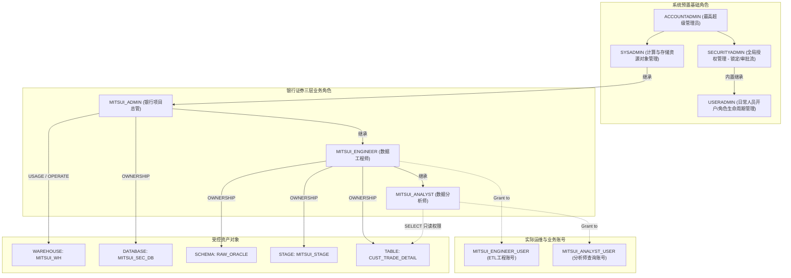
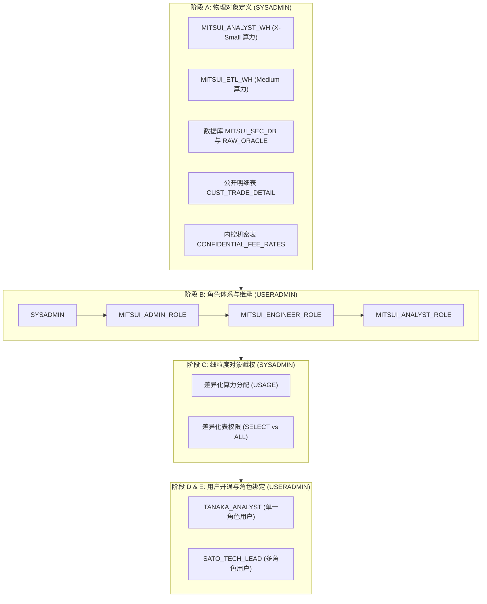

# 第 03 章：Snowflake 企业级 RBAC 权限设计与环境搭建实战

在银行证券等金融机构中，**最小特权原则（Principle of Least Privilege）**与**职能分离（Separation of Duties）**是合规的生命线。

---

## 1. 系统概要与核心目标（社内管理基盘设计思想）

在金融工程实践中，Snowflake 企业内部统一管理基盘的设立主要聚焦于以下两大核心目标：

1. **防范重大安全风险，基盘团队收敛全局特权**：  
   对于直接关联外部数据外泄等重大安全风险的全局最高权限，必须由**基盘架构团队（基础平台与安全运维）**统一所管。具体而言，全局系统管理角色 **`ACCOUNTADMIN`** 与 **`SECURITYADMIN`** 必须严格受控，杜绝直接下放给业务开发人员；基盘团队以此为前提，为各业务系统部门提供一个标准化、安全可信的 Snowflake 容器与基础设施。

2. **对接分散运维基盘，提供通用公共能力以减轻业务负担**：  
   由管理基盘统一对外提供与企业级分散运维体系对接所需的公共能力与标准接口，大幅减轻各业务部门的独立运维负担。  
   > [!IMPORTANT]
   > **企业级权责边界划分原则**：  
   > 针对因各业务系统而异的 **`SYSADMIN` 管理领域（包括各自的计算仓库 Warehouse、数据库 Database、Schema、Stage 等物理对象）**，全面下放并**由各业务系统部门（银行证券数据迁移项目组）自主管理与规划**，兼顾全局安全合规与业务线的敏捷工程落地。

---

## 2. 🏛️ 银行证券角色继承与访问控制架构



---

## 3. 🛠️ Step 4.1 ~ 4.15 详细执行手册

### 阶段一：切换 `USERADMIN`（管理用户与角色的生命周期）

```sql
USE ROLE USERADMIN;
```

#### 4.1 创建 Role
创建银行证券三层业务角色体系：
```sql
CREATE ROLE IF NOT EXISTS MITSUI_ADMIN    COMMENT = '银行证券项目总管角色';
CREATE ROLE IF NOT EXISTS MITSUI_ENGINEER COMMENT = '银行证券数据工程师角色';
CREATE ROLE IF NOT EXISTS MITSUI_ANALYST  COMMENT = '银行证券数据分析师角色';
```

#### 4.2 赋予 / 继承权限 (Role Hierarchy)
建立清晰的角色层级树，使得权限平滑继承，并最终汇总受控于 `SYSADMIN`：
```sql
-- 将 MITSUI_ADMIN 挂载到 SYSADMIN 之下
GRANT ROLE MITSUI_ADMIN TO ROLE SYSADMIN;

-- 工程师继承总管
GRANT ROLE MITSUI_ENGINEER TO ROLE MITSUI_ADMIN;

-- 分析师继承工程师
GRANT ROLE MITSUI_ANALYST TO ROLE MITSUI_ENGINEER;
```

#### 4.3 创建 User
创建实际业务用户：

> [!NOTE]
> **依赖时序说明**：此处为用户预先配置了 `DEFAULT_WAREHOUSE = MITSUI_WH`。Snowflake 允许在建用户时登记默认仓库名，但该计算资源必须在随后的 **Step 4.5** 中由 `SYSADMIN` 正式创建并下发 `USAGE` 权限后方可生效。

```sql
-- 工程师账号
CREATE USER IF NOT EXISTS MITSUI_ENGINEER_USER
    PASSWORD = 'MitsuiSecStrongPass2026!'
    DEFAULT_ROLE = MITSUI_ENGINEER
    DEFAULT_WAREHOUSE = MITSUI_WH
    MUST_CHANGE_PASSWORD = FALSE
    COMMENT = '银行证券ETL与迁移工程账号';

-- 分析师账号
CREATE USER IF NOT EXISTS MITSUI_ANALYST_USER
    PASSWORD = 'MitsuiSecStrongPass2026!'
    DEFAULT_ROLE = MITSUI_ANALYST
    DEFAULT_WAREHOUSE = MITSUI_WH
    MUST_CHANGE_PASSWORD = FALSE
    COMMENT = '银行证券分析师业务账号';
```

#### 4.4 赋予角色
```sql
GRANT ROLE MITSUI_ENGINEER TO USER MITSUI_ENGINEER_USER;
GRANT ROLE MITSUI_ANALYST TO USER MITSUI_ANALYST_USER;
```

---

### 阶段二：切换 `SYSADMIN`（分配计算资源与下发建库特权）

```sql
USE ROLE SYSADMIN;
```

#### 4.5 WAREHOUSE 作成
创建按需自动启停的虚拟计算仓库：
```sql
CREATE WAREHOUSE IF NOT EXISTS MITSUI_WH
    WITH 
    WAREHOUSE_SIZE = 'XSMALL'
    AUTO_SUSPEND = 300           -- 5分钟无查询自动休眠
    AUTO_RESUME = TRUE           -- 有SQL请求时秒级自动拉起
    INITIALLY_SUSPENDED = TRUE
    COMMENT = '银行证券核心数据批处理与迁移专用WH';

-- 授予计算仓库使用权
-- ★重要安全规则：Snowflake 角色继承仅单向向上汇总（父拥有子特权，子不继承父特权）
-- 因此必须分别明确将 USAGE 授予 MITSUI_ADMIN、MITSUI_ENGINEER 与 MITSUI_ANALYST
GRANT USAGE, OPERATE ON WAREHOUSE MITSUI_WH TO ROLE MITSUI_ADMIN;
GRANT USAGE ON WAREHOUSE MITSUI_WH TO ROLE MITSUI_ENGINEER;
GRANT USAGE ON WAREHOUSE MITSUI_WH TO ROLE MITSUI_ANALYST;
```

#### 4.6 DB 作成权限付与
在 Account 层级授予项目总管建库特权：
```sql
GRANT CREATE DATABASE ON ACCOUNT TO ROLE MITSUI_ADMIN;
```

---

### 阶段三：切换至业务角色，验证特权并创建存储实体 (Step 4.7 ~ 4.15)

#### 4.7 账号角色切换（切换为项目总管 MITSUI_ADMIN）
```sql
USE ROLE MITSUI_ADMIN;
USE WAREHOUSE MITSUI_WH;
```

#### 4.8 DATABASE 作成
```sql
CREATE DATABASE IF NOT EXISTS MITSUI_SEC_DB
    COMMENT = '银行证券核心生产数据云端迁移仓';

USE DATABASE MITSUI_SEC_DB;
```

#### 4.9 Schema 作成权限付与
将创建 Schema 的权限委托给数据工程师角色 `MITSUI_ENGINEER`：
```sql
GRANT USAGE ON DATABASE MITSUI_SEC_DB TO ROLE MITSUI_ENGINEER;
GRANT CREATE SCHEMA ON DATABASE MITSUI_SEC_DB TO ROLE MITSUI_ENGINEER;
```

#### 4.10 账号角色切换（切换为数据工程师 MITSUI_ENGINEER）
```sql
USE ROLE MITSUI_ENGINEER;
USE WAREHOUSE MITSUI_WH;
USE DATABASE MITSUI_SEC_DB;
```

#### 4.11 SCHEMA 作成
创建 Oracle 落地原始表所在的 Schema：
```sql
CREATE SCHEMA IF NOT EXISTS RAW_ORACLE
    DATA_RETENTION_TIME_IN_DAYS = 7
    COMMENT = 'Oracle 迁移落地原始表 Schema';

USE SCHEMA RAW_ORACLE;
```

#### 4.12 阶段 / 表作成权限付与
`MITSUI_ENGINEER` 作为当前 Schema 的创建者（OWNER），天然拥有创建 Stage、Table、File Format 的所有特权；同时为分析师赋予 Schema 的使用权：
```sql
GRANT USAGE ON SCHEMA MITSUI_SEC_DB.RAW_ORACLE TO ROLE MITSUI_ANALYST;
```

#### 4.13 账号角色切换 / 上下文锁定
```sql
USE ROLE MITSUI_ENGINEER;
USE WAREHOUSE MITSUI_WH;
USE DATABASE MITSUI_SEC_DB;
USE SCHEMA RAW_ORACLE;
```

#### 4.14 ステージ作成（Stage 与解析格式定义）
```sql
CREATE OR REPLACE FILE FORMAT CSV_ORACLE_IMPORT_FF
    TYPE = 'CSV'
    FIELD_DELIMITER = ','
    RECORD_DELIMITER = '\n'
    SKIP_HEADER = 1
    FIELD_OPTIONALLY_ENCLOSED_BY = '"'
    NULL_IF = ('NULL', 'null', '')
    EMPTY_FIELD_AS_NULL = TRUE
    TIMESTAMP_FORMAT = 'YYYY-MM-DD HH24:MI:SS'
    ENCODING = 'UTF8';

CREATE OR REPLACE STAGE MITSUI_STAGE
    FILE_FORMAT = CSV_ORACLE_IMPORT_FF
    COMMENT = '接收来自 Oracle 导出的中间受控暂存区';
```

#### 4.15 テーブル作成（CUST_TRADE_DETAIL 表创建）
严格按照 Excel 的规范映射创建落地表：
```sql
CREATE OR REPLACE TABLE CUST_TRADE_DETAIL (
    TRADE_QTY          NUMBER(15, 0)     DEFAULT 0 NOT NULL COMMENT '取引数量',
    AMOUNT_JPY         NUMBER(18, 3)     DEFAULT 0 NOT NULL COMMENT '約定金額・円貨',
    AMOUNT_FCY         NUMBER(18, 3)     DEFAULT 0 COMMENT '約定金額・外貨',
    CCY_CODE           VARCHAR(3)        COMMENT '通貨区分 (USD/EUR等)',
    EXCHANGE_RATE      NUMBER(9, 6)      COMMENT '為替レート',
    REMARKS            VARCHAR(100)      DEFAULT ' ' COMMENT '摘要・備考 (全角半角混在安全)',
    CUST_ID            VARCHAR(10)       NOT NULL COMMENT '顧客ID',
    TRADE_TYPE_CD      VARCHAR(2)        NOT NULL COMMENT '取引区分 (01:買付, 02:売付)',
    BRANCH_CD          VARCHAR(4)        NOT NULL COMMENT '支店コード',
    TRADE_DATE         VARCHAR(8)        NOT NULL COMMENT '約定日 (YYYYMMDD)',
    SETTLE_MONTH       VARCHAR(6)        COMMENT '決済対象月 (YYYYMM)',
    REG_DATETIME       TIMESTAMP_NTZ(6)  DEFAULT CURRENT_TIMESTAMP() NOT NULL COMMENT '登録日時',
    UPD_DATETIME       TIMESTAMP_NTZ(6)  COMMENT '更新日時',
    MIGRATED_AT        TIMESTAMP_LTZ(6)  DEFAULT CURRENT_TIMESTAMP() COMMENT '迁移同步时间戳',
    CONSTRAINT PK_CUST_TRADE_DETAIL PRIMARY KEY (CUST_ID, TRADE_DATE, TRADE_TYPE_CD)
)
COMMENT = '顧客取引明細（Oracle移行先 Snowflake設計）';

-- 遵循最小权限，只为分析师角色赋予 SELECT 权
GRANT SELECT ON TABLE CUST_TRADE_DETAIL TO ROLE MITSUI_ANALYST;
```

---

## 4. 🎯 基础验证与自检清单

```sql
-- 1. 查看当前会话环境
SELECT CURRENT_USER(), CURRENT_ROLE(), CURRENT_WAREHOUSE(), CURRENT_DATABASE(), CURRENT_SCHEMA();

-- 2. 检查角色继承关系
SHOW GRANTS OF ROLE MITSUI_ENGINEER;
SHOW GRANTS OF ROLE MITSUI_ADMIN;

-- 3. 检查表对象与阶段
SHOW STAGES LIKE 'MITSUI_STAGE';
SHOW TABLES LIKE 'CUST_TRADE_DETAIL';
```

---

## 5. 🏢 金融企业级进阶实战：多规格算力、多表隔离与单/多角色深度演练

在完成上述 **Step 4.1 ~ 4.15** 基础单仓单表的标准搭建后，在真实的金融与大型企业级生产环境中，权限与资源管控往往需要进一步升级为更为灵活严密的复合场景：
1. **多规格 Warehouse 隔离**：不同职责用户需要匹配不同算力（例如：数据分析师只需 `X-Small` 算力，而夜间跑批与 ETL 迁移工程师需要 `Medium` 高吞吐算力）；
2. **多表细粒度权限隔离**：同一业务 Schema 下，部分表允许分析师只读查询（如公开流水 `CUST_TRADE_DETAIL`），部分高敏表（如内控费率 `CONFIDENTIAL_FEE_RATES`）则绝不可对分析师开放；
3. **单角色用户 vs 多角色用户**：初级/外包人员配置单一受限角色；技术主管或核心骨干配置多角色，并支持按需自由切换上下文（`USE ROLE`）。

> [!TIP]
> 本进阶演练配套全量独立可执行验证脚本已存放于工程：[`scripts/snowflake/00_account_provisioning_and_rbac_demo.sql`](https://github.com/BIGMAX-RKO007/snowflakeblog/blob/main/scripts/snowflake/00_account_provisioning_and_rbac_demo.sql)。可在 Snowsight Worksheet 中一键导入或分段运行。

### 5.1 企业级规范构建顺序与职责分离 (Separation of Duties)

根据金融安全合规标准（FISC 规范），必须杜绝使用全局最高角色 `ACCOUNTADMIN` 进行日常对象维护，严格执行如下分层流水线：



### 5.2 单一角色用户 vs 多角色用户对比矩阵

| 评估维度 | 单一角色用户 (`TANAKA_ANALYST`) | 多角色用户 (`SATO_TECH_LEAD`) |
| :--- | :--- | :--- |
| **分配角色** | 仅绑定 `MITSUI_ANALYST_ROLE` | 同时绑定 `MITSUI_ADMIN_ROLE` + `MITSUI_ENGINEER_ROLE` + `MITSUI_ANALYST_ROLE` |
| **会话上下文行为** | 登录即被限定在分析师角色，无法执行提权操作 | 默认以 `MITSUI_ENGINEER_ROLE` 登录，可随时执行 `USE ROLE` 自由切换 |
| **计算资源约束** | 仅被允许拉起 `MITSUI_ANALYST_WH` (X-Small)，单价 1 点/时，成本严格可控 | 日常开发使用 `MITSUI_ETL_WH` (Medium)，查报表时可自主降级至分析仓库 |
| **数据访问边界** | 仅对 `CUST_TRADE_DETAIL` 只读；访问机密费率表直接报 `Object does not exist` | 工程师角色下可读写机密费率表；切至主管角色可执行全局管理与授权 |
| **适用人群** | 外包人员、业务合规人员、初级分析师（零特权越界风险） | 架构师、Tech Lead、核心数据工程师（兼顾高权限与日常审计安全） |

### 5.3 进阶核心 SQL 摘要

```sql
-- 1. 创建多规格 Warehouse 与差异化安全表 (SYSADMIN)
USE ROLE SYSADMIN;
CREATE WAREHOUSE IF NOT EXISTS MITSUI_ANALYST_WH WITH WAREHOUSE_SIZE = 'X-SMALL' AUTO_SUSPEND = 60 AUTO_RESUME = TRUE;
CREATE WAREHOUSE IF NOT EXISTS MITSUI_ETL_WH     WITH WAREHOUSE_SIZE = 'MEDIUM'  AUTO_SUSPEND = 120 AUTO_RESUME = TRUE;

-- 2. 差异化赋权 (SYSADMIN)
-- 分析师仅获轻量仓库与普通明细表只读
GRANT USAGE ON WAREHOUSE MITSUI_ANALYST_WH TO ROLE MITSUI_ANALYST_ROLE;
GRANT SELECT ON TABLE MITSUI_SEC_DB.RAW_ORACLE.CUST_TRADE_DETAIL TO ROLE MITSUI_ANALYST_ROLE;

-- 工程师获高性能仓库与机密费率表读写
GRANT USAGE ON WAREHOUSE MITSUI_ETL_WH TO ROLE MITSUI_ENGINEER_ROLE;
GRANT SELECT, INSERT, UPDATE, DELETE ON TABLE MITSUI_SEC_DB.RAW_ORACLE.CUST_TRADE_DETAIL TO ROLE MITSUI_ENGINEER_ROLE;
GRANT SELECT, INSERT, UPDATE ON TABLE MITSUI_SEC_DB.RAW_ORACLE.CONFIDENTIAL_FEE_RATES TO ROLE MITSUI_ENGINEER_ROLE;

-- 3. 开通用户与角色绑定 (USERADMIN)
USE ROLE USERADMIN;
CREATE USER IF NOT EXISTS TANAKA_ANALYST PASSWORD = 'InitPassword123#A' DEFAULT_ROLE = MITSUI_ANALYST_ROLE DEFAULT_WAREHOUSE = MITSUI_ANALYST_WH;
CREATE USER IF NOT EXISTS SATO_TECH_LEAD PASSWORD = 'InitPassword123#B' DEFAULT_ROLE = MITSUI_ENGINEER_ROLE DEFAULT_WAREHOUSE = MITSUI_ETL_WH;

-- 绑定角色
GRANT ROLE MITSUI_ANALYST_ROLE TO USER TANAKA_ANALYST;
GRANT ROLE MITSUI_ENGINEER_ROLE TO USER SATO_TECH_LEAD;
GRANT ROLE MITSUI_ANALYST_ROLE  TO USER SATO_TECH_LEAD;
GRANT ROLE MITSUI_ADMIN_ROLE    TO USER SATO_TECH_LEAD;
```

### 5.4 验证测试清单（可在 Snowflake 直接复核）
* **测试 1（受限用户查询）**：以 `MITSUI_ANALYST_ROLE` 查询 `CUST_TRADE_DETAIL`，成功读取；
* **测试 2（越权拦截）**：以 `MITSUI_ANALYST_ROLE` 尝试执行 `INSERT` 或查询 `CONFIDENTIAL_FEE_RATES`，系统直接拦截报错（Access denied）；
* **测试 3（算力隔离）**：以 `MITSUI_ANALYST_ROLE` 执行 `USE WAREHOUSE MITSUI_ETL_WH`，系统提示无权限拒绝使用；
* **测试 4（多角色动态切换）**：以 `SATO_TECH_LEAD` 执行 `USE ROLE MITSUI_ANALYST_ROLE`，成功动态降级切换。

