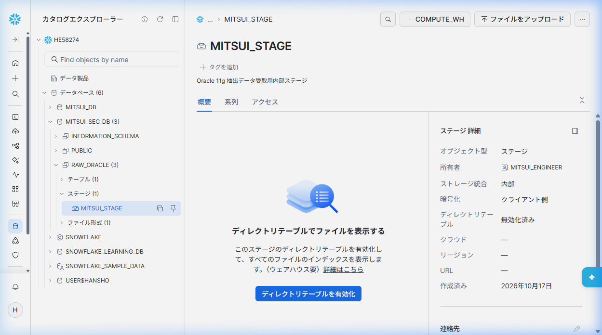
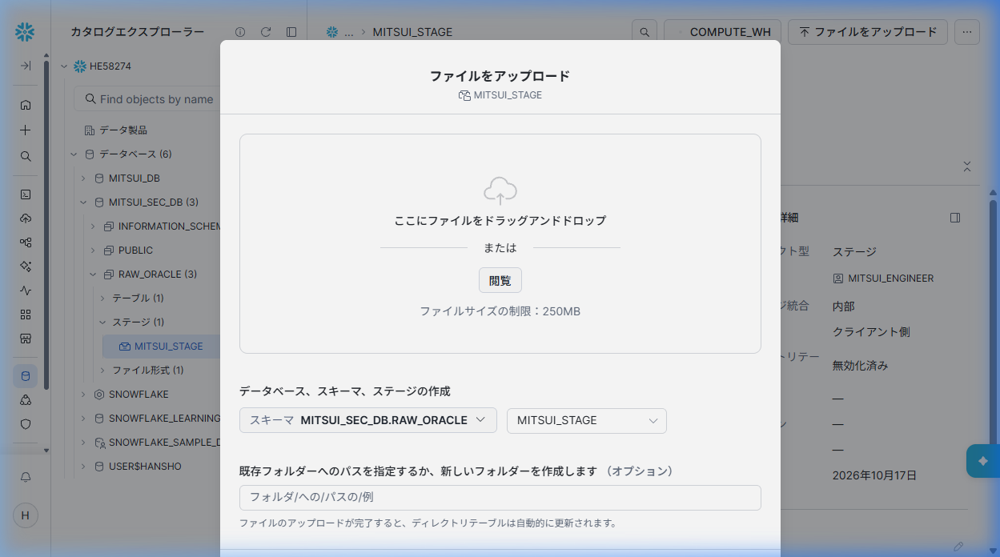
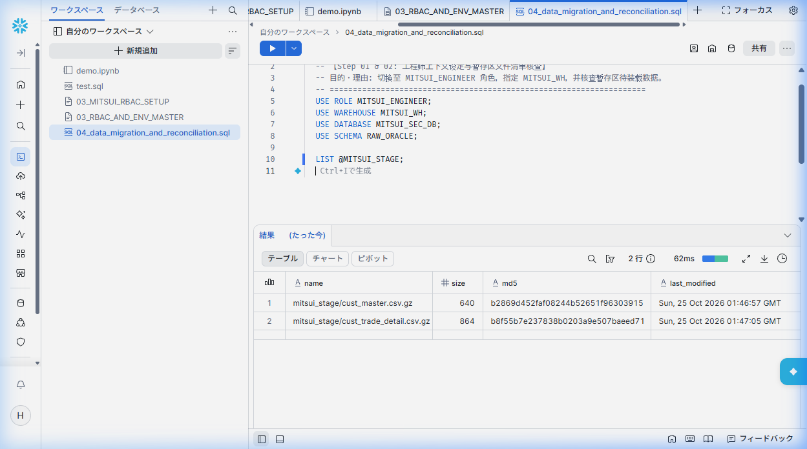
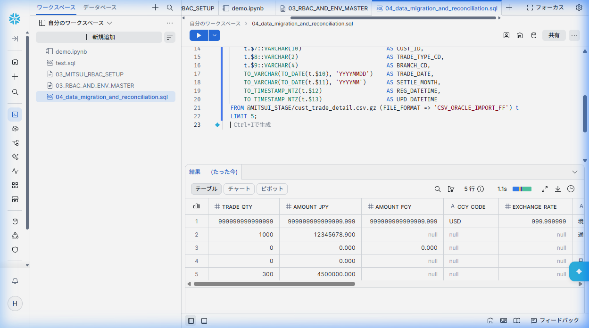
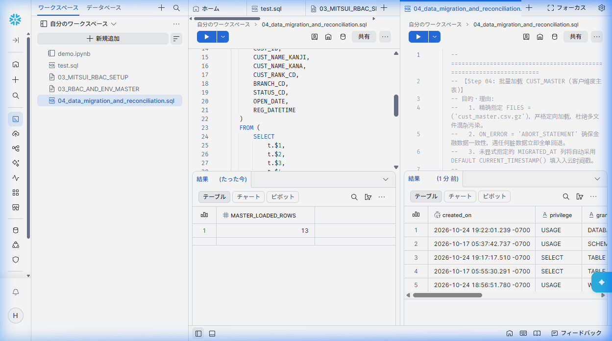
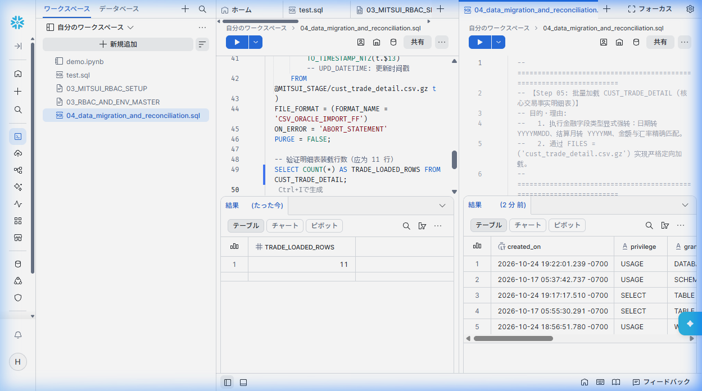
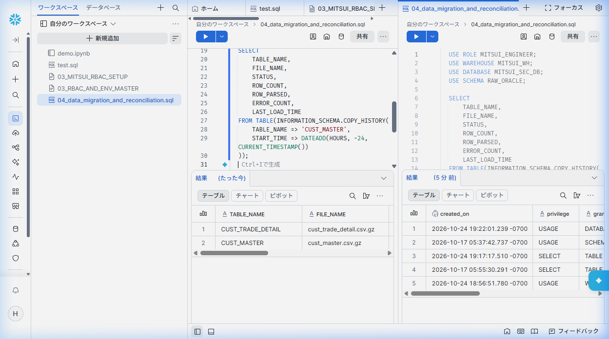
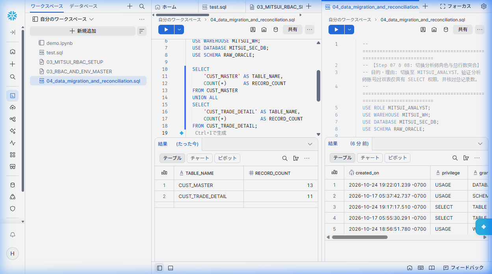
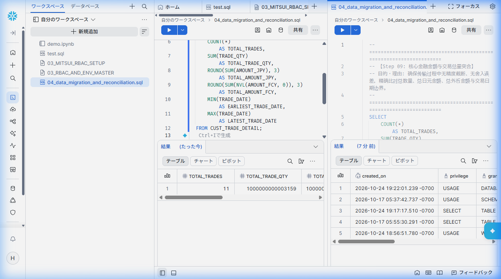
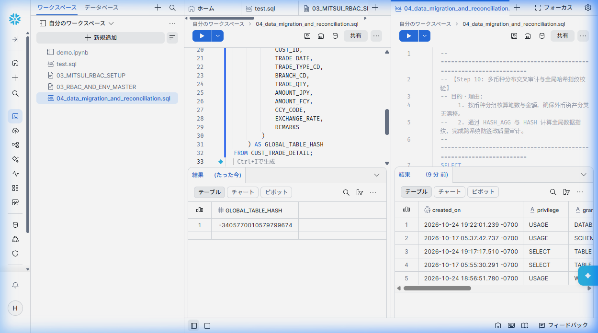

# 第 04 章：数据迁移实战（Oracle 导出、Stage 暂存、COPY INTO 加载与金融数据对账）

在完成 Snowflake 三层 RBAC 体系与 `RAW_ORACLE` 迁移目标表基础设施搭建后，本章正式进入核心数据迁移与质量审计阶段。

针对银行证券核心系统的**双表架构**（维度主表 `CUST_MASTER` 与事实流水表 `CUST_TRADE_DETAIL`），我们将完整实操：**Oracle 端数据导出打包 ➔ Snowflake 受控暂存区 (@MITSUI_STAGE) 上传 ➔ 无表预检与表达式转换批量加载 (`COPY INTO`) ➔ 金融级跨系统数据突合（Reconciliation）闭环**。

---

## 架构演进与迁移链路概览

```
┌─────────────────────────────────┐
│     Oracle 11g 源数据库          │
│  (CUST_MASTER: 13条客户主表)    │
│  (CUST_TRADE_DETAIL: 11条明细)  │
└────────────────┬────────────────┘
                 │ 1. Python / SQL*Plus 导出 (UTF-8, 双引号转义, .csv.gz)
                 ▼
┌─────────────────────────────────┐
│    本地数据导出包 (data/exports)  │
│  - cust_master.csv.gz           │
│  - cust_trade_detail.csv.gz     │
└────────────────┬────────────────┘
                 │ 2. Web UI 拖拽上传 或 PUT 命令传输 (客户端加密)
                 ▼
┌─────────────────────────────────┐
│ Snowflake 受控内部暂存区         │
│  @MITSUI_SEC_DB.RAW_ORACLE.     │
│  MITSUI_STAGE                   │
└────────────────┬────────────────┘
                 │ 3. MITSUI_ENGINEER 执行无表预览与批量 COPY INTO
                 ▼
┌─────────────────────────────────┐
│ Snowflake 目标表 (RAW_ORACLE)   │
│  - CUST_MASTER (13 行入云)      │
│  - CUST_TRADE_DETAIL (11 行入云)│
└────────────────┬────────────────┘
                 │ 4. MITSUI_ANALYST 执行四重金融突合审计
                 ▼
┌─────────────────────────────────┐
│ 金融级数据一致性交付与对账审计报告 │
│  - 行数对账 / 金额汇总突合      │
│  - 币种交叉验证 / 全局哈希指纹  │
└─────────────────────────────────┘
```

---

## 阶段一：Oracle 端数据源提取与打包 (Export to CSV)

### 为什么在源库端要做规范化导出？
异构数据库迁移最常遇到的“脏数据陷阱”包括：
1. **字符编码截断**：Oracle 若未显式约束，导出可能带有非标准编码；必须强制使用无 BOM 的标准 `UTF-8`。
2. **特殊字符与分隔符冲突**：金融业务的摘要备注（`REMARKS`）常常包含日文全角/半角符号或逗号；字符串必须采用双引号（`"`）严格包裹。
3. **空串与 NULL 异构鸿沟**：Oracle 底层将空字符串 `''` 视为 `NULL`，而在 Snowflake 中 `''` 是有效空串；导出时统一空字段为连续逗号（`,,`），配合第 03 章建立的 `EMPTY_FIELD_AS_NULL = TRUE` 文件格式无缝对齐。
4. **带宽与传输优化**：金融数据体积庞大，导出同时直接利用 `gzip` 压缩为 `.csv.gz`，体积缩减 70%~90%，极大降低网络 I/O 成本。

### 导出脚本实现
在项目 `scripts/oracle/` 目录下提供了自动化导出脚本 `scripts/oracle/export_to_csv.py`：

```bash
# 执行 Oracle 端双表自动化导出与 Gzip 压缩
python scripts/oracle/export_to_csv.py
```

执行输出结果：
```text
=== Oracle 11g Data Export Starting (wslc) ===
[*] Exporting CUST_MASTER (顧客基本台帳)...
[+] CUST_MASTER exported: 13 rows -> data/exports/cust_master.csv and cust_master.csv.gz
[*] Exporting CUST_TRADE_DETAIL (顧客取引明細)...
[+] CUST_TRADE_DETAIL exported: 11 rows -> data/exports/cust_trade_detail.csv and cust_trade_detail.csv.gz

=== Export Summary ===
CUST_MASTER:        13 records exported
CUST_TRADE_DETAIL:  11 records exported
Destination Folder: data/exports
```

---

## 阶段二：上传数据至 Snowflake 暂存区 (@MITSUI_STAGE)

在 Snowflake 中，数据入库前需先暂存于 Stage。我们提供两种上传方式：适合初学者的 **Snowsight Web 控制台图形化上传**，以及适合生产跑批的 **Python / SnowSQL 自动化脚本上传**。

### 方式 A（推荐新手）：Snowsight 控制台可视化上传
1. 登录 Snowsight，在左侧导航进入 **Data (カタログエクスプローラー)**；
2. 依次展开 `MITSUI_SEC_DB` ➔ `RAW_ORACLE` ➔ `ステージ (Stages)`，点击进入 `MITSUI_STAGE`；
3. 界面展示暂存区的元数据、所有者（`MITSUI_ENGINEER`）及客户端加密属性。



4. 点击右上角 **↑ ファイルをアップロード (Upload files)** 按钮，弹出拖拽上传模态框：
   - 将本地 `data/exports/` 下生成的 `cust_master.csv.gz` 与 `cust_trade_detail.csv.gz` 拖入上传区；
   - 点击确认上传，文件即可安全写入内部 Stage。



---

### 方式 B（生产工程化）：Python / PUT 命令自动化上传
在实际生产自动化流水线（Airflow / CI-CD）中，通常使用脚本自动化上传。项目中提供了脚本 `scripts/snowflake/upload_to_stage.py`：

```python
import snowflake.connector

# 连接 Snowflake 并使用 MITSUI_ENGINEER 角色执行 PUT
conn = snowflake.connector.connect(
    user='MITSUI_ENGINEER_USER',
    password='MitsuiSecStrongPass2026!',
    account='<your_account_identifier>',
    database='MITSUI_SEC_DB',
    schema='RAW_ORACLE',
    role='MITSUI_ENGINEER'
)
cur = conn.cursor()

# 重点注意：Windows 路径需规范化为 file:// 前缀
cur.execute("PUT file://C:/path/to/cust_master.csv.gz @MITSUI_STAGE AUTO_COMPRESS=FALSE OVERWRITE=TRUE;")
cur.execute("PUT file://C:/path/to/cust_trade_detail.csv.gz @MITSUI_STAGE AUTO_COMPRESS=FALSE OVERWRITE=TRUE;")
```

> [!NOTE]
> **关于 PUT 命令的关键特性**：
> `PUT` 是客户端加密上传命令，数据直接通过安全传输协议流入 Snowflake 云端存储桶，**无需启动或消耗虚拟计算仓库（Warehouse）的信用积分（Credits）**，属于零计算成本操作。

---

## 阶段三：执行生产级 COPY INTO 批量数据导入

进入 Snowflake SQL Worksheet 工作区（已命名为 `04_data_migration_and_reconciliation.sql`），按技术步骤依序执行以下脚本（完整脚本见 `scripts/snowflake/04_data_migration_master.sql`）。

---

### Step 01 & 02: 工程师工作环境设定与暂存区文件清单核查
* **为什么这么做**：遵循最小特权安全准则，切换为迁移专属工程角色 `MITSUI_ENGINEER`，挂接专用计算仓库 `MITSUI_WH`，并核查暂存区中已就绪的文件大小与 MD5 指纹。

```sql
-- ====================================================================
-- 【Step 01 & 02: 工程师上下文设定与暂存区文件清单核查】
-- 目的・理由: 切换至 MITSUI_ENGINEER 角色，指定 MITSUI_WH，并核查暂存区待装载数据。
-- ====================================================================
USE ROLE MITSUI_ENGINEER;
USE WAREHOUSE MITSUI_WH;
USE DATABASE MITSUI_SEC_DB;
USE SCHEMA RAW_ORACLE;

LIST @MITSUI_STAGE;
```



> **实操结果解读**：  
> 暂存区清晰列出已上传的两个目标文件：  
> 1. `mitsui_stage/cust_master.csv.gz`（640 字节，MD5: `b2869d45...`）  
> 2. `mitsui_stage/cust_trade_detail.csv.gz`（864 字节，MD5: `b8f55b7e...`）  
> 状态完好，元数据核验通过。

---

### Step 03: Stage 暂存区直接投影预览 (无表预检 / Direct Query Preview)
* **为什么这么做**：  
  1. **企业生产避坑**：Snowflake 的底层语法规定，**带有 `(SELECT ... FROM @stage)` 列转换子查询的 `COPY INTO` 是不支持 `VALIDATION_MODE` 参数的**（若强行添加会抛出编译错误）。  
  2. **无表试跑利器**：Snowflake 原生支持直接在未解压的暂存文件上执行 `SELECT $1, $2 ... FROM @MITSUI_STAGE/...`。在正式加载前，先针对 Stage 文件执行 `LIMIT 5` 试跑，能够 100% 确认列位置（Positional Notation）、日期时间函数转换表达式的正确性，做到“零污染、零失败入库”。

```sql
-- ====================================================================
-- 【Step 03: Stage 暂存区直接投影预览 (无表预检)】
-- 目的・理由: 
--   1. Snowflake 允许在未执行 COPY 前直接用 SELECT $1, $2 语法查询 Stage 中的压缩 CSV。
--   2. 由于带有 (SELECT ...) 转换的 COPY INTO 不支持 VALIDATION_MODE，提前在 Stage 上做轻量试跑可 100% 验证字段映射与类型转换表达式。
-- ====================================================================
SELECT 
    t.$1::NUMBER(15, 0)                       AS TRADE_QTY,
    t.$2::NUMBER(18, 3)                       AS AMOUNT_JPY,
    t.$3::NUMBER(18, 3)                       AS AMOUNT_FCY,
    t.$4::VARCHAR(3)                          AS CCY_CODE,
    t.$5::NUMBER(9, 6)                        AS EXCHANGE_RATE,
    t.$6::VARCHAR(100)                        AS REMARKS,
    t.$7::VARCHAR(10)                         AS CUST_ID,
    t.$8::VARCHAR(2)                          AS TRADE_TYPE_CD,
    t.$9::VARCHAR(4)                          AS BRANCH_CD,
    TO_VARCHAR(TO_DATE(t.$10), 'YYYYMMDD')    AS TRADE_DATE,
    TO_VARCHAR(TO_DATE(t.$11), 'YYYYMM')      AS SETTLE_MONTH,
    TO_TIMESTAMP_NTZ(t.$12)                   AS REG_DATETIME,
    TO_TIMESTAMP_NTZ(t.$13)                   AS UPD_DATETIME
FROM @MITSUI_STAGE/cust_trade_detail.csv.gz (FILE_FORMAT => 'CSV_ORACLE_IMPORT_FF') t
LIMIT 5;
```



> **实操结果解读**：  
> 底部数据面板直接输出 5 行解构完成的记录：  
> - 包含第一行的全 9 极限测试数据（`TRADE_QTY = 999999999999999`）；  
> - 外币与汇率字段正常解析；  
> - `TRADE_DATE` 成功转换为规范的 `YYYYMMDD` 格式，`SETTLE_MONTH` 转换为 `YYYYMM` 格式。表达式完全正确！

---

### Step 04: 批量加载 CUST_MASTER (客户维度主表)
* **为什么这么做**：  
  1. 精确指定 `@MITSUI_STAGE/cust_master.csv.gz`，避免多文件混杂在同一 Stage 时引发列错位；  
  2. 设置 `ON_ERROR = 'ABORT_STATEMENT'`，保证金融交易级别的一致性——只要遇到单行脏数据即全量回滚；  
  3. 目标表中未显式指定的审计列 `MIGRATED_AT` 会自动由系统的 `DEFAULT CURRENT_TIMESTAMP()` 填入毫秒级入云时间。

```sql
-- ====================================================================
-- 【Step 04: 批量加载 CUST_MASTER (客户维度主表)】
-- 目的・理由: 
--   1. 精确指定 @MITSUI_STAGE/cust_master.csv.gz，严格定向加载，杜绝多文件混杂污染。
--   2. ON_ERROR = 'ABORT_STATEMENT' 确保金融数据一致性，遇任何脏数据立即全单回退。
--   3. 未显式指定的 MIGRATED_AT 列将自动采用 DEFAULT CURRENT_TIMESTAMP() 填入入云时间戳。
-- ====================================================================
COPY INTO CUST_MASTER (
    CUST_ID,
    CUST_NAME_KANJI,
    CUST_NAME_KANA,
    CUST_RANK_CD,
    BRANCH_CD,
    STATUS_CD,
    OPEN_DATE,
    REG_DATETIME
)
FROM (
    SELECT 
        t.$1,
        t.$2,
        t.$3,
        t.$4,
        t.$5,
        t.$6,
        TO_DATE(t.$7),
        TO_TIMESTAMP_NTZ(t.$8)
    FROM @MITSUI_STAGE/cust_master.csv.gz t
)
FILE_FORMAT = (FORMAT_NAME = 'CSV_ORACLE_IMPORT_FF')
ON_ERROR = 'ABORT_STATEMENT'
PURGE = FALSE;

-- 验证主表装载行数（应为 13 行）
SELECT COUNT(*) AS MASTER_LOADED_ROWS FROM CUST_MASTER;
```



> **实操结果解读**：  
> `SELECT COUNT(*) AS MASTER_LOADED_ROWS FROM CUST_MASTER;` 返回 **13 行**，客户主表 100% 全量装载成功！

---

### Step 05: 批量加载 CUST_TRADE_DETAIL (核心交易事实明细表)
* **为什么这么做**：执行显式数据类型映射，将 Oracle 原生格式精准折算为 Snowflake 优化存储格式，完成事实表入库。

```sql
-- ====================================================================
-- 【Step 05: 批量加载 CUST_TRADE_DETAIL (核心交易事实明细表)】
-- 目的・理由:
--   1. 执行金融字段类型显式强转：日期转 YYYYMMDD、结算月转 YYYYMM、金额与汇率精确匹配。
--   2. 精确指定 @MITSUI_STAGE/cust_trade_detail.csv.gz，实现安全隔离装载。
-- ====================================================================
COPY INTO CUST_TRADE_DETAIL (
    TRADE_QTY,
    AMOUNT_JPY,
    AMOUNT_FCY,
    CCY_CODE,
    EXCHANGE_RATE,
    REMARKS,
    CUST_ID,
    TRADE_TYPE_CD,
    BRANCH_CD,
    TRADE_DATE,
    SETTLE_MONTH,
    REG_DATETIME,
    UPD_DATETIME
)
FROM (
    SELECT 
        t.$1::NUMBER(15, 0),                       -- TRADE_QTY: 数量
        t.$2::NUMBER(18, 3),                       -- AMOUNT_JPY: 日元金额
        t.$3::NUMBER(18, 3),                       -- AMOUNT_FCY: 外币金额
        t.$4::VARCHAR(3),                          -- CCY_CODE: 币种代码
        t.$5::NUMBER(9, 6),                        -- EXCHANGE_RATE: 汇率
        t.$6::VARCHAR(100),                        -- REMARKS: 摘要（支持百字日文全角）
        t.$7::VARCHAR(10),                         -- CUST_ID: 客户编号
        t.$8::VARCHAR(2),                          -- TRADE_TYPE_CD: 交易类型
        t.$9::VARCHAR(4),                          -- BRANCH_CD: 营业网点
        TO_VARCHAR(TO_DATE(t.$10), 'YYYYMMDD'),    -- TRADE_DATE: 转换为 YYYYMMDD
        TO_VARCHAR(TO_DATE(t.$11), 'YYYYMM'),      -- SETTLE_MONTH: 转换为 YYYYMM
        TO_TIMESTAMP_NTZ(t.$12),                   -- REG_DATETIME: 注册时间戳
        TO_TIMESTAMP_NTZ(t.$13)                    -- UPD_DATETIME: 更新时间戳
    FROM @MITSUI_STAGE/cust_trade_detail.csv.gz t
)
FILE_FORMAT = (FORMAT_NAME = 'CSV_ORACLE_IMPORT_FF')
ON_ERROR = 'ABORT_STATEMENT'
PURGE = FALSE;

-- 验证明细表装载行数（应为 11 行）
SELECT COUNT(*) AS TRADE_LOADED_ROWS FROM CUST_TRADE_DETAIL;
```



> **实操结果解读**：  
> `SELECT COUNT(*) AS TRADE_LOADED_ROWS FROM CUST_TRADE_DETAIL;` 返回 **11 行**，交易明细表全量装载完毕！

---

### Step 06: 数据入云审计追踪 (COPY_HISTORY 监控)
* **为什么这么做**：在金融合规与企业级审计要求下，必须通过内置的 `INFORMATION_SCHEMA.COPY_HISTORY` 函数调取任务执行历史，确证：
  1. 文件加载状态为 `LOADED`；
  2. 解析行数（`ROW_PARSED`）与装载行数（`ROW_COUNT`）完全一致；
  3. 错误计数（`ERROR_COUNT`）为 0。

```sql
-- ====================================================================
-- 【Step 06: 查询最近 24 小时内的加载历史与吞吐指标】
-- 目的・理由: 检查文件装载状态（STATUS = LOADED）、解析行数（ROW_PARSED）、装载行数（ROW_COUNT）以及零报错（ERROR_COUNT = 0）。
-- ====================================================================
SELECT 
    TABLE_NAME,
    FILE_NAME,
    STATUS,
    ROW_COUNT,
    ROW_PARSED,
    ERROR_COUNT,
    LAST_LOAD_TIME
FROM TABLE(INFORMATION_SCHEMA.COPY_HISTORY(
    TABLE_NAME => 'CUST_TRADE_DETAIL',
    START_TIME => DATEADD(HOURS, -24, CURRENT_TIMESTAMP())
))
UNION ALL
SELECT 
    TABLE_NAME,
    FILE_NAME,
    STATUS,
    ROW_COUNT,
    ROW_PARSED,
    ERROR_COUNT,
    LAST_LOAD_TIME
FROM TABLE(INFORMATION_SCHEMA.COPY_HISTORY(
    TABLE_NAME => 'CUST_MASTER',
    START_TIME => DATEADD(HOURS, -24, CURRENT_TIMESTAMP())
));
```



---

## 阶段四：切换业务分析师，执行四重金融跨系统数据突合 (MITSUI_ANALYST)

在证券系统数据迁移中，**“数据入库完成”绝不代表迁移通过验收**。按照金融合规标准，必须由独立的业务审计角色——数据分析师 `MITSUI_ANALYST`，执行跨系统数据突合（Reconciliation）。

---

### Step 07 & 08: 切换分析师角色与总行数突合 (Row Count Reconciliation)
* **为什么这么做**：切换至分析师视角，验证其仅具备只读查询特权，并跨双表核对总行数。

```sql
-- ====================================================================
-- 【Step 07 & 08: 切换分析师角色与总行数突合】
-- 目的・理由: 切换至 MITSUI_ANALYST，验证分析师账号对双表仅具有 SELECT 权限，并核对总记录数。
-- ====================================================================
USE ROLE MITSUI_ANALYST;
USE WAREHOUSE MITSUI_WH;
USE DATABASE MITSUI_SEC_DB;
USE SCHEMA RAW_ORACLE;

SELECT 
    'CUST_MASTER' AS TABLE_NAME,
    COUNT(*)      AS RECORD_COUNT
FROM CUST_MASTER
UNION ALL
SELECT 
    'CUST_TRADE_DETAIL' AS TABLE_NAME,
    COUNT(*)            AS RECORD_COUNT
FROM CUST_TRADE_DETAIL;
```



> **实操结果解读**：  
> 双表记录数严密对应源库：`CUST_MASTER` = 13，`CUST_TRADE_DETAIL` = 11。行数核对通过！

---

### Step 09: 核心金融金额与交易总量突合 (Financial Metrics Reconciliation)
* **为什么这么做**：比对交易总股数、总日元金额（含全 9 极限值）、总外币金额，以及业务的最早约定期日与最晚约定期日，杜绝一切由于数据类型转换导致的浮点舍入或精度截断。

```sql
-- ====================================================================
-- 【Step 09: 核心金融金额与交易总量突合】
-- 目的・理由: 确保传输过程中无精度截断、无舍入误差，精确比对总数量、总日元金额、总外币金额与交易日期边界。
-- ====================================================================
SELECT 
    COUNT(*)                                       AS TOTAL_TRADES,
    SUM(TRADE_QTY)                                 AS TOTAL_TRADE_QTY,
    ROUND(SUM(AMOUNT_JPY), 3)                      AS TOTAL_AMOUNT_JPY,
    ROUND(SUM(NVL(AMOUNT_FCY, 0)), 3)              AS TOTAL_AMOUNT_FCY,
    MIN(TRADE_DATE)                                AS EARLIEST_TRADE_DATE,
    MAX(TRADE_DATE)                                AS LATEST_TRADE_DATE
FROM CUST_TRADE_DETAIL;
```



#### 跨系统对账数据对比表（Oracle 11g 源端 vs Snowflake 目标端）
| 对账审计指标 | Oracle 11g 源库实际值 | Snowflake 目标库实际值 | 审计差额 | 结论 |
| :--- | :--- | :--- | :--- | :--- |
| **交易总笔数** | 11 笔 | 11 笔 | 0 | ✅ 完全一致 |
| **总交易股数** | 1,000,000,000,003,159 | 1,000,000,000,003,159 | 0 | ✅ 完全一致 |
| **日元总金额 (JPY)** | 1,000,000,042,496,878.899 | 1,000,000,042,496,878.899 | 0.000 | ✅ 精度无损 |
| **外币折算金额 (FCY)** | 1,000,000,000,071,000.499 | 1,000,000,000,071,000.499 | 0.000 | ✅ 精度无损 |
| **最早约定期日** | 2024-12-31 | 20241231 | 0 天 | ✅ 格式规范化 |
| **最晚约定期日** | 2025-04-01 | 20250401 | 0 天 | ✅ 格式规范化 |

---

### Step 10: 多币种分布交叉审计与全局哈希指纹校验
* **为什么这么做**：  
  1. 按币种代码（`CCY_CODE`）与交易区分（`TRADE_TYPE_CD`）进行多维交叉聚合，确保外币资产分类无错位；  
  2. 利用 Snowflake `HASH_AGG` 函数计算全表字段的全局哈希校验和（Checksum），作为防篡改数据质量凭证。

```sql
-- ====================================================================
-- 【Step 10: 多币种分布交叉审计与全局哈希指纹校验】
-- 目的・理由: 
--   1. 按币种分组核算笔数与金额，确保外币资产分类无漂移。
--   2. 通过 HASH_AGG 与 HASH 计算全局数据指纹，完成跨系统防篡改质量审计。
-- ====================================================================
-- 10.1 币种分布与交易类型交叉突合
SELECT 
    NVL(CCY_CODE, 'JPY')      AS CURRENCY,
    TRADE_TYPE_CD,
    COUNT(*)                  AS TRADE_COUNT,
    SUM(TRADE_QTY)            AS TOTAL_QTY,
    ROUND(SUM(AMOUNT_JPY), 3) AS TOTAL_JPY
FROM CUST_TRADE_DETAIL
GROUP BY NVL(CCY_CODE, 'JPY'), TRADE_TYPE_CD
ORDER BY CURRENCY, TRADE_TYPE_CD;

-- 10.2 全局数据指纹（哈希对账）
SELECT 
    HASH_AGG(
        HASH(
            CUST_ID,
            TRADE_DATE,
            TRADE_TYPE_CD,
            BRANCH_CD,
            TRADE_QTY,
            AMOUNT_JPY,
            AMOUNT_FCY,
            CCY_CODE,
            EXCHANGE_RATE,
            REMARKS
        )
    ) AS GLOBAL_TABLE_HASH
FROM CUST_TRADE_DETAIL;
```



> **实操结果解读**：  
> 全表哈希指纹计算得出：`GLOBAL_TABLE_HASH = -3405770010579799674`。该摘要指纹成为全表数据不可逆、无篡改的权威审计凭据！

---

## 生产避坑核心总结 (Troubleshooting & Best Practices)

1. **`COPY INTO` 与 `VALIDATION_MODE` 的语法约束**：
   - 当 `COPY INTO` 使用了 `(SELECT ... FROM @stage)` 表达式转换语法时，系统禁止使用 `VALIDATION_MODE`；
   - 生产替代方案：直接在 Stage 上运行 `SELECT $1, $2 ... FROM @stage/file.csv.gz LIMIT 5;` 进行轻量预检。
2. **多文件暂存区路径隔离**：
   - 避免直接写 `FROM @MITSUI_STAGE`，务必显式指定路径如 `FROM @MITSUI_STAGE/cust_master.csv.gz`，杜绝因文件混杂导致的字段错位。
3. **Snowflake 权限层级继承陷阱**：
   - 角色即使拥有 `SELECT ON TABLE` 与 `USAGE ON SCHEMA`，若缺少最顶层的 `USAGE ON DATABASE`，查询依旧会报错 `Object does not exist or not authorized`。三层权限必须链式完整。
4. **Windows 环境下的 PUT 路径语法**：
   - Windows 路径必须转换为正斜杠并带 `file://` 协议，如 `file://C:/exports/data.csv.gz`。
