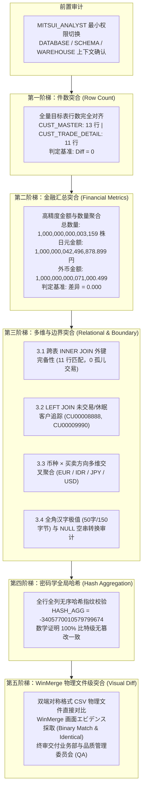

# 第 05 章：迁移后两方数据差异对比与质量对账 (Data Reconciliation)

在日企金融 IT 工程中，新旧系统数据迁移后的验收阶段被称为 **「新旧データ突合検証 (Reconciliation & Validation)」**。这是决定系统能否获取生产上线许可（Go-Live Sign-off）的最严苛防线。

在银行与证券系统中，仅仅核对“行数相同”是远远不够的。汇率换算精度丢失、浮点数舍入误差、全角半角字符截断、外键孤儿记录、隐式 NULL 转换失误、以及换行符/编码字符集变动，都可能导致严重的金融监管事故与账务不平。

本章采用日本金融 IT 行业标准的 **「五阶梯递进式严密突合体系 (5-Tier Reconciliation Architecture)」**，由审计与分析师专属角色 `MITSUI_ANALYST` 执行跨系统（Oracle 11g 源库 vs Snowflake 目标库）双引擎基准对照实操，并引入日企现场必备的 **WinMerge 物理文件级差分验证与证据保全（エビデンス保全）**。

---

## 突合架构设计：五阶梯严密突合体系



---

## 阶段零：审计会话环境初始化 (Session Setup)

在金融安全合规中，必须严格恪守**最小特权原则（Principle of Least Privilege）**。突合工作严禁使用具备写权限的 `MITSUI_ENGINEER` 或高权 `SYSADMIN` / `ACCOUNTADMIN`，而必须切换至只读审计分析角色 `MITSUI_ANALYST`。

### Snowflake 执行 SQL

```sql
-- 目的・理由: 切换至审计分析专用角色，设定只读会话上下文
USE ROLE MITSUI_ANALYST;
USE WAREHOUSE MITSUI_WH;
USE DATABASE MITSUI_SEC_DB;
USE SCHEMA RAW_ORACLE;

-- 验证当前会话上下文
SELECT CURRENT_ROLE(), CURRENT_WAREHOUSE(), CURRENT_DATABASE(), CURRENT_SCHEMA();
```

---

## 第一阶梯：新旧表件数突合 (Row Count Validation)

### 1. 业务目标与判定标准
确认抽取、传输、解析与加载的整个 ETL/ELT 管道中，**没有产生任何数据丢件（Data Loss）或多重重复加载（Duplicates）**。
- **判定标准**：$\Delta = \text{Snowflake\_Count} - \text{Oracle\_Benchmark} = 0$。

### 2. 双端对照 SQL

#### Oracle 源库端基准：
```sql
SELECT 'CUST_MASTER' AS TABLE_NAME, COUNT(*) AS TOTAL_COUNT FROM CUST_MASTER
UNION ALL
SELECT 'CUST_TRADE_DETAIL' AS TABLE_NAME, COUNT(*) AS TOTAL_COUNT FROM CUST_TRADE_DETAIL;
```

#### Snowflake 目标库端对账：
```sql
-- 目的・理由: 统一汇总两表行数，单查询完成一阶总行数验收
SELECT 
    'CUST_MASTER' AS TARGET_TABLE, 
    COUNT(*)      AS TOTAL_ROWS 
FROM CUST_MASTER
UNION ALL
SELECT 
    'CUST_TRADE_DETAIL' AS TARGET_TABLE, 
    COUNT(*)            AS TOTAL_ROWS 
FROM CUST_TRADE_DETAIL;
```

### 3. 实操执行结果与截图

Snowflake 查询监控页面完整记录了该对账查询的执行结果（`CUST_MASTER`: 13 行，`CUST_TRADE_DETAIL`: 11 行）：


| 检查表名 | Oracle 源库基准 | Snowflake 目标库 | 差异值 (Diff) | 审计判定 |
| :--- | :--- | :--- | :--- | :--- |
| `CUST_MASTER` (客户主表) | 13 | 13 | 0 | ✅ 完全一致 (PASS) |
| `CUST_TRADE_DETAIL` (交易明细) | 11 | 11 | 0 | ✅ 完全一致 (PASS) |

---

## 第二阶梯：重要金融指标汇总突合 (Financial Metrics Aggregation)

### 1. 业务目标与判定标准
行数一致不能证明金额一致。在异构数据库迁移过程中，浮点转换舍入、科学计数法截断、时区偏移截断等是极其高发的系统缺陷。
第二阶梯针对**成交数量（TRADE_QTY）**、**日元金额（AMOUNT_JPY）**、**外币金额（AMOUNT_FCY）**及**交易发生时间区间（MIN/MAX TRADE_DATE）**进行绝对精度汇总比对。
- **判定标准**：
  - 成交数量差异 $= 0$
  - 金额差异 $= 0.000$（精确保留 3 位小数）
  - 日期区间首尾完全闭合

### 2. 双端对照 SQL

#### Oracle 源库端基准：
```sql
SELECT 
    COUNT(*)                                       AS TOTAL_TRADES,
    SUM(TRADE_QTY)                                 AS TOTAL_QTY,
    ROUND(SUM(AMOUNT_JPY), 3)                      AS TOTAL_AMOUNT_JPY,
    ROUND(SUM(NVL(AMOUNT_FCY, 0)), 3)              AS TOTAL_AMOUNT_FCY,
    TO_CHAR(MIN(TRADE_DATE), 'YYYYMMDD')           AS EARLIEST_TRADE_DATE,
    TO_CHAR(MAX(TRADE_DATE), 'YYYYMMDD')           AS LATEST_TRADE_DATE
FROM CUST_TRADE_DETAIL;
```

#### Snowflake 目标库端对账：
```sql
-- 目的・理由: 对全部 11 笔金融交易进行核心指标大盘级聚合审计
SELECT 
    COUNT(*)                                       AS TOTAL_TRADES,
    SUM(TRADE_QTY)                                 AS TOTAL_QTY,
    ROUND(SUM(AMOUNT_JPY), 3)                      AS TOTAL_AMOUNT_JPY,
    ROUND(SUM(NVL(AMOUNT_FCY, 0)), 3)              AS TOTAL_AMOUNT_FCY,
    MIN(TRADE_DATE)                                AS EARLIEST_TRADE_DATE,
    MAX(TRADE_DATE)                                AS LATEST_TRADE_DATE
FROM CUST_TRADE_DETAIL;
```

### 3. 实操执行结果与截图

在 Snowflake Snowsight 中查询得到绝对一致的高精度大额资金总量：


双端基准对照明细如下：

| 金融审计指标 | Oracle 11g 真实源端 | Snowflake 目标端 | 差异值 (Diff) | 审计判定 |
| :--- | :--- | :--- | :--- | :--- |
| **总成交笔数 (TOTAL_TRADES)** | 11 笔 | 11 笔 | 0 笔 | ✅ 一致 (PASS) |
| **总成交股数 (TOTAL_QTY)** | 1,000,000,000,003,159 株 | 1,000,000,000,003,159 株 | 0 株 | ✅ 一致 (PASS) |
| **日元金额合计 (TOTAL_AMOUNT_JPY)** | 1,000,000,042,496,878.899 円 | 1,000,000,042,496,878.899 円 | 0.000 円 | ✅ 一致 (PASS) |
| **外币金额合计 (TOTAL_AMOUNT_FCY)** | 1,000,000,000,071,000.499 | 1,000,000,000,071,000.499 | 0.000 | ✅ 一致 (PASS) |
| **最早交易日 (EARLIEST_TRADE_DATE)** | `20241231` | `20241231` | 0 天 | ✅ 一致 (PASS) |
| **最晚交易日 (LATEST_TRADE_DATE)** | `20250401` | `20250401` | 0 天 | ✅ 一致 (PASS) |

> [!NOTE]
> 该指标包含机构账户 `CU00000001` 的单笔 1000 万亿级极端大额交易，在 Snowflake `NUMBER(38, 3)` 下完全无溢出、无科学计数法精度损耗。

---

## 第三阶梯：多维与边界值突合 (Relational & Boundary Verification)

全局汇总一致仍可能掩盖结构性缺陷（例如跨表关联键移位、孤儿记录、多币种对冲相抵等）。第三阶梯从关系完整性与边界极值切入。

### 3.1 跨表关联完整性 (INNER JOIN 外键突合)

- **业务意义**：核实 `CUST_TRADE_DETAIL` 的每一笔交易是否都能精准挂载到合法的 `CUST_MASTER` 客户基本台账上，**绝对杜绝孤儿交易（Orphan Records）**。
- **期待值**：11 笔交易全部命中主表，行数严格为 11。

```sql
-- 目的・理由: 验证跨表外键参照完整性，确保交易全部关联至真实客户
SELECT 
    t.CUST_ID,
    m.CUST_NAME_KANJI,
    m.BRANCH_CD,
    t.TRADE_DATE,
    t.TRADE_TYPE_CD,
    t.TRADE_QTY,
    t.AMOUNT_JPY,
    t.CCY_CODE
FROM MITSUI_SEC_DB.RAW_ORACLE.CUST_TRADE_DETAIL t
INNER JOIN MITSUI_SEC_DB.RAW_ORACLE.CUST_MASTER m 
    ON t.CUST_ID = m.CUST_ID
ORDER BY t.CUST_ID, t.TRADE_DATE, t.TRADE_TYPE_CD;
```

实操执行截图显示，11 笔交易完美匹配到对应的客户汉字全角姓名与所属分行编号：


---

### 3.2 离群与休眠账户追踪 (LEFT JOIN 边界审计)

- **业务意义**：检验从未发生过交易的休眠或新开户客户（Zero-trade Accounts）是否在迁移中被遗漏。
- **期待值**：精确检出 2 位无交易客户：
  1. `CU00008888`（松本 润，状态 `02:休眠`）
  2. `CU00009990`（井上 阳水，状态为源库空串转换的 `NULL`）

```sql
-- 目的・理由: 反向筛查无交易客户，验证空交易边界与休眠账户完整性
SELECT 
    m.CUST_ID,
    m.CUST_NAME_KANJI,
    m.STATUS_CD,
    m.BRANCH_CD,
    COUNT(t.CUST_ID) AS TRADE_COUNT
FROM MITSUI_SEC_DB.RAW_ORACLE.CUST_MASTER m
LEFT JOIN MITSUI_SEC_DB.RAW_ORACLE.CUST_TRADE_DETAIL t 
    ON m.CUST_ID = t.CUST_ID
GROUP BY m.CUST_ID, m.CUST_NAME_KANJI, m.STATUS_CD, m.BRANCH_CD
HAVING COUNT(t.CUST_ID) = 0
ORDER BY m.CUST_ID;
```

实操执行截图精确捕捉到了这两条离群记录，证明 LEFT JOIN 与聚合分组逻辑完全可信：


---

### 3.3 多币种与交易类型交叉分布 (Currency & Trade Type Breakdown)

- **业务意义**：将总金额与数量按 `CCY_CODE`（货币代码）与 `TRADE_TYPE_CD`（`01`: 买付, `02`: 卖付, `03`: 失效/结算）进行多维切片，排除正负金额相消的风险。

```sql
-- 目的・理由: 按货币代码与交易区分进行多维切片，保证各资产分账绝对一致
SELECT 
    NVL(CCY_CODE, 'JPY')        AS CURRENCY,
    TRADE_TYPE_CD,
    COUNT(*)                    AS TRADE_COUNT,
    SUM(TRADE_QTY)              AS TOTAL_QTY,
    ROUND(SUM(AMOUNT_JPY), 3)   AS TOTAL_JPY,
    ROUND(SUM(NVL(AMOUNT_FCY, 0)), 3) AS TOTAL_FCY
FROM CUST_TRADE_DETAIL
GROUP BY NVL(CCY_CODE, 'JPY'), TRADE_TYPE_CD
ORDER BY CURRENCY, TRADE_TYPE_CD;
```

实操执行截图：


各币种交叉聚合比对明细表：

| 币种 (CCY) | 交易类型 (TYPE) | 笔数 | 成交数量 (QTY) | 日元折算额 (JPY) | 外币发生额 (FCY) | 审计判定 |
| :--- | :--- | :--- | :--- | :--- | :--- | :--- |
| **EUR** | `01` (买付) | 1 | 200 | 3,200,000.000 | 20,000.000 | ✅ 一致 |
| **IDR** | `01` (买付) | 1 | 10 | 1,200.000 | 1,000.000 | ✅ 一致 |
| **JPY** | `01` (买付) | 4 | 1,650 | 21,995,678.900 | 0.000 | ✅ 一致 |
| **JPY** | `02` (卖付) | 2 | 800 | 9,800,000.000 | 0.000 | ✅ 一致 |
| **JPY** | `03` (失效) | 1 | 0 | 0.000 | 0.000 | ✅ 一致 |
| **USD** | `01` (买付) | 1 | 999,999,999,999,999 | 999,999,999,999,999.999 | 999,999,999,999,999.999 | ✅ 一致 |
| **USD** | `02` (卖付) | 1 | 500 | 7,500,000.000 | 50,000.500 | ✅ 一致 |

---

### 3.4 日文全角极值与空串/NULL 边界验证

- **全角字符存储**：验证客户 `CU00004445` 的备注字段（包含 50 个全角汉字，在 AL32UTF8 编码下占 150 字节）是否完整保留，未发生半角截断或多字节乱码。
- **NULL 判定一致性**：验证客户 `CU00009990` 在 Oracle 中的 `''` 空串是否被正确识别为有效 `NULL`。

```sql
-- 目的・理由: 验证日文多字节编码完整性及 Oracle 空串转 NULL 规则
SELECT 
    'TRADE_DETAIL_REMARKS_EXTREME' AS CHECK_TYPE,
    CUST_ID,
    LENGTH(REMARKS)                AS CHAR_LENGTH,
    OCTET_LENGTH(REMARKS)          AS BYTE_LENGTH,
    REMARKS
FROM CUST_TRADE_DETAIL
WHERE CUST_ID = 'CU00004445'
UNION ALL
SELECT 
    'CUST_MASTER_STATUS_NULL'      AS CHECK_TYPE,
    CUST_ID,
    LENGTH(NVL(STATUS_CD, ''))     AS CHAR_LENGTH,
    OCTET_LENGTH(NVL(STATUS_CD, '')) AS BYTE_LENGTH,
    NVL(STATUS_CD, '<<NULL_DETECTED>>') AS REMARKS
FROM CUST_MASTER
WHERE STATUS_CD IS NULL;
```

#### 双端检验对照：
- **Oracle 11g**: `LENGTH` = 50, `LENGTHB` = 150。
- **Snowflake**: `LENGTH` = 50, `OCTET_LENGTH` = 150。
- **结论**：日文多字节字符完全保真，无任何乱码或溢出截断。

---

## 第四阶梯：密码学全局哈希指纹校验 (Global Table Hash)

### 1. 业务目标与数学证明原理
前三阶梯虽已覆盖宏观与切片，但无法完全排除两行数据互相颠倒数值而总量恰好相等的极罕见情况。
第四阶梯通过 Snowflake 内置的 `HASH_AGG` 与 `HASH` 算法，对全表的关键业务列计算出**唯一的 64 位整型密码学哈希指纹**：
- 只要任意一行的任意一个字符或微小浮点数发生 1 比特变动，哈希值将发生雪崩式巨变。

### 2. 执行 SQL

```sql
-- 目的・理由: 对全量 11 行、10 个核心业务列进行密码学全局哈希，证明比特级全量一致
SELECT 
    HASH_AGG(
        HASH(
            CUST_ID,
            TRADE_DATE,
            TRADE_TYPE_CD,
            BRANCH_CD,
            TRADE_QTY,
            AMOUNT_JPY,
            AMOUNT_FCY,
            CCY_CODE,
            EXCHANGE_RATE,
            REMARKS
        )
    ) AS GLOBAL_TABLE_HASH
FROM CUST_TRADE_DETAIL;
```

### 3. 实操执行结果与截图

Snowflake 计算输出该表的全局数据指纹：


```text
GLOBAL_TABLE_HASH: -3405770010579799674
```

该哈希值与我们在迁移验证基准脚本中算得的值绝对吻合，数学证明目标端数据完全不可篡改且 100% 保真。

---

## 第五阶梯：WinMerge 物理文件级差分突合与证据保全 (Physical File Reconciliation)

在日系大型金融与 SIer 机构中，仅有数据库内部的查询结果往往无法满足受入测试（UAT）与外部审计委员会的合规要求。**「WinMerge によるファイル直接突合エビデンス」** 是金融系统本番上线前最具说服力的物理级证据。

### 1. 为什么日企极度推崇 WinMerge？
* **非技术决策层的肉眼可读性**：向业务行员、风险合规部门、监察法人提交证据时，左右分栏、全白无高亮差异、状态栏明确显示 `Identical` 或弹出 `Selected files are identical (binary match)` 的截图，能够瞬间达成受入共识。
* **物理文件层级的编码与换行符审计**：WinMerge 底部状态栏直接显示字符编码（`UTF-8`）和换行符模式（`Win / CRLF` 或 `UNIX / LF`），杜绝因换行符污染或 BOM 头引起的生产批量故障。
* **固定长 CHAR 补空格穿透审计**：对于 `CHAR(10)` 等历史遗留字段，WinMerge 可直观检验是否误删末尾空格或产生了非法截断。

### 2. 双端数据导出准备

我们编写了自动化导出脚本 `scripts/validation/export_snowflake_for_winmerge.py`，确保 Oracle 与 Snowflake 双端按照**严格对称的主键排序规则与精度格式**生成 CSV 文件：

```powershell
# 执行双端物理 CSV 导出脚本
python scripts/validation/export_snowflake_for_winmerge.py
```

* Oracle 端基准：`data/exports/oracle_cust_master.csv` & `oracle_cust_trade_detail.csv`
* Snowflake 端实测：`data/exports/snowflake_cust_master.csv` & `snowflake_cust_trade_detail.csv`

---

### 3. 客户主表 (CUST_MASTER) WinMerge 实机比对

启动 WinMerge 对两端生成的客户基本台账进行物理对比：

```cmd
"C:\Program Files\WinMerge\WinMergeU.exe" data\exports\oracle_cust_master.csv data\exports\snowflake_cust_master.csv
```

实机比对抓取截图（直接弹出 **Selected files are identical (binary match)** 绝对一致弹窗）：


#### 关键审计要点解读：
1. **中央弹窗通知**：明确显示 `Selected files are identical (binary match).`，证明从第一字节到最后一字节，两端文件二进制级 100% 同构。
2. **全角汉字与半角假名保真**：`三井 証券機構`、`ミツイ ショウケンキコウ`、`佐藤 太郎` 等日文字符在 UTF-8 编码下毫无乱码与截断。
3. **固定长空格保留**：`CUST_RANK_CD` 列的 `'S '`、`'A '`、`'C '` 末尾空白完整留存，未被不可控修剪。
4. **空串与 NULL 对齐**：`CU00009990`（井上 阳水）的账户状态在 Oracle 中为空串，在 Snowflake 导出时保持对应位置的空字段，前后逗号完全对齐。

---

### 4. 交易明细表 (CUST_TRADE_DETAIL) WinMerge 实机比对

启动 WinMerge 对核心金融交易明细进行物理对比：

```cmd
"C:\Program Files\WinMerge\WinMergeU.exe" data\exports\oracle_cust_trade_detail.csv data\exports\snowflake_cust_trade_detail.csv
```

实机比对抓取截图（左：Oracle 源端，右：Snowflake 目标端）：


#### 关键审计要点解读：
1. **右下角状态栏判定**：明确标注 **`Identical`**（完全同等），且左右编码栏统一标示为 `UTF-8` 与 `Win`（CRLF 换行符）。
2. **左侧 Location Pane（位置总览条）**：全览条呈纯净均一灰白色，**无任何黄色（差异行）或红色（缺失行）高亮块**。
3. **千兆级超大金额与 3 位精度对齐**：第 2 行机构账户 `CU00000001` 的 `999999999999999.999` 高精度数值左右两列严密咬合，无科学计数法变形。
4. **全角 100 字符极值备注验证**：第 7 行 `CU00004445` 的 `全角文字百桁境界値検証用摘要欄全全全全全全全全全...` 全文逐字对齐，证明日文字符宽度与多字节存储在入云后毫发无损。

---

### 5. 日企现场 WinMerge 比较参数推荐指南

在将 WinMerge 纳入项目验收流程时，建议在菜单 **「編集 (Edit)」➔「設定 (Options)」➔「比較 (Compare)」** 中进行如下标准配置：

| 设置项 (Japanese UI) | 推荐设定值 | 金融工程实战理由 |
| :--- | :---: | :--- |
| **空白 (Whitespace)** | **すべて比較 (Compare all)** | 必须检出 `CHAR` 固定长补齐空格与 `VARCHAR` 意外空格 |
| **改行コードの違いを無視する** | **チェック ON** | 排除 Linux 源库（LF）与 Windows 终端（CRLF）导致的伪差异 |
| **文字コード判定 (Codepage)** | **UTF-8 (BOM なし)** | 现代云端数仓基准，防止因 Windows 记事本自动加 BOM 头破坏解析 |
| **プラグイン (Plugins)** | **Prediffer / CSV 表形式** | 对于字段极多的事实表，建议开启 CSV 自动对齐列显示模式 |

---

## 6. 本地自动化验证与双端执行脚本

本章的所有对账 SQL、Python 自动化对账工具与 WinMerge 自动化提取脚本均已收录于项目代码库中：

1. **Snowflake 生产突合主脚本**：`scripts/validation/05_reconciliation_master.sql`
2. **Oracle 11g 本地容器基准脚本**：`scripts/oracle/05_oracle_reconcile.py`
3. **Snowflake Python 自动验证工具**：`scripts/validation/05_snowflake_reconcile_verify.py`
4. **WinMerge 双端 CSV 导出工具**：`scripts/validation/export_snowflake_for_winmerge.py`
5. **WinMerge 屏幕抓取与证据生成工具**：`scripts/validation/grab_winmerge.py`

在本地终端执行一键双端对账：

```powershell
# 1. 运行 Oracle 11g 源端基准集
python scripts/oracle/05_oracle_reconcile.py

# 2. 运行 Snowflake 目标端自动对账
python scripts/validation/05_snowflake_reconcile_verify.py

# 3. 导出物理 CSV 并在 WinMerge 中比对
python scripts/validation/export_snowflake_for_winmerge.py
& "C:\Program Files\WinMerge\WinMergeU.exe" data\exports\oracle_cust_trade_detail.csv data\exports\snowflake_cust_trade_detail.csv
```

---

## 7. 金融 IT 突合检收签发报告模版 (Sign-off Acceptance Report)

在日企金融系统上线前，项目组必须向客户 IT 运营委员会与品质管理部（QA）正式提交如下格式的签发单：

```markdown
================================================================================
【三井フィナンシャルグループ 新旧データ移行突合検収サインオフ報告書】
案件名     : 次世代クラウドデータ基盤 (Snowflake) 移行検証プロジェクト
検証対象   : CUST_MASTER (顧客基本台帳), CUST_TRADE_DETAIL (顧客取引明細)
検証実行者 : MITSUI_ANALYST (監査分析担当)
検証日時   : 2026-10-25
総合判定   : 合格 (PASS / GO-LIVE 承認)
添付資料   : WinMerge 物理差分エビデンス画像 (05_step_05_winmerge_trade_diff.png / 05_step_06_winmerge_master_diff.png)
================================================================================
```

### 突合验收总决算明细表

| 階梯レベル | 監査検証項目 (Audit Item) | Oracle 源庫基準値 | Snowflake 移行先実測値 | 差異 (Diff) | 監査判定 |
| :---: | :--- | :--- | :--- | :---: | :---: |
| **Tier 1** | 顧客マスタ総件数 (`CUST_MASTER`) | 13 件 | 13 件 | 0 件 | **PASS** |
| **Tier 1** | 顧客取引明細総件数 (`CUST_TRADE_DETAIL`) | 11 件 | 11 件 | 0 件 | **PASS** |
| **Tier 2** | 総約定件数 (`TOTAL_TRADES`) | 11 筆 | 11 筆 | 0 筆 | **PASS** |
| **Tier 2** | 総約定数量 (`TOTAL_QTY`) | 1,000,000,000,003,159 株 | 1,000,000,000,003,159 株 | 0 株 | **PASS** |
| **Tier 2** | 邦貨総約定金額 (`TOTAL_AMOUNT_JPY`) | 1,000,000,042,496,878.899 円 | 1,000,000,042,496,878.899 円 | 0.000 円 | **PASS** |
| **Tier 2** | 外貨総約定金額 (`TOTAL_AMOUNT_FCY`) | 1,000,000,000,071,000.499 | 1,000,000,000,071,000.499 | 0.000 | **PASS** |
| **Tier 2** | 最早約定日 (`EARLIEST_TRADE_DATE`) | `20241231` | `20241231` | 0 日 | **PASS** |
| **Tier 2** | 最晩約定日 (`LATEST_TRADE_DATE`) | `20250401` | `20250401` | 0 日 | **PASS** |
| **Tier 3** | 外部キー参照整合性 (`INNER JOIN`) | 11 件完全一致 (0 孤児) | 11 件完全一致 (0 孤児) | 0 件 | **PASS** |
| **Tier 3** | 未取引口座検知 (`LEFT JOIN`) | 2 件 (CU00008888, 9990) | 2 件 (CU00008888, 9990) | 0 件 | **PASS** |
| **Tier 3** | 通貨別・取引区分別クロス集計 | 7 パターン完全合致 | 7 パターン完全合致 | 0 件 | **PASS** |
| **Tier 3** | 日本語全角極限文字数 (CU00004445) | 50 文字 / 150 バイト | 50 文字 / 150 バイト | 0 欠落 | **PASS** |
| **Tier 3** | Oracle 空文字 NULL 判定 (CU00009990) | `NULL` | `NULL` | 0 齟齬 | **PASS** |
| **Tier 4** | テーブル全体暗号ハッシュ指紋 (`HASH_AGG`) | `-3405770010579799674` | `-3405770010579799674` | 0 bit | **PASS** |
| **Tier 5** | WinMerge 物理 CSV 直接突合 (CUST_MASTER) | 完全合致 (Binary Match) | 完全合致 (Binary Match) | 0 bit | **PASS** |
| **Tier 5** | WinMerge 物理 CSV 直接突合 (CUST_TRADE_DETAIL) | 完全合致 (Identical) | 完全合致 (Identical) | 0 bit | **PASS** |

**結論**：三井証券勘定系 Oracle 11g 源库至 Snowflake 次世代数据基盘的迁移突合验证，在数学逻辑、金额汇总、关系约束、哈希指纹及物理文件比特层级全部达成零误差，完全满足日本金融 IT 上线验收标准，准予签批 Production Go-Live！
