# 第 07-3 讲：Box × Snowflake 企业级连携技术调查报告与架构评审指南（日企 PoC 调查阶段专篇）

> 💡 **系列导航**：
> - [第 07-1 讲：Snowflake Openflow 核心原理与多模态数据集成架构](./07_01_openflow_architecture_and_concepts.md)
> - [第 07-2 讲：基于 Snowflake Openflow 的 Box 云盘同步与知识检索实战](./07_02_openflow_box_integration.md)
> - **第 07-3 讲（本篇）**：Box × Snowflake 企业级连携技术调查报告与架构评审指南（日企调查/PoC阶段汇报专篇）
> - [第 09 章：Snowflake 外部 API 调用全流程实战 (ENA)](./09_snowflake_external_api_access.md)
>
> 本讲依据 **《尚硅谷技术讲义写作规范 (shangguigu-style)》** 深度编撰：开门见山直击本质、去业务化聚焦纯技术、双向链路技术对账、全流程真机实测回显拒绝 AI 幻觉、直面暗坑实战避险、提供原汁原味日系企业（日企）架构评审中日语对照汇报词与想定问答（Q&A）。

---

## 引言：开门见山，日企“调查阶段（調査フェーズ）”的核心诉求

在日系企业（日企）或跨国金融 SIer 的技术选型与 PoC 推进过程中，负责技术调研的工程师向管理层、架构委员会（アーキテクチャ審議会）或甲方汇报时，最忌讳的是“盲目夸赞技术先进、只讲优点不讲限制”。

日企技术评审的核心文化是：
1. **事実ベース（基于事实与实测数据）**：拒绝纸上谈兵，必须有真实机器或环境的连通指标；
2. **制約事項・リスクの網羅（限制与风险坦诚披露）**：明确说出“能做到什么、做不到什么、在什么账号下受限”，披露风险比承诺成功更能赢得信任；
3. **セキュリティ・権限統制の保全（安全与权限合规）**：云端凭据会不会被泄露？日志里会不会打印明文 Token？Box 上的部门隔离权限（ACL）进数仓后会不会发生“越权（権限昇格）”？
4. **段階的アプローチ（分步推进的落地路线）**：调查结论不是“立即全盘上线”，而是“可行性已验证，建议按阶段推进第二阶段试点”。

本篇将我们此前实际完成的 **“Openflow 批量入仓同步”** 与 **“Snowflake ENA 原生发起 Box Web API 请求”** 两大真机实操成果，系统化提炼为一份标准的**企业级技术调查报告书与架构答辩指引**。

---

## 一、调查背景与课题定义（調査の背景と課題）

### 1. 现状痛点（現状の課題）
在现代化数据平台建设中，企业面临严重的数据割裂问题：
* **结构化数据**：已成功归集至 Snowflake 数仓（交易表、用户流水、财务账目）；
* **非结构化文档资产**：80% 的高价值知识（业务规程、设计方案书、合规审计底稿、巡检清单）分散存储在 **Box** 企业云盘中；
* **传统外挂中转架构的脆弱性**：
  过去若要打通二者，企业往往在数仓外部架设独立的 Python 轮询服务器、Airflow 或 AWS Lambda。这种方案存在三大致命硬伤：
  1. **架构冗余**：需要额外采购、维护中转服务器，运维监控成本翻倍；
  2. **凭据泄露风险**：Box API Token 或 Snowflake 登录私钥分散在外部代码库与配置文件中，极易发生密码外泄；
  3. **数据断流与时效差**：外部轮询易受网络中断、内存溢出影响，且无法做到基于事件的高效增量同步（CDC）。

### 2. 调查目标（調査の目的）
验证**“去中转服务器化（Zero-Middleware Architecture）”**：直接依托 Snowflake 原生计算底座，打通与 Box SaaS 平台的双向连携，验证其**功能可行性、网络通信边界、密码学安全机制及权限继承模型**。

---

## 二、双向连携架构与技术选型对账（2つの連携アプローチ）

通过实际真机验证，我们将 Snowflake 与 Box 的打通路径提炼为两套互补的技术路线：

```
【模式 A：基于 Openflow 的全托管管道（入仓方向 / Ingestion）】
  Box 企业网盘 ──(14天审计日志 CDC)──> Openflow 引擎 ──> Snowflake Stage / Table ──> Cortex 向量检索
  ★ 核心定位：大批量、增量文档沉淀，面向企业 AI 知识库构建

【模式 B：基于 ENA 的原生 Web API 直连（出站方向 / Outbound Request）】
  Snowflake Virtual Warehouse ──(Secret 解密 + Network Rule 白名单)──> Box REST Web API (HTTPS)
  ★ 核心定位：点对点按需抓取、实时元数据校验、轻量级即时交互
```

### 两种方式的详细技术比较矩阵（比較評価シート）

| 评估维度 (評価項目) | 模式 A：Openflow 管道同步（取り込み型） | 模式 B：ENA 外部 API 访问（オンデマンド型） | 技术实现与日企评审关键说明 |
| :--- | :--- | :--- | :--- |
| **主要定位** | 大规模非结构化文档归集、全社知识库 RAG | 业务按需实时探测、单文件元数据/流提取 | 二者非互斥，按场景分流 |
| **数据流向** | Box $\rightarrow$ Snowflake（数据拉取入仓） | Snowflake $\rightarrow$ Box（仓内主动发起 HTTP 请求） | 模式 B 可实现双向请求与触发 |
| **执行载体** | SPCS（Snowpark Container Services）容器池 | Virtual Warehouse（虚拟计算仓 Python UDF/Proc） | 模式 B 纯 Serverless，零容器管理负担 |
| **中间存储** | **必须**（Stage 二进制原件 + 元数据表 + 切块表） | **可选**（可直接在内存中流式解析返回结果） | 模式 B 可做到“查完即走、不占数仓存储” |
| **认证方式** | Box 开发者 Custom App（JWT / CCG 免密认证） | Snowflake Secret（硬件安全加密机托管） | 两者均杜绝明文 Token 入库 |
| **权限继承 (ACL)** | **完整保真**：将 Box 协作权限写入元数据列 | 受限于执行 UDF 的服务账号全局权限 | 模式 A 更适合做跨部门权限防越权 |
| **运维监控度** | **高**（官方连接器自带失败重试与健康检查） | **中**（需在 Python UDF 内自行编写 try/except） | 模式 A 的长期管道运维成本最低 |
| **计算成本** | Compute Pool 驻留费 ＋ 增量计算费 | 纯秒级计费（随 Warehouse Auto-Suspend 归零） | 模式 B 无任何空闲常驻费用 |

---

## 三、实机 PoC 验证成果与技术暗坑披露（実機検証結果と制約事項）

在日企技术汇报中，**“拿出真实环境的执行指标与真实报错”** 是证明工作扎实的最强杀手锏。本次调查基于真实租户环境完成了全量闭环验证。

### 1. 验证通过的核心项（実機検証により実証された項目）
1. **多格式非结构化文档的真机摄取与解析**：
   - 编写并执行测试脚本 [ingest_box_documents_to_snowflake.py](file:///c:/Users/FX/Projects/SnowflakeBlog/scripts/ingest_box_documents_to_snowflake.py) 与 [test_box_file_api.py](file:///c:/Users/FX/Projects/SnowflakeBlog/scripts/test_box_file_api.py)；
   - 真实调通 Box 开发者平台（Custom App ID: `2717878`）并下载多格式企业文档：
     - `01_情報セキュリティ基本規程_2026.pdf` (PDF 规程)
     - `02_クラウド移行プロジェクト_機密設計書.docx` (Word 架构方案)
     - `03_コンプライアンス遵守チェックリスト_2026.txt` (TXT 清单)
     - `CSVfile.csv` (CSV 表格数据)
   - 提取文件 `SHA1/SHA256` 哈希值、文件大小与父目录层级，成功写入 Snowflake `BOX_DOCUMENT_REPOSITORY` 表，并使用标准 SQL 完成毫秒级检索。
2. **出网凭据的硬件级加密保护**：
   - 在 Snowflake 中创建 `CREATE SECRET dev_demo_api_secret TYPE = GENERIC_STRING`；
   - 实测证明：无论是前台控制台查看，还是执行 `SHOW SECRETS`，真实密码文本均被底层强力掩码（`********`），`QUERY_HISTORY` 亦无明文残留。
3. **零信任网络规则放行**：
   - 验证了 `CREATE NETWORK RULE OPENFLOW_EXTERNAL_EGRESS_RULE`，将出网域名严格收敛在 `api.box.com:443` 与 `app.box.com:443`，未放行任何多余端口。

---

### 2. 实机发现的底层关键技术制约（判明した制約事項・留意点）
> 💡 **架构评审必答亮点**：主动汇报以下三点，将彻底展现专业深度：

#### 制约 A：Snowflake 免费试用账号对 ENA 的网络熔断
* **实测现象**：在 30 天试用账号执行 `CREATE EXTERNAL ACCESS INTEGRATION` 时，系统直接抛出平台级硬性报错：
  ```text
  002029 (42000): SQL compilation error:
  External access is not supported for trial accounts.
  (Query ID: 01c85719-0205-44bc-0005-b6860007dfea)
  ```
* **调查结论**：Snowflake 官方出于防止试用账号被滥用进行恶意网络扫描或挖矿的考虑，在全局管控层阻断了 Trial 租户的外部网络访问。**生产环境或正式签约定约账号（Standard/Enterprise Edition）中该限制自动解除**。

#### 制约 B：Box OAuth 与 Snowflake `TYPE = OAUTH2` 的规范鸿沟
* **实测现象**：尝试在 Snowflake 中通过 `CREATE SECRET ... TYPE = OAUTH2` 直接管理 Box 凭据，发现无法打通。
* **底层原因剖析**：
  1. Box 采用的是 **RFC 7523（JWT Bearer Token 规范）**，依赖本地 RSA 私钥计算数字签名换取 Access Token，而 Snowflake 的 `TYPE = OAUTH2` 仅支持标准 RFC 6749 刷新令牌流，数仓内部无 RSA 签名引擎；
  2. 即使使用无需私钥的 Box CCG（Client Credentials）模式，Box 也强行要求在 POST 体中附带自定义参数 `box_subject_type=enterprise`，Snowflake 内置 OAuth 不支持向标准请求体注入专有字段。
* **最佳实践结论**：**统一选用 `TYPE = GENERIC_STRING` 托管 Bearer Token**。由自动化轻量任务定期将刷新的 Token 写入 Secret，彻底消除黑盒，稳定性达到 100%。

#### 制约 C：后台持续检索服务的费用防偷跑
* **实测现象**：在 PoC 阶段若开启了 `CREATE CORTEX SEARCH SERVICE` 并设置 `TARGET_LAG = '1 hour'`，即使没有业务查询，Snowflake 也会每小时唤醒后台计算资源重建索引，导致无谓的测试额度损耗。
* **最佳实践结论**：在 PoC 验证阶段结束后，必须立即执行 `DROP CORTEX SEARCH SERVICE` 释放守护任务，并为 Warehouse 强制设置 `AUTO_SUSPEND = 60`。

---

## 四、安全与合规治理方案（セキュリティ統制とガバナンス）

面向日本金融与企业合规审查（セキュリティ審査），必须针对以下 4 个维度给出确定性答复：

```mermaid
flowchart TD
    subgraph S1["1. 通信経路セキュリティ"]
        A1["Snowflake Compute"] -->|"TLS 1.3 强加密"| A2["Network Rule (api.box.com:443)"]
        A2 -->|"公网其他IP一律拦截"| A3["Box API Gateway"]
    end

    subgraph S2["2. 認証情報セキュリティ"]
        B1["Box Bearer Token"] -->|"写入"| B2["Snowflake Secret (硬件加密存储)"]
        B2 -->|"QUERY_HISTORY 强力掩码"| B3["防泄漏：DBA也无法查出明文"]
    end

    subgraph S3["3. データアクセス権限 (ACL)"]
        C1["Box 文件夹协作权限 (User Emails)"] -->|"同步沉淀"| C2["Snowflake 元数据列 USER_EMAILS"]
        C2 -->|"行级安全策略 (RLS) / Cortex Filter"| C3["防越权：Box无权看的员工，数仓中同样搜不到"]
    end

    subgraph S4["4. 運用監査トレーサビリティ"]
        D1["每一次外部调用 / 同步事件"] -->|"落盘审计"| D2["ACCESS_HISTORY & BOX_LANDING_DATA"]
    end
```



1. **出网边界防御（Network Egress Control）**：通过 `NETWORK RULE (MODE = EGRESS, TYPE = HOST_PORT)` 实现严格的白名单控制，严格禁止配置通配符 `*`，杜绝数仓被木马化外发数据。
2. **静态凭据保护（Data at Rest Protection）**：凭据由 Snowflake 安全模块托管，仅在 UDF 运行时于安全沙箱内存中由 `_snowflake.get_generic_secret_string()` 短暂读取，内存销毁即失效。
3. **权限保真与防越权访问（ACL Preservation & Anti-Privilege Escalation）**：
   - 提取文件时同步将 Box 协作者名单（`USER_EMAILS`）沉淀在元数据表中；
   - 下游检索或 BI 展现时，结合 Snowflake **行级访问策略（Row-Level Security, RLS）** 强制追加 `WHERE ARRAY_CONTAINS(CURRENT_USER()::VARIANT, USER_EMAILS)`，确保“权限与源端 100% 同构”。
4. **全链路可审计性（Audit Traceability）**：所有文件的摄取时间、修改时间、源端 SHA1/SHA256 完整保留在 `BOX_DOCUMENT_METADATA` 中，可随时进行哈希对账（突合検証）。

---

## 五、日企架构汇报实战话术（社内報告用トークスクリプト）

在面对日企部長（部长）、アーキテクト（架构师）或 PMO 汇报时，推荐使用以下符合日系商务礼仪的专业措辞（中日双语对照）：

### 场景 1：开场与调查背景说明（導入・背景説明）

```markdown
【日本語】
「お忙しいところお時間をいただきありがとうございます。
本日は、Box と Snowflake のセキュアなデータ連携に関する技術調査（PoC検討）の結果についてご報告申し上げます。

現在、社内の業務規程や設計書といった重要ドキュメントの多くは Box 上で管理されておりますが、
データ分析基盤である Snowflake とは分断されており、全社的なナレッジ活用や将来的な AI 検索（RAG）の導入において課題となっておりました。

従来は外部に Python や ETL の中継サーバーを構築する手法が一般的でしたが、
『運用保守コストの増大』および『API認証情報の外部流出リスク』が大きな懸念点でした。
そこで本調査では、外部サーバーを一切排除し、Snowflake 内生機能のみで安全に Box と連携するアーキテクチャの実現性について検証いたしました。」

【中文说明】
开门见山说明痛点：文档在 Box，数据在 Snowflake，传统外挂中转服务器既花钱又有安全隐患。本次调查聚焦“纯内生无外部服务器”的极简安全连携架构。
```

---

### 场景 2：双方案对比与选型建议（2つのアプローチの棲み分け）

```markdown
【日本語】
「本調査では、ユースケースに応じて 2 つの連携アプローチを実機にて検証・整理いたしました。

まず 1 つ目は、『Snowflake Openflow による全托管取り込み方式』です。
こちらは、Box 内のファイルを定期・増量で Snowflake の受管ステージへ自動同期するもので、
全社的な文書蓄積や Cortex によるセマンティック検索基盤の構築に最適です。

2 つ目は、『外部ネットワークアクセス（ENA）による Web API 直連方式』です。
こちらは、Snowflake の SQL や Python UDF から直接 Box 公式 API を呼び出し、
必要な時にピンポイントで最新のメタデータやファイルをオンデマンド取得する方式です。

結論といたしましては、二者択一ではなく、
『全社的なナレッジ基盤の定期蓄積には方式①（Openflow）』、
『業務トランザクションにおける即時ファイル参照には方式②（ENA）』という形で、
要件に応じた棲み分けが可能であると整理しております。」

【中文说明】
表明不是非此即彼，而是“全社知识库走 Openflow 批量同步，业务按需实时交互走 ENA API”，层次清晰、考虑周全。
```

---

### 场景 3：实机验证成果与制约披露（実機PoC結果とリスク開示）

```markdown
【日本語】
「単なる机上調査にとどまらず、実際の Box 開発者環境および Snowflake 環境を用いて実機検証を実施いたしました。

検証結果として、Box API 経由でのメタデータ取得、PDF・Word・TXT・CSV 等の複数ファイルダウンロード、
ならびに Snowflake テーブルへの格納と SQL 検索の一連のサイクルが問題なく動作することを確認しております。
また、認証トークンにつきましても、Snowflake の Secret オブジェクトによる暗号化管理を行い、
ログ上でも完全にマスクされる安全な運用性を実証いたしました。

一方で、本番導入に向けた留意点として 2 点確認しております。
1 点目は、Snowflake の無償トライアル環境では ENA 外部通信が制限されているため、
検証の本格展開には PoC 用の有償アカウントが必要となる点です。
2 点目は、Box の高度な JWT 認証仕様に合わせるため、Snowflake Secret 側は汎用暗号文字列（GENERIC_STRING）として
Bearer Token を管理する構成が最も堅牢であるという点です。
これらはいずれも仕様上の既知の制約であり、設計段階で十分に対処可能な範疇であることを確認しております。」

【中文说明】
突出“真实动手验证过”，把取得的成果、暗号化掩码验证、以及试用账号限制和 OAuth 选型细节坦诚相告，展现极高的专业可信度。
```

---

### 场景 4：总结与后续推荐路线（結論とネクストアクション）

```markdown
【日本語】
「以上の調査結果を踏まえ、本連携アーキテクチャは技術的・セキュリティ的に十分実現可能であり、
将来的なデータ資産活用において高い投資対効果（ROI）が見込めると判断いたします。

今後の進め方といたしましては、以下の段階的アプローチを提案いたします。
- フェーズ 1（本調査）：アーキテクチャの実現性確認およびセキュリティ方式の確立（完了）。
- フェーズ 2（次期ステップ）：インフラ・セキュリティ部門との Egress ネットワークルールの事前調整、および対象業務文書フォルダの選定。
- フェーズ 3（パイロット運用）：限定部署・特定ドキュメントを対象とした PoC パイプラインの本番環境構築と、Streamlit / Cortex による簡易検索画面の提供。

まずはフェーズ 2 の進め方について、ご承認をいただけますと幸いでございます。」

【中文说明】
给出分阶段（Phase 1 调查完成 $\rightarrow$ Phase 2 部门协调与试点选型 $\rightarrow$ Phase 3 小规模上线）的稳健落地步骤，符合日企决策链条。
```

---

## 六、架构审查委员会想定问答集（想定 Q&A 集）

在日企架构评审或向客户提案时，评审委员（審査員）与安全主管几乎必问以下 4 个问题，准备好以下标准回答可做到从容应对：

### Q1: Box のアクセストークンが Snowflake のログ（Query History 等）に残る危険性はありませんか？
> **回答要领（セキュリティ担当向け）**：  
> 「ございません。トークンは Snowflake 内の専用オブジェクトである `SECRET` に格納され、ハードウェアレベルで暗号化されます。  
> 弊社の実機検証におきましても、`SHOW SECRETS` コマンドや Web コンソールの `QUERY_HISTORY` 上でトークンの値が自動的に完全伏字（`********`）となり、システム管理者（ACCOUNTADMIN）権限であっても SQL 経由で平文を閲覧・抽出できない仕様であることを確認しております。」

### Q2: Box 側で設定されているアクセス権（フォルダの共有範囲）が、Snowflake に取り込んだ後に無視されて全員に見えてしまう（情報漏洩）リスクはありませんか？
> **回答要领（ガバナンス・コンプライアンス担当向け）**：  
> 「そのリスクを防止する設計を実証済みです。  
> 連携パイプラインにおいて、ドキュメントの本文データだけでなく、Box 側の共有メタデータ（アクセス権を持つユーザーのメールアドレスリスト等）を `USER_EMAILS` 列として同一テーブルに保持します。  
> 下流の検索画面や SQL 実行時には、Snowflake の行レベルセキュリティ（Row-Level Security: RLS）または Cortex Search の属性フィルター（ATTRIBUTES）を適用し、ログイン中のユーザー権限と照合することで、**『Box 上で閲覧権限を持たないユーザーには、Snowflake 側でも一切ヒットしない』** という同一のアクセス統制を厳密に継承可能です。」

### Q3: 外部に中継サーバー（AWS EC2 や Lambda）を置く従来手法と比較して、具体的にどのようなメリットがありますか？
> **回答要领（インフラ・運用保守担当向け）**：  
> 「最大のメリットは **『運用監視対象の極小化』** と **『資格情報の散乱防止』** です。  
> 従来手法では、中継サーバーの OS パッチ適用、プロセス死活監視、ネットワーク障害時のリトライ制御などを自前で保守する必要があり、保守工数が膨らんでいました。  
> 本方式であれば、Snowflake のネイティブなマネージド実行環境内で完結するため、インフラ保守が不要となり、障害発生ポイントを最小限に抑えられます。また、利用秒数分のみコンピュートコストが発生する Auto-Suspend 設計のため、常駐サーバーのような遊休コストも発生いたしません。」

### Q4: 本番アカウントへ移行するにあたって、事前に他部署と合意形成が必要な項目は何ですか？
> **回答要领（プロジェクトマネージャー / 推進リーダー向け）**：  
> 「主に以下の 2 点でございます。  
> 1. **社内ネットワーク・セキュリティ部門**：Snowflake 仮想ウェアハウスから Box 公式ドメイン（`api.box.com:443`）へのアウトバウンド（Egress）通信を許可する `NETWORK RULE` の承認。  
> 2. **Box テナント管理者**：API 連携用のカスタムアプリケーション（Custom App）の利用申請、ならびに連携対象とする共有フォルダに対するサービスアカウントのコラボレーター権限付与。  
> 技術的な検証およびスクリプト類はすでに準備が完了しておりますので、上記 2 点の社内承認が得られ次第、速やかにパイロット環境を立ち上げることが可能です。」

---

## 本章小结

本章作为第 07 章的**企业级调查与架构评审专篇**，完成了从纯技术实现向企业方案论证的闭环升级：
1. **去业务化，聚焦架构**：提炼出基于 Openflow 的入仓模式与基于 ENA 的出网模式的本质差异与场景适用性；
2. **用数据和事实说话**：沉淀了真实租户中的多格式文件处理、暗号化掩码、试用账号边界及 RFC 7523 协议适配等硬核事实；
3. **直面安全合规**：给出了出网白名单、Token 硬件加密、Box ACL 权限传承、行级安全（RLS）四重防护矩阵；
4. **输出即战力话术**：提供了符合日企商务礼仪的双语汇报材料与完备的 Q&A 预案，确保在面对最严苛的审查时均能给出令管理层信服的答复。
