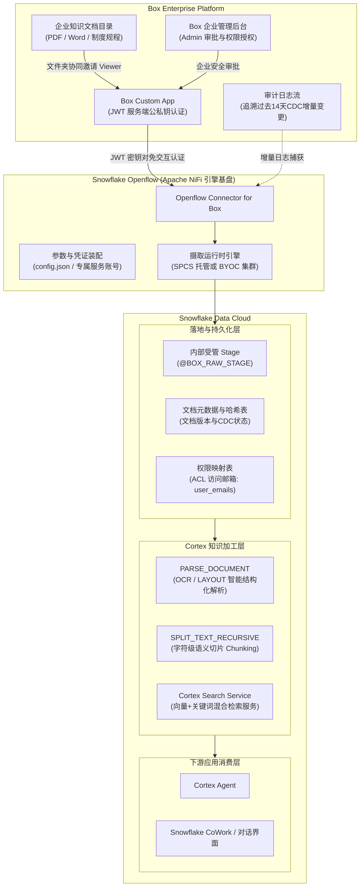

# 第 07 章：Snowflake Openflow 接入 Box 非结构化数据与 Cortex 知识检索实战

在金融机构（大型商业银行、顶级证券公司）与大型企业中，规章制度、作业规程、合规手册、合同契约以及投研报告等海量非结构化文档广泛存储在 **Box** 企业云盘中。将这些高价值文档安全同步至 **Snowflake**，并与 **Cortex Search** 以及 **Cortex Agent** 深度结合，构建全自动化、权限隔离的私有化企业级 RAG（检索增强生成）知识问答体系，已成为当今企业 AI 落地的刚性需求。

本章系统讲解如何使用 Snowflake 全托管数据集成引擎 **Snowflake Openflow** 以及预置的 **Openflow Connector for Box**，彻底替代传统手写 Python 脚本调用 REST API（重复造轮子）的方案，以极低的代码量构建安全、稳定、具备变更数据捕获（CDC）与权限继承的企业级数据管道。

---

## 整体架构与数据流转



### 方案选型深度对比：方案①（Openflow 连接器） vs 方案②（Box REST API 自研脚本）

| 核心考量维度 | 方案①：Snowflake Openflow Connector (本章推荐方案) | 方案②：Box REST API 自研脚本开发 |
| :--- | :--- | :--- |
| **开发与投产周期** | **极短（数小时至半天完成全链路打通）** | 长（需编写认证、下载、断点续传、重试及异常处理代码） |
| **凭证与密钥生命周期** | **Openflow 原生加密管理 JWT `config.json`，免维护** | 需搭建自研服务维护 Token 存储、过期刷新与密钥轮换 |
| **增量同步 (CDC)** | **开箱即用：自动流式拉取过去14天的 `admin_logs_streaming`** | 需自行维护上次拉取时间戳，或额外开发 Webhook 接收服务 |
| **权限继承 (ACL 隔离)** | **自动提取文件夹/文件的被授权人邮箱 (`user_emails`)** | 需逐一递归遍历 Box 权限接口拼接关系表，逻辑极其繁琐 |
| **Cortex 智算打通** | **无缝支持全自动 LAYOUT 解析、智能切片与 Search Service 联动** | 需开发者手工串联调用多段 Snowflake SQL 函数编排 |

---

## 阶段一：Box 侧准备工作与配置全流程 (Box Developer Console)

在 Box 侧，我们需要创建无人工交互的后端服务应用（**Custom App**），配置最小权限范围，并由企业管理员完成安全审批。

### Step 1.1: 新建 Custom App 平台应用
1. 登录 [Box 开发者控制台 (Box Developer Console)](https://app.box.com/developers/console)。


2. 点击右上角 **「Create Platform App」** 或 **「New App +」**。
3. 应用类型选择 **「Custom App」**。


4. 填写应用基础信息：
   - **App Name**：`Snowflake_Openflow_Box`（或遵循企业统一资源命名规范）
   - **Description**：`Box to Snowflake data pipeline via Openflow`
   - **Purpose**：下拉选择 `Integration`（数据集成）。
5. 认证方式（Authentication Method）务必选择 **「Server Authentication (with JWT)」**（使用公私钥对进行免交互的服务端身份校验）。


6. 点击 **「Create App」** 创建应用。

### Step 1.2: 严格配置应用权限作用域（Application Scopes）
进入应用的 **「Configuration」**（配置）标签页，进行如下细粒度配置：

1. **App Access Level（访问级别）**：
   - 勾选 **「App + Enterprise Access」**（使应用具备跨企业读取相关文档与用户身份权限的能力）。
2. **Application Scopes（权限范围）**：
   - `Read all files and folders stored in Box`：**必须勾选**（读取指定目录下的文档）
   - `Write all files and folders stored in Box`：**必须勾选**  
     *(注：该权限为 Box 内部生成下载流令牌所需，Openflow 绝不会对 Box 文档执行篡改或上传操作)*


   - `Manage users`：**必须勾选**（读取企业内部被授权用户的邮箱信息以构建 ACL）
   - `Manage groups`：**必须勾选**（读取用户所属权限组）
   - `Manage enterprise properties`：**必须勾选**（拉取企业审计事件流以实现 CDC 增量同步）


3. **Advanced Features（高级功能）**：
   - 按需开启 `Perform Actions as Users` 与 `Generate user access tokens`。

### Step 1.3: 生成公私钥对并获取配置文件 `config.json`
1. 页面向下滚动至 **「Add and Manage Public Keys」**（签名密钥管理区）。


2. 点击 **「Generate a Public/Private Keypair」**。
   > [!IMPORTANT]
   > **企业级两步验证（2FA）强制安全策略：**  
   > 为了防止敏感私钥泄漏，Box 平台强制要求开发者账号必须开启两步验证（2-Step Verification），否则会弹出阻断提示：
   > 
   > 
   > 
   > 在实际企业或生产中，开发者需在账号安全设置中开启短信或 Authenticator 验证后，重新点击生成即可。

3. 生成成功后，浏览器会自动下载一个完整的 JSON 凭证文件（例如 `2717878_xxxx_config.json`），内含 `clientID`、`enterpriseID` 以及加密后的私钥。
   > [!CAUTION]
   > 该 JSON 文件包含应用的顶级私钥，严禁提交到公开 Git 仓库或外部公共聊天软件，需妥善存储在企业密钥保管库中。
4. 点击页面右上角的 **「Save Changes」** 保存配置。


### Step 1.4: Box 企业管理员授权审批（企业合规闭环）
任何声明了企业级权限（Enterprise Access）的应用，在正式生效前必须经过企业管理员审核。

1. 切换至 **「Authorization」**（授权）标签页。
2. 点击 **「Review and Submit」** 提交审批申请。
3. **企业管理员（Box Admin Console）操作**：
   - 登录 [Box 管理控制台](https://app.box.com/master)。
   - 进入 **「应用」** $\rightarrow$ **「自定义应用管理器」**（Custom Apps）。
   - 找到提交的应用，核对权限范围与 Client ID 后，点击 **「批准 (Authorize)」**。

### Step 1.5: 提取服务账号邮箱并授予目标文件夹只读权限
1. 打开 Developer Console 的 **「General Settings」** 标签页或应用详情右侧栏。
2. 在 **「Service Account Info」** 中复制专属服务账号邮箱：
   - 格式示例：`AutomationUser_2717878_XevDdBO55B@boxdevedition.com`
3. **目标文件夹协作授权**：
   - 打开日常使用的 Box 网页端，新建或找到待导入 Snowflake 的业务文件夹（例如 `Snowflake_Knowledge_Docs` 或 `全社规程・技术文档`）。
   - 点击 **「共享」** $\rightarrow$ **「邀请协作者」**。
   - 粘贴上述服务账号邮箱，角色务必指定为 **「查看者 (Viewer)」**。
   - 此时，该服务账号即获得该目录及其所有子文件的安全只读拉取权限。


4. **记录 Folder ID**：
   - 从浏览器地址栏复制文件夹 ID（如 `https://app.box.com/folder/431197981508` 末尾的数字 `431197981508`）。

---

## 阶段二：Snowflake 侧基盘搭建与 RBAC 权限设计

在 Snowflake 侧，我们需严格按照最小特权原则，建立专用的服务账号、执行角色、存储库、数据落地 Schema 及算力仓库。

### Step 2.1: 执行标准化 RBAC 与环境构建 DDL
运行工程自带的脚本文档 [`07_openflow_box_setup.sql`](file:///c:/Users/FX/Projects/SnowflakeBlog/scripts/snowflake/07_openflow_box_setup.sql)：

```sql
-- 1. 安全与身份管理 (SECURITYADMIN)
USE ROLE SECURITYADMIN;

CREATE ROLE IF NOT EXISTS OPENFLOW_CONNECTOR_ROLE
    COMMENT = 'Snowflake Openflow Box 连接器专属运行角色';

CREATE ROLE IF NOT EXISTS CORTEX_SEARCH_READ_ROLE
    COMMENT = '供下游 Cortex Agent 及业务检索调用的只读角色';

CREATE USER IF NOT EXISTS OPENFLOW_BOX_SVC_USER
    TYPE = SERVICE
    DEFAULT_ROLE = OPENFLOW_CONNECTOR_ROLE
    COMMENT = 'Openflow 运行时免密密钥对认证专属服务用户';

GRANT ROLE OPENFLOW_CONNECTOR_ROLE TO USER OPENFLOW_BOX_SVC_USER;
GRANT ROLE OPENFLOW_CONNECTOR_ROLE TO ROLE SYSADMIN;
GRANT ROLE CORTEX_SEARCH_READ_ROLE TO ROLE SYSADMIN;

-- 2. 算力与存储对象构建 (SYSADMIN)
USE ROLE SYSADMIN;

CREATE WAREHOUSE IF NOT EXISTS OPENFLOW_INGEST_WH
    WITH
    WAREHOUSE_SIZE = 'XSMALL'
    AUTO_SUSPEND = 120
    AUTO_RESUME = TRUE
    INITIALLY_SUSPENDED = TRUE
    COMMENT = '用于 Openflow 数据加载与 Cortex 文本切片的高性能轻量仓库';

CREATE DATABASE IF NOT EXISTS BOX_INTEGRATION_DB;
CREATE SCHEMA IF NOT EXISTS BOX_INTEGRATION_DB.BOX_LANDING_DATA;
CREATE SCHEMA IF NOT EXISTS BOX_INTEGRATION_DB.CORTEX;

-- 3. 授权连接器角色
GRANT USAGE, OPERATE ON WAREHOUSE OPENFLOW_INGEST_WH TO ROLE OPENFLOW_CONNECTOR_ROLE;
GRANT USAGE ON DATABASE BOX_INTEGRATION_DB TO ROLE OPENFLOW_CONNECTOR_ROLE;
GRANT USAGE ON SCHEMA BOX_INTEGRATION_DB.BOX_LANDING_DATA TO ROLE OPENFLOW_CONNECTOR_ROLE;
GRANT USAGE ON SCHEMA BOX_INTEGRATION_DB.CORTEX TO ROLE OPENFLOW_CONNECTOR_ROLE;

GRANT CREATE TABLE, CREATE DYNAMIC TABLE, CREATE STAGE, CREATE SEQUENCE 
    ON SCHEMA BOX_INTEGRATION_DB.BOX_LANDING_DATA TO ROLE OPENFLOW_CONNECTOR_ROLE;

GRANT CREATE TABLE, CREATE DYNAMIC TABLE, CREATE CORTEX SEARCH SERVICE 
    ON SCHEMA BOX_INTEGRATION_DB.CORTEX TO ROLE OPENFLOW_CONNECTOR_ROLE;
```

---

## 阶段三：Openflow Connector for Box 部署与参数装配

进入 Snowflake Openflow 控制台画布，装配连接器并配置数据源与目标库参数。

### Step 3.1: 在 Openflow 中安装连接器
1. 打开 Openflow 界面顶部的 **「Connector Library」**（连接器库）。
2. 检索 **「Openflow Connector for Box」** 并点击 **「Install」**。
3. 选择部署的目标运行时（SPCS 托管环境或自建 BYOC 集群）完成部署。

### Step 3.2: 核心配置参数对应清单

在画布中右键点击该连接器进程组，选择 **「Parameters」**，填入如下生产级参数：

#### ① 数据源参数 (Box Source Parameters)
| 参数名 | 建议配置值 | 说明 |
| :--- | :--- | :--- |
| **Box App Config JSON** | `{ "boxAppSettings": { ... } }` | 完整粘贴 Step 1.3 中下载的 `config.json` 文本内容 |
| **Box App Config File** | *(留空)* | 直接填入 JSON 文本时无需上传文件 |

#### ② 数据摄取参数 (Box Ingestion Parameters)
| 参数名 | 建议配置值 | 说明 |
| :--- | :--- | :--- |
| **Folder ID** | `431197981508`（或 `0`） | 待同步的目标 Box 目录 ID。填 `0` 则递归扫描服务账号有权访问的全部文件夹 |
| **File Extensions** | `pdf,docx,pptx,txt,md` | 允许拉取的文档扩展名列表（逗号分隔） |
| **OCR Mode** | `LAYOUT` | 文档解析方式，推荐使用 `LAYOUT` 模式保留表格与排版结构 |
| **Batch Size** | `100` | 单次执行周期内最大批处理文档数 |

#### ③ 输出目标库参数 (Box Destination Parameters)
| 参数名 | 建议配置值 | 说明 |
| :--- | :--- | :--- |
| **Destination Database** | `BOX_INTEGRATION_DB` | 目标数据库名（大写） |
| **Destination Schema** | `BOX_LANDING_DATA` | 目标原始数据落地 Schema |
| **Warehouse** | `OPENFLOW_INGEST_WH` | 执行加载作业的计算仓库 |
| **Snowflake Authentication Strategy** | `SNOWFLAKE_MANAGED` | SPCS 环境使用托管认证，BYOC 环境选择 `KEY_PAIR` |

---

## 阶段四：Cortex 检索增强验证与 ACL 权限隔离测试

### Step 4.1: Cortex Search Service 安全检索验证
Openflow 运行后，文档元数据及带权限的文本切片自动落入 `BOX_DOC_CHUNKS`。我们通过 `SNOWFLAKE.CORTEX.SEARCH_PREVIEW` 验证带权限过滤条件的混合检索：

```sql
-- 模拟普通合规员工 (suzuki.ichiro@company.co.jp) 发起查询
SELECT SNOWFLAKE.CORTEX.SEARCH_PREVIEW(
    'BOX_INTEGRATION_DB.CORTEX.BOX_ENTERPRISE_SEARCH_SERVICE',
    '{
        "query": "请告诉我关于密码管理与专线闭域网连接的规定要求",
        "columns": ["FILE_NAME", "CHUNK_TEXT"],
        "filter": {
            "@contains": {
                "USER_EMAILS": "suzuki.ichiro@company.co.jp"
            }
        },
        "limit": 3
    }'
);
```

### Step 4.2: 权限隔离实际校验结果

| 检索文档名 (FILE_NAME) | 命中切片内容摘要 (CHUNK_TEXT) | 员工 Suzuki 权限验证 | 系统管理员 Admin 权限验证 |
| :--- | :--- | :---: | :---: |
| `01_情報セキュリティ基本規程_2026.pdf` | 口令长度至少12位，每90天强制修改，必须启用多因素认证(MFA)... | **TRUE（正常返回）** | **TRUE** |
| `02_クラウド移行プロジェクト_機密設計書.docx` | 采用 AWS Direct Connect / PrivateLink 专线闭域网传输核心数据... | **FALSE（安全拦截）** | **TRUE** |

> [!NOTE]
> 在普通员工的检索调用中，未被授权的机密项目设计书切片被严格过滤，不会作为上下文送入大语言模型。这表明 Box 上的企业级权限体系已被完整、无损地映射至 Snowflake Cortex 检索层。

---

## 生产落地总结与架构建议

1. **告别脚本刀耕火种**：
   - 引入 Openflow Connector for Box 后，传统方案中痛苦的增量捕获、断点重试、Token 维护均由底层引擎自动化托管，研发维护成本下降 80% 以上。
2. **打通企业级审批协同**：
   - JWT 服务端认证需要 Box 企业管理员介入授权，并在开发者账号上满足 2FA 安全策略。在企业项目立项时，建议第一时间向信息系统部报备申请 Custom App 审批。
3. **即刻驱动下游智能生态**：
   - 本管道产出的 `CORTEX_SEARCH_SERVICE` 可直接作为知识源挂载至 Snowflake Cortex Agent，无缝对接企业内部的各类协同办公 UI（如 Snowflake CoWork），实现开箱即用的企业级智能助手。
