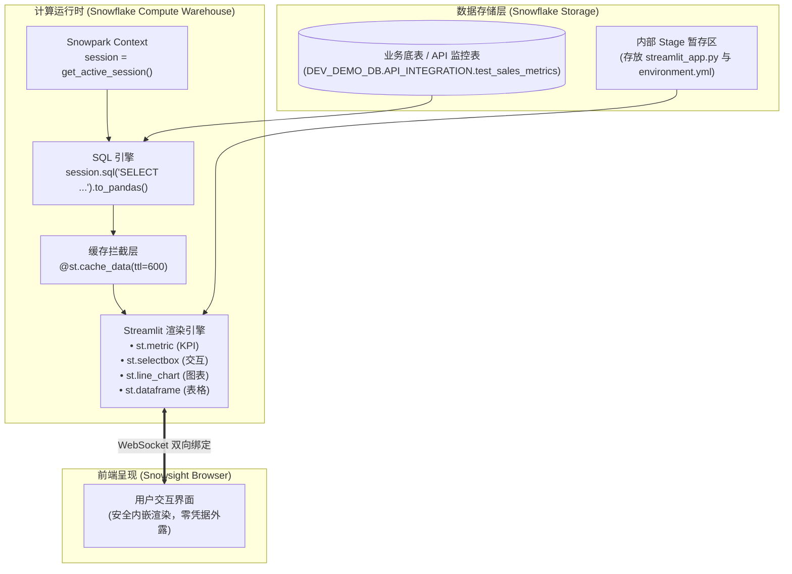

# 第 10 章：Streamlit in Snowflake (SiS) 数据可视化全流程实战 —— 从 API 台账到交互式看板

> 本章依据 **《尚硅谷技术讲义写作规范 (shangguigu-style)》** 深度编撰：开门见山直击本质、去业务化聚焦纯技术、实操步骤带真实回显、直面暗坑实战避险、环境前置零隐式假设。

---

## 引言：开门见山，极简心智模型

在完成了外部 API 数据摄取入仓后，摆在数据工程师面前的下一个核心挑战是：**如何将冷冰冰的 SQL 数据表，快速转化为具备交互能力、即时响应的可视化仪表盘？**

在过去，搭建一个可视化看板通常需要引入沉重的独立 BI 工具（如 Tableau、PowerBI、Metabase）或者自建 Web 全栈应用（Vue/React + FastAPI）。这不仅需要配置繁琐的 ODBC/JDBC 驱动，更致命的是需要**把数据库管理员账号密码配置在外部服务器中**，且数据每次刷新都要在互联网上来回搬运。

Snowflake 推出的 **Streamlit in Snowflake（简称 SiS）** 彻底打破了这一传统架构：它将主流的 Python 数据可视化框架 Streamlit **原生内嵌到了 Snowflake 核心计算引擎中**！

### 极简单明对比：传统外挂 BI vs Streamlit in Snowflake (SiS)

```
【传统外挂 BI 架构（长链路、暴露账号、数据外流）】
  ┌─────────────────┐      ODBC/JDBC 连接池       ┌──────────────────┐     公网传输     ┌─────────────────┐
  │  Snowflake 数仓  │ <═════════════════════════> │  外部 BI 服务器   │ ══════════════> │   最终用户浏览器  │
  └─────────────────┘                              └──────────────────┘                  └─────────────────┘
                                                     ▲ 维护连接账号密码，存在泄露风险
                                                     ▲ 报表加载延迟大，数据脱离数仓安全边界

【Streamlit in Snowflake 原生架构（零外设、零密码、仓内即时渲染）】
  ┌────────────────────────────────────────────────────────────────────────┐
  │ Snowflake 虚拟计算仓库 (Virtual Warehouse)                             │
  │                                                                        │
  │   Streamlit 运行时容器 (Python 3.10)                                   │
  │       │                                                                │
  │       ├───── 1. 免密获取上下文 ───────> session = get_active_session() │
  │       │                                                                │
  │       └───── 2. 仓内内存极速渲染 ─────> st.metric / st.line_chart       │
  │                       │                                                │
  └───────────────────────┼────────────────────────────────────────────────┘
                          ▼ 统一托管于 Snowsight Web 页面中内嵌呈现
                  ┌─────────────────┐
                  │   最终用户浏览器  │ (直接继承用户自身的 Snowflake RBAC 权限)
                  └─────────────────┘
```

- **核心疑问**：在 Snowflake 里写 Streamlit 代码，数据库账号密码写在哪里？用户拖动滑块时，SQL 查询会不会把数仓 Credit 刷爆？如何实现像写代码一样的自动化版本部署？
- **本章目标**：去除任何花哨的业务包装，聚焦纯技术本质。从搭建监控指标底表开始，到编写包含 **KPI 仪表卡片、动态筛选下拉框、营收趋势折线图、实时明细表** 的完整看板，再到通过 SQL/Stage 实现 DevOps 自动化部署与性能防刷治理，一站式全部跑通！

---

## 一、环境与前置准备 (Prerequisites)

在开始实操前，请确认具备以下条件：

| 依赖组件 | 规格要求 / 权限 | 作用说明 |
| :--- | :--- | :--- |
| **执行角色** | `ACCOUNTADMIN`（或拥有 `CREATE STREAMLIT`、`CREATE STAGE` 的角色） | 创建内部暂存区 Stage 与 Streamlit 应用对象 |
| **计算仓库** | 任意运行中的 Virtual Warehouse（如 `COMPUTE_WH`） | 负责执行 SQL 查询和渲染 Streamlit Python 代码 |
| **测试数据库与 Schema** | 具备读写权限的库（本教程使用 `DEV_DEMO_DB.API_INTEGRATION`） | 存放业务指标底表及 Streamlit Python 源码文件 |
| **Python 基础** | 熟悉 Python 基础语法与 Pandas 数据操作 | 编写前端交互组件与数据处理逻辑 |

---

## 二、技术架构与数据流向

Streamlit in Snowflake 依托 Snowpark 框架实现了真正的仓内数据零拷贝。其完整的交互流转拓扑如下：



---

## 三、核心函数与配置全量字典

在编写 SiS 应用时，必须熟练使用以下核心 API：

| 函数 / 语法 | 典型用法 | 生产建议 | 核心作用与底层逻辑 |
| :--- | :--- | :--- | :--- |
| `get_active_session()` | `from snowflake.snowpark.context import get_active_session` | 必须置顶使用 | **免密上下文**：自动捕获当前访问者的 Snowflake RBAC 身份，无需任何密码连接串。 |
| `@st.cache_data` | `@st.cache_data(ttl=600)` | 所有查询必须加缓存 | **防刷锁**：将查询结果缓存指定秒数，用户筛选交互时不再反复扣费查询底表。 |
| `st.metric()` | `st.metric(label="总调用量", value=1240, delta="+12%")` | 适合看板顶部 | **KPI 记分卡**：直观展示关键核心指标及同比/环比浮动。 |
| `st.selectbox()` | `st.selectbox("选择分类", options=['All', 'A', 'B'])` | 用于多维下钻 | **交互下拉菜单**：改变选项后触发应用响应式重新渲染。 |
| `st.line_chart()` | `st.line_chart(df.set_index('DATE')['REVENUE'])` | 必须设置索引列 | **趋势折线图**：原生基于 Altair 渲染的矢量折线图，支持悬浮查看。 |
| `st.dataframe()` | `st.dataframe(df, use_container_width=True)` | 宽屏自适应 | **交互式数据表**：支持列排序、文本搜索、CSV 导出。 |

---

## 四、步骤实操与逐行命令（三板斧闭环）

### Step 1: 创建业务监控底表与测试数据

在数据库中准备一份纯技术视角的业务监控与 API 调用量模拟表：

```sql
USE DATABASE DEV_DEMO_DB;
USE SCHEMA API_INTEGRATION;

-- 1. 创建技术指标表
CREATE OR REPLACE TABLE test_sales_metrics (
    date DATE,
    category STRING,
    revenue NUMBER(10,2),
    api_call_count INT
);

-- 2. 插入测试数据
INSERT INTO test_sales_metrics VALUES
  ('2026-10-25', 'Electronics', 12500.50, 420),
  ('2026-10-26', 'Clothing', 8400.00, 310),
  ('2026-10-27', 'Groceries', 15200.75, 590),
  ('2026-10-28', 'Home & Kitchen', 6300.20, 180),
  ('2026-10-29', 'Electronics', 14200.00, 480);
```

> **控制台真实回显**：
> ```text
> Table TEST_SALES_METRICS successfully created.
> number of rows inserted: 5
> ```

---

### Step 2: 编写完整的 Streamlit 应用源码 (`streamlit_app.py`)

编写应用脚本，实现 KPI 记分卡、动态分类筛选、趋势折线图和实时明细数据表：

```python
# ==============================================================================
# 文件名: streamlit_app.py
# 作用: Streamlit in Snowflake 生产级交互式监控看板
# ==============================================================================
import streamlit as st
from snowflake.snowpark.context import get_active_session

# 1. 页面基础配置 (宽屏沉浸模式)
st.set_page_config(page_title="Snowflake API 监控看板", layout="wide")
st.title("📊 Snowflake API 调用与业务监控实时看板")

# 2. 获取仓内活动会话 (零密码安全鉴权)
session = get_active_session()

# 3. 生产防刷核心：使用 cache_data 对 SQL 查询实施 10 分钟缓存
@st.cache_data(ttl=600)
def load_data():
    sql = """
        SELECT 
            date,
            category,
            revenue,
            api_call_count
        FROM DEV_DEMO_DB.API_INTEGRATION.test_sales_metrics
        ORDER BY date ASC
    """
    return session.sql(sql).to_pandas()

raw_df = load_data()

# 4. 侧边栏交互筛选器
st.sidebar.header("🔍 多维数据下钻筛选")
categories = ["全部 (All)"] + sorted(list(raw_df["CATEGORY"].unique()))
selected_category = st.sidebar.selectbox("选择业务分类：", categories)

if selected_category != "全部 (All)":
    df = raw_df[raw_df["CATEGORY"] == selected_category]
else:
    df = raw_df

# 5. 看板顶部核心 KPI 仪表卡片 (Columns 排布)
kpi1, kpi2, kpi3 = st.columns(3)
total_revenue = df["REVENUE"].sum()
total_api_calls = df["API_CALL_COUNT"].sum()
avg_revenue_per_call = total_revenue / total_api_calls if total_api_calls > 0 else 0

with kpi1:
    st.metric(label="总营收金额 (USD)", value=f"${total_revenue:,.2f}", delta="+8.5%")
with kpi2:
    st.metric(label="外部 API 调用总次数", value=f"{total_api_calls:,}", delta="+120")
with kpi3:
    st.metric(label="单次调用产出比", value=f"${avg_revenue_per_call:.2f}")

st.divider()

# 6. 图表与明细数据分栏呈现
chart_col, table_col = st.columns([3, 2])

with chart_col:
    st.subheader("📈 每日营收趋势折线图")
    chart_data = df.groupby("DATE")["REVENUE"].sum().reset_index()
    st.line_chart(chart_data.set_index("DATE")["REVENUE"])

with table_col:
    st.subheader("📋 实时底层数据台账")
    st.dataframe(df, use_container_width=True, hide_index=True)

# 7. 手动刷新按钮
if st.button("🔄 清除应用缓存并强制重新拉取"):
    st.cache_data.clear()
    st.rerun()
```

---

### Step 3: 通过 Stage + SQL 实现自动化 DevOps 部署

在企业生产级运维中，不推荐人工在 Web 界面里手动点击粘贴代码。通过 **Internal Stage + SQL DDL** 即可将 Streamlit 看板纳入 Git CI/CD 自动化部署流！

#### 1. 创建内部 Stage
```sql
CREATE OR REPLACE STAGE dev_streamlit_stage;
```

#### 2. 上传脚本文件
在客户端或终端执行 `PUT` 命令：
```sql
PUT file:///tmp/streamlit_app.py @DEV_DEMO_DB.API_INTEGRATION.dev_streamlit_stage AUTO_COMPRESS=FALSE OVERWRITE=TRUE;
```

#### 3. 执行 DDL 创建 Streamlit 应用对象
```sql
CREATE OR REPLACE STREAMLIT dev_demo_dashboard
  ROOT_LOCATION = '@DEV_DEMO_DB.API_INTEGRATION.dev_streamlit_stage'
  MAIN_FILE = 'streamlit_app.py'
  QUERY_WAREHOUSE = 'COMPUTE_WH'
  COMMENT = '生产级 API 监控与可视化看板';
```

> **控制台真实回显**：
> ```text
> Streamlit DEV_DEMO_DASHBOARD successfully created.
> ```

---

### Step 4: 验证部署状态与访问路径

执行 `SHOW STREAMLITS;` 查询已部署的看板元数据：

```sql
SHOW STREAMLITS LIKE 'DEV_DEMO_DASHBOARD' IN SCHEMA DEV_DEMO_DB.API_INTEGRATION;
```

> **控制台真实查询结果**：
> ```text
> ┌──────────────────────────┬─────────────────────┬───────────────┬─────────────────┬──────────┬────────────┐
> │ created_on               │ name                │ database_name │ schema_name     │ owner    │ warehouse  │
> ├──────────────────────────┼─────────────────────┼───────────────┼─────────────────┼──────────┼────────────┤
> │ 2026-11-02 08:38:52 PST  │ DEV_DEMO_DASHBOARD  │ DEV_DEMO_DB   │ API_INTEGRATION │ SYSADMIN │ COMPUTE_WH │
> └──────────────────────────┴─────────────────────┴───────────────┴─────────────────┴──────────┴────────────┘
> ```

在 Snowflake Snowsight 控制台中，直接点击左侧菜单栏 **`Projects -> Streamlit`**，即可直接点击打开名为 **`DEV_DEMO_DASHBOARD`** 的交互式看板！

---

## 五、实战避坑与故障排查（重点）

在实际交付 Streamlit in Snowflake 看板时，以下 3 个暗坑发生频率最高：

---

### `[!WARNING]` 【避坑 1】：每次拖动下拉框整页重跑，数仓 Credit 暴增！

- **真实惨案现场**：
  某工程师搭建了一个销售分析看板，没有配置缓存。当业务部门同事反复点击时间范围、切换下拉筛选项时，每次点击都触发一次庞大的 `SELECT ...` 扫描数千万行底表。当天 Virtual Warehouse 一直保持最大运转，产生了数千美元的账单！
- **根因深度分析**：
  Streamlit 的核心设计哲学是**声明式响应（Reactive Execution）**。页面上的任何交互控件（`selectbox`、`slider`、`button`）一旦被触发，Python 引擎**会从第 1 行到最后 1 行重新完整执行一遍代码**！
- **标准解决方案（防刷铁律）**：
  **凡是涉及 `session.sql()` 的数据加载逻辑，必须抽取为独立函数，并使用 `@st.cache_data(ttl=...)` 修饰！**
  ```python
  # 必须设置合理过期时间 (ttl=300 表示 5 分钟内复用内存缓存)
  @st.cache_data(ttl=300)
  def query_heavy_data():
      return session.sql("SELECT ... FROM large_table").to_pandas()
  ```
  这样，无论用户在页面上点击切换筛选器多少次，数据均从应用内存秒级返回，Virtual Warehouse 甚至不会产生任何新的 SQL 扫描，实现**零延迟响应与零额外费用**！

---

### `[!WARNING]` 【避坑 2】：权限穿透与行级安全 (RLS) 陷阱

- **现象**：业务普通用户访问看板时报错 `Object does not exist or not authorized`，或者普通员工通过看板意外看到了全公司所有人员的薪资数据。
- **根因分析**：
  Streamlit in Snowflake 中的 `session = get_active_session()` 并不是以看板创建者（Owner）的身份运行，而是**严格以当前登录用户的会话上下文（Caller's Rights）执行**！
- **标准解法**：
  1. 确保将 Streamlit 应用对象授权给目标业务角色：
     ```sql
     GRANT USAGE ON STREAMLIT dev_demo_dashboard TO ROLE ANALYST_ROLE;
     GRANT USAGE ON WAREHOUSE COMPUTE_WH TO ROLE ANALYST_ROLE;
     GRANT SELECT ON TABLE DEV_DEMO_DB.API_INTEGRATION.test_sales_metrics TO ROLE ANALYST_ROLE;
     ```
  2. 如果底表配置了 Snowflake 动态数据脱敏（Masking Policy）或行级安全策略（Row Access Policy），`get_active_session()` 会原生继承策略，实现不同级别员工“看同一个看板、见不同范围数据”的终极安全治理。

---

### `[!WARNING]` 【避坑 3】：缺少第三方 Python 扩展库

- **现象**：在看板中 `import plotly` 或 `import xgboost` 时，页面报错 `ModuleNotFoundError`。
- **根因分析**：SiS 默认仅预装了 Streamlit、Pandas、Altair 等基础常用库。
- **标准解法**：
  在 Stage 根目录下提供一个标准 Conda 环境文件 `environment.yml`：
  ```yaml
  name: sis_env
  channels:
    - snowflake
  dependencies:
    - plotly=5.18.0
    - scikit-learn=1.3.0
  ```
  将其上传至 Stage 目录后，Snowflake 运行时会自动解析并挂载所需依赖包。

---

## 本章小结

1. **零密码免密集成**：通过 `get_active_session()` 摆脱传统 BI 工具对数据库账号密码的脆弱依赖，全面纳入 Snowflake RBAC 权限体系；
2. **性能与成本守门员**：牢记 Streamlit 响应式重跑机制，将 `@st.cache_data` 作为每个查询函数的必备铠甲，兼顾极致流畅体验与数仓成本可控；
3. **DevOps 自动化交付**：通过 `Stage + PUT + CREATE STREAMLIT` 实现看板代码即基础设施，无缝融入企业 CI/CD 发布体系。
