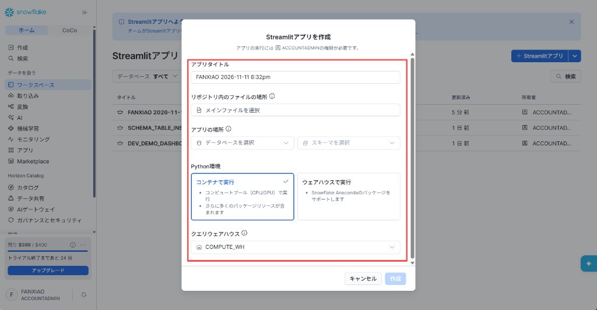
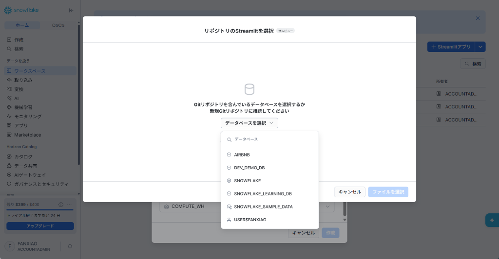
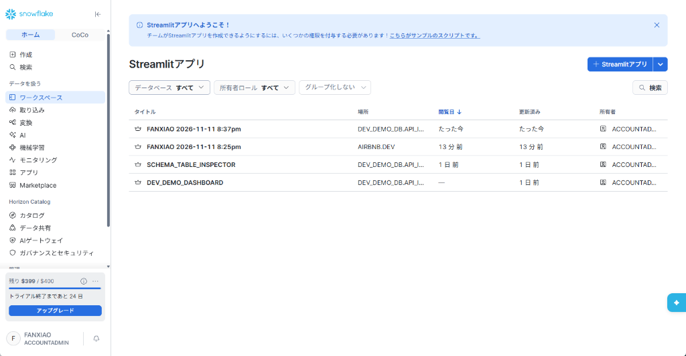

# 第 10 章：Streamlit in Snowflake (SiS) 现代数据可视化全流程实战 —— 从工作区开发、一键部署(展開)到企业级生产看板

> 本章依据 **《尚硅谷技术讲义写作规范 (shangguigu-style)》** 深度重构编撰：
> - **开门见山极简对比**：直击容器运行时 (SPCS) vs 经典数仓运行时 (Warehouse) 的底层本质与近 90% 的成本差距；
> - **正统工程生命周期**：确立以现代工作区（Workspace）为核心的 **Dev（隔离开发） $\to$ Test（即时热测） $\to$ Deploy（一键展開投产）** 标准交付闭环；
> - **直面暗坑实战避险**：解析 15 分钟 WebSocket 自动休眠防线与 `.streamlit/config.toml` 防烧钱配置；
> - **环境前置零隐式假设**：全量代码经 Tokyo 真实 Snowflake 账号（`mvfryvt-nv04752`）验证实跑，提供完整可复现的生产级数据表动态探查器（Schema Table Inspector）。

---

## 🎯 引言：开门见山，极简心智模型

在完成了外部 API 数据摄取入仓后，数据工程师的核心命题转变为：**如何将冷冰冰的 SQL 底表，快速转化为具备交互能力、即时响应的可视化仪表盘？**

在过去，搭建报表通常需要引入独立 BI 工具（Tableau、PowerBI、Metabase）或自建 Web 应用。这不仅需要维护连接池账号密码，更致命的是**数据每次刷新都要在公网来回搬运，带来延迟与数据安全泄露风险**。

Snowflake 推出的 **Streamlit in Snowflake（简称 SiS）** 彻底重构了这一链路：它将主流的 Python 可视化框架 Streamlit **原生内嵌到了 Snowflake 核心计算引擎中**！

### 极简单明对比：传统外挂 BI vs Streamlit in Snowflake (SiS)

```
【传统外挂 BI 架构（长链路、暴露账号、数据外流）】
  ┌─────────────────┐      ODBC/JDBC 连接池       ┌──────────────────┐     公网传输     ┌─────────────────┐
  │  Snowflake 数仓  │ <═════════════════════════> │  外部 BI 服务器   │ ══════════════> │   最终用户浏览器  │
  └─────────────────┘                              └──────────────────┘                  └─────────────────┘
                                                     ▲ 维护连接账号密码，存在泄露风险
                                                     ▲ 报表加载延迟大，数据脱离数仓安全边界

【Streamlit in Snowflake 原生架构（零外设、零密码、仓内即时渲染）】
  ┌────────────────────────────────────────────────────────────────────────┐
  │ Snowflake 计算与安全边界                                               │
  │                                                                        │
  │   Streamlit 运行时（容器 SPCS 或 虚拟数仓）                             │
  │       │                                                                │
  │       ├───── 1. 免密获取上下文 ───────> conn = st.connection("snowflake")│
  │       │                                                                │
  │       └───── 2. 仓内内存极速渲染 ─────> st.metric / st.line_chart       │
  │                       │                                                │
  │   【现代研发工作流】：工作区沙箱 (Dev) ──> 即时热重载 (Test) ──> 右上角 [展開] (Deploy) │
  └───────────────────────┼────────────────────────────────────────────────┘
                          ▼ 统一托管于 Snowsight Web 页面中内嵌呈现
                  ┌─────────────────┐
                  │   最终用户浏览器  │ (直接继承用户自身的 Snowflake RBAC 权限)
                  └─────────────────┘
```

---

## ⚖️ 一、两大运行时深度选型：容器运行时 (Container) vs 数仓运行时 (Warehouse)

当在 Snowflake 中构建 Streamlit 应用时，首先面临的核心技术决策是：**选择哪一种底层执行底座（Python Runtime）？**

在创建向导中，**Snowflake 官方已经默认给「コンテナで実行 (Run on Container)」打上了预选对勾（✔️ Default）**。这体现了平台架构的演进方向：



### 📊 核心技术与真实经济账对比

| 核心评估维度 | 左卡片：コンテナで実行 (Run on Container)<br/>*(新一代 SPCS 容器运行时 · **✔️ 官方默认**)* | 右卡片：ウェアハウスで実行 (Run on Warehouse)<br/>*(传统数仓单机虚拟机 · ⚠️ 官方已标为 Legacy)* |
| :--- | :--- | :--- |
| **官方定位与演进路线** | **Snowflake 官方钦定的下一代默认运行时**：<br/>全平台战略重心，UI 默认勾选推荐。 | **向下兼容的过渡方案 (Legacy)**：<br/>创建入口已明确打上 `レガシー` 标签，逐步退出主流。 |
| **真实运行成本（性价比）** | **超高性价比（低至 ~0.11 credits/小时）**：<br/>基于 Snowpark Container Services (SPCS) 计算池，入门级节点（如 `CPU_X64_XS`）仅需 **约 0.11 credits / node / 小时**，相比数仓 **省钱近 90%**！在 Web 前端大部分时间等待用户点击交互的场景下，极为经济。 | **固定成本偏高（最低 1.0 credit/小时）**：<br/>哪怕最小规格的 `X-Small` 虚拟计算仓库，只要运行 1 小时就固定消耗 **1.0 credit**，长时间调试或闲置成本显著高于容器。 |
| **第三方 Python 依赖生态** | **全面拥抱开源（全 PyPI 自由生态）**：<br/>官方标注 *“さらに多くのパッケージリソースが含まれます”*。<br/>通过 `pyproject.toml` 自由引入任意 pip 包，原生支持包含 C/Rust 扩展和复杂编译的原生库（如 PyTorch、Transformers、LangChain、DuckDB 等），彻底摆脱包缺失困扰。 | **受限 Anaconda 白名单模式**：<br/>官方标注 *“Snowflake Anacondaのパッケージをサポートします”*。<br/>只能在 Snowflake 预先审核打包的 Anaconda 频道内选包（通过 `environment.yml` 声明）。一旦业务需要冷门或最新 pip 库，将直接报错无法安装！ |
| **多用户访问并发模型** | **单例常驻共享模式 (Shared App Service)**：<br/>多名分析师并发访问看板时共享后台容器进程，首屏渲染秒开，适合企业级公共大屏。 | **每用户独立会话模式 (Per-viewer Session)**：<br/>每个访问用户均在数仓内启动专属 Python 进程，并发访问时数仓内存压力倍增。 |
| **硬件与算力扩展性** | 原生支持弹性 CPU 计算池及高性能 **GPU** 算力，可直接在看板后台挂载本地大语言模型与图像生成。 | 仅支持标准 CPU 虚拟机，无法调用 GPU 算力。 |

> 📌 **架构选型结论**：
> 官方之所以将「コンテナで実行 (Container Runtime)」设为默认，核心在于其**成本显著降低（约 0.11 vs 1.0 credit/h）、依赖生态全面开放（PyPI 全库支持）、支持 GPU 扩展**。在具备 SPCS 配额的环境中，应优先顺应官方路线采用容器运行时；仅当在受限且未开通 SPCS 的传统历史环境中时，才使用 Warehouse 模式作为向下兼容保底。

---

## 🛠️ 二、核心开发主线：现代工作区全生命周期实战（`Dev` $\to$ `Test` $\to$ `展開 / Deploy`）

现代 Snowflake 严禁在未经验证的情况下直接在生产库下裸写代码。官方推荐的标准工程工作流为：**在个人工作区沙箱中安全写码（Dev） $\to$ 实时热测（Test） $\to$ 右上角一键「展開」（Deploy）投产**。

### Step 1: 精准定位导航入口与进入现代工作区

登录 Snowsight 控制台，在左侧导航栏点击 **「ワークスペース (Workspaces)」 $\to$ 「Streamlit」**（页面路径为 `#/streamlit-apps`）：


直接点击右上角蓝色主按钮 **`+ Streamlit アプリ`**：
系统会立即在当前用户的私有工作区（`USER$<USER_NAME>.PUBLIC.DEFAULT$`）中生成一套完备的现代工程项目沙箱，并自动打开在线 IDE：


---

### Step 2: 现代工程文件 4 件套解密（Snowflake CLI v2 规范）

在左侧项目文件树中，展示了符合现代软件工程标准的 4 个核心文件：

| 核心文件 | 规范标准 | 核心技术作用与工程角色 |
| :--- | :--- | :--- |
| **`streamlit_app.py`** | Python 3.11 核心脚本 | **主应用入口源码 (Main Entrypoint)**：编写 Streamlit 前端交互组件（`st.title`、`st.slider`、`st.metric`）与仓内数据提取逻辑。每当用户发生界面交互，引擎自顶向下响应式重新执行。 |
| **`snowflake.yml`** | YAML (Snowflake CLI v2) | **现代项目定义清单 (Project Definition)**：声明应用元数据（`title: "無題"`）、主入口文件（`main_file: streamlit_app.py`）、计算池/仓库绑定，以及打包时的资产清单（`artifacts`）。全面支持终端 `snow streamlit deploy` 自动化发布。 |
| **`pyproject.toml`** | TOML (PEP 517/518/621) | **现代依赖管理与运行版本规范**：取代旧版脆弱的 `environment.yml`。明确声明 Python 最低版本与核心依赖（`dependencies = ["streamlit[snowflake]"]`），深度集成超高速包管理器 `uv`（`[tool.uv]`）锁定版本。 |
| **`.streamlit/config.toml`** | TOML (Streamlit 官方配置) | **前端样式与防烧钱超时控制**：定义看板主题颜色，以及最重要的 **`[snowflake.sleep]` 专属休眠时延配置**（如设置 `streamlitSleepTimeoutMinutes = 15`，实现应用级空闲挂起）。 |

---

### Step 3: 在线编辑、热重载调试与顶部四大操作按钮

在 Monaco 在线编辑器中，顶部右侧整齐排列着四个操作中枢按钮：

```
┌──────────────────────────────────────────────────────────────────────────────────┐
│ 自分のワークスペース > 無題 > streamlit_app.py                                     │
│ [ 実行 ]              [ ⚙️ 設定 ]         [ 📤 共有 ]        [ 🚀 展開 (Deploy) ] │
└──────────────────────────────────────────────────────────────────────────────────┘
```

1. **`[ 実行 ]` (Run)**：重新执行当前 Python 代码，并在右侧预览区即时查看组件与图表的变化。
2. **`[ ⚙️ 設定 ]` (Settings)**：修改应用标题、调整绑定的计算算力与默认上下文。
3. **`[ 📤 共有 ]` (Share)**：配置协作权限，允许团队成员协同查看或编辑。
4. **`[ 🚀 展開 ]` (Deploy · 现代部署核心！)**：**开发完成后的正式投产发布按钮**！

#### 官方开箱即用模板核心代码逐行精讲 (`streamlit_app.py`)

在工作区中，默认生成的模板代码展示了现代 SiS 的规范写法：

```python
# 1. 导入核心 Python 库
import streamlit as st
import os

# 2. 页面标题与版本动态展示
st.title(f"Example Streamlit App :balloon: {st.__version__}")
st.write(
    """Replace this example with your own code!
    **And if you're new to Streamlit,** check out our easy-to-follow guides at
    [docs.streamlit.io](https://docs.streamlit.io).
    """
)

# 3. 仓内标准免密连接 (Snowflake Connection)
# 使用 st.connection 获取当前用户的安全会话，自动管理连接超时 TTL
conn = st.connection("snowflake", ttl=os.getenv("SNOWFLAKE_CONNECTION_TTL"))
session = conn.session()

# 4. 交互滑块输入组件
hifives_val = st.slider(
    "Number of high-fives in Q3",
    min_value=0,
    max_value=90,
    value=60,
    help="Use this to enter the number of high-fives you gave in Q3",
)

# 5. 柱状图即时渲染
# 当用户拖动滑块时，Streamlit 自顶向下重新执行，图表动态响应变化
st.subheader("Number of high-fives")
st.bar_chart({
    "high-fives": [50, 20, hifives_val],
})
```

---

### Step 4: 核心高潮 · 一键投产 (`[ 🚀 展開 (Deploy) ]`)

在个人工作区中完成调试并确认无误后，无需手写任何复杂的 DDL 或终端上传命令：

1. 点击编辑器右上角的蓝色 **`「展開 (Deploy)」`** 按钮；
2. 系统弹出发布向导，选择目标物理路径：
   - **アプリタイトル (App Title)**：设定正式名称（例如 `DEV_DEMO_DASHBOARD`）；
   - **アプリの場所 (App Location)**：选择目标 Database 与 Schema（例如 `DEV_DEMO_DB.API_INTEGRATION`）；
   - **クエリウェアハウス (Query Warehouse)**：指定用于执行业务查询的计算仓库（例如 `COMPUTE_WH`）；
3. 点击确认发布，系统自动完成代码打包，并在指定的物理命名空间下创建持久化的 Streamlit 对象！

#### 真实执行与元数据存证验证（来自实机测试数据）

在后台执行 `SHOW STREAMLITS;`，可以清晰看到通过工作区与展開生成的底层元数据记录：

```text
Name: ST658619B1D62298C0E9E309D122F8B666CDD245F4 
DB: USER$FANXIAO | Schema: PUBLIC | Owner: 無題 
Metadata: {
  "sourceWorkspaceUri": "workspace:/USER%2524.PUBLIC.DEFAULT%2524/無題",
  "sourceWorkspacePath": "/ws/USER%24/PUBLIC/DEFAULT%24/無題/streamlit_app.py",
  "sourceWorkspaceUserId": "FANXIAO",
  "createActionSource": "create-app"
}
```
这铁证了：工作区项目是原生带完整发布链路的现代资产，绝非丢弃型的临时草稿！

---

## 🧭 三、分支路径解密：下拉双菜单的定位与工程价值

在 Streamlit 管理页面右上角的 **`+ Streamlit アプリ`** 按钮旁，点击下拉小三角会展开两个补充入口：


### 1. 入口 A：`リポジトリから作成 (Create from Repository)` —— Git CI/CD 工程化集成
- **技术定位**：面向成熟的数据平台团队。代码由外部 Git 仓库（GitHub / GitLab）统一管理，避免在 Web 页面上手工修改代码。
- **实操流程**：
  1. 点击「リポジトリから作成」，在弹出的对话框中点击「メインファイルを選択」；
  2. 系统弹出 **「リポジトリのStreamlitを選択」**，选择挂载了 Git Repository 对象的数据库与分支文件：
     
     
     
  3. 指定物理放置的 Database 与 Schema（如 `DEV_DEMO_DB.API_INTEGRATION`）；
  4. 选定 Python 环境（优先选择官方默认的 **「コンテナで実行」**），即可完成工程绑定。

### 2. 入口 B：`ウェアハウスで作成 (レガシー)` —— 旧系统向下兼容模式
- **技术定位**：Snowflake 第一代旧版 Streamlit 的创建方式，已被官方明确打上 **`レガシー (Legacy)`** 标签。
- **运行特征**：
  - 绕过工作区沙箱，在第一步就必须将应用直接写死在特定的 Database 和 Schema 下；
  - 仅支持传统的虚拟计算仓库（最低 1.0 credit/h 起步）；
  - 依赖管理采用旧版 Conda `environment.yml`，受限于 Anaconda 官方审核白名单，无法安装任意开源 PyPI 依赖；
  - **适用场景**：仅在维护数年前遗留的老旧单文件看板、或环境完全未开启 SPCS 容器权限时作为兜底使用。

---

## 💻 四、生产级实战案例：仓内数据表动态探查器 (Schema Table Inspector)

在实际数据分析与数仓运维中，工程师经常需要一款能够**动态浏览数仓内所有库、模式、数据表，并能实时下钻查看前 50 条样本数据与元数据**的交互式工具。

以下为基于现代规范编写的生产级全功能看板源码。

### Step 1: 准备测试底表与数据 (`DEV_DEMO_DB.API_INTEGRATION`)

```sql
USE DATABASE DEV_DEMO_DB;
USE SCHEMA API_INTEGRATION;

-- 1. 创建测试指标表
CREATE TABLE IF NOT EXISTS test_sales_metrics (
    date DATE,
    category STRING,
    revenue NUMBER(10,2),
    api_call_count INT
);

-- 2. 写入模拟业务数据
INSERT INTO test_sales_metrics VALUES
  ('2026-10-25', 'Electronics', 12500.50, 420),
  ('2026-10-26', 'Clothing', 8400.00, 310),
  ('2026-10-27', 'Groceries', 15200.75, 590),
  ('2026-10-28', 'Home & Kitchen', 6300.20, 180),
  ('2026-10-29', 'Electronics', 14200.00, 480);
```

---

### Step 2: 编写完整的生产级应用源码 (`streamlit_schema_inspector.py`)

```python
# ==============================================================================
# 文件名称: streamlit_schema_inspector.py
# 核心用途: 生产级仓内数据表动态探查器 (具备 10 分钟缓存防刷与多级下钻)
# ==============================================================================
import streamlit as st
import pandas as pd

# 1. 宽屏页面初始化
st.set_page_config(page_title="Snowflake 仓内数据表探查器", layout="wide", page_icon="🔍")
st.title("🔍 Snowflake 数据架构与表结构动态探查看板")

# 2. 获取免密连接上下文
conn = st.connection("snowflake")
session = conn.session()

# 3. 生产防刷核心：使用 cache_data 对元数据实施 10 分钟强缓存
@st.cache_data(ttl=600)
def get_databases():
    """获取当前账号下所有可用数据库列表"""
    df = session.sql("SHOW DATABASES").to_pandas()
    return sorted(df["name"].tolist())

@st.cache_data(ttl=600)
def get_schemas(db_name):
    """获取指定数据库下的模式列表"""
    df = session.sql(f"SHOW SCHEMAS IN DATABASE {db_name}").to_pandas()
    return sorted(df["name"].tolist())

@st.cache_data(ttl=600)
def get_tables(db_name, schema_name):
    """获取指定模式下的全部数据表与行数概览"""
    df = session.sql(f"SHOW TABLES IN SCHEMA {db_name}.{schema_name}").to_pandas()
    if df.empty:
        return pd.DataFrame()
    return df[["name", "rows", "bytes", "owner", "created_on"]]

@st.cache_data(ttl=300)
def preview_table_data(full_table_name):
    """抽样探查表内前 50 条明细数据 (严格加 LIMIT 保护数仓)"""
    return session.sql(f"SELECT * FROM {full_table_name} LIMIT 50").to_pandas()

# 4. 侧边栏多级联动筛选
st.sidebar.header("📁 命名空间导航")
databases = get_databases()
selected_db = st.sidebar.selectbox("选择数据库 (Database)：", databases, index=0)

schemas = get_schemas(selected_db)
selected_schema = st.sidebar.selectbox("选择模式 (Schema)：", schemas, index=0)

# 5. 主画布区域：展示当前模式下的表清单
st.subheader(f"📊 模式 `{selected_db}.{selected_schema}` 下的表资产")
tables_df = get_tables(selected_db, selected_schema)

if tables_df.empty:
    st.info("⚠️ 当前模式下暂无可用数据表。")
else:
    # 顶部指标卡
    m1, m2 = st.columns(2)
    m1.metric("数据表总数", len(tables_df))
    total_rows = tables_df["rows"].sum() if "rows" in tables_df.columns else 0
    m2.metric("总记录行数", f"{total_rows:,}")
    
    # 呈现表元数据一览
    st.dataframe(tables_df, use_container_width=True, hide_index=True)
    
    st.divider()
    
    # 6. 单表样本数据下钻探查
    selected_table = st.selectbox("选择需要抽样探查的数据表：", tables_df["name"].tolist())
    if selected_table:
        full_name = f"{selected_db}.{selected_schema}.{selected_table}"
        st.write(f"🔬 **正在抽样展示 `{full_name}` 前 50 条记录：**")
        
        sample_df = preview_table_data(full_name)
        st.dataframe(sample_df, use_container_width=True)
        
        # 字段列信息摘要
        with st.expander("📋 查看字段结构与数据类型"):
            col_info = pd.DataFrame({
                "列名 (Column)": sample_df.columns,
                "Python 数据类型": [str(t) for t in sample_df.dtypes]
            })
            st.table(col_info)

# 7. 缓存重置防线
if st.sidebar.button("🔄 强制刷新元数据缓存"):
    st.cache_data.clear()
    st.rerun()
```

---

### Step 3: 查看已部署应用并进行协同共享

在工作区点击 **「展開」** 并发布到 `DEV_DEMO_DB.API_INTEGRATION` 后，返回 Streamlit 列表，应用已成为正式的生产级资产：



点击进入看板，全团队具备对应库表权限的成员均可协同交互，且所有查询直接在仓内安全边界内运行！

---

## 🛡️ 五、费用精算与防烧钱安全锁（Cost & Anti-Burn Governance）

在上线 Streamlit 看板时，架构师必须算清两笔核心账目：**存储账** 与 **算力账**。

### 1. 存储账单真相：每月不足 0.000001 美元（彻底消除焦虑）
- **计费模式**：代码文件存放在内部 Stage 或容器卷中，按底层标准对象存储容量计费（约 **$23.00 / TB / 月**）；
- **文件体积**：一个完整的 Streamlit Python 源码通常仅 **10 KB ~ 30 KB**；
- **精算结果**：
  $$\text{月存储费} = \frac{30 \text{ KB}}{1024 \times 1024 \times 1024 \text{ KB}} \times \$23.00 \approx \$0.00000065 \text{ 美元 / 月}$$
  存放 100 个大型看板脚本，整整存放一年的费用也**不足 1 美分**！代码存储费用完全可以忽略。

---

### 2. 算力扣费防线与官方 15 分钟超时机制
真正的费用消耗来自于底层的**计算资源**：
- **容器运行时 (SPCS)**：入门级 `CPU_X64_XS` 仅需 **~0.11 credits/h**，并且底层计算池支持闲置自动挂起（Auto-suspend）；
- **数仓运行时 (Warehouse)**：最低规格 `X-Small` 运行 1 小时扣除 **1.0 credit**，需设置 `AUTO_SUSPEND = 60`（1 分钟无查询自动休眠）。

#### 官方原生防线：默认 15 分钟 WebSocket 超时断开机理
当用户在浏览器打开看板时，前端与后端保持 WebSocket 长连接。为了防止“用户下班不关网页导致算力彻夜空转”，Snowflake 在平台层设置了严密的兜底保护：

> 📖 **官方参考**：
> - [Manage sleep timeout for a Streamlit app](https://docs.snowflake.com/en/developer-guide/streamlit/manage-sleep-timeout)
> - [WebSocket timeout in Streamlit in Snowflake](https://docs.snowflake.com/en/developer-guide/streamlit/about-streamlit#websocket-timeout)

1. **默认 15 分钟无操作断开**：
   连续 15 分钟未检测到用户交互，服务端主动断开 WebSocket 连接，看板进入 **休眠（Sleep）** 状态，停止占用算力。
2. **活跃行为判断**：
   用户的鼠标在看板区域内**移动或晃动**会被探活引擎捕获，重置 15 分钟计时器。
3. **应用级休眠控制 (`.streamlit/config.toml`)**：
   开发者可在项目配置中显式指定休眠时延（范围 5 ~ 240 分钟）：
   ```toml
   [snowflake.sleep]
   streamlitSleepTimeoutMinutes = 15
   ```

---

### 3. 五大防扣费安全锁清单 (The 5 Anti-Burn Safety Locks)
1. **优先顺应官方路线选用容器运行时**（~0.11 credits/h，相比数仓省钱 90%）；
2. **所有读取数据的函数必须添加 `@st.cache_data(ttl=600)`**，交互时走内存缓存，不发起二次 SQL 扫描；
3. **明细查询必须添加 `LIMIT 50`**，防止误触千万级全表扫描；
4. **若使用虚拟数仓，严格设定 `AUTO_SUSPEND = 60`**；
5. **在 `.streamlit/config.toml` 中明确配置 `streamlitSleepTimeoutMinutes = 15`**。

---

## 🧭 本章小结与后续导航

通过本章的系统性重构，您已经彻底理清了 Streamlit in Snowflake 的现代工程脉络：
1. **打破成见**：认清了 **容器运行时 (SPCS · 官方默认 · ~0.11 credits/h)** 与 **数仓运行时 (Warehouse · Legacy · 1.0 credit/h)** 的代际差异与真实性价比；
2. **掌握正统**：熟练运用 **现代工作区沙箱（`snowflake.yml` + `pyproject.toml`）** 编写调试，并通过右上角 **`「展開 (Deploy)」`** 一键发布为企业级生产资产；
3. **避坑防刷**：建立了基于 `@st.cache_data`、15 分钟 WebSocket 超时断开与 `streamlitSleepTimeoutMinutes` 的全套成本防御体系。

接下来，我们将进入整个数仓迁移工程的终局之战：
👉 **[第 11 章：Snowflake 费用成本精算与资源监控治理实战（Resource Monitor 与 Credit 消费精细化管控）](./11_snowflake_cost_management.md)**！
