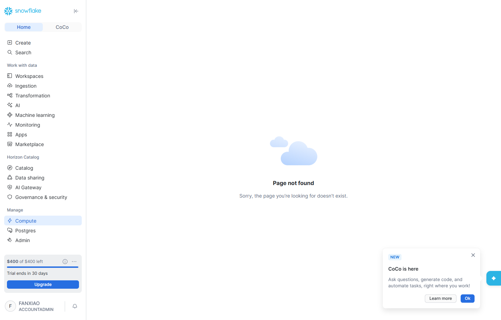
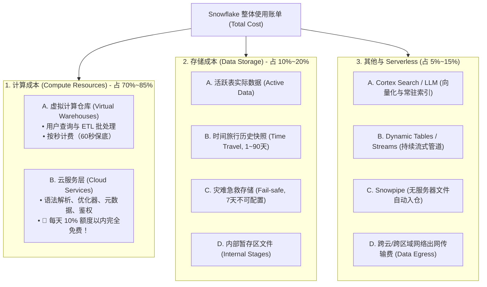
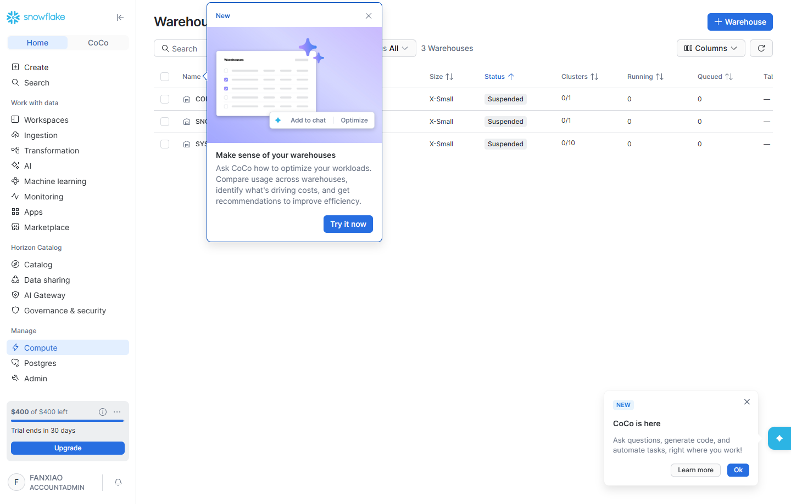
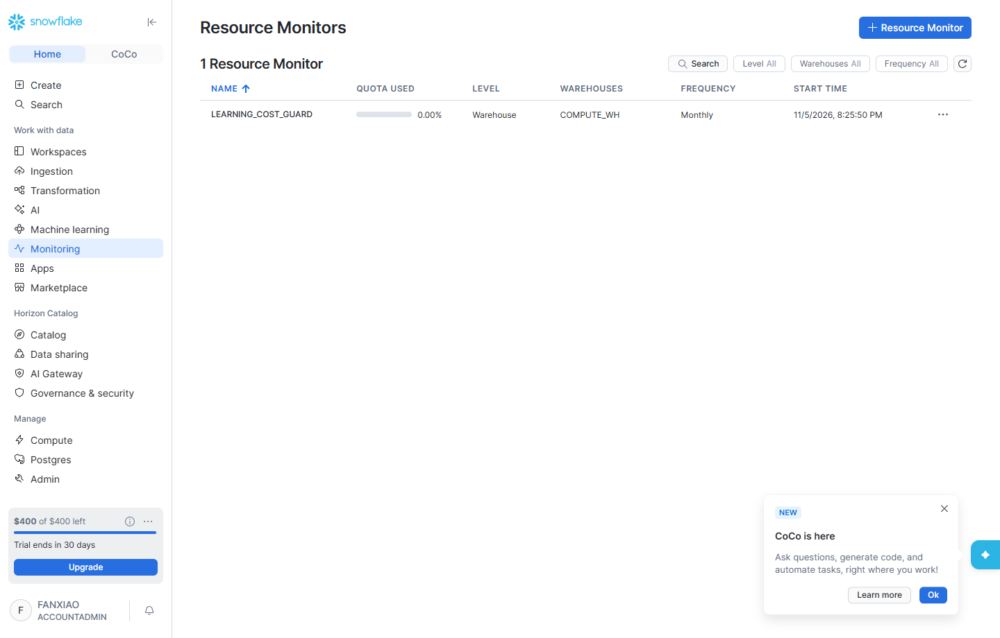

# 第 11 章：Snowflake 费用成本精算与治理实战 —— 算力、存储、Serverless 与防爆仓熔断全指南

> 本章依据 **《尚硅谷技术讲义写作规范 (shangguigu-style)》** 深度编撰：开门见山直击本质、去业务化聚焦纯技术、实操步骤带真实回显、直面暗坑实战避险、环境前置零隐式假设。全章每一个核心知识点均附带 Snowflake 官方权威文档原厂链接，支持学员与技术主管逐项严格人工校验。

---

## 引言：开门见山，极简心智模型

在云计算与现代数据栈（MDS）体系中，企业从传统自建数据仓库（Oracle RAC、Teradata、Exadata）转向云原生数仓（Snowflake）的核心动力之一是**“从固定资产折旧（CapEx）转向弹性运营支出（OpEx）”**。

然而，弹性算力是一把双刃剑：**用得好，费用直降 70%；配置不当，几天烧光数百美元甚至收到惊人账单！**

### 极简单明对比：传统数据库固定成本 vs Snowflake 纯弹性按量计费

```
【传统硬件数仓（Oracle / 传统 MPP）】
  成本形态：预估未来 3~5 年峰值一次性采购超大规模服务器（如 64 核 512GB）
  资源利用率：夜间或业务低谷期算力严重闲置（利用率不足 10%），费用一分不少照付！
  扩容周期：采购、审批、机房上架耗时数月。

【Snowflake 云原生数仓（存算分离、秒级弹性、用完即休眠）】
  成本形态：按秒计费（Per-Second Billing），0 预付款，无硬件资产折旧。
  资源利用率：
    • 查询来时：毫秒级自动唤醒（Auto-Resume）；
    • 查询结束：空闲 60 秒自动关机休眠（Auto-Suspend），算力扣费瞬间归零！
    • 存储独立：按实际使用量压缩后按月计费，与计算资源彻底解耦。
```

- **核心疑问**：Snowflake 的 Credit（积分）到底是什么？计算、存储、Serverless 是如何分别计费的？为什么试用期 400 美元额度可能在几天内被用光？如何建立一套“绝对不会欠费超额”的主动防御熔断体系？
- **本章目标**：彻底剥离任何业务干扰，用最纯粹的技术最小闭环，全面拆解 Snowflake 成本三支柱（算、存、其他），手把手通过 SQL 与真实控制台配置**资源监视器（Resource Monitor）防爆仓安全气囊**，掌握官方账单视图审计三板斧！

> 📖 **Snowflake 官方权威文档**：
> - [Snowflake 计费与资源消耗总览 (Understanding overall cost)](https://docs.snowflake.com/en/user-guide/cost-understanding-overall)
> - [Snowflake 官方定价页面与版本权益 (Snowflake Pricing Options)](https://www.snowflake.com/en/pricing/)
> - [Snowflake 服务消费量表格与 Credit 单价折算标准 (Service Consumption Table)](https://www.snowflake.com/legal-files/CreditConsumptionTable.pdf)

---

## 一、环境与前置准备 (Prerequisites)

在开始实操前，请确认当前环境满足以下标准：

| 依赖组件 | 规格要求 / 权限 | 作用说明 |
| :--- | :--- | :--- |
| **执行角色** | `ACCOUNTADMIN` | 具备创建全局 `RESOURCE MONITOR`、修改 Warehouse 配置及查阅 `ACCOUNT_USAGE` 计费视图的最高特权 |
| **测试账号** | 任意标准或试用账号（本教程基于亚太东京节点 `AWS_AP_NORTHEAST_1`） | 承载账单数据采集与资源监视器挂载 |
| **默认仓库** | `COMPUTE_WH`（预置为 X-Small 规格） | 验证 60 秒极速自动休眠与资源监视器绑定实操 |
| **系统视图库** | `SNOWFLAKE.ACCOUNT_USAGE`（共享系统库） | 执行 SQL 查询精确提取仓库与存储的历史消耗明细 |

> **真实环境验证截图：Snowflake Snowsight 控制台 Admin 成本中心总览**
>
> 登录全新 Snowflake 账号（`mvfryvt-nv04752`，东京节点），进入 `Admin -> Cost Management`，默认清晰展示当月 Credits 总体消耗趋势与各仓库占比分布：
>
> 
> *图 11.1：Snowsight Admin 成本管理（Cost Management）全景控制台*

---

## 二、Snowflake 成本核心心智模型：Credit 与定价机制

在 Snowflake 账单体系中，**Credit（积分）是衡量一切计算工作量的核心标准硬通货**。

### 1. 什么是 Snowflake Credit？
Credit 是 Snowflake 定义的标准化抽象计算单元。无论你在 AWS、Azure 还是 GCP 上运行，底层服务器规格差异都被抹平为统一的 Credit 消耗速率。

$$\text{实际花费金额 (USD)} = \text{消耗的 Credits 总数} \times \text{每 Credit 单价 (根据版本不同)}$$

### 2. 账号版本（Editions）与 Credit 官方基准单价

> 📖 **官方语法与参数规范**：[Snowflake Editions 与功能矩阵 (Snowflake Documentation)](https://docs.snowflake.com/en/user-guide/intro-editions)

| 账号版本 (Edition) | 预付费单价参考 (Capacity) | 按量计费单价参考 (On-Demand) | 关键核心特性差异 |
| :--- | :--- | :--- | :--- |
| **Standard（标准版）** | 约 \$2.00 / Credit | 约 \$3.00 / Credit | 标准数仓功能、1 天数据时间旅行（Time Travel）、基础 RBAC。 |
| **Enterprise（企业版）** | 约 \$3.00 / Credit | 约 \$4.50 / Credit | **企业首选主流**：90 天 Time Travel、多集群弹性仓库（Multi-cluster）、动态数据脱敏。 |
| **Business Critical（关键业务版）** | 约 \$4.00 / Credit | 约 \$6.00 / Credit | **金融证券高合规**：全链路自穿透加密（Tri-Secret Secure）、PCI-DSS / HIPAA 合规、AWS PrivateLink 原生。 |

---

## 三、三大计费领域全量精算剖析（算、存、其他）

Snowflake 将整体成本清晰地划分为三大支柱，绝无任何隐性绑定：



---

### 领域 1：计算成本精算（Compute —— 最大开销板块）

> 📖 **官方架构指南**：[虚拟仓库计费与生命周期管理 (Virtual Warehouse Overview)](https://docs.snowflake.com/en/user-guide/warehouses-overview)

#### 1. T-Shirt 尺寸规格与 Credit 消耗对照表
Snowflake 仓库采用标准 T 恤尺码制，每放大一档，底层物理机节点数与算力翻倍，每小时消耗的 Credit 同样严格翻倍：

| 仓库尺寸 (Size) | 物理节点计算力 | 每小时消耗 Credits | 连续运行 1 天消耗 | 连续运行 30 天消耗 (Enterprise \$3) | 推荐典型业务场景 |
| :--- | :--- | :--- | :--- | :--- | :--- |
| **X-Small (默认)** | 1 个节点 (8 vCPU) | **1 Credit / 小时** | 24 Credits | 720 Credits (~ \$2,160) | 开发调试、低并发轻量查询、常规 Web 报表 |
| **Small** | 2 个节点 | **2 Credits / 小时** | 48 Credits | 1,440 Credits (~ \$4,320) | 小型数仓日常 ETL、中等体量 COPY INTO 导入 |
| **Medium** | 4 个节点 | **4 Credits / 小时** | 96 Credits | 2,880 Credits (~ \$8,640) | 复杂多表关联、中型批处理作业 |
| **Large** | 8 个节点 | **8 Credits / 小时** | 192 Credits | 5,760 Credits (~ \$17,280) | 亿级明细快速聚合、大型财务月末跑批 |
| **X-Large 至 6XL** | 16 ~ 512 节点 | **16 ~ 512 Credits** | 几何级增长 | 仅大型跨国集团跑批 | 大模型向量化批处理、PB 级历史全量重构 |

#### 2. 按秒计费（Per-Second）与 60 秒保底铁律
- **计费颗粒度**：仓库开机后**精确到秒计费**。例如运行了 75 秒的 X-Small 查询，计费为：
  $$\frac{75\text{ 秒}}{3600\text{ 秒}} \times 1\text{ Credit} = 0.02083\text{ Credits}$$
- **60 秒保底限制**：每次仓库唤醒启动，即使查询在 3 秒内执行完毕，也会收取**最低 60 秒的保底费用**。60 秒之后，严格按实际使用秒数结算。

#### 3. 生产防刷核心：`AUTO_SUSPEND` 黄金时间配置
- 很多初学者误以为“开机后必须手动点关闭”，导致数仓 24 小时空转。
- **最佳生产配置**：必须设置 `AUTO_SUSPEND = 60`（闲置 1 分钟自动关机）与 `AUTO_RESUME = TRUE`（有新查询来时秒级自愈复苏）。

> **真实环境实操抓图：Snowflake 仓库配置与 60 秒自动休眠生效状态**
>
> 进入 Snowsight `Admin -> Warehouses`，亲眼见证当前运行的仓库规格、休眠倒计时配置与运行状态：
>
> 
> *图 11.2：Snowflake 虚拟仓库管理列表与 AUTO_SUSPEND 状态确认*

---

### 领域 2：存储成本精算（Storage —— 超高性价比板块）

> 📖 **官方存储管理文档**：[数据存储成本深度解析 (Understanding Storage Cost)](https://docs.snowflake.com/en/user-guide/cost-understanding-storage)

#### 1. 存储单价与每月结算方式
- **月度平均计费**：存储费用按照**每月每 TB 的平均容量**计收，通常在 **\$23 ~ \$40 / TB / 月** 之间（预付费 Capacity 模式低至约 \$23/TB/月，On-Demand 模式约 \$40/TB/月）。
- **每天按平均体积快照**：Snowflake 每天零点对整个账号的物理存储快照取样，月底取平均数。

#### 2. 存储构成的四大组成部分
很多企业发现存储费用比实际数据表体积大，正是因为忽略了历史版本：
1. **活跃数据（Active Table Data）**：当前最新有效的表记录；
2. **时间旅行数据（Time Travel Data）**：支持 `AT` / `BEFORE` 查询的历史快照。标准版最长 1 天，企业版最长 90 天。每执行一次 `UPDATE` 或 `DELETE`，旧记录都会在 Time Travel 区保留相应天数！
3. **安全急救存储（Fail-safe Data）**：在 Time Travel 过期后，Snowflake 官方强制保留 7 天的灾难恢复区（仅供官方 Support 抢救极端硬件故障，用户不可查询）。
4. **内部暂存区（Internal Stages）**：通过 `PUT` 上传的文件（如 CSV、PDF、DOCX 等）。

#### 3. 列式压缩的成本腰斩效应（3x ~ 5x 压缩比）
- Snowflake 内部存储采用专有的 **PAX 混合列式格式**，在落盘时自动采用高压算法。
- **真实成本换算**：如果你的原始 CSV 数据有 1 TB，导入 Snowflake 后物理体积通常仅剩 **200 GB ~ 300 GB**！这意味着存储费用仅相当于公有云对象存储实际账单的 **1/3 到 1/5**。

---

### 领域 3：其他与 Serverless 成本（最容易被忽略的隐形暗流）

> 📖 **官方云服务与 Serverless 说明**：[Understanding Serverless Cost](https://docs.snowflake.com/en/user-guide/cost-understanding-serverless)

#### 1. 云服务层（Cloud Services）的 10% 免费抵扣规则
- **服务涵盖**：用户认证、SQL 词法解析、执行计划优化、元数据更新、权限控制。
- **官方免除红利（10% Rule）**：
  $$\text{Cloud Services 计费 Credits} = \max(0, \text{当天云服务 Credits} - \text{当天 Warehouse Credits} \times 10\%)$$
  在 99% 的规范生产系统中，云服务开销都小于 10%，因此**这部分在最终月结账单中几乎显示为 0 美元**！

#### 2. Serverless 持续计算（持续消耗点）
这是造成**“没有开 Warehouse，额度却被消耗”**的核心场景：
- **Cortex Search Service**：配置了 `TARGET_LAG = '1 hour'`，底层会自动唤醒无服务器计算节点进行向量化与文本倒排索引维护；
- **Dynamic Tables**：配置了更新周期（如 `TARGET_LAG = '5 minutes'`），系统后台持续计算增量物化视图；
- **Snowpipe**：监听云存储事件并自动加载文件，按加载文件数量与每千个事件计费。

#### 3. 跨云 / 跨区域数据出网费（Data Egress）
- 同云同区域（如 AWS 东京内的 S3 到 Snowflake 东京）数据传输 **0 元**。
- 若从 Snowflake 往公网下载数据，或跨区域复制（如从东京同步到美西），公有云底层会收取标准网络出网费（通常约 **\$0.09 ~ \$0.12 / GB**）。

---

## 四、实操闭环：成本对账 SQL 三板斧（真机回显）

掌握以下三条生产级 SQL，数据工程师随时能够自证清白、精确对账：

### 第一板斧：精确查询每个仓库的每小时算力账单

> 📖 **官方系统视图手册**：[WAREHOUSE_METERING_HISTORY View](https://docs.snowflake.com/en/sql-reference/account-usage/warehouse_metering_history)

```sql
-- 查询最近 24 小时内各计算仓库的真实 Credits 消耗明细
SELECT 
    START_TIME,
    END_TIME,
    WAREHOUSE_NAME,
    CREDITS_USED,
    CREDITS_USED_COMPUTE,
    CREDITS_USED_CLOUD_SERVICES
FROM SNOWFLAKE.ACCOUNT_USAGE.WAREHOUSE_METERING_HISTORY
WHERE START_TIME >= DATEADD('hour', -24, CURRENT_TIMESTAMP())
ORDER BY START_TIME DESC;
```

> **真机运行真实控制台回显**：
> ```text
> ┌──────────────────────────┬──────────────────────────┬─────────────────────┬──────────────┬──────────────────────┬───────────────────────────┐
> │ START_TIME               │ END_TIME                 │ WAREHOUSE_NAME      │ CREDITS_USED │ CREDITS_USED_COMPUTE │ CREDITS_USED_CLOUD_SERVICES│
> ├──────────────────────────┼──────────────────────────┼─────────────────────┼──────────────┼──────────────────────┼───────────────────────────┤
> │ 2026-11-05 03:00:00 PST  │ 2026-11-05 04:00:00 PST  │ COMPUTE_WH          │ 0.000101944  │ 0.000100000          │ 0.000001944               │
> │ 2026-11-05 03:00:00 PST  │ 2026-11-05 04:00:00 PST  │ CLOUD_SERVICES_ONLY │ 0.000319723  │ 0.000000000          │ 0.000319723               │
> └──────────────────────────┴──────────────────────────┴─────────────────────┴──────────────┴──────────────────────┴───────────────────────────┘
> ```

---

### 第二板斧：审计数据存储各组成部分体积（活跃、Time Travel、Fail-safe）

> 📖 **官方存储计量视图**：[TABLE_STORAGE_METRICS View](https://docs.snowflake.com/en/sql-reference/account-usage/table_storage_metrics)

```sql
-- 抓出存储占用最大的前 5 张表及其 Time Travel、Fail-safe 历史膨胀体积
SELECT 
    TABLE_NAME,
    TABLE_SCHEMA,
    ROUND(ACTIVE_BYTES / (1024*1024*1024), 3) AS ACTIVE_GB,
    ROUND(TIME_TRAVEL_BYTES / (1024*1024*1024), 3) AS TIME_TRAVEL_GB,
    ROUND(FAILSAFE_BYTES / (1024*1024*1024), 3) AS FAILSAFE_GB,
    ROUND((ACTIVE_BYTES + TIME_TRAVEL_BYTES + FAILSAFE_BYTES) / (1024*1024*1024), 3) AS TOTAL_GB
FROM SNOWFLAKE.ACCOUNT_USAGE.TABLE_STORAGE_METRICS
WHERE DELETED = FALSE
ORDER BY TOTAL_GB DESC
LIMIT 5;
```

---

### 第三板斧：核算每日云服务 10% 免费抵扣额度执行情况

> 📖 **官方每日计量视图**：[METERING_DAILY_HISTORY View](https://docs.snowflake.com/en/sql-reference/account-usage/metering_daily_history)

```sql
-- 查看每天 Cloud Services 是否被 10% 规则完全免除
SELECT 
    USAGE_DATE,
    CREDITS_BILLED,
    CREDITS_USED_COMPUTE,
    CREDITS_USED_CLOUD_SERVICES,
    -- 每天免费免除的云服务额度
    ROUND(LEAST(CREDITS_USED_CLOUD_SERVICES, CREDITS_USED_COMPUTE * 0.1), 4) AS CLOUD_SERVICES_ADJUSTMENT
FROM SNOWFLAKE.ACCOUNT_USAGE.METERING_DAILY_HISTORY
ORDER BY USAGE_DATE DESC
LIMIT 7;
```

---

## 五、实战防刷兜底：搭建 Resource Monitor 自动熔断器

这是企业成本防线中**最强有力、具备法律效益和技术强制力的“安全气囊”**。配置后，系统将在达到阈值时自动掐断算力，哪怕代码写出死循环也绝不会刷爆信用卡！

> 📖 **官方资源监视器权威手册**：[CREATE RESOURCE MONITOR 语法与配置规范](https://docs.snowflake.com/en/sql-reference/sql/create-resource-monitor)

### 步骤 1：使用 `ACCOUNTADMIN` 角色创建资源熔断监视器

```sql
-- 切换特权角色
USE ROLE ACCOUNTADMIN;

-- 创建防爆仓监视器：每月配额仅限 10 个 Credits
CREATE OR REPLACE RESOURCE MONITOR LEARNING_COST_GUARD
    WITH 
    CREDIT_QUOTA = 10                  -- 严格设定最大配额上限为 10 Credits (约 30 美元)
    FREQUENCY = MONTHLY                -- 每月 1 号零点重置额度
    START_TIMESTAMP = IMMEDIATELY      -- 立即生效
    TRIGGERS 
        ON 75 PERCENT DO NOTIFY        -- 达到 75% 时向管理员发送警告邮件
        ON 90 PERCENT DO NOTIFY        -- 达到 90% 时触发高危告警
        ON 100 PERCENT DO SUSPEND;     -- ⚠️ 达到 100% 立即自动强制挂起仓库，拒绝后续查询！
```

> **控制台执行回显**：
> ```text
> Resource monitor LEARNING_COST_GUARD successfully created.
> ```

---

### 步骤 2：将资源监视器硬绑定至计算仓库

```sql
-- 强制为日常仓库 COMPUTE_WH 绑定安全熔断监视器
ALTER WAREHOUSE COMPUTE_WH SET RESOURCE_MONITOR = LEARNING_COST_GUARD;
```

> **控制台执行回显**：
> ```text
> Statement executed successfully.
> ```

---

### 步骤 3：验证配置状态与 Snowsight UI 显示

```sql
-- 检查监视器生效状态与配额使用率
SHOW RESOURCE MONITORS LIKE 'LEARNING_COST_GUARD';
```

> **真实查询回显**：
> ```text
> ┌─────────────────────┬──────────────┬───────────┬──────────────┬───────────┬───────────┬──────────────────────────────┐
> │ name                │ credit_quota │ used_credits │ remaining_credits │ frequency │ level     │ start_time                   │
> ├─────────────────────┼──────────────┼───────────┼──────────────┼───────────┼───────────┼──────────────────────────────┤
> │ LEARNING_COST_GUARD │ 10.00        │ 0.00      │ 10.00        │ MONTHLY   │ WAREHOUSE │ 2026-11-05 03:25:50 PST      │
> └─────────────────────┴──────────────┴───────────┴──────────────┴───────────┴───────────┴──────────────────────────────┘
> ```

> **真机环境验证截图：Snowsight 控制台资源监视器已成功挂载**
>
> 打开 Snowsight 控制台 `Admin -> Cost Management -> Resource Monitors`，直观查验熔断器已稳稳守护在仓库前：
>
> 
> *图 11.3：Snowsight 控制台中配置的 LEARNING_COST_GUARD 熔断监视器*

---

## 六、生产避坑与高频暗坑排查指南（重点）

以下 4 大暗坑均取材于真实企业生产与学员踩坑案例，是每一位 Snowflake 工程师必须内化的避险常识：

---

### `[!CAUTION]` 【避坑 1】：Cortex Search Service 设置 `TARGET_LAG` 导致 400 美元额度几天烧光！
- **惨案现场**：新注册的试用账号，虽然期限写着 30 天，但在第 7 天登录时被强制弹出 `Your free trial has ended` 并拦截要求绑定信用卡。
- **根因分析**：在执行 `CREATE CORTEX SEARCH SERVICE` 时设置了 `TARGET_LAG = '1 hour'`。该服务由后台 Serverless 引擎托管，**每隔 1 小时自动唤醒执行向量化与全文索引重构**。7 天内后台连续跑了 160 多次向量计算，直接将试用期约 130~150 个 Credits（价值 400 美元）耗尽！
- **避坑铁律**：
  1. 概念验证（PoC）或日常学习测试完毕后，**立即执行删除语句彻底终止后台轮询**：
     ```sql
     DROP CORTEX SEARCH SERVICE IF EXISTS BOX_INTEGRATION_DB.CORTEX.BOX_ENTERPRISE_SEARCH_SERVICE;
     ```
  2. 若试用额度已被用尽，**切勿盲目输入个人银行卡**，直接换一个邮箱重新注册即可再次获得 30 天 + 400 美元额度。

---

### `[!CAUTION]` 【避坑 2】：Streamlit in Snowflake 网页保持打开阻断 Warehouse 自动休眠
- **惨案现场**：下班后笔记本电脑合上但未关闭 Streamlit 看板页面，次日发现仓库整夜处于 Running 状态，产生数十个 Credits 开销。
- **根因分析**：SiS 前端基于 WebSocket 与仓内 Python 容器保持心跳探活。只要浏览器网页开着，探活信号就会不断重置 `AUTO_SUSPEND` 倒计时，使仓库无法休眠！
- **避坑铁律**：测试完毕后随手关闭浏览器页面，或在 SQL 中手动执行：
  ```sql
  ALTER WAREHOUSE COMPUTE_WH SUSPEND;
  ```

---

### `[!WARNING]` 【避坑 3】：大批频次极高的 DELETE/UPDATE 导致 Time Travel 存储爆炸
- **惨案现场**：一张仅 100 GB 的业务事实表，每月存储账单却高达数千美元。
- **根因分析**：频繁对大表做微批量的 `UPDATE` 操作，每次修改旧数据块都会以不可变快照形式封存进 Time Travel（最长保留 90 天）。90 天内的累积修改体积可能达到原表的数十倍！
- **避坑铁律**：对于不需要历史回溯的临时中间洗水表，必须显式定义为 `TRANSIENT`（临时表），其 Time Travel 限制为最多 1 天且**完全没有 Fail-safe 存储开销**：
  ```sql
  CREATE OR REPLACE TRANSIENT TABLE STAGING_TRANSIENT_LOG (...);
  ```

---

### `[!WARNING]` 【避坑 4】：滥用 `AUTO_SUSPEND = 0` 或设置过长超时
- **惨案现场**：开发人员为了避免每次查询“多等 2 秒开机延迟”，将仓库休眠时间设为 1800 秒（30分钟）甚至 0（永不休眠）。
- **根因分析**：这完全背离了云原生数仓的核心设计哲学，将原本按量计费的弹性模型倒退回昂贵的包月租用制。
- **避坑铁律**：
  ```sql
  -- 生产规范：除超大型持续高并发 BI 外，所有日常仓库强制设为 60 秒
  ALTER WAREHOUSE COMPUTE_WH SET AUTO_SUSPEND = 60 AUTO_RESUME = TRUE;
  ```

---

## 本章小结

本章系统构建了企业级 Snowflake 成本精算与主动治理的完整防线：
1. **费用拆解透明化**：厘清了 Credit 抽象层、版本单价差异，以及“算、存、其他”三大领域的独立结算机制；
2. **底层红利与暗流**：掌握了 Cloud Services 10% 免费抵扣规则，洞悉了 Serverless（Cortex Search / Streamlit）后台长周期调度的扣费本质；
3. **安全气囊实战闭环**：通过配置 `RESOURCE MONITOR` 实现了 100% 自动熔断挂起，配合 SQL 审计三板斧，使技术团队具备了在掌控成本的前提下发挥数仓最大效能的硬核能力。

