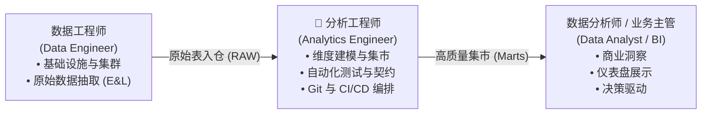
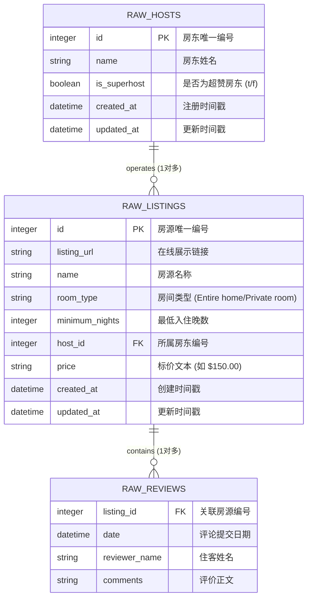

# 第 01 章：初识 dbt —— 现代数据栈的工程化革命与心智模型

> 本章依据 **《尚硅谷技术讲义写作规范 (shangguigu-style)》** 深度编撰：开门见山直击本质、去业务化聚焦纯技术、实操步骤带真实回显、直面暗坑实战避险、环境前置零隐式假设。本章知识体系全面紧扣全球权威实战体系（Complete dbt Bootcamp）与 dbt Analytics Engineering 官方认证考纲。

---

## 引言：开门见山，极简心智模型

在传统企业数据仓库（Oracle、Teradata、传统数仓）或早期的 Hadoop / Spark 数据湖建设中，数据处理流程通常遵循古老的 **ETL（Extract-Transform-Load）** 模式。随着以 **Snowflake** 为代表的云原生数仓（存算分离、秒级弹性、按量计费）崛起，现代数据架构全面进化为 **ELT（Extract-Load-Transform）**：
- **E & L（抽取与加载）**：由专门的工具（如 COPY INTO、Fivetran、Airbyte、Openflow）将原始数据原汁原味同步入仓；
- **T（转换与建模）**：**在数仓内部利用近乎无限的算力直接执行清洗、聚合与维度建模**。

然而，在仓内做“T”的过程中，绝大多数企业都迅速滑入了灾难性的**“SQL 脚本泥潭”**：

### 极简单明对比：传统 SQL 脚本泥潭 vs dbt 现代分析工程

```
【传统数仓 SQL 泥潭（脆弱、黑盒、手工维护）】
  • 脚本散落：数百个 .sql 脚本和存储过程散落在各个文件夹或调度器中；
  • 蝴蝶效应：上游改动一个字段，下游 3 个关键报表在生产中瞬间报错；
  • 人肉校验：缺乏自动化测试，连公司 CFO 都在用 Excel 手工核对报表异常；
  • 文档脱节：文档靠 Word 手写，写完之日即过时之时，没人理得清指标血缘。

【dbt 原生现代分析工程模式（软件工程化、声明式、全自动）】
  ┌─────────────────────────────────────────────────────────────────────────┐
  │ 开发者专注核心业务：只写标准 SELECT 查询 (Models)                        │
  └────────────────────────────────────┬────────────────────────────────────┘
                                       ▼ dbt 编译器自动化接管
  ┌─────────────────────────────────────────────────────────────────────────┐
  │ 1. 自动依赖解析：基于 &#123;&#123; ref() &#125;&#125; 自动构建 DAG 拓扑图，决定执行次序       │
  │ 2. 自动物化编排：自动在 Snowflake 仓内执行 CREATE TABLE/VIEW/MERGE     │
  │ 3. 质量门禁防御：自动运行 unique/not_null/unit_tests，异常即刻阻断      │
  │ 4. 活文档与血缘：代码即文档，自动提取元数据生成列级血缘图谱 (Lineage)     │
  └─────────────────────────────────────────────────────────────────────────┘
```

- **核心疑问**：什么是 dbt？为什么说“dbt 之于数据转换，就如同 Git 之于软件开发”？它如何让数据分析师蜕变为拥有软件工程武器库的分析工程师（Analytics Engineer）？
- **本章目标**：彻底告别杂乱的脚本修补，建立现代分析工程的顶级心智模型，掌握 dbt 核心四大支柱，并建立 Snowflake + dbt 的全套开发与认证通关全景图！

> 📖 **官方权威参考资源**：
> - [dbt 官方权威手册 (What is dbt?)](https://docs.getdbt.com/docs/introduction)
> - [实战课程官方源码库 (Complete dbt Bootcamp GitHub)](https://github.com/nordquant/complete-dbt-bootcamp-zero-to-hero)
> - [官方全套演示课件 (Presentation Slides - Google Slides)](https://docs.google.com/presentation/d/1ZFU-bPVnF7n1-5h9wWws5_FUHpGnM7ev0CS42IGwMwM/edit?usp=sharing)
> - [dbt Analytics Engineering 官方认证考纲](https://www.getdbt.com/certifications/analytics-engineer-certification-exam)

---

## 一、环境与前置准备 (Prerequisites)

在开启 dbt 现代分析工程实战之前，请确保当前开发环境满足以下基线要求：

| 依赖组件 | 规格要求 / 推荐版本 | 作用说明 |
| :--- | :--- | :--- |
| **云数仓底座** | Snowflake 任意标准/试用租户（如前置章节完成的东京节点） | 提供底层计算仓库（`COMPUTE_WH`）与数据存储底座 |
| **Python 运行时** | Python 3.10 ~ 3.12（推荐使用新一代极速工具 `uv` 或标准 `venv`） | 运行 `dbt-core` 与 `dbt-snowflake` 适配器驱动 |
| **版本控制** | Git 2.30+ | 践行软件工程代码管理、CI/CD 与多分支沙箱协作 |
| **开发编辑器** | VS Code 或 Cursor（推荐安装 `dbt Power User` 扩展） | 获得模型语法高亮、SQL 一键编译预览与血缘可视化交互 |

---

## 二、dbt 的本质：用软件工程重构数据转换

### 1. 什么是 Analytics Engineer（分析工程师）？
在过去，数据团队存在巨大的断层：
- **数据工程师（Data Engineer）**：专注于底层基础设施、分布式管道、Kafka 实时流和数仓底座搭建，但通常缺乏对最终财务、营销、业务指标的深度理解；
- **数据分析师（Data Analyst）**：最懂业务模型和指标，却通常缺乏软件工程素养（不会写单元测试、不清楚 Git 版本控制、习惯手写几千行临时 SQL）。

**dbt 催生并定义了一个全新黄金职业：Analytics Engineer（分析工程师）**。它赋予分析师像专业软件开发者一样的工程能力，让数据转换逻辑具备可测试、可维护、可追踪的高质量标准。



### 2. dbt 的核心理念：“只写 SELECT 语句”
在没有 dbt 之前，编写数仓转换往往需要充斥着冗长繁琐的 DDL 和事务逻辑：
```sql
-- 传统模式：充斥着样板代码与脆弱的 DDL
DROP TABLE IF EXISTS analytics.dim_customers;
CREATE TABLE analytics.dim_customers AS 
SELECT id, name, ... FROM raw.customers;
-- 还需要手动考虑索引、主键约束、异常回滚...
```

**而在 dbt 中，你只需要写纯粹的业务查询：**
```sql
-- dbt 模式：models/dim_customers.sql（没有任何样板代码）
SELECT 
    id AS customer_id,
    name AS customer_name,
    created_at
FROM &#123;&#123; ref('stg_customers') &#125;&#125;
```

dbt 会在编译阶段自动读取你的配置，将其包裹并翻译为 Snowflake 目标方言：
- 若物化为 View，自动生成 `CREATE OR REPLACE VIEW ... AS SELECT ...`；
- 若物化为 Table，自动生成高效的零停机影子表替换语法；
- 若物化为 Incremental，自动将其转换为基于 Snowflake 原生优化的 `MERGE INTO` 增量合并语句！

---

## 三、dbt 核心四大杀手锏体系解析

dbt 之所以能成为现代数据团队的事实标准，源自其不可替代的四大核心基石：

```mermaid
flowchart TD
    subgraph dbtCore["dbt 现代工程化四大支柱"]
        M["1. 模块化模型 (Models)<br/>• 纯 SELECT 声明式代码<br/>• &#123;&#123; ref() &#125;&#125; 动态依赖解耦<br/>• 自动物化 (View/Table/Incremental)"]
        T["2. 质量防御网 (Tests & Contracts)<br/>• 通用测试 (unique, not_null...)<br/>• 业务单元测试 (Unit Tests)<br/>• 架构契约 (Data Contracts)"]
        L["3. 全息血缘图谱 (DAG Lineage)<br/>• 自动拓扑推导依赖树<br/>• 列级血缘 (Column-Level Lineage)<br/>• 智能局部编译 (--select)"]
        D["4. 活文档门户 (Automated Docs)<br/>• 代码与文档一体化沉淀<br/>• 一键生成可交互 Web 门户<br/>• Exposures 下游仪表盘溯源"]
    end
```



### 1. 模块化模型（Models）与依赖解耦（`&#123;&#123; ref() &#125;&#125;`）
- **硬编码的危害**：传统 SQL 中手写 `FROM dev_db.raw_data.orders`，一旦发布到生产环境（`prod_db`），需要全部人肉查找替换，极易污染生产；
- **dbt 的解耦机制**：使用 `&#123;&#123; ref('stg_orders') &#125;&#125;` 或 `&#123;&#123; source('raw', 'orders') &#125;&#125;`。dbt 编译器在运行时根据当前目标环境（Target: `dev` 或 `prod`）自动解析为正确的库表路径。

### 2. 自动化质量防御网（Tests & Contracts）
- **Generic 测试门禁**：仅需在 YAML 文件中声明，dbt 自动在构建后执行断言：
  - `unique`：主键唯一性检查；
  - `not_null`：非空约束防漏；
  - `accepted_values`：枚举值合法性检验（如订单状态仅限 `PENDING`, `COMPLETED`）；
  - `relationships`：跨表外键引用完整性校验。
- **Unit Tests 单元测试**：针对复杂 SQL 转换逻辑，在本地通过 Mock 输入测试边界情况，未入数仓前即保证逻辑 100% 正确；
- **Data Contracts（数据契约）**：锁定字段名与数据类型，上游若发生不兼容破坏性变更（Breaking Change），编译时直接硬拦截！

### 3. 全息血缘图谱（DAG Lineage）
dbt 通过静态分析所有 SQL 中的 `&#123;&#123; ref() &#125;&#125;` 调用，自动构建全仓库的有向无环图（DAG）：
- 明确知道谁是上游输入、谁是下游依赖；
- **智能选择编译**：执行 `dbt run --select +dim_listings` 即可仅运行目标模型及其依赖的上游，杜绝全库无效重跑！

### 4. 自动生成全局文档（Docs）
运行一行 `dbt docs generate`，系统提取字段描述、数据类型、测试结果及血缘图，生成一个无需外部后端的独立静态 Web 网站，业务部门和分析师可以在页面中快速检索任意指标来源。

---

## 四、Snowflake + dbt：天作之合的现代数据栈底座

为什么在业界，**Snowflake 与 dbt 的搭配被称为“现代数据栈黄金组合（The Gold Standard）”**？

| Snowflake 原生特性 | dbt 工程化协同优势 | 生产级实战价值 |
| :--- | :--- | :--- |
| **存算分离 (Decoupled Compute & Storage)** | dbt 在本地执行多模型并行编译，触发 Snowflake 并发计算仓 | 复杂模型树编译时间缩减 80%，且存储与计算互不干扰 |
| **微秒级弹性休眠 (Auto-Suspend 60s)** | 批处理运行完即刻关机休眠，零空转计费 | 完美配合第 11 章成本治理，实现极致的按量经济性 |
| **零拷贝克隆 (Zero-Copy Clone)** | `CREATE DATABASE dev_sandbox CLONE prod_db` | 秒级复制 TB 级生产快照供 dbt 本地调试，**存储成本为 0** |
| **原生 MERGE 算子优化** | dbt `incremental` 增量策略原生调用 Snowflake 高性能 `MERGE` | 大表数千万数据增量摄取仅耗时数秒 |

---

## 五、实战背景：Airbnb 核心数据集矩阵预览

为了让整个专栏具备完全一致的工业级实战感，后续所有章节将统一以经典、开源且结构完备的 **Airbnb 真实民宿大数据集** 为主线：



### 数据流向分层架构：
1. **Raw 数据层（`AIRBNB.RAW`）**：从 S3 外部暂存区直接灌装的无清洗原始表；
2. **Staging 数据层（`AIRBNB.DEV.SRC_*`）**：字段重命名、脏数据清洗、字符串转数值（如处理货币符号 `$`）；
3. **Core / Marts 核心集市层（`DIM_*` / `FCT_*`）**：维度退化宽表、关联增量事实表、满月（Full Moon）业务关联洞察。

---

## 六、dbt 官方认证直通车 (Analytics Engineering Certification)

本专栏紧跟 dbt Labs 最新发布的 **dbt Analytics Engineer Certification（对齐 dbt 1.11 / 1.12+ 最新版本考纲）**，核心考点贯穿全书：

```
┌────────────────────────────────────────────────────────────────────────┐
│ dbt Certified Developer / Analytics Engineer 核心考纲模块分布          │
├────────────────────────────────────────────────────────────────────────┤
│ 1. 开发与模型设计 (Developing Models)                           [30%]   │
│    • Ref/Source 宏引用、表/视图/增量策略选型、Jinja 控制流与宏开发     │
│ 2. 数据质量与测试 (Testing & Data Quality)                     [25%]   │
│    • Generic/Singular 测试、Unit Tests 单元测试、Data Contracts 契约   │
│ 3. 部署与 CI/CD 优化 (Deployment & Optimization)                [25%]   │
│    • Slim CI 差异化构建 (--select state:modified+)、快照 (Snapshots)   │
│ 4. 文档、血缘与治理 (Documentation & Governance)                [20%]   │
│    • Column-level Lineage 列级血缘、Exposures 报表打通、版本生命周期   │
└────────────────────────────────────────────────────────────────────────┘
```

---

## 七、实战避坑与高频暗坑排查指南（重点）

---

### `[!CAUTION]` 【避坑 1】：切勿在 dbt 模型（.sql）中手写 `CREATE TABLE` 或 `INSERT INTO`！
- **新手误区**：从传统存储过程转入 dbt 的工程师，习惯在 `models/my_model.sql` 中开头写 `CREATE TABLE AS SELECT ...`。
- **惨痛后果**：dbt 编译时会自动将该文件包裹进自身的 DDL 中，最终向 Snowflake 发送 `CREATE TABLE AS CREATE TABLE AS SELECT ...`，引发语法致命崩溃！
- **避坑铁律**：**模型文件内只能包含纯净的 `SELECT` 语句！** 物化为表还是视图，统一在顶部配置块 `&#123;&#123; config(materialized='table') &#125;&#125;` 或全局 `dbt_project.yml` 中声明。

---

### `[!WARNING]` 【避坑 2】：切勿在 SQL 中硬编码数据库与 Schema 生产路径！
- **新手误区**：直接写 `FROM PROD_DB.PUBLIC.RAW_ORDERS`。
- **惨痛后果**：一旦开发者在本地执行 `dbt run`，将直接改写或查询生产库，丧失沙箱隔离保护，严重违反生产合规。
- **避坑铁律**：永远使用 `&#123;&#123; source('source_name', 'table_name') &#125;&#125;` 引用源表，永远使用 `&#123;&#123; ref('model_name') &#125;&#125;` 引用上游模型，环境切换完全交由 `profiles.yml` 动态分发。

---

### `[!NOTE]` 【避坑 3】：全面废弃旧版 PDF 资料，统一使用 Markdown 与官方 GitHub
- **背景说明**：旧版课程曾提供部分 PDF 资料，在学员复制 SQL 代码时，经常因 PDF 内部字符集编码问题将单引号 `'` 替换为特殊全角字符，导致编译无故报错。
- **解决标准**：本教程所有实操代码均直接从官方维护的 GitHub [`_course_resources/course-resources.md`](https://github.com/nordquant/complete-dbt-bootcamp-zero-to-hero) 抽取并校验，确保 100% 格式无污染。

---

通过本章，我们彻底确立了 dbt 的现代分析工程心智模型。在下一章中，我们将立即动手：在 Snowflake 中构建专属 `AIRBNB` 数据库环境，通过现代工具链 `uv` 搭建本地运行时，打通 Snowflake 与 dbt 的双向连通性测试！
