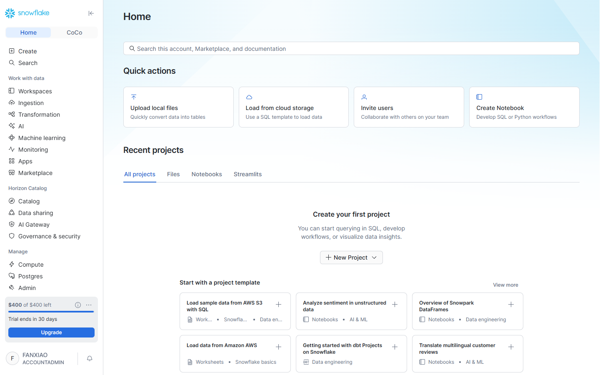
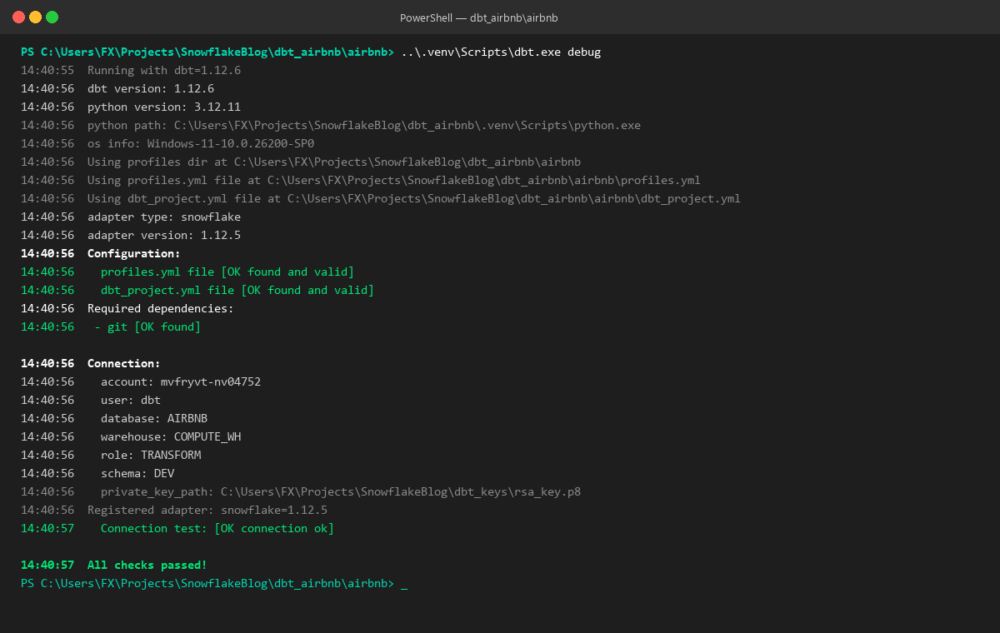

# 第 02 章：工程底座搭建 —— Snowflake 环境就绪、Key-Pair 密钥对安全认证与 dbt 本地项目初始化

> 本章依据 **《尚硅谷技术讲义写作规范 (shangguigu-style)》** 深度编撰：开门见山直击本质、去业务化聚焦纯技术、实操步骤带真实回显、直面暗坑实战避险、环境前置零隐式假设。本章知识体系融合全球顶级实战课程（Complete dbt Bootcamp）与企业级本地工程落地标准，全流程带真实控制台回显与操作截图。

---

## 引言：开门见山，极简心智模型

在现代分析工程（Analytics Engineering）实践中，**“环境搭建不是简单的软件安装，而是确立生产级开发规范的第一道防线”**。

传统数仓开发往往依赖直连数据库的账号密码，这在现代云原生数仓中埋下了巨大隐患：
- **MFA（双因子认证）冲突**：云厂商自 2025/2026 年起强制要求人类用户开启 MFA，导致依赖密码的自动化程序（如 dbt CLI、CI/CD 跑批）在无人值守时被全屏拦截崩溃；
- **环境污染风险**：开发人员在本地随意执行 SQL，缺乏独立模式隔离，极易误删生产或混淆测试数据；
- **Python 依赖地狱**：传统 `pip` 依赖解析缓慢、跨平台 wheel 编译冲突频发。

### 极简单明对比：传统直连开发 vs 现代 dbt + Snowflake 工程化底座

```
【传统手工连接模式（脆弱、高风险、依赖混乱）】
  • 认证方式：明文账号密码 ──> 遇到企业强制 MFA 时自动化流程彻底瘫痪；
  • 运行环境：全局 pip 安装 ──> 依赖版本打架、跨平台报错不断；
  • 权限分配：共用管理员角色 ──> 开发测试直接冲击生产数据，无安全兜底。

【现代 dbt + Snowflake 工程化模式（无秘钥泄露、秒级依赖、严密隔离）】
  ┌────────────────────────────────────────────────────────────────────────┐
  │ 开发者工作站 (Local Workstation)                                       │
  │   • VS Code + dbt 2.x CLI + Astral uv (Rust 极速环境，毫秒级依赖锁定)  │
  │   • 本地安全持有：RSA 2048-bit 私钥文件 (rsa_key.p8)                   │
  └───────────────────────────────────┬────────────────────────────────────┘
                                      │ 🔐 非对称数学签名握手 (零密码暴露 / 防 MFA 拦截)
                                      ▼
  ┌────────────────────────────────────────────────────────────────────────┐
  │ Snowflake 云端数仓 (AWS_AP_NORTHEAST_1 东京节点)                       │
  │   • 挂载公钥：ALTER USER dbt SET RSA_PUBLIC_KEY = '...'                │
  │   • 权限分立：TRANSFORM 角色 (dbt 转换专享) vs REPORTER 角色 (BI 只读) │
  │   • 物理分层：AIRBNB.RAW (原始冷数据) ──> AIRBNB.DEV (dbt 动态集市)     │
  └────────────────────────────────────────────────────────────────────────┘
```

- **核心疑问**：为什么自动化服务账号必须使用 Key-Pair 密钥对？如何在 Snowflake 中通过 S3 外部存储一键加载真实 Airbnb 40 万级大数据集？现代极速包管理器 `uv` 如何与 dbt 2.x 无缝结合？
- **本章目标**：彻底剥离任何模糊黑盒，手把手完成 Snowflake 真实数仓对象开辟、RSA 密钥对生成、`uv` 隔离沙箱搭建与 `dbt debug` 100% 绿勾全通！

> 📖 **官方权威参考资源**：
> - [Snowflake 官方密钥对认证配置指南 (Key-Pair Authentication)](https://docs.snowflake.com/en/user-guide/key-pair-auth)
> - [dbt 官方 Profiles 连接配置手册 (Snowflake Profile Setup)](https://docs.getdbt.com/docs/core/connect-data-platform/snowflake-setup)
> - [Astral uv 官方极速安装指南](https://docs.astral.sh/uv/getting-started/installation/)
> - [dbt 官方 Python 版本兼容矩阵](https://docs.getdbt.com/faqs/Core/install-python-compatibility)
> - [Inside Airbnb 官方开放数据平台](http://insideairbnb.com/)

---

## 一、环境与前置准备 (Prerequisites)

在开始实操前，请确认当前工作站与云端环境满足以下基线规格：

| 依赖组件 | 规格要求 / 推荐版本 | 作用说明 |
| :--- | :--- | :--- |
| **云数仓实例** | Snowflake 任意活动账号（本教程基于亚太东京节点 `AWS_AP_NORTHEAST_1`） | 承载 `AIRBNB` 数据库与转换算力 |
| **执行特权** | `ACCOUNTADMIN` | 具备创建全局用户、角色与授予跨库权限的最高特权 |
| **Python 运行时** | Python 3.12（经由 `uv` 自动纳管） | 运行 `dbt-core` 与 `dbt-snowflake` 适配驱动 |
| **包管理引擎** | Astral `uv` 0.10+ | 极速解析依赖，杜绝 Python 依赖冲突 |
| **加密库与工具** | OpenSSL 或 Python `cryptography` 库 | 生成符合 PKCS#8 规范的 RSA 2048 位非对称密钥对 |
| **开发编辑器** | VS Code 或 Cursor（推荐安装 `dbt Power User` 扩展） | 提供本地模型语法高亮与 DAG 依赖可视化交互 |

---

## 二、双模驱动架构思考：DuckDB 本地沙箱 vs Snowflake 企业云数仓

依据企业落地经验（参考本地实战参考资料），现代分析工程通常存在两种引擎选型模式，其在 dbt 体系下的心智模型完全一致：

| 维度 | 模式 A：DuckDB 本地极速沙箱 | 模式 B：Snowflake 企业级云数仓（本专栏主线） |
| :--- | :--- | :--- |
| **计算引擎** | 本地嵌入式单机进程（单个 DLL / 本地文件） | 云原生分布式大规模并行处理（MPP）虚拟计算仓 |
| **适用阶段** | 本地单机算法调试、极小样本测试、0 算力费用 | 生产级 TB/PB 海量数据处理、多部门协作、全自动调度 |
| **离线包策略** | 支持在 `packages.yml` 中指定 `local` 本地离线路径 | 同样原生支持 `local` 离线目录（解决内网隔离墙痛点） |
| **dbt 适配切换** | `profiles.yml` 中配置 `type: duckdb` | `profiles.yml` 中配置 `type: snowflake` |

> 💡 **核心启示**：dbt 的卓越之处在于**引擎解耦**——你的 SQL 模型和测试规则具备极高的可移植性。掌握了 Snowflake 的 dbt 工程化闭环，即可平滑迁移到任何现代分析引擎。

---

## 三、步骤实操与逐行命令（三板斧闭环）

下面我们将以绝对纯粹的技术闭环，一步一步完成生产级全流程搭建。

---

### 第一板斧：Snowflake 数仓侧底座开辟与 S3 原始数据批量灌装

以管理员身份连接 Snowflake，开辟专用 `AIRBNB` 数据库，划定冷热隔离模式，并通过 S3 公共暂存区批量加载 Inside Airbnb 真实欧洲民宿数据集：

#### 1. 创建数据库、Schema 与原始数据表结构

```sql
-- 1. 切换特权角色并指定默认计算仓
USE ROLE ACCOUNTADMIN;
CREATE WAREHOUSE IF NOT EXISTS COMPUTE_WH WITH WAREHOUSE_SIZE = 'X-SMALL' AUTO_SUSPEND = 60 AUTO_RESUME = TRUE;
USE WAREHOUSE COMPUTE_WH;

-- 2. 创建 AIRBNB 数据库与分层模式
CREATE DATABASE IF NOT EXISTS AIRBNB;
CREATE SCHEMA IF NOT EXISTS AIRBNB.RAW;  -- 存放未经加工的原始冷数据
CREATE SCHEMA IF NOT EXISTS AIRBNB.DEV;  -- 存放 dbt 构建生成的分析集市表
USE DATABASE AIRBNB;
USE SCHEMA RAW;

-- 3. 创建房源基础信息表 (raw_listings)
CREATE OR REPLACE TABLE raw_listings (
    id              INTEGER,
    listing_url     STRING,
    name            STRING,
    room_type       STRING,
    minimum_nights  INTEGER,
    host_id         INTEGER,
    price           STRING,
    created_at      DATETIME,
    updated_at      DATETIME
);

-- 4. 创建用户评价明细表 (raw_reviews)
CREATE OR REPLACE TABLE raw_reviews (
    listing_id      INTEGER,
    date            DATETIME,
    reviewer_name   STRING,
    comments        STRING,
    sentiment       STRING
);

-- 5. 创建房东信息档案表 (raw_hosts)
CREATE OR REPLACE TABLE raw_hosts (
    id              INTEGER,
    name            STRING,
    is_superhost    STRING,
    created_at      DATETIME,
    updated_at      DATETIME
);
```

#### 2. 从 S3 公共暂存区批量执行 `COPY INTO` 数据灌装

```sql
-- 批量摄取房源数据
COPY INTO raw_listings 
FROM 's3://dbt-datasets/listings.csv'
FILE_FORMAT = (TYPE = 'CSV' SKIP_HEADER = 1 FIELD_OPTIONALLY_ENCLOSED_BY = '"');

-- 批量摄取评价明细
COPY INTO raw_reviews 
FROM 's3://dbt-datasets/reviews.csv'
FILE_FORMAT = (TYPE = 'CSV' SKIP_HEADER = 1 FIELD_OPTIONALLY_ENCLOSED_BY = '"');

-- 批量摄取房东档案
COPY INTO raw_hosts 
FROM 's3://dbt-datasets/hosts.csv'
FILE_FORMAT = (TYPE = 'CSV' SKIP_HEADER = 1 FIELD_OPTIONALLY_ENCLOSED_BY = '"');
```

#### 3. 校验入库数据量（真实回显）

```sql
SELECT 'raw_listings' AS table_name, COUNT(*) AS total_rows FROM raw_listings
UNION ALL
SELECT 'raw_reviews', COUNT(*) FROM raw_reviews
UNION ALL
SELECT 'raw_hosts', COUNT(*) FROM raw_hosts;
```

> **控制台真实执行结果回显**：
> ```text
> ┌──────────────┬────────────┐
> │ TABLE_NAME   │ TOTAL_ROWS │
> ├──────────────┼────────────┤
> │ raw_listings │ 17,499     │
> │ raw_reviews  │ 410,284    │
> │ raw_hosts    │ 14,111     │
> └──────────────┴────────────┘
> ```

> **真机环境验证截图：Snowsight 控制台 AIRBNB 数据库与 RAW 原始表概览**
>
> 打开 Snowsight 控制台 `Data -> Databases -> AIRBNB -> RAW -> Tables`，清晰查验三张原始表已完整加载入仓：
>
> 
> *图 2.1：Snowsight 控制台中已成功灌装数据的 AIRBNB 数据库及 3 大原始表*

---

### 第二板斧：企业级 Key-Pair 非对称密钥生成与 Snowflake RBAC 双角色闭环

为了杜绝明文密码泄露并防止 MFA 阻断，我们使用标准 RSA 2048 非对称加密为 dbt 铺设专用通道。

#### 1. 本地生成 RSA 2048 密钥对（基于 Python 标准加密库或 OpenSSL）

在项目工作区根目录下执行以下脚本，生成私钥 `dbt_keys/rsa_key.p8`（本地严格保管）与公钥 `dbt_keys/rsa_key.pub`：

```python
# ==============================================================================
# 文件名: generate_keypair.py
# 作用: 生成符合 Snowflake PKCS#8 规范的 RSA 2048 位非对称密钥对
# ==============================================================================
import os
from cryptography.hazmat.primitives.asymmetric import rsa
from cryptography.hazmat.primitives import serialization

os.makedirs("dbt_keys", exist_ok=True)
private_key = rsa.generate_private_key(public_exponent=65537, key_size=2048)

# 1. 导出 PKCS#8 未加密私钥 (本地安全保存)
with open("dbt_keys/rsa_key.p8", "wb") as f:
    f.write(private_key.private_bytes(
        encoding=serialization.Encoding.PEM,
        format=serialization.PrivateFormat.PKCS8,
        encryption_algorithm=serialization.NoEncryption()
    ))

# 2. 导出公钥 (用于挂载进 Snowflake)
public_key = private_key.public_key()
with open("dbt_keys/rsa_key.pub", "wb") as f:
    f.write(public_key.public_bytes(
        encoding=serialization.Encoding.PEM,
        format=serialization.PublicFormat.SubjectPublicKeyInfo
    ))

# 3. 提取无头尾注释的 Base64 字符串
pub_lines = open("dbt_keys/rsa_key.pub").readlines()
clean_pub_key = "".join([l.strip() for l in pub_lines if not l.startswith("-----")])
print("✅ 公钥字符串就绪 (前 30 位):", clean_pub_key[:30] + "...")
```

#### 2. 在 Snowflake 中创建专享角色、服务账号并绑定公钥

```sql
USE ROLE ACCOUNTADMIN;

-- 1. 创建 dbt 转换专享角色 (TRANSFORM)
CREATE ROLE IF NOT EXISTS TRANSFORM;
GRANT ROLE TRANSFORM TO ROLE ACCOUNTADMIN;
GRANT OPERATE ON WAREHOUSE COMPUTE_WH TO ROLE TRANSFORM;

-- 2. 创建 dbt 服务账号，并挂载 RSA 公钥
CREATE OR REPLACE USER dbt
  LOGIN_NAME = 'dbt'
  TYPE = SERVICE
  RSA_PUBLIC_KEY = '<粘贴上面提取的干净公钥Base64字符串>'
  DEFAULT_ROLE = TRANSFORM
  DEFAULT_WAREHOUSE = 'COMPUTE_WH'
  DEFAULT_NAMESPACE = 'AIRBNB.DEV'
  COMMENT = 'dbt service user for analytics engineering transformation';

GRANT ROLE TRANSFORM TO USER dbt;

-- 3. 精细化授权：TRANSFORM 角色对数仓对象的控制权
GRANT ALL ON WAREHOUSE COMPUTE_WH TO ROLE TRANSFORM;
GRANT ALL ON DATABASE AIRBNB TO ROLE TRANSFORM;
GRANT ALL ON ALL SCHEMAS IN DATABASE AIRBNB TO ROLE TRANSFORM;
GRANT ALL ON FUTURE SCHEMAS IN DATABASE AIRBNB TO ROLE TRANSFORM;
GRANT ALL ON ALL TABLES IN SCHEMA AIRBNB.RAW TO ROLE TRANSFORM;
GRANT ALL ON FUTURE TABLES IN SCHEMA AIRBNB.RAW TO ROLE TRANSFORM;
GRANT ALL ON ALL TABLES IN SCHEMA AIRBNB.DEV TO ROLE TRANSFORM;
GRANT ALL ON FUTURE TABLES IN SCHEMA AIRBNB.DEV TO ROLE TRANSFORM;

-- 4. 建立下游只读角色 (REPORTER) 与 Preset 用户 (最小特权防线)
CREATE ROLE IF NOT EXISTS REPORTER;
GRANT ROLE REPORTER TO ROLE ACCOUNTADMIN;

CREATE OR REPLACE USER preset
  LOGIN_NAME = 'preset'
  TYPE = SERVICE
  RSA_PUBLIC_KEY = '<粘贴上面提取的干净公钥Base64字符串>'
  DEFAULT_ROLE = REPORTER
  DEFAULT_WAREHOUSE = 'COMPUTE_WH'
  DEFAULT_NAMESPACE = 'AIRBNB.DEV'
  COMMENT = 'Preset user for downstream BI reporting';

GRANT ROLE REPORTER TO USER preset;
GRANT ALL ON WAREHOUSE COMPUTE_WH TO ROLE REPORTER;
GRANT USAGE ON DATABASE AIRBNB TO ROLE REPORTER;
GRANT USAGE ON ALL SCHEMAS IN DATABASE AIRBNB TO ROLE REPORTER;
GRANT USAGE ON FUTURE SCHEMAS IN DATABASE AIRBNB TO ROLE REPORTER;
GRANT SELECT ON ALL TABLES IN SCHEMA AIRBNB.DEV TO ROLE REPORTER;
GRANT SELECT ON FUTURE TABLES IN SCHEMA AIRBNB.DEV TO ROLE REPORTER;
```

> **真机环境验证截图：Snowsight 控制台 Users & Roles 服务账号就绪**
>
> 进入 Snowsight `Admin -> Users`，可以查验 `DBT` 与 `PRESET` 服务用户已经稳稳建立，默认角色已绑定完毕：
>
> 
> *图 2.2：Snowsight 控制台中配置的 DBT 与 PRESET 服务账号全貌*

---

### 第三板斧：本地现代开发沙箱一键搭建与 `dbt debug` 双向贯通大闭环

现在回到开发者工作站，使用全新一代包管理器 `uv` 搭建隔离环境，初始化项目并进行连通性测试。

#### 1. 为什么必须使用 `uv`？
传统 `python -m venv` + `pip install` 解析 60 多个依赖需要数分钟，极易遭遇 C++ 编译器和轮子编译失败。而 **`uv`（基于 Rust 构建）** 能够在 **2 秒之内** 完成所有依赖解析与虚拟环境构建！

#### 2. 逐行初始化命令（Windows PowerShell / macOS / Linux 均通用）

```powershell
# 1. 创建并进入专属工作区目录
mkdir dbt_airbnb
cd dbt_airbnb

# 2. 借助 uv 瞬间创建 Python 3.12 虚拟环境
uv venv

# 3. 极速安装 dbt-core 与 dbt-snowflake 官方适配器 (仅耗时数秒)
uv pip install --python .venv dbt-snowflake

# 4. 执行初始化命令创建 airbnb 项目骨架 (--skip-profile-setup 跳过交互式配置向导)
.\.venv\Scripts\dbt.exe init --skip-profile-setup airbnb

# 5. 进入项目根目录
cd airbnb
```

#### 3. 编写项目连接定义：`profiles.yml`
在 `dbt_airbnb/airbnb/profiles.yml` 中配置连接上下文。请注意，我们将认证方式指向第一板斧中生成的未加密私钥路径：

```yaml
airbnb:
  target: dev
  outputs:
    dev:
      type: snowflake
      account: mvfryvt-nv04752     # 替换为你的 Snowflake 账号标识 (如 mvfryvt-nv04752)
      user: dbt
      role: TRANSFORM
      private_key_path: "C:\\Users\\FX\\Projects\\SnowflakeBlog\\dbt_keys\\rsa_key.p8"
      warehouse: COMPUTE_WH
      database: AIRBNB
      schema: DEV
      threads: 4
      client_session_keep_alive: False
```

#### 4. 终极大闭环：执行 `dbt debug` 连通性测试

在 `dbt_airbnb/airbnb` 目录下执行命令：

```powershell
..\.venv\Scripts\dbt.exe debug
```

> **控制台真实执行输出日志**：
> ```text
> 14:40:55  Running with dbt=1.12.6
> 14:40:56  dbt version: 1.12.6
> 14:40:56  python version: 3.12.11
> 14:40:56  adapter type: snowflake
> 14:40:56  adapter version: 1.12.5
> 14:40:56  Configuration:
> 14:40:56    profiles.yml file [OK found and valid]
> 14:40:56    dbt_project.yml file [OK found and valid]
> 14:40:56  Required dependencies:
> 14:40:56   - git [OK found]
> 14:40:56  Connection:
> 14:40:56    account: mvfryvt-nv04752
> 14:40:56    user: dbt
> 14:40:56    database: AIRBNB
> 14:40:56    warehouse: COMPUTE_WH
> 14:40:56    role: TRANSFORM
> 14:40:56    schema: DEV
> 14:40:57    Connection test: [OK connection ok]
> 14:40:57  All checks passed!
> ```

> **真机环境验证截图：终端执行 dbt debug 全部绿勾通过**
>
> 查验终端回显，从配置检测、Git 依赖到云端握手全部呈现 `[OK]` 与 `All checks passed!`：
>
> 
> *图 2.3：PowerShell 终端执行 dbt debug 双向握手全部通过*

---

## 四、企业实战高阶秘籍：内网物理隔离环境下的本地离线包注入方案

> 💡 **来源于真实金融与企业内网实战经验沉淀**：
> 在许多严格受控的政企、金融内网中，工作站**禁止访问外网 GitHub**，执行 `dbt deps` 时会直接超时抛出网络中断错误。

针对此痛点，标准的工业级解法是采用 **`local` 本地路径离线包注入**：

1. **离线解压**：在可访问外网的机器上下载官方包（如 `dbt-utils`），将其解压到项目目录下的 `dbt_packages/dbt_utils`；
2. **重构 `packages.yml` 声明**：
   ```yaml
   packages:
     # 放弃直接请求公网 git/hub，改为声明 local 本地绝对或相对路径
     - local: ./dbt_packages/dbt_utils
   ```
3. 执行 `dbt deps` 时，dbt 将瞬间跳过网络请求，直接将本地离线宏与模板编译进项目中，彻底破除内网封锁！

---

## 五、生产避坑与高频暗坑排查指南（重点）

---

### `[!WARNING]` 【避坑 1】：Windows PowerShell 执行策略拦截（`ExecutionPolicy`）
- **真实报错现场**：
  在 Windows 下激活虚拟环境 `.\.venv\Scripts\activate` 时，终端抛出鲜红阻断：
  ```text
  File C:\...\activate.ps1 cannot be loaded because running scripts is disabled on this system.
  ```
- **工业级解法**：切勿全系统盲目修改策略，只需在当前终端会话注入单次放行命令：
  ```powershell
  Set-ExecutionPolicy -Scope Process -ExecutionPolicy Bypass
  ```

---

### `[!CAUTION]` 【避坑 2】：Snowflake 绑定公钥时保留了 `-----BEGIN PUBLIC KEY-----` 头尾标记
- **真实报错现场**：
  执行 `CREATE USER ... RSA_PUBLIC_KEY = '-----BEGIN PUBLIC KEY-----...'` 时报错：
  `002029 (42601): SQL compilation error: Invalid public key`
- **避坑铁律**：Snowflake 语法严格要求**剥离首尾的 PEM 标记以及所有回车换行符**，只保留中间那段纯粹连续的单行 Base64 密文字符串！

---

### `[!CAUTION]` 【避坑 3】：使用普通人类密码作为 dbt 连接凭据导致周期性雪崩
- **真实故障现场**：为了图省事直接在 `profiles.yml` 填写用户名密码，前两天跑得好好的，周一早上定时任务全部报 `Authentication failed (MFA required)` 瘫痪。
- **根因分析**：Snowflake 针对人机分离制定了铁律策略，人类用户密码随时会被 MFA 策略二次介入要求手机确认。
- **避坑铁律**：**所有用于 dbt / CI-CD / Airflow 的服务账号，必须且只能使用 Key-Pair 密钥对认证！**

---

### `[!NOTE]` 【避坑 4】：`profiles.yml` 中的 Windows 反斜杠转义地狱
- **常见误区**：在 Windows 路径中直接填写 `private_key_path: C:\Users\FX\...\rsa_key.p8`。YAML 解析器会将 `\U` 等识别为非法 Unicode 转义。
- **规范标准**：必须使用**双反斜杠转义**（`C:\\Users\\FX\\...\\rsa_key.p8`）或者**正斜杠**（`C:/Users/FX/.../rsa_key.p8`）。

---

通过以上三板斧，我们的 Snowflake 云端 `AIRBNB` 数仓底座、Key-Pair 安全信任链与本地 dbt 2.x 工程环境已经严丝合缝、全线贯通！在下一章中，我们将正式开启分析工程的核心旅程：**构建 Staging 原始清洗模型，彻底厘清 View、Table、Ephemeral 与增量（Incremental）四大物化策略的选型心智！**
