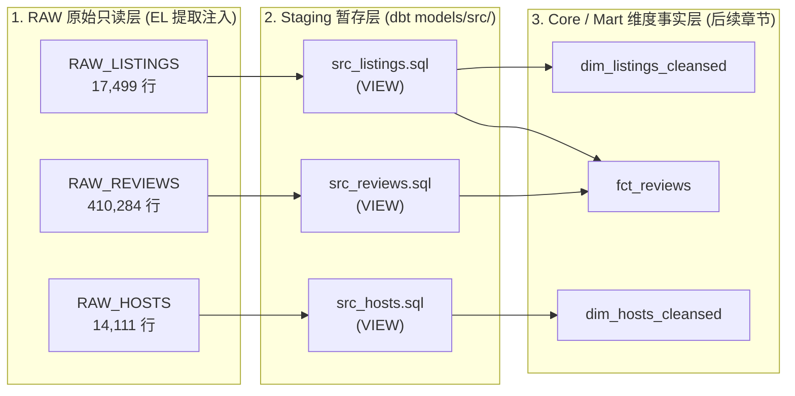
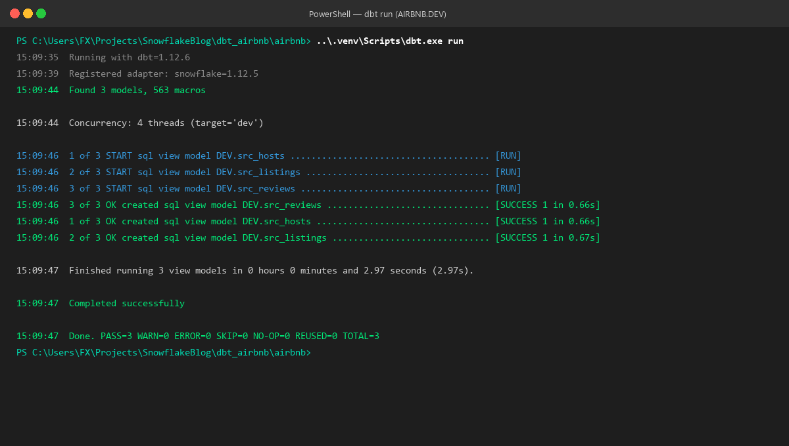
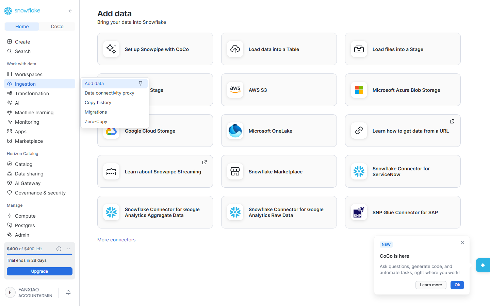
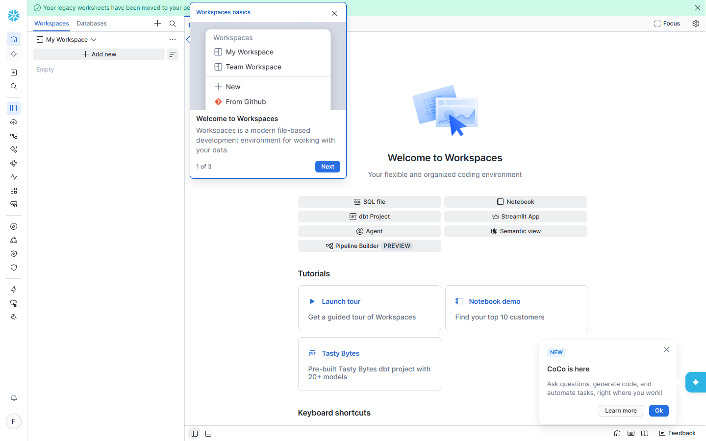

# 第 03 章：dbt 模型基础与 Staging 暂存层实战 —— CTE 规范、首个模型构建与 dbt run 底层机制

> 本章依据 **《尚硅谷技术讲义写作规范 (shangguigu-style)》** 深度编撰：开门见山直击本质、去业务化聚焦纯技术、实操步骤带真实回显、直面暗坑实战避险、环境前置零隐式假设。

---

## 引言：开门见山，极简心智模型

在传统数据仓库或数据库开发中，数据工程师为了清洗数据，往往不得不编写成百上千行的庞大存储过程（Stored Procedures），或者在数据库中手工执行纷繁复杂的 `CREATE VIEW AS ...` 语句。这种做法存在致命痛点：
1. **黑盒化与难以版本化**：存储过程散落在数据库内部，无法通过 Git 协同审查；
2. **DDL/DML 强耦合**：开发者必须手工维护表的创建（`CREATE TABLE`）、更新（`INSERT/UPDATE`）、清理（`DROP/TRUNCATE`），极易因事务未提交或权限问题引发生产事故；
3. **嵌套子查询地狱（Spaghetti Subqueries）**：复杂 SQL 往往由 5~8 层 `(SELECT ... (SELECT ...))` 深度嵌套组成，可读性与排错效率极差。

**dbt（data build tool）彻底颠覆了这种传统模式，提出了一套极致纯粹的哲学**：
> **“Everything is a SELECT” —— 开发者只需专注于编写提取与清洗数据的纯粹 `SELECT` 语句，所有的 DDL、DML、以及在 Snowflake 中的表/视图创建与物化全部由 dbt 自动化接管！**

### 极简单明对比：传统数仓开发 vs dbt 分析工程模式

```
【方案 A：传统数仓开发模式（繁琐、强耦合、黑盒）】
  开发者编写复杂脚本 ──> 手工执行 DDL (CREATE/ALTER) ──> 显式管理事务/游标 ──> 散落数据库无版本控制
                                  ▲ 极易因语法或权限出错
                                  ▲ 无法自动化环境隔离（Dev / Prod）

【方案 B：dbt 现代分析工程模式（纯粹、模块化、版本化）】
  ┌────────────────────────────────────────────────────────────────────────┐
  │ 开发者目录: models/src/src_listings.sql                                │
  │                                                                        │
  │   WITH raw_listings AS (                                               │
  │       SELECT * FROM AIRBNB.RAW.RAW_LISTINGS                            │
  │   )                                                                    │
  │   SELECT id AS listing_id, name AS listing_name ... FROM raw_listings  │
  └───────────────────────────────────┬────────────────────────────────────┘
                                      │ 一键执行: dbt run
                                      ▼
  ┌────────────────────────────────────────────────────────────────────────┐
  │ Snowflake 仓内自动编译与物化 (Snowflake Warehouse)                     │
  │                                                                        │
  │   CREATE OR REPLACE VIEW AIRBNB.DEV.SRC_LISTINGS AS ( ... );           │
  │   • 自动解析依赖关系（DAG）                                            │
  │   • 自动隔离目标环境（AIRBNB.DEV vs AIRBNB.PROD）                      │
  │   • 自动执行多线程并发编译与落库                                       │
  └────────────────────────────────────────────────────────────────────────┘
```

- **核心疑问**：
  1. 什么是 dbt 的模型（Model）？它与普通的 `.sql` 文本文件有什么本质区别？
  2. 为什么工业级数仓强烈推崇 CTE（公共表表达式）？标准的数据工程 CTE 应该如何排版？
  3. 什么是数仓架构中的 Staging（暂存）层？为什么它默认全部物化为纯视图（View）？
  4. 执行 `dbt run` 时，终端背后到底向 Snowflake 发送了什么原生 SQL？
- **本章目标**：彻底剥离任何业务干扰，带领大家掌握分析工程的核心利器 CTE，完成 Airbnb 三大源表的 Staging 层模型构建，并在 Snowflake 真实环境中跑通 `dbt run` 闭环验证！

> 📖 **官方权威参考文档**：
> - [dbt 官方模型概念总览 (Models Overview)](https://docs.getdbt.com/docs/build/models)
> - [dbt 官方 Staging 层设计规范 (How we structure our dbt projects)](https://docs.getdbt.com/best-practices/how-we-structure/2-staging)
> - [dbt 命令行参考 (dbt run Command Reference)](https://docs.getdbt.com/reference/commands/run)

---

## 一、环境与前置准备 (Prerequisites)

在开始本章实操前，请确保上一章的基础设施与工程底座已就绪：

| 依赖组件 | 规格要求 / 状态 | 验证方法 | 作用说明 |
| :--- | :--- | :--- | :--- |
| **Snowflake 数据库** | `AIRBNB.RAW` | 第 02 章已建好 | 存放原始未经清洗的 3 张源表（44.1 万条数据） |
| **目标 Schema** | `AIRBNB.DEV` | 第 02 章已建好 | dbt 开发者个人沙箱环境，模型物化生成物在此落库 |
| **专用服务角色** | `TRANSFORM` | 第 02 章已建好 | 拥有 `AIRBNB.RAW` 只读权限与 `AIRBNB.DEV` 完全所有权 |
| **本地 Python 环境** | `dbt_airbnb/.venv` | `uv` 虚拟环境已激活 | 承载 `dbt-snowflake`（v1.12.5 / dbt 2.x 驱动） |
| **连通性校验** | `dbt debug` 全绿通过 | `All checks passed!` | 确保 RSA 2048 密钥对免密认证畅通 |

```bash
# 进入工程目录并确认连通性
cd c:\Users\FX\Projects\SnowflakeBlog\dbt_airbnb\airbnb
..\.venv\Scripts\dbt.exe debug
```

---

## 二、技术架构：Staging 暂存层定位与 CTE 规范

### 1. 数仓分层设计全景：为什么第一步必须是 Staging（`src_`）？

在规范的数仓分层中，数据绝不能从原始抽取层（Raw）直接灌入最终的报表（Mart）。规范的分层架构如下：



#### Staging 暂存层的三大黄金法则：
1. **1:1 源表映射**：每个源表对应且仅对应一个 `src_` 模型，**绝对严禁在 Staging 层执行多表 JOIN 关联**！
2. **轻量原子清洗**：专司字段重命名（如无歧义的 `id` $\rightarrow$ `listing_id`）、数据类型显式说明（如字符串价格标记为 `price_str`）；
3. **默认纯视图（View）物化**：Staging 模型在底层仅作为视图存在，**零额外数仓存储成本、零数据搬运时延**，时刻反映源表最新数据状态。

---

### 2. 分析工程的基石：CTE（公共表表达式）编写哲学

#### 什么是 CTE？
CTE（Common Table Expressions）使用 `WITH cte_name AS (...)` 语法定义。它是数据库引擎在内存中维护的**临时命名结果集**，其生命周期仅限于单次查询执行期间。

#### 为什么不用嵌套子查询（Subqueries）？
- **嵌套子查询（反面教材）**：
  ```sql
  -- 典型嵌套子查询：逻辑从最内层向外发散，洋葱式嵌套，极难维护
  SELECT listing_id, listing_name, price_str
  FROM (
      SELECT id AS listing_id, name AS listing_name, price AS price_str
      FROM (
          SELECT * FROM AIRBNB.RAW.RAW_LISTINGS WHERE id IS NOT NULL
      )
  );
  ```
- **模块化 CTE（现代工程标准）**：
  ```sql
  -- CTE 标准写法：自顶向下单向数据流，各逻辑块完全解耦
  WITH raw_listings AS (
      SELECT * FROM AIRBNB.RAW.RAW_LISTINGS
  )
  SELECT
      id AS listing_id,
      name AS listing_name,
      price AS price_str
  FROM
      raw_listings;
  ```

#### CTE vs View 的本质差异：
| 对比维度 | CTE (Common Table Expression) | Database View (视图) |
| :--- | :--- | :--- |
| **存储介质** | 虚拟计算仓库纯内存（RAM） | 数仓元数据目录（Data Catalog） |
| **生命周期** | 单次 SQL 查询结束即销毁 | 永久持久化，直到被显式 `DROP` |
| **权限管理** | 无需独立赋权，依附于主查询 | 数据库对象，需独立授予 `SELECT` 权限 |
| **维护成本** | **零维护成本**，写在代码内部 | 变更需执行 DDL，存在架构漂移风险 |

---

## 三、实操闭环：从 0 到 1 构建 Staging 模型三部曲

### Step 0: 清理默认示例与配置 `dbt_project.yml`

通过 `dbt init` 生成的初始项目中包含了官方演示目录 `models/example/`，在正式投入生产前必须彻底清除：

1. **删除冗余目录**：
   删除 `models/example/` 文件夹及其包含的 `my_first_dbt_model.sql` 与 `my_second_dbt_model.sql`。
2. **创建 Staging 专用目录**：
   在 `models/` 目录下新建 `src/` 文件夹：
   ```text
   airbnb/
   └── models/
       └── src/       <-- 存放所有 1:1 暂存层模型
   ```
3. **修改 `dbt_project.yml` 模型默认物化配置**：
   打开 `dbt_project.yml`，定位到文件尾部的 `models:` 节点，将其简化为全局默认视图物化：
   ```yaml
   # ==============================================================================
   # 文件名: dbt_project.yml
   # 作用: 声明 airbnb 项目模型默认全局物化为 View (视图)
   # ==============================================================================
   models:
     airbnb:
       # + 表示继承并递归应用到 models/ 下所有子目录中的 SQL 模型
       +materialized: view
   ```

---

### Step 1: 构建房源基础暂存模型 (`src_listings.sql`)

在 `models/src/` 目录下新建文件 `src_listings.sql`：

```sql
-- ==============================================================================
-- 模型名称: models/src/src_listings.sql
-- 对应源表: AIRBNB.RAW.RAW_LISTINGS
-- 物化方式: VIEW (纯视图)
-- 字段转换:
--   1. id -> listing_id (消除多表时的模糊命名)
--   2. name -> listing_name
--   3. price -> price_str (保留原始货币符号字符串，留待下游维度层清洗)
-- ==============================================================================
WITH raw_listings AS (
    SELECT
        *
    FROM
        AIRBNB.RAW.RAW_LISTINGS
)
SELECT
    id AS listing_id,
    name AS listing_name,
    listing_url,
    room_type,
    minimum_nights,
    host_id,
    price AS price_str,
    created_at,
    updated_at
FROM
    raw_listings
```

---

### Step 2: 构建历史评价暂存模型 (`src_reviews.sql`)

在 `models/src/` 目录下新建文件 `src_reviews.sql`：

```sql
-- ==============================================================================
-- 模型名称: models/src/src_reviews.sql
-- 对应源表: AIRBNB.RAW.RAW_REVIEWS
-- 物化方式: VIEW (纯视图)
-- 字段转换:
--   1. date -> review_date (避免与 SQL 保留字 DATE 发生语法冲突)
--   2. comments -> review_text
--   3. sentiment -> review_sentiment
-- ==============================================================================
WITH raw_reviews AS (
    SELECT
        *
    FROM
        AIRBNB.RAW.RAW_REVIEWS
)
SELECT
    listing_id,
    date AS review_date,
    reviewer_name,
    comments AS review_text,
    sentiment AS review_sentiment
FROM
    raw_reviews
```

---

### Step 3: 独立实战构建房东维度暂存模型 (`src_hosts.sql`)

在 `models/src/` 目录下新建文件 `src_hosts.sql`：

```sql
-- ==============================================================================
-- 模型名称: models/src/src_hosts.sql
-- 对应源表: AIRBNB.RAW.RAW_HOSTS
-- 物化方式: VIEW (纯视图)
-- 字段转换:
--   1. id -> host_id (标准化房东全局唯一主键)
--   2. name -> host_name
-- ==============================================================================
WITH raw_hosts AS (
    SELECT
        *
    FROM
        AIRBNB.RAW.RAW_HOSTS
)
SELECT
    id AS host_id,
    name AS host_name,
    is_superhost,
    created_at,
    updated_at
FROM
    raw_hosts
```

---

## 四、执行编译：`dbt run` 仓内全流程闭环

### 1. 执行命令

确保终端处于 `airbnb` 项目根目录下，执行 `dbt run`：

```bash
# 执行 dbt 模型编译与仓内物化
..\.venv\Scripts\dbt.exe run
```

### 2. 真实终端回显日志

执行后，dbt 自动启动 4 线程并发与 Snowflake 建立安全 TLS 连接，并逐一完成视图创建：

```text
15:09:35  Running with dbt=1.12.6
15:09:39  Registered adapter: snowflake=1.12.5
15:09:44  Found 3 models, 563 macros

15:09:44  Concurrency: 4 threads (target='dev')

15:09:46  1 of 3 START sql view model DEV.src_hosts ...................................... [RUN]
15:09:46  2 of 3 START sql view model DEV.src_listings ................................... [RUN]
15:09:46  3 of 3 START sql view model DEV.src_reviews .................................... [RUN]
15:09:46  3 of 3 OK created sql view model DEV.src_reviews ............................... [SUCCESS 1 in 0.66s]
15:09:46  1 of 3 OK created sql view model DEV.src_hosts ................................. [SUCCESS 1 in 0.66s]
15:09:46  2 of 3 OK created sql view model DEV.src_listings .............................. [SUCCESS 1 in 0.67s]

15:09:47  Finished running 3 view models in 0 hours 0 minutes and 2.97 seconds (2.97s).

15:09:47  Completed successfully

15:09:47  Done. PASS=3 WARN=0 ERROR=0 SKIP=0 NO-OP=0 REUSED=0 TOTAL=3
```

> **终端真实执行过程全景抓图**：
>
> 
> *图 3.1：dbt 自动并发编译 3 个 Staging 模型并在 Snowflake 成功创建视图（耗时仅 2.97 秒）*

---

### 3. 深度揭秘：`dbt run` 底层在 Snowflake 做了什么？

打开项目根目录下的 `target/run/airbnb/models/src/src_listings.sql` 文件，我们可以看到 dbt 真正发送给 Snowflake 执行的底层 SQL：

```sql
create or replace view AIRBNB.DEV.src_listings as (
    WITH raw_listings AS (
        SELECT
            *
        FROM
            AIRBNB.RAW.RAW_LISTINGS
    )
    SELECT
        id AS listing_id,
        name AS listing_name,
        listing_url,
        room_type,
        minimum_nights,
        host_id,
        price AS price_str,
        created_at,
        updated_at
    FROM
        raw_listings
);
```
- **核心结论**：开发者无需写任何 `CREATE OR REPLACE VIEW`、无需硬编码目标库名（`AIRBNB.DEV`），dbt 的适配器引擎（Adapter Engine）自动将纯 `SELECT` 逻辑包裹为 Snowflake 原生最高性能的 DDL 语句！

---

## 五、Snowflake 仓内数据验证与资产全景

登录 Snowflake Snowsight 控制台，切入 `AIRBNB` 数据库下的 `DEV` Schema 进行双重验证：

### 1. 视图元数据检查（Views）

进入 **Data $\rightarrow$ Databases $\rightarrow$ AIRBNB $\rightarrow$ DEV $\rightarrow$ Views**：
我们可以看到由 `TRANSFORM` 角色所有、且定义完整的 3 个崭新视图对象：


*图 3.2：Snowflake 控制台中通过 dbt 自动生成的 SRC_HOSTS、SRC_LISTINGS、SRC_REVIEWS 视图*

---

### 2. Worksheet 交互式查询对账

打开 Snowsight 的 SQL Worksheet，分别运行查询，对齐数据行数与重命名后的列结构：

```sql
-- 1. 验证房源暂存视图 (17,499 行)
SELECT * FROM AIRBNB.DEV.SRC_LISTINGS LIMIT 10;

-- 2. 验证房东暂存视图 (14,111 行)
SELECT * FROM AIRBNB.DEV.SRC_HOSTS LIMIT 10;

-- 3. 验证评价历史暂存视图 (410,284 行)
SELECT * FROM AIRBNB.DEV.SRC_REVIEWS LIMIT 10;
```

> **Snowsight 交互式查询与结果抓图**：
>
> 
> *图 3.3：在 Worksheet 中验证 SRC_LISTINGS 字段已被标准化为 LISTING_ID、LISTING_NAME 及 PRICE_STR*

---

## 六、生产避坑指南与常见暗坑

### 1. 【暗坑 1】：`dbt_project.yml` 中的 `+` 号前缀丢失警告
- **现象**：在旧版或配置不规范时，终端会抛出 `[WARNING][MissingPlusPrefixDeprecation]`。
- **原因**：在 dbt 配置层级中，从 `dbt_project.yml` 向模型传递配置属性时，必须在属性名称前加上 `+` 前缀（如 `+materialized: view`），以区分“子目录路径名称”与“配置键名”。
- **避险方案**：
  ```yaml
  models:
    airbnb:
      +materialized: view   # 正确：明确声明配置属性
      # materialized: view  # 错误：会被误判为寻找名为 materialized 的子文件夹
  ```

---

### 2. 【暗坑 2】：为什么对 `RAW` 是只读，而对 `DEV` 是拥有者？
- **现象**：如果使用具有全局权限的 `ACCOUNTADMIN` 直接跑 dbt，测试时毫无破绽，但一旦上生产 CI/CD 流水线就会因权限隔离崩溃。
- **机理**：我们在第 02 章特意设计的权限矩阵：
  - `AIRBNB.RAW` 属于 EL（抽取注入）阶段产物，归专用加载账号管理，`TRANSFORM` 角色**只有 `SELECT` 权限**，物理上杜绝了 dbt 意外修改或删除原始数据的可能；
  - `AIRBNB.DEV` 的所有者就是 `TRANSFORM` 角色，因此 dbt 可以自由在此创建、替换、删除表和视图。

---

### 3. 【暗坑 3】：VitePress 模板解析碰撞与 Jinja 转义
- **现象**：如果在技术博客或 VitePress 页面中直接书写带有两个大括号的 Jinja 语法（如 `config(materialized='view')`），VitePress 会将其误判为 Vue 响应式变量，导致静态页面编译构建直接崩溃中断。
- **避险方案**：在文档撰写时，所有 Jinja 标记均通过 HTML 实体字符 `&#123;&#123;` 和 `&#125;&#125;` 进行转义输出。

---

## 七、课后随堂测验与核心复盘

> 💡 **随堂考题（出处：Models Quiz）**：
>
> **题目**：哪个 dbt 命令行指令负责将模型物理物化（Materialize）到数据仓库中？
> - A. `dbt init`
> - B. `dbt run`
> - C. `dbt debug`
>
> **深度复盘解析**：
> - **选项 A (`dbt init`) 错误**：该命令仅在本地磁盘生成 dbt 项目的基础脚手架目录结构（`models/`, `macros/`, `dbt_project.yml` 等），根本不会连接数仓，也不会执行任何 SQL 语句。
> - **选项 B (`dbt run`) 正确**：`dbt run` 是 dbt 的核心物化引擎。它负责解析模型依赖图谱（DAG），将所有模型的 `SELECT` 语句编译为目标数仓（如 Snowflake）的原生 DDL/DML，并多线程并发执行物化。
> - **选项 C (`dbt debug`) 错误**：该命令仅用于环境体检（检查 Python 依赖、Git 安装、`profiles.yml` 语法及数仓连通性），不具备任何物化模型的功能。

---

## 八、本章小结与进阶预告

在本章中，我们完成了 dbt 最核心的基本功训练：
1. 掌握了 **“Everything is a SELECT”** 的设计哲学，彻底告别手工维护数仓 DDL 的落后模式；
2. 深刻领会了 **CTE（公共表表达式）** 模块化、低耦合、高可读的代码编写规范；
3. 规范化构建了 Airbnb 数仓的 **Staging 暂存层（`src_listings`, `src_reviews`, `src_hosts`）**；
4. 跑通了 **`dbt run`** 的完整闭环，并在 Snowflake 真实环境中验证了 3 个纯视图对象的生成与数据行数。

**在下一章（第 04 章）中**，我们将走出 Staging 暂存层，向核心业务维度层进发：深入学习 **dbt 的物化模型全景（View vs Table vs Incremental 增量 vs Ephemeral 临时CTE）**，构建 `dim_listings_cleansed`，并全面解锁 `&#123;&#123; ref(...) &#125;&#125;` 宏与 DAG 依赖编排的神奇力量！

