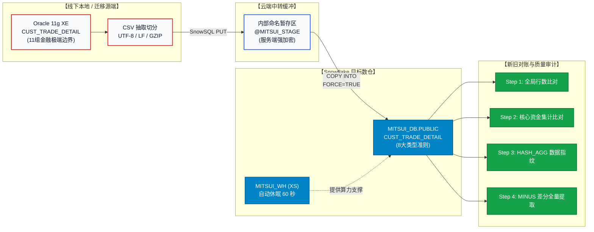

## 🚀 迁移工程端到端全景流 (End-to-End Migration Flow)

本项目以证券业务核心资产「客户交易明细数据（`CUST_TRADE_DETAIL`）」为真实载体，完整展现了金融生产级别的全流程迁移闭环：

---

## 📊 核心工程指标达成看板 (Key Project Metrics)

| 指标维度 | 达成标准 | 生产级落地手段与成果 |
| :--- | :---: | :--- |
| **数据绝对一致性** | **100% 零误差** | 通过 4 级对账矩阵（行数、核心金额、全量哈希指纹、双向全量差分差集提取），证实源与目标端 0 差异。 |
| **安全隔离合规** | **最小特权达成** | 收敛 ACCOUNTADMIN/SECURITYADMIN 权限，在 SYSADMIN 下派生 3 层金融职能角色，完成全自动化审计。 |
| **业务容灾与高可用** | **RPO=0 / 秒级复原** | 利用 Snowflake 原生 Time Travel（最大 90 天）与零拷贝克隆，0 额外存储成本达成秒级镜像备份与快照恢复。 |
| **字符集与类型健壮** | **零溢出 / 零乱码** | 解决 Oracle 字节语义 (BYTE) 往 Snowflake 字符语义 `VARCHAR(100)` 的安全过渡，杜绝全角日文/中文截断。 |
| **云上成本控制** | **月均仅需 ~$508** | 依托 60 秒自动休眠机制与微分区追加不可变特性，以极小 XS 算力支撑月度全量数据加工与异地容灾。 |

---

## 🗺️ 实战教程快速导航

### 【第一专栏】Snowflake 银行证券数仓迁移实战
1. [**00. 项目背景与顶层架构设计**](/zh/00_architecture_overview)  
   传统架构痛点、19 大核心受控对象、8 大数据类型推计准则、参数继承机制、高可用容灾与安全合规。
2. [**01. Snowflake 账号开通与基础设置**](/zh/01_snowflake_signup)  
   30 天免费试用环境申请、云平台（AWS/Azure）选定、首次控制台登录与初始配置。
3. [**02. Oracle 源端环境搭建与测试数据生成**](/zh/02_oracle_setup_and_data)  
   Docker 极速拉起 Oracle 11g XE、构建覆盖 11 组极端金融业务边界的测试数据集与数据提取脚本。
4. [**03. 3 层 RBAC 权限模型与环境初始化**](/zh/03_snowflake_rbac_setup)  
   落地 MITSUI_ADMIN / ENGINEER / ANALYST 三权分立设计，执行 Step 4.1~4.15 自动化授权脚本。
5. [**04. 数据迁移实务（抽取、阶段、装载）**](/zh/04_data_migration)  
   通过 SnowSQL 上传至内部命名暂存区、执行 `COPY INTO` 批量高性能数据导入并追踪加载日志。
6. [**05. 迁移后新旧数据严密对账与审计**](/zh/05_data_reconciliation)  
   编写并执行经受金融审计检验的 4 级对账 SQL 矩阵，出具 100% 吻合的对账验收报告。
7. [**06. 故障排查与最佳实践避坑指南**](/zh/06_troubleshooting_tips)  
   文字编码溢出根因、NUMBER 精度把控、业务日期字符化深度解析与查询画像优化。
8. [**07. Snowflake Openflow 接入 Box 与 Cortex 知识检索**](/zh/07_openflow_box_integration)  
   企业级云盘 Box 架构、OAuth 2.0 / JWT 认证、非结构化文档入库与 Cortex Search AI 问答。
9. [**08. Box API 实战指南 (8-1 〜 8-8)**](/zh/08_01_box_content_management)  
   涵盖 Content Management、Auth、Sharing、Metadata、AI、Workflows 等全量企业接口实操。
10. [**09. Snowflake 外部 API 调用全流程实战 (ENA)**](/zh/09_snowflake_external_api_access)  
    外部网络访问门禁、加密凭据 Secret、Python UDF 仓内直接调用 Box API 下载解析多格式文档。
11. [**10. Streamlit in Snowflake 数据可视化全流程实战**](/zh/10_snowflake_streamlit_visualization)  
    纯仓内 Python 原生交互式仪表盘、实时指标卡、动态交易流对账分析可视化。
12. [**11. Snowflake 费用成本精算与治理实战**](/zh/11_snowflake_cost_management)  
    资源监控器 Resource Monitor、计费原理解析与防欠费安全熔断体系建设。

---

### 【第二专栏】dbt 现代分析工程实战 (Analytics Engineering)
依托现代数据栈（Modern Data Stack, MDS）标准，全流程构建 Airbnb 数仓建模：
1. [**01. 初识 dbt 与现代数据栈**](/zh/dbt/01_what_is_dbt)  
   传统 ETL vs 现代 ELT、dbt 核心设计哲学、为什么分析工程必须走向 Code as Configuration。
2. [**02. 工程底座搭建与 Key-Pair 安全认证**](/zh/dbt/02_environment_setup_and_snowflake)  
   Snowflake Airbnb 数据库初始化、44.1 万条源数据入库、RSA 2048 密钥对服务账号认证、`uv` 极速虚拟环境配置。
3. [**03. 模型基础与 Staging 暂存层实战**](/zh/dbt/03_models_and_staging_layer)  
   “Everything is a SELECT”、CTE 模块化编写规范、Airbnb 三大源表 Staging 视图构建、`dbt run` 仓内物化全流程验证。

