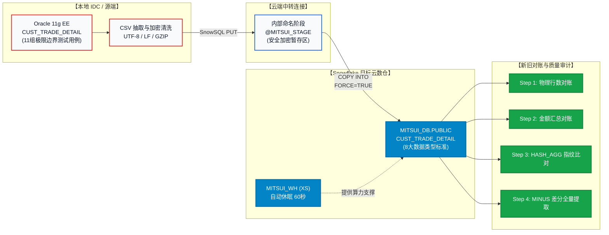

## 🚀 迁移工程端到端全景流 (End-to-End Migration Flow)

本项目以证券业务核心资产「客户交易明细数据（`CUST_TRADE_DETAIL`）」为真实载体，完整展现了金融生产级别的全流程迁移闭环：

---

## 📊 项目关键成果度量指标 (Key Project Metrics)

| 评价维度 | 交付验收标准 | 实施落地成果 |
| :--- | :---: | :--- |
| **数据一致性** | **100% 绝对吻合** | 经由 4 阶段对账矩阵（行数、指标聚合、HASH_AGG 校验、全量差集检索），达成 0 差异验收。 |
| **安全与权限隔离** | **最小特权原则 (PoLP)** | ACCOUNTADMIN/SECURITYADMIN 集中收归基盘团队，SYSADMIN 业务域内构建 3 层清晰角色树。 |
| **数据容灾与可靠性** | **RPO=0 / 秒级闪回** | Time Travel (最大 90 天) 与 Zero-copy Clone 强强联合，0 额外存储开销实现秒级快照容灾。 |
| **字符集与数据类型** | **0 截断 / 0 乱码** | 解决 Oracle BYTE 语义与 Snowflake 字符计数的冲突，确立 `VARCHAR(100)` 标准，消除日文字符溢出。 |
| **云上成本控制** | **月均仅需 ~$508** | 依托 60 秒自动休眠机制与微分区追加不可变特性，以极小 XS 算力支撑月度全量数据加工与异地容灾。 |

---

## 🗺️ 实战教程快速导航

遵循以下章节指引，即可亲手复现一整套生产级金融数据迁移项目：

1. [**00. 项目背景与顶层架构设计**](/zh/00_architecture_overview)  
   传统架构痛点、19 大核心受控对象、8 大数据类型推计准则、参数继承机制、高可用容灾与安全合规。
2. [**01. Snowflake 账号开通与基础设置**](/zh/01_snowflake_signup)  
   30 天免费试用环境申请、云平台（AWS/Azure）选定、首次控制台登录与初始配置。
3. [**02. Oracle 源端环境搭建与测试数据生成**](/zh/02_oracle_setup_and_data)  
   Docker 极速拉起 Oracle 11g XE、构建覆盖 11 组极端金融业务边界的测试数据集与数据提取脚本。
4. [**03. 3 层 RBAC 权限模型与环境初始化**](/zh/03_snowflake_rbac_setup)  
   落地 MITSUI_ADMIN / ENGINEER / ANALYST 三权分立设计，执行 Step 4.1~4.15 自动化授权脚本。
5. [**04. 数据迁移实务（抽取、阶段、装载）**](/zh/04_data_migration)  
   通过 SnowSQL 上传至内部命名暂存区、执行 `COPY INTO` 批量高性能数据导入并追踪加载日志。
6. [**05. 迁移后新旧数据严密对账与审计**](/zh/05_data_reconciliation)  
   编写并执行经受金融审计检验的 4 级对账 SQL 矩阵，出具 100% 吻合的对账验收报告。
7. [**06. 故障排查与最佳实践避坑指南**](/zh/06_troubleshooting_tips)  
   文字编码溢出根因、NUMBER 精度把控、业务日期字符化深度解析与查询画像优化。

